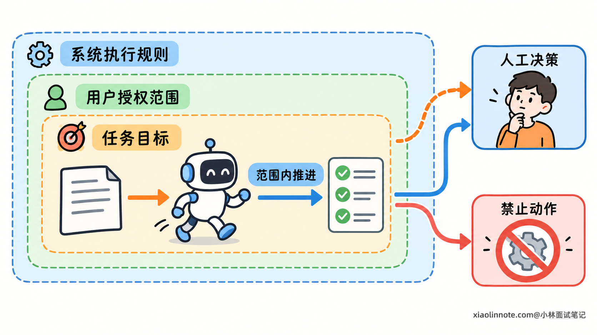
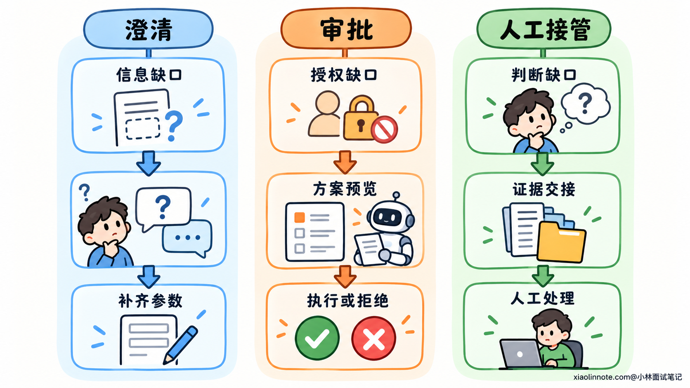
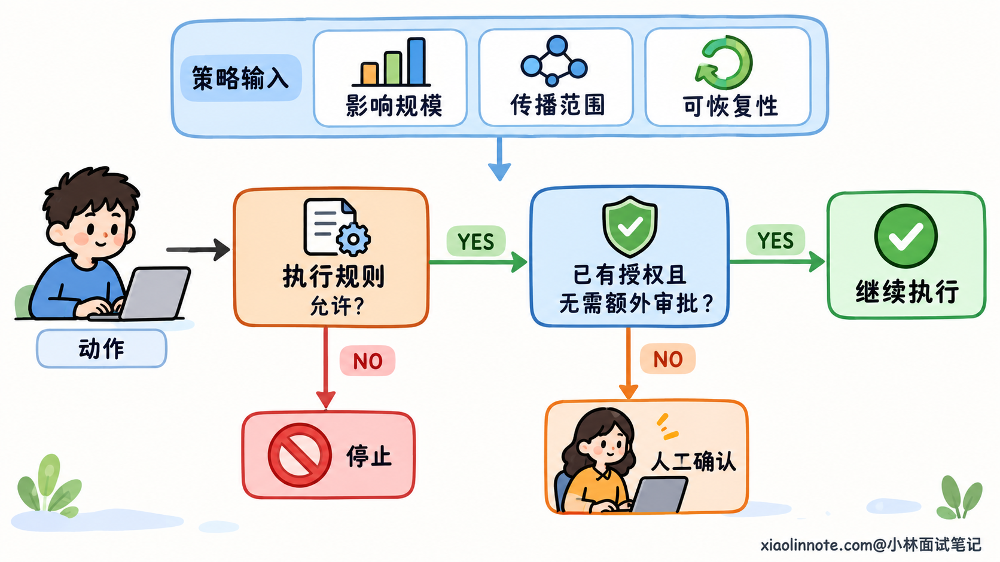
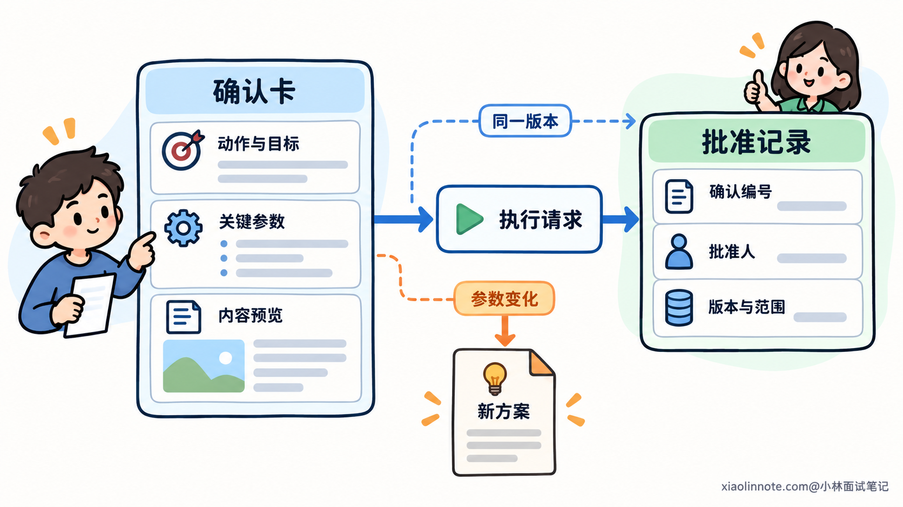
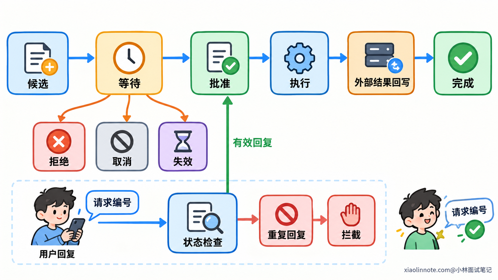
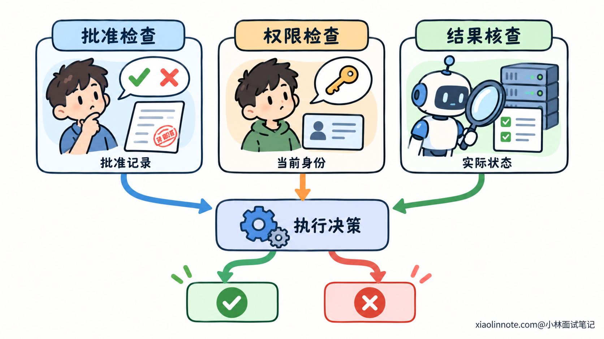

# Agent 应该在什么情况下请求人工确认？

> 原文：[Agent 应该在什么情况下请求人工确认？](https://xiaolinnote.com/ai/agent/28_human_confirmation.html) · 小林面试笔记


👔面试官：一个能够调用工具、执行实际操作的 Agent，应该什么时候请求人工确认？

🙋‍♂️我：每次调用工具都确认一下，用户同意以后再执行。

👔面试官：用户已经让它读取资料并整理报告，为什么每读一个文件还要问一次？这些确认增加了什么有效信息？

🙋‍♂️我：那就看模型的置信度，没把握才问，有把握就直接做。

👔面试官：模型很确定自己要发送邮件，也不能说明收件人选对了，更不能说明用户授权它发送。你怎么判断真正需要人的地方？

🙋‍♂️我：遇到高风险动作问一句「是否继续」，用户答应就能执行。

👔面试官：用户批准的是哪个对象、哪些参数？方案后来变了，原来的同意还有效吗？批准人没有资源权限又该怎么办？

咱们先把人工确认解决的问题分清楚，再看它应该怎样进入 Agent 的决策和执行过程。

## 💡 简要回答

我会先看这一步是不是在用户已经授权的范围内。目标和参数明确、操作也符合执行规则时，Agent 可以继续完成任务，不需要每次调用工具都重复确认。需要停下来问的，是关键对象或要求有歧义、准备执行的动作超出了原来的授权，或者业务规则要求人工审批的情况。

操作影响也要考虑进去。对外发送、删除唯一数据、扩大权限这类后果较大的动作，要把具体对象、内容和影响讲清楚，确认它们确实被授权。用户已经明确批准过同一项操作，而且方案和条件没有变化，就可以沿用这份批准，不能只因为又调用一次工具就重新问。

实现上，我会在真正执行前保存待确认方案，让用户批准、修改或者拒绝。批准要和具体任务、参数版本绑定，恢复时再核对方案与当前权限。用户说同意不等于有后端操作权限，也不能证明一次超时的操作没有发生。结果未知时先查实际状态，确实需要人的判断再升级处理，不能让一句「继续」代替事实核查。

## 📝 详细解析

### 自主执行与人工确认，怎样划分控制权？

用户把任务交给 Agent，是希望它在目标范围内自己安排步骤。读取材料、比较结果、选择工具，这些日常决策如果全部交回用户，任务就难以自主推进。

但一项任务通常也有边界。目标规定要完成什么，授权规定可以采取哪些操作，执行规则规定当前身份和环境允许做什么。

Agent 可以在这些边界内作出选择。需要改变目标、扩大操作范围，或者决定一个用户尚未明确的关键参数时，控制权就要交还给人。

比如「整理一份报告」通常包含读取指定资料、生成草稿等必要步骤，但不当然包含把草稿公开发布。发布改变了结果的传播范围，不能因为它有助于展示工作成果，就自行推导出这项授权。

人工确认的作用，就是在这种决策边界处暂停，让有权决定的人补充信息、批准方案或接手处理。它可以出现在工具执行前，也可以出现在计划选择、结果审核等环节，并不只是一种工具调用弹窗。

如果确认只增加一句重复的同意，没有提供新的信息，也没有核对新的影响，就没有补上决策缺口。设计确认机制时，需要明确这次究竟要让人决定什么。



### 澄清、审批和人工接管，解决的是不同问题

日常表达里，这几种交互都可能叫「找人确认」，但它们需要的输入和后续处理不同。

**澄清解决的是信息不完整或含义不明确。** Agent 还不知道用户指哪个对象、采用什么标准，无法形成可靠方案。此时需要询问具体缺项，回答会成为后续任务的参数或约束。

例如「清理旧文件」里的「旧」，可能指修改时间早，也可能指已经废弃。两种含义会得到不同清单。应该先让用户说明依据，而不是让他批准一份尚未确定的删除方案。

**审批解决的是方案已经明确，但执行还需要授权。** 它需要展示将执行的动作，让用户或其他有权审批的人判断能否实施。批准不会改变动作内容，修改则会产生新的方案，拒绝会阻止这项动作。

**人工接管解决的是系统无法在当前能力或规则下继续处理。** 比如多次核查后仍无法判定异常原因，或出现需要业务人员处理的争议。此时应该移交已有证据、处理过程和未解决的问题，而不是不断问同一个「是否继续」。

可以把它们放在一起比较：

| 交互类型 | 缺少什么 | 人的输入怎样影响后续 |
| --- | --- | --- |
| 澄清 | 明确的含义、对象或要求 | 补齐参数，继续形成方案 |
| 审批 | 对具体动作的有效批准 | 执行、修改或停止该动作 |
| 人工接管 | 系统无法提供的判断或处理能力 | 人接手核查或决定处理路径 |

这三种交互也可能先后出现。对象不明确时先澄清，方案形成后再判断是否需要审批。一个确认按钮不能同时解决缺参数、缺授权和缺处理能力三个问题。



### 审批时机，要结合已有授权和操作后果判断

形成动作以后，首先检查它是否被当前授权覆盖。

授权可以来自用户对具体操作的直接指示，也可以来自此前明确的委托范围。例如用户已经要求移动一份确定的文件到指定目录，就已经表达了操作意愿，不必再把相同内容问一遍。

但授权并不是无限延伸的。它包含操作类型、对象、目的和限制条件。获准生成报告，不等于获准发送报告；获准修改指定目录，不等于获准修改其他项目。

如果动作不在已有范围内，而任务又确实需要这一步，就要先形成具体方案，再请求相应授权。如果规则明确禁止这项操作，普通用户再说一次同意也不能绕过规则，应当说明限制或转入规定的授权流程。

接下来再看操作后果。影响越大，越需要检查授权是否明确、是否存在额外审批要求。

可以从几个角度理解影响：操作会改变多少对象，会不会影响其他人，是否让数据离开原有范围，发生错误后能否恢复，以及恢复要付出什么代价。

可恢复性不是只看有没有「撤销」按钮。文件能从备份恢复，可能仍然造成业务中断；邮件可以再发解释，却无法保证收件人没有读过原内容。损失是否能被补偿，与原操作能否完全撤回，是不同判断。

这些因素用于决定审批策略的严格程度，但不会抹去已有授权。一个影响较大的动作，若用户已经明确授权、当前方案没有变化，且执行规则允许直接实施，就不需要仅因「影响大」再次询问相同内容。

反过来，读操作也不一定没有影响。通过外部服务分析敏感内容，会扩大数据处理范围；大量查询可能占用资源。不能单凭工具标注「只读」，就认定它已经处于授权范围内。



### 面对不确定性，先区分事实缺口和人的选择

Agent 没有把握，不代表一定要问用户。关键是它缺少的内容能否在授权范围内自行查明。

文件是否存在、接口当前状态是什么、查询是否返回错误，这些属于可以通过工具核实的事实。如果程序能够查明，就应该先查询，让后续决定建立在已有证据上。

用户更希望保留哪个版本、同名联系人中指哪一位、愿不愿意承担一项额外影响，则属于需要人表达意图或取舍的内容。程序不能靠检索结果替用户决定。

有些任务同时包含两者。可以先查询候选对象及必要的区分信息，再让用户选择。这样问题会具体得多，用户不需要从头替 Agent 做调查。

模型输出的置信度，也要放回这个区别里理解。它表示的可能只是模型对生成内容的确信程度，不能直接证明参数正确，更不能代表用户已经授权。

如果系统有经过验证的不确定性指标，可以结合操作影响决定是否补查或请求复核。但一句模型自报的「我有 95% 把握」，不能替代授权与事实检查。

对可逆且影响小的非关键选择，合理默认值可以帮助推进任务。例如草稿采用某种排序方式，用户不满意还可以调整。涉及外部收件人、唯一数据删除范围等关键参数，就不适合靠猜测完成。

当事实始终无法核实时，需要说明不确定在哪里，以及它会怎样影响下一步。人工接管可以帮助调查或作出有权的取舍，但不应把未知状态包装成已经确认的事实。

### 一次有效确认，要让批准范围足够明确

确认请求只有「是否继续」，用户很难知道自己批准了什么。要让批准能用于执行，方案至少应说明具体动作、对象、关键参数和预期影响。

这些内容要和即将执行的请求对应。用户看到一份报告，批准后实际发送了另一份，即使文件名相同，也不是同一项动作。

可以把批准理解为一个有边界的许可：允许指定身份，对指定对象，在约定条件下完成某项操作。不同系统的记录格式可以不同，但这些边界必须能够被核对。

比如一次发送操作，可以展示收件地址、最终正文和附件版本。一次批量修改，可以展示完整对象清单、修改规则与范围。内容很多时可以提供摘要和详细预览，关键差异不能藏在笼统描述里。

执行记录还要保留确认编号、任务编号、批准人、方案版本和决定。这样用户回复时，程序能够找到他正在处理的那项请求。

| 批准记录中的信息 | 为什么需要 |
| --- | --- |
| 动作与对象 | 防止把批准用于另一种操作或另一项资源 |
| 关键参数与内容版本 | 防止方案变化后继续沿用旧批准 |
| 批准人和请求编号 | 确认决定来源，并关联正确的待处理请求 |
| 适用条件与有效范围 | 判断批准在何种情况下仍能使用 |

参数较多时，可以计算内容指纹，帮助比较方案是否变化。指纹是根据内容生成的标识，便于程序核对，但不能代替用户可读的预览，也不能凭它证明批准人有权限。

还要防止预览以后内容继续变化。如果批准的是文件的某个版本，执行时应读取对应版本，或由资源系统在写入时检查版本条件。只在执行前检查一次，再任意读取后来变化的内容，仍然可能执行到用户没有看过的版本。



### 用任务状态，连接暂停、批准和恢复执行

确认不是发出一个问题以后原地等待。用户可能过一段时间才回答，服务也可能在等待期间重启。系统需要保存任务和待确认请求，让后续回复能够恢复正确的执行过程。

一个常见的流程是：形成候选动作，判断需要确认，保存方案和当前进度，把任务标记为等待，然后向用户展示请求。真正产生影响的操作放在有效批准之后。

用户回复后，系统读取同一项待处理请求，校验回复来源与决定类型，再核对方案和执行条件。检查通过，才进入执行。

可以用这些状态理解全过程：

```text
候选动作 -> 等待确认 -> 已批准 -> 执行中 -> 已完成
                |
                +-> 已拒绝 / 已取消 / 已失效
```

这些状态不是在描述模型说过什么，而是在描述程序实际走到了哪里。「已批准」说明已经收到有效决定，「执行中」说明动作已经开始，「已完成」则需要有实际结果。

执行失败时记录失败原因；没有收到确定结果时标记为待核实。批准完成不代表动作一定成功，待核实也不能直接记成未执行。

用户修改方案时，要生成对应的新版本。系统可以把用户明确提交的修改作为一份新的决定；如果随后又增加了他没有批准的关键变化，就需要重新核对授权，不能用旧批准覆盖。

拒绝和取消也必须影响执行状态。待提交的动作应停止；已经提交给外部系统的动作，需要查询当前进度并尝试系统支持的取消方式，不能只把界面弹窗关掉就认为它已撤销。

回复重复到达时，程序还要防止重复执行。可以用请求编号核对状态，并通过事务或条件更新，让同一项批准只进入一次执行流程。

这只能防止本地重复启动，不能单独保证外部动作只发生一次。进程崩溃或接口响应丢失时，还需要外部接口的去重支持与结果核查，不能把重新加载状态等同于重新执行动作。



### 批准之后，还要区分权限和结果事实

用户说同意，只说明他作出了某个决定。系统仍然需要检查：这个人是否有权批准，执行身份是否有权操作资源，以及当前业务条件是否满足。

这几种判断不能互相替代。用户愿意修改一个共享文件，不会自动获得文件写权限；管理员有权限，也不代表他已经同意 Agent 当前提出的具体修改。

因此，批准来自可信的用户交互或审批系统，资源权限则由业务接口和执行层核验。模型输出「用户已同意」，或外部文档写着「这一步已经批准」，都不能直接当作批准事件。

方案没有变化，也不代表条件一直有效。对象可能被其他人修改，任务可能已经取消，审批规则也可能要求特定有效期。恢复时应核对相关条件，发生实质变化就重新判断。

另一个容易混淆的是未知结果。接口超时只说明调用方没有收到完整响应，动作可能没有发生，也可能已经完成。

此时再次询问「是否继续」，不能确定哪一种情况成立。程序应先通过操作标识、任务记录或外部状态查询核查结果，再决定是否还需要执行。

如果用户确实需要在无法确定结果的情况下作出取舍，要把已经核查的内容、剩余不确定性和可能的重复影响说明白。人工决定可以授权某种后续处理，但不能让历史事实因此变得确定。



### 减少重复确认，要保存有效的委托范围

确认次数多，不一定意味着控制更好。用户反复遇到没有新信息的弹窗，可能逐渐不再认真阅读。系统既打断了任务，也没有让关键决定得到充分关注。

减少重复确认，首先要保存已经明确的授权。动作仍在同一范围内，方案和适用条件也没有变化时，继续使用这份授权，而不是每调用一次工具就重新开始判断用户是否同意。

一组明确操作也可以合并确认。系统展示完整清单与共同规则，用户一次批准这批动作，随后逐项执行。不在清单里、也不符合委托规则的新对象，不能自动加入。

有些任务适合范围授权，例如规定只处理某个目录、只生成草稿、最多修改多少项。授权范围越清楚，程序越容易自动检查每一步是否仍在范围内。用一句「以后都直接做」，却没有对象和限制，难以支撑可靠核对。

需要新增批准时，先完成授权范围内的查询与准备，做出可查看的候选结果，再把真正需要用户决定的部分交给他。这样一次确认通常就能推进到执行，而不是确认后才发现对象、内容还没确定。

改善机制时，也不应该只追求确认次数下降。需要同时看有没有未经授权的操作、用户是否经常修改关键参数，以及等待确认是否阻断了本来能完成的任务。

频繁修改收件人，可能说明对象消歧做得不好；反复批准完全相同的方案，可能说明授权没有被正确保存。通过这些记录调整理解、预览和范围检查，比单纯增加或减少弹窗更有用。

## 🎯 面试总结

开头每次调用都问，把已经委托给 Agent 的工作交回了用户；只看模型自信，又把授权和事实检查混在了一起。人工确认应当补上缺失的意图、批准或处理判断，让明确授权范围内的步骤继续自动执行。

澄清先补齐含义和参数，审批针对具体方案，人工接管则带着证据处理系统无法继续解决的问题。是否需要审批，要结合已有授权、操作影响与执行规则判断，不能只按工具名称划分。

确认还需要落实到程序里：展示方案，保存批准范围，暂停任务，再根据可信回复恢复执行。批准后继续核对版本、当前权限和实际结果；保存有效委托，才能减少重复打扰，同时避免把一次同意扩展到未经批准的操作。

---
