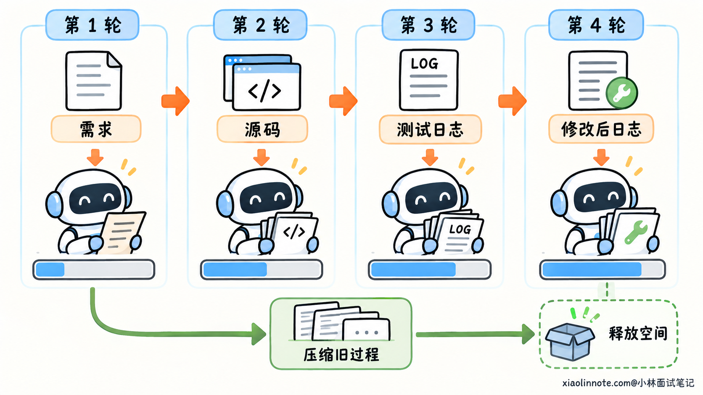
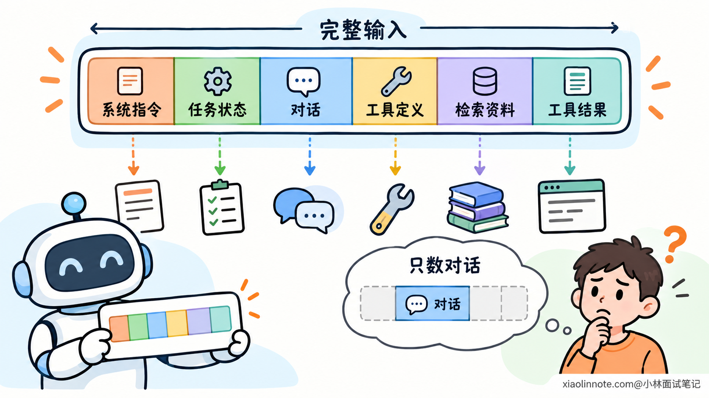
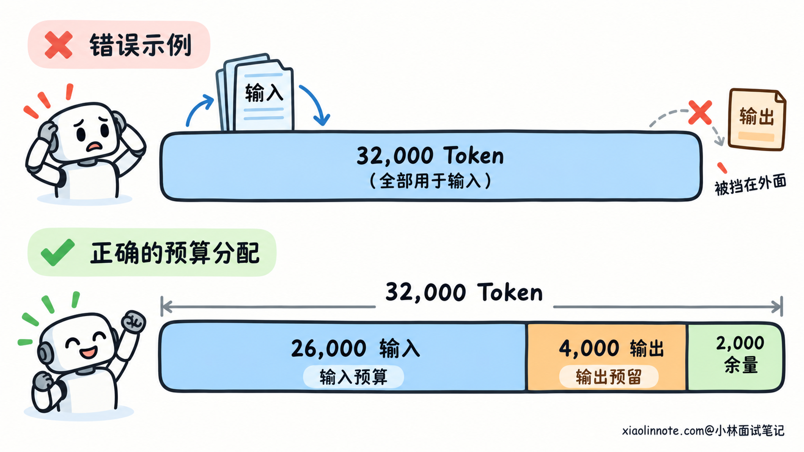
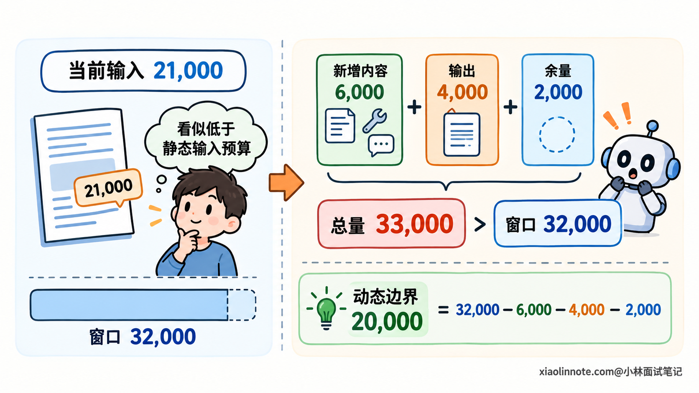
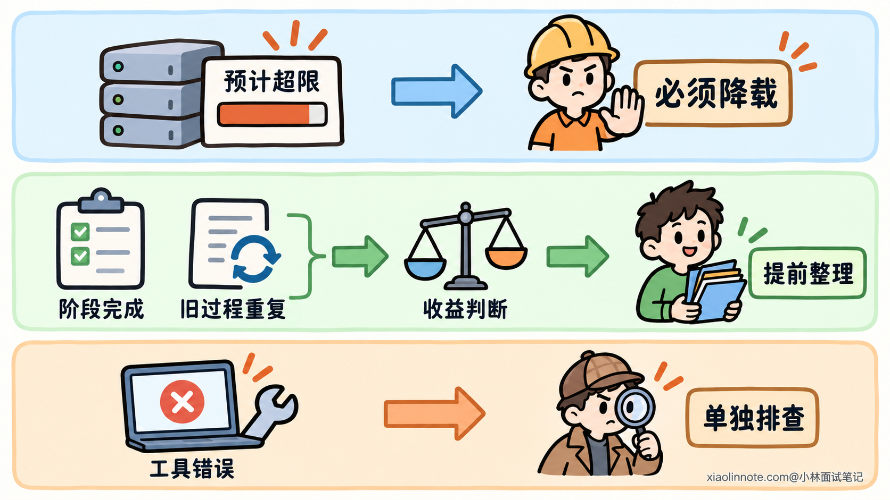
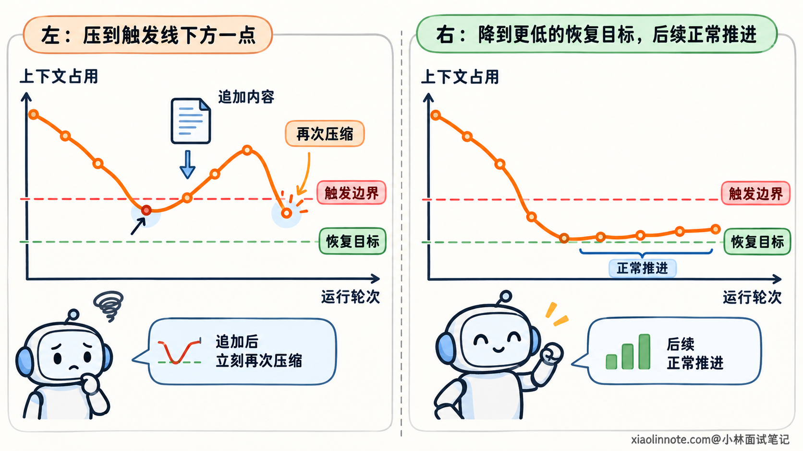
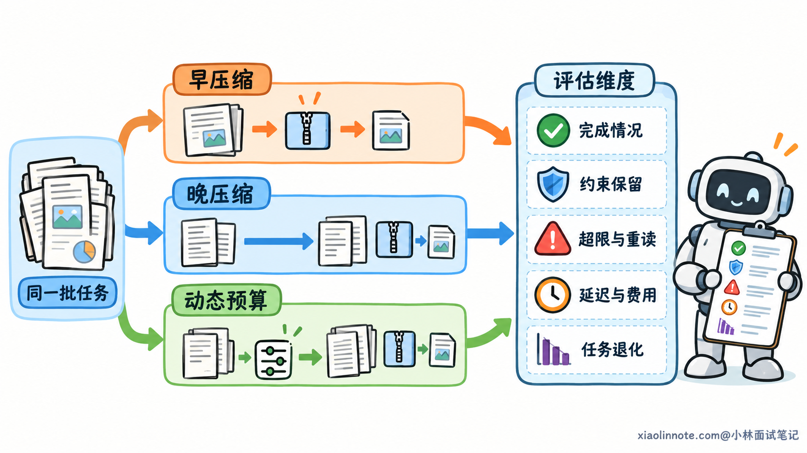

# Agent 的上下文压缩阈值应该如何确定？

> 原文：[Agent 的上下文压缩阈值应该如何确定？](https://xiaolinnote.com/ai/agent/29_context_compression_threshold.html) · 小林面试笔记


👔面试官：你们的 Agent 什么时候压缩上下文，这个阈值是怎么确定的？

🙋‍♂️我：用到上下文窗口的 80% 就压缩，剩下 20% 应该够了。

👔面试官：为什么够？下一步工具返回一大份日志，模型还要生成回答，剩下的空间能装下吗？

🙋‍♂️我：那等接近窗口上限再压缩，前面的信息就能多保留一点。

👔面试官：模型输出也需要空间。等输入已经塞满，下一次调用可能直接超限，连生成摘要都来不及。

🙋‍♂️我：那把阈值设低，早点压缩，总比超限好。

👔面试官：压缩会丢细节，还要花时间和 Token。太早压缩，模型反复查回旧信息，任务效果可能更差。你准备怎么找到合适的时机？

咱们从上下文为什么会越用越大开始，一步步算清楚压缩应该在哪个时刻发生。

## 💡 简要回答

压缩阈值应该根据剩余空间和接下来要做的任务来确定，没有一个通用的 80%。当前输入除了聊天记录，还有指令、工具定义和工具结果，先把这些内容的实际 Token 占用算清楚，再给模型输出和下一步可能增加的内容留出空间。

比如一个 Agent 接下来要读取大量测试日志，即使当前窗口还没用到 80%，剩余空间也可能不够；如果只是做一次短查询，后续增长很小，就可以保留更多原始信息。所以阈值更适合跟着任务动态调整。

另外，压缩本身也有代价，太早会损失细节，太晚可能超限。具体的触发比例和压缩后的目标大小，要在实际任务上比较完成效果、关键信息保留、延迟和成本。压缩完还得检查目标、约束和未完成状态是否保留下来，不能只看 Token 降了多少。

## 📝 详细解析

### 上下文为什么会越用越大？

假设你让一个 Coding Agent 排查接口超时。

第一轮，你只给了一句需求。Agent 读取接口源码以后，上下文里多了一份代码；运行测试以后，又多了一段日志；修改代码再次测试，新的修改记录和报错继续加入。

用户可能只说了几句话，整个输入却已经很长了。

这是因为模型判断下一步时，需要获得当前任务的相关信息。应用通常会把指令、消息、工具调用及其结果组织起来，交给模型。如果历史一直累积，又没有筛选，下一轮输入就会比上一轮更大。

模型能处理的上下文有容量限制。这里的容量用 Token 衡量，Token 是模型处理文本时使用的单位，不等于字数，也不等于聊天条数。一段源码和一段同样字数的中文，分成多少 Token 可能不同。

到了容量边界，有些接口会拒绝请求，有些情况下输出会提前结束，具体取决于服务的规则。Agent 正在排查问题，突然无法继续调用模型，任务就会被打断。

压缩的作用，是把已经积累的过程收敛成较短、仍然有用的信息，释放空间。比如多次排查最后确认是连接池配置的问题，后续可以保留这个结论和依据位置，不必每轮都携带全部旧日志。



不过，压缩不是没有损失的搬家。摘要可能保留了「发现连接池问题」，却漏了具体环境、配置值和用户限制。越早压缩，越可能提前丢掉之后仍然需要的细节。

因此，阈值要解决的是一个取舍：既要给后续执行留空间，又要让仍然有用的原始信息保留得足够久。

### 在算阈值之前，先看窗口里到底装了什么

如果只统计用户和模型说了多少话，预算很容易算少。

实际请求里还可能包含系统指令、当前任务状态、工具说明、检索资料和工具结果。几十个工具的名称、描述和参数结构，即使没有被调用，也可能随请求进入上下文。

有些任务还带图片、文档或模型的推理内容，这些也要按照当前接口的计数规则处理。不同模型和服务的规则有差异，不能把一次纯文本估算直接套到所有请求上。



所以，计数对象应该是已经装配好的请求。服务提供计数接口时，可以用它估算；否则使用匹配模型的分词器，并结合实际返回用量校准。估算和服务实际计数可能有差异，后面还需要留余量。

这里还容易混淆缓存与容量。前缀缓存可以减少重复处理的开销，但命中缓存的内容仍然可能占着上下文窗口。费用下降，不代表模型多出了一块能装材料的空间。

接下来为了把预算讲清楚，我们假设一个接口的输入和输出共享总窗口。同时记住，真实接口还可能有单独的输入、输出上限，实际请求要分别满足这些限制，推理内容怎样计入也要看接口规则。

### 窗口剩下的空间，还要留给模型输出

假设可用总窗口是 32,000 Token，当前输入已经有 30,000 Token。

看起来还剩 2,000，输入也没有超限。如果这次只需要一句短回复，可能够用；如果模型要生成一段修改后的代码，需要 4,000 Token，空间就不够了。

上下文容量不能全部用来放输入。模型接下来生成的内容，也需要在接口允许的范围里安排空间。

因此，先给输出留预算，再决定输入最多能放多少。假设这类任务预留 4,000 Token 输出，另留 2,000 Token 处理计数误差与意外增长，那么当前输入的预算就是：

```text
32,000 总窗口 - 4,000 输出预留 - 2,000 安全余量
= 26,000 输入预算
```

这些数字只是说明计算过程，不是模型配置推荐。输出预算也不是要求模型必须生成这么多，而是避免计划中的必要输出没有空间。

当前输入达到 26,000 左右，就已经接近这套预算的边界。继续等待到 32,000 才处理，相当于把模型下一步工作的空间也占掉了。



输出预留要跟任务走。提取一个字段和生成完整代码文件，所需空间不同。如果任务对推理预算另有要求，也要按接口的实际计入方式安排，不能只预留最后可见答案的长度。

到这里，阈值已经不再是凭感觉设的比例，而是能从任务预算里算出来的一条边界。

### 工具结果突然变大，为什么要更早处理？

刚才算的是一次调用。Agent 还会继续调工具，下一轮输入可能突然增加。

接口排查任务里，查询一个配置值只会返回几行内容；运行整套测试，可能返回几千行日志。两种动作虽然都叫工具调用，给上下文带来的增长却差很多。

继续用刚才 32,000 Token 的假设。当前输入是 21,000，还没到 26,000 的输入预算，按静态阈值看似可以继续。

但下一步预计会增加 6,000 Token 的工具结果和调用消息。再给随后的一次模型调用保留 4,000 输出和 2,000 余量，预计占用就变成：

```text
21,000 当前输入 + 6,000 预计新增内容
+ 4,000 后续输出预留 + 2,000 安全余量
= 33,000 Token
```

已经超过 32,000。当前输入只占窗口的约三分之二，却应该提前减小输入或限制工具返回。

换个角度算，给这次增长预留以后，当前输入只能使用 20,000 Token：`32,000 - 6,000 - 4,000 - 2,000`。所以，这一步的触发边界比前面更低。



预计新增内容要有清楚的计数范围。前一轮模型生成的工具调用消息，会在之后成为历史输入，这部分应算进增长；已经包含在当前输入里的消息不再重复计算，后续输出则只预留接下来那次生成所需的空间。

增长估计可以参考同类工具过去的返回量。日志波动很大时，单看平均值容易低估异常情况，可以结合较大结果的分布和任务风险预留。工具实际返回以后，再重新计数，估计不能替代检查。

如果工具本来就能返回无限长内容，仅降低压缩阈值也解决不了问题。把完整日志保存到外部，只返回摘要、命中位置或一部分内容，后续按需读取，才能让增长有可控制的范围。

**固定比例只有在输出预留、工具增长和其他余量恰好适合时，才可能是一个合适的起点。** 换模型、换任务、换工具以后，原来的比例需要重新检查。

### 还有空间，也可能值得压缩吗？

容量预算解决了「还能不能装下」。另一种问题是材料虽然装得下，当前任务却不再需要其中很多内容。

比如 Agent 已经定位到连接池参数，前面几十轮都在排查 SQL 和网络。那些失败尝试可以留下结论，但原始过程如果一直跟着当前步骤走，就会增加阅读负担和处理成本。

完成一个阶段时，通常更容易判断哪些内容已经可以收起。原因已经确认，接下来进入修改和验证，把排查过程整理成结论，比在还没找到原因时匆忙压缩更容易保留有效信息。

因此，工程上可以把容量边界和提前整理分开。前者用于避免下一次请求超限，后者根据阶段结束、内容重复和实测质量决定是否更早处理。

但不能看到模型重复调用，就断定上下文必须压缩。也可能是工具一直返回错误，或者任务本身缺少信息。需要结合执行记录判断，压缩不是所有卡顿和循环问题的解决办法。



提前压缩也需要比较收益。当前任务还在依赖日志里的精确字段，过早把它们概括成「出现错误」，模型可能又得重新读取。输入变短了，工具调用却变多，最后总耗时和成本未必下降。

### 触发以后压到哪里，决定下一轮会不会又压缩

有了触发边界，还差一个问题：这次要释放多少空间？

假设某类任务在输入超过 26,000 Token 时触发整理，处理后只降到 25,800。下一轮增加 500 Token，又触发一次。

这样，Agent 可能反复总结几乎相同的历史。每次摘要都花时间，还可能逐次损失细节。触发边界只决定「什么时候开始」，压缩后的目标决定「这次释放多少」。

可以把两者分开。例如某套实验配置在 26,000 附近触发，目标降到 20,000 左右，让后续几步有可用空间。这组数字同样只是示意，目标要结合预计增长和任务需要确定。



释放空间时，用户目标、硬约束、关键参数和当前进度需要保留下来。比如「不能修改接口字段」，不能被压成「尽量兼容接口」；一次工具超时但结果未知，也不能总结成已经失败。

消息协议同样有约束。工具请求和返回通常要通过调用编号关联，不能删掉请求却留下孤立结果。已结束的旧工具链，只有在接口允许时才能整体收敛成摘要；仍需保留的调用与内容块，要满足对应接口要求。

所以，压缩完成后要检查两件事：大小是否回到合适预算，继续任务所需的信息与消息结构是否还完整。Token 降了很多，只能证明内容变短，不能证明摘要可用。

而且压缩过程本身也需要空间。若使用同一个受限模型生成摘要，等窗口彻底满了再提交整段历史，压缩调用同样可能失败。提前触发、分段处理和保留外部原始记录，都能给恢复留下余地。

### 怎样知道这个阈值真的适合当前任务？

预算能够推导容量边界，但哪些内容仍然有用、压缩损失会不会影响后面的判断，不能只靠公式回答。

这就需要把候选策略放到实际任务上比较。可以准备短查询、长代码修改和大日志分析等不同任务，固定模型、资料版本与初始状态，再运行较早压缩、较晚压缩和按增长动态触发的策略。

每类任务最好重复运行，观察结果是否稳定。一个策略偶然成功一次，不足以说明它比另一个更适合。

比较时先看任务有没有完成、用户约束有没有违反，以及关键信息能否继续使用。随后才看输入大小、压缩次数、重复读取、总延迟和费用。

| 观察到的现象 | 需要检查的方向 |
| --- | --- |
| 工具结果到达后经常超限 | 增长估计是否不足，返回内容是否缺少上限 |
| 压缩后反复重读同一份资料 | 关键细节是否丢失，触发是否过早 |
| 每一两步就再次压缩 | 压缩目标是否离触发边界太近 |
| Token 明显下降，但任务失败增加 | 摘要是否破坏约束、进度或消息关系 |



这些现象需要结合记录核实，不能只看一项指标就调整阈值。比如压缩后又读取文件，可能是在补回丢失细节，也可能是任务自然进入新的代码位置，两者处理不同。

最后得到的往往是一套按任务类型配置的策略，而非所有 Agent 共用一个数字。模型容量、工具输出或任务分布变化以后，再用同样的方法检查，原来的预算是否仍然成立。

## 🎯 面试总结

开头回答 80% 时漏掉了后续增长，等到上限再处理又没有给输出留下空间，盲目提前压缩则忽略了信息损失。这三个问题，都需要放回一次具体任务里计算和验证。

先明确窗口与接口限制，统计实际输入，再预留后续输出、工具增长和安全余量，就能推导当前步骤的容量边界。阶段完成时是否更早整理，则取决于信息价值和实际收益。

触发时机、压缩目标和内容保留要一起考虑。通过任务回放检查效果、约束、延迟和成本，才能知道这套阈值是否适合当前场景。

---
