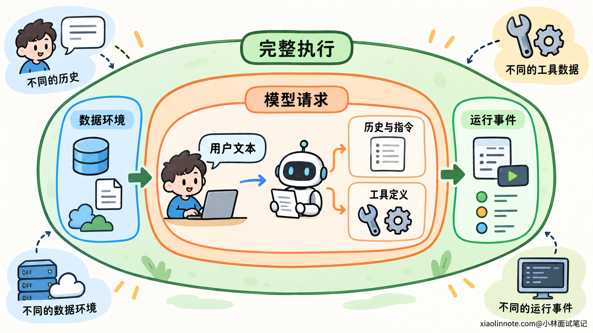
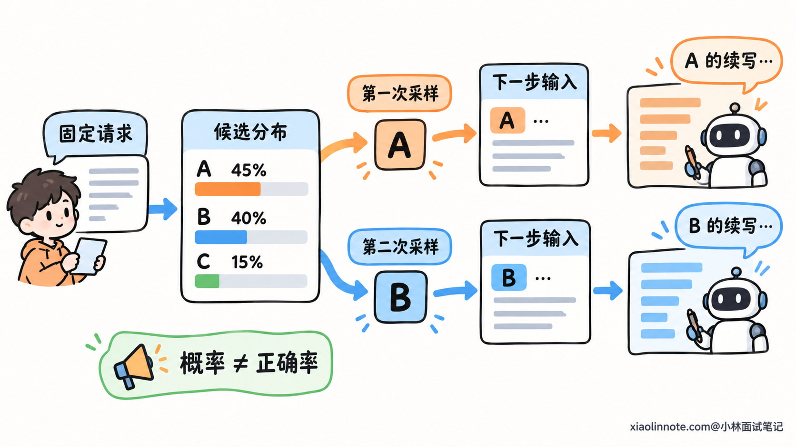
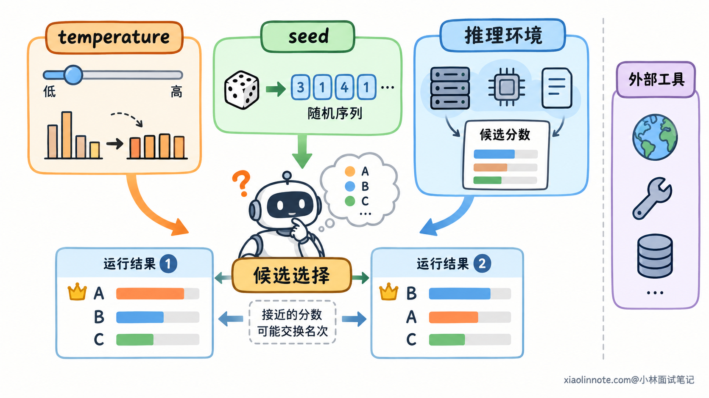
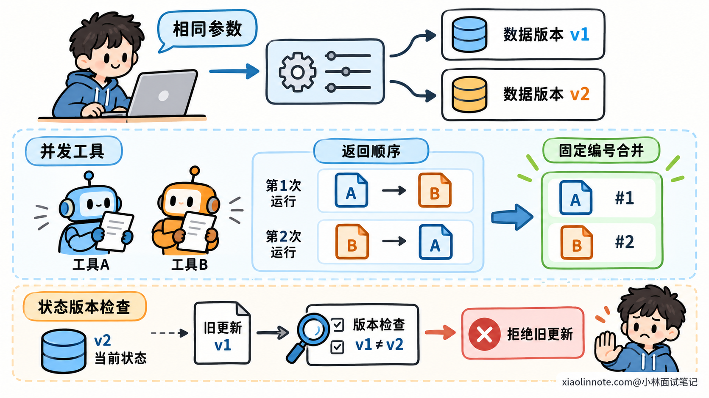
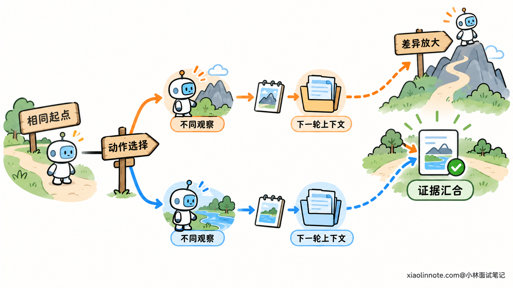
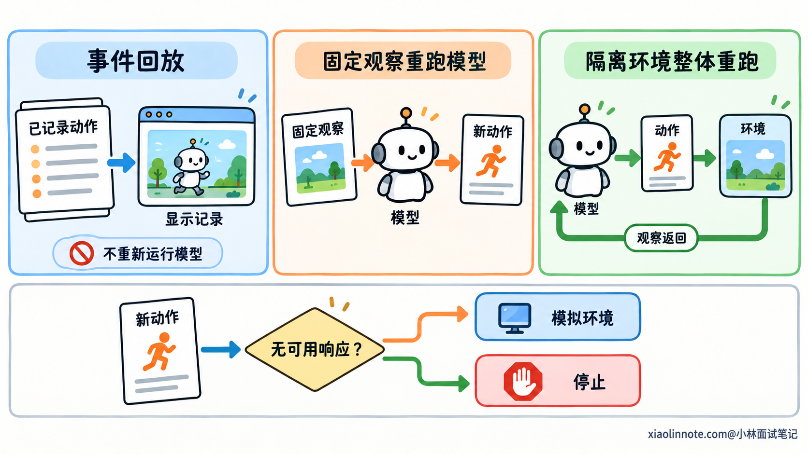

# 相同输入为什么会得到不同的 Agent 执行结果？

> 原文：[相同输入为什么会得到不同的 Agent 执行结果？](https://xiaolinnote.com/ai/agent/30_execution_variance.html) · 小林面试笔记


👔面试官：用户给出相同的输入，Agent 却走了不同的执行过程，甚至返回不同结果，这是为什么？

🙋‍♂️我：因为大模型有随机性，把 temperature 调成 0 就能保证一样。

👔面试官：如果两次工具读到的数据不同，调 temperature 能解决吗？模型推理环境变化，又能保证输出不变吗？

🙋‍♂️我：那固定 seed，再保存用户问题，就可以完整复现。

👔面试官：模型还会接收历史、记忆和工具说明。你只保存用户问题，怎么知道两次真正送给模型的内容一样？

🙋‍♂️我：我规定每次都按相同顺序调用工具，最后的文字也必须完全一致。

👔面试官：两份独立资料先查哪份，可能都能正确完成任务。你要保证的是结果和约束，还是每个步骤、每个字都不能变化？

咱们先分清「输入相同」究竟固定了什么，再逐层拆解模型和运行系统怎样产生差异。

## 💡 简要回答

我会先确认这里的相同输入，指的是同一句用户问题，还是完整运行条件都相同。Agent 还会用到系统指令、历史、记忆、工具定义和任务状态，这些内容变化，模型实际收到的请求就已经不同了。后续工具读到的数据也可能变化，所以相同用户文本不一定应该得到相同结果。

即使模型请求相同，生成策略也可能从候选中采样，导致输出不同。降低 temperature 或固定支持的 seed，可以控制一部分变化，但模型版本、推理实现和数值计算也会影响结果。另外，并发工具的返回顺序、超时重试和共享状态更新，都可能改变后续决策。这些差异进入多步循环以后，还会继续影响下一轮输入。

排查时，我会保存实际请求、模型配置、工具参数与返回、状态变化，对齐两次执行记录，先找最早出现差异的位置，再通过固定观察或回放事件检查对应环节。稳定性则要按业务要求判断：合理路径和措辞可以不同，事实、计算结果、权限约束和写操作的去重必须符合规定，不能只用逐字一致衡量。

## 📝 详细解析

### 「相同输入」有三个层次，先明确比较范围

我们通常把输入理解成聊天框里的一句话。但 Agent 作出决定时，还会读取很多用户没有在这一轮重新输入的内容。

系统指令描述行为要求，历史消息提供前面的交流，任务状态记录当前进度，记忆和检索材料补充已有信息，工具说明告诉模型可以采取哪些操作。

应用把这些内容装配成请求，模型处理的是这份完整材料。用户文字相同，只能说明其中一部分相同。

例如第二次提问时，历史中已经保存了上一次查到的资料，模型可能直接分析；第一次没有资料，则需要先查询。路径不同有明确的信息依据。

还要再往外看一层。即使两次模型请求相同，工具访问的文件、数据库和外部服务也未必处于同一个状态。它们在后续执行中返回新观察，同样会影响结果。

所以可以把比较范围分成三层：

| 比较层次 | 需要固定的内容 | 仍可能发生的变化 |
| --- | --- | --- |
| 用户文本相同 | 当前用户说的话 | 历史、指令、记忆和任务进度 |
| 模型请求相同 | 实际提交的完整材料与调用参数 | 模型实现和外部工具观察 |
| 执行环境与初始状态相同 | 除请求外，相关模型版本、工具环境与任务初始状态 | 采样、计算与调度中尚未控制的因素 |

完整运行条件也不只是启动时的快照。如果任务会读取当前时间、调用实时接口，执行中新增的输入也需要被考虑。只固定第一轮请求，不能据此推断整条链路都固定了。



理解这三个层次以后，就不会把所有差异都归因于模型。接下来再单独看：一份固定请求进入模型以后，输出为什么仍可能变化。

### 模型生成的是一串选择，采样会产生不同续写

自回归语言模型通常逐个生成 Token。Token 是模型处理和生成内容的单位，一个词可能包含多个 Token，不能简单当成一个汉字或一个完整动作。

每生成一步，模型根据输入和已经生成的内容，为下一个 Token 计算候选分数。生成策略再决定选哪个候选，选出来的 Token 会成为下一步的条件。

假设某一步三个候选的概率分别是 45%、40% 和 15%。如果按这个分布采样，最高概率的候选更容易出现，但并不意味着每次都选它。

这些数字只是解释采样的示意，并不是某个模型的实际输出。候选概率也表示生成倾向，不能直接当作答案正确率。

同一份请求，第一次选中候选 A，第二次选中候选 B，后面的生成条件就不同了。最初可能只是表达方式变化，也可能逐渐改变工具名称、参数或计划。

工具调用通常也由模型生成，所以它会受到生成策略影响。接口要求输出符合指定结构，可以减少格式错误，但结构合法仍然允许多个工具或多组合法参数，不能据此保证动作一致。

temperature 用来调节候选分布的集中程度。其他条件不变时，较低温度通常让高分候选更占优势；较高温度通常保留更多候选的机会。具体支持方式和范围取决于模型接口。



如果每步都固定选择最高分候选，而且分数、并列处理和计算过程完全相同，生成可以是确定的。这里的关键条件，恰好也是只调一个参数无法全部控制的部分。

### temperature 为 0 和固定 seed，各自控制哪部分？

支持 temperature 为 0 的接口，通常会采用贪心选择或相近处理方式，也就是每步倾向于选择最高分候选。这样可以消除或显著减少显式采样带来的变化。

但最高分是谁，需要先经过实际数值计算。模型权重相同，不代表不同推理环境计算出的每一个分数都逐位相同。

计算机使用有限精度表示数值，运算过程会产生舍入。并行计算可能改变累加顺序，批处理方式和计算内核也可能采用不同执行路径。数学上等价的计算，不一定产生逐位相同的结果。

如果两个候选分数相差很大，小误差往往不改变选择；如果分数接近，误差就可能改变排序。即使仍然取最高分，生成也可能从这一处开始分开。

这不是说每次推理都会发生变化，而是说：关闭采样以后，还需要检查计算实现是否具有所需的确定性。自部署系统可以固定环境并选择确定性实现，托管服务能够提供哪些保证，则取决于它实际开放的能力。

seed 控制的是伪随机过程。伪随机数由算法和内部状态生成，在同一算法、初始状态和调用顺序下，可以重复得到相同序列。

所以固定 seed 有助于重复采样，但如果候选分布变了，同一随机序列也可能选出不同候选；如果随机数使用顺序变了，相同起始 seed 也不代表每一步都用到相同随机数。

它更不能固定模型权重、工具数据和应用状态。接口是否支持 seed、控制哪些随机源，也需要按实际实现判断。



模型版本同样属于条件。固定一个会更新的服务别名，未必等于固定具体权重和推理实现。排查时应记录服务提供的版本信息，并明确哪些后端条件无法由调用方控制。

### 工具观察和并发调度，是模型之外的变化来源

Agent 的工具请求即使一致，返回结果也可能不同。工具读取的是当前环境，不是一份永远固定的答案。

数据库会更新，文件会被修改，搜索索引会重建。相同参数在不同时间访问，还可能遇到缓存、权限或外部服务状态差异。

内容相同，顺序也可能不同。数据库查询没有明确排序，就不能依赖返回顺序；即使按某个字段排序，该字段有重复值时，仍需要额外的稳定依据来确定先后。

例如按时间列出记录，时间相同的两项可能交换位置。如果业务会选取第一项，就需要加入唯一编号等排序依据。否则看似取到了同一批数据，后续选择却可能变化。

并发执行还会带来事件顺序差异。两个独立工具同时启动，哪一个先返回，取决于实际耗时。如果程序按到达顺序把结果加入上下文，两次模型输入的排列就可能不同。

需要固定合并顺序时，可以等待这一轮必需的结果齐全，再按稳定的任务编号组织材料。若操作之间有依赖，则应直接约束执行顺序，而不是假设某个工具通常返回更快。

共享状态还有另一类问题。两个工作进程基于同一个旧版本修改进度，后返回的结果可能覆盖已经产生的新状态。这种差异来自并发控制，调采样参数没有作用。

可以通过独立任务状态、受控的更新顺序或版本条件检查，减少这类冲突。重试也要保留原操作的身份与实际结果，避免一次超时被误当成未执行，随后形成重复副作用。



### 多步闭环，会把一次局部差异带到后面的决策

普通的一次生成，到模型返回文本就结束了。Agent 往往还要执行工具、读取结果、更新状态，再调用模型。

一轮的输出，会参与构成下一轮的输入。它可以从两条路径影响后续：作为消息留在历史里，或者通过工具改变外部环境，再由后续查询读回来。

这个过程可以表示为：

```text
本轮上下文 -> 模型选择动作 -> 工具产生观察
     ↑                              |
     +-- 新上下文 <- 更新任务状态 <--+
```

因此，第一轮只有一点不同，第二轮就可能已经面对不同材料。两条运行轨迹越往后，越难直接用相同轮次比较。

比如一次选择先搜索代码，另一次选择先读取一个候选文件。两种方式都可能合理，但它们拿到的材料不同，后续可能采用不同的排查顺序。

再遇到超时、重试、上下文压缩或运行预算限制，分歧会继续扩展。某条路径多执行了几步，就可能更早触发压缩；压缩后保留的材料不同，又会影响新的判断。

这也解释了为什么固定第一轮 seed，不能单独保证整条任务一致。后续输入、随机数使用和工具环境都可能已经分开。

不过，局部差异不一定持续放大。两条路径可能最后读到相同事实，得到相同结论。是否影响最终结果，取决于任务中的分支、依赖和验证，而不能只凭第一处不同就认定某次执行错误。



### 排查结果差异，先找到最早的可观察分歧

最终答案只是整条执行的末端。直接比较两个答案，通常无法判断差异从哪一层进入。

需要记录每轮实际提交的上下文、模型与生成配置、模型返回、工具参数和真实结果，以及状态更新与执行顺序。把这些内容按任务、步骤和调用编号关联起来，就得到可比较的运行轨迹。

比较时沿数据流向前找：模型请求是否已经不同，模型输出是否不同，工具返回是否不同，还是接收相同事件以后，程序更新出了不同状态。

| 最早观察到不同的位置 | 优先核查什么 |
| --- | --- |
| 调用模型前的请求 | 指令版本、历史、记忆、上下文整理与消息顺序 |
| 相同请求下的模型输出 | 生成配置、具体模型版本与推理环境 |
| 相同动作下的工具返回 | 数据版本、调用身份、时间与工具实现 |
| 相同结果下的状态更新 | 并发、重试、取消、恢复与状态处理代码 |

这张表提供排查入口，不是只凭记录就完成了根因证明。最早记录到的分歧之前，仍然可能存在没有保存的环境差异，需要进一步检查。

分支已经不同以后，不能机械比较两边的「第七步」。一边在读文件，另一边在重试查询，它们并不对应。应该先比较共同前缀，再按动作和依赖关系分析分叉部分。

保存请求内容的指纹，能够快速判断材料是否变化。指纹相同与否提供比较线索，但要解释差异，还需要有受控方式查看原内容，或者能够从版本与产物引用中还原。

日志也有边界。敏感内容需要脱敏或控制访问；后端没有开放的内部计算过程，也不能凭应用记录假装已经看见。保留这些限制，才能区分已证实的原因与待验证的推测。

### 分层回放，才能分别检查模型、工具和运行逻辑

有了记录，还需要一种办法验证怀疑的环节。这里要区分「回放当时事件」和「让模型再做一次」。

如果怀疑解析或状态更新程序出错，可以把已记录的模型输出和工具结果作为输入，再交给运行程序处理。模型和真实工具不重新执行，重点看同一组事件是否产生预期状态。

如果怀疑模型决策变化，可以固定完整请求，重新调用模型。对多步任务，还可以用保存的工具观察或模拟环境提供反馈，减少真实数据变化的影响。

如果要检查整体任务，则恢复初始文件、数据、身份和依赖，在隔离环境里重新执行模型与工具。这更接近端到端验证，也需要更多环境控制。

| 检查方式 | 哪些部分重新运行 | 主要验证什么 |
| --- | --- | --- |
| 事件回放 | 解析、调度与状态处理 | 已知事件是否被程序正确处理 |
| 固定观察后重跑模型 | 模型生成与后续决策 | 固定材料下生成行为怎样变化 |
| 环境恢复后整体重跑 | 模型、工具和运行程序 | 整条任务能否重复完成 |

回放也需要控制代码会读取的其他输入。当前时间、随机数和事件顺序如果影响状态逻辑，就要一并记录或固定，否则只固定模型输出仍然不够。

新一轮模型可能提出原记录里没有的工具请求。此时不能随便拿另一次查询结果充当返回，需要模拟环境支持这个动作，或者停止并说明记录无法覆盖这条新路径。

重复动作也不能只按工具名称匹配。相同工具和参数在不同阶段可能对应不同状态，需要结合调用编号、顺序和环境来判断该使用哪份观察。



发送通知、创建记录等副作用需要隔离或模拟。复现程序中的故障，不应该因此再次产生真实业务动作；模拟回放的成功，也只能作为测试证据，不能写成线上已经执行成功。

### 稳定性要分层定义，逐字一致只是其中一层

分析完变化来源，最后还要判断哪些差异真的有问题。

两段回答措辞不同，但表达同一事实，通常属于合理变化。两条执行路径不同，但都获取了必要证据、满足目标，也可以同时正确。

如果两次算出了不同金额，遗漏了同一项约束，或者对相同业务动作产生重复写入，差异就会影响实际结果。它们需要规则与执行机制保障，不能只依赖模型更倾向于选择某条路径。

可以把一致性要求分成表达、过程、结果和约束几个层次。具体任务决定哪些层次需要固定，并不是所有系统都只看最终答案。

例如审核流程要求先通过批准再执行，即使最终产物正确，也不能接受绕过批准的路径；普通资料汇总则可能允许独立检索步骤交换顺序。过程是否等价，要看任务约束，而不只是结果相似。

对明确计算使用确定的规则和工具，对资源访问落实权限检查，对业务写入使用稳定的操作标识与后端去重支持。模型可以在允许的范围内选择路线，关键条件由程序核验。

评估时，用固定任务条件重复运行，记录目标是否完成、约束是否满足，以及耗时和费用的分布。若某些路径经常失败，再沿运行记录定位原因。

外部事实变化时，正确行为也可能需要改变。为了让输出永远相同而强行忽略新数据，会损害任务正确性。复现用于研究已发生的过程，实际执行仍然要依据当前有效事实。

## 🎯 面试总结

开头只调 temperature，忽略了完整请求、工具环境和执行顺序；只固定 seed，又没有固定候选分布、计算实现和多步反馈。相同用户文本，需要放回完整运行条件中比较，才能判断差异来自哪里。

模型选择、工具观察和状态更新会共同构成下一轮输入，所以一次局部差异可能改变后续轨迹。保存各轮真实记录，找到最早的可观察分歧，再用事件回放、固定观察或环境恢复验证对应环节，才能逐步定位原因。

路径和文字不同未必意味着不稳定，关键是满足该任务要求的结果与约束。明确哪些层次必须一致，再把计算、权限和写入去重落实到执行机制中，才能控制有实际影响的变化。

---
