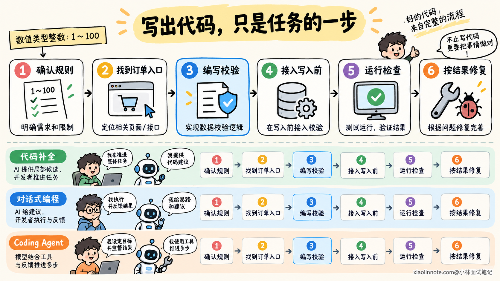
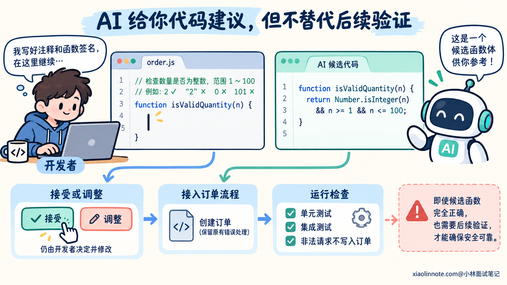
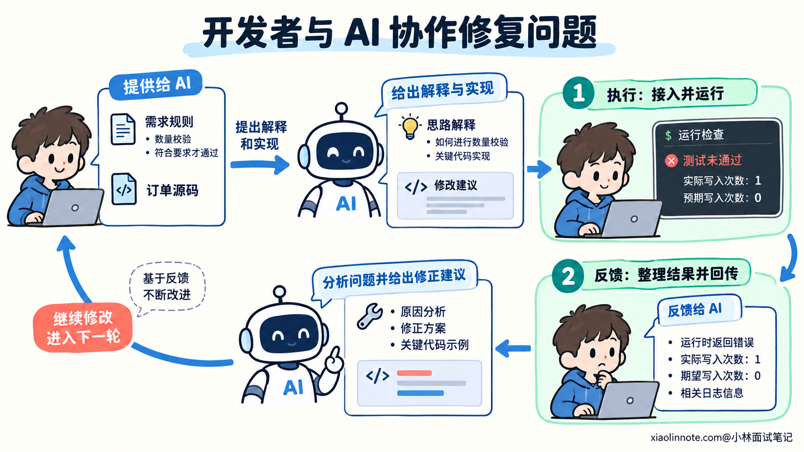
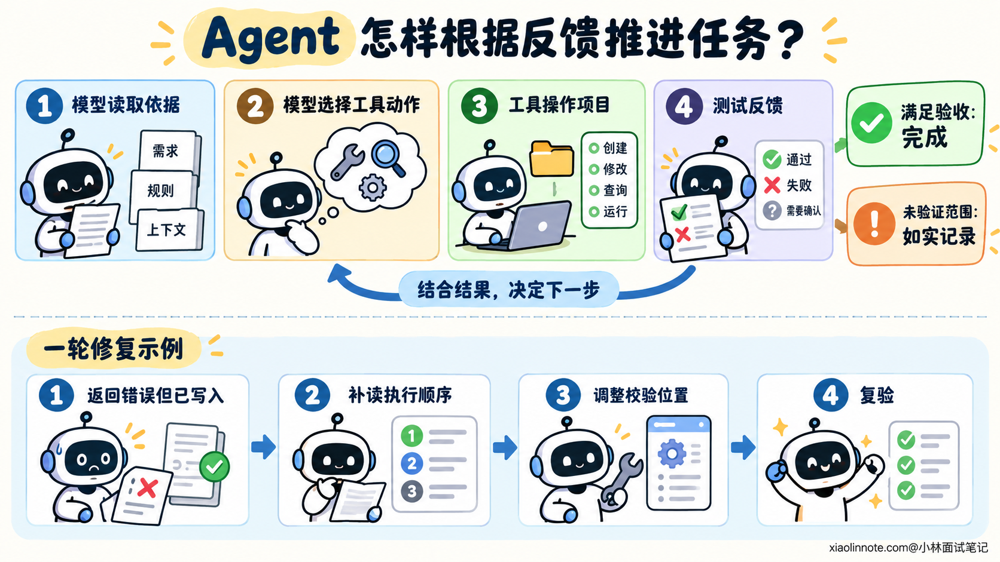
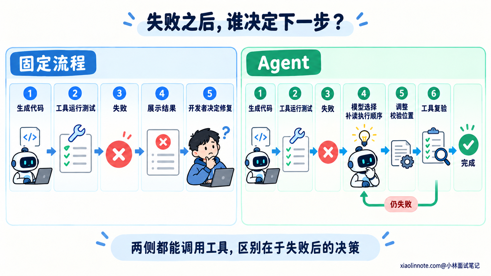
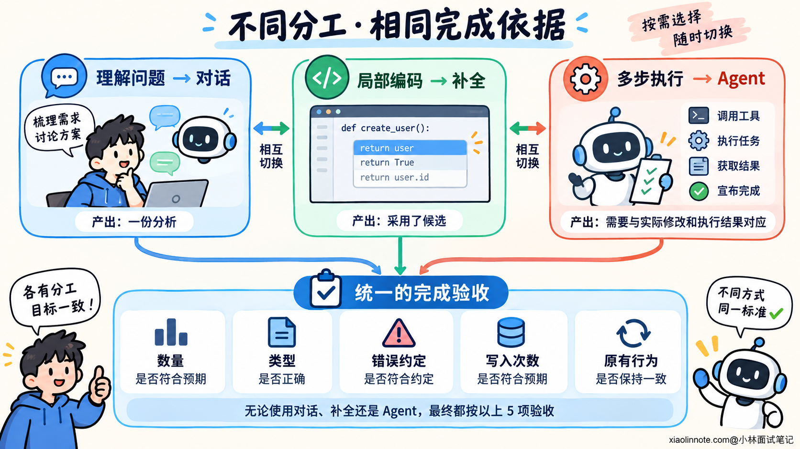

# AI 编程有哪些常见方式？代码补全、对话生成和 Agent 编程有什么区别？

> 原文：[AI 编程有哪些常见方式？代码补全、对话生成和 Agent 编程有什么区别？](https://xiaolinnote.com/ai/coding/ai_programming_modes.html) · 小林面试笔记


👔面试官：你平时怎么用 AI 编程？代码补全、对话生成和 Agent 编程有什么区别？

🙋‍♂️我：都是让 AI 写代码，只是补全写得少，Agent 写得多。

👔面试官：代码补全也能生成整个函数，用代码长度能分清吗？

🙋‍♂️我：那聊天窗口里用的就是对话生成，终端里跑的就是 Agent。

👔面试官：Agent 也可以放在聊天窗口里，你怎么判断它有没有在执行任务？

🙋‍♂️我：能调用工具就是 Agent，用了 Agent 就可以直接交付。

👔面试官：查一次文件和根据测试结果继续修复有什么区别？自动执行又能证明代码满足需求吗？

咱们沿着代码从生成到验证的过程，看看这三种方式分别把哪些工作交给了 AI。

## 💡 简要回答

我会按 AI 参与开发的方式，分成代码补全、对话生成和 Agent 编程。

代码补全主要根据光标附近的代码和工具提供的其他上下文，给出后续代码或修改建议。我决定写什么，再选择接受、修改还是拒绝建议，开发过程主要由我推进。

对话生成允许我把需求、约束和相关代码讲清楚，让 AI 解释代码、讨论方案或者生成实现。如果使用的是以问答为主的模式，运行代码、判断问题和反馈结果这些步骤，主要还是由我来组织。

Agent 编程会在授权范围内，把读文件、改代码、运行检查等工具接入任务执行过程。模型可以根据工具返回的结果决定下一步，比如测试失败后继续查原因、修改并重新验证。它承担了更多执行和反馈处理的工作。

所以我会看两点：AI 能采取哪些行动，以及谁根据执行结果推进下一步。同一个产品可以提供这三种方式，聊天界面里也可以运行 Agent。使用时，我会把局部编码交给补全，把解释和方案讨论放在对话里，再把目标清楚、能够验证的多步修改交给 Agent。最终仍然要按需求检查实际改动和验证结果。

## 📝 详细解析

### 三种方式的区别，先看开发工作怎样分担

同样一句「帮我写代码」，实际可以把很不一样的工作交给 AI。你可能已经打开目标函数，只想让它接着写；也可能还没弄清需求，想先讨论规则；还可能希望它查找实现、修改文件并完成检查。

这几种情况的差别，藏在开发过程的分工里。明确目标、理解已有代码、提出实现、写入项目、运行检查，以及根据失败继续修复，都需要有人推进。AI 参与了哪些环节，会影响你怎样提供信息、怎样接收结果。

因此，比较代码补全、对话生成和 Agent 编程，可以先看两个问题：AI 获得了什么行动能力，以及执行结果出来以后，由谁组织下一步。模型能够生成代码，是三种方式的共同基础；执行过程中的分工才有助于区分它们。

下面用同一个任务来理解：给创建订单接口增加数量校验。假设已经确认，`quantity` 只接受 1 到 100 的数值整数，包含两个端点；字符串、缺失值和小数都应拒绝，不做隐式转换。非法输入沿用项目的参数错误方式，并且不能写入订单。

这个任务既有局部判断，也有接入与验证。写出正确的校验函数，只完成了一部分；还要确认调用位置在写入之前，错误按约定传递，已有合法请求仍然能够成功。

用同一组规则比较三种方式，是为了把注意力放在分工上。它们都可能生成同一段正确代码，区别在于谁把这段代码接进项目，谁观察执行结果，再据此继续。



### 代码补全：从编辑位置获得候选实现

使用代码补全时，你通常已经在编辑某个位置。工具把光标附近的代码和其他可用上下文交给模型，模型据此提出后续代码或修改建议，再由你决定是否采用。

在数量校验任务里，假设你已经决定增加一个返回布尔值的辅助函数，可以先写出规则和函数边界：

```javascript
// 只接受 1 到 100 的数值整数，包含端点，不做类型转换。
function isValidQuantity(quantity) {
  // 光标位于这里，等待补全函数体。
}
```

这里的注释补充了函数名没有表达的规则：上限是否包含、字符串是否接受，以及是否转换类型。若只写 `isValidQuantity`，模型只能猜项目对「有效数量」的定义。

模型可能给出下面这份候选实现：

```javascript
function isValidQuantity(quantity) {
  // 先检查数值整数，再检查包含端点的范围。
  return Number.isInteger(quantity)
    && quantity >= 1
    && quantity <= 100;
}
```

`Number.isInteger` 不会先把字符串转换为数值，因此数值 `2` 可以通过，字符串 `'2'` 不会通过。范围判断也保留了两个端点，`1` 和 `100` 都应接受，`0` 和 `101` 则拒绝。这些结果来自前面确认的规则，能帮助你审查候选代码。

接受补全以后，还要把函数接入创建订单流程。你决定调用位置，保留原有错误处理，再安排检查。即使候选函数完全正确，它也不会仅凭这段内容证明非法请求没有写入订单。

这就是补全适合参与的工作：在开发者已经推进到某个编辑位置时，减少局部编码负担。建议可以是一行，也可以是整个函数；部分工具还能建议下一个编辑位置。只要仍然由开发者组织修改和验证，生成长度增加并不会改变这种分工。



### 对话生成：表达规则、讨论实现，再带着反馈继续

还没有确定怎样修改时，对话能提供更充分的表达空间。你可以让 AI 解释已有代码、推导边界、比较方案，也可以要求它先指出需求歧义，再生成实现。

这里讨论的是以问答为主的使用方式。相关代码可以由开发者粘贴，也可以由工具附加或检索；后续的修改、运行和反馈主要由开发者组织。

对同一个数量校验任务，可以这样提问：

```text
请帮我设计创建订单的数量校验。
quantity 只接受 1 到 100 的数值整数，包含两个端点。
字符串、小数、null 和缺失值都应拒绝，不做隐式转换。
非法数量沿用已有参数错误方式，并且不得写入订单。

我会附上当前 createOrder、仓库写入接口和参数错误定义。
请先说明关键输入的预期结果，再给出校验函数与接入建议。
解释应该在哪里调用校验，以及原因。本轮先讨论实现。
```

这段提示词比光标附近的一句注释多了执行位置和错误语义。AI 可以讨论整个创建过程，指出「拒绝输入」同时要求正确返回错误和避免写入，帮助开发者理解接入位置。

实际使用时，要提供提示词所说的当前源码。只说「沿用已有错误」，却没有给出错误定义或让工具读取，模型仍然可能采用不符合项目约定的写法。

生成建议之后，你审查并接入项目，再运行检查。假设校验函数的边界用例都通过了，但接口回归发现：数量为 `0` 时虽然返回参数错误，订单写入方法却已经调用了一次。这个反馈说明局部校验正确，接入流程仍然有问题。

下一轮可以这样反馈，使用时附上实际函数和对应输出：

```text
数量校验函数的边界检查通过了，但创建订单的回归检查失败。
quantity=0 时，预期返回已有参数错误，且订单写入次数为 0。
实际返回了错误，订单写入次数却是 1。

请结合我附上的 createOrder 和这次测试输出检查执行顺序，
说明哪里违反了规则，以及怎样修改。保留原来的验收预期。
```

这里同时保留错误结果和写入次数，是因为二者共同决定是否符合要求。只反馈「测试没过」，或者只说「已经返回错误」，都不足以表达发生了什么。AI 根据这些事实继续分析，开发者再决定并执行修复。

对话并不只能用于完整需求。有时你已经知道需要的实现，只想追问为什么某种类型判断更合适，也可以通过对话解决。关键是问答帮助理解与生成，实际执行反馈由开发者带回，形成下一轮讨论的依据。



### Agent 编程：把读写、检查和反馈接入任务执行

当希望 AI 承担更多项目操作时，可以给出开发目标，让它在授权范围内使用读取、编辑和命令执行等工具。模型根据取得的信息选择行动，工具执行后返回结果，模型再决定下一步。

继续看数量校验。对于能够读取仓库、修改文件并运行检查的工具，可以把任务交代成下面这样。路径仅作示意，实际使用时替换为真实项目位置。

```text
请为创建订单接口增加数量校验，并完成相关修改和验证。
quantity 只接受 1 到 100 的数值整数，包含两个端点。
字符串、小数、null 和缺失值都应拒绝，不做隐式转换。
非法数量沿用已有参数错误方式，不得写入订单。

先从 src/order/order_service.js 的 createOrder 入手，
读取请求入口、参数处理、仓库写入接口、错误定义和相关测试。
根据实际实现确定接入位置，再修改代码并补充必要用例。
运行项目已有的相关检查，失败时依据规则继续排查和修复。

本轮允许本地修改与相关检查，保留无关改动，不发布到外部环境。
完成后说明实际修改、执行结果，以及尚未验证的范围。
```

这段提示词没有规定每个工具调用，却明确了行动范围和完成依据。Agent 需要先用源码确认实现，再安排修改与验证。项目入口可能与最初线索不同，它也可以根据调用关系继续查找。

工具能力让模型能够取得实际反馈，但执行程序才负责读文件、写入修改和运行命令。模型生成一句「测试通过」不会让测试真的执行；需要查看工具返回的实际结果，才能据此判断。

假设接入时同样出现了「非法请求返回错误，却已写入订单」的问题。Agent 可以从回归失败中读到写入次数，继续核对执行顺序，将校验移到写入前，再运行相关检查。开发者不必在每个步骤之间手工搬运代码和报错。

一次执行过程可以整理成下面这份示意记录，帮助读者看到反馈怎样影响下一步。这不是当前项目的真实运行报告，使用时必须记录实际源码与执行结果。

```markdown
# 数量校验任务：示意执行记录

## 读取依据
已核对创建入口、参数处理、仓库写入与参数错误约定。
规则要求非法数量在写入前拒绝。

## 修改与反馈
新增数量校验，并接入 createOrder。
运行相关检查后，数量 0 的用例返回错误，但观察到一次订单写入。
根据失败继续读取执行顺序，发现校验位于写入之后。
将校验移到写入前，保留原有错误与合法输入处理。

## 复验与剩余范围
重新检查数量边界、类型以及非法输入的写入次数。
记录对应测试命令、当前代码状态和实际结果。
尚未执行的真实接口检查单独列出，不将局部通过写成整体通过。
```

这里的重要变化是：执行结果直接进入任务推进过程。发现失败以后，模型选择补读哪个位置、怎样修复，以及需要重跑哪些检查。循环可以持续到完成条件满足，也可能因权限限制、环境问题或规则不清而暂时无法继续。

遇到无法执行的检查，Agent 应说明缺口，而不是编造成功结果。获得工具和自动推进能力，会改变开发分工，但不会自动保证规则正确、测试充分或最终结果可以交付。



### 为什么代码长度、界面和单次工具调用都分不清？

同一段 `isValidQuantity`，可以通过补全生成，也可以通过对话生成，还可以由 Agent 写进文件。代码内容相同，参与开发的方式却不同，所以不能根据函数长度判断类别。

聊天窗口也只是交互入口。你可以在里面讨论一个方案，也可以让 Agent 执行多步修改；终端工具同样可能只接受一个问题、返回建议。要看背后实际发生了哪些操作。

单次工具调用则只说明取得了某种能力。例如对话工具检索一次相关文件，再给出解释，后续仍可能由开发者推进。Agent 编程关注的是模型能否围绕目标，根据工具反馈持续选择行动。

固定流程也可以自动调用工具。一个预先规定「生成代码 -> 执行测试 -> 展示结果」的程序，测试失败后如果只是把结果交给人处理，就与模型根据失败继续搜索和修复有不同分工。自动执行了几步，不等于模型接管了后续决策。



把前面的数量校验放在一起，可以得到下面的比较：

| 比较内容 | 代码补全 | 以问答为主的对话生成 | Agent 编程 |
| --- | --- | --- | --- |
| 开发者给出的起点 | 当前编辑位置、注释与可用上下文 | 规则、相关代码和问题 | 目标、范围、规则与完成条件 |
| AI 主要提供什么 | 校验函数的候选代码 | 解释、实现与接入建议 | 文件修改、工具操作与执行反馈 |
| 谁组织代码接入和检查 | 开发者 | 开发者为主 | 模型在授权范围内安排工具执行 |
| 出现写入次数错误后 | 开发者排查并继续编辑 | 开发者带回事实，再讨论修复 | 模型可依据失败补读、修改并复验 |

这张表描述常见分工，具体工具可能组合不同能力。对话可以进入 Agent 执行，Agent 修改以后也可以继续用补全处理细节，三种方式不是互斥的产品分类。

### 实际开发中怎样组合使用，并判断交付？

选择方式时，先看当前缺什么。还没理解创建流程，可以通过对话解释写入和错误处理；已经知道需要哪个判断，可以在编辑器里使用补全；希望完成查找、接入和检查等多步工作，则可以交给具备相应能力的 Agent。

这也不意味着一定按三个阶段依次使用。熟悉项目时，可以直接借助补全完成小修改；一个目标清楚的任务，也可以直接交给 Agent。遇到需要确认的业务选择，再回到讨论和核验。

决定交付时，数量校验任务仍然需要同一份依据：允许的数值被接受，不允许的类型与范围被拒绝，错误方式符合约定，非法输入没有写入，原有合法流程继续正常工作。

补全被接受，只说明开发者采用了候选；对话解释通顺，只说明提出了一份分析；Agent 宣布完成，还要与实际修改和执行结果对应。检查是否真正覆盖这些要求，会影响最终判断。

例如只运行校验函数的测试，能够检查布尔值，却没有观察创建流程的写入次数。需要用相关接口或流程检查补齐这一范围。验证要求来自任务行为，不因选择了哪种 AI 编程方式而降低。

开发者因此要明确目标与约定，审查实际差异，并核对重要验证。三种方式帮助承担不同工作，最终交付仍然需要对应当前代码的事实依据。



## 🎯 面试总结

开头把三种方式理解为代码写得多少，会忽略开发过程中的分工。再用聊天窗口或终端来分类，又容易把交互界面当成执行能力。

回答时可以按参与程度展开：补全在编辑过程中提供候选，对话让开发者充分表达问题并讨论实现，Agent 则通过工具和执行反馈承担更多任务推进工作。说明谁执行操作、谁处理结果，就能讲清它们怎样影响开发过程。

最后补上选择与验收：三种方式可以配合使用，按当前任务需要分配工作。自动执行的程度增加以后，仍然要用明确需求、实际改动和验证结果判断交付质量。
