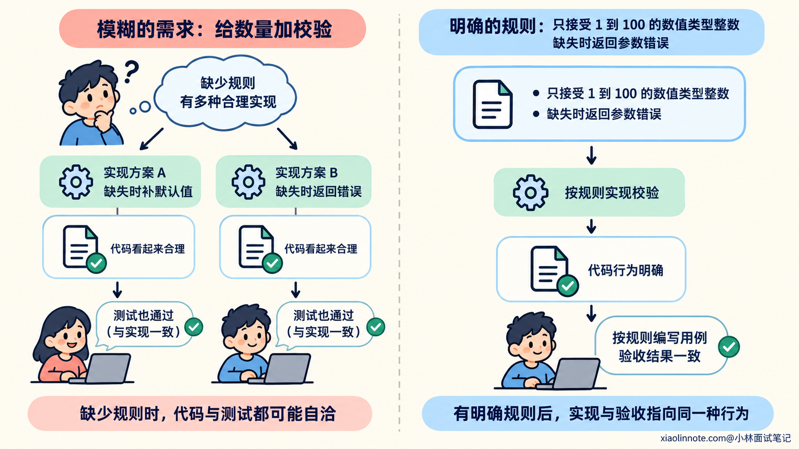
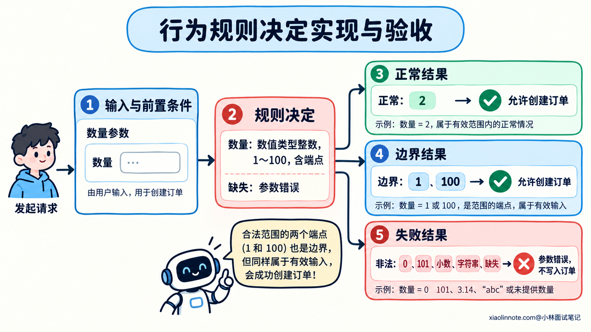
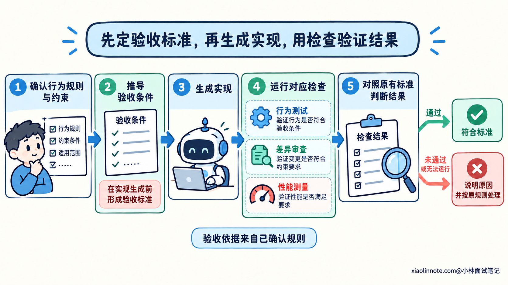
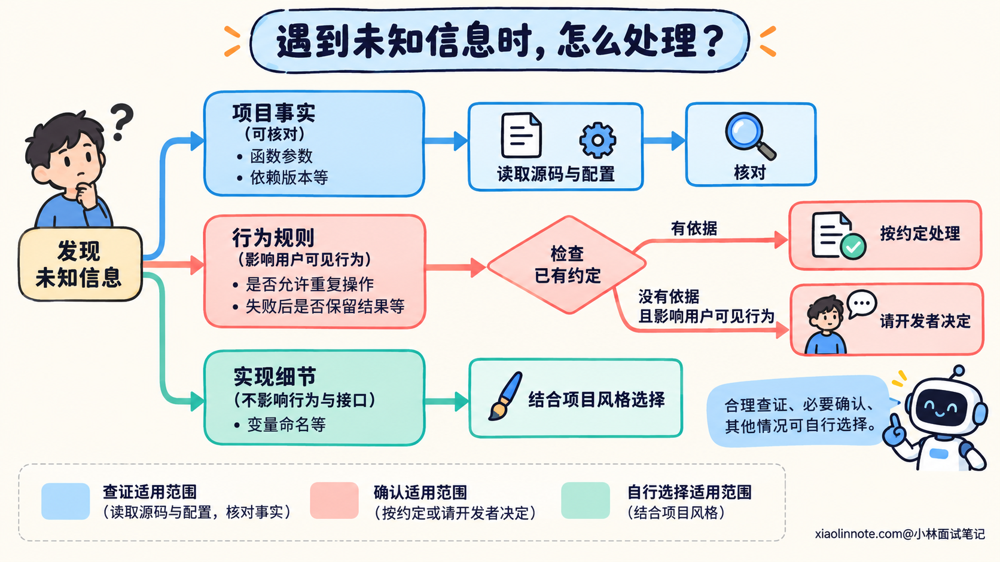
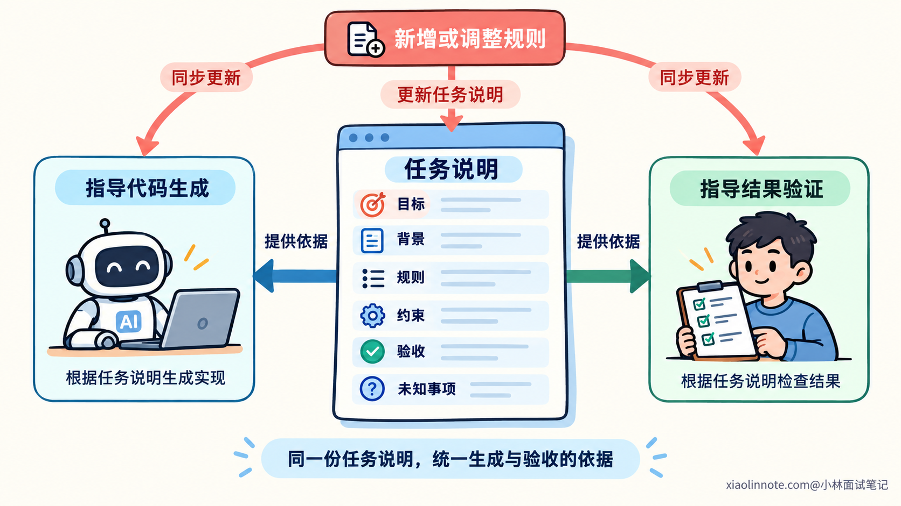

# 如何向 AI 描述开发需求、约束条件和验收标准？

> 原文：[如何向 AI 描述开发需求、约束条件和验收标准？](https://xiaolinnote.com/ai/coding/task_specification.html) · 小林面试笔记


👔面试官：让 AI 帮你开发一个功能，你会怎样描述需求、约束和验收标准？

🙋‍♂️我：先给它安排一个角色：「你是拥有二十年经验的顶级程序员，请写出生产级代码。」

👔面试官：（放下笔）那我现在宣布你是拥有三十年经验的架构师。来，继续回答。

🙋‍♂️我：（坐直了）我会把需求写得越长越好，再强调三遍「一定要正确」。

👔面试官：（翻了翻需求）三千字里出现五次「高性能」，一次「多久算快」都没有。你这是提需求，还是给 AI 念加油词？

🙋‍♂️我：那就让它把没写清楚的规则补上，再自己写测试。测试全绿，我就验收。

👔面试官：（把简历递过来）要不这场面试也由你出题、你打分，我负责鼓掌？

咱们把需求描述拆开，看看哪些信息需要在编码前明确，才能让生成和验收围绕同一个目标进行。

## 💡 简要回答

我会先讲清这次开发要改变什么行为，再提供理解这个任务需要的项目背景。比如当前接口是什么、已有行为有什么问题、相关代码在哪里。功能需求里，我会明确输入输出，以及会影响结果的边界和失败处理，避免让 AI 自己补业务规则。

然后我会说明修改范围和必须保留的约定，比如接口兼容性、依赖版本，以及哪些已有行为不能改变。硬约束和偏好我会分开写，实现细节则尽量沿用项目约定，给 AI 留出选择空间。

验收标准我会在编码前从需求里推导，写成「在什么条件下，应该观察到什么结果」。重点覆盖新增行为、关键边界和需要保留的原有行为。测试通过可以作为证据，但预期结果要依据已经确认的规则，不能跟着 AI 生成的实现来改。

对不确定的内容，我会先区分是项目事实还是规则决策。接口和现有实现可以让 AI 查源码确认；会改变用户可见行为的规则，应该向我确认。任务较复杂时，我会让它先复述目标、约束和验收条件，检查有没有漏掉或误解，再开始修改。

这样生成之前就有了交付依据，后续发现问题，也能判断是实现偏了、需求需要调整，还是验证还没完成。

## 📝 详细解析

### 需求写得模糊，AI 会在哪些地方开始猜？

把「帮我实现这个功能」交给 AI，它可能很快生成代码。代码里的每一个分支，却都需要某种规则：允许哪些输入，遇到异常怎样处理，什么时候返回成功。

你没有说明的部分，模型可能根据常见写法提出一种实现。对于变量命名，这种选择通常容易调整；对于是否重试、是否允许覆盖已有数据，选择不同就会产生不同的行为。

所以，需求中的信息缺口也有区别。有些缺口属于实现空间，有些则属于尚未决定的规则。开发者需要明确后者，才能判断生成结果是否正确。

例如「支持空值」，可以理解为接受空值并返回默认结果，也可以理解为识别空值并给出明确错误。这两种实现都可能有完整的代码和测试，但只能依据需求判断哪一种符合目标。

「生产级」「高质量」这样的表达，可以传达总体期望，却没有说明具体的行为条件。反复强调这些词，依然无法替你决定空值应该怎样处理。

**描述需求时，先找出会改变结果的歧义，再把规则写清楚。** 提示词里的角色、语气和篇幅，都要服务于这份明确的任务。

比如，给创建订单接口补一个数量校验，可以先看这条提示词：

```text
帮我给创建订单接口加数量校验，代码写得健壮一点。
```

AI 能看出你想增加校验，却不知道数量的合法范围，缺少数量时该怎么办，校验失败后怎样响应。「健壮一点」没有补上这些规则。下面用这项示例任务，逐步看看提示词需要增加什么信息，文中的文件路径只作示意。



### 先说明目标，再提供理解目标需要的现状

一个开发任务里，目标和现状回答的是不同问题。目标说明修改以后希望出现什么行为，现状说明现在的代码和环境是什么样。

如果把这两部分混在一起，AI 就容易把已有实现当成新要求，或者把开发者的猜测当成已经确认的事实。描述时可以先说清需要新增、修复或保留的行为，再补充理解任务所需的背景。

新增功能需要明确要增加什么能力。修复问题需要区分当前实际结果与期望结果。重构则要说明哪些外部行为应该保持一致，内部结构可以怎样调整。

开发者提出的方案也需要标明性质。「我怀疑这里少了一次校验」是一条排查线索；「这个条件下必须拒绝请求」才是一条行为要求。如果直接把怀疑写成确定的修改指令，AI 可能按这个猜测改完，却没有解决原来的问题。

接着提供必要背景，例如相关入口、真实接口、项目使用的依赖版本，或者能够复现问题的错误信息。背景应该帮助 AI 理解当前实现和验证规则，不需要把整个仓库的历史都塞进去。

你不知道准确的修改位置时，也可以提供接口路径、错误文本或模块职责，让 AI 继续查找。明确行为目标，并不要求开发者提前完成所有代码分析。

回到数量校验，先补充目标和查找入口：

```text
请给创建订单接口补充 quantity 参数校验，在不合法的数量进入订单写入逻辑前拒绝请求。

从 src/order/create_order.ts 和对应测试入手，核对当前参数处理、错误响应约定和订单写入位置。
```

第一句说明期望改变的行为，第二句提供核对现状的起点。它没有预先认定应该修改哪一行，也没有让 AI 重做整个下单流程。

### 把输入输出说清楚，才能确定行为边界

目标明确以后，还需要把它落实到可观察的行为。对于一项功能，输入是什么、允许什么条件、执行后返回什么或改变什么状态，会直接影响实现。

只写正常情况，AI 仍然要自行处理其他输入。空值、边界值、重复操作和依赖失败，可能触发不同分支。需要补充哪些情况，要看它们是否会改变这次任务要求的结果。

例如「数量在 1 到 100 之间」还不够完整。范围是否包含 1 和 100，是否只接受整数，缺少数量时是否有默认值，都可能改变行为。如果这些情况属于接口支持的输入范围，就应当把对应规则说明白。

输入的单位和格式也有同样的问题。秒与毫秒、空字符串与字段缺失，看起来只是表示方式，却可能影响计算和校验。已有接口已经规定这些语义时，应让 AI 核对并沿用；这次需要改变语义时，就要明确改变了什么。

失败处理尤其容易遗漏。写「处理异常」，没有说明调用方怎样识别失败，也没有说明失败以后是否留下状态变化。开发者需要根据任务补齐关键结果，而不是只要求加一个异常捕获。

这里不需要穷举所有想象得到的输入。优先明确会改变业务决策的条件、已知故障涉及的条件，以及接口承诺支持的情况，让每条规则都有明确用途。

对应的行为规则可以这样补：

```text
quantity 必须是数值类型的整数，范围为 1 到 100，包含两个端点。
字段缺失、null、非数值类型、小数和超出范围的值，都按参数错误拒绝。
不要把字符串转换成数字，也不要为缺失值补默认数量。
拒绝请求时，沿用项目现有的参数错误响应结构，不执行订单写入。
```

这里把「范围」「类型」「缺失值」分别讲清楚，是因为它们对应不同的判断。数值 `2` 与字符串形式的 `2` 都可能被转换成同一个数；上面的规则明确选择只接受数值，让 AI 不必自行决定是否做类型转换。项目原本采用其他规则时，应当按已确认的约定修改这段提示词。



### 约束条件决定哪些实现可以被接受

行为规则说明要做什么，约束条件则限制实现能够采用的方式，以及这次任务允许改变的范围。

同一个结果可以有多种实现。AI 可能复用现有模块，也可能新加依赖；可能修改内部逻辑，也可能调整接口。若项目有兼容性或依赖要求，就需要把这些要求带进任务。

修改范围也要有依据。例如允许调整目标模块和相关测试，并要求保留公共接口，可以帮助 AI 集中处理这次问题。不过，「只能改一个文件」未必合理，因为修复也可能需要修改调用方。范围应对应任务影响，而不是任意限制文件数量。

约束里还要区分必须满足的要求与偏好。接口保持兼容是一项明确要求，「尽量减少改动」则需要结合代码判断。把两者都写成不能违反的命令，可能让 AI 为了少改几行，保留不合适的结构。

对实现细节，可以让 AI 沿用项目已有方式。你不必提前规定每个循环、变量和辅助函数；但某种实现选择如果会影响兼容性、性能目标或数据语义，就应该说明限制和理由。

性能要求也需要可判断的条件。「更快」要结合处理的数据规模、运行环境和衡量方式，才能成为具体目标。没有可靠基准时，可以先要求分析瓶颈和提出验证方法，再确认需要达到的指标。

这项任务的修改约束，可以写成：

```text
修改围绕 quantity 校验和相关测试展开，沿用项目现有的校验与错误处理方式。
合法数量的订单处理流程和成功返回结构保持不变，不升级依赖，不顺带重构其他业务。
如果现有结构无法满足上述规则，请说明需要扩大修改范围的原因。
```

这样既给出了修改边界，也留出了处理真实依赖关系的空间。AI 如果发现必须调整公共校验代码，需要说明依据；开发者再判断扩大范围是否合理。

### 验收标准怎样从需求中推导出来？

需求与约束确定以后，开发者就可以写出完成标准。标准应该说明在哪些条件下，怎样观察到符合要求的结果。

可以用「前置条件、执行操作、预期结果」组织一条验收要求。这样既能告诉 AI 需要实现什么，也能帮助后续检查者安排验证。预期结果应从规则推导，不能等实现生成以后，再按它的行为填写。

假设已经确认数量只允许 1 到 100 的整数，且包含两个端点，那么 1 和 100 都应被接受，0 和 101 应被拒绝。这些结果在编码前就能确定，后续实现无论怎样组织，都应该满足同一份规则。

验收还要包含需要保留的行为。新增校验不能顺便改变已经约定的成功返回格式；重构内部代码，也不能把原来承诺的错误处理改掉。它们来自修改范围和兼容性要求，同样属于完成条件。

「单元测试全部通过」可以是一项检查要求，但它没有独立说明功能目标。测试可能没有覆盖新增规则，也可能使用了错误预期。编译、测试和人工检查，都是取得验证证据的方式，证据要对应具体要求。

某些要求也需要多种方式验证。接口返回结果可以通过行为测试检查，依赖是否被升级可以查看实际差异，性能指标则需要约定条件下的测量。写验收标准时，应当说明要确认什么，再选择适合的检查方式。

把前面的数量规则变成验收要求，可以这样写：

```text
请补充相关测试。在其他字段有效、依赖正常的条件下：
quantity 为 1、2、100 时，按原有流程创建订单，保存的数量与输入一致。
quantity 为 0、101、1.5、null、字符串形式的 2 或字段缺失时，返回约定的参数错误，不触发订单写入。
合法数量的成功返回结构保持原有约定。

运行与此次修改有关的测试，并说明实际验证了哪些规则。
如果检查无法运行或未通过，说明原因，不要为通过检查放宽上述规则。
```

这里加上「其他字段有效、依赖正常」，是为了避免测试被无关条件提前拦截。否则一个请求可能因为其他字段错误而被拒绝，测试通过了，却没有验证数量校验。列出的输入只是关键验收样例，完整测试还要覆盖规则中的其他非数值类型。



### 信息不完整时，哪些可以查，哪些需要确认？

明确需求不意味着开发前必须知道全部细节。开发者可以让 AI 查找资料、分析源码、提出方案，再补充关键决策。

这里先区分两类未知信息。当前函数接收什么参数、项目使用哪个依赖版本，属于能够核对的项目事实。没有必要让开发者凭记忆重新回答，AI 可以读取源码和配置确认。

是否允许重复操作、失败后是否应该保留结果，则可能涉及尚未确定的规则。已有约定能够回答时，就按约定处理；没有依据，而且不同选择会改变用户可见行为时，需要让开发者决定。

不影响这些约定的实现细节，可以结合项目风格自行选择。这样既能减少擅自补规则，也不会把每个变量命名都变成一次确认。



要求之间有冲突时，也需要先处理冲突。例如一方面要求保持返回格式，另一方面又要求更改必填字段，这两条可能无法同时满足。应当指出冲突涉及的行为，确认优先级或调整方案，不能默认满足其中一条就算完成。

复杂任务开始前，可以让 AI 复述目标、硬约束、验收条件和待确认事项。开发者通过这份复述发现遗漏或误解；但复述正确，只说明任务理解经过了一次核对，最终结果仍需要实际验证。

### 怎样把这些信息组织成一份可执行的任务？

理解了前面的关系，就可以把需求组织成一份简短的任务说明。先写要改变的行为，再提供必要现状，接着明确规则和约束，最后说明完成依据与尚未确定的事项。

把前面的信息合在一起，可以得到下面这份完整提示词。读者使用时，需要替换示意路径，并把业务规则改成自己的项目已经确认的要求。

```text
请给创建订单接口补充 quantity 校验，在非法数量进入订单写入逻辑前拒绝请求。

背景：
从 src/order/create_order.ts 和对应测试入手，核对现有参数处理、错误响应和写入流程。
依赖版本与测试命令以项目配置为准。

规则：
quantity 只接受 1 到 100 的数值类型整数，包含两个端点。
缺失、null、非数值类型、小数和越界值都按参数错误拒绝。
不做字符串转数字，不补默认数量；拒绝时不执行订单写入。
参数错误的响应结构沿用项目现有约定。

约束：
修改围绕该校验和相关测试展开，沿用现有实现方式。
合法输入的处理流程和成功返回结构保持不变，不升级依赖、不顺带重构其他业务。

验收：
其他字段有效、依赖正常时，1、2、100 都能按原有流程创建订单，保存数量与输入一致。
0、101、1.5、缺失、null 和非数值类型输入被拒绝，不触发订单写入。
检查合法输入的成功返回结构是否保持原有约定。
补充并运行相关测试，检查实际改动是否符合上述范围。

请先核对源码。能查清的项目事实自行核对；如果规则与现有业务约定冲突，
或必须扩大修改范围，请说明具体问题，再确认处理方式。
完成后说明修改内容、实际验证结果和仍未验证的部分。
检查失败时按上述规则定位原因，不要放宽规则来让测试通过。
```

这份提示词没有规定每个变量和分支怎么写，AI 可以根据源码选择实现方式。但开发目标、允许的行为、修改边界和验收依据已经明确，开发者也能据此检查结果。

简单任务用几句话就能表达清楚，复杂任务则可以单独保存成文档。篇幅取决于需要消除多少歧义，格式只要便于核对和更新即可。

开发过程中补充了规则，或者调整了修改范围，也要同步更新受影响的验收标准。否则 AI 可能根据新要求编码，检查者却仍然按照旧要求判断。

这些信息共同提供了生成和验收的依据。AI 可以帮助发现遗漏、提出选项和整理说明，开发者则确认会影响结果的规则，再把已经确认的内容用于后续检查。



## 🎯 面试总结

给 AI 安排一个资深角色，再重复「一定要正确」，仍然没有交代正确结果是什么。让它补规则、写实现，再按自己设定的预期打分，也可能得到一套自洽却不符合目标的结果。

回答这道题时，要把需求描述讲成一个明确行为的过程：先确认目标与现状，再补齐关键输入输出和边界，划清修改约束，最后从规则推导验收条件。实现可以有选择，交付标准需要有依据。

再说明怎样处理未知信息和规则变更。能够核对的项目事实先查清楚，影响行为的规则由开发者确认，确认后的变更同步到任务说明和验收标准。这样才能让 AI 的生成结果接受同一份要求的检查。
