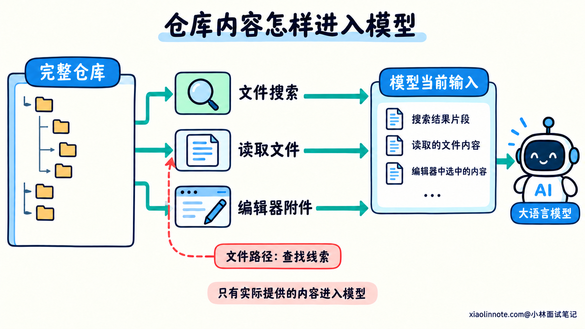
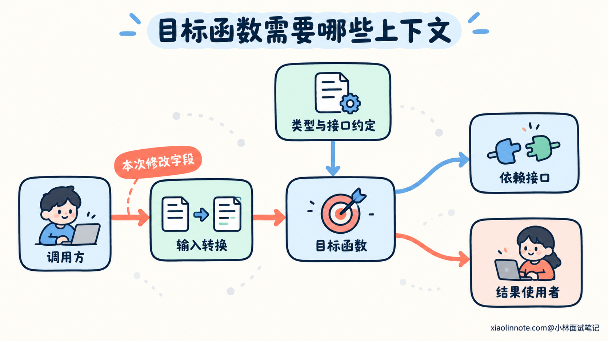
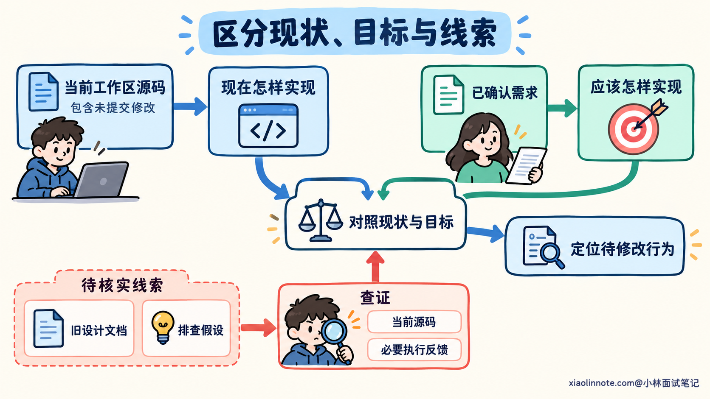
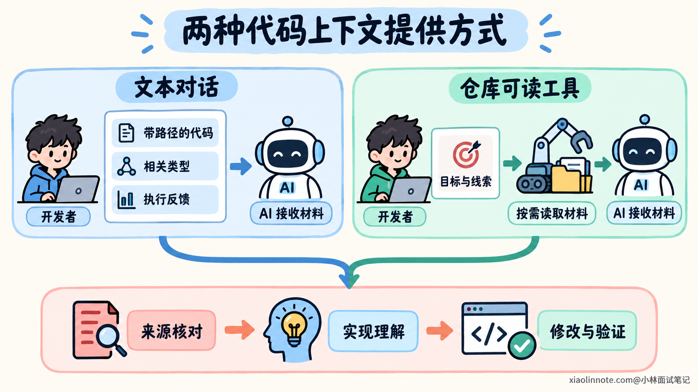

# 使用 AI 编程时，应该提供哪些代码上下文？

> 原文：[使用 AI 编程时，应该提供哪些代码上下文？](https://xiaolinnote.com/ai/coding/code_context.html) · 小林面试笔记


👔面试官：让 AI 修改项目代码，你会提供哪些上下文？

🙋‍♂️我：把整个仓库都塞进去，连 `node_modules` 一起梭哈，主打一个资料齐全。

👔面试官：（看了眼文件大小）你是让 AI 改代码，还是给它办数据迁移？

🙋‍♂️我：那只贴要改的函数，精华浓缩，绝不浪费一个 Token。

👔面试官：参数从哪里来，结果给谁用？你这浓缩到把案发现场都蒸发了。

🙋‍♂️我：工具能读仓库，它肯定全知道。再把上个月的设计文档给它，完美。

👔面试官：（合上电脑）仓库没读，文档过期。你这是找编程助手，还是请 AI 考古？

咱们从 AI 怎样获得项目信息讲起，再看什么样的上下文能够支持一次有依据的代码修改。

## 💡 简要回答

我会围绕当前任务选择上下文，先提供目标、修改约束和验收标准，让 AI 知道这次要解决什么问题，再补充实现这个任务需要的项目事实。

代码方面，我会提供相关入口和目标函数，必要时补上调用方、依赖接口和类型定义。因为只看一个函数，可能不知道参数的单位、数据经过了什么转换，也不知道修改返回值会影响谁。相关测试和一个经过核对的同类实现，也能帮助它理解项目已有的行为和写法。

如果任务涉及构建或运行问题，我还会提供依赖版本、相关配置、执行命令和关键报错。工具能够读取仓库时，我可以先给路径、符号或错误文本，让它查找并按需补读；但能访问文件，不代表模型已经拿到了文件内容。

我选择上下文的标准，是这份信息是否会影响当前实现或验证的判断。我不会默认把全仓库塞进去，也不会为了省长度把函数和类型截得不完整。关键材料要对应当前工作区，旧文档和历史结论需要回到源码核对，事实与猜测也要分开。这样 AI 才能基于项目的真实约定修改代码，遇到缺口时继续查证。

## 📝 详细解析

### 打开了仓库，AI 就知道项目里的所有代码吗？

开发者打开一个项目，能够浏览目录、跳转文件。AI 编程工具也可能拥有读取文件和运行命令的能力，但模型在一次回答里，依据的是这次实际得到的信息。

这些信息可以来自你粘贴的代码、工具附加的文件内容、对话历史，也可以来自搜索、文件读取和命令执行的结果。工具把它们组织成输入，模型才能据此分析当前项目。

比如你告诉 AI「问题在 `order_service.ts`」，模型得到了一个文件线索。如果工具没有把文件内容提供给它，它仍然不知道里面的实现。文件路径能够指引查找，查找和读取才会补充实际内容。

部分工具会自动带入选中的代码、当前文件或其他项目信息，具体行为取决于工具和使用模式。关键材料可以显式引用，并通过读取结果确认，不必把「正在项目里使用」当成「已经读过所有相关文件」。

模型学习过的通用编程知识，同样无法代替当前项目事实。它可能知道某种框架的常见用法，却不知道你安装的版本、封装过的接口，以及工作区里刚刚改过的代码。

**提供代码上下文，就是让当前任务需要的项目事实进入 AI 的判断过程。** 先明确它已经得到了什么，再补充缺少的信息，才能减少凭常见写法猜实现的情况。



### 先确定当前问题，再决定哪些材料值得提供

一个项目里，很多文件都与某个业务有关。修改一个校验条件，却不一定需要阅读这个业务的所有页面、任务和历史版本。

选择上下文时，先明确这次需要做哪些判断。要新增一个输入字段，就需要知道接口怎样接收数据、字段怎样传递，以及下游怎样使用。要修复一个失败，则需要知道触发条件、实际错误和期望结果。

任务目标、约束和验收条件，也属于上下文的一部分。它们说明希望代码发生什么变化；源码、配置和执行结果则说明当前项目是什么样。两类信息结合起来，AI 才能判断修改方向。

例如需求希望改变输入校验，相关材料通常会包括校验入口、输入类型、错误处理约定和对应测试。一个只负责展示订单列表的页面，即使也有「订单」这个名称，也未必影响这次判断。

因此，可以用一个问题筛选材料：**没有这份信息，AI 会不会在这次修改或验证中猜一个重要条件？** 如果会，就值得补充；如果只是业务名称相同，可以先保留位置，等出现具体需要时再读。

你也不需要提前找齐所有文件。已经知道的入口、接口路径、函数名或错误文本，可以作为起点，让工具继续查找。开发者提供目标和线索，AI 再补充实现关系，双方能够分担上下文收集的工作。

先看一条信息不足的提示词：

```text
帮我给订单查询加一个筛选条件，按照项目风格写。
```

AI 知道你想增加筛选，却还不知道实际查询入口、筛选字段的类型，以及项目使用什么方式组织查询。仅凭「项目风格」也无法确定应该参考哪份实现。

对于能够读取仓库的工具，可以补成下面这样。后文中的路径和名称都只是示意，实际使用时需要替换为项目里的真实线索。

```text
请为订单查询增加按状态筛选。筛选规则以我已确认的需求说明为准。

先从 src/order/order_query.ts 中的 listOrders 入手，
查找请求入口、查询参数类型和对应测试，核对当前查询流程。
如果实际入口不在这里，请根据调用关系继续查找。
```

这段提示词同时提供了目标和读取起点，也允许工具根据源码修正最初的定位。需要补充哪些材料，可以围绕查询流程继续判断。

### 目标函数之外，为什么还要补齐类型和代码关系？

读到目标函数以后，AI 能看到它的内部逻辑。但这段逻辑依赖什么输入、遵守什么接口约定，以及返回结果怎样被使用，可能写在其他位置。

首先要保留必要的代码边界。孤立的一行判断，往往缺少所属函数的参数、前置处理和返回路径。读取完整的小函数，或者大函数中相关分支与必要的外围结构，可以帮助 AI 判断这行代码实际在做什么。

接着看类型和接口定义。参数是否允许缺失、字段有什么枚举值、返回结果可能是哪几种结构，这些约定会影响生成代码。有些语义还需要文档或调用代码说明，例如一个整数表示秒还是毫秒，类型名称本身未必能够回答。

调用方说明数据怎样进入目标函数。输入可能已经经过校验、转换或默认值处理；如果不知道这些步骤，AI 可能重复处理，也可能遗漏真正需要处理的位置。

目标函数使用的依赖，则说明它把哪些操作交给了其他组件。返回错误、修改数据或执行查询，都需要符合实际接口。下游使用者又会影响能否调整返回类型和异常方式。

补齐关系也要围绕当前问题。确认字段怎样传递，可以沿着这一字段查输入和使用位置；只想核对错误响应，则应关注相关错误类型和处理入口。没有必要把所有调用链全部展开。

对于工具可读的仓库，可以这样要求补充上下文：

```text
围绕这次状态筛选，继续核对 listOrders 的参数类型、请求参数转换，
以及实际执行查询的接口。

请说明状态值从哪里进入、经过哪些处理、在哪里参与筛选。
读取相关函数和必要类型；暂时不展开与该字段无关的业务分支。
如果某个判断缺少依据，标出需要补读的文件或符号。
```

这里要求的是补齐会影响修改的关系。输出里保留文件和符号位置，也方便开发者回到源码检查分析是否成立。



### 测试、配置和报错，各自补充什么信息？

源码能够说明实现结构，但项目怎样运行、约定怎样检查，还需要其他材料。

相关测试可以展示已有行为、边界样例和项目的测试方式。尤其是在修改已有功能时，测试能帮助 AI 发现需要保留的约定。不过，旧测试也可能有遗漏或错误，需求明确要求改变行为时，需要核对它们的预期依据。

一个经过核对的同类实现，可以帮助 AI 了解项目怎样处理相同的问题。例如错误如何封装、模块怎样分层、测试替身怎样组织。但参考实现仍然需要与目标模块的约定一致，名称相似或代码较新，都不能独立证明适合照搬。

依赖清单、锁文件和相关配置，则帮助确认实现能否在当前项目中使用。一个框架的示例代码可以运行，不代表当前版本也支持它。配置还可能决定某个实现是否启用，或当前测试采用什么环境。

报错和日志提供的是执行反馈。保留触发输入、执行命令、关键错误和相关堆栈，比只说「运行失败」更有助于排查。需要区分构建失败、测试断言失败和环境无法启动，它们指向的检查方向不同。

如果需要隐藏敏感数据，可以替换具体身份或凭据，同时保留影响判断的结构、类型和关联关系。大量无关日志可以删减，关键错误的前后信息则要保留，避免截断以后改变含义。

这些材料不要求每次全部提供。它们分别补充不同的未知条件：

| 材料 | 通常帮助核对什么 |
| --- | --- |
| 相关测试 | 已有行为、关键样例和测试组织方式 |
| 同类实现与项目规范 | 当前项目采用的接口、结构和处理约定 |
| 依赖与相关配置 | 可用能力、启用条件和执行环境 |
| 输入、命令、报错与堆栈 | 实际怎样失败，失败发生在哪个步骤 |

例如，当前只是增加一个查询字段，可以优先提供相关测试和查询接口。出现依赖版本或运行错误时，再补充对应配置和执行反馈，让材料跟随问题扩展。

### 上下文应该怎样控制范围，并逐步补充？

把整个仓库都放进输入，虽然看起来省去了选择工作，却会同时带入依赖、生成文件、旧实现和无关业务。AI 仍然需要区分哪些内容影响当前任务。

模型每次能够处理的输入有长度限制，历史对话、文件内容和工具结果都会占用空间。工具在接近限制时，可能压缩或截断部分内容。即使全部材料能够放进去，也需要核对关键规则是否被有效使用。

反过来，只为了减少长度而删除关键分支、类型或错误上下文，也可能让模型在缺失条件下推断。控制范围时，应该保留当前判断需要的结构，再减少无关内容。

可以先提供入口、任务约定和必要代码，让 AI 说明目前能确认什么。发现参数语义不清，就补读类型和调用方；发现检查失败，就补充对应命令和错误。每次增加材料，都解决一个具体的信息缺口。

对于暂时无关但以后可能需要的内容，保留路径、符号和一句经过核对的说明即可。有需要时再读取原文。摘要可以帮助选择阅读方向，重要行为判断仍要回到相关源码。

如果阅读结果被截断，或者某个文件没有读到，就应该补读缺少的范围。未出现在当前结果里，并不足以说明某个实现不存在。

提供上下文的程度，可以用当前任务检查：目标代码、接口约定和影响范围是否有依据，关键结果能否验证，是否还在猜会改变行为的条件。仍有缺口时继续补充，已经明确的部分则可以进入修改。


### 材料齐了以后，还要检查来源和当前版本

上下文除了相关，还需要对应正在处理的代码。旧分支的实现、过期设计文档和当前工作区的文件混在一起，可能分别看起来合理，却描述不同的行为。

因此，代码片段最好保留文件路径和关键符号；涉及已提交版本时，可以记录提交位置。工作区中还有未提交修改时，也要考虑实际文件内容，不能只依据一个提交号判断当前实现。

文档和历史结论可以提供线索，但需要区分它们的来源和核实程度。开发者说「我怀疑某个字段转换错了」，属于待验证的假设；当前源码明确执行了一次转换，则属于能够核对的事实。混在一起，AI 可能直接围绕猜测修改。

这也不意味着当前代码永远优先于其他材料。源码说明现在怎样实现，已经确认的需求说明应该怎样实现。两者不同，可能正是需要修复的问题；旧文档与新需求冲突时，也需要确认适用的约定。



在持续修改过程中，AI 前面读过的代码也可能发生变化。开发者补充了新改动，或者依赖接口已经调整，相关理解就需要更新。在决定重要修改前核对当前内容，可以避免继续沿用旧片段。

提示词可以补上对来源的要求：

```text
请以当前工作区的实际源码核对已有实现，注意其中未提交的修改。
需求说明用于确定期望行为，历史文档用于提供线索。

分析时区分源码已确认的事实、我的排查假设和仍缺少的信息，
关键结论附上文件与符号位置。
如果材料互相冲突，请指出冲突涉及的行为，不要默默选择一个版本。
```

这段要求让不同材料各自承担明确作用。它也方便开发者检查 AI 的推断来源，而不是只听一段无法追溯的结论。

### 实际使用时，怎样把上下文交给 AI？

提供方式需要与工具能力配合。纯粹的文本对话，需要把必要内容附上；能够读取仓库的编程工具，则可以先给目标和查找线索，让它继续获取材料。

如果 AI 无法读取你的仓库，可以按下面的方式组织输入。占位内容需要替换成实际材料，没有掌握的信息应标明未知。

```text
任务：为订单查询增加按状态筛选，规则如下：
<已确认的行为、约束和验收条件>

项目环境：
<与此次修改相关的语言、依赖版本和配置>

相关代码：
<文件路径与目标函数>
<调用方、参数类型，以及查询依赖中影响本次修改的部分>

参考与验证：
<相关测试或经过核对的同类实现>
<实际执行命令、关键报错；没有发生错误时不必填写>

这些片段来自同一份当前工作区。
请先说明现有代码怎样处理查询参数，以及还缺少哪些影响实现的信息。
未提供的接口不要按名称猜实现，请说明需要补充的定义。
```

如果工具能够读取仓库，可以把内容改成路径和获取要求：

```text
请为订单查询增加按状态筛选，按我已确认的需求和验收条件实施。

从 src/order/order_query.ts 的 listOrders 入手，先核对当前源码，
再补读影响该字段的请求入口、参数类型、查询接口和相关测试。
依赖版本、测试命令和相关配置以当前项目文件为准。

围绕这次修改收集上下文。对接口、输入语义和结果结构的判断，
请保留文件与符号依据；缺少信息时，继续查找相应定义。
如果检索或读取结果不完整，请补读，不要当成代码不存在。

说明需要保留的已有行为和拟修改的范围，再修改并运行相关检查。
遇到已确认需求与现有业务约定的冲突，指出具体问题后确认处理方式。
完成后说明实际修改、验证结果与仍未确认的部分。
```

第二份提示词把上下文的收集交给工具，开发者仍然明确任务目标和判断依据。实际使用时，需要把示意入口换成真实线索，并提供已经确认的需求。

上下文是否合适，可以从 AI 的分析和后续检查中继续核对。它能否说明接口来自哪里、参数怎样流转、哪些已有行为需要保留，能够帮助你发现阅读遗漏；最终修改是否满足要求，仍然需要检查实际代码和执行结果。



## 🎯 面试总结

开头的三个回答分别把上下文等同于全仓库、孤立函数和工具的访问能力。它们都没有确认当前任务需要哪些事实，以及模型是否实际取得了这些事实。

回答时，可以先说明按任务选择材料，再解释怎样从目标函数补齐相关类型、调用关系、测试与环境信息。材料要能够支撑实现和验证判断，缺少重要条件时继续查找，也要保留足够的代码结构。

最后补充来源与版本核对。需求规定期望行为，源码说明当前实现，文档和历史结论需要确认适用范围。把这些信息分清楚，才能让 AI 围绕当前项目的真实条件完成修改。
