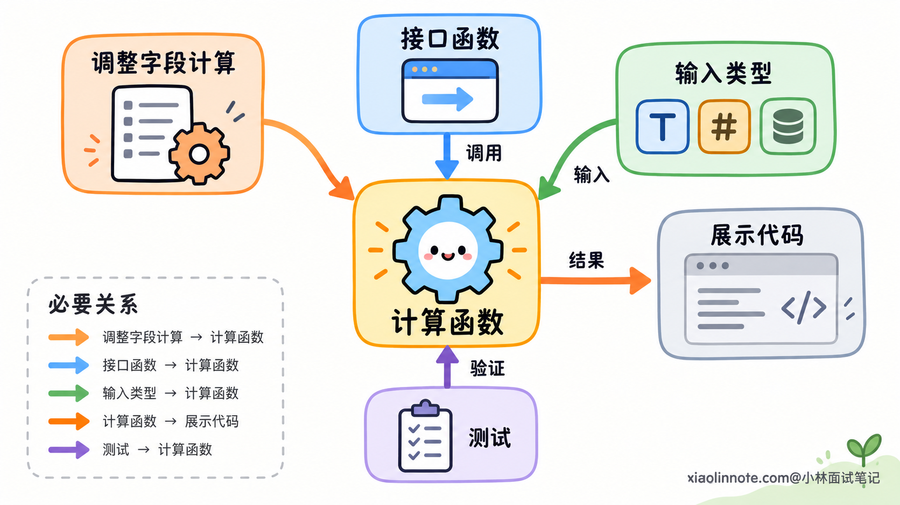
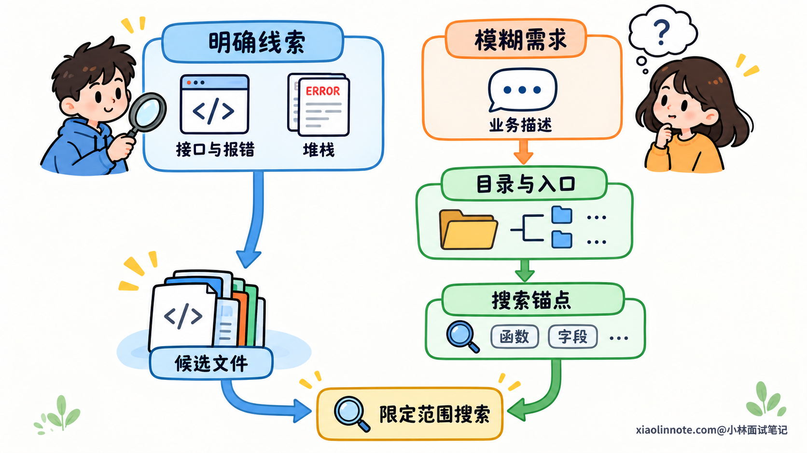
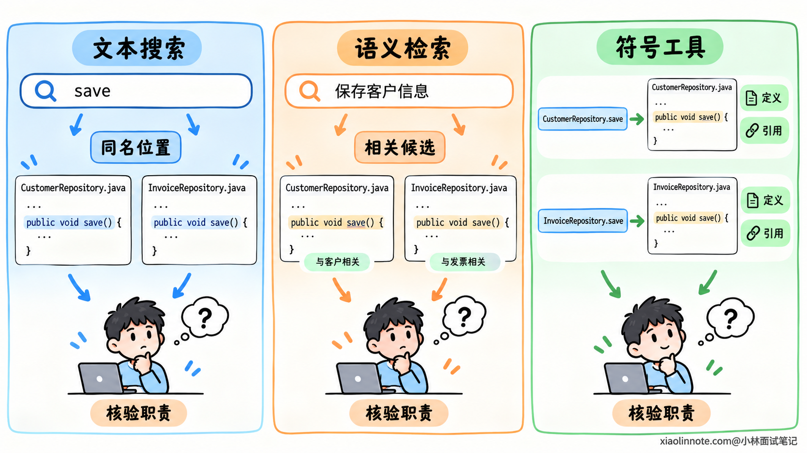
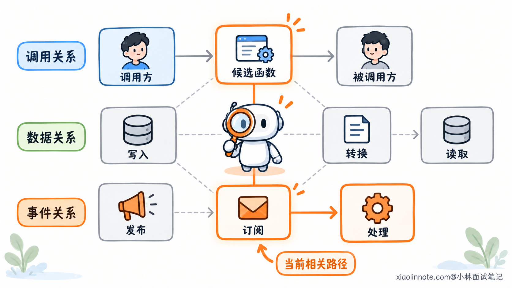
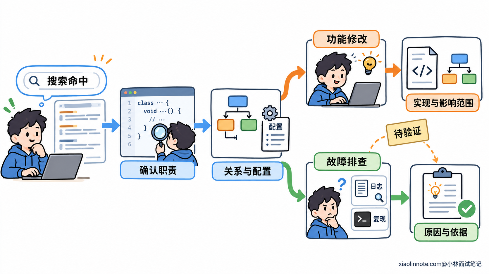

# Coding Agent 如何在大型代码仓库中定位相关代码？

> 原文：[Coding Agent 如何在大型代码仓库中定位相关代码？](https://xiaolinnote.com/ai/coding/code_localization.html) · 小林面试笔记

👔面试官：一个大型仓库有几十万行代码，Coding Agent 怎么找到与当前需求相关的实现？

🙋‍♂️我：把仓库里的代码都放进上下文，让模型自己找。

👔面试官：依赖、测试和历史实现混在一起，模型怎么判断哪些代码值得读？

🙋‍♂️我：那就做向量检索，取相似度最高的几个代码片段。

👔面试官：入口函数、数据转换和事件消费者分散在不同文件里，相似度能把这些关系找齐吗？

🙋‍♂️我：再搜一下相关关键词，命中的函数就是要修改的地方。

👔面试官：同名函数可能属于不同模块，也可能根本没有在当前版本里使用，你怎么确认？

咱们把代码定位拆开来看，理解 Agent 怎样从一句需求逐步找到有依据的实现位置。

## 💡 简要回答

大型仓库里的代码定位，核心是先缩小搜索范围，再沿代码关系补齐上下文。需求里的业务描述和源码命名不一定一致，所以要先结合目录结构，把接口路径、报错文本、日志、字段名或者堆栈转成可以搜索的线索。

有明确标识时，文本搜索通常更直接；只有模糊的业务描述时，可以用语义检索寻找候选。命中后还要读取完整函数和相关类型，用跳转定义、查找引用等工具确认符号，避免把同名代码当成同一个实现。

接下来要看调用方、被调用方，以及数据读写和事件传递关系，把分散在多个文件里的实现连起来。配置和注册代码也要核对，因为它们会影响当前实际使用哪个实现。

定位到什么程度取决于任务。新增功能需要确认实现职责和修改会影响的范围；排查故障还要结合日志、执行轨迹或最小复现验证原因。整个过程应围绕当前问题逐步读取代码，并保留路径、关键符号和验证依据，支持后续修改。

## 📝 详细解析

### 为什么命中了文件，还不一定找到了相关实现？

在一个小项目里，业务逻辑可能集中在几个文件中，搜到业务名称，再从头读一遍，就能大致理解实现。仓库变大以后，同一个需求可能涉及接口层、业务层、数据访问层，还可能通过消息交给另一个服务处理。

这时，需求里的一个业务词，通常对应不了一个完整的代码位置。搜索「订单」可能找到几十个文件，其中有类型定义、测试数据、旧接口，也有正在使用的业务逻辑。文件与问题有关，不代表其中所有代码都需要修改。

**代码定位需要回答两个问题：哪段代码承担当前要找的职责，以及哪些代码关系会影响这段实现。**

比如要调整一个字段的计算方式，负责计算的函数是直接目标，但还要知道它接收什么输入、计算结果在哪里使用。只读计算函数，可能漏掉调用方对空值的约定；只搜字段名，又可能把只负责展示的代码误认为计算入口。

因此，定位的结果通常是一组有关系的代码位置：关键函数、必要的类型或配置，以及与任务相关的调用方。Agent 需要从庞大的仓库中筛出这组代码，再据此理解和修改。

还有一个前提容易忽略：**搜索和阅读要对应同一份代码版本。** 如果排查的是线上故障，却读了已经修改过的主分支，实现可能已经不同。若使用预建索引，也要确认索引对应的提交，并回到当前源码核验候选；工作区里的未提交修改同样会影响实际内容。

### 如何把需求转成可以搜索的线索？

Agent 接收到的通常是自然语言，比如「增加重复提交校验」或「某个接口返回异常」。源码里未必出现同样的描述，开发者可能把相关逻辑命名为 `checkIdempotency`，也可能把校验放在公共中间件中。

直接拿整句需求搜索，容易找不到；不断换业务同义词，也可能始终在猜名字。更有效的做法是寻找需求与源码之间共有的标识。

接口路径、错误码、日志字符串和堆栈中的函数名，往往能直接指向一段实现。页面字段、数据库列名、事件名也能成为线索，因为代码需要读取、写入或传递它们。这些能在仓库里查找的标识，就是搜索锚点。

拿到锚点以后，还需要确定搜索范围。对于陌生仓库，可以先读取顶层目录、构建配置和模块入口，了解服务与模块怎样划分。目录名帮助选出候选范围，入口代码再确认职责；一个叫 `common` 的目录，并不能说明它与业务问题无关。

如果已经有准确的文件路径或堆栈，就可以直接从对应位置展开。了解目录结构是为了减少无关搜索，不需要每次都先浏览完整仓库。

初次搜索通常可以优先关注项目源码，减少依赖目录、构建产物和大批生成文件的干扰。但搜索范围要随着证据调整：如果堆栈指向某个依赖，或者关键接口由生成代码提供，就需要继续读取那里。

这个过程会反复进行。读到入口函数，获得被调用的服务名；读到服务，获得状态字段；查到字段写入位置，又发现事件名。每次读取都应提供新的线索，让下一次搜索更具体。

### 怎样从搜索结果中确认真正相关的函数？

有了线索，接下来要选择能处理这种线索的工具。文本搜索、语义检索和符号工具提供的信息不同，不能把它们的结果当成同一种证据。

**文本搜索适合查找已经知道的名称或字符串。** 例如知道接口路径、错误文本或字段名，就可以找出它们的出现位置。带路径、行号和少量上下文的结果，便于 Agent 先筛选，再展开阅读，避免一次读入所有命中文件。

文本搜索也存在歧义。`save` 可能出现在多个类里，注释和测试中也可能出现它。搜索命中只能说明这段文本存在，还需要判断它属于哪个对象、承担什么职责。

**语义检索适合在缺少明确名称时寻找候选。** 用户说「防止请求重复处理」，相关代码可能描述为「幂等校验」。语义检索可以帮助跨过这层表述差异，再从候选源码中提取准确的函数名和字段名，继续查找。

不过，相似度高只表示内容可能相关。一个讲幂等性的注释、测试或旧实现，都可能比当前入口更接近需求描述。Agent 仍然需要读取源码，确认候选实际做了什么。

当问题变成「这个调用究竟指向哪个函数」时，就需要利用代码的符号信息。符号可以理解为程序中有名称的对象，例如函数、类和字段；作用域、所属类型和项目依赖决定一个名称具体指向谁。

比如两个类都有 `save` 方法，`CustomerRepository.save` 和 `InvoiceRepository.save` 保存的对象不同。查找名称相同的文本，无法直接区分这两种职责；在项目分析可用时，语言服务提供的跳转定义、查找引用等能力，可以帮助确认具体符号。

确认符号后，还要给模型足够的阅读上下文。孤立的一行 `status = SUCCESS`，看不出修改了哪个对象，也不知道什么条件下会执行。读取所属函数的参数、分支和返回，再补上状态类型，才能解释这行代码的含义。

语法解析器可以帮助找到函数、类等代码边界，避免固定长度切块把一个函数拆成几段。识别语法边界和解析符号指向是不同能力：找到一处函数调用的语法结构，并不等于已经知道它运行时调用哪个实现。

展开阅读也要控制范围。先看函数签名和主体，遇到不清楚的类型或辅助函数再补读；一个函数很长时，可以先看整体结构，再围绕相关分支深入。这样既保留必要上下文，也减少无关代码。

### 如何沿代码关系找到跨文件实现？

读懂一个函数以后，Agent 往往还不能解释完整行为，因为函数的输入来自别处，输出也可能交给别的模块。此时需要沿当前问题涉及的关系继续查找。

最直接的是调用关系。调用方说明函数在什么条件下执行、传入什么参数；被调用方说明它把哪些工作交给了其他代码。查调用关系时，要关注与任务有关的分支，而不是把所有能到达的函数都展开一遍。

如果关注的是某个字段的结果，数据关系往往更有用。谁写入字段、谁读取字段，中间有没有默认值、格式转换或重新计算，这些位置共同决定最终值。即使几个文件没有相似的业务描述，也可能通过同一个数据对象联系起来。

事件驱动的实现还需要追踪消息关系。比如代码发布了 `OrderPaid` 事件，后续处理可能发生在另一个服务的消费者中。两个函数之间没有直接调用，要从事件类型、发送位置、订阅注册和处理函数继续查找。

这也是为什么代码相似度无法替代关系分析。事件发布函数与消费函数可能连变量名都不同，却共同实现一段业务流程；两个名称相近的函数，则可能服务于不同业务。

**代码存在，还要确认当前运行路径会不会使用它。** 接口可能有多个实现，依赖注入配置决定选择哪个；消费者可能已经写好，订阅配置却没有启用。找到类或函数之后，必要的注册与配置也是定位范围的一部分。

静态工具能帮助追踪很多关系，但动态调用、反射和运行时注册可能让分析不完整。查找引用没有结果时，应先确认项目分析是否完整、实现是否通过动态方式接入，再决定能否排除这个候选。

扩展关系要有具体问题。例如想确认输入是否经过校验，就查输入来源与校验分支；想确认结果为什么没有变化，就查写入条件和后续读取。当前证据不支持原来的判断时，再调整搜索方向。这样能逐步补齐必要代码，而不会把整个依赖图搬进上下文。

### 怎样判断代码已经定位到位？

找到相关文件、理解相关实现、确认故障原因，是不同程度的结论。Agent 需要知道当前任务要求哪一种，才能判断是否还要继续搜索。

对于新增功能或修改行为，定位应明确职责由哪个函数承担，输入输出有什么约定，以及修改可能影响哪些调用方。相关测试还能帮助理解已经约定的行为。有这些依据，后续修改才有明确范围。

对于故障排查，还要检查候选原因能否解释实际现象。源码说明某条路径可能发生，日志或执行轨迹则能帮助判断这次是否经过该路径。最小复现进一步验证，在对应条件下能否出现同样的错误。

例如发现两个模块分别使用 `order_id` 和 `orderId`，只能提出「字段转换可能有问题」的假设。如果中间存在正确的映射，这个差异就解释不了故障。继续读取转换逻辑，结合实际输入或复现结果，才能判断假设是否成立。

工具结果的完整性也影响判断。搜索结果被截断，不能据此断言其他位置没有实现；文件读取失败，也不能当作代码不存在。Agent 需要缩小查询范围、补读缺失内容，或者明确留下尚未确认的部分。

定位完成以后，保留关键路径、函数名、必要关系和验证依据即可。那些读过但已排除的文件，不必一直占用上下文；需要重新核对时，再按位置读取。这样后续修改能围绕已确认的代码展开，也能追溯定位判断来自哪里。

## 🎯 面试总结

开头的三个回答分别忽略了范围筛选、跨文件关系和命中结果的核验。把代码全交给模型、只取相似片段、搜索到关键词就确定修改位置，都会在这些环节留下缺口。

回答这道题时，可以沿着定位过程说明：从需求中提取搜索线索，结合仓库结构缩小范围，再用文本、语义和符号工具找到候选。读取完整函数与必要类型后，继续追踪调用、数据和事件关系，确认实际承担职责的实现。

最后说明定位的完成标准。功能修改要明确实现位置与影响范围，故障排查还要验证原因。讲清每一步怎样减少不确定性，就能说明 Coding Agent 为什么需要逐步搜索、阅读和核验代码。

---
