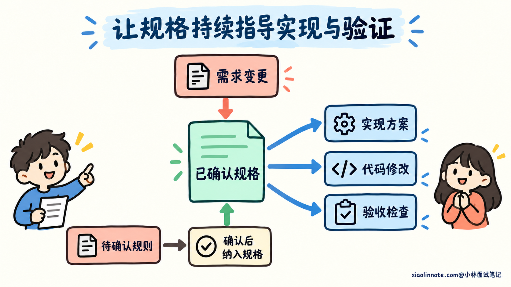
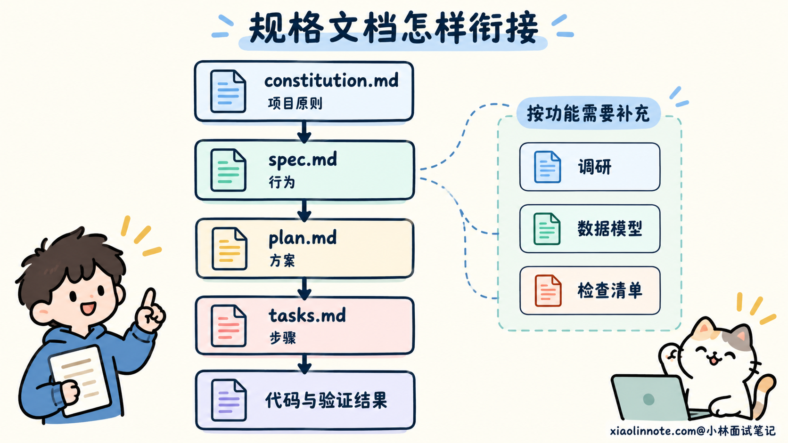
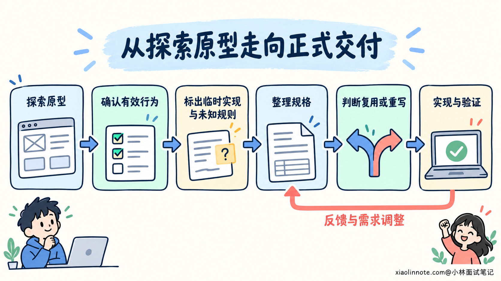
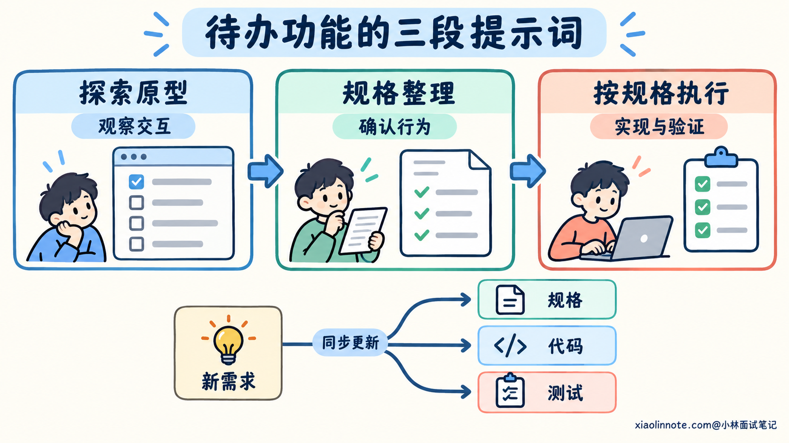

# Vibe Coding 和 Spec 驱动开发有什么区别？分别适合什么场景？

> 原文：[Vibe Coding 和 Spec 驱动开发有什么区别？分别适合什么场景？](https://xiaolinnote.com/ai/coding/vibe_coding_vs_spec_driven.html) · 小林面试笔记


👔面试官：你怎么理解 Vibe Coding 和 Spec 驱动开发？分别适合什么场景？

🙋‍♂️我：只要用 AI 写代码就叫 Vibe Coding。Spec 驱动就是先写一份文档。

👔面试官：（指了指项目的 README）那我们项目早就有文档，是不是早就 Spec 驱动了？

🙋‍♂️我：那得写得厚一点。我让 AI 先写五十页规格，再一次把整个项目生成出来，稳。

👔面试官：（翻了翻文档）五十页规则都没确认，你是减少返工，还是给返工办批发？

🙋‍♂️我：写完规格就行了。后面需求变了，直接在聊天里让 AI 改代码，文档不影响运行，不用管。

👔面试官：（把文档扣在桌上）规格只负责出席开工仪式，后面全靠聊天？这份文档是来剪彩的吧。

咱们从开发过程中怎样确定需求、判断结果讲起，看看两种方式为什么会有不同的优势和代价。

## 💡 简要回答

我理解的 Vibe Coding，采用的是较严格的含义：用自然语言让 AI 生成和修改代码，开发者主要看运行效果、继续反馈，对生成代码本身的理解和审查较少。如果我会阅读改动、理解实现并做验证，即使没有专门的规格文档，也可以属于普通的 AI 辅助开发。

Spec 驱动开发则会先把已经确认的行为、约束和验收条件写成规格，再组织实现和验证。像 Spec Kit 这样的工具，会用 [spec.md](http://spec.md) 说明做什么、[plan.md](http://plan.md) 说明怎么做、[tasks.md](http://tasks.md) 安排具体步骤，再通过对应的 Skill 推进。需求变更时，也要更新受影响的文档和检查。文件可以很短，关键是规则有确认依据，后续实现持续对照它们。

两者的差别主要在于怎样处理不确定性。想法还没成形时，快速生成原型、看效果再调整，能够帮助探索；规则已经明确，需要兼容已有系统、多人协作或长期维护时，按规格组织开发更容易追踪要求和验证结果。

实际工作中，我会根据任务阶段组合使用。先用低成本、容易舍弃的原型确认方向，准备进入正式交付时，再明确规格、检查原型代码，并补齐验证。我不会因为原型能跑就直接继承全部实现，也不会把规格写得很长当成质量保证。

## 📝 详细解析

### 先分清词义：用 AI 写代码，都算 Vibe Coding 吗？

现在聊 AI 编程，经常会听到「这个项目是 Vibe 出来的」。这句话可能只是说代码主要由 AI 生成，也可能是在描述一种以效果反馈为主、较少检查代码的开发方式。

为了把面试题回答清楚，咱们先采用后一种较严格的用法：开发者描述想法，让 AI 生成代码，再根据运行结果提出调整。这个过程中，对代码细节的理解和审查可以很少，主要依据是眼前看到的效果。

如果开发者使用 AI 生成代码，同时认真阅读差异、核对业务规则、运行检查，那就可以按普通的 AI 辅助开发来理解。它未必维护一份正式 Spec，但仍然可以有明确的任务约定和工程验证。

Spec 驱动开发关注的是另一层问题：把已经确认的要求组织成规格，持续用于指导实现和核对结果。它是一种组织开发的方式，也能够用于人工编码，AI 则可以参与规格整理、实现和验证。

所以，这道题并没有要求你在两种方式里强行选一个。AI 是否生成代码、开发者怎样审查代码，以及有没有用规格组织开发，是需要分别说明的事情。

同样，Agent 是怎样执行任务的问题。一个 Agent 可以根据聊天反馈不断改原型，也可以按规格实现功能。使用哪个工具或交互界面，并不能独立决定采用了哪种开发方式。


### Vibe Coding 怎样依靠效果反馈推进？

想法还不清楚时，开发者未必知道最终界面、交互和功能范围应该怎样设计。先生成一个能运行的版本，能够把这些抽象想法变成可以观察、尝试的结果。

这种推进过程通常是「提出想法 -> 生成实现 -> 运行观察 -> 反馈调整」。看到结果以后，开发者可能发现布局不合适，某个操作需要多一步，或者最初想要的功能并没有价值，再让 AI 继续修改。

它的价值在于缩短试验的等待时间。你可以在需求仍然变化时尝试几个方向，也可以丢弃不合适的版本，减少过早决定全部细节的成本。

但观察结果能够回答的问题有范围。页面表现符合预期，可以支持对交互的判断；它未必能说明异常分支、数据处理和依赖使用也正确。如果开发者很少读取代码，这些实现问题就可能持续积累。

反复通过对话修补，还可能让不同轮次采用了不同规则。一次要求增加功能，下一次又换了处理方式，代码能够继续运行，却不一定形成一致、容易维护的实现。

因此，效果反馈适合帮助发现需求，正式交付还需要把已经确定的要求转成可核对的规则，并检查实际实现。原型里采用的每一种处理方式，都不应仅因为已经写出来就成为最终约定。


### Spec 怎样持续指导实现，而不是写完就放着？

开发者确定希望保留哪些行为以后，就可以把它们写成规格。这里的 Spec 可以理解为一份经过确认的行为约定，说明要实现什么、受到哪些限制，以及怎样判断完成。

规格先规定可观察的结果。例如允许哪些输入、失败后应该怎样响应、修改后哪些旧行为必须保留。具体采用什么数据结构、怎样分层，则可以在结合项目现状后形成实现方案。

把这两层分清楚，同一份行为规格就可以支持不同实现。开发者调整内部结构时，仍然可以使用原来的验收条件检查外部行为，而不必因为换了实现就重新定义正确结果。

在 AI 编程中，规格还可以用于推导任务和测试。AI 读取相关要求，提出实现步骤，再根据这些要求生成修改和检查。开发者要核对计划是否覆盖关键规则、测试预期是否来自已经确认的要求。

**Spec 驱动的关键，是让规格持续参与开发判断。** 实现失败时要对照规则定位，需求变更时要调整对应规格，后续维护也要能够追踪某个行为依据哪条要求。

一份文档写得很完整，却在编码以后不再使用，无法发挥这些作用。反过来，一个小功能用几段文字写清行为，并在实现、测试和变更中持续核对，也可以采用规格驱动的思路。

规格也可能存在遗漏、冲突或错误。AI 能帮助整理和发现问题，但生成出来的文档需要审查。测试如果继承了错误规格，同样可能通过，所以确认要求和检查实现缺一不可。



### Spec 通常会落成哪些 Markdown 文档？

把规格驱动落实到项目里，可以先理解三份核心文档：`spec.md`、`plan.md` 和 `tasks.md`。它们分别记录行为要求、实现方案和执行步骤，让 AI 在下一阶段能够继续读取已经确认的内容。

`spec.md` 说明做什么，以及什么结果算符合要求。比如前面的待办功能，可以写明空名称不能新增记录、切换状态只影响指定记录。这些规则先确定外部行为，不必提前规定组件和变量怎样组织。

`plan.md` 再结合项目现状说明怎么实现。数据放在哪里、模块怎样协作、采用什么技术约束、怎样安排验证，都可以在这里解释。规格要求刷新后清空数据，方案就要选择符合这种行为的状态管理方式。

`tasks.md` 把方案落成可执行步骤，并标明顺序和依赖。例如先建立状态处理，再接入新增、切换和删除操作，最后补齐相应检查。一个任务应该能够说明修改目标和完成依据，不能只写「完善功能」。

| 文档 | 主要回答的问题 | 待办功能里的内容示例 |
| --- | --- | --- |
| `spec.md` | 应该有什么行为？怎样验收？ | 空名称不新增，操作只影响目标记录，刷新后清空 |
| `plan.md` | 怎样在当前项目中实现这些行为？ | 沿用现有组件结构，使用内存状态，安排对应的行为检查 |
| `tasks.md` | 按什么顺序执行，哪些步骤依赖前面的结果？ | 状态处理、交互接入、边界验证与相关回归 |

以 Spec Kit 的文件约定为例，核心材料通常组织成下面这样。`<功能目录>` 表示工具为当前功能建立的实际目录，具体名称可能随配置和版本不同。

```text
.specify/
└── memory/
    └── constitution.md      # 项目共同遵守的原则

specs/
└── <功能目录>/
    ├── spec.md              # 功能要求与验收条件
    ├── plan.md              # 技术实现方案
    └── tasks.md             # 可执行任务与依赖顺序
```

其中 `constitution.md` 是项目层面的原则，例如依赖使用、兼容性和验证要求，通常由多个功能共同使用。`spec.md` 等则围绕一个功能展开，避免把整个项目的所有规则都混进同一份任务说明。

复杂功能还可能产生 `research.md` 记录技术调研与选择依据，`data-model.md` 说明实体与状态，`quickstart.md` 记录运行和验证步骤。接口约定可以放在 `contracts/`，格式也可能是 OpenAPI 或其他文件，不局限于 Markdown。

检查材料也有不同用途。`checklists/requirements.md` 可以用于核对规格是否清楚、完整，其他 `checklists/*.md` 可以检查特定方面的需求质量。清单勾选通过，说明相应要求经过核对；它不能替代代码测试的执行结果。

这些文件是具体工具的组织约定，规格驱动开发没有统一要求必须使用这些名字。小功能可以合并材料，复杂功能可以拆开，重点是每份内容能够被后续实现与验证使用。



### 哪些常见 Skill 能把文档和执行串起来？

整理规格、制定方案和检查一致性，都可以写成可复用的 Skill。Skill 会告诉编程助手这一步要读取哪些材料、怎样处理、把结果保存在哪里，再由助手使用文件和执行工具完成工作。

GitHub 的 Spec Kit 就提供了这样一组工作流 Skill。下面用 `/speckit-*` 展示常见的调用形式：在项目完成安装和初始化以后，在编程助手的聊天输入中逐步调用。它们不是终端命令，实际入口也可能因集成方式写成 `/speckit.*` 或其他形式，以工具加载的名称为准。

| Skill | 主要作用 | 主要产物或影响 |
| --- | --- | --- |
| `/speckit-constitution` | 建立或更新项目原则 | `.specify/memory/constitution.md` |
| `/speckit-specify` | 把自然语言需求整理成规格 | `spec.md`，以及规格质量检查材料 |
| `/speckit-plan` | 根据规格和技术约束设计实现 | `plan.md`，以及需要的调研、模型和接口材料 |
| `/speckit-tasks` | 根据方案拆分有依赖顺序的任务 | `tasks.md` |
| `/speckit-implement` | 按任务推进实现 | 代码、测试和任务进度 |
| `/speckit-converge` | 实现后对照规格、方案和任务检查遗漏 | 输出发现的问题；有缺口时向 `tasks.md` 追加待办 |

需求存在歧义时，可以在规划前用 `/speckit-clarify` 补齐回答并更新 `spec.md`。任务拆完以后，`/speckit-analyze` 会交叉分析 `spec.md`、`plan.md` 和 `tasks.md`，报告冲突、遗漏和含糊之处；这个分析步骤本身不修改文件。

另一个辅助 Skill 是 `/speckit-checklist`，它生成特定方面的需求质量检查清单。例如错误处理是否说明完整、权限规则是否存在歧义。这一步检查的是要求本身，代码有没有正确实现这些要求，还需要后续验证。

每个阶段都应该阅读实际产物，再决定下一步。若规格有误，应当先修正规格；若方案遗漏规则，就补齐方案和受影响的任务。Skill 能帮助组织检查，但它的报告仍需要核实，不能把「没有发现问题」等同于已经证明所有要求都满足。

另一套可以了解的工具是 OpenSpec。它围绕一次变更组织材料：用 `/opsx:propose` 建立变更并生成规划文档，`/opsx:apply` 执行任务，完成后通过 `/opsx:archive` 归档，并处理变更规格与主规格的同步。下面是它的常见变更结构，能力目录与变更名只作示意。

```text
openspec/
├── specs/
│   └── <能力>/spec.md                 # 当前维护的主规格
└── changes/
    └── <变更名>/
        ├── proposal.md                # 为什么改，本次改变什么
        ├── specs/<能力>/spec.md        # 这次新增、修改或移除的要求
        ├── design.md                  # 技术方案与重要决策
        └── tasks.md                   # 实现任务
```

这里的 `proposal.md` 先说明变更动机与范围，`specs/` 记录具体要求的变化，`design.md` 解释技术方案。OpenSpec 的调用入口也会随编程工具不同而变化，应当使用初始化后实际提供的 Skill 或命令名称。

比较这些工具时，先看它们怎样保存要求、形成方案、安排任务和维护变更，就能理解它们解决的共同问题。具体选择可以结合项目现有流程，不需要为了使用某个 Skill，把所有功能都扩成一套复杂文档。

### 两种方式怎样处理需求与验证的不确定性？

理解了推进方式，再比较它们的取舍，就不能只看第一次生成代码有多快。

需求探索阶段，很多选择需要通过试用才能判断。你先做一个结果，发现问题再调整，能够获得新的信息。如果为了尚未确定的想法，提前维护大量细节规格，后续方向一变，这些工作也需要重做。

进入实现阶段以后，开发者则希望减少另一类不确定性：已经决定的规则有没有被正确实现，已有约定有没有受到影响，以及检查结果能否说明完成。规格能够把这些判断依据明确下来，减少每轮对话重新解释和临时补规则的情况。

不过，两类不确定性可以同时存在。交互布局还在试验，不代表权限规则也应该随意试；业务规则已经确定，也不代表技术方案必须一次决定。可以只对尚未明确的部分进行探索，对已经明确的部分保留约束和验证。

| 比较维度 | Vibe Coding 的典型方式 | Spec 驱动开发 |
| --- | --- | --- |
| 推进依据 | 运行效果与即时反馈 | 已确认的规格和当前执行结果 |
| 需求怎样明确 | 在尝试和反馈中逐步形成 | 先确认相关规则，再用于指导实现 |
| 代码审查与验证 | 较少深入检查代码，容易停留在可见效果 | 要把实现和检查对应到规格，仍需要审查代码 |
| 变更怎样处理 | 通过追加反馈继续修改 | 更新受影响的规格、实现和验证依据 |
| 主要代价 | 实现理解不足、规则不一致和后续返工 | 规格确认、维护与一致性检查的投入 |

Spec 驱动通常需要投入前期确认和维护工作，但它也可能减少后续解释、协作和返工。Vibe Coding 能较快得到可见结果，后续接入正式项目时，则可能需要重新理解和整理实现。

因此，要结合任务的整个生命周期判断成本。对于容易舍弃的尝试，先探索有价值；对于需要不断修改和交接的功能，清楚的规格和验证依据会持续发挥作用。

### 哪些任务适合探索，什么时候需要转向明确约定？

选择方式时，可以先看当前最需要解决什么问题。如果还在判断功能是否有用、哪种交互更合适，原型的反馈能够帮助确认方向。前提是这次尝试的失败影响有限，代码也容易舍弃。

如果功能需要接入已有系统，改变公共接口，或者由多人长期维护，就要明确需要保持的约定，并安排相应验证。任务即使只有几行代码，也可能涉及重要的行为变化，不能只按代码数量选择开发方式。

规格的详细程度同样要按需要决定。一个局部校验可以用简短的行为规则和边界样例说明；跨模块功能则可能需要补齐接口、状态变化和异常结果。只写会影响实现和验收的内容，能够控制维护成本。

从探索转向交付时，可以先整理原型中已经确认的行为，标出临时替代的部分和仍未决定的规则。随后检查代码是否适合继续使用，再制定实现与验证计划。

原型可以帮助发现需求，但原型代码未必值得全部保留。临时状态、模拟数据和绕过错误的处理，都需要重新核对。有的部分可以整理后复用，有的部分重新实现更容易形成清楚的结构。

已经确认的规格也可以调整。试用后发现需求不合适，应当修改要求并更新受影响的实现和检查。持续核对的依据要跟着有效需求变化，才能避免文档、代码和测试分别描述不同的功能。



### 提示词怎样体现不同的推进方式？

可以用一个简单的待办列表来理解提示词的差别。这个例子只用于展示开发组织方式，实际项目的行为和限制需要自行确认。

如果主要想尝试交互，可以先把探索范围限制清楚，再要求一个可运行版本：

```text
我想试一个简单的待办列表交互。
先做一个能运行的原型，支持新增待办、切换完成状态和删除。
界面尽量简洁，状态只保存在内存里，刷新后清空。
不用账号、云端数据和外部服务。

这一轮先让我试用交互。完成后说明运行方法，
并标出哪些处理只是原型里的临时选择。
```

开发者可以根据结果继续反馈，例如修改按钮位置或操作顺序。这里先获取一个可观察版本，是为了判断交互方向。是否属于严格意义的 Vibe Coding，还要看后续有没有理解和审查代码，仅凭这段提示词无法决定。

方向已经确认以后，可以先要求整理规格，而不是直接在原型上继续堆功能：

```text
请根据以下已确认规则，为待办功能整理一份简短规格，保存到 specs/todo/spec.md。
这一步先整理规则，不修改实现。

待办名称去掉首尾空白后不能为空；拒绝空名称时，不新增记录。
新增记录默认未完成；切换和删除只影响指定记录，不影响其他记录。
数据只存在内存，刷新后清空。暂不提供账号和同步功能。

请列出对应的验收条件，区分已确认规则和原型里其他临时选择。
影响行为的未知事项请单独标明，不要直接把临时实现写成要求。
```

这一步把试验中已经决定的行为明确下来。规格由 AI 整理，开发者仍然需要核对遗漏和冲突。这里用 `specs/todo/` 作示意目录，实际使用 Spec Kit 时，应当采用工具为当前功能生成的目录。

规格确认以后，可以继续要求形成方案和任务，让实现阶段有明确的读取依据：

```text
请根据已经确认的 specs/todo/spec.md 和当前项目代码，整理 plan.md。
说明状态怎样管理、哪些模块需要调整，以及如何验证关键行为。
沿用项目现有技术栈，不增加本次功能不需要的依赖。

方案核对后，再据此生成 tasks.md。
每项任务说明修改目标和完成依据，按依赖顺序排列，并包含相关验证工作。
两份文件均保存到 specs/todo/。如果方案与规格冲突，先指出冲突。
```

如果已经使用 Spec Kit，这两个阶段可以分别通过 `/speckit-plan` 和 `/speckit-tasks` 完成。每次调用以后核对生成文件，再进入后续步骤；上面的自然语言表达也可以用于没有安装这些 Skill 的编程助手。

方案和任务确认以后，再让实现与检查围绕它们展开：

```text
请读取 specs/todo/ 下的 spec.md、plan.md 和 tasks.md，按已确认的要求实现待办功能。
先检查现有原型，说明哪些行为符合规格，哪些需要调整，
再沿用项目现有技术栈和测试方式完成修改。

测试至少验证：空名称不新增记录、新记录默认未完成、
切换或删除只影响目标记录，以及刷新后不保留数据。
测试预期依据规格，不要根据现有实现反推。

运行相关检查，并说明规格中的哪些要求已有验证证据，
哪些仍未验证。如果规则有冲突，指出具体问题后确认处理方式。
```

这段提示词同时提供了实现依据和验证方向。它不要求先把原型全部推倒，也不默认原型实现可以直接接受，而是通过规格判断需要保留和修改的部分。

如果后续希望刷新以后仍然保留待办，就需要改变原来明确规定的行为。提示词可以先要求分析这项变更：

```text
现在希望刷新页面后仍然保留待办。
请先说明这项需求会改变当前规格中的哪些行为，
并列出需要确认的存储方式、数据范围和失败处理。

确认新规则后，更新受影响的规格、实现和测试，
检查旧的刷新清空要求是否仍残留在其中。
```

当变更涉及存储方式和失败语义时，需要先确认这些规则，再调整 `spec.md` 中的行为、`plan.md` 中的方案和 `tasks.md` 中受影响的步骤。Spec 驱动开发通过维护一致的要求，支持后续修改；单纯保留一份最初的文档，无法提供同样的依据。



## 🎯 面试总结

开头把所有 AI 编程都叫 Vibe Coding，会忽略开发者对代码理解和验证的投入。把 Spec 驱动理解成写一份厚文档，又会遗漏规格在实现和变更中的持续作用。

回答时，可以先说明采用的词义，再比较推进依据：Vibe Coding 主要靠生成、运行和即时反馈，Spec 驱动则用已经确认的规则组织实现与验证。普通的 AI 辅助开发也可以有严谨的审查和检查，不必强行归入其中一类。

需要展开实践时，可以用 `spec.md`、`plan.md` 和 `tasks.md` 解释行为、方案与步骤的分工，再说明 Spec Kit 等工具如何通过 Skill 连接这些材料。文件名字和调用方式可以不同，核对要求、实现和验证是否一致，是共同的工作。

最后讲清选择与转换。想法不明确时，用可舍弃的原型获取反馈；准备持续交付时，确认行为、审查实现并补齐验证。规格可以简短，也可以变更，但需要与有效需求、代码和检查保持一致。
