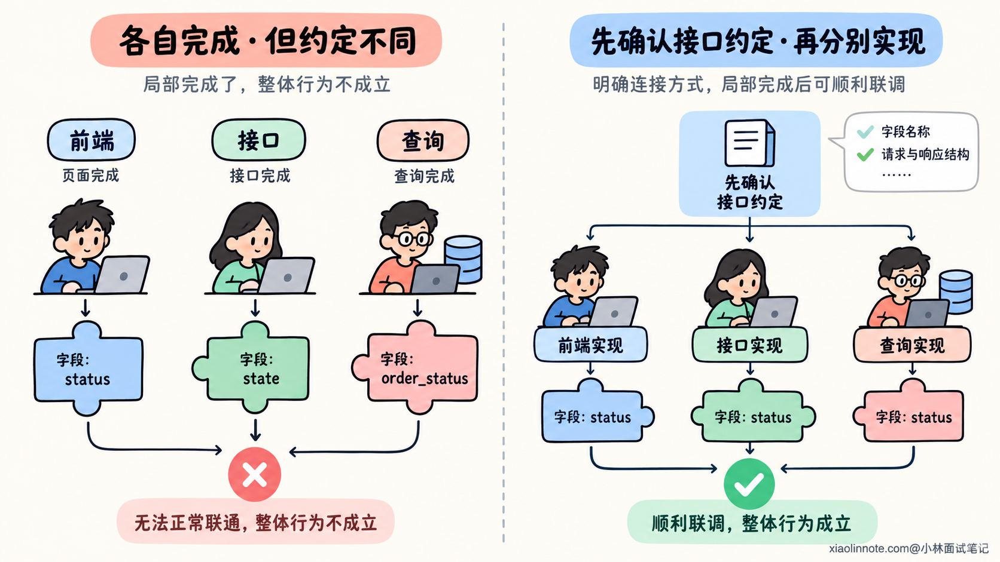
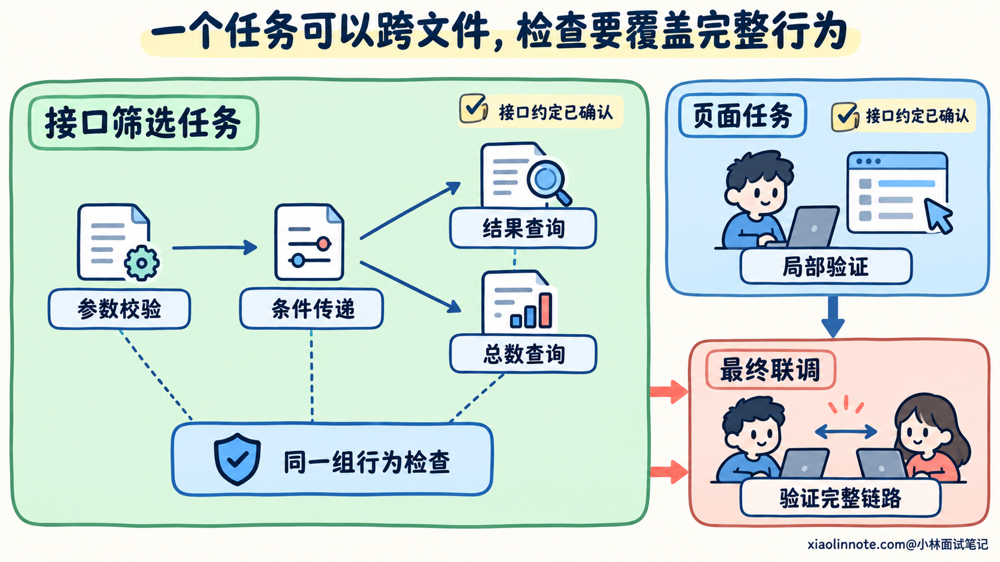
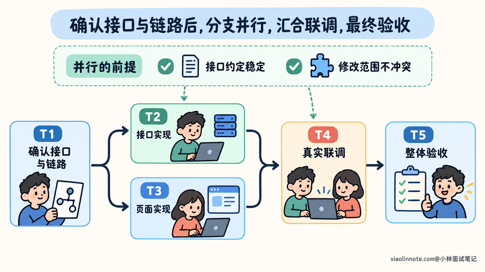
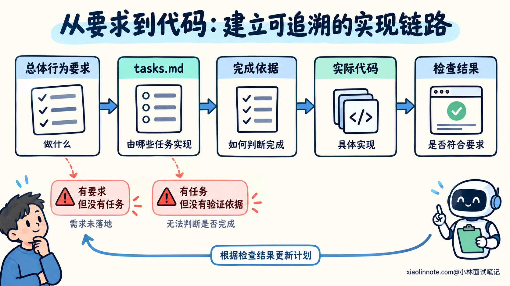
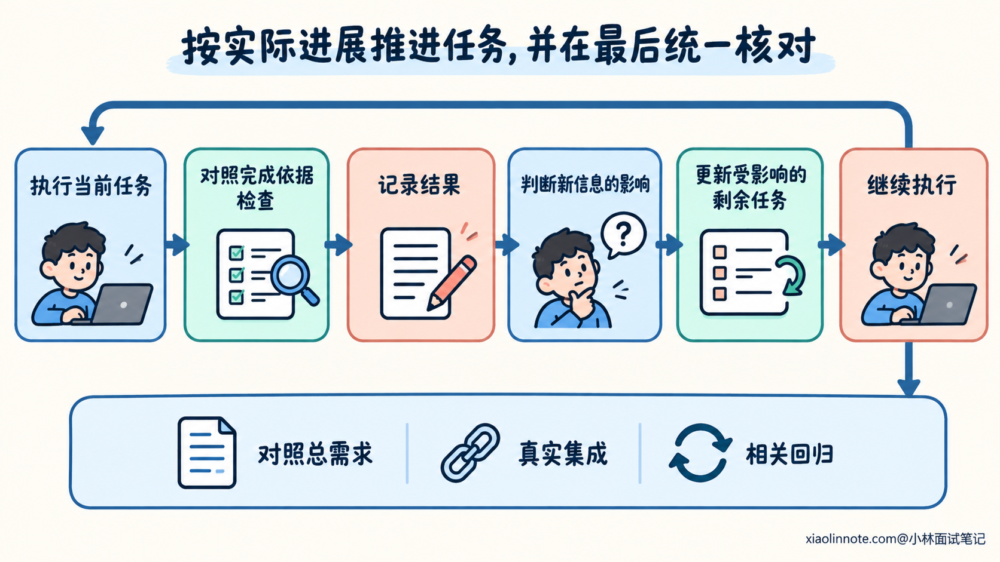

# 复杂开发需求如何拆分，才能让 AI 更可靠地完成？

> 原文：[复杂开发需求如何拆分，才能让 AI 更可靠地完成？](https://xiaolinnote.com/ai/coding/task_decomposition.html) · 小林面试笔记


👔面试官：一个需求涉及前端、接口和数据查询，你会怎样拆给 AI 做？

🙋‍♂️我：前端一个任务，后端一个任务，数据库一个任务。分工明确，最后一拼就行。

👔面试官：（画了三个圈）前端叫 status，后端叫 state，数据库叫 order_status。各自都写完了，谁负责让它们互相认识？

🙋‍♂️我：那再拆细一点，每个函数一个任务，加一行校验也单独开个任务。

👔面试官：（数了数任务）修一个参数要走五个步骤，你这是提高可靠性，还是给进度条续命？

🙋‍♂️我：多开几个 AI 一起做，任务全部打勾就完成了。

👔面试官：（拿起鼠标）前端通过，后端通过，按钮一点就报错。你这任务清单倒是实现了全员满勤。

咱们先看任务拆分需要解决什么问题，再把一个开发目标拆成能够执行、验证和接续的步骤。

## 💡 简要回答

我会先结合需求和现有代码，找出要改变的行为、需要保留的约定，以及哪些地方还没弄清楚，再按可验证的目标拆任务。

每个任务要说明依据、修改范围、依赖和完成标准。粒度以能理解、能检查为准，一个任务可以跨多个文件；相关实现和必要验证也要一起安排。比如给查询增加筛选，筛选条件怎样进入查询、怎样影响结果和总数，需要作为同一项行为来考虑，不能分别改完却没人检查它们是否一致。

执行顺序上，我会先确认共享接口和必要的前置条件，优先打通一条能够验证的链路，再逐步扩展。只有依赖已经满足、修改范围不会冲突的任务，才考虑并行，最终还要验证它们组合后的行为。

我会把任务、依赖和验证结果保存在 [tasks.md](http://tasks.md) 里。执行中发现新依赖、需求变化或者原来判断不成立，就更新受影响的剩余计划。完成依据是实际改动和检查结果，最后再对照总需求做集成和回归检查，确保局部任务都完成以后，整体功能也成立。

## 📝 详细解析

### 为什么列出了步骤，复杂需求仍然可能做不好？

开发需求的复杂，往往来自多个条件需要同时成立。一项修改可能既要接收新参数，又要保持返回结构，还要让调用方正确使用结果。代码分散在不同文件里，行为却通过接口和数据联系在一起。

把这些工作一次交给 AI，它需要同时理解实现、选择修改位置、保持多处约定一致，并解释如何验证。某个条件遗漏以后，错误可能继续进入后面的代码，直到联调时才暴露。

因此，拆分需要减少每一步同时处理的未知条件，并提供可以检查的中间结果。先确认接口，后续实现就有了共同约定；一个修改完成后运行对应检查，也能较早发现偏差，减少后续工作建立在错误假设上的情况。

但步骤数量增加，本身不能保证这些效果。「写前端」「写后端」「完成测试」也是步骤，却没有说明各自要实现什么行为，交接时采用哪些约定，以及如何判断已经完成。

拆得过细，同样会增加成本。读取一个文件、写一行代码、加一个断言，都变成独立任务，开发者和 AI 就需要反复恢复上下文、交接结果，完整行为反而更难核对。

**任务拆分的作用，是让每一步的目标和依据更清楚，同时保留步骤之间的关系。** 任务数量应当由这些关系决定，而不是预先规定必须拆成多少步。



### 先从行为要求拆起，再确定代码修改范围

开始拆任务之前，需要知道整体完成意味着什么。可以先整理要增加的行为、重要边界，以及必须保持的原有约定，再结合源码确认它们涉及哪些位置。

例如，给已有订单列表增加状态筛选，可以先确认下面这组示例要求：状态未选择时保持原查询范围；选择状态后，列表和总数使用同一筛选条件；切换状态回到第一页；非法状态按已有参数错误方式处理。原来的数据访问约束与合法响应结构也需要保留。

这些要求说明了需要交付的行为。至于状态怎样从页面传到接口、总数在哪里计算、错误由哪个入口处理，还需要读取项目里的真实实现。下面的模块和文件名称只作示意。

如果直接按技术层拆成前端、后端和数据库，就容易让每层自行决定接口。先确认筛选参数、总数语义和错误响应，再安排对应实现，后续工作才有共同依据。

同样，不能看到哪些文件，就把每个文件都安排成一个任务。需求可能只涉及其中某个分支，也可能通过公共接口影响另一个模块。任务范围应该来自要改变的行为及其关系。

对暂时不清楚的部分，可以先安排一个有输出的分析任务。例如核对查询链路，记录参数传递、筛选位置和现有验证方式。分析的完成依据是找到了可核对的代码关系，而不是已经运行了一次搜索。

拆完以后，再把任务与整体要求对照。状态筛选有人实现，页面切换也有人实现，但总数是否使用相同条件没有出现在任何任务里，就说明计划仍有缺口。

### 一个任务拆到什么程度，才适合交给 AI？

一个适合执行的任务，需要在前置条件成立后，有明确的输出和检查方法。它可以是一个经过核对的接口约定，也可以是一项能够运行并验证的功能修改。

以订单筛选为例，接口任务可以覆盖参数校验、条件传递、结果与总数的查询，以及相应测试。它可能跨过请求入口、业务层和查询层，但这些修改共同完成一个可以通过接口验证的行为。

如果把「增加筛选条件」和「调整总数查询」完全分开，却没有明确两者必须使用同一条件，中间结果就可能不一致。它们可以保留实现步骤，但应该在同一行为目标下安排检查。

相关验证也要跟着任务走。接口行为完成时，检查有效筛选、非法输入和分页结果；页面交互完成时，检查参数发送与页码重置。不要等所有实现都结束，才第一次考虑正确结果是什么。

这里的「可以单独验证」，并不意味着任务不能依赖其他任务。它表示前置结果已经具备以后，能够判断这一步有没有完成约定的目标。页面可以先使用符合接口约定的测试替身做局部验证，真实前后端配合则仍需要联调。

判断粒度时，还要看当前任务需要同时理解多少规则，改动是否容易审查，失败以后能否定位。如果混合了多个互不相关的目标，可以继续拆分；如果几步都要反复读取同一段逻辑才能判断，可以考虑合并。

优先打通一条最小但真实的链路，也能帮助检查方案。例如先让筛选参数经过请求入口、查询和响应，得到可验证的接口结果，再接入页面交互。这样发现接口语义有问题时，不必先完成所有页面细节。



### 怎样安排依赖，哪些步骤能够并行？

任务之间的依赖，来自后一步需要使用前一步的结果。接口参数还没有确定时，页面不知道应该发送什么；测试条件没有准备好时，执行检查也无法说明功能是否正确。

因此，计划里要写明前置结果，而不只是任务编号。比如页面任务依赖「筛选参数和响应结构已确认」，能够让执行者理解为什么要等待，以及是否可以先使用稳定约定开展局部工作。

共享约定确定以后，接口与页面实现可以具备并行条件：两边采用同一参数语义，修改范围分开，局部检查也有明确依据。最终联调则依赖两边的实际结果，都具备以后才能验证完整链路。

并行还要考虑共享修改和执行状态。两个任务修改同一个公共类型，或者同时调整同一份测试数据，可能相互覆盖。即使文件不同，只要共同改变一个接口约定，也可能产生语义冲突。

独立目录或工作区可以减少文件操作互相干扰，但它们不会自动保证接口一致。并行前仍要确认依赖和约定，合并以后也要检查实际差异和组合行为。

没有足够独立的工作时，按依赖顺序执行即可。任务多、执行者多，并不意味着整体会更快，因为交接、冲突处理和重复理解都需要时间。



### tasks.md 怎样写，才能支持执行和检查？

把拆分结果保存到 `tasks.md`，可以让开发者和 AI 都知道当前任务、依赖和检查依据。文件本身并不会提高质量，内容需要足够具体，才能支持接续执行。

每项任务可以保留目标、前置条件、修改范围和完成依据。关键规则较多时，关联到需求条目，方便检查有没有遗漏。不必复制整份规格，文件位置和规则编号能够帮助回到原文核对。

下面是前面订单筛选需求的一份示意任务清单。勾选项表示等待实际验证的工作，并非已经执行完成。这里刻意把行为实现和对应检查放在一起。

```markdown
# 订单列表状态筛选任务

## 总体约定
状态未选择时保持原查询范围；选择后，列表和总数使用相同条件。
切换状态回到第一页；非法状态沿用现有参数错误响应。
保留原数据访问约束和合法响应结构，不顺带重构其他业务。

## T1：确认现有链路与接口约定
- [ ] 核对请求入口、参数类型、结果与总数查询、页面调用和现有测试。
- [ ] 在 plan.md 中记录状态参数、页码处理与错误响应的代码依据。
完成依据：能够说明数据怎样传递，关键规则已有明确约定，未知事项已标出。

## T2：实现接口筛选与对应验证
前置：T1 中的接口语义已确认。
- [ ] 实现参数校验与筛选传递，使列表和总数使用相同条件。
- [ ] 验证有效筛选、非法状态、空结果以及筛选后的分页与总数。
完成依据：实际接口结果符合约定，相关检查通过且不破坏原查询行为。

## T3：实现页面筛选与对应验证
前置：T1 中的接口语义已确认，页面修改不与 T2 冲突。
- [ ] 接入筛选交互，正确发送状态参数，切换状态时重置页码。
- [ ] 使用符合约定的测试数据检查参数、页码与结果展示。
完成依据：局部交互符合规则；明确此时是否仍使用测试替身。

## T4：连接真实接口并验证完整链路
前置：T2、T3 已通过各自检查。
- [ ] 通过页面切换状态和翻页，核对真实请求、列表、总数与页码。
- [ ] 检查无匹配结果和恢复未筛选状态时的表现。
完成依据：页面到实际接口的行为一致，没有仅在替身环境中成立的假设。

## T5：核对总需求与相关回归
前置：T4 已完成。
- [ ] 对照总体约定检查覆盖情况，运行受影响范围内的回归检查。
- [ ] 记录最终改动、执行过的检查及尚未验证的条件。
完成依据：总需求有对应证据，已有约定得到保留，未完成项如实列出。
```

这份清单把 T1 的接口约定作为共同输入，让 T2 和 T3 有条件分别推进。T3 明确记录是否用了测试替身，T4 再检查真实连接，避免把局部通过当成整项功能完成。

其中 `plan.md` 保存核对后的实现关系，`tasks.md` 保存执行步骤。实际项目可以换成自己的文档位置；使用 Spec Kit 时，也可以通过 `speckit-tasks` Skill 生成初稿，再按这些原则检查任务边界和依赖。

任务里的路径与检查方法，应当在读取实际项目后补齐。示例没有列具体文件，是为了避免把示意目录当成所有项目的固定结构。已有真实入口时，写清文件和符号能够减少后续查找成本。



### 执行中怎样验证，并更新剩余计划？

计划形成以后，每一步执行结果都可能带来新信息。比如实际源码采用了不同的参数封装，某个公共接口还有其他调用方，或者既有测试没有提供计划假定的数据条件。

这时需要判断新信息影响哪部分计划。只影响局部实现方式，可以调整当前任务；改变接口约定或前置结果，就要检查后续任务是否仍然成立。需求本身发生变化时，也要同步更新相关要求和验收依据。

完成状态同样需要证据。文件已经写入，说明生成了实现；局部测试通过，说明检查范围内的条件符合预期。构建环境无法启动，或者仍然使用测试替身时，应该记录相应限制，不能直接标为完整验收通过。

每个阶段尽早检查，能够帮助定位问题；最后仍然需要对照总目标验证集成行为。局部任务分别正确，可能还存在单位转换、字段传递或执行顺序方面的组合错误。

例如接口单测和页面组件测试都通过，真实请求却没有携带状态参数。接口接受默认查询，页面展示了不该出现的数据，这类问题需要从真实连接中发现，不能只看两边的通过结果。

计划更新也不需要每一步都重新生成全部任务。保留仍然有效的步骤，补充新依赖和缺口，更新受影响的完成依据即可。已完成的任务如果因新规则失效，也要明确需要重新验证什么。

因此，任务清单需要跟随实际工作维护：正在执行什么，已经取得什么结果，哪些仍有缺口，剩余步骤是否还符合当前要求。这样的记录才能帮助 AI 接续任务，也让开发者判断实际进度。



### 怎样用提示词让 AI 先拆清楚，再逐步完成？

如果直接说「帮我拆成二十个任务」，AI 很容易围绕数量生成清单。可以改为要求它读取现状，按行为、依赖和验证方法拆分，再把结果保存到文档。

```text
请根据已确认的订单状态筛选需求，先读取当前查询链路和页面调用。
这一步只做分析与拆分，不修改业务实现。

把核对后的接口语义和代码位置记录到 plan.md，再生成 tasks.md。
每项任务说明目标、前置条件、修改范围和完成依据，
把相关实现与必要验证一起安排，并检查所有关键需求都有任务覆盖。

优先安排一条能够验证的链路，再逐步扩展。
不要按文件数量平均分，也不要为了凑任务数量把一次完整判断拆散。
能查清的事实先读源码；影响行为的未知规则单独标出。
```

这段提示词要求 AI 用实际代码修正计划，并同时写出验证方法。它没有预设任务数，也没有要求把整个项目重新设计一遍。

任务清单核对以后，可以限定本轮执行范围：

```text
请读取 plan.md 和 tasks.md，本轮完成 T2 的接口筛选与对应验证。
核对 T1 已确认的接口约定，沿用现有查询与错误处理方式。

同时检查列表和总数是否使用同一筛选条件，运行相关测试。
不要提前修改页面或重构无关模块。
如果实际依赖与计划不同，说明影响，并更新受影响的剩余任务。

完成后记录实际修改和检查结果，只勾选已有相应证据的工作。
检查未完成或未通过时，保留原因与待处理项。
```

限定执行范围，可以减少一轮中混入其他目标，也方便审查这次修改。它仍然允许 AI 核对相关依赖，避免为了遵守文件限制而忽略必要关系。

接口和页面都具备以后，再安排整体验证：

```text
请继续完成 T4 的真实联调，并按总需求检查已有约定。
确认页面切换状态与翻页时，实际请求、列表、总数和页码保持一致。

区分组件测试、接口测试和真实连接的验证结果。
如果出现问题，定位它属于当前实现、接口约定还是测试条件，
修复后重跑受影响的检查，并更新相关任务状态。

最后说明每项关键要求的验证依据，以及仍未验证的部分。
不要仅根据任务复选框全部打勾宣布整个功能完成。
```

接口和页面任务完成局部检查以后，联调再检查它们怎样共同满足需求。之后还需要完成清单中的 T5，对照总要求做相关回归。提示词把执行范围和判断标准连接起来，开发者就能看到具体证据，而不只是一句「全部完成」。

## 🎯 面试总结

开头按前端、后端和数据库分完就等着拼接，容易遗漏共同约定；把每个函数和操作都单独拆开，又会增加交接成本。任务全部打勾，也无法独立说明组合后的行为正确。

回答时，可以从行为要求出发，说明怎样确定任务边界、安排依赖和配套验证。粒度要支持理解、执行与检查，一个任务可以跨文件，相关步骤也可以有明确的前置关系。

最后补上执行中的计划维护和整体验收。用实际结果更新任务状态，新信息只调整受影响的计划，再通过集成和回归核对总目标。任务清单因此能够支持持续推进，而不只是展示一个进度条。
