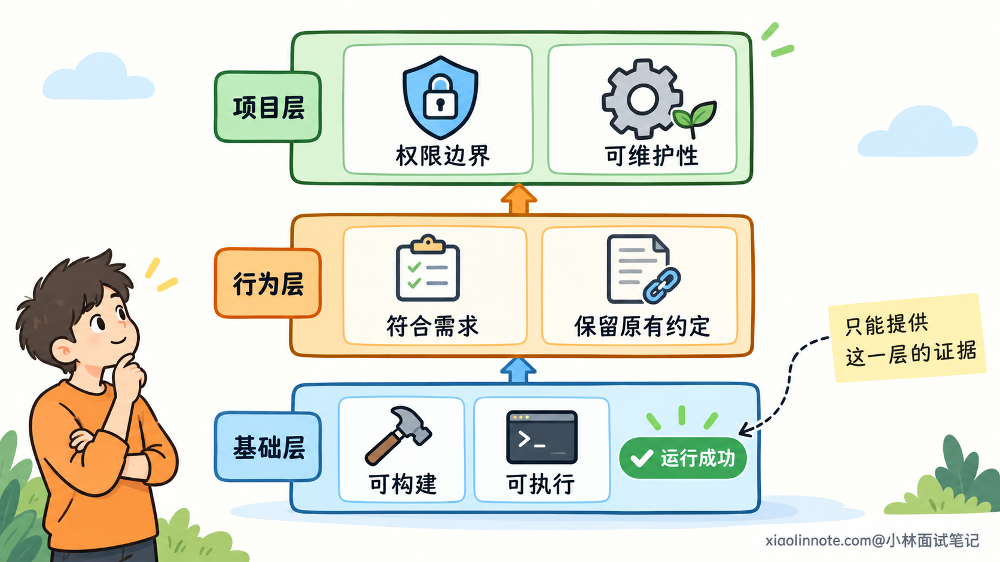
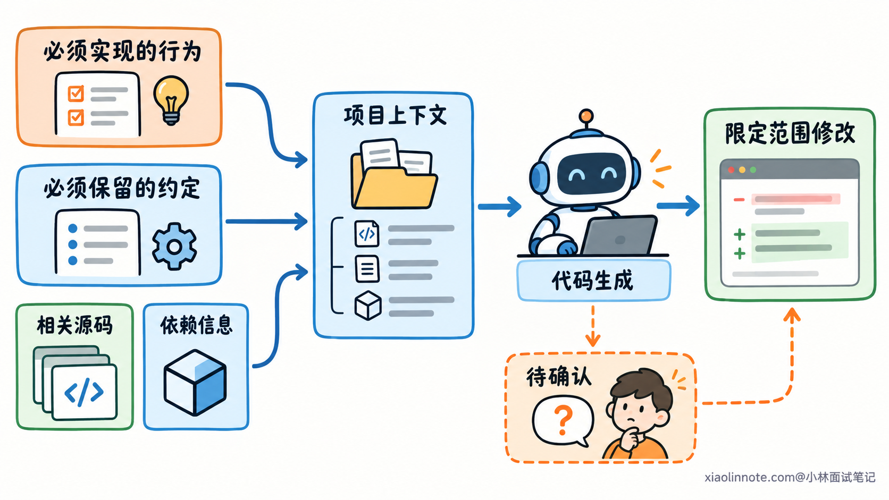
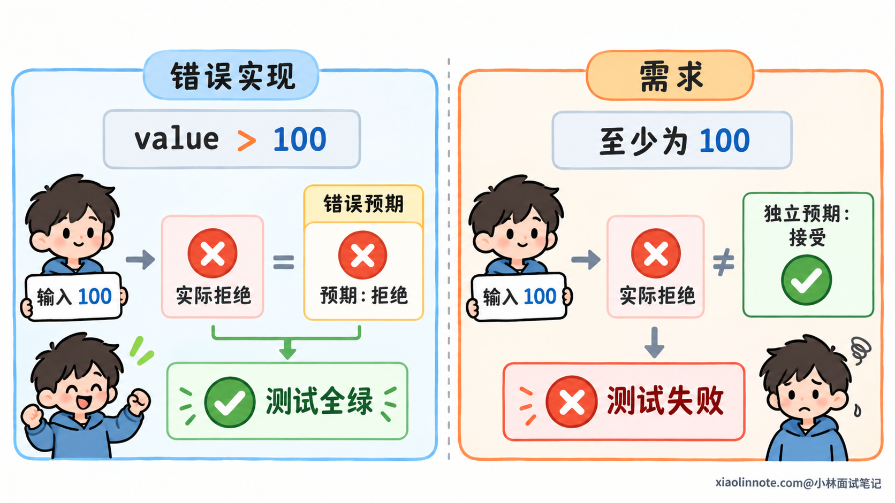
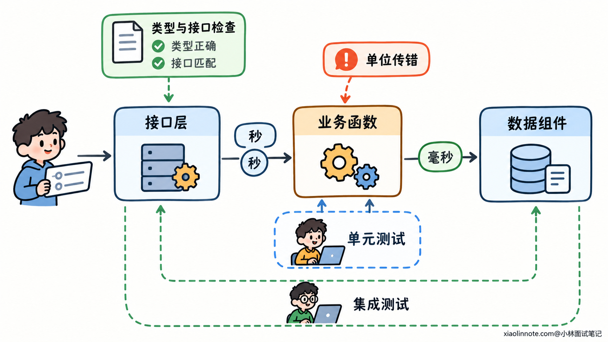
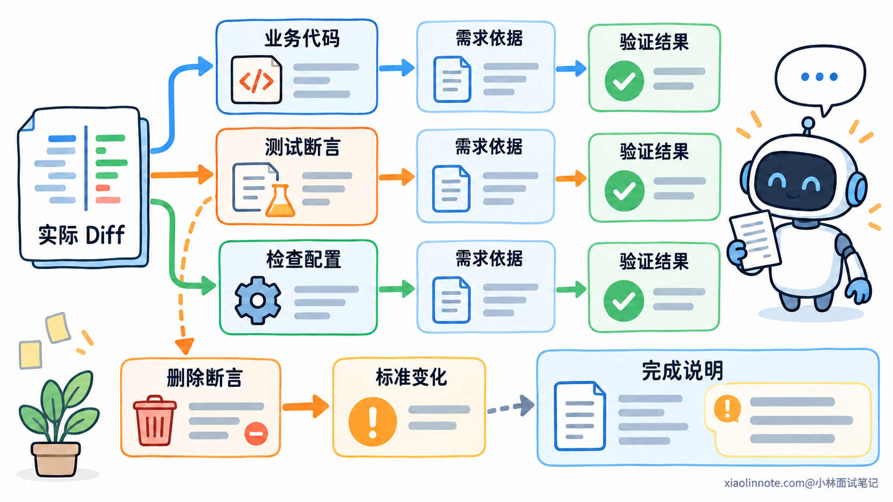
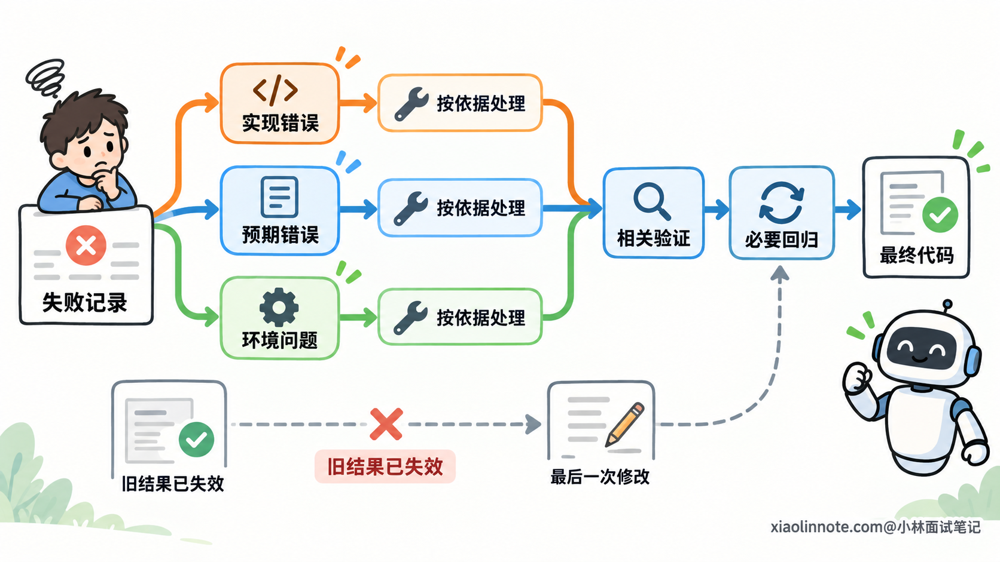

# 如何保证 AI 生成代码的质量？

> 原文：[如何保证 AI 生成代码的质量？](https://xiaolinnote.com/ai/coding/generated_code_quality.html) · 小林面试笔记

👔面试官：用 AI 生成了一段代码，怎么判断它已经达到交付要求？

🙋‍♂️我：让 AI 解释一下，思路合理、代码能运行就可以了。

👔面试官：解释合理，怎么证明它实现的是正确需求，而且没有破坏原来的行为？

🙋‍♂️我：再让 AI 给这段代码生成测试，全部通过就没问题了。

👔面试官：如果实现和测试预期都理解错了，同样可以全部通过。预期结果依据什么？

🙋‍♂️我：那换一个模型审查，两个模型都认可就能交付。

👔面试官：换模型可以增加检查视角，但它们如果都没拿到真实业务约束，认可的依据仍然不充分。

咱们从质量标准讲起，看看怎样让生成、验证和审查都围绕同一份需求进行。

## 💡 简要回答

判断 AI 生成的代码能不能交付，主要看它是否符合需求、是否破坏已有行为，以及能否安全地接入项目。代码能运行只是基础，模型的解释和自我审查不能代替实际验证。

生成前要明确输入输出、边界条件和不允许改变的行为，再提供相关源码、真实接口和项目约束，让修改集中在必要范围。这样既减少模型猜测，也方便后续检查每一处改动。

生成后要先做构建、类型和静态检查，再用测试验证业务行为和真实调用链。测试预期必须有独立的需求依据，不能照着生成实现反推，否则实现和测试可能一起错。已有测试还要做相关回归，检查这次修改有没有破坏原来的功能。

最后审查实际代码差异，重点看业务规则、权限边界和修改范围。发现失败就根据规则修复，不能靠删断言、跳过检查把结果改绿；修复后重新验证受影响部分。交付判断要依据最终这份代码的检查结果，并说明还有哪些重要条件没有验证。

## 📝 详细解析

### 代码能运行，为什么还不够？

AI 生成的代码可能语法正确，函数名和注释也很像项目原来的风格。运行一个正常输入，结果看起来合理，很容易让人觉得任务已经完成。

但程序语言只规定代码怎样表达、怎样执行，不知道业务希望它做什么。规则要求某个数值至少为 100，`value >= 100` 和 `value > 100` 都是合法表达式，区别只会在边界值上显现。

因此，能编译、能运行，只能排除部分基础错误。要判断功能正确，还需要一份独立于这段实现的标准，说明哪些条件下应该发生什么。

质量也不只看新增行为。一段代码完成了新需求，却改变了原来的错误码、返回格式或权限规则，已有调用方仍然可能出问题。这些原有约定也是验收范围的一部分。

再往后看，代码还要能维护。模型为一个简单判断引入复杂框架，或者复制了一套项目已有的逻辑，即使当前样例正确，也会增加后续理解和修改的成本。审查时需要判断这些复杂度是否确有必要。

这里要分清生成与验收的职责。AI 可以提出实现方案和待确认问题，真正的标准应来自需求、接口约定和项目规则。不能因为模型生成了某种行为，就反过来把这种行为当成需求。

### 生成前，哪些约束需要先确定？

如果需求只有「处理异常情况」，模型就需要自行决定哪些异常可以重试、哪些应该返回错误，以及失败后要不要撤销已经发生的修改。这些选择会直接改变行为，不能当成普通实现细节。

生成前需要把对结果有影响的歧义说明白：输入允许什么，成功后输出什么，边界与失败时怎样处理，哪些已有约定必须保留。不需要事先规定每一行代码，但不能让模型替业务决定关键规则。

可以把这些内容理解为验收契约。契约约定外部能够观察到的行为，实现则决定内部怎样完成。两者分开，才允许不同的代码结构接受同一套检查。

确定行为以后，还要提供相关的项目上下文。已有调用方怎样传参，接口怎样返回错误，项目使用哪个依赖版本，都影响代码能否接入。模型记得某个库有某种用法，不代表当前项目安装的版本支持它。

修改范围也要明确。例如修复一个校验条件，通常应围绕这个条件、相关调用和必要测试展开。额外改名、升级依赖或重写模块，会引入新的变化，也需要新的验证依据。

这不要求每次都追求最少行数。合理重构可能让实现更清楚，但可以按目的拆开，让每份改动有明确职责。限制无关修改，主要是减少一次验收中需要同时判断的问题。

这些约束仍然需要在生成后核对。输入里写了「保留接口」，不代表模型一定遵守；它们是检查的依据，不是已经满足的结果。

### 为什么测试预期不能跟着实现走？

测试执行以后，通常把程序的实际结果与预期结果比较。比较相等，只能说明这两者一致；要进一步说明程序正确，预期本身必须有可靠依据。

还是看「数值至少为 100」这个规则。模型如果把实现写成 `value > 100`，又根据实现给数值 100 写出「应该拒绝」的预期，测试就会通过。但它验证的是错误实现与错误预期相互一致。

更明显的情况，是测试再次调用待测函数计算预期。这样实际值和预期值来自同一段逻辑，即使逻辑错了，也可能相等。把生产逻辑复制到测试中，也容易重复同一种错误。

正确预期应从确认的规则推导。在这个例子里，100 应当被接受，低于 100 应当被拒绝，这些结论在实现生成之前就能确定。人工确认的样例、接口规范或经过审查的参考模型，都可以提供判断依据。

这类判断正确结果的依据，常被称为测试 Oracle。它不一定是另一个程序，也可以是一组已经确认的输入和结果。重点是预期有需求依据，而不是照着待检验的实现反推。

独立也不意味着测试必须全部人工编写。AI 可以根据确认的规则生成测试，开发者核对关键预期和断言。换一个模型审查能够增加视角，但如果两个模型都继承同一份错误规则，仍然可能一致认可。

还要看测试观察了什么。只检查「函数没有抛异常」，验证不了数据是否正确保存；只检查某个方法被调用，也不一定证明最终状态正确。断言需要对应验收契约中的结果，才有机会发现相关缺陷。

### 不同检查，各自能发现什么问题？

有了标准，接下来才能选择验证方式。不同检查观察的范围不同，适合互相补充，而不能把其中一种通过当成全部质量要求已经满足。

构建与类型检查通常先处理基础问题，例如语法不合法、类型不匹配、接口引用不正确。静态分析根据代码结构和规则检查潜在问题，可以提示部分空值、资源处理或危险调用。但这些工具通常不知道项目特有的业务规则。

单元测试把范围缩到一个函数或模块，验证局部输入与结果，适合快速检查边界和分支。失败以后，定位也比较集中。不过，局部行为正确，还需要调用方把正确的数据传进来。

例如一个函数约定接收毫秒，上游却传入秒，两边都使用整数，类型检查未必能发现；函数的单元测试也可能一直使用正确单位。通过接口到函数的实际传递路径做集成验证，才能检查这类协作问题。

测试替身可以让外部组件按指定方式返回结果，方便构造正常与失败条件。但替身未必具有真实组件的事务、约束或网络行为，必要的集成验证要使用真实或足够接近实际的组件，确认这些假设。

回归测试则检查修改有没有破坏原有行为。已有测试提供重要基础，还要根据影响范围关注调用方与公共约定。若修改前测试已经失败，需要区分原有问题和本次引入的问题，不能把所有失败都归因于新代码，也不能用原有失败掩盖新增问题。

验证强度应围绕改动风险选择。修改权限条件，就要验证允许与拒绝的边界；修改带状态的重试，就要检查重复执行和失败后的状态。选检查的依据是这次可能改变什么行为，而不是把所有工具名称列一遍。

### 检查通过以后，为什么还要审查实际改动？

测试总是在有限条件下运行，未构造的路径可能仍然有问题。审查代码差异，也就是 Diff，可以直接看到相对于原版本新增、删除和修改了哪些内容，再检查现有验证是否覆盖它们。

模型的完成说明是一份摘要，可能漏掉修改。它说只调整了校验，实际却删了权限判断或改了公共返回格式，这些变化仍然会进入代码。审查对象应当是实际差异，并按需要补读周围的调用与数据关系。

尤其要检查测试和检查配置本身。如果 AI 删除断言、放宽预期或跳过失败用例，测试变绿可能只是标准变弱。检查调整可以有合理原因，但需要独立说明原标准为什么不适用，不能只依据新实现无法通过。

功能检查之外，还要关注信任边界。代码能够读取一条记录，不代表当前用户有权读取它；校验参数格式正确，也不代表这个参数对应的资源属于用户。权限与业务约束需要结合真实入口和数据来源判断，安全扫描没有告警也不能替代这项分析。

可维护性同样需要结合项目审查。是否重复已有逻辑，异常是否按项目约定处理，新增抽象能否简化理解，都很难仅凭当前几条功能测试判断。目的在于让后续开发者能够理解和修改这段实现，避免为了形式上的复杂设计增加负担。

AI 审查可以帮助提出疑点、发现遗漏，但疑点仍要回到源码与规则核实。熟悉业务和项目的开发者要判断关键行为是否符合要求，自动工具则提供相应范围内的检查结果。

### 验证失败以后，怎样修复才算完成？

检查失败时，首先保留失败条件、实际结果和预期依据。它们说明哪项约定没有满足，也是判断后续修复是否有效的基础。

然后区分原因。实现违反已经确认的规则，应修改实现；测试使用了错误预期，可以根据独立规则修正；依赖环境不可用，则需要恢复环境或说明验证尚未完成。失败本身不能决定应该改哪一边。

修复以后，要重新运行相关检查，并根据影响范围做必要回归。只验证原来的失败样例，可能漏掉修复对其他分支的影响；也不需要每次无差别重复所有检查，关键是覆盖本次修复新影响的行为。

验证结果必须对应最终准备交付的代码。检查通过后又修改了逻辑或依赖，先前结果就不能直接证明新版本的行为。需要重新检查受影响部分，而不能继续引用之前的一次全绿。

交付时应当能说明这份改动实现了哪些规则，经过哪些实际运行的检查，以及有哪些重要条件还没有验证。自动化流水线可以持续执行项目约定的检查，减少漏跑和环境不一致，但它仍然执行的是已经配置好的标准。

## 🎯 面试总结

开头的三个回答分别把解释、测试全绿和模型认可当成了交付依据。它们可以提供帮助，但如果缺少正确标准，仍然可能共同接受一个错误实现。

质量控制需要从需求与项目约束开始，让生成范围可审查，再用有独立预期的测试验证行为。基础检查、局部测试、集成验证和回归各自观察不同范围，实际 Diff 审查则补充权限、业务约定和可维护性的判断。

修复阶段同样要守住这份标准，区分实现、测试与环境的问题，修改后重新检查受影响部分。最终交付依据要与最终代码对应，尚未验证的重要条件也需要明确。

---
