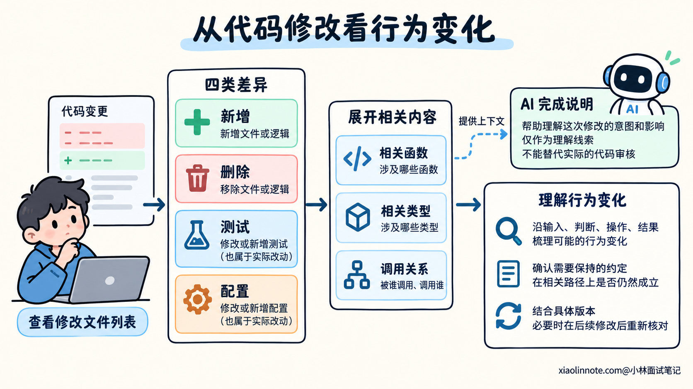
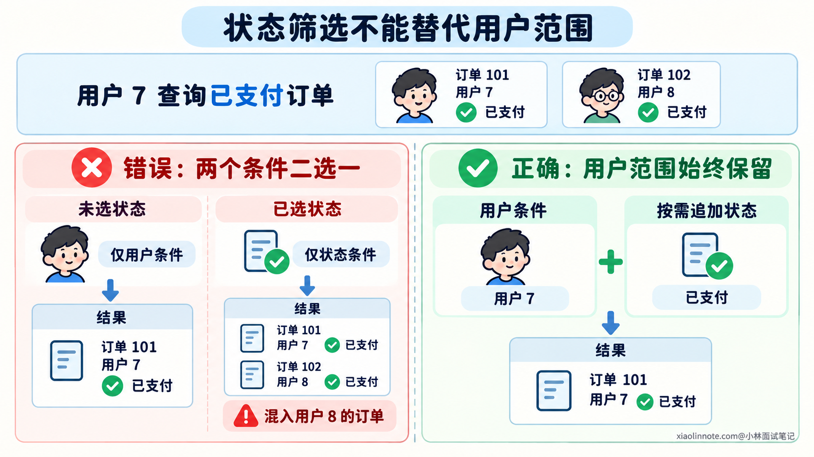
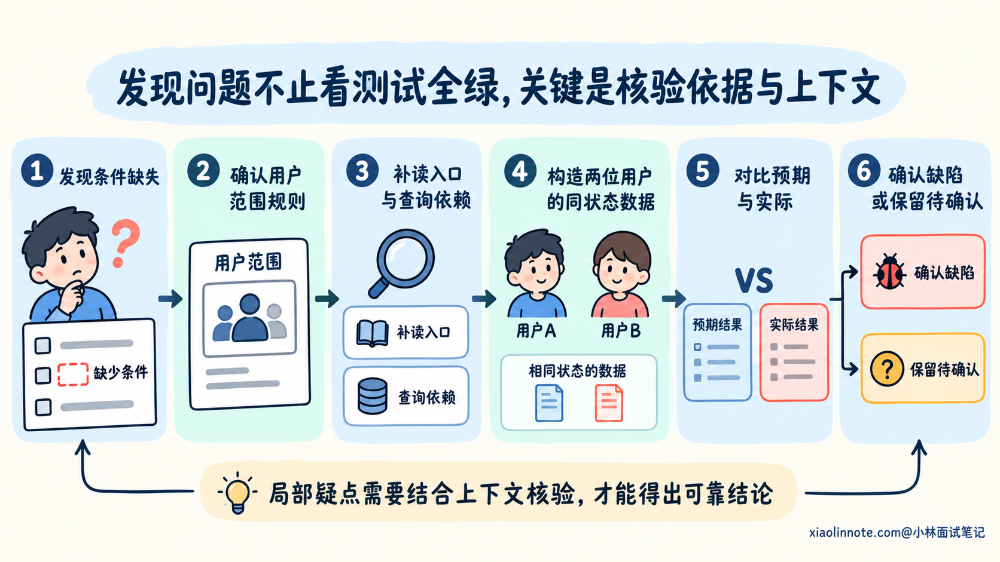
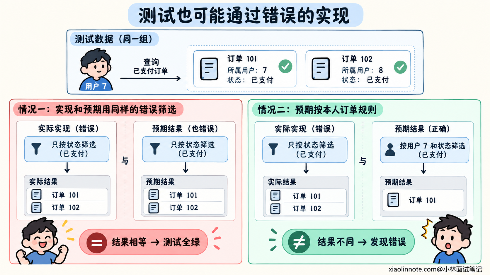
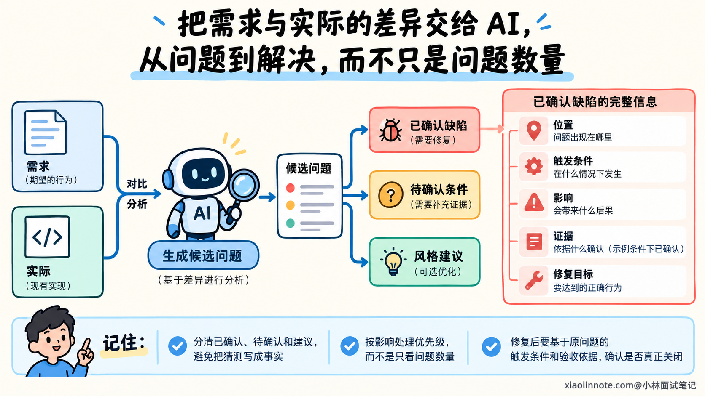
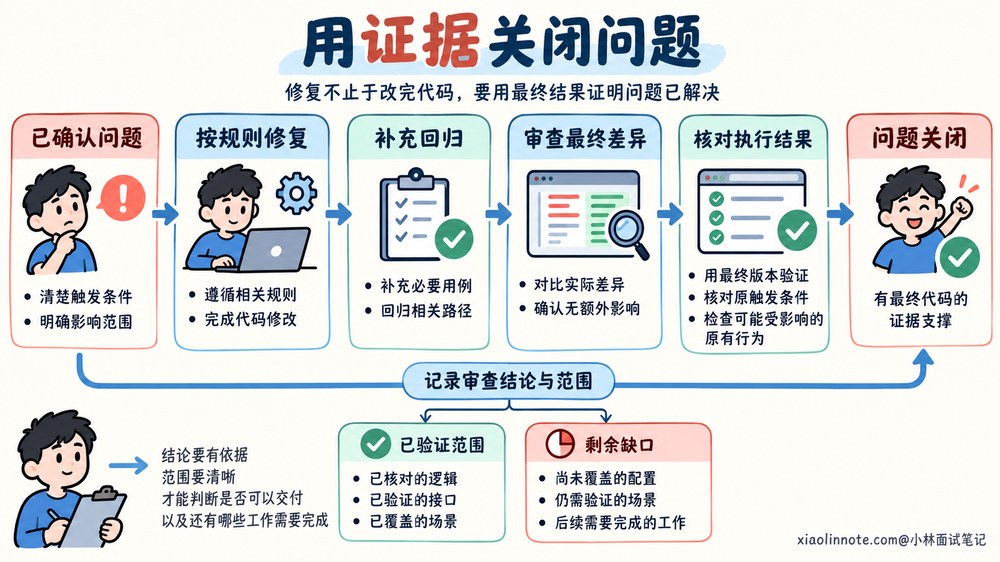

# 如何审查 AI 生成的代码，发现看起来合理但实际错误的实现？

> 原文：[如何审查 AI 生成的代码，发现看起来合理但实际错误的实现？](https://xiaolinnote.com/ai/coding/ai_code_review.html) · 小林面试笔记


👔面试官：AI 写出来的代码看着挺顺，测试也通过了，你会怎样审查？

🙋‍♂️我：先读它的完成说明，逻辑讲得合理，我就收货。

👔面试官：（点开代码差异）总结说「精简了判断」，实际删了用户范围限制。你这是验收代码，还是听售后话术？

🙋‍♂️我：那就看测试，全绿总不能有问题吧。

👔面试官：（点开测试差异）原来检查用户归属的断言被删了。告警确实不响了，烟雾报警器也被拆了。

🙋‍♂️我：再让另一个 AI 挑一百个问题，数量够多，应该查得很严。

👔面试官：（翻了半天报告）全在给变量改名，漏了查询范围变大。变量改名你管了，数据去了谁家你不管？

咱们从修改前后的行为差异入手，看看怎样把一段看着合理的代码，审查成有依据的判断。

## 💡 简要回答

我会先对照需求和必须保留的约定，看实际代码差异，确认改了哪些文件、增加或删除了什么。审查范围也包括测试、依赖和检查配置，避免只看 AI 的完成说明。

接着，我会把改动转成行为问题：哪些条件变了，数据从哪里来、经过什么处理、最后影响谁。关键位置要补读调用方和依赖，重点检查业务边界、权限范围、错误处理和接口兼容性。判断依据是项目规则和当前实现，代码的名字、注释和解释只能辅助理解。

发现疑点以后，我会找出具体触发条件，说明预期结果与实际结果的差别，再用源码推导或最小复现核验。还要检查外围是否已经处理了这个条件，避免把局部片段里的疑点直接当成缺陷。

测试也需要审查：是否真的触发了目标路径，断言是否依据独立规则，以及有没有通过删断言、放宽预期让结果变绿。AI 可以帮助寻找遗漏，但每条意见都要核实。最后按影响处理问题，修复后重新检查最终差异和相关验证，并说明仍未确认的范围。

## 📝 详细解析

### 代码看起来合理，为什么行为仍然可能错误？

一段代码的命名、结构和解释都很顺，能够降低阅读难度，但正确行为需要符合具体要求。函数写得简洁，也可能把原本需要同时成立的条件变成了二选一。

这类问题在语法上可以完全合法，正常输入也可能返回合理结果。如果测试没有构造触发错误的条件，构建和测试仍然能够通过。

因此，审查时需要把「代码在做什么」和「项目要求它做什么」放在一起核对。前者来自源码及其调用关系，后者来自已确认的需求、接口约定和业务规则。

AI 生成的说明可以帮助了解意图，却不能代替这种核对。它可能只描述新增功能，省略了同时删除的逻辑，也可能解释了自己理解的规则，而这份理解本身就不完整。

人写的代码也会发生同样的问题。AI 能较快产生较多修改，开发者更需要确认每项改动的行为含义，而不是因为输出完整、解释流畅就直接接受。

**审查的目标，是确认这份实际改动怎样改变了系统行为，以及这些改变有没有正确依据。** 有了这个目标，阅读就能围绕具体问题展开。

### 从实际差异入手，确定这次究竟改了什么

审查通常从修改前后的差异开始，也就是 Diff。它可以让你看到新增、删除和调整的内容，再结合周围代码理解每处变化。

先看完整的文件变化范围。需求只涉及查询筛选，实际却调整了公共类型、依赖版本和测试配置，这些变化也需要解释。范围扩大不一定错误，但它们会引入新的影响，不能因为完成说明没提就略过。

删除的代码尤其值得核对。新增逻辑容易吸引注意，原来的约束、异常处理或状态更新被删除以后，可能没有留下明显报错。需要知道删除前承担什么职责，以及现在由哪个位置继续承担。

测试和检查配置也属于实际改动。测试预期变化可能是合理的需求更新，也可能是在配合错误实现；跳过某个用例、放宽校验规则，同样会改变通过结果的含义。

Diff 展示的几行上下文未必足够。一个判断的输入可能在函数前半段经过转换，输出又由其他模块使用。读到会影响行为的地方，应当展开相关函数、类型和调用关系。

对比还要对应明确版本。审查的是哪份修改，依据哪个基线，是否包含工作区中的其他变动，都需要弄清楚。后续又改了实现时，前一次审查结论也要按影响重新核对。



### 怎样把代码变化转成需要核对的行为问题？

拿到改动以后，可以沿输入、判断、操作和结果读下去。输入是否仍有原来的限制，判断条件怎样组合，操作会影响哪些数据，失败时留下什么状态，这些关系共同决定行为。

需要保持的约定，可以理解为在相关路径上都应该成立的条件。例如普通用户只能查询自己的订单，新增状态筛选之后，这项限制也应该继续成立。

看一段简化的 JavaScript 示例。假设调用方提供的 `ownerId` 来自已验证的用户身份，状态也已通过参数校验，未选择时使用 `undefined`。查询器按过滤对象匹配数据，不额外补充用户范围限制。原来的查询始终带上 `ownerId`，本次需求只是增加状态筛选。

AI 可能生成下面这段实现：

```javascript
function buildOrderFilter(ownerId, status) {
  // 有状态条件时，重新创建一个只包含状态的过滤对象。
  if (status !== undefined) {
    return { status };
  }

  // 没选择状态时，保留原来的用户范围。
  return { ownerId };
}
```

分支很清楚，传状态就查状态，不传就查用户。但项目要求的是用户范围始终成立，选择状态后再叠加筛选。上面的实现把两项条件变成了不同分支中的替代关系。

未选择状态时，原来的用例仍然可以通过；数据恰好都属于同一个用户时，新增筛选的测试也可能通过。代码错误需要在「选择状态，且存在其他用户同状态订单」的条件下才显现。

从这段改动中，审查者应该提出具体问题：选择状态后，查询条件里还保留用户范围吗？这种读法围绕新增条件如何影响原有约定，能够比逐行描述语法更接近业务结果。

同样的方法也适用于其他修改。调整返回类型，需要看调用方怎样使用；移动异常处理，需要看错误是否被转换成成功；增加重试，需要核对重复操作是否影响已有状态。先沿变化推导风险，再根据项目实际情况深入。



### 从一个疑点，怎样走到能够确认的缺陷？

一个审查意见需要说明触发条件、违反的规则和可观察的影响。只写「这里可能有问题」，无法让开发者确认是否需要修复，也难以检验修复结果。

在前面的示例里，可以构造两条订单：101 属于用户 7，102 属于用户 8，两条都是已支付状态。用户 7 按已支付筛选时，应该只得到 101；错误过滤对象只保留状态，因此两条都会匹配。

这个反例把规则差异落实成了结果差异。它不需要大量数据，只需要满足导致错误的条件，就能说明问题所在。

但在真实项目里，看到过滤对象缺少用户字段，还需要继续读查询依赖。如果下层始终补充用户范围，或者这个函数仅用于具有不同约定的管理入口，局部片段就不足以证明发生了越权。

所以要核对入口身份、实际查询条件和执行路径。能够从完整源码关系确认的，可以说明静态依据；必须依赖运行配置或外部组件的，则需要对应的复现或验证。缺少这些信息时，应当标明待确认条件。

确认示例中的行为要求以后，修复可以让用户范围始终保留：

```javascript
function buildOrderFilter(ownerId, status) {
  // 普通用户查询始终保留自己的数据范围。
  const filter = { ownerId };

  // 状态筛选作为附加条件，不替换用户范围。
  if (status !== undefined) {
    filter.status = status;
  }

  return filter;
}
```

修复后要同时检查选择和未选择状态两种路径，再用包含多个用户的数据验证最终查询结果。只证明过滤对象新增了字段，还需要确认查询器实际采用了这些条件。

其他疑点也可以沿这个过程核验：先列出能够区分正确与错误实现的条件，再对照源码或执行结果。这样审查意见就有明确依据，修复也有可检查的目标。



### 测试全绿时，审查者还要检查哪些依据？

测试通过，说明实际结果与测试预期一致。审查者还需要知道预期是否正确，以及用例是否真的触发了要检查的行为。

对于用户范围与状态筛选的例子，如果测试数据只有一个用户，就无法区分「同时按用户和状态筛选」与「只按状态筛选」。用例名字即使写着权限校验，也没有建立能发现错误的条件。

再看断言。如果只检查返回数据都有正确状态，前面的错误实现仍然满足断言。需要同时观察结果的归属范围，才能检验这项业务约定。

如果测试自己调用过滤函数计算预期，或者复制了同样的错误分支，测试和实现还可能一起接受错误行为。正确预期应该来自已确认的用户范围规则，以及能够独立说明结果的样例。



审查测试差异时，也要看原来的检查是否被削弱。删断言、跳过用例、把错误响应改成允许成功，都需要需求或项目约定的依据。某次实现无法通过旧检查，并不能单独说明旧检查应该删除。

测试替身也可能隐藏真实差异。它返回了预先准备好的本人订单，代码即使没有传用户条件也会得到正确数据。此时要检查替身是否观察实际输入，以及是否需要真实查询路径的补充验证。

审查者据此选择缺失的检查即可，不需要为每条意见增加一套庞大测试。重点是验证能够改变结论的条件，并确认这些检查对应最终准备交付的代码。

### AI 审查意见怎样组织，才能让人核验和修复？

AI 可以帮助展开调用关系、寻找边界和提出候选问题。开发者需要给它明确的规则与实际差异，让它对照证据审查，避免只复述生成代码时的解释。

例如，可以这样发起一轮审查：

```text
请审查本次订单查询增加状态筛选的实际代码差异。
已确认要求：普通用户的查询始终限制在本人订单，状态作为附加条件。
保留原有响应结构、错误约定和相关查询行为。

先核对修改基线与完整文件列表，阅读新增、删除、测试和配置变化。
沿状态参数、用户身份与查询条件补读调用方和依赖，
重点检查新增筛选是否改变了原来的数据范围。

本轮不修改业务实现，可以运行已有相关检查或构造最小反例核验。
每个问题说明位置、触发条件、违反的规则、预期与实际结果，以及证据。
缺少依据的推断列为待确认项；纯风格偏好单独列出，不当成功能缺陷。
```

这段提示词明确了需要保留的约定，也要求核对外围实现。AI 即使提出了疑点，仍然要说明在哪里、什么条件下发生，以及怎样影响结果。

审查结果可以保存在 `review.md` 中，也可以用项目现有的审查记录方式。下面是示意记录，文件和符号位置需要替换为真实项目内容。

```markdown
# 审查记录

## 示例条件下已确认的问题：选择状态后丢失用户范围
位置：src/order/order_query.js 的 buildOrderFilter
规则：普通用户只能查询本人订单，状态条件应当叠加。
触发：选择已支付状态，同时存在其他用户的已支付订单。
预期：只返回当前用户符合状态的订单。
实际：过滤对象只有状态；在示例查询语义下，其他用户的订单也会匹配。
证据：状态分支返回值缺少 ownerId，两位用户的同状态数据能区分两种实现。
影响：普通用户的数据查询范围扩大，应优先修复。
修复方向：保留用户条件，再追加状态条件。
验证：代码级反例成立；真实接口的身份来源与查询执行仍需对应检查。

## 待确认项
真实查询依赖是否还存在其他范围限制，需要读取相关实现确认。
复现和回归检查必须对应实际项目的最终版本。
```

记录用「示例条件下已确认」标明判断范围。迁移到真实项目时，需要补齐入口与查询依赖的证据，再判断问题是否成立。审查记录要分清确认了哪一层、还缺少什么，才能避免把猜测写成事实。

处理顺序也应当看影响。数据范围扩大、结果错误和接口破坏需要优先处理；没有项目规则依据的命名偏好，可以作为建议。意见数量多，并不代表审查质量高，关键在于能否帮助确认和解决实际问题。

换一个模型审查可以增加检查视角，但多个模型都可能继承同一份错误需求，或者都没有读取实际依赖。AI 没有提出问题，也不能替代对关键规则和实际改动的核验。



### 修复以后，怎样确认审查问题确实关闭？

确认一个问题以后，修复应围绕违反的规则进行。前面的示例需要恢复用户范围与状态条件的组合，不能通过不允许状态筛选，或者让测试只检查状态，把原本的功能和验证要求绕过去。

可以用一条明确的修复提示词，保留问题的触发条件与验收依据：

```text
请修复已确认的筛选条件问题：用户范围始终保留，状态条件按需叠加。
保留合法状态筛选功能，不修改无关接口和业务。

补充能够区分错误实现的回归用例，包含多个用户的同状态数据，
并检查未选择状态时的原有行为。
核对最终查询执行确实采用这两项条件，不只检查对象里多了一个字段。

完成后重新检查实际差异和相关验证，说明问题为何已解决。
无法完成的接口验证如实列出，不要通过弱化断言关闭审查意见。
```

修复后还要重新查看实际差异，确认没有额外改动影响其他路径。相关检查通过以后，用最终版本重新核对原问题的触发条件，并根据修改范围检查可能受影响的原有行为。

审查结论也要保留范围。已经核对了过滤逻辑、已经验证了真实接口、尚未覆盖某种配置，是不同程度的结果。记录清楚这些依据，开发者才能判断是否可以交付，以及还有哪些工作需要完成。



## 🎯 面试总结

开头只读 AI 的完成说明，容易漏掉实际删除和范围变化；只看测试全绿，可能接受没有触发错误的用例，甚至接受变弱的断言。审查意见再多，也需要具体证据才能形成有效判断。

回答时，可以沿实际差异说明审查过程：对照规则推导行为变化，补齐输入、调用与依赖关系，再用触发条件和反例核验疑点。测试本身也要审查，预期、断言和执行路径都应该支持相关规则。

最后讲清问题处理和关闭依据。AI 负责辅助寻找遗漏，开发者核实结论并按影响处理；修复后重新审查最终版本和验证结果，把已确认的问题与尚未验证的范围分开记录。
