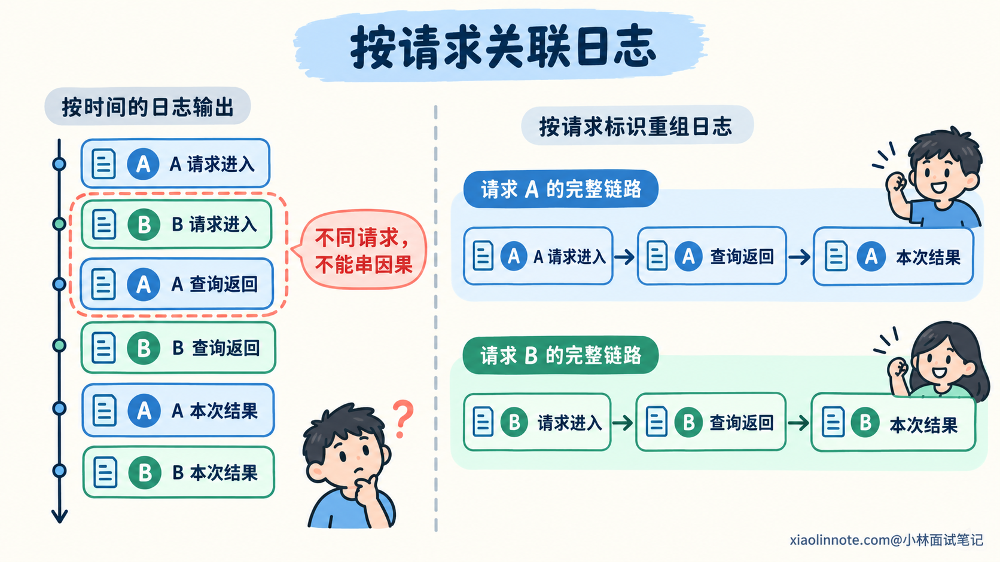
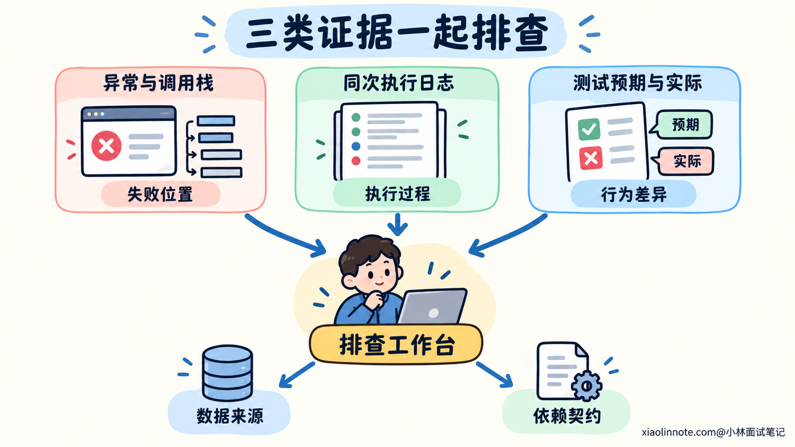
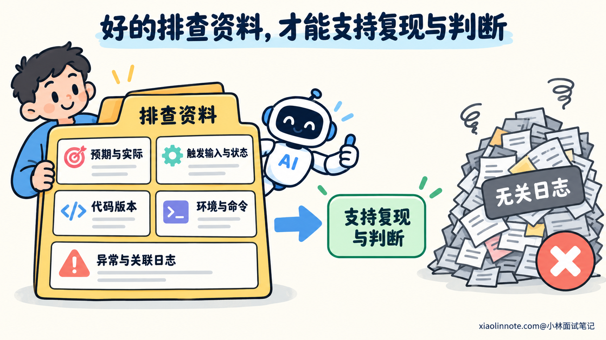
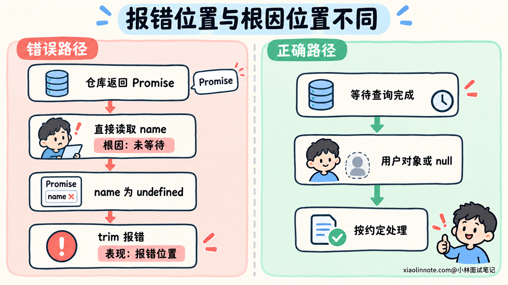
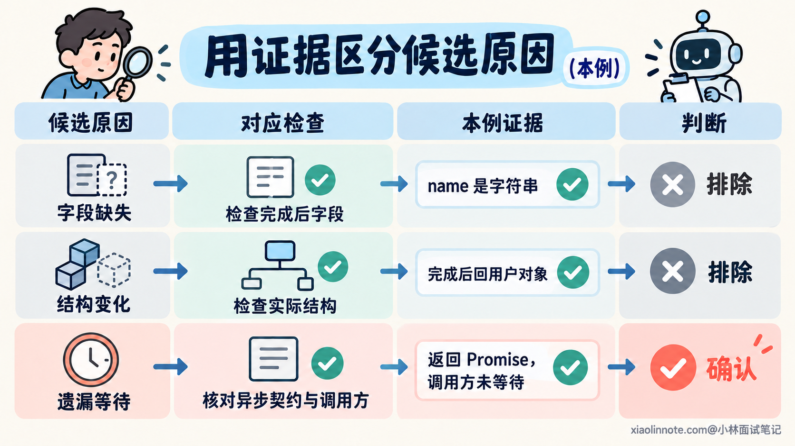
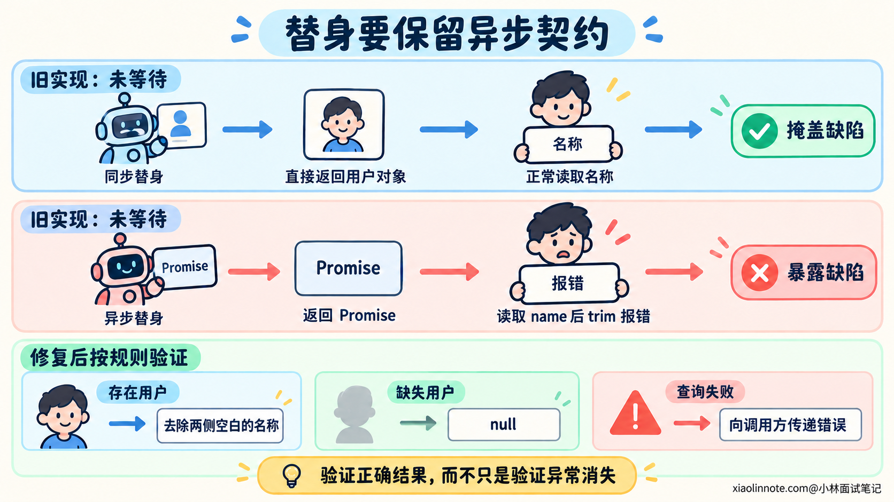

# 如何利用报错、日志和测试结果，让 AI 排查并修复问题？

> 原文：[如何利用报错、日志和测试结果，让 AI 排查并修复问题？](https://xiaolinnote.com/ai/coding/ai_debugging.html) · 小林面试笔记


👔面试官：AI 写的用户资料接口报错了，你会怎样让它排查和修复？

🙋‍♂️我：把最后一行报错贴给它，提示空值就补个默认值，先让接口跑起来。

👔面试官：（刷新页面）接口倒是成功了，用户名也没了。你是修了用户资料，还是顺手把用户注销了？

🙋‍♂️我：那就把服务器今天的日志全发过去，信息越多，查得越准。

👔面试官：（翻到第八千行）它开始分析隔壁定时任务了。你让它查一个用户名，还是审全公司的年报？

🙋‍♂️我：让它多改几轮，测试全部变绿就算修好。

👔面试官：（打开测试差异）它把「应返回用户名」改成了「空字符串也行」。你这学生考不过，就连参考答案一起改？

咱们顺着一次故障的证据往回查，看看怎样让 AI 找到原因，再证明修改恢复了正确行为。

## 💡 简要回答

我会先把问题复现清楚，给 AI 明确的预期结果、实际结果、触发步骤，以及对应的代码版本、运行环境和执行命令。报错保留异常信息和相关调用栈，日志筛出同一次请求或测试的关键过程，避免把无关输出混进去。

接着，我会让它沿报错位置追踪输入和数据来源，提出有依据的原因假设，并说明下一步怎样区分这些假设。每轮先做能缩小范围的检查，例如读取依赖契约、观察中间值或构造最小复现，再按结果更新判断。

确认原因后，我会要求它按原有业务约定修复，保留正常行为和错误语义。比如遗漏异步等待，就应当等查询结果回来再处理，不能靠返回默认值让报错消失。

最后用原来的复现条件检查修复，补上能在旧实现中失败的回归用例，再检查相关路径和最终差异。AI 的解释属于判断，实际执行结果才是验证依据；无法复现或尚未验证的部分，我会单独说明。

## 📝 详细解析

### 报错、日志和测试结果，分别能告诉我们什么？

程序在某一行抛出异常，说明执行到这里时，某个操作无法完成。异常信息能提示失败类型，调用栈能帮助定位出现异常的位置及相关调用关系，但还需要继续追查造成这个状态的过程。

比如读取用户名时出现空值错误，可能是查询结果结构与预期不同，也可能是根本没有拿到查询完成后的结果。报错位置接近问题表现，产生错误状态的位置可能在更早的调用中。

日志可以补上过程：请求进入了哪个分支，依赖返回了什么状态，失败前完成了哪些步骤。读日志时要按同一次请求、同一条测试或同一轮执行关联，时间接近的两条输出不一定属于同一个操作。



测试结果则把预期和实际放在一起。失败的断言可以说明哪个约定没有满足，但测试准备的数据、替身和环境，也会影响实际执行。用例失败可能来自业务代码，也可能来自错误的测试前置条件，需要继续核对。

可以把这几类证据放在一起理解：

| 证据 | 主要帮助回答的问题 | 还需要补充的依据 |
| --- | --- | --- |
| 异常信息与调用栈 | 在什么操作、什么位置出现了失败？ | 相关值怎样产生，外围有没有包装或转换？ |
| 关联日志 | 这次执行经过了哪些步骤，哪些状态与预期不同？ | 日志是否覆盖关键位置，是否属于同一次执行？ |
| 失败测试 | 哪个预期没有满足，实际发生了什么？ | 前置条件、断言和测试替身是否符合真实约定？ |

这些证据没有固定的高低顺序。接口直接返回了错误结果却没有异常时，失败断言可能更有用；依赖偶发失败时，关联日志又能提供单次执行中看不到的线索。开发者要根据当前缺失的信息选择下一步检查。



### 给 AI 哪些信息，才能复现同一个问题？

只给 AI 一句「这里报错了」，它不知道正确行为应该是什么，也不知道怎样触发。它可能找到一段类似代码，再根据常见错误给出修补建议，这份建议还没有对应到你的故障。

先把行为差异说清楚。假设一个函数用于获取用户显示名称：用户存在时，应返回去掉两侧空白的用户名；用户不存在时，返回 `null`；查询失败时，错误继续交给调用方处理。本次故障是明明存在的用户，调用后却出现了读取 `trim` 的异常。

接着固定复现条件，包括输入、准备的数据和操作步骤。需要数据库已有某条记录，就说明记录中哪些字段影响结果；依赖某个配置或执行顺序，也要保留这一条件。删掉会改变故障的条件，得到的就可能是另一个问题。

环境信息按问题补充。运行时版本、依赖锁定状态、执行目录和命令，会影响程序实际怎样运行。还要确认输出对应哪份代码，避免把修改前的报错交给 AI 分析修改后的文件。

下面是一段示例排查提示词。文件路径和命令是为这个例子设计的，实际使用时替换为项目中的真实位置。示例项目采用 ES 模块，使用 Node.js 自带的测试运行器。

```text
请排查 getDisplayName 查询存在用户时出现 TypeError 的原因。

已确认约定：存在的用户返回去除两侧空白的用户名；
不存在返回 null；查询失败继续向调用方抛出错误。
输入 userId=17，准备的数据为 id=17、name='  Lin  '。
预期返回 Lin，实际出现读取 trim 的 TypeError。

环境：Node.js 22，ES 模块，依赖按项目锁定文件安装。
复现命令：在项目根目录运行
node --test tests/user/display_name.test.js

请读取当前版本的 src/user/display_name.js、调用方、用户仓库实现和相关测试。
结合本轮异常、调用栈和测试输出，先说明已确认事实与候选原因。
为候选原因安排能够区分它们的检查，再根据结果决定怎样修改。
本轮先排查，可以运行相关检查，不调整业务约定和测试预期。
缺少的信息请指出，并说明拿到它以后能确认或排除什么。
```

这段提示词把正常行为、故障条件和检查入口放在一起。AI 可以读取代码验证自己的猜测，也可以判断现有资料还不足以确认什么，而不是一收到错误名称就开始改。

如果工具只能对话，开发者需要提供相关源码和实际输出；如果工具能访问仓库与终端，就让它读取这些位置并执行复现。能够运行命令，还需要看它是否真的运行成功、是否执行了目标用例。命令没有启动、用例被跳过，都不能算作复现结果。

日志也要筛选。保留相关请求标识、关键状态、异常与必要的前后过程，说明省略了哪些无关输出。观察值的类型或字段是否存在就够用时，可以只提供这些信息，减少噪声和不必要的原始数据。



### 从报错位置出发，怎样追到产生问题的数据？

我们看一段简化实现。先保留原代码，沿执行过程理解它做了什么：

```javascript
export async function getDisplayName(userId, userRepo) {
  // 发起用户查询。
  const user = userRepo.findById(userId);

  // 按业务约定，不存在的用户返回 null。
  if (user === null) return null;

  // 对存在的用户，去掉名称两侧的空白。
  return user.name.trim();
}
```

相关异常的示意输出如下，实际调用栈中的路径、行号和列号应当按运行结果保留：

```text
TypeError: Cannot read properties of undefined (reading 'trim')
    at getDisplayName (src/user/display_name.js:<行号>:<列号>)
    ...相关调用方...
```

对照源码，这个错误说明访问 `trim` 时，前面的 `user.name` 是 `undefined`。它并不能直接说明数据库里没有用户。若 `user` 本身是 `null`，这份实现会提前返回；报错指向的值需要按实际表达式核对。

接下来向上追一层：`user` 来自 `findById`，这次调用返回的究竟是什么？再读仓库实现和接口约定，就能确认这里返回的是一个 Promise，成功完成后得到用户对象或 `null`。

Promise 表示这次查询的异步结果。当前代码拿到 Promise 就继续往下走，`user === null` 判断不会成立，普通 Promise 上也没有用户的 `name` 字段，于是访问 `trim` 时抛出异常。

即使查询很快完成，返回的 Promise 也不会自动变成用户对象。函数前面的 `async` 只是允许函数使用异步写法，并让函数返回 Promise，内部某次调用的结果仍然需要按依赖约定等待。

这样就能把错误串起来：仓库返回 Promise -> 调用方按用户对象读取 -> `name` 为 `undefined` -> 读取 `trim` 失败。根本问题是调用方没有正确取得查询结果，补一个空字符串会保留这段错误的数据处理过程。

其他问题也可以沿数据来源追查。返回字段不对，就核对原始响应与转换；分页结果不对，就核对条件在什么位置应用；错误被变成成功，就追踪捕获与返回的位置。找到异常行以后，继续读产生相关值的代码，才能解释为什么会走到这里。



### 怎样用检查和实验，区分 AI 提出的原因？

只有一条异常信息时，AI 可能提出用户名缺失、响应被多包了一层、遗漏异步等待等原因。列出原因以后，还需要说明什么观察结果能够支持或排除它们。

例如，怀疑用户名字段缺失，就查看查询完成后的对象是否有字符串类型的 `name`；怀疑响应包装变化，就检查实际返回结构；怀疑遗漏等待，就核对仓库返回类型和调用方取得结果的方式。

在隔离的诊断脚本中，可以分别观察原始返回值、等待后的结果，以及原函数的执行结果。下面是压缩后的示意记录：

```text
run=demo-17 check=lookup-return thenable=true
run=demo-17 check=lookup-resolved found=true nameType=string
run=demo-17 check=original-call outcome=TypeError
```

这里的 `thenable=true` 表示返回值上存在可调用的 `then`，它是异步返回的线索，还需要结合仓库源码确认契约。等待后的结果包含合法用户名，可以排除这份数据中字段缺失的猜测；原函数仍然失败，则说明正确数据没有被调用方按约定处理。

诊断日志的设计要围绕具体疑问。我们需要区分返回的是查询结果还是等待中的对象，因此记录返回特征和完成后的字段类型，比打印整份用户资料更有用。日志是帮助验证判断的观察点，不能只在入口和出口写两句「开始」「结束」。

还可以建立最小复现：只保留这个函数、符合接口约定的异步仓库替身，以及能触发异常的输入。这样能直接检查调用方是否正确处理异步返回，不必启动页面、数据库和整个服务。

但替身必须保留导致问题的语义。本例的关键是返回 Promise；如果把仓库替换成同步返回用户对象，原函数就能正常读取名称，复现反而会把缺陷藏起来。最小复现减少的是无关组件，关键条件需要留下。

每轮检查尽量验证一个明确判断。一次同时改返回结构、异常处理和测试预期，即使结果变了，也很难知道哪个改动有效。优先做范围小、结果能区分候选原因的检查，再按证据决定下一步。

如果问题只在真实数据库或特定时序下出现，隔离脚本没有复现，就需要回到对应依赖、数据和执行顺序继续查。一次没有出现故障，只能说明这次检查条件下没有观察到，不能据此认定原问题不存在。



### 确认原因后，怎样修复并证明恢复了正确行为？

确认异步返回契约以后，这份实现应先等待查询结果，再执行原来的判断和处理：

```javascript
export async function getDisplayName(userId, userRepo) {
  // 等待查询完成，得到用户对象或 null。
  const user = await userRepo.findById(userId);

  // 用户不存在时，继续遵守原有返回约定。
  if (user === null) return null;

  // 查询成功后，再处理实际用户名。
  return user.name.trim();
}
```

这里保留了名称处理和错误传递约定。本例中，查询完成后的用户名是合法字符串；用户不存在和查询失败则有不同含义。依赖返回的 Promise 被拒绝时，`await` 会让当前函数抛出对应错误，再由调用方按原来的方式处理。

可以把修复目标写成下面的提示词：

```text
已确认原因：findById 返回 Promise，getDisplayName 在等待前读取了 name。
请按仓库契约等待结果，再保留现有的用户存在与不存在处理。
查询失败继续向调用方传递，不返回默认名称，也不改成成功结果。

补充符合异步契约的回归用例，覆盖存在用户、不存在用户和查询失败。
先确认存在与不存在两类用例在旧实现中能失败，再验证修复后的结果。
预期来自已确认的业务规则，不跟随实现调整。

运行原复现和相关检查，审查最终差异。
报告实际执行的命令、结果和仍未验证的范围。
```

验证要观察原来的行为差异。用户名正确返回、缺失用户返回 `null`、查询失败仍然抛出错误，才能说明修复符合约定。仅检查「没有抛出 TypeError」，会让返回空字符串的错误修改也通过。

下面给出一份使用 Node.js 自带测试运行器的示例。测试文件为 `tests/user/display_name.test.js`，对应模块导出前面的函数。关键步骤都围绕已确认规则设置：

```javascript
import assert from 'node:assert/strict';
import test from 'node:test';
import { getDisplayName } from '../../src/user/display_name.js';

test('存在用户时返回去除空白的名称', async () => {
  const userRepo = {
    // 替身保留真实接口的异步返回方式。
    async findById(userId) {
      assert.equal(userId, 17);
      return { id: 17, name: '  Lin  ' };
    }
  };

  // 预期来自名称处理规则，不由待测函数计算。
  assert.equal(await getDisplayName(17, userRepo), 'Lin');
});

test('不存在的用户返回 null', async () => {
  // 同样先返回 Promise，完成后得到 null。
  const userRepo = { async findById() { return null; } };
  assert.equal(await getDisplayName(404, userRepo), null);
});

test('查询失败继续向调用方传递错误', async () => {
  const cause = new Error('query failed');
  // 在仓库查询这一步制造失败，检查错误有没有被吞掉。
  const userRepo = { async findById() { throw cause; } };
  await assert.rejects(
    () => getDisplayName(17, userRepo),
    error => error === cause
  );
});
```

前两条用例可以在原实现中触发失败，修复后再通过，因此能够检查这次缺陷。第三条补充检查错误传递，防止修复过程中顺手增加的兜底改变失败语义。

这里还解释了原有测试为什么可能全绿：旧替身若同步返回用户对象，调用方就没有等待的必要，测试没有模拟真实仓库的接口契约。改成 `async` 后，即使 Promise 很快完成，也能区分这两种实现，不需要人为增加延迟。

这些用例验证的是调用方处理仓库契约的行为，还没有证明真实仓库和接口整体正确。根据实际修改范围，继续运行相关集成检查，确认依赖契约、接口映射和调用方没有受到影响。验证结果应当对应最终代码，新增改动之后需要核对受影响的结论。



### 每轮排查怎样保留结论，避免越改越乱？

AI 可以连续读取文件、执行命令和修改代码。每一步之后，都要根据结果更新判断：哪些是已经观察到的事实，哪些只是候选原因，下一项检查准备解决什么疑问。

比较复杂的排查，可以在 `debug.md` 中保留简短记录。文件名只是示例，重点是让结论对应证据，避免下一轮重复猜测已经排除的原因。前面的例子可以记录成这样：

```markdown
# 排查记录：用户名称读取失败

## 已确认事实
存在用户时应返回 Lin，原实现出现读取 trim 的 TypeError。
仓库契约为异步返回用户对象或 null，查询失败则拒绝。
原调用方直接读取 Promise 的 name，没有等待查询结果。

## 已排除的候选原因
本例数据缺少用户名：等待查询后，name 是合法字符串。
本例返回结构多了一层：仓库完成后直接返回用户对象。

## 修复与验证
修复：等待仓库结果，再执行原有业务处理。
旧实现：异步替身下，存在与不存在两类用例均失败。
修复后：名称处理、缺失用户、错误传递三类用例通过。
命令：node --test tests/user/display_name.test.js
以上结论对应本文示例；真实项目需记录版本与实际执行结果。

## 尚未验证
真实仓库及对外接口的集成行为，需要在项目环境中继续检查。
```

如果连续几轮没有缩小范围，就检查排查方法：复现条件是否稳定，观察点是否覆盖关键步骤，有没有把一次修改前后的输出混在一起。继续执行同样的检查而没有新信息，通常不能帮助确认原因。

偶发问题还需要保留出现和未出现时的差异，包括数据、环境与执行顺序。怀疑并发时，可以在隔离测试中控制关键步骤的先后；怀疑配置差异，就比较实际生效的配置。证据不足时，把下一步缺什么说清楚，比分配一个笼统的「环境问题」标签更有用。

修复完成后，最后查看实际改动范围。为了排查增加的临时输出是否还需要保留，测试预期有没有被放宽，无关接口是否发生变化，都应当核对。报告中分别说明已验证的修复和仍未确认的范围，开发者才能据此判断后续工作。

## 🎯 面试总结

开头只看最后一行报错，容易在错误表现处补默认值，却留下真正原因；把无关日志全部塞给 AI，又会让它难以关联同一次执行。多改几轮、测试变绿，也要核对是否恢复了原有业务约定。

面试回答可以沿一次排查的判断过程展开：固定复现与预期，结合异常、日志和测试追踪数据来源，再用能区分候选原因的检查确认问题。每轮都说明查到了什么、排除了什么、下一步还缺什么证据。

最后讲清修复与验证。按已确认原因改代码，让回归用例在旧实现中暴露错误、在新实现中验证正确结果，再检查相关路径和最终差异。开发者用实际执行结果核实 AI 的判断，并明确尚未验证的范围。
