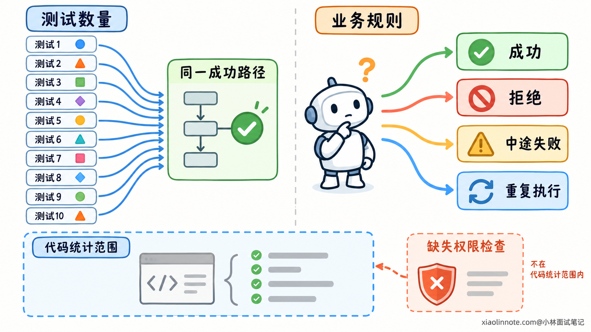
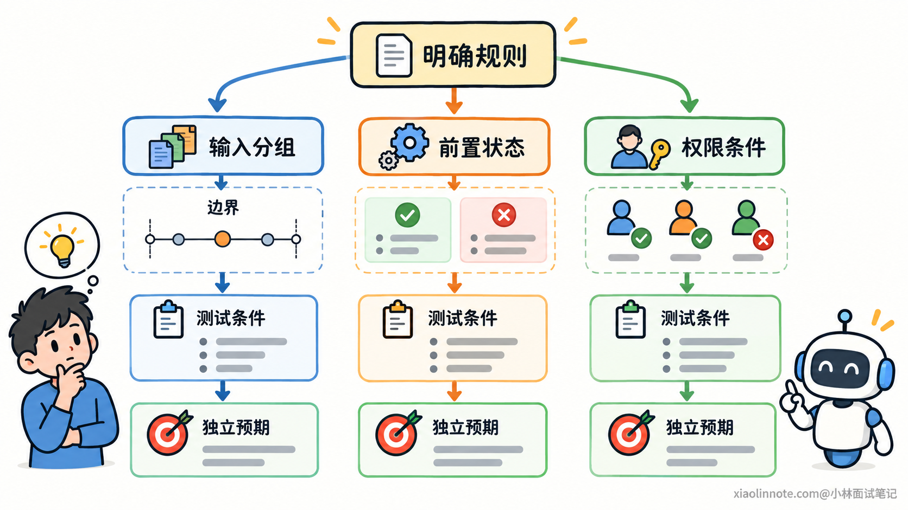
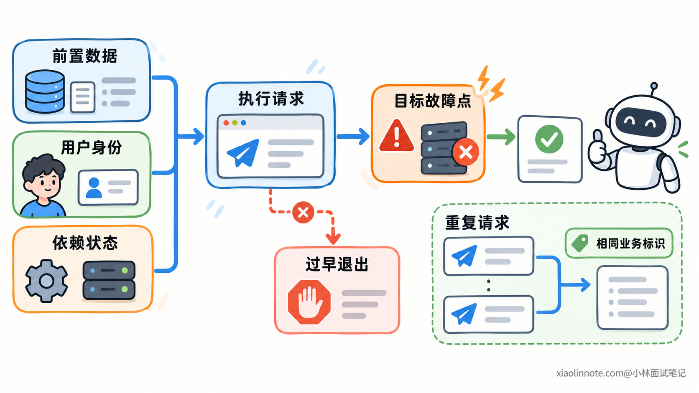
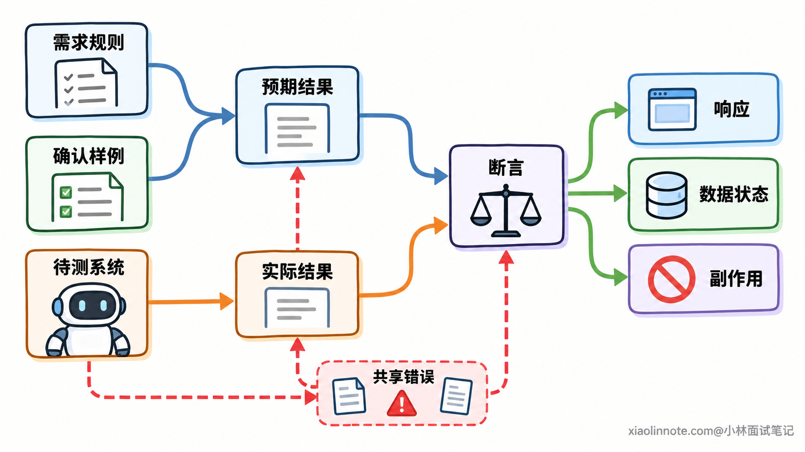
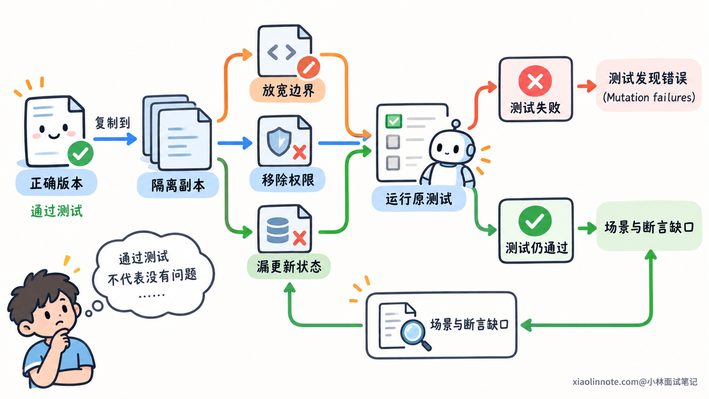

# 如何保证 AI 生成的测试用例覆盖关键业务场景？

> 原文：[如何保证 AI 生成的测试用例覆盖关键业务场景？](https://xiaolinnote.com/ai/coding/generated_test_coverage.html) · 小林面试笔记

👔面试官：AI 生成了一批测试，怎么判断它们覆盖了关键业务场景？

🙋‍♂️我：每个函数都生成几条，正常和异常都有，应该就够了。

👔面试官：一个业务动作可能跨过多个函数，重复请求和中途失败的情况，你怎么确认没有漏掉？

🙋‍♂️我：把行覆盖率做到 100%，所有代码都执行过，就不会漏了。

👔面试官：执行到了错误处理代码，但没检查处理结果，代码写错了，测试也可能通过。

🙋‍♂️我：那让 AI 根据实现补上预期和断言。

👔面试官：实现可能已经漏掉业务规则，测试预期也照着漏了。正确结果得有独立依据。

咱们从业务规则与测试场景的关系讲起，看看怎样判断一批用例究竟验证了什么。

## 💡 简要回答

关键是先把业务规则对应到场景，再让 AI 生成测试，而不是只按函数数量分配用例。场景要从输入范围、业务状态、权限条件和流程中的失败点推导；涉及重复请求或并发时，还要考虑操作顺序。

每条用例都需要明确前置状态、执行操作和预期结果，并确认测试真的触发了目标条件。比如测试重试，就不能只模拟一次失败，还要检查后续执行有没有违反业务约定。正确预期要来自需求、已确认样例或可信参考模型，不能照着待测实现反推。

生成后要把关键规则与实际运行的测试对应起来，检查哪些规则没有用例、哪些只有正常路径，以及断言有没有观察关键结果。代码覆盖率能帮助发现没执行的区域，但不能证明业务已经做对。

对重要规则，还可以在测试副本里故意破坏相关逻辑，看现有用例能否失败，再补充遗漏。AI 负责辅助扩展和编写，规则、预期与实际执行结果仍要核对，最后明确已验证的范围和剩余缺口。

## 📝 详细解析

### 为什么测试数量和代码覆盖率都不能代表业务覆盖？

AI 可以快速生成很多测试。例如同一个成功请求换十组输入，测试文件就多了十条。它们执行的是相同流程，验证的也可能是同一项规则，数量增加不一定增加了新的业务覆盖。

按函数生成测试也有类似问题。一个业务动作可能先检查资格，再保存数据，最后通知其他组件。每个函数单独测试过，不代表它们组合起来时，中途失败、重复执行和状态变化都符合要求。

因此，关键业务场景需要从业务规则看。规则说明系统应该遵守什么，场景则规定在什么条件下、经过什么操作来检查这项规则。输入相同，但用户身份、初始状态或执行顺序不同，都可能构成不同场景。

代码覆盖率观察的是另一件事。行覆盖率记录哪些代码行执行过，分支覆盖率进一步检查条件判断的不同去向有没有执行。它们帮助开发者发现尚未走到的代码区域，却不知道某项业务要求是否已经完整实现。

如果实现本来就漏了一个权限检查，测试可能把现有代码全部执行一遍，覆盖率仍然很高。那项缺失规则根本没有对应代码，覆盖率也就没有这一部分可以统计。

所以，要先确定重要规则，再检查每项规则在哪些条件下需要验证。源码可以帮助找到实现分支和依赖，但只沿现有代码生成测试，容易把实现中的遗漏一起带进测试集。

### 一条业务规则，怎样推导出需要测试的场景？

先把规则写成能判断对错的行为。像「参数要合理」太模糊，生成器只能猜；如果明确为「页大小是 1 到 100 的整数，超出范围应拒绝」，就能推导出具体场景。

就这条范围校验来说，可以先把输入分成允许范围、低于下限和高于上限几类。这种分组思路叫等价类划分：对当前要验证的规则，具有相同处理要求的输入先归为一类，再选代表值检查。

接着检查边界。0 与 1 分别在下限外和下限上，100 与 101 分别在上限上和上限外。只用 10、20 这类中间值，发现不了把包含边界写成不包含的错误。其他格式条件也要根据契约单独检查，不能把范围有效误认为整个输入一定有效。

对于带状态的业务，还要看操作前处于什么状态。如果规则规定已取消的任务不能完成，就需要分别检查允许完成的状态和已取消状态。相同的完成操作，前置状态不同，预期就不同。

权限条件也会改变结果。例如「已经登录」与「有权访问当前资源」是不同要求。只构造登录成功的用户，不能检查资源归属限制。多项条件共同决定行为时，要有满足条件的路径，也要有关键条件不满足的路径；条件相互影响的组合需要额外检查。

跨步骤流程则要检查失败发生在什么位置。第一步尚未完成就失败，与第一步成功、第二步失败，可能留下不同状态。超时也不能直接等同于操作没完成：请求可能没有生效，也可能已经生效，只是响应丢失，后续重试应分别按规则验证。

涉及共享状态时，再考虑重复操作和执行顺序。一次操作正确，不代表重复一次仍然正确；两次操作串行正确，也不代表交错执行没有问题。这些场景来自业务约束，而不是看函数里有没有显式写出「并发」这个词。

条件组合可能很多，不需要无差别穷举。优先覆盖会改变业务决策、造成越权或错误状态的条件，以及已经发生过的故障。对彼此独立、不会改变当前规则结果的输入变化，可以减少重复，把精力放在有不同结果或失败风险的场景上。

### 写出了目标场景，怎样让测试真正触发它？

用例名称写着「超时后重试」，并不说明测试执行时真的发生了超时，更不说明系统走完了重试。场景需要落实成可控制的前置条件和操作过程。

前置条件包括初始数据、业务状态、用户身份，以及依赖组件的行为。测试不能依赖另一条用例碰巧留下的数据，否则顺序变化以后，可能验证的是另一种情况。需要隔离或重置相关状态，让每次执行都能从明确条件开始。

操作过程要足够具体。测试第一次执行后重试，就应安排两次请求，并控制第一次的结果。如果测试重复请求，还要确定两次使用的是同一个业务标识；换成两个不同标识，就可能始终在验证两次独立操作。

依赖失败可以通过测试替身制造。测试替身替代某个组件，让它在指定位置返回错误或抛出异常，便于检查程序怎样处理。需要确认故障发生在目标步骤，而不是前面的输入校验已经拒绝请求，导致目标逻辑根本没有执行。

但测试替身的行为与真实组件可能不同。例如替身返回一个失败，不会自动模拟事务已经提交、响应却丢失的情况。涉及这些语义时，需要安排对应状态，必要时用真实或接近真实的组件做集成验证。

并发场景还需要控制时序。如果规则要求共享资源只能成功占用一次，就要检查竞争条件下是否仍然成立。可以在需要验证的竞争点使用同步屏障或测试钩子，安排请求到达某个步骤后等待，再按指定顺序放行，最后观察成功次数和资源状态。

单纯启动两个线程再固定睡眠，很难确认是否出现了目标交错，机器负载变化还可能让测试偶尔失败。时序控制的价值，是让测试可重复地触发想检查的条件，而不是靠运行次数碰运气。

对于异步行为，也要有明确检查点。等待目标事件或状态，并设置合理超时，比睡一会儿就检查更容易解释失败。已验证的场景应能重复执行，结果变化时能区分产品问题与测试条件不稳定。

### 预期结果和断言，怎样才能检验业务规则？

目标条件触发以后，还需要判断结果。测试预期如果来自待测实现自身，程序与测试就可能一起接受错误行为。

比如规则明确上限为 100，实现误写成允许 101，AI 根据实现生成「101 应通过」的预期，测试就会全绿。正确预期应该从已确认的规则推导，这样 101 才会成为能发现问题的输入。

用于判断正确结果的依据，常被称为测试 Oracle。它可以是需求约定、人工确认的样例，也可以是经过审查的参考模型。参考模型应描述业务规则，不能只是复制生产实现，否则相同遗漏可能在两边同时出现。

AI 可以根据确认的规则生成预期，并不要求开发者手写所有测试。需要核对的是关键判断有没有独立依据，而不是测试由人还是模型编写。

断言要观察规则要求的结果。检查返回成功，未必证明数据已经保存；检查写入方法被调用，未必证明最终状态正确。如果规则涉及持久化，就需要相应的状态证据；如果只验证局部函数的参数传递，调用断言则可以提供这一范围内的依据。

拒绝类场景也不能只检查报错。若规则要求无权限时不得修改资源，就还要检查原有数据没有变化，也没有发生不允许的后续动作。错误响应和副作用是两项不同观察，遗漏后者可能放过「虽然拒绝了，却已经修改数据」的问题。

断言不需要全部堆在同一条测试里。局部测试检查分支与调用，集成测试检查跨组件结果，但要能说明关键规则最终由哪项检查验证。对结果有明确观察，场景才不只是执行了一遍代码。

### 怎样找出已有测试的覆盖缺口？

测试生成并运行以后，可以把关键规则、目标条件、对应测试和业务断言放到一张表里。这种对应关系帮助开发者看到：某项规则是否没有用例，同一规则是否只验证了正常条件，某条用例是否缺少有效断言。

例如，下面几种规则可以分别核对相应证据。具体条件与预期都要以项目已确认的约定为准。

| 关键规则 | 需要核对的条件 | 断言观察的结果 |
| --- | --- | --- |
| 参数范围受限 | 合法范围、边界内外 | 接受与拒绝是否符合约定 |
| 无权限不得修改资源 | 身份与资源权限不满足 | 错误结果，以及数据和副作用未变化 |
| 重复请求不重复处理 | 相同业务标识重复执行 | 响应、执行次数与最终状态 |
| 失败后的状态符合约定 | 不同步骤失败、响应丢失 | 已完成与未完成的状态、恢复结果 |
| 并发操作遵守资源限制 | 目标竞争条件与时序 | 成功次数和资源最终状态 |

这张表需要对应实际运行的用例。测试文件存在、名称写着目标场景，还不算完成验证。要确认测试能够执行，确实触发条件，并检查了规则要求的结果。

接着使用覆盖报告补查实现。未执行的行或分支，可以提示场景没有触发、测试范围遗漏，或者相关代码不可达。已经覆盖的部分，则还要看断言是否有效。业务规则与代码覆盖互相补充，不能互相替代。

对重要规则，可以进一步检查：如果实现违反它，测试能不能发现？在隔离的测试副本中，故意放宽边界、移除权限判断或跳过关键状态更新，再运行原来的用例。

如果对应测试失败，说明它对这项错误具有辨别能力；如果仍然通过，就继续检查输入有没有触发错误、结果有没有被观察，以及断言是否过弱。历史故障版本也可以用于这种核验，新测试应能在相关错误版本上失败，在修复后通过。

自动工具生成小范围程序改动，再检查测试是否失败，这种方法叫变异测试。仍然通过的改动值得检查，但不一定都代表缺口：某些改动没有改变可观察行为，属于等价变异；还有些没有违反当前验证范围内的规则。要分析具体变化，而不是只追求一个分数。

AI 可以帮助整理对应表、提出缺失条件，并编写补充用例。开发者仍需核对业务依据和实际执行。需求变化或出现新故障时，再更新规则、预期与回归测试，让覆盖范围跟着实际业务变化。

## 🎯 面试总结

开头按函数分配用例，容易漏掉跨步骤、状态和时序中的业务要求；追求行覆盖率，解决不了缺失规则与无效断言；照着实现生成预期，又可能让实现和测试共同接受错误行为。

关键业务覆盖需要从明确规则推导条件，再把条件落实为可重复执行的测试，用独立预期检查响应、数据和必要副作用。每项重要规则都应能对应到实际运行的用例和结果证据。

覆盖报告帮助查未执行区域，错误注入和变异测试帮助核验发现错误的能力。结合这些证据补齐缺口，才能说明已验证哪些业务场景，而不能只用测试数量或覆盖率概括整批用例。

---
