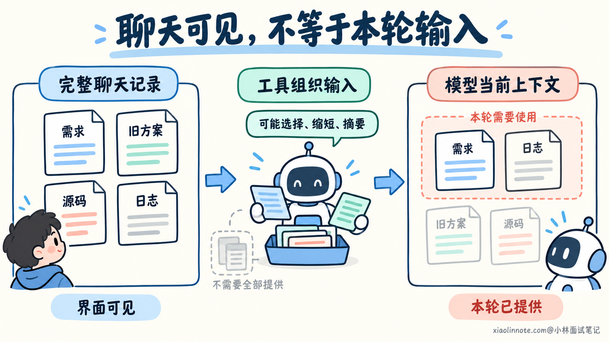
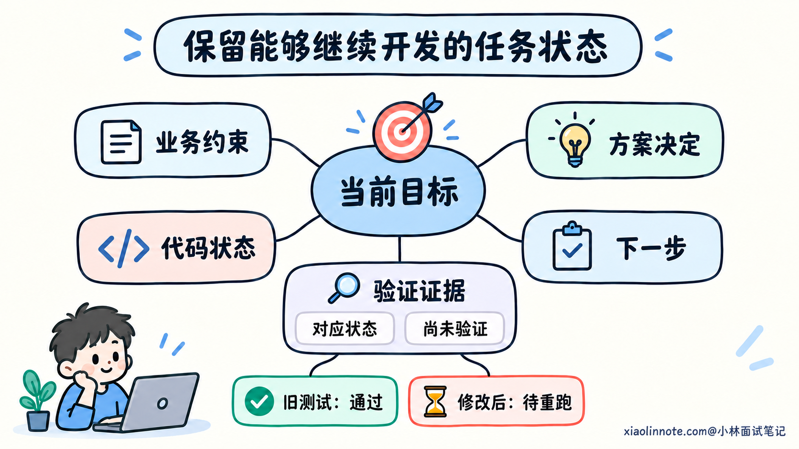
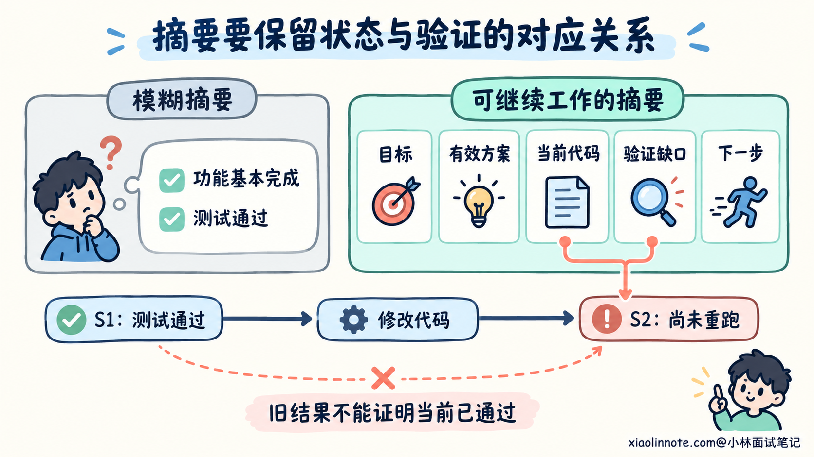
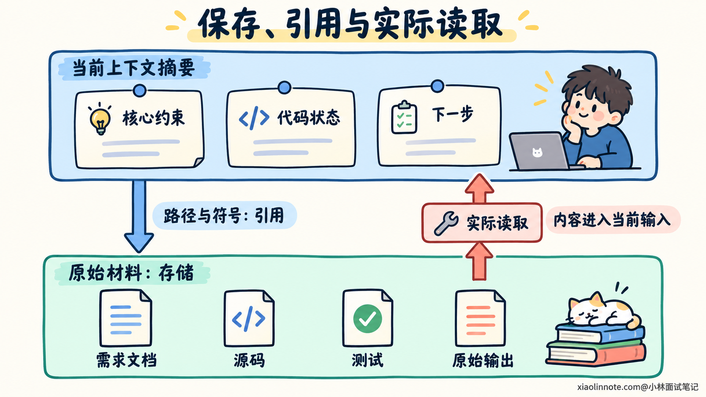
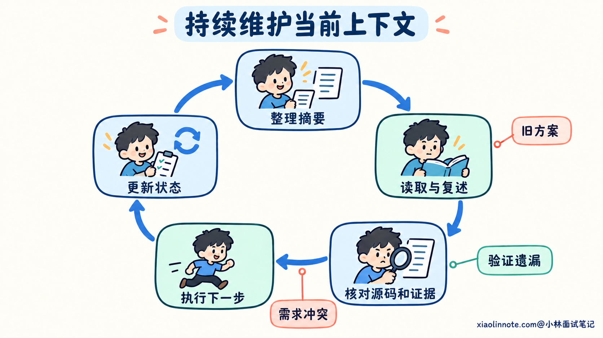

# AI 编程的上下文越来越长时，如何保留关键信息？

> 原文：[AI 编程的上下文越来越长时，如何保留关键信息？](https://xiaolinnote.com/ai/coding/context_management.html) · 小林面试笔记


👔面试官：一个开发需求聊了几十轮，代码、日志和方案越来越多，你怎么让 AI 继续做对？

🙋‍♂️我：换个上下文窗口大的模型，全塞进去。内存够大，就没有失忆。

👔面试官：（指着刚生成的代码）你第七轮说只能查本人数据，它第四十轮把条件删了。仓库搬进去了，门锁留在楼下了？

🙋‍♂️我：那让它把前面的内容浓缩成三句话，精华肯定都在。

👔面试官：（念摘要）「功能基本完成，测试通过，继续优化。」哪项功能？哪轮测试？刚改完还没重跑的那份，也给你算通过了？

🙋‍♂️我：我已经写进 `context.md`，文件在，它应该就记住了。

👔面试官：（检查读取记录）文件都没打开。你把复习资料锁进抽屉，还指望它隔着抽屉背诵？

咱们从模型实际拿到的信息讲起，再看长对话里哪些内容要留下，以及怎样让这些内容继续支持正确判断。

## 💡 简要回答

我会先围绕下一步开发整理当前状态，保留目标、不能违反的约束、当前采用的方案、代码改到哪里、验证结果和剩余问题。聊天过程里重复的讨论、大段源码和日志，可以压缩成结论并保留读取位置；关键条件和结论的适用范围要写清楚。

摘要不能只写「已经完成、测试通过」。我会区分代码已修改和行为已验证，记录测试对应的版本或工作区状态，以及修改后有没有重跑。旧方案已经替换、某个原因只是猜测，也要标明，避免整理以后又被当成当前依据。

我通常把核心状态放进一份简短的 Markdown 记录，详细规则、源码和原始结果保留在各自的位置。需要使用时，确认相关内容已经进入模型的当前输入，并按路径和符号补读。文件存在，并不等于模型已经读过。

需求变化、完成一个阶段或上下文明显变杂时，我会更新摘要，移除重复和失效内容。继续开发前，让 AI 复述当前约束与下一步验证，再对照原始材料核验关键判断。这样保留的是能够继续工作的状态，同时还留着回查证据的入口。

## 📝 详细解析

### 聊天还在，为什么 AI 仍然可能漏掉前面的要求？

开发过程中，你会不断补充需求，AI 也会读取文件、执行命令、贴出结果。几十轮以后，对话里既有当前规则，也有旧方案、失败尝试和大量工具输出。

模型在一次生成中，依据的是工具为这次请求组织的上下文。你在界面里能够翻到的聊天记录，不一定会原样进入每次请求。部分工具可能整理历史、缩短工具输出或使用摘要，具体处理方式取决于工具及其配置。

上下文窗口有容量限制，通常按 Token 计量。Token 可以理解为模型处理文本时使用的片段单位，不对应固定的汉字数。输入中的指令、历史消息、代码和工具结果都会占用空间，还要考虑所用模型与接口的输出限制。因此，对话可以持续很久，但模型每次使用的输入仍然需要组织。

即使内容装得下，也不能据此认定模型会正确使用其中每个条件。长上下文研究在部分任务中观察到，信息位置和输入长度会影响检索与回答表现。具体效果因模型和任务而异，不能简单推断为长度一增加就必然出错。

对于编程任务，还存在更直接的问题：历史内容可能互相冲突。前面讨论同步导出，后来确认改为异步；旧测试通过，随后代码又修改了。模型需要知道哪些信息仍然有效，而不是把每条历史记录都当成当前事实。

所以，扩大窗口可以缓解容量问题，开发者仍然需要整理当前规则和状态。重复强调一句「别忘了之前的要求」，也没有说明之前究竟哪些要求还应继续采用。



### 哪些信息应该留下，怎样判断它是否关键？

筛选信息时，可以先想下一步要做什么判断。没有这条信息，AI 会不会选错方案、破坏约束、重复已经完成的工作，或者把尚未验证的代码当成可以交付？如果会，就应当保留。

例如准备实现订单导出，当前只导出本人订单的限制，会影响查询条件，应该直接进入当前上下文。之前反复讨论的按钮文案，如果不会影响这一步，可以留在界面设计材料中，需要时再读。

信息是否关键，也不由出现时间决定。最新一条消息可能只是重复日志，较早确认的用户范围限制却仍然有效。只留下最近几轮，很容易丢掉持续生效的约定。

长任务中，可以围绕下面几类信息检查遗漏：

| 需要保留的内容 | 帮助避免什么判断错误 |
| --- | --- |
| 当前目标、范围与验收条件 | 做偏需求，或者未经依据扩大修改范围 |
| 必须保留的业务与接口约定 | 新功能破坏原有行为，例如遗漏数据归属条件 |
| 当前方案及关键选择依据 | 重新采用已放弃的方案，重复争论已经确认的决定 |
| 当前代码状态与相关位置 | 重复修改、漏掉未完成模块，或误读过去的实现 |
| 验证结果、条件与剩余缺口 | 把旧结果、未执行的检查或局部验证当成整体通过 |
| 未解决问题与下一步检查 | 在猜测上继续实现，或者不知道该补充什么证据 |

关键选择依据需要保留到能支持后续判断的程度。例如已经确认异步导出，就写清这是当前需求，以及之前的同步方案已经替换。无需把当时十轮讨论全部复制回来。

同时要区分事实、约定和推测。需求规定只能导出本人订单，是行为要求；代码已增加用户条件，是实现状态；真实接口是否遵守这个条件，需要对应验证。把它们都写成「用户范围已处理」，后面就无法判断还缺什么。

这里需要保留的细节往往很短，却会改变结论。像「不」「仅」「尚未」「修改前」「用户已确认」这些限定，不能为了精简随意删掉。它们说明一条结论成立的条件。



### 怎样把聊天经过整理成能够继续开发的摘要？

摘要会省略原始内容，因此需要决定省略哪些过程、保留哪些判断依据。按时间复述「先看了文件，又改了代码，然后跑了测试」，往往占用了篇幅，却没有说明现在应该怎样继续。

更有用的写法是整理当前状态。先说明现在的目标和约束，再说明采用的方案、当前代码、验证情况和下一步。已经被替换的想法只保留必要的失效说明，重复讨论和原始输出可以留下位置。

来看一个示例。假设项目正在增加异步订单导出，最初讨论过同步返回 CSV，后来用户确认改为异步任务。创建任务的代码已写过一版，测试也曾通过，但之后又调整了用户范围条件，尚未重新运行测试；导出执行模块还未完成。

下面这种摘要就丢失了会影响继续开发的信息：

```text
已经实现订单导出的核心功能，测试通过。
接下来完善导出流程，注意权限和性能。
```

AI 读到这里，无法判断应该做同步还是异步，也不知道所谓测试通过对应哪份代码。「注意权限」没有保留具体限制，「完善流程」又掩盖了一个模块还没有实现。

可以整理成下面这份 `context.md`。路径、状态节点和验证结果都是示例，真实使用时需要替换为实际项目记录；文件名也不是工具统一要求的约定。

```markdown
# 当前上下文：订单 CSV 导出

## 目标与必须保留的约定
新增异步导出任务，只导出当前用户自己的订单。
用户身份沿用已有认证结果，不接受请求参数指定其他用户。
现有订单列表接口及响应结构保持原有约定。
验收仍需覆盖本人范围、异步任务流程和原有查询行为。
规则位置：specs/order-export/spec.md。

## 当前方案
用户已确认采用异步任务，之前讨论的同步返回 CSV 方案已替换。
创建任务后由导出执行模块处理，具体约定见 specs/order-export/plan.md。

## 当前代码状态
状态节点 S2：用户范围条件调整后，相关测试尚未重跑。
src/order/export_job.js：createExportJob 已编写，最新调整需要核验。
tests/order/export_job.test.js：已有创建任务用例，需要核对并重跑。
src/order/export_worker.js：导出执行模块尚未实现。
上述位置有本轮修改，不能只按较早的代码记录判断。

## 验证依据与缺口
S1 时运行 node --test tests/order/export_job.test.js，结果通过。
S1 之后修改了用户范围条件，因此这条结果不能证明 S2 已通过。
完整导出与真实接口尚未验证，不能将任务标记为整体完成。
测试原始输出保留在本轮执行记录中。

## 当前下一步
先核对当前 createExportJob、用户条件来源和相关测试。
重跑创建任务测试，确认修改后的用户范围符合规则。
再实现导出执行模块，完成后补充完整流程验证。
```

这份摘要保留了未来行动所需要的约束。用户身份来源决定代码能否信任一个输入；异步方案决定模块职责；S1 与 S2 的区分说明旧测试结果不能直接复用。它没有复制源码，却指明了继续核验的入口。

状态节点 S1、S2 只是为了说明两次代码状态不同，不是通用版本编号。项目使用版本控制时，可以记录基线版本及工作区修改；尚未提交的变化也需要体现。日期新、分支名相同或提交号相同，都不能独立证明本地文件没有变化。

整理时还要防止把模糊原文补成确定结论。原记录只说「怀疑问题出在任务执行模块」，摘要就应保留为待核实的线索；没有对应实现和验证，不能改写成「执行模块存在缺陷」。



### 大段源码和日志省略以后，怎样保留回查能力？

把源码全文和工具输出持续放在对话里，会增加重复。开发者可以在摘要里保留关键结论与读取位置，把原始材料保留在仓库、文档或执行记录中，需要时再提供相关内容。

这样能区分两件事：当前上下文用于说明这一步要遵守什么、从哪里查；原始材料用于核对实际实现和证据。摘要中的一句「只导出本人订单」，还不能证明源码已经符合规则，需要阅读真正采用的用户条件。

读取位置也要足够明确。「导出逻辑」太笼统，`src/order/export_job.js` 的 `createExportJob` 就更有助于定位。核对测试结果时，则需要命令、执行条件和结果记录，不能只留下「见日志」。

例如前面的状态摘要可以将读取范围限定到创建任务函数、用户身份来源和相关用例。接下来实现导出执行模块时，再补读任务数据结构、文件生成和状态更新约定。无需每一步都重新加载所有导出材料。

原始内容是否能再次取得，也影响压缩方式。仓库里的当前源码通常可以重读；一次偶发故障的输出如果只在终端里显示，后面可能无法重建，就应保存必要的原始记录，并留下触发条件和查找位置。

外部保存还需要实际读回。模型不会因为工作目录中存在 `context.md`，就自动获得其中的内容。部分工具有文件加载约定，其他工具则需要显式引用、读取或粘贴，使用时应确认相关内容已经提供给本轮模型。

因此，写笔记之后要把它纳入下一步输入。关键约束直接写在当前摘要里，详细规则和证据按需读取。只有一个路径、却始终没有读到对应内容，仍然不足以支持代码判断。

也不必为每个小任务创建一整套文档。现有的需求说明、任务清单和执行记录可以继续使用，摘要只整理当前状态并引用它们。重复维护同一项规则，会增加几份材料互相不一致的机会。



### 什么时候整理上下文，怎样避免摘要越写越长？

完成一个开发阶段、切换到下一个模块，或者需求发生调整时，都适合检查当前上下文。重复信息增多、旧方案和新决定混在一起，也说明需要整理，未必要等到窗口接近限制才开始。

整理通常包括移除重复、提炼长输出和修正失效结论。对于已经结束的尝试，保留结果和必要依据即可；对于当前仍然生效的约束，则保留完整含义。正在分析的错误调用栈和触发输入还会影响判断，不能因为篇幅较长就先删掉。

更新摘要时，应修订原有状态，而不是在末尾不断追加「补充说明」。同步方案已经替换，就在当前方案处写明异步；S2 的测试已经重跑，就更新对应验证状态，同时保留需要追溯的记录位置。否则摘要很快也会变成一份新的长聊天。

可以这样让 AI 整理本轮上下文：

```text
请整理当前订单导出任务的上下文，本轮只更新状态记录，不改业务代码。

先核对用户已确认的最新要求、现有需求文档和本轮修改。
更新 context.md，保留目标、范围、必须遵守的约定、当前方案、
代码状态、验证证据、未解决问题和下一步。

把代码已修改与行为已验证分开。
测试结果说明对应的代码状态，以及后来是否有改动尚未复验。
已替换的方案标明不再采用，猜测保留为待确认。
不要补造执行结果，不要把未完成工作压缩成已经完成。

移除重复讨论和可重读的大段内容，保留路径、符号及原始记录位置。
无法再次取得、又会影响后续判断的证据，请保留必要内容。
最后指出哪些关键结论缺少依据，需要补读或重新验证。
```

这段提示词把整理工作限制在状态记录上，同时要求核对修改和执行结果。它强调保留判断条件，避免模型为了生成一份流畅的总结，把不确定和未完成的部分一并省掉。

提示词生成摘要，并不意味着工具已经缩短了本轮输入。实际删除或替换历史内容，需要所用工具的上下文管理能力；普通对话工具也可以通过显式提供整理结果，帮助后续判断，但不能据此假定旧信息已从输入中移除。

有些工具提供自动压缩，开发者仍然需要核对压缩结果是否留下关键约束和状态。如果已经丢失重要信息，就回到原始需求、源码与记录恢复。自动压缩触发阈值和保留方式因工具而异，没有必要把某个固定百分比当成通用做法。

### 整理以后，怎样检查没有丢掉会影响开发的信息？

摘要写出来以后，可以先让 AI 说明当前目标、硬约束、最新代码状态，以及下一步准备验证什么。这样能发现它是否仍在使用旧方案，或者把测试曾经通过误解为当前代码已通过。

不过，复述正确只说明它能够从当前资料中回答这些问题，还需要看后续行动是否遵守。修改时保留用户范围条件，检查时运行正确用例，报告时区分已验证与未验证，才说明这些信息真的参与了开发。

可以用一条续做提示词，让摘要与实际材料重新对应：

```text
继续订单导出任务。先读取当前 context.md，
简要确认目标、必须保留的约定、当前未验证项和下一步。

本轮先核对 S2 的创建任务修改：读取 createExportJob、
实际用户身份来源、对应测试及必要类型，检查是否与摘要一致。
若有冲突，区分状态记录过期与实现不符合需求，指出具体来源。
保留已确认约定，将错误实现列为待修复，不改写需求迁就代码。

再运行相关测试，记录当前代码的实际结果。
根据结果更新验证状态，随后按当前方案继续未完成工作。
摘要没有覆盖的关键判断，先补读原始材料。
```

这条提示词先读状态，再检查本轮涉及的真实实现，避免摘要中的旧结论直接控制修改。它也没有要求重新读完所有历史，只补充当前判断需要的材料。

如果摘要与源码冲突，要先分清各自说明什么。源码代表当前实现，已确认需求说明应该实现什么；代码不符合需求，需要修复代码，不能把需求摘要改成迁就实现。若只是记录落后于实际进度，则更新状态并保留依据。

最终检查的是继续工作的结果：有没有重复已完成的操作，遗漏剩余模块，恢复已放弃的方案，或者把未经验证的结论写成通过。发现这些问题时，补齐被省略的条件，重新组织相关上下文，再继续核验。



## 🎯 面试总结

开头只靠大窗口保留全部历史，仍然需要处理失效方案和规则冲突；把几十轮压成三句，又可能丢掉业务约束与验证条件。写好一份文件之后，还要确认内容已经进入模型的当前输入。

回答时，可以围绕当前状态展开：保留目标、约束、有效决定、代码状态、验证依据和下一步，将重复过程与大段材料压缩成结论及读取位置。明确哪些已确认、哪些待验证，以及结果对应哪份代码。

最后讲清维护和核验。阶段变化时修订摘要，继续工作时按需补读源码与证据，观察实际修改和验证是否遵守约定。摘要帮助开发者与 AI 继续工作，关键判断仍然需要原始材料支持。
