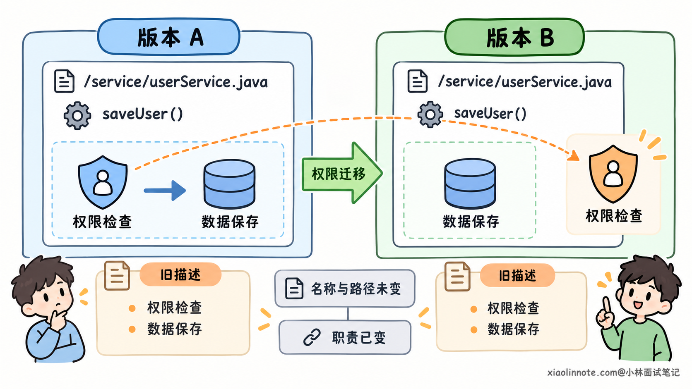
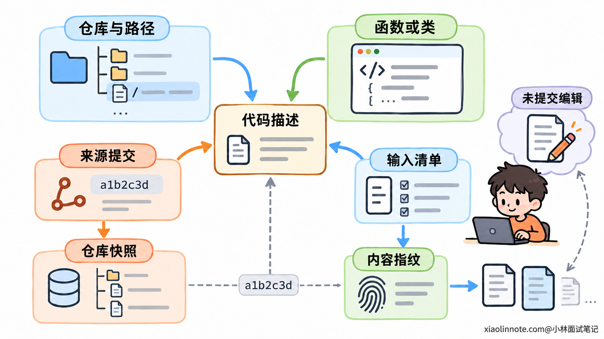
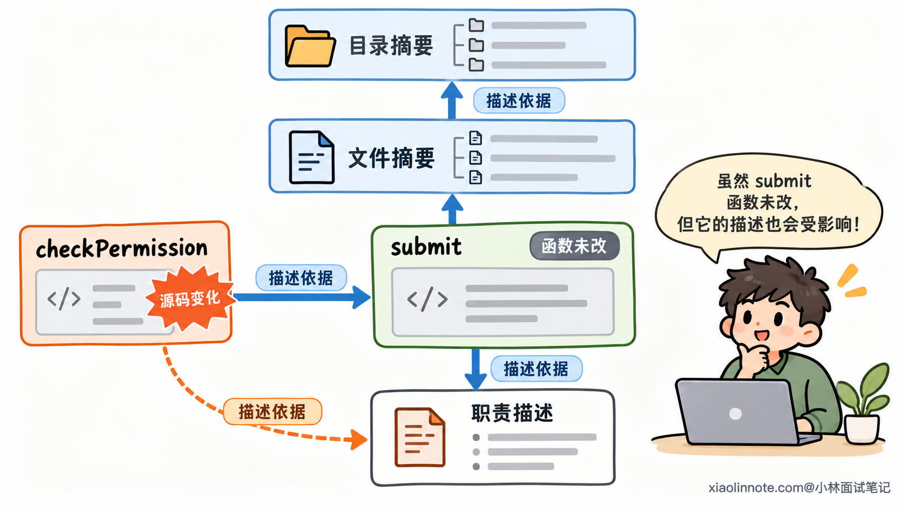
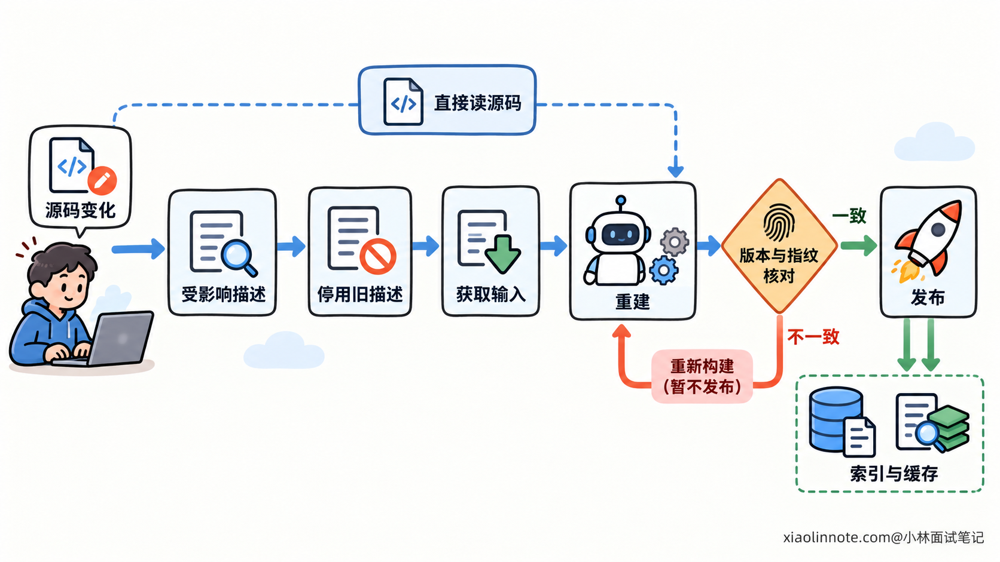
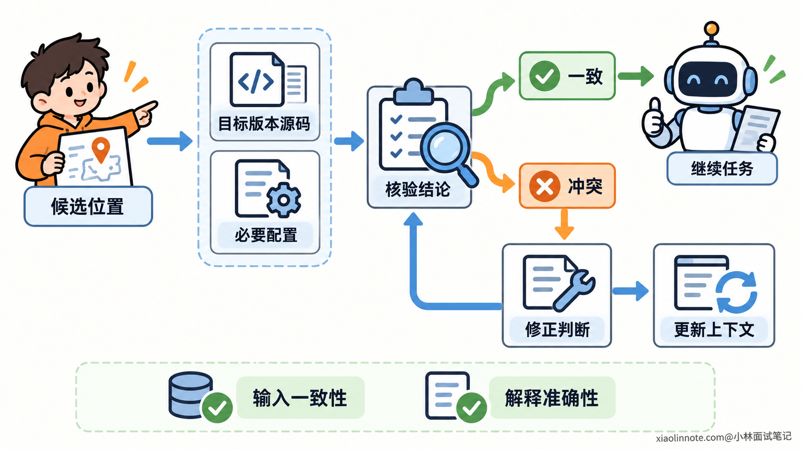

# Coding Agent 如何避免被过期的代码描述误导？

> 原文：[Coding Agent 如何避免被过期的代码描述误导？](https://xiaolinnote.com/ai/coding/stale_code_description.html) · 小林面试笔记

👔面试官：Coding Agent 会用函数摘要、目录说明来理解仓库，代码改了以后，怎么避免旧描述误导它？

🙋‍♂️我：每天重新生成一遍描述，应该就够了。

👔面试官：刚生成完代码就改了，在下一次更新前，Agent 读到的仍然是旧逻辑。

🙋‍♂️我：那哪个文件改了，就重新生成哪个文件的描述。

👔面试官：被调用的函数改了，调用方的职责说明也可能失效，调用方文件却没有修改。

🙋‍♂️我：给描述加个日期，让 Agent 优先相信最新的。

👔面试官：日期新也可能读的是旧分支，描述还可能一开始就理解错了。你怎么核验？

咱们从描述与源码的关系讲起，看看系统怎样发现过期，Agent 又怎样避免把旧解释当成当前事实。

## 💡 简要回答

代码描述是根据源码提炼出来的摘要，可以帮助 Agent 找到相关实现，但关键判断还要回到源码核验。判断描述是否过期，主要看它依据的代码和依赖有没有变化，不能只看生成日期。

生成描述时，需要记录对应的仓库、路径、符号和源码版本，并保存生成输入的内容指纹。代码变化后，先把受影响的描述标为失效，停止作为当前信息返回，再增量重建。影响范围还包括依赖这些代码的职责说明和上层摘要，不能只处理改动文件。

检索描述和读取源码要对齐目标版本，本地代码还没提交时，也要检查实际文件的变化。更新期间可以直接读取源码；新描述生成后，还要确认它对应的输入没有在过程中再次变化，避免旧任务覆盖新结果。

Agent 用描述找到候选后，要确认关键函数、调用关系和必要配置。如果发现描述与当前实现冲突，就根据源码和执行证据修正判断，同时纠正上下文里已经采用的旧结论。版本匹配解决的是来源一致，描述本身是否准确仍然需要核验。

## 📝 详细解析

### 代码描述为什么会过期？

Coding Agent 阅读大型仓库时，可能先看到一句函数职责说明，或者一段目录摘要。这些内容把很多代码压缩成几句话，帮助模型了解大致方向，减少初次查找时需要阅读的内容。

压缩会省略细节。例如「检查权限后保存数据」，概括了两个操作，却没有完整保留权限条件、异常分支和实际调用方式。Agent 如果把这句话当成完整实现，就可能在省略的信息上做出错误判断。

代码描述通常属于派生信息：生成器先读取源码，再提炼出解释，之后系统保存这份结果。描述写完以后，源码继续变化，它不会自动跟着变化。

函数删除或重命名，比较容易暴露问题，因为旧位置可能已经找不到。更难发现的是函数名和路径都没变，职责却已经改变。旧描述仍然能把 Agent 带到一个真实文件，看起来可信，解释的却是过去的行为。

过期也不一定意味着整段描述都错了。一段摘要可能正确说明模块负责保存数据，却仍然保留「保存前做权限检查」这个已经迁走的职责。部分正确的描述，反而容易让 Agent 接受其中未经核实的结论。

所以，判断过期要比较描述依据的实现与当前任务要研究的实现。昨天生成的描述可能已经失效，一年前生成的描述也可能仍然适用。生成时间可以帮助排查更新延迟，却无法独立证明内容有效。

### 怎样判断一条描述对应哪份代码？

要做比较，先得知道描述从哪里来。如果系统只保存「负责权限检查」这句话，没有来源记录，就无法判断它解释的是哪个函数、哪个分支，也不知道应该回到哪里核验。

一条可维护的描述需要带上仓库、文件路径和符号位置。符号可以是函数、类等代码对象；这些信息让使用者能从摘要回到具体实现。行号可以辅助定位，但代码增删会改变行号，不能只靠行号标识来源。

源码版本说明它基于哪份仓库快照。对于已提交的代码，可以记录提交号；只记录分支名还不够，因为同一个分支会不断产生新提交。

提交号也不能独立代表正在编辑的工作区。开发者或 Agent 修改文件后，尚未提交，提交号仍然相同，实际代码却已经改变。因此，还需要检查工作区中的修改、新增和删除。

**内容指纹用来判断实际输入有没有变化。** 系统对生成时使用的内容计算 Hash，保存为一个摘要值；再次使用时，对对应内容重新计算并比较，就能发现不匹配。Hash 的作用是比较输入，不是理解代码。

这里要注意指纹的范围。生成器如果读取了函数主体、相关类型和配置，就应该记录这些输入，不能只给函数主体计算指纹。否则配置改变了，系统仍可能认为描述与原来的输入一致。

另一方面，仓库出现新提交，也不意味着每条描述都必须重写。若某条描述依赖的输入没有变化，就可以检查后复用。按实际输入判断，既能发现局部修改，也能减少无关更新带来的重复生成。

旧描述仍然可能适用于它原来对应的历史版本。「失效」说的是它不能继续解释当前目标版本，不需要把所有历史描述都删除。

### 为什么没有修改的文件，描述也可能失效？

假设 `submit()` 调用了 `checkPermission()`，它的描述写着「只允许管理员提交」。后来 `checkPermission()` 改成允许某一类普通用户，`submit()` 的函数体完全没有变化，这句话却已经不准确了。

问题出在描述依据的范围。虽然描述挂在 `submit()` 上，它关于权限的结论依赖另一个函数。只检查当前函数的内容，检测不到这种变化。

因此，系统需要记录描述与来源之间的依赖关系。这里的依赖是「这条解释依据了哪些内容」，可能包含被调用函数、类型定义、路由注册或配置。它与代码的调用关系有关，但两者不完全相同。

例如文件摘要会依赖文件里的多个函数，目录摘要会依赖目录中的文件职责。这类概括关系没有函数调用，却同样需要在输入变化时检查。目录增加或删除文件，也可能改变目录职责，来源记录应包含相应的成员范围。

更新时，可以从变更的输入反向查找依赖它的描述。如果上层摘要根据下层描述生成，影响还需要继续向上检查；否则函数摘要已经更新，目录摘要却可能继续传播旧结论。

查到依赖，首先说明它需要重新检查，未必意味着自然语言正文一定要改变。局部变量改名可能不影响职责；返回值含义或权限条件改变，则更可能影响说明。输入已经不同、但尚未重新核验的描述，应退出当前有效结果，检查或重建后再恢复使用。

粒度可以按系统能力选择。文件级检查比较容易实现，但同一文件的局部修改可能触发多条摘要更新；函数级检查更细，需要同时处理类型、配置和外部依赖。若静态分析无法覆盖动态注册等关系，可以扩大到相关模块检查，避免把「没有查到依赖」当成「没有影响」。

### 更新时，为什么要先让旧描述失效？

发现源码变化以后，重新生成描述可能需要排队。假如系统只提交更新任务，却继续把旧描述当成当前结果返回，Agent 在这段空档里仍然会按旧解释推理。

因此，更新要先改变旧描述的使用状态。针对当前目标版本，受影响的描述应标记为待更新，并在检索结果中屏蔽旧正文，或者明确标成旧版本线索，只供回到源码查找，不能继续作为当前行为依据。

随后按目标版本获取输入，生成并核验新描述，再更新相关索引。描述正文、检索索引和来源记录要一起对应这份输入；只更新正文，检索缓存仍返回旧内容，也没有完成更新。

生成过程中还可能发生新的修改。一个任务读取版本 A 开始生成，之后代码变成 B，另一个任务已经完成 B 的描述。如果 A 的任务更晚返回，直接覆盖最新结果，就会把描述重新退回旧状态。

新结果应带着原来的来源标识，写入时检查它是否仍匹配目标输入。A 的结果可以保留在 A 的记录中，但不能冒充 B 的当前描述。系统也可以用版本条件控制写入，防止迟到任务覆盖较新的结果。

对于固定提交，可以把相关描述与索引构建成同一份快照，完成后整体切换查询目标。正在编辑的工作区则需要额外处理本地变化：已修改内容停用旧描述，删除位置从当前结果中排除，新增内容直接读取或生成新描述，未受影响的内容继续复用。

事件通知能帮助及时发现变更，但也可能漏掉。定期或查询时比较来源指纹，可以补查遗漏。无论采用哪种触发方式，更新期间都应允许 Agent 直接读取源码，而不是为了等待摘要生成而继续依赖旧正文。

### Agent 使用描述时，还需要核验什么？

前面的机制解决了一个问题：描述依据的输入是否仍然适用。但输入一致，并不能保证模型当初就理解正确。生成器可能漏看分支，把「部分请求需要校验」写成「所有请求都需要校验」，这种错误与过期无关。

所以，描述适合提供查找方向，重要结论仍然需要用目标版本的源码确认。例如摘要声称某个函数负责权限检查，就读取关键条件和调用位置；声称某个功能没有启用，就核对注册与配置，而不是仅凭一句职责说明决定修改。

检索与读取也要对齐。如果任务研究的是部署版本，摘要和源码都应对应部署使用的实现；如果任务修改本地代码，则要考虑当前工作区。读取了另一分支的代码，不能据此确认或否定当前描述。

发现冲突时，先核对版本和实际接入的实现，再按源码、配置以及必要的执行证据修正判断。源码能说明当前怎么实现，需求与规范则说明应该实现什么，不能因为代码与摘要一致，就认定业务行为正确。

还有一个容易漏掉的位置：Agent 自己的上下文。系统已经停用了旧描述，但模型前几轮可能读过它，并把旧结论写进计划或任务摘要。检索端更新，不会自动撤回模型已经采用的信息。

发现失效后，需要把受影响的旧结论明确标为不再适用，补充最新源码依据，并重新检查依赖它的计划。对于持久保存的代码理解记录，也要保留来源，让后续使用时能够再次核验。

来源信息缺失或暂时无法核验时，可以把描述当成待确认线索，直接查源码。这样仍然能利用摘要帮助导航，同时避免把一个无法确认的解释升级为修改依据。

## 🎯 面试总结

开头的三个回答，分别漏掉了更新间隔、依赖影响和来源核验。提高生成频率只能缩短延迟，只更新改动文件会漏掉依赖它的描述，而生成日期无法证明摘要对应当前代码。

避免过期描述误导，需要先建立描述与源码输入的对应关系，再根据变更检查受影响范围。旧描述先退出当前有效结果，新内容按目标版本重建，发布时核对来源，防止检索、源码和更新任务混用不同版本。

Agent 使用时还要核验关键结论，并纠正上下文中已经采用的旧判断。来源一致与解释准确是两项检查：前者帮助发现过期，后者避免把生成时就存在的理解错误继续用于修改。

---
