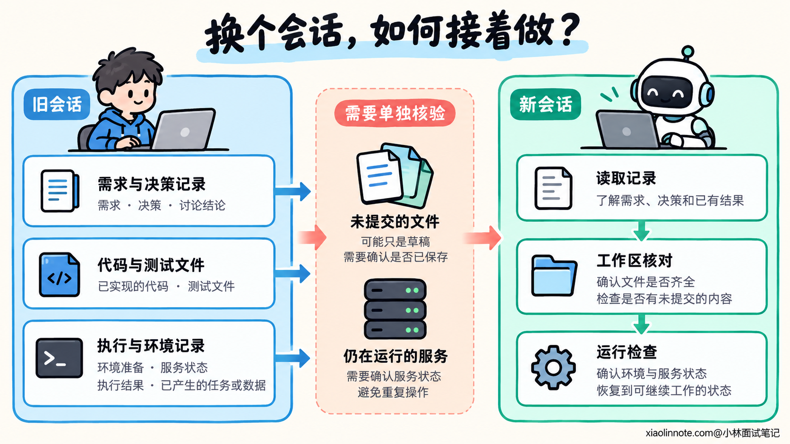
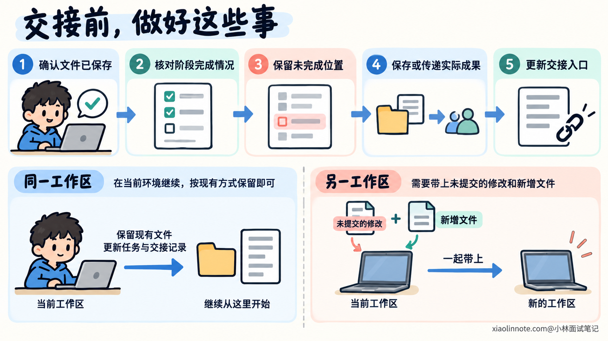
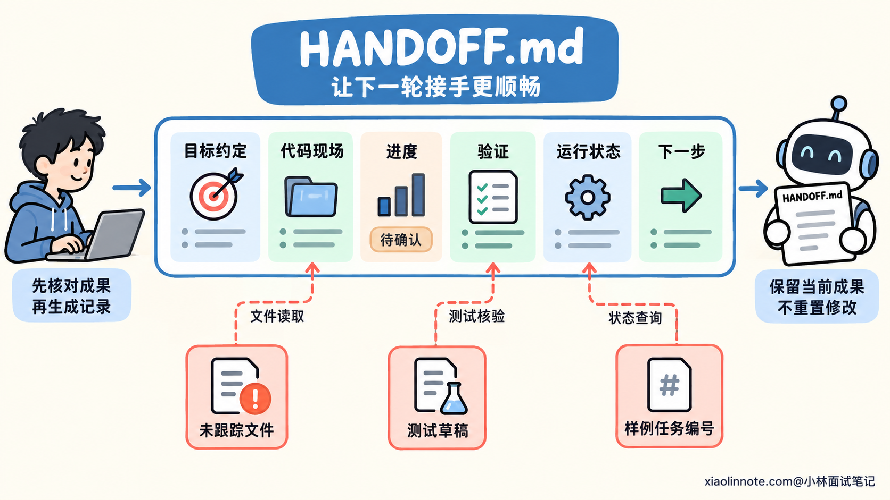
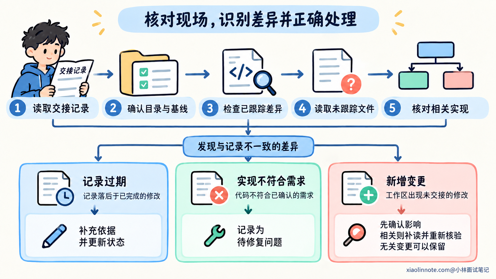
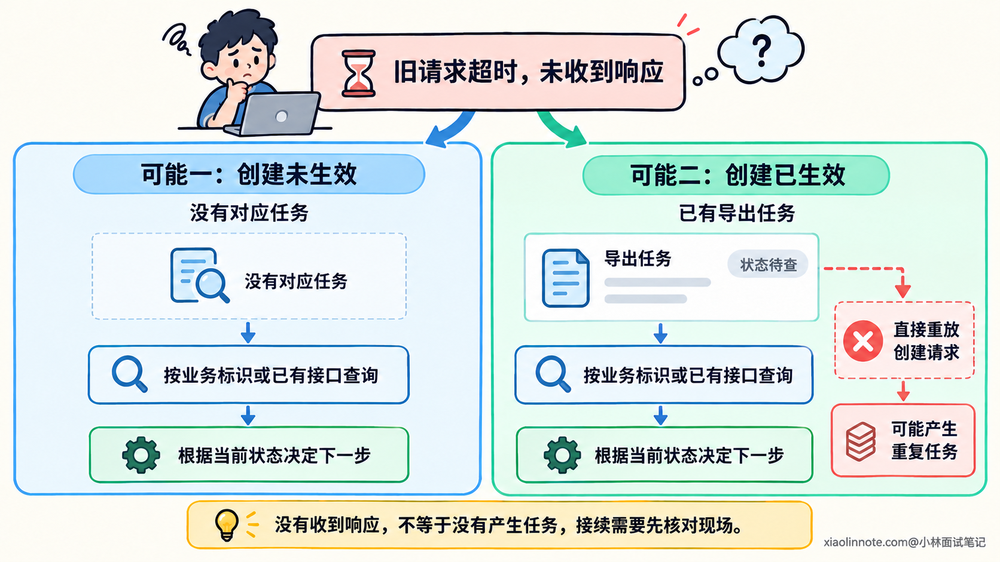
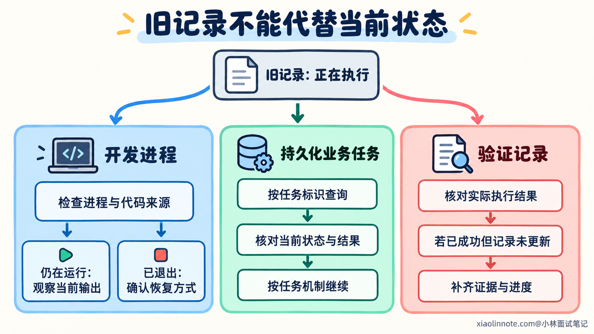
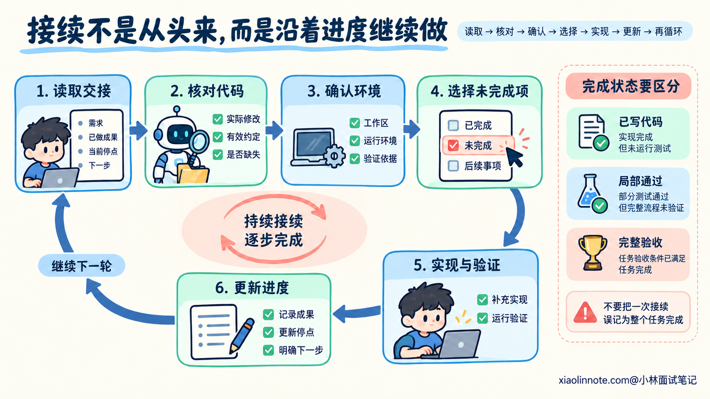

# 跨会话继续开发时，如何让 AI 接续需求、代码状态和任务进度？

> 原文：[跨会话继续开发时，如何让 AI 接续需求、代码状态和任务进度？](https://xiaolinnote.com/ai/coding/session_handoff.html) · 小林面试笔记


👔面试官：一个功能今天没做完，明天换个会话接着做，你怎么让 AI 接上？

🙋‍♂️我：同一个账号，发一句「继续昨天的」，它应该就懂了。

👔面试官：（打开新会话生成的计划）昨天该写导出执行模块，今天又从页面按钮开始。你的「继续」，到底续的是哪一集？

🙋‍♂️我：那把代码提交到 Git，进度也就存好了。

👔面试官：（指着一个未跟踪文件）昨晚那半个模块没进提交，测试记录也没带。你存了片头截图，就说整部剧都看完了？

🙋‍♂️我：让它把昨天的命令都重跑一遍，总能恢复现场。

👔面试官：（看着两个导出任务）服务多起了一份，任务又创建了一单。你这是读存档，还是又按了一次新游戏？

咱们把一次未完成的开发当作工作交接，看看怎样留下成果，再让新会话核对现场并继续推进。

## 💡 简要回答

我会在结束前保存实际代码和交接记录，写清当前需求、必须保留的约定、已确认方案，以及哪些代码已实现、哪些只写了一部分、哪些还没验证。记录也要说明工作区位置、版本与未提交文件，保证新会话能拿到真正的开发成果。

新会话开始后，我会让 AI 先读取交接记录和项目规范，再核对当前目录、代码差异、新增文件和相关实现。交接记录是恢复线索，实际工作区可能已经变化；有冲突时，要区分记录过期与代码不符合需求，保留已确认的业务约定。

运行状态也要重新确认，包括依赖、开发服务和测试条件。之前执行过的命令可能已经创建任务或修改数据，不能当成初始化步骤全部重放。需要先检查当前状态，再决定继续使用、恢复还是补做。

接着，我会从明确的未完成项入手，先做与它相关的检查，再继续修改和验证。每完成一个阶段，就更新交接记录中的代码状态、实际验证结果和剩余工作。接续成功要看当前行为和进度能否对上，不能只看 AI 是否复述出了昨天的总结。

## 📝 详细解析

### 换了会话以后，究竟有哪些东西需要接上？

开发一项功能时，AI 会逐渐了解需求、阅读实现、安排任务，并通过执行结果修正判断。这些内容有一部分在对话里，有一部分已经变成文件，还有一部分只存在于运行环境中。

不同工具可能提供历史恢复、记忆或自动摘要，但新会话实际拿到什么，要按工具的加载方式确认。同一个账号、同一个项目名称，都不能独立证明昨天的任务信息已经进入当前输入。

即使聊天恢复了，也还要核对开发现场。另一个人可能改了文件，你可能换了工作目录，开发服务可能仍然运行，也可能已经退出。旧记录说明过去观察到的状态，不能代替对当前状态的检查。

跨会话开发需要接上三部分：

| 需要恢复的部分 | 包含什么 | 只恢复其中一部分可能遗漏什么 |
| --- | --- | --- |
| 需求与决策 | 目标、约束、验收条件、当前方案和未解决问题 | 知道代码怎么写，却不知道哪些行为必须保留 |
| 实际开发成果 | 源码、测试、配置、未提交修改和新增文件 | 有计划和总结，却拿不到已经写出的实现 |
| 执行与验证状态 | 环境准备、服务状态、执行结果和已产生的任务或数据 | 代码齐全，却无法运行，或者重复已经执行的操作 |

比如交接记录写着「创建导出任务已完成」，可能只表示函数写完，也可能表示单元测试通过，还可能表示真实接口已经创建过一条任务。这几个状态会决定下一步不同的动作，记录时需要说明到哪一层。

因此，接续的起点是确认当前拿到了什么、缺少什么，再恢复到能够继续判断和操作的状态。不能仅凭一句「接着做」推断已经具备全部条件。



### 结束之前，怎样留下可以恢复的工作状态？

准备结束一轮开发时，先确认实际改动已经保存。AI 在对话里展示了一段代码，或者说「接下来会实现」，并不代表文件里已有对应内容。需要知道哪些文件确实写入了，哪些只是草稿或计划。

如果能够完成一个小阶段，就将实现和相关检查做完，再留下结果。例如创建导出任务已经符合约定、相关测试已经运行，新会话就能从执行模块继续。阶段边界越明确，恢复时越容易判断当前进度。

遇到必须中途停止的情况，也可以交接，但要写明停在哪里。函数只有部分逻辑、测试尚未执行、环境无法连接，这些状态都应保留。把半成品标成完成，新会话会在错误的前提上继续安排工作。

接着确认成果怎样传递。如果新会话继续使用同一个工作区，已经保存的文件通常可以直接读取；如果换到另一台机器或新的工作树，就需要将这轮修改和必要资料一起带过去。

Git 提交可以保存其中的代码变化，但只有进入对应提交的文件才会随它一起恢复。未提交的修改、未跟踪的新文件和被忽略的必要资料，需要按项目已有方式保存或传递。记录路径并不会把文件内容自动搬到新环境。

交接不要求为每次暂停新建提交，更不要求初始化一个原本没有 Git 的目录。采用项目现有的版本管理、文件快照或工作区保留方式即可，重点是能定位和恢复实际成果。

任务文档也需要跟着真实状态更新。验收条件保留在需求说明里，实施进度写入现有任务清单，交接记录指出当前停点与读取入口。已有文件能承担职责时，直接使用，避免维护几份彼此矛盾的进度。



### 交接文档怎样写，才能让下一轮知道从哪里开始？

交接文档要让新会话回答三个问题：这次应该继续实现什么，当前已经有什么，开始之前需要核对什么。它可以引用现有需求和任务清单，不需要重新复制整段历史对话。

下面用异步订单导出举例。假设创建任务的接口已实现并通过一轮单元测试；导出执行模块只写了 CSV 表头的辅助函数，还没有接上任务处理。执行模块和它的测试草稿是未跟踪文件，开发服务及本地样例任务需要在恢复时重新确认。

可以把这份状态写入 `HANDOFF.md`。这是示例文件名，路径、版本标识、任务编号和验证结果都是为说明交接方式设计的，实际使用时填写真实项目内容。

```markdown
# 交接记录：异步订单导出

## 目标与当前约定
新增异步 CSV 导出，只处理当前用户自己的订单。
用户身份使用已有认证结果，现有订单列表行为保持原有约定。
用户已确认异步方案，之前的同步返回方案不再采用。
需求位置：specs/order-export/spec.md。
方案位置：specs/order-export/plan.md。

## 交接的代码现场
项目：order-service，工作目录：/workspace/order-service。
版本标识 A 为本文示意，真实交接填写基线版本及工作区变化。
已跟踪文件有本轮未提交修改：
src/order/export_job.js、tests/order/export_job.test.js。
未跟踪的新文件需要一并保留：
src/order/export_worker.js、tests/order/export_worker.test.js。
本记录和必要测试输出也需要提供给接续会话。

## 进度与未完成项
创建任务：createExportJob 已实现，单元测试已运行。
执行模块：只有 CSV 表头辅助函数，任务处理与完成状态尚未实现。
执行模块测试：已有草稿，尚未运行，不能标为通过。
完整导出与真实接口验收：尚未完成。

## 验证记录
命令：node --test tests/order/export_job.test.js。
结果：交接时的创建任务用例通过。
条件：对应上述基线与当时的工作区内容，使用仓库接口替身。
输出位置：artifacts/handoff/export_job.unit.txt。
恢复后先核对相关代码和依赖是否变化，再决定哪些结果需要复验。

## 运行状态
开发服务曾在本地 3000 端口启动，目前是否仍运行需要检查。
启动方式：项目已有开发脚本，说明见 docs/development.md。
依赖与环境要求：以锁文件、环境变量示例和开发说明为准。
本地测试环境曾创建样例导出任务 demo-export-17，记录时处于等待状态。
恢复时先查询该任务的当前状态，不直接重放创建请求。

## 下一步
先核对工作区、新文件、创建任务实现与相关验证记录。
确认本地测试环境和样例任务状态。
继续实现导出执行模块，再补充执行模块测试和完整流程验证。
```

这份记录说明了执行模块只是草稿，而不是把「文件已经存在」写成「模块完成」。它还单独列出未跟踪文件，避免在换工作区时只带走提交，留下真正需要继续修改的代码。

测试记录说明验证的范围和条件。仓库接口替身下的单元测试通过，不能证明真实接口和完整导出流程已经通过。恢复后，如果相关实现或依赖变化，还需要重新评估这条结果是否适用。

运行状态也没有写成「明天直接运行昨天的请求」。样例任务可能已经完成、失败或者仍在等待，下一轮要根据当前状态决定动作。交接记录保留查询入口，帮助新会话恢复现场，而不是重复制造一个现场。

整理交接时，可以这样提示 AI：

```text
请为当前订单导出任务整理交接记录，复用已有需求与任务文档。
核对本轮实际保存的文件和执行结果，再更新 HANDOFF.md。

写清当前目标与约定、已确认方案、工作区位置和版本，
列出未提交修改、新文件，以及哪些成果需要带到另一个工作区。
区分代码已编写、检查已通过、完整行为已验证和仍未完成。

补充运行环境、启动与测试入口、原始结果位置和下一步。
已经产生的样例任务或数据，记录可查询的标识及最后观察到的状态。
无法核实的进度标为待确认，不补造完成或通过结果。
本轮保留当前成果，不重置已有修改，不为了交接重放业务操作。
```

提示词要求先核对成果，再生成记录，能减少把旧计划写成已完成工作的情况。它也保留了已执行动作的查找线索，让下一轮能够先观察当前状态。



### 新会话开始后，为什么要先核对工作区？

拿到交接记录以后，新会话需要确认记录所指的现场与当前目录一致。项目名称相同，可能仍然是另一个工作树、分支或版本；工作区里也可能增加了其他人的修改。

在使用 Git 的项目里，可以用下面几条命令核对。它们用于查看位置、基线和文件状态，不会把工作区恢复成某个版本：

```bash
# 确认当前目录和所在工作树根目录。
pwd
git rev-parse --show-toplevel

# 核对当前提交，并列出修改和未跟踪文件。
git rev-parse HEAD
git status --short --untracked-files=all

# 分别查看未暂存与已暂存的改动。
git diff
git diff --cached
```

普通 `git diff` 展示工作区与暂存区之间的差异，`git diff --cached` 展示暂存区相对提交的差异。新建但尚未跟踪的文件，通常不会出现在这些差异中，需要通过文件状态找到，再直接读取内容。

被忽略的资料也可能不在普通状态列表里，例如必要的测试输出。交接记录引用了它，就要检查对应文件是否实际存在、内容是否匹配。项目没有使用 Git 时，按文件快照、目录和已有版本记录核对即可。

确认文件范围后，再阅读本轮要继续的实现和相关依赖。导出执行模块是半成品，就应看实际完成了哪些函数、是否已经被注册，以及任务输入的结构。不能根据「昨天准备写这里」推断今天文件仍然处于同一位置。

发现记录和代码不同，需要解释差异。记录落后于已完成修改，可以补充依据并更新状态；代码违反了已确认需求，则记录为待修复问题。业务规则说明应该怎样做，源码说明现在怎样做，两者不能混成一项事实。

工作区出现未交接的修改时，先确认它们怎样影响当前任务。无关变更可以保留，相关变更需要补读和重新核验；不能为了对齐昨天的记录，直接覆盖当前内容。

这些检查帮助新会话建立自己的依据。读取交接记录是开始，核对实际文件以后，才能知道下一步修改会作用于哪份实现。



### 运行环境和已经执行的动作，怎样接续？

代码文件能够保留，终端和服务状态却需要单独确认。新会话可能使用新的终端，原来临时设置的环境变量不再存在；旧开发服务也可能仍然占用端口。结束会话不能直接推断为所有进程都已停止。

恢复时要检查当前需要的依赖、配置和服务是否可用。记录运行时要求、锁文件和项目已有启动方式，能帮助新会话重建环境。需要配置时，保留变量名称和获取入口即可，不把凭据复制到交接文档里。

服务正在运行，还要确认它对应哪个项目和哪份代码。端口有响应，只能说明那里有服务；它可能是另一工作区的旧进程。如果已经有正确的服务，就按当前状态继续；需要启动时，再使用项目约定的方式恢复。

之前执行的命令，也需要按效果区分。读取文件、查询任务状态，是为了观察；启动服务、创建任务和修改数据，则会改变现场。交接时记录「执行过什么」，不等于要求下一轮将它们逐条再执行。

例如本地样例任务 `demo-export-17` 已经创建，恢复后先查看它是否存在、当前状态和执行结果。任务已经完成，就可以利用对应结果验证；任务仍在等待，则继续核对执行模块；需要新的样例时，再明确安排一轮新的验证。

如果旧请求超时了，只知道没有收到响应，还不能确定创建动作是否生效。可以按业务标识或已有查询接口确认结果，避免把一次不确定的执行误认为没有发生，再创建一条重复任务。



异步执行中断，还需要判断未完成的是进程、业务任务还是验证记录。进程仍在运行，就观察当前输出和任务状态；进程退出但任务保存在队列里，则按任务机制恢复；代码已经执行成功、只是记录没更新，则补齐证据与进度。单凭旧会话最后一句「正在执行」，无法区分这些情况。

环境暂时无法恢复时，也可以先核对源码、需求和相关单元测试，将受环境影响的检查单独记录。只要明确已验证范围，就能继续推进有依据的工作，不必把环境问题写成整个功能已经完成或完全无法判断。



### 怎样确认接续成功，并给下一轮留下清楚的进度？

新会话恢复到能够继续工作以后，应从一个明确的未完成项入手。先检查与这一项相关的已有行为，确认当前起点，再继续实现和验证。无需每次接续都重跑项目所有检查，也不能完全沿用已经不适用的旧结果。

可以用下面这段提示词开始一轮接续：

```text
继续异步订单导出任务。先读取项目规范、HANDOFF.md 和它引用的需求文档。
确认当前目录、基线、未提交修改与新文件，核对实际源码是否符合记录。
保留当前工作区成果，区分记录过期、实现错误和后续新增变更。

确认本轮需要的环境、服务和测试条件。
对记录中的样例任务先查询当前状态，不直接重放创建请求。
核对旧验证结果的适用范围，执行本轮需要的相关检查。

按已确认方案继续未完成的导出执行模块，补充测试与流程验证。
每完成一个阶段，更新实际代码状态、执行结果和剩余工作。
有依据缺口时先补读或检查，无法验证的部分如实记录。
```

这段提示词先安排恢复和核对，再指定接下来实现的模块。它保留了旧成果，也要求新会话根据当前证据修正判断，避免看到一点已完成代码就宣布整个任务结束。

判断接续成功，要看后续行动是否对上实际进度：读取了正确实现，沿用了有效约定，补做了缺失模块，验证结果对应当前代码。复述交接内容可以帮助发现理解偏差，接续是否成功仍要检查实际修改与执行结果。

推进之后，将当前停点更新到任务清单与交接入口。实现写完但尚未运行测试、局部测试通过但完整流程未验证，都保留各自状态。原始输出与对应版本也要能找到，方便下一轮判断哪些结论可以继续使用。

对于仍未完成的工作，写清下一步要核验或修改的位置，以及当前缺什么条件。这样下一轮开始时，可以从一个具体问题继续，而不是重新猜测「剩下的细节」包含哪些内容。



## 🎯 面试总结

开头依赖同一个账号和一句「继续」，无法确认新会话实际拿到的信息；只有 Git 提交，也可能漏掉未提交代码和执行状态。把昨天的命令全部重跑，又可能重复启动服务或创建业务任务。

回答时，可以沿工作交接展开：结束前保存需求、成果和当前停点，新会话先读取记录，再核对工作区、环境与验证依据。对旧记录中的已执行动作，先确认当前状态，再决定怎样继续。

最后讲清接续的完成依据。按明确的未完成项推进，用当前代码和实际结果更新进度，并留下下一步与剩余缺口。交接记录负责指引恢复，开发者和 AI 仍然需要用当前现场核验判断。
