# 大模型工程面试题

## 为什么长上下文会出现 Lost in the Middle？上下文窗口越大越好吗？

👔面试官：为什么长上下文会出现 Lost in the Middle？上下文窗口是不是越大越好？

🙋‍♂️我：上下文太长以后，模型记不住中间的内容，所以会把它忘掉。把上下文窗口继续扩大，模型就能记住了。

👔面试官：窗口能装进去，为什么就等于模型能用好？一个模型能接收 100 万 token，只能说明请求不会因为超长被拒绝，不能说明它能准确找到第 50 万个 token 里的证据。

🙋‍♂️我：那应该是位置编码外推的问题，RoPE 没有处理好中间位置，所以模型找不到。

👔面试官：如果全是位置编码的问题，为什么同一个模型常常能找到开头和结尾的信息，却更容易漏掉中间的信息？注意力分配、训练数据和任务干扰都不考虑吗？

🙋‍♂️我：那把所有资料都塞进去，再让模型多思考一会儿，应该总能找到吧。

👔面试官：资料越多，噪声和冲突也越多，预填充延迟、显存占用和调用成本还会一起上涨。长窗口是容量，不是质量保证。先搞清楚「装得下」和「用得好」的区别。

这道题最容易踩的坑，就是把上下文窗口当成电脑硬盘，误以为容量越大，模型就一定看得越全、答得越准。

### 💡 简要回答

我不会把长上下文能力简单理解成「模型最多能接收多少 token」。最大上下文窗口只是输入上限，真正有用的是模型在不同长度、不同位置和不同干扰强度下，能不能稳定找到证据并完成推理，也就是它的有效上下文能力。

Lost in the Middle 指的是关键信息放在长文本中间时，模型的利用效果往往比放在开头或结尾更差。它不只是位置编码造成的，还和训练时见过的长度分布、注意力的位置偏置、无关内容对注意力的稀释，以及任务需要跨段整合多少信息有关。

所以窗口不是越大越好。输入越长，稠密 Self-Attention 的计算量增长很快，KV Cache、首 token 延迟和调用成本也会增加。工程上我会先做检索和重排，只保留真正相关的片段，再配合结构化摘要、清晰分区和关键约束布局，最后用不同长度、不同证据位置的测试集验证，而不是把所有资料一次性塞给模型。

### 📝 详细解析

#### 先分清「训练长度」「窗口上限」和「有效长度」

看到模型介绍里写着支持 128K、200K，甚至 1M 上下文，很多林友会自然地理解成：「只要内容没超过这个数，模型就能全部记住。」

其实这里混在了一起的是三件不同的事。

第一件事是**训练时见过的长度**。如果模型在预训练或长上下文继续训练时，大部分样本都比较短，那么它即使通过位置编码扩展接受了更长输入，也不代表它已经学会在超长文本中稳定检索和推理。

第二件事是**接口允许的最大窗口**。它表示输入 token 加输出 token 不能超过某个上限，回答的是「能不能装进去」。窗口扩展可以通过长文本继续训练、位置插值、YaRN 等办法完成，但扩到更长并不等于所有任务都能无损外推。

第三件事是**有效上下文长度**。它回答的是「装进去以后能不能用好」。同样一段证据，放在 8K 输入里能答对，放进 100K 的大量干扰内容中就可能答错。对真实业务来说，第三个数字往往比模型标称的窗口大小更重要。

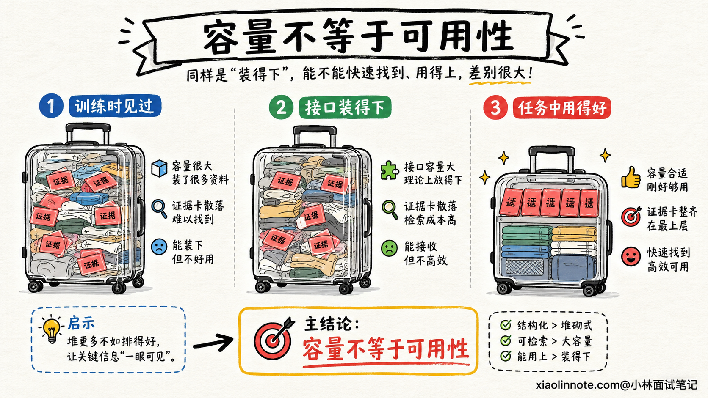

#### Lost in the Middle 到底是什么现象？

假设我们把一条能直接回答问题的证据，分别放在长文档的开头、中间和结尾，再让模型回答同一个问题。很多模型会呈现一种类似 U 形的表现：证据在开头和结尾时更容易答对，放在中间时正确率更容易下降。

这就是 Lost in the Middle，直译过来是「迷失在中间」。它不是说模型完全看不见中间的 token，而是说在长输入和大量干扰下，模型没有稳定地把中间那段信息选出来，并用于最后的回答。

为什么开头和结尾会占便宜？开头通常放系统指令、任务背景和核心定义，模型在训练中见过大量这种结构；结尾离当前要生成的答案最近，用户问题也经常出现在这里。久而久之，模型可能形成对开头和近邻内容更强的利用倾向。

中间内容则很容易夹在大量相似段落里。如果关键信息只出现一次，周围又有几十段看似相关的文字，它虽然在窗口内，却未必能赢得足够的注意力。

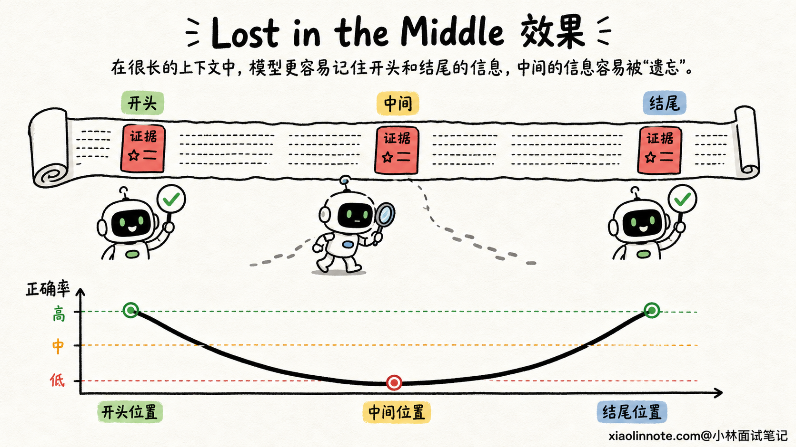

#### 为什么不能只怪位置编码？

位置编码确实会影响长上下文。模型如果推理时使用了训练阶段从没见过的位置范围，位置表示可能失真，近距离和远距离的关系也可能判断不准。但把 Lost in the Middle 全部归因于 RoPE 或其他位置编码，是把问题想简单了。

更完整地看，至少还有三股力量一起在起作用。

第一股是**训练分布**。模型训练时接触到的文本长度、关键信息所在位置、长文本任务类型，会影响它学会怎样使用上下文。如果训练样本里的答案经常在开头或结尾，中间位置自然练得少。

第二股是**注意力稀释和干扰**。输入从 10 段扩到 1000 段以后，需要竞争注意力的 token 多了很多。此时真正相关的证据可能被重复信息、相似表述和错误版本包围。模型不是没有读到，而是没有把它选成回答依据。

第三股是**任务难度**。从长文中找一个唯一编号，和先找到三个分散证据、再判断它们的时间和因果关系，完全不是一个难度。窗口长度相同，后者更容易失败。因此长上下文评测不能只做简单的「大海捞针」。

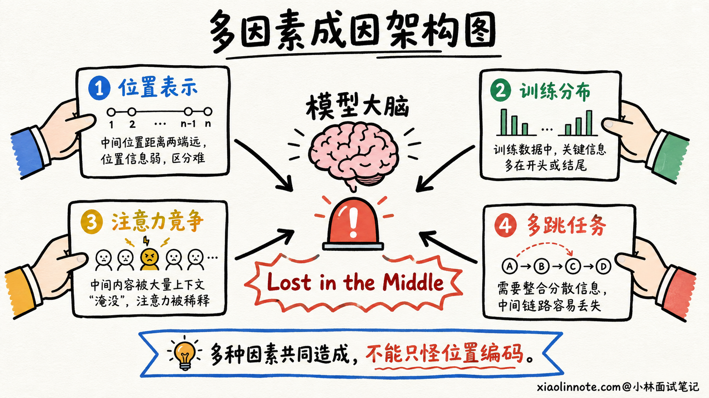

#### 上下文窗口越大，代价也越大

长窗口当然有价值。阅读整份合同、分析大型代码仓库、总结多轮会话时，如果窗口太小，关键信息连放都放不进去。但问题是，窗口越大并不是免费的。

对于标准的稠密 Self-Attention，序列长度从 `n` 增长后，注意力计算量大致按 `n²` 增长。Flash Attention 能明显降低中间结果的显存读写和显存占用，但它不会把稠密注意力的计算关系直接变成线性。

推理时，已有 token 的 K、V 还要放进 KV Cache。序列越长，KV Cache 通常越大，长输入的 Prefill 时间也越久。对 API 调用来说，更多输入 token 还意味着更高成本。即使模型最终回答只用了其中两段证据，前面的海量文本也已经参与了处理。

还有一种更隐蔽的代价叫**质量退化**。塞入更多资料，看起来是在增加信息，实际上也可能引入旧版本、重复片段、无关内容和彼此矛盾的描述。模型要先从噪声里找信息，再进行推理，任务反而更难。

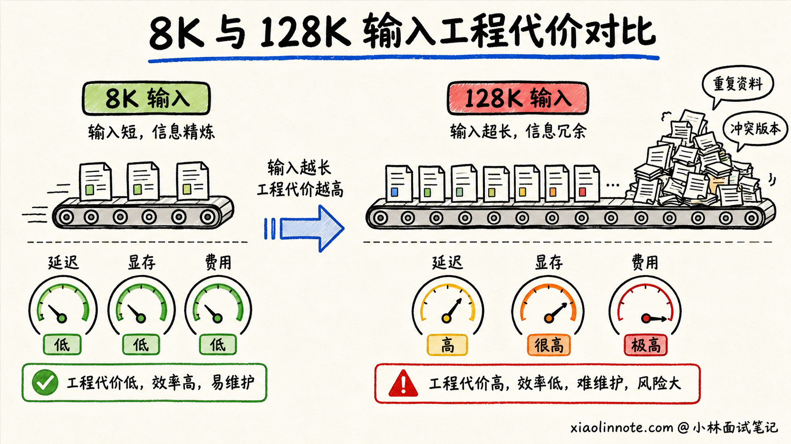

#### 工程上怎么让长上下文真正好用？

面对一大堆资料，第一反应不应该是「全部塞进去」，而应该先问：「完成当前任务，模型到底需要哪些信息？」

如果是在文档问答场景，我会先把问题送入检索链路，通过关键词检索和向量检索召回候选片段，再用 Rerank 把真正相关的内容排到前面。这样走完的是「全量文档 -> 候选片段 -> 高相关证据 -> 模型回答」，模型面对的不是一整座仓库，而是当前问题真正需要的几页资料。

如果任务确实需要全局信息，比如总结一本书或分析一整份代码库，就不能只取几个 chunk。这时可以采用分层摘要，先对章节、模块分别生成有出处的结构化摘要，再由上层汇总；对于数字、约束、待办和接口定义这类不能模糊压缩的信息，则单独抽取成结构化字段，不要混在自然语言摘要里。

提示词布局也很重要。系统指令、用户目标、不可违反的约束要分区清楚，证据要带标题、来源和段落编号，问题可以在证据之后再次明确。对最关键的限制条件，可以放进独立的任务规格区，而不是埋在几十页聊天历史中等模型自己发现。

另外，压缩不是越狠越好。摘要之后必须保留回查原文的引用或 chunk ID，一旦回答涉及数字、合同条款等高风险信息，就回到原文核验。这样既减少上下文，又不会让摘要变成新的信息瓶颈。

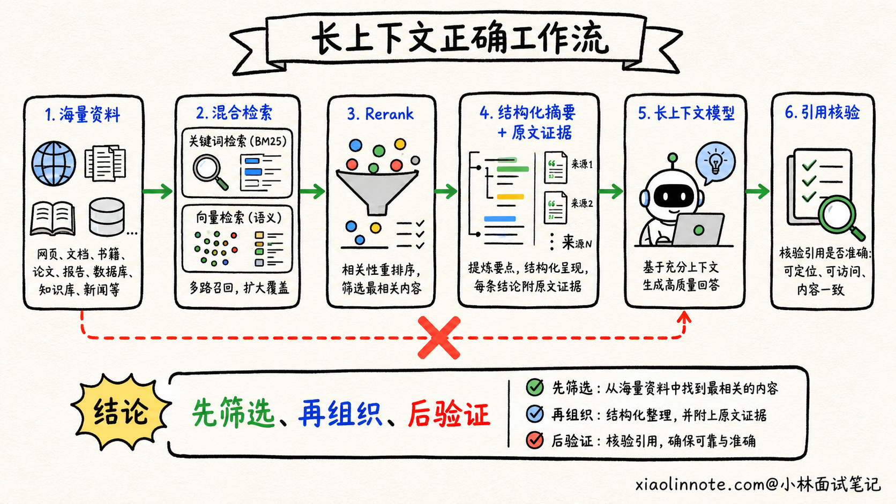

#### 长上下文应该怎么评测？

只拿一篇短文章问两个问题，测不出长上下文能力。只把一串随机数字藏进长文本，再看模型能不能找回来，也不够接近真实业务。

比较可靠的做法，是让测试集同时改变几个条件：输入长度从 8K、32K 增长到目标长度；关键证据分别放在开头、中间和结尾；干扰文档从少到多；任务同时包含单点检索、多证据汇总、时间排序和冲突判断。

指标也不能只看答案准确率。还要看证据引用是否正确、遗漏了多少关键事实、是否引用了干扰内容，以及长度增长以后首 token 延迟、总耗时和单次调用成本增加了多少。

最终要得到的不是一句「这个模型支持 128K」，而是一条更有用的结论：「在我们的合同审核任务里，输入不超过 40K、证据分布在任意位置时，准确率和延迟都能达到要求。」这才是项目真正能使用的有效长度。

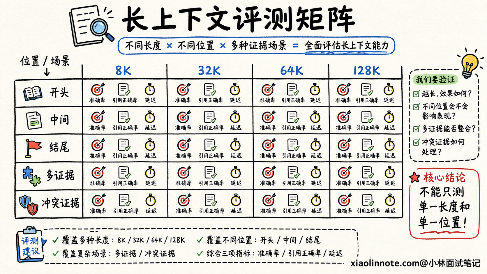

### 🎯 面试总结

回到开头的问题，面试时我会先把一句话说清楚：**最大上下文窗口表示「装得下多少」，不代表模型「稳定用得好多少」**。训练时见过的长度、接口支持的长度和业务里的有效长度，是三个不同概念。

Lost in the Middle 表现为关键信息放在长文本中间时，比放在开头或结尾更容易被忽略。它与位置编码有关，但不能只怪位置编码，还要考虑训练分布、位置偏置、注意力稀释、干扰内容和任务本身的推理难度。

窗口越大，稠密注意力的计算量、KV Cache、Prefill 延迟和输入成本通常也越高，噪声与冲突信息还可能让答案质量下降。所以工程上更合理的做法是先检索和重排，再通过分层摘要、结构化抽取、清晰布局和引用回查，把真正有用的信息交给模型。

最后要用不同长度、不同证据位置和不同任务难度做评测，找出当前业务的有效上下文长度。能把「容量、质量、成本、评测」这四层都讲清楚，这道题就不只是背过概念，而是真正理解了长上下文如何落地。

## 什么是 CoT？为啥效果好？它有什么缺点或局限性？

👔面试官：来讲讲什么是 CoT？为啥效果好？它有什么缺点或局限性？

🙋‍♂️我：CoT 就是 Chain-of-Thought，让模型一步步思考，效果会更好。

👔面试官：……「让模型一步步思考」是表面话。**为什么**一步步思考效果就好？模型有想吗？再说，CoT 一定有用吗？什么场景下会反而拖累效果？

🙋‍♂️我：呃，应该是模型推理过程里能看到中间步骤？

👔面试官：方向对。但你只说了好的一面，没说局限。CoT 不是万能的，对简单问题反而是浪费 token，推理链本身也可能出错。这两个限制你能讲清楚吗？

🙋‍♂️我：呃……我以为 CoT 都是好的。

👔面试官：典型的「只看好处不看代价」。CoT 的成本（token 多 + 延迟高）和风险（推理链错误传导）都得讲清楚，才知道什么时候该用。回去搞清楚再来。

这几个反问问下来，其实点的是同一件事，CoT 真不是一句「让模型一步一步想」能糊弄过去的。它为什么有效、什么时候反而起反作用、怎么和 Few-shot 搭配，得连着讲清楚。

### 💡 简要回答

CoT 我第一次用是在做一个需要多步逻辑推理的任务，发现只要让模型先分步分析，效果提升就很明显。后来理解了为什么：模型是一个 token 一个 token 生成的，让它先组织中间步骤，等于给了它「草稿纸」，后面生成答案时能利用前面的推理上下文，自然出错就少了。缺点也很实际，消耗的 token 会多很多，延迟和成本都上去了，而且推理链本身也可能出错、错误还会累积传导。所以我的经验是：对需要多步推理的任务用 CoT，简单问答直接回答就好；对外产品里不一定展示完整 CoT，展示简要理由或核查步骤通常更合适。

### 📝 详细解析

#### 没有 CoT 时模型在做什么

大语言模型在没有 CoT 的情况下，处理问题的方式有点像人在没睡醒的时候凭直觉答题：看到题目，从记忆里拼出一个听起来合理的答案，跳过了中间的推理过程。对于简单问题，这没什么问题。但一旦题目涉及多步计算、逻辑推导或因果链，直接跳答案就很容易出错，因为模型没有一步步「检查」自己的逻辑。

一个经典的例子：问模型「小明有 5 个苹果，他给了小红 2 个，然后又买了 3 个，最后还剩几个？」如果模型直接输出答案，可能会犯各种错误，比如只做了一步运算。但如果让模型写出推理过程：「小明初始 5 个，给出 2 个后剩 3 个，再买 3 个后变成 6 个」，每一步都很容易验证，错误自然就少了。

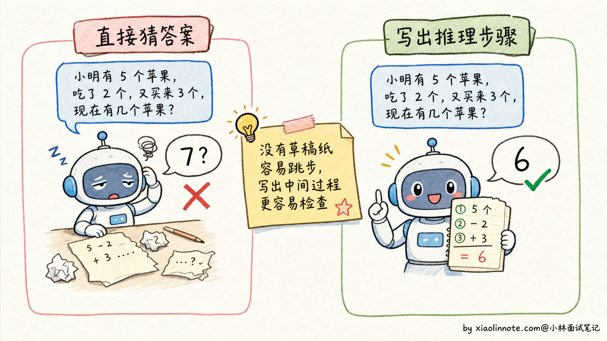

#### CoT 的核心思路

CoT 的本质是让模型「推出来」而不是「直接猜出来」。对于复杂问题，答案无法直接从训练数据里召回，但可以通过一步步推理得到。每一步推理都基于上一步的结论，整个过程在模型上下文里更清晰。

但要注意，「让模型推理」和「把完整推理链展示给用户」不是一回事。现代产品和 API 往往会让模型内部完成推理，最终只给用户简洁答案、关键依据或可核查步骤。这样既保留推理收益，又避免输出冗长、不稳定的思考链。

一个关键的洞见是：语言模型生成 token 的方式本身就支持这种逐步推理，因为模型是一个 token 接一个 token 生成的，每生成一个新 token 时都能「看到」前面所有已生成的内容。所以让它先生成推理步骤，相当于给后续的答案生成提供了更多的「工作记忆」。

基于这个思路，CoT 有两种实现方式，复杂度不同，适用场景也有差异。

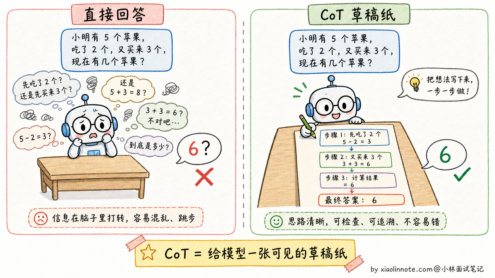

#### 两种 CoT 形式

- **Few-shot CoT** 是在 Prompt 里给出几个完整的「推理示例」，每个示例都包含问题、可核查的中间步骤和最终答案。模型可能据此模仿任务结构，但效果依赖示例质量、任务分布和模型能力，不能保证“最稳定”。
- **Zero-shot CoT** 更简单：在问题末尾加上一句「请分步思考后再给结论」这类提示。它可能诱导模型生成中间步骤，但并不等于增加了真实的验证能力；对不同模型、语言和任务的收益需要实测。

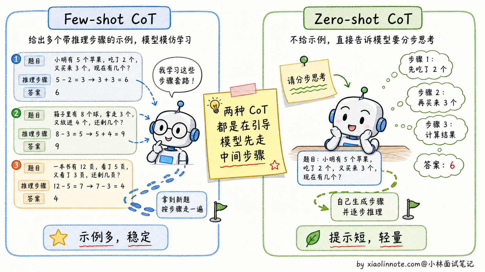

#### 为什么 CoT 有效

CoT 有效的原因可以从几个角度来理解。

- 第一，逐步推理让每一步的错误都暴露出来，方便模型（或人）发现和纠正，而不是把错误隐藏在一个不透明的「答案」里。
- 第二，中间步骤充当了「草稿纸」的作用，复杂的中间状态不再需要全部存在模型的「隐状态」里，通过显式输出记下来，减轻了模型的推理负担。
- 第三，CoT 激活了模型在预训练时从大量推理型文本（数学解题、逻辑分析等）中学到的推理模式。

把 CoT 放进生产链路时，还应补上校验环节：

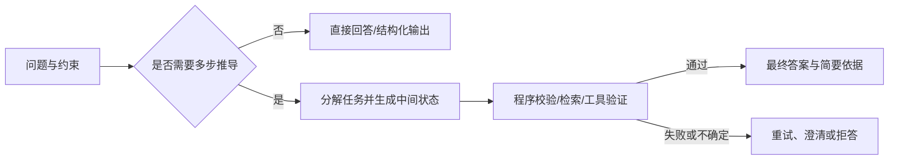

中间步骤只是候选工作轨迹，不应直接当作事实或安全授权；真正重要的是可执行的验证器、停止条件和不确定性处理。

#### Self-Consistency：CoT 的升级版

Self-Consistency 是在 CoT 基础上的进一步增强。做法是对同一个问题，用较高的温度（temperature）生成多条不同的推理路径，然后取最终答案里出现最多次的那个（多数投票）。

这个方法的直觉是：若多条独立路径收敛到同一答案，答案可能更可靠；但错误也可能因为共享偏差而一致，且多数投票只适合有可比较答案的任务。采样次数、温度和收益没有固定值，应在验证集上用预算约束评估。代价是调用次数、输入重复计算和延迟增加；如果有程序验证器，往往还应比较“多次采样 + 验证”和“单次生成 + 验证”的收益。

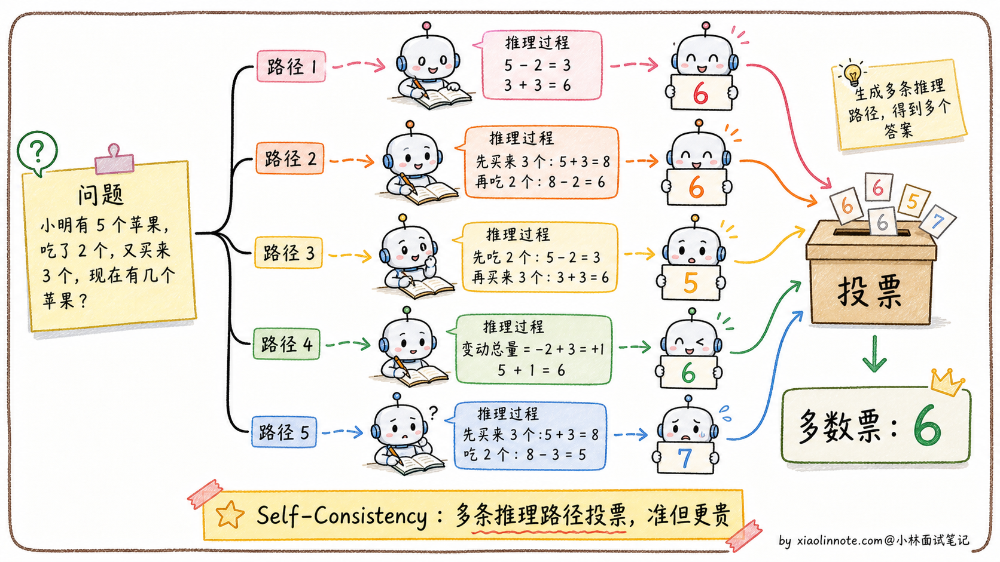

#### CoT 的局限性

CoT 并不是万能的，它有几个明显的局限。

首先是 token 消耗和延迟增加，实际增加量取决于任务、模型、停止条件和是否有隐藏推理预算。其次是对简单问题可能适得其反：让模型对「1+1 等于几」也展开推理，通常只是在消耗预算。再者是推理链本身也会出错：如果某一步前提错了，后续可能沿着错误路径继续推导；“看起来详细”不等于正确。

CoT 能减少跳跃性错误，但不能消除推理错误。最后，CoT 对纯粹依赖记忆的任务（比如「请问 2020 年奥运会在哪里举办」）没有帮助，因为这类问题根本不需要推理。

简单来说，CoT 是为「需要多步推理」的问题设计的工具，在数学、逻辑题、代码调试这类场景里很有价值；对简单问答、分类、信息提取这类不需要推理的任务，用普通 Prompt 就好了。

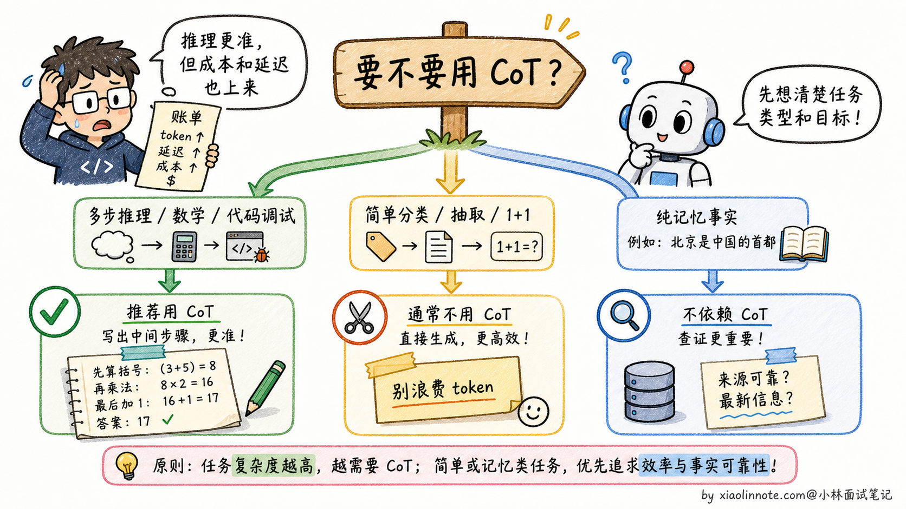

### 🎯 面试总结

回到开头那段对话，问到 CoT，最重要的是先把**为什么有效**讲清楚。模型是一个 token 一个 token 生成的，让它先组织推理步骤，等于给了它一张「草稿纸」，后面生成答案时能利用前面的推理上下文，自然出错就少了。这一句铺垫先讲到，面试官就知道你抓到了 CoT 的本质机制。

讲完原理后，把**两种 CoT 形式**说清楚。Few-shot CoT 用示例约束任务结构，但会占用上下文；Zero-shot CoT 只增加指令，成本低但收益更不稳定。两者都要用任务集验证，不能把提示词当成准确率保证。

最关键的是讲清**CoT 的局限**：额外 token 与延迟随任务变化；简单或纯检索任务可能不需要推理；中间步骤可能是错的或事后合理化，错误会沿链路传导；对外展示完整推理链还可能泄露敏感信息。生产中应配合验证器、预算和拒答/澄清策略。

如果还想再加分，可以提一句 **Self-Consistency**（多次采样多条路径，再按答案聚合或交给验证器），同时强调它不是免费提升：要比较额外成本、延迟、相关错误和验证收益。生产环境也不必展示完整 CoT，通常展示结论、简要依据、引用或可复核的步骤。

---

## 大模型生成文本时的解码策略有哪些？贪心、Beam Search、采样分别什么时候用？

👔面试官：来讲讲大模型生成文本时的解码策略有哪些？贪心、Beam Search、采样这几种各自在什么场景用？

🙋‍♂️我：解码策略就是怎么从模型输出的概率分布里选一个 token。最简单的是贪心，每次选概率最高的那个；复杂一点是 Beam Search，会保留几个候选；还有采样的，有 Temperature、Top-K、Top-P 这些。

👔面试官：……你只列了名字，没说本质。贪心和采样的区别是「确定 vs 随机」，那 Beam Search 是确定还是随机？为什么 LLM 现在很少用 Beam Search 了？翻译模型时代为什么大家都用 Beam Search？

🙋‍♂️我：哦哦，Beam Search 应该是确定的，能更准。LLM 不用是因为……更慢吧？

👔面试官：「更慢」是表面原因。深一点说，Beam Search 在翻译时代很受欢迎是因为翻译任务有「单一最优译文」的特性，但生成式对话/写作任务没有「单一最优答案」，Beam Search 的「保留多个高概率路径」反而成了缺陷。这个本质区别你能讲清楚吗？

🙋‍♂️我：呃……我没想这么深。

👔面试官：那再问一个：贪心解码和「Temperature=0 的采样」是同一回事吗？为什么 LLM 工程实践里大多数推理 API 默认用 Temperature 采样而不是贪心？回去搞清楚再来。

问到这里我自己也清醒了，解码策略表面是「下一个 token 怎么挑」，本质是「不同生成任务想要什么样的结果」。把这层捋顺，每种策略适合在哪用就自然出来了。

### 💡 简要回答

我理解大模型的解码策略本质上是回答一个问题：**模型在每一步输出了一个 vocabulary 大小的概率分布，我们怎么从中选下一个 token？**

主流方案分两大类。

第一类是**确定性策略**，输入相同输出永远相同。

- **贪心解码（Greedy Decoding）**：每一步选概率最高的 token。简单、可复现，但容易重复啰嗦、缺乏多样性
- **Beam Search**：每一步保留 Top-B 条高分候选路径，最后按长度归一化等评分选一条序列。它比贪心保留更多搜索分支，但计算/显存开销随束宽和实现增加；束宽取值没有跨任务的固定标准。

第二类是**随机性策略**，引入随机性让输出有多样性。

- **Temperature 采样**：通过缩放概率分布的「锐度」，控制随机性强度。Temperature 越低越确定，越高越发散
- **Top-K 采样**：每步只从概率最高的 K 个 token 里采样，截断长尾
- **Top-P（Nucleus）采样**：每步累加概率到 P 为止，从这个「核」里采样，自适应截断

这两大类的核心区别是，**确定性策略保证质量但牺牲多样性；随机性策略保证多样性但每次输出不同**。

LLM 工程实践里常见的现象是：开放式聊天和写作较少默认使用 Beam Search。原因是 Beam Search 优化的是序列概率，而开放式任务通常存在多个可接受答案；高概率序列可能更保守、重复或缺乏多样性。但翻译、受约束生成、候选重排等任务仍可能使用它，不能说“已经弃用”。

许多 LLM API 会提供 **Temperature + Top-P** 这类采样参数，但默认值、参数组合和是否支持 Beam Search 都由供应商/模型决定。更稳的工程表达是：精确任务从低随机性或受约束解码开始，开放任务再增加多样性，并用回归集观察质量、格式错误和重复率。

### 📝 详细解析

#### 解码策略的本质：从概率分布里选下一个 token

要讲清楚解码策略，得先回到大模型生成的最底层机制。

LLM 是自回归生成的，每生成一个新 token，模型都会输出一个 vocabulary 大小的 logits/概率分布。所谓的「解码策略」，就是回答**怎么从这个分布里选一个 token 出来**；词表大小和分布形状随 tokenizer 与模型而变，不宜背固定数字。

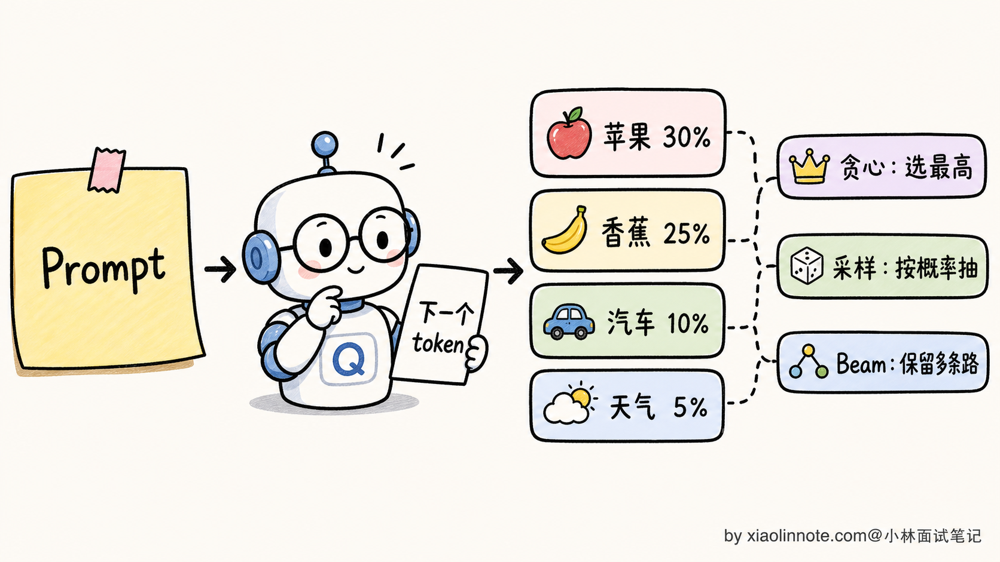

不同的解码策略就是不同的「选择规则」。规则的差异不只是「选哪个」，更深层是**对生成任务本质的不同假设**：

- 贪心和 Beam Search 更偏向寻找高概率序列，但这不等于任务真的存在唯一最优答案
- Temperature/Top-K/Top-P 允许从候选分布采样，用随机性探索多个合理答案

理解了这个底层假设的差异，下面五种策略各自的取舍就好理解了。

#### 贪心解码：最简单也最容易踩坑

贪心解码（Greedy Decoding）是最朴素的策略：**每一步无脑选概率最高的那个 token**，然后这个 token 拼到序列后面，进入下一步。

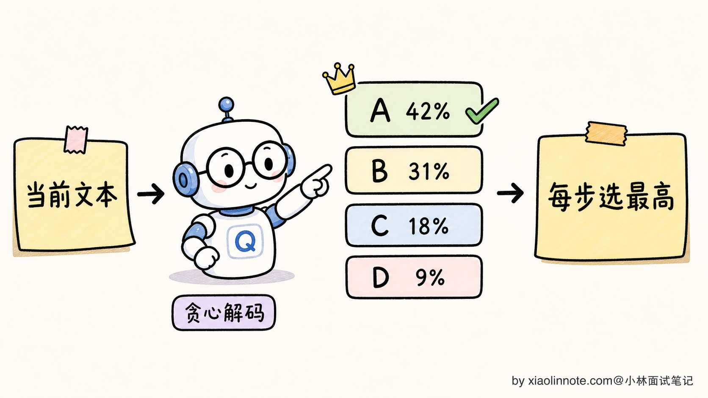

贪心解码的优点：

- **极简**：每步只挑最大值，时间复杂度 O(V)，几乎没开销
- **完全确定**：相同输入永远得到相同输出，便于调试和复现
- **不引入随机性**：API 调用结果稳定，对单元测试、批处理友好

但贪心有一个臭名昭著的毛病，叫「**复读机问题（Repetition Loop）**」。

举个具体例子。让 GPT-2 用贪心解码续写「I love my dog because」，常见的输出会是这样：

```
I love my dog because he is so cute. He is so cute. He is so cute. He is so cute. ...
```

为什么会这样？因为模型某一步生成了「He is so cute」，下一步在概率分布里发现「He is so cute」这个模式刚刚出现过、上下文里这个模式的概率很高，又选了它；再下一步又选了一遍。贪心策略一旦走进这种「自我加强的循环」，就出不来了，会一直无限重复。

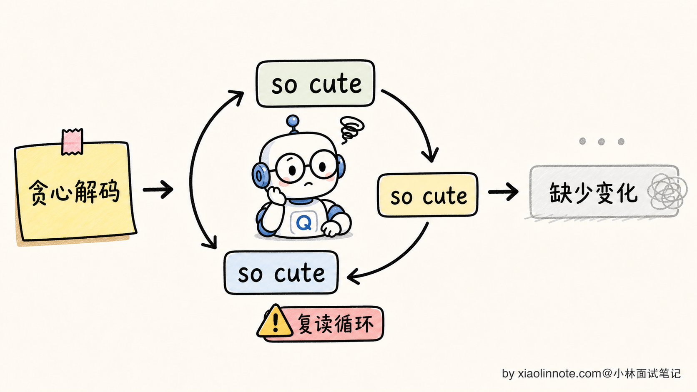

更隐蔽的问题是，贪心解码生成的文本**乏味、保守、缺乏惊喜**。因为模型每步都选最稳的那条路，最终生成的文本就是「最大众化的表达」，读起来很 boring。这对代码生成、信息抽取这类任务可能没问题，但对创意写作、对话场景就太单调了。

不过贪心也有它的最佳战场：**精确任务**。比如代码生成、SQL 生成、JSON 抽取这种「输出有标准答案」的任务，贪心反而是首选，因为它确定、不会乱写。

#### Beam Search：翻译时代的王者

Beam Search 是贪心的扩展版本，思路是：**每一步不只保留一条路径，而是保留 B 条高分路径同时推进**（B 叫「束宽」beam width）。实际实现还要处理长度偏置、停止条件、重复惩罚、约束和候选去重。

具体怎么做？看个例子，假设 B=3：

- 第 1 步：模型预测下一个 token 的概率分布，保留前 3 个：「我」「你」「他」
- 第 2 步：把这 3 个 token 各自当作前缀继续预测，得到 3×V 个候选（V 是 vocabulary 大小），从中挑总概率最高的 3 条路径，可能是「我喜」「我爱」「你爱」
- 第 3 步：重复上述过程，3 个前缀各自展开，挑总概率最高的 3 条
- ……一直进行到生成结束（遇到 EOS token）
- 最后从 3 条最终路径里选**整体概率乘积最高**的那条作为输出

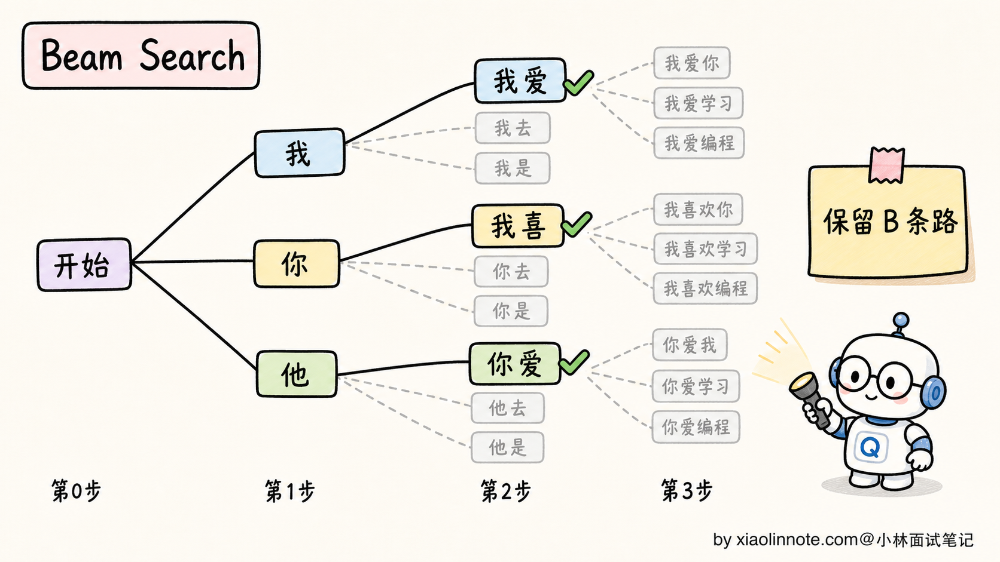

Beam Search 的优点：

- **全局视野更好**：能避开贪心走进死胡同的情况。比如某一步贪心选错了，Beam Search 还有其他 B-1 条备份路径可以走
- **接近全局最优**：总体概率上比贪心高得多，输出更「合理」

Beam Search 在 2014-2018 年的**机器翻译时代**是绝对主流，几乎所有翻译模型（Google NMT、Facebook fairseq、OpenNMT）都用 Beam Search。原因是翻译任务有一个独特属性：**给定源语言句子，存在一个或几个「最优译文」**，Beam Search 的「找概率最高序列」目标和翻译任务高度匹配。


但到了 LLM 时代，Beam Search 在开放式生成中的默认地位下降了。原因得单独讲一节。

#### 为什么 LLM 时代 Beam Search 失宠了

这是一个面试里的高频追问点。表面理由是「Beam Search 慢」（B 倍计算量），但深层原因是**生成式任务的本质和 Beam Search 的目标不匹配**。

Beam Search 的优化目标是「**找到整体概率最高的那条序列**」。这个目标在翻译时代很合理，因为「I love you -> 我爱你」这种翻译任务确实有「最优答案」。但在 LLM 的开放式生成任务（写故事、对话、回答开放问题）里，**根本不存在「最优答案」**，存在的只是「一个广阔的合理回答空间」。

更糟的是，Beam Search 在长序列上可能出现一个反直觉的失效模式：**高概率序列并不一定是最有帮助、最自然或最多样的内容**。

为什么？因为「整体概率最高」往往等价于「每一步都选最稳的词」。最稳的词通常是「重复前面已经出现过的内容」，因为重复内容在概率分布上特别尖锐（模型对重复模式特别熟悉）。结果就是 Beam Search 在生成长文本时，会陷入和贪心类似的复读，甚至比贪心还严重。

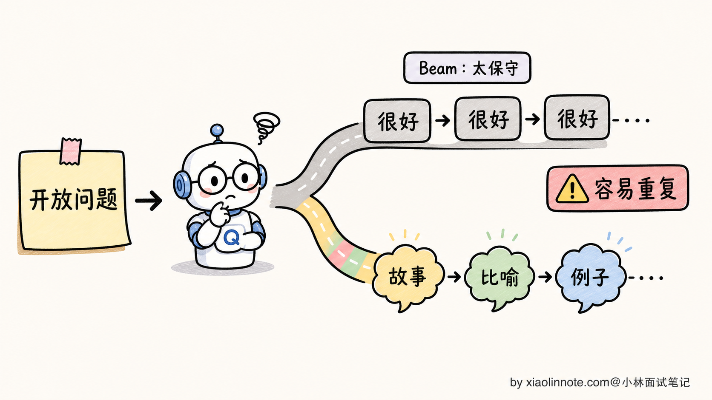

束宽增大通常会带来更多搜索计算，但质量变化取决于模型、长度归一化、重复惩罚和任务；不能把“B 越大越差”或某个固定束宽当成普遍规律。

还有一个工程上的代价：**Beam Search 会让现代 LLM 推理调度更复杂**。

KV Cache 需要同时维护多个分支；实现可以共享公共前缀或使用分页/树状存储，但分支越多，调度、显存和带宽压力越大。Flash Attention、PagedAttention 等并非与 Beam Search 理论上不兼容，只是需要框架对分支、重排和缓存复用做额外支持。

所以许多推理框架会支持或部分支持 Beam Search，但是否可用、性能如何要看版本和模型；开放式对话和写作通常优先采用采样。更准确地说，Beam Search 从通用默认策略退回了特定任务工具，例如翻译、受约束生成或候选重排。

#### 采样族：用随机性换多样性

LLM 时代的解码主流是**采样**，核心思路从「找最优」变成「按概率分布掷骰子」。

最基础的采样叫**普通采样（vanilla sampling）**：直接按模型输出的概率分布随机抽。这样每次生成的结果都不一样，多样性是有了，但有一个新问题：**长尾噪声**。

模型的概率分布往往有一个「长长的尾巴」，比如「下一个词」分布里前 20 个词概率合起来 90%，但后面还有几万个词分布着 10% 的概率，每个都极小。普通采样有概率从这堆极小概率的词里抽到一个完全不合理的词（比如生成中文时突然冒出「@$%」），让整段输出毁掉。

为了解决长尾问题，业界发展出三种采样调节器：**Temperature、Top-K、Top-P**。

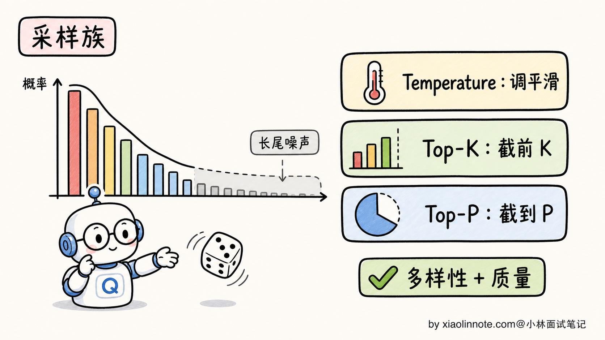

**Temperature** 控制的是分布的**锐度**。数学上，正温度 T 会把 logit 除以 T 再做 softmax：

- T 趋近于 0：在理想数学定义下趋向选择最高 logit；许多 API 把 `Temperature=0` 实现为贪心或近似确定性，但并非所有后端完全相同
- T=1：用模型原始分布采样
- T<1（比如 0.5）：分布变尖锐，更倾向高概率词
- T>1（比如 1.2）：分布变平坦，更倾向探索低概率词

**Top-K** 是固定截断：每步只从概率最高的 K 个 token 里采样，后面全部丢弃。比如 K=50，意味着每步从概率前 50 的词里挑。

**Top-P（Nucleus 采样）** 是自适应截断：从高到低累加概率，超过阈值 P（比如 0.9）就停，从这个「核」里采样。Top-P 的好处是候选集大小会根据分布形状自动调整，分布尖锐时候选集小（几个词就累加到 0.9），分布平坦时候选集大。

这三种调节器的具体使用场景和参数选择，是另一个独立的话题。本题层面只需要记住：**采样族通过引入随机性 + 截断长尾，在「多样性」和「质量」之间找到平衡**。

#### 实际选型：什么任务用什么策略

工业界的解码策略选择，本质上是看任务对「确定性」和「多样性」的需求：

| 任务类型 | 推荐策略 | 典型参数 | 为什么 |
| --- | --- | --- | --- |
| **代码生成** | 低随机性/约束解码，必要时多候选 | 从官方默认或低温基线开始 | 关注编译、测试和安全，不只看文本稳定 |
| **SQL 生成 / JSON 抽取** | 低随机性 + schema/语法校验 | 按供应商支持调参 | 结构约束和重试通常比某个温度数字更关键 |
| **数学推理** | 单次生成 + 验证，或预算内多次采样 | 由验证集和成本预算决定 | 多数投票不是对所有任务都有效 |
| **日常对话** | 采样 | 以默认值为基线 | 观察拒答、事实性、重复和用户满意度 |
| **创意写作/头脑风暴** | 更开放的采样 | 逐步增加随机性并设停止条件 | 多样性和可控性需要共同评估 |
| **机器翻译** | Beam/低温采样/约束解码均可能 | 由语言对和评测决定 | 仍可能有多个可接受译文，需看自动指标与人工质量 |

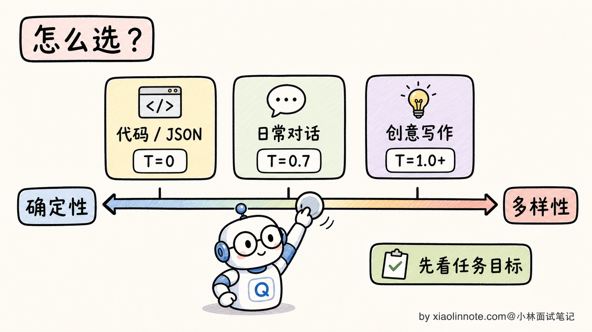

实践中有个简单的判断口诀：

- **任务需要可复现** -> 从贪心或低随机性开始，并锁定模型、模板和后端版本
- **任务有多种合理答案** -> 用采样，并用质量/安全/重复率评估预算
- **任务需要严格格式** -> 优先使用结构化输出、语法约束和程序校验，而不是只调温度

OpenAI、Claude、Qwen 这些主流 API 都提供 Temperature / Top-P 这类参数，但默认值会随模型版本和产品形态变化，不能死记一个固定配置。工程上更可靠的做法是：先用官方默认值作为基线，再按任务是「精确」还是「开放」去调。

#### 进阶策略：推测解码与 Self-Consistency

讲到这里，主流策略基本覆盖了。再简单提两个进阶方向，作为面试加分项。

**推测解码（Speculative Decoding）** 是一种推理加速技术。核心思路是用一个**小的草稿模型**（比如 7B）快速生成多个 token，再用**大的目标模型**（比如 70B）一次性验证这几个 token。如果草稿模型的预测和大模型一致，就直接用；不一致就以大模型为准。

为什么可能加速？大模型验证多个草稿 token 时可以提高一次前向的利用率，减少逐 token 调度开销；但收益取决于草稿模型接受率、批量、硬件和实现，可能没有收益甚至变慢。特定接受算法可保持目标模型分布等价，不能把“完全等价”推广到所有近似实现。

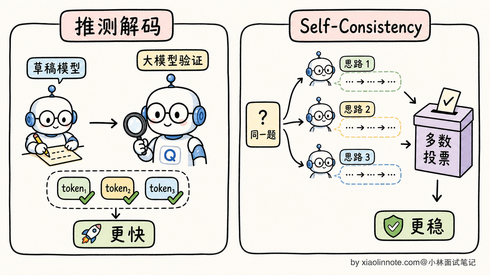

**Self-Consistency** 是用于推理类任务的解码增强。核心思路：对同一个数学题/逻辑题，用较高的 Temperature 采样生成 N 条独立的推理路径，最后取**最终答案出现最多次**的那个（多数投票）。

直觉是：正确答案可能通过多条路径得到，聚合后有机会降低单条路径的随机错误；但共享模型偏差也会造成一致错误。收益应以任务集、采样数、验证器和总预算实测，代价不仅是 N 倍调用，还包括重复输入、排队和聚合延迟。

这两个进阶策略都是「在主流采样基础上的加速/加强」，不替代基础解码策略，而是叠加使用。能在面试里提一句，会显得你跟得上工业界的最新实践。

### 🎯 面试总结

回到开头那段对话，问到解码策略，最重要的是先把本质讲清楚。每生成一个 token 都对应一个 vocabulary 大小的概率分布，解码策略就是「怎么从这个分布里挑下一个 token」。不同策略对应「生成任务到底有没有最优答案」的不同假设，这是整道题的地基。

讲完本质，自然过渡到贪心和 Beam Search 这两种确定性策略。贪心每步选最高，简单可复现但容易陷入复读循环；Beam Search 是贪心的并行版，保留 B 条候选最后选总分最高的整条序列。Beam Search 在翻译时代是王者，因为翻译有「单一最优译文」，所以「找概率最高序列」这个目标和任务本质契合。

最关键的是讲清**为什么开放式 LLM 较少默认 Beam Search**：它优化序列概率，而开放式任务有多个合理答案，高概率不等于高帮助；多分支还增加调度和缓存成本。不要说成“与 KV Cache/Flash Attention 不兼容”或“工业界完全弃用”，应结合任务和框架实测。

最后讲采样族（Temperature/Top-K/Top-P）的整体定位。它们用随机性换多样性，配合长尾截断保证质量。实际选型上，精确任务（代码、SQL、JSON）用贪心或低温；对话/写作可以从官方默认值开始微调；创意任务再提高 Temperature，但要用测试集观察跑偏率。

如果还想再加分，可以提一句推测解码（小模型起草、大模型验证，收益依赖接受率和实现）和 Self-Consistency（多次采样后投票或验证，收益依赖任务与预算）。关键是说明这些都是可测量的工程策略，不是固定倍数或准确率承诺。

---

## 大模型部署有哪些主流方案？vLLM、TGI、llama.cpp、SGLang 实际项目里怎么选？

👔面试官：来讲讲大模型部署有哪些主流方案？vLLM、TGI、llama.cpp、SGLang 这几个怎么选？

🙋‍♂️我：vLLM 用来部署大模型推理，速度快；llama.cpp 是 CPU 推理；TGI 和 SGLang 我没用过。

👔面试官：……「速度快」是表面话，vLLM 凭什么比直接用 transformers 库快？PagedAttention 是什么？为什么这个名字叫「Paged」？

🙋‍♂️我：哦哦，应该是分页管理 KV Cache 吧，类似操作系统的虚拟内存？

👔面试官：方向对，但具体怎么 Paged 你能讲清楚吗？再说，SGLang 的 RadixAttention 和 vLLM 的 PagedAttention 是什么关系？为什么 SGLang 在 Agent / 多轮对话场景比 vLLM 更省？

🙋‍♂️我：呃……RadixAttention 我不太熟。

👔面试官：RadixAttention 是 SGLang 的核心创新，把 KV Cache 组织成共享前缀树（Radix Tree），让多个请求的相同前缀只存一份。这个对 Agent / Few-shot Prompt 这种「前缀重复率高」的场景特别有效。这种细节都不知道，去面试就是被怼。回去补一下。

面试官这一连串追问其实在敲打同一件事，推理框架不是「随便挑一个跑起来」就行。每家解决的核心痛点不一样，PagedAttention、RadixAttention、CPU 量化背后各有一套设计哲学，得对着场景一个个对上。

### 💡 简要回答

我理解大模型部署框架的本质问题是：**怎么在固定的硬件上跑得更快、更省显存、支持更多并发用户？**

主流框架按定位分四类。

**1. vLLM**：常被用于服务化推理。核心能力包括 PagedAttention、连续批处理和多种模型/硬件适配；实际吞吐和显存效率取决于模型、上下文长度、量化、硬件、并发与版本，不能只凭框架名下结论。

**2. SGLang**：面向结构化生成和服务化推理的框架，提供 RadixAttention 等前缀复用能力。共享前缀较多时可能减少重复 prefill，但是否优于其他框架要用相同模型、硬件、请求分布和缓存策略对比。

**3. TGI（Text Generation Inference）**：Hugging Face 生态中的推理服务方案。优点是模型、tokenizer、chat template 和现有服务流程的集成；支持的模型、后端和接口能力需按具体版本验证，性能也要用业务负载基准测试。

**4. llama.cpp**：面向本地、边缘和跨平台推理的 C/C++ 实现，常与 GGUF 模型格式和量化结合，也支持部分 GPU/加速后端。适合本地隐私、离线和资源受限场景；是否能达到目标吞吐取决于设备与模型。

**怎么选**：

- **生产高吞吐 LLM API**：先比较 vLLM、SGLang、TGI 或其他后端的真实负载
- **Agent / 多轮对话 / Few-shot**：重点测共享前缀命中率、prefill/decoding 和缓存失效
- **拥抱 Hugging Face 生态**：优先评估 TGI 或与现有 Transformers 流程兼容的方案
- **本地 / Mac / 边缘 / 离线**：优先评估 llama.cpp 及目标设备后端
- **极致性能、自家定制**：TensorRT-LLM（NVIDIA 官方）

### 📝 详细解析

#### 部署框架解决的核心问题

要理解为什么需要 vLLM、SGLang 这些专门的部署框架，得先看看「直接用 transformers 库跑模型」会有什么问题。

最朴素的部署方式是写个 Python 脚本，加载 HF transformers 的 AutoModelForCausalLM，调 `model.generate()`。能跑起来，但效率会很糟糕，三个核心痛点：

**1. KV Cache 显存碎片严重**

朴素实现可能按最大长度预留连续空间，导致内部碎片和容量利用率下降；实际浪费取决于分配器、请求长度分布、batch 和框架，并不存在一组对所有部署都成立的并发数字。

**2. 批量推理调度低效**

朴素批量处理（static batching）是「凑齐 N 个请求一起跑、所有请求一起结束」。但每个请求生成长度不同（有的 50 tokens 就完了、有的要 1000 tokens），短的请求等长的请求，GPU 大量时间在「跑了一半在等」。吞吐率上不去。

**3. 重复计算**

如果每个用户都用同一段 System Prompt（比如 1000 tokens 的产品知识库），朴素实现每次都要重新算这 1000 tokens 的 KV Cache，浪费极大。

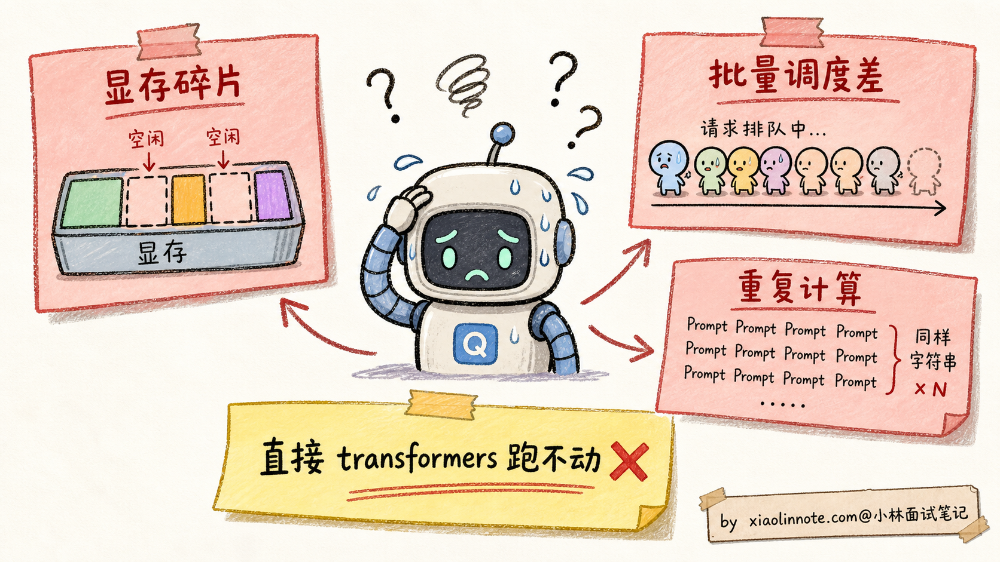

部署框架就是为了解决这三个痛点。三大优化方向：**内存高效（显存碎片）+ 批量调度（吞吐率）+ 缓存复用（重复计算）**。每个主流框架在这三个方向上都有自己的创新。

#### vLLM 与 PagedAttention：操作系统虚拟内存的灵感

vLLM 的核心能力之一是 **PagedAttention**，它借鉴分页思想管理 KV Cache。

PagedAttention 的灵感来自操作系统的**虚拟内存（Virtual Memory）**。

操作系统怎么管理内存？不是给每个进程预分配大块连续物理内存（这样会有大量碎片），而是把物理内存切成固定大小的「页（Page）」，每个进程拿到的是「逻辑地址」，通过页表（Page Table）映射到真实的物理页。这样物理内存可以充分利用，不浪费。

PagedAttention 把这个思路搬到 KV Cache 上：

- 把 GPU 显存切成若干逻辑 Block，具体大小由实现和版本决定
- 每个请求拿到的是「逻辑 KV 序列」，由一张 Block Table 映射到具体的物理 Block
- 一个请求实际用了 200 tokens 就只占 13 个 Block（200/16），用完即释放
- 没有「预分配 4096 但只用 200」的浪费

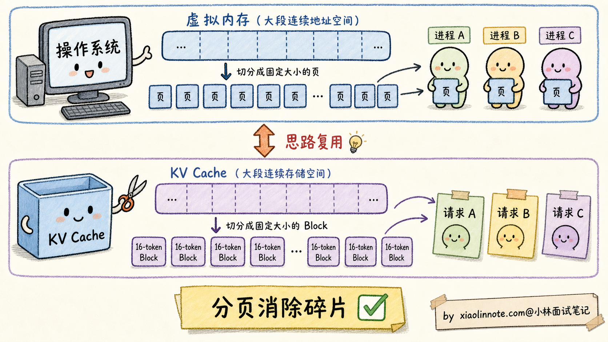

PagedAttention 的目标是减少连续预分配造成的碎片、支持按需分配和复用；具体利用率、并发和吞吐提升必须在目标模型、上下文长度和硬件上实测。

vLLM 还有第二个杀手锏：**Continuous Batching（连续批处理）**。

朴素 static batching 是「凑齐 N 个请求一起跑、跑完一起结束」。Continuous Batching 是「请求异步加入和退出，每个 token 步骤动态组 batch」。比如：

- 时刻 t1：请求 A、B、C 同时在跑
- 时刻 t5：A 生成完了退出，立刻有新请求 D 加入
- 时刻 t8：B 也生成完了退出，新请求 E 加入
  - 这样调度器可以在请求完成时及时补入新请求，通常比静态批处理更能利用 GPU；实际收益取决于请求长度与调度策略

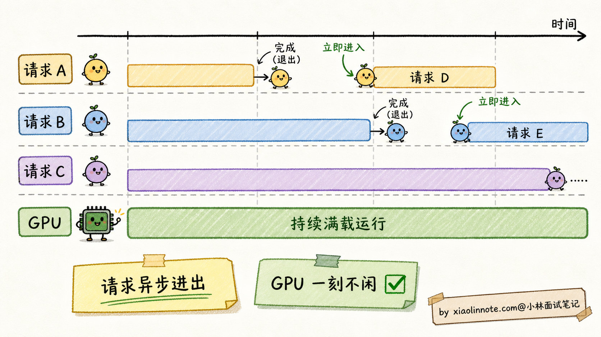

可以把 vLLM 的一条主线概括为“分页式 KV Cache 管理 + 连续批处理”；它是常见候选方案之一，但不是所有生产环境的事实标准。闭源供应商的内部实现也不应根据传闻推断。

#### SGLang 与 RadixAttention：共享前缀的杀手锏

SGLang 是 LMSYS（创建 Vicuna、Chatbot Arena 的团队）在 2024 年推出的新一代推理框架。它**不是要替代 vLLM**，而是针对 vLLM 没解决好的特定场景：**多请求共享前缀**。

什么场景下「共享前缀」很常见？

- **System Prompt 共享**：所有用户调用同一个 API，System Prompt 完全一样（几千 tokens）
- **Few-shot Examples 共享**：Prompt 里有 5-10 个固定示例，每个用户的查询前面都附带这些示例
- **多轮对话历史**：同一用户的多轮对话，每轮都包含前 N 轮的完整历史
- **Agent 工作流**：Agent 调用 LLM 多次，每次的上下文都从同一个 System Prompt 开始

vLLM 的 PagedAttention 虽然显存高效，但**不同请求的 KV Cache 仍然各存各的**。10 个用户都用同样的 1000 tokens System Prompt，vLLM 要存 10 份相同的 KV Cache。

SGLang 的核心创新 **RadixAttention** 把这个问题解决了。

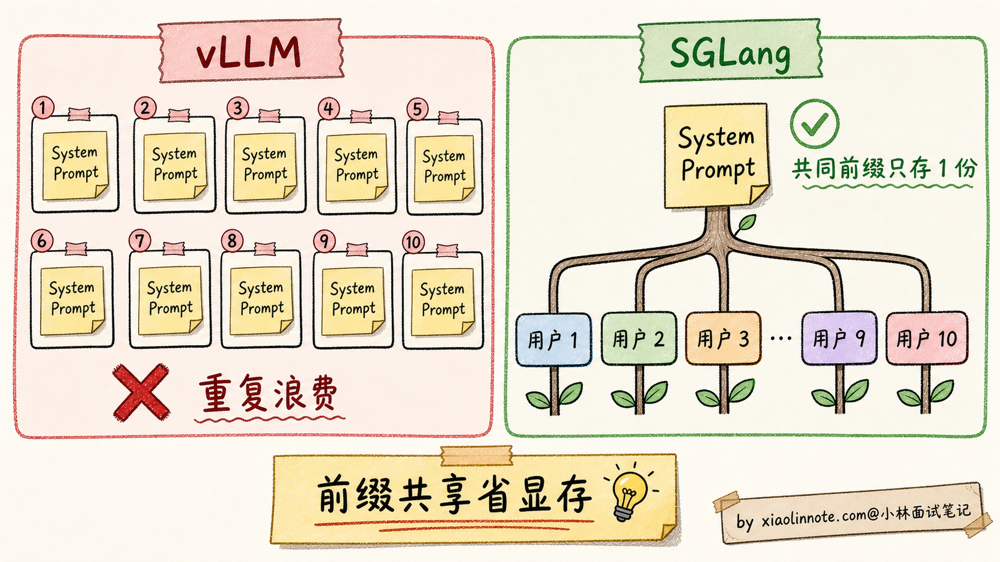

RadixAttention 用的是计算机科学里的经典数据结构 **Radix Tree（基数树）**：

- 把 KV Cache 组织成一棵树
- 树的根节点是空（无 token）
- 每个请求的 token 序列从根节点开始往下走
- 多个请求如果开头 N 个 tokens 一样，就共享根节点到第 N 层的同一条路径
- 第 N+1 层开始分叉，各自存独立部分

这样在前缀重复且缓存可复用时，KV Cache 可能按共享前缀加分支部分组织，而不是为每个请求完整复制；节省比例受前缀命中率、生命周期、租户隔离和显存压力影响，不能固定为某个百分比。

RadixAttention 类机制还可能复用仍在缓存中的历史前缀；缓存会受容量、淘汰、租户隔离、敏感信息和模型版本影响，不能假设一小时后的内容仍在，也不能把命中收益承诺为固定毫秒数。

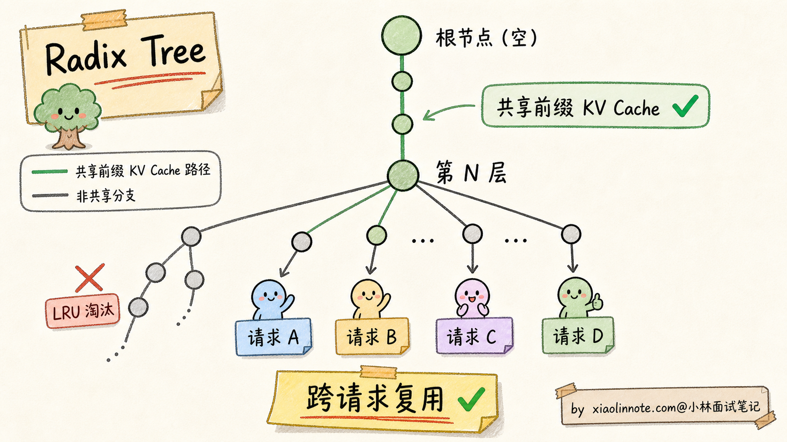

在 Agent 或多轮场景中，若共享前缀命中率高，前缀复用可能改善首 token 延迟和吞吐；但结果随请求分布、缓存策略、模型和硬件变化，不能用固定倍数概括，也不能据此说所有 Agent 框架都推荐某个后端。

但要注意：**纯单请求、无前缀共享场景下，SGLang 相对 vLLM 优势不明显**。两者目前是互补关系不是替代关系。

#### TGI：HuggingFace 生态集成方案

TGI（Text Generation Inference）是 HuggingFace 在 2022 年推出的推理服务，专门为「让 HF Hub 上的模型一键部署成生产 API」设计。

它的核心卖点不是绝对性能，而是**生态集成 + 企业级特性**：

**生态集成**：

- 直接读 HF Hub 的模型 ID，自动下载部署，不用手动转格式
- 支持 HF 各种格式（safetensors、quantization 配置）
- 兼容 HF transformers 的 tokenizer 和 chat template

**企业级特性**：

- HTTP / gRPC 双协议
- 鉴权（API Key、JWT）
- Prometheus metrics
- 健康检查、优雅重启
- 流式响应（SSE）

**性能层面**：

- 也支持连续批处理、量化、流式输出等生产服务常用能力
- 不同版本和负载下的吞吐差异可能不同，应以相同基准测试为准
- 价值通常来自生态集成、服务接口和已有企业流程迁移成本低

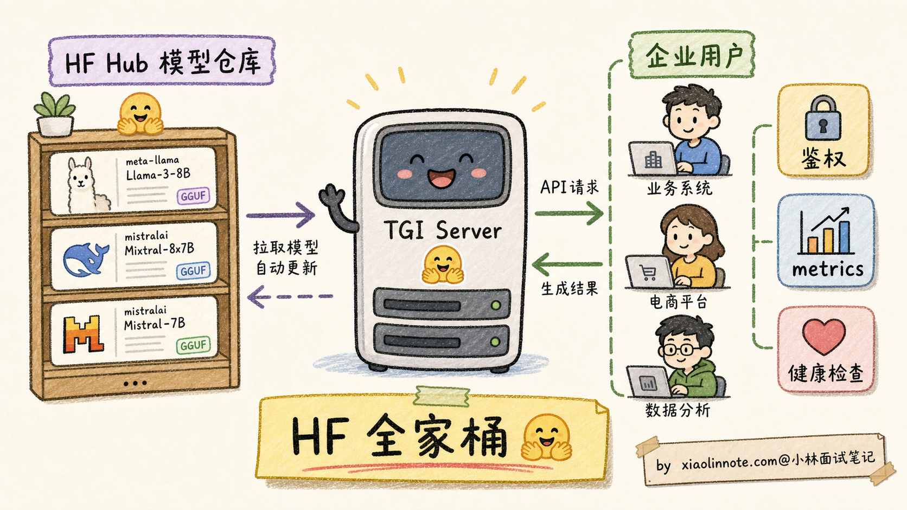

适合用 TGI 的场景：

- 公司本来就用 HuggingFace 全套（数据集 / Transformers / Hub）
- 需要快速 POC，不想折腾推理框架
- 要部署的模型在 HF Hub 上有现成的，不想自己转格式
- 需要企业级特性（鉴权、metrics、可观测性）

#### llama.cpp：CPU / 边缘设备的事实标准

llama.cpp 起源于个人开源项目，常用于让模型在本地和非数据中心设备上运行；“事实标准”应理解为社区常见选项，而不是所有平台的唯一标准。

它的核心思路与 vLLM/TGI 不同：使用轻量 C/C++ 推理实现、量化和可选硬件后端，减少本地部署依赖；并不意味着所有路径都是纯 CPU 或零依赖。

为什么要这样做？因为**绝大多数个人设备没有 GPU**：

- MacBook Pro（M1/M2/M3 芯片，统一内存架构）
- Windows 笔记本（集成显卡）
- 树莓派、Jetson 等嵌入式设备
- 手机（iPhone、Android）

llama.cpp 的几个关键技术：

**1. GGUF 文件格式**

llama.cpp 自定义的模型存储格式，把模型权重 + 量化方案 + 元数据打包到一个文件。常见的 GGUF 量化档位：

- **Q8_0**：8-bit 量化，几乎无损
- **Q5_K_M**：5-bit 量化，精度和体积平衡
- **Q4_K_M**：4-bit 量化，最常用，体积压到 1/4
- **Q3_K_S**：3-bit 量化，极端压缩，精度有损失

**2. SIMD 优化**

针对不同 CPU 指令集和 GPU 后端提供优化 kernel；性能与芯片、线程、量化、上下文和后端有关，不能用占 GPU 百分比的固定数字判断。

**3. Metal 后端（Apple Silicon）**

苹果 Silicon 的统一内存和 Metal 后端使本地运行大模型更方便，但可运行的模型大小、速度和内存余量要按具体设备、量化和上下文实测。

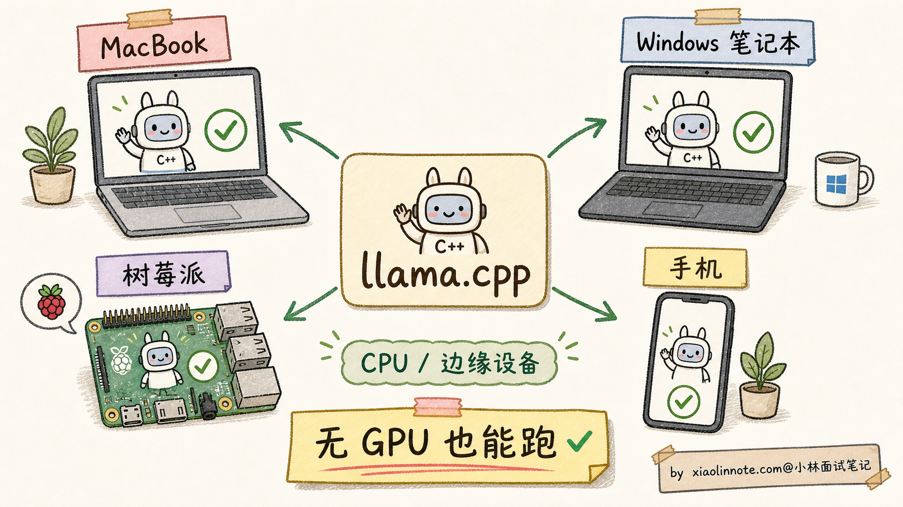

适合用 llama.cpp 的场景：

- 个人开发者本地玩模型
- Mac 用户想充分利用 M 系列芯片
- 边缘 / 嵌入式部署
- 离线场景（没网也能用）
- 隐私敏感场景（数据不出设备）

不适合的场景：

- 高并发生产 API（CPU 吞吐量上不去）
- 需要 batch 处理（llama.cpp 的批量支持较弱）
- 多卡 GPU 集群（不是它的设计目标）

#### TensorRT-LLM：NVIDIA 官方极致优化

最后简单提一下 NVIDIA 自家的 **TensorRT-LLM**。它的定位很特殊：**针对 NVIDIA GPU 做极致优化，不考虑跨平台**。

核心特点：

- 对每个具体 GPU 型号（A100 / H100 / H200）做硬件级别 fine-tuning
- 集成 NVIDIA 自家的内核库（cuBLAS、cuDNN、TensorRT）
- 支持 FP8、INT4 等所有 NVIDIA 硬件支持的精度
- 性能可能受益于针对性内核和编译，但必须按模型、GPU、batch、精度和版本基准测试

代价：

- 开源但工程门槛高，部署相对复杂（需要先编译 engine）
- 只支持 NVIDIA GPU，AMD / Apple Silicon 不行
- 文档生态不如开源框架活跃

适合：

- 有 NVIDIA 大集群的大厂（字节、腾讯、阿里等）
- 追求极致 GPU 利用率
- 愿意承担额外的工程复杂度

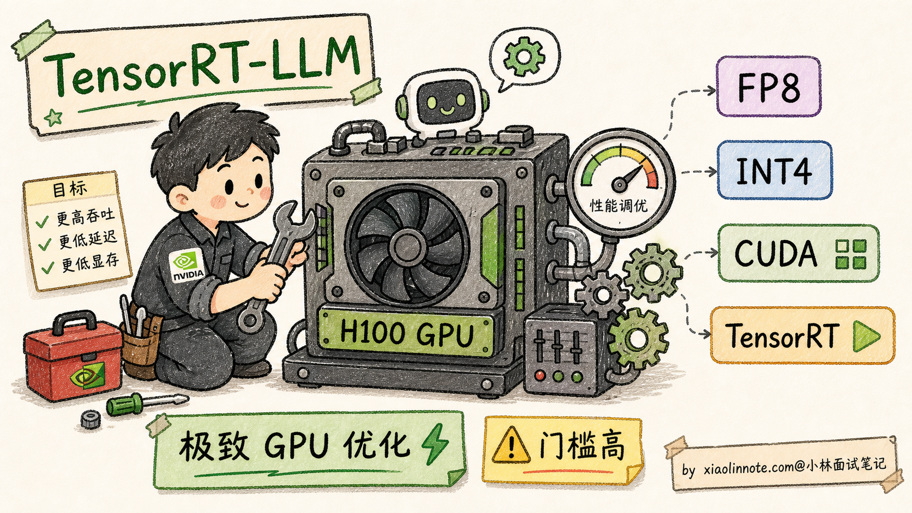

#### 怎么选部署方案：决策矩阵

把上面几个框架放一起对比：

| 框架 | 核心创新 | 最佳场景 | 性能 | 生态 |
| --- | --- | --- | --- | --- |
| **vLLM** | 分页式 KV Cache、连续批处理等 | 服务化吞吐、并发请求 | 需按负载基准 | GPU 服务生态 |
| **SGLang** | 结构化生成、前缀复用等 | 前缀共享或复杂生成流程 | 需按命中率基准 | 版本/模型适配需验证 |
| **TGI** | Hugging Face 生态集成 | 既有 HF 流程与服务治理 | 需按负载基准 | HF 工具链 |
| **llama.cpp** | 轻量 C/C++、GGUF 与量化/后端 | 本地、离线、边缘 | 依设备与后端 | 跨平台本地生态 |
| **TensorRT-LLM** | NVIDIA 定制内核与编译优化 | 固定 NVIDIA 集群、极致性能 | 需按 GPU/engine 基准 | NVIDIA 生态 |

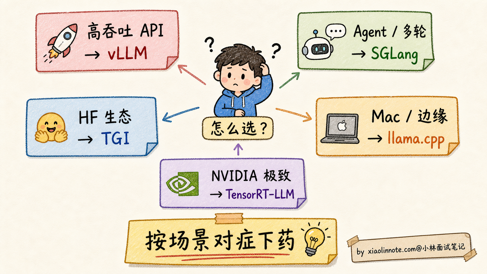

实战中常见的几个**误用陷阱**：

**误用 1：用 vLLM 跑 Agent 多轮对话**

Agent 场景若前缀重复率高，可评估带前缀复用能力的后端；vLLM 是否能复用、SGLang 是否更优取决于版本和配置，不能预先承诺固定延迟收益。

**误用 2：用 llama.cpp 做高并发服务**

llama.cpp 的定位更偏本地和边缘，但它也有批处理和多后端能力；若要做高并发服务，应在目标设备上与 GPU 服务框架比较，不要把某一个框架写成唯一生产答案。

**误用 3：用 TGI 追求绝对性能**

如果你的瓶颈是 GPU 吞吐量，TGI 通常不是第一选择，应该优先评估 vLLM、SGLang 或 TensorRT-LLM。具体差距会随模型、硬件、量化方式和 batch 策略变化，不要死记一个固定百分比。

**误用 4：用 TensorRT-LLM 做快速 POC**

TensorRT-LLM 部署需要先编译 engine（每个模型 / GPU 组合都要编译），不适合「快速试验、模型经常换」的场景。

#### 部署的三大隐藏陷阱

最后讲三个具体上线时容易踩的坑，作为面试加分项。

**陷阱 1：显存碎片在长上下文场景下还是会出现**

PagedAttention 等机制可以缓解分配碎片，但不消除长上下文、请求长度不均、调度保留和显存峰值问题。应对是监控实际显存、KV Cache 使用、排队、OOM 和 P95/P99 延迟，再调整最大上下文、并发、批处理和量化；不要用固定碎片百分比或单一利用率阈值下结论。

**陷阱 2：KV Cache 量化的支持差异大**

权重量化（FP16 -> INT4）很多框架都支持，但 KV Cache 量化（FP16 -> INT8 / FP8 / INT4）的支持差异很大，而且版本迭代很快。vLLM、SGLang、TensorRT-LLM 都在持续增强这块能力，TGI 和 llama.cpp 的支持方式也要看具体版本。如果你的瓶颈是长上下文 KV Cache 显存，选型前一定要查当前版本文档，别只听别人说「支持」。

**陷阱 3：MoE 模型的部署支持差异**

MoE 模型通常涉及专家路由、负载均衡、并行策略和跨卡通信，部署复杂度与具体模型/版本有关。各框架的支持、量化和性能差异要逐项验证，建议用真实专家激活分布和长上下文场景做预生产测试。

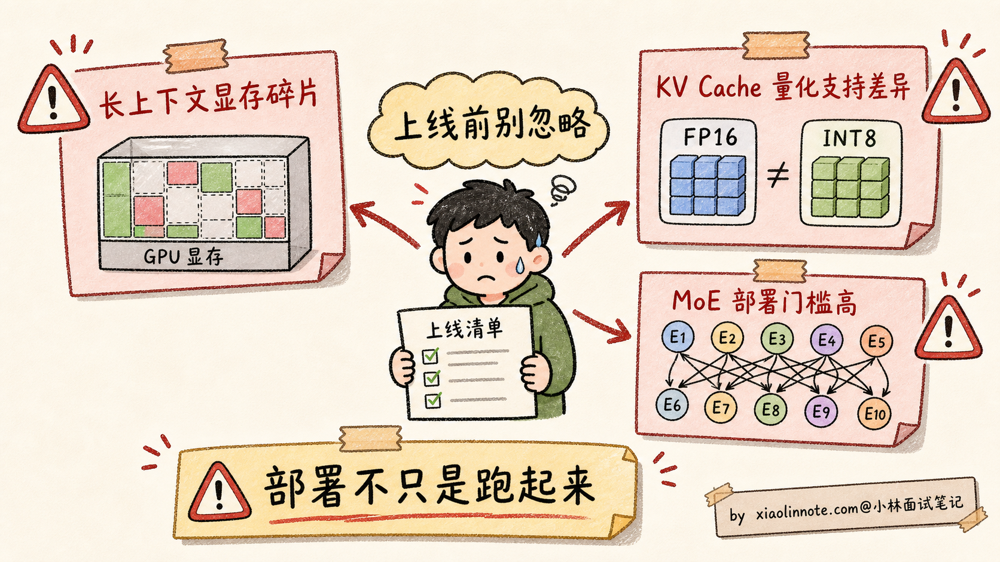

### 🎯 面试总结

回到开头那段对话，问到部署方案，最重要的是先讲清楚**部署框架解决什么问题**。直接用 transformers 库部署有三大痛点：显存碎片严重、批量调度低效、共享前缀重复计算。每个主流框架的核心创新都是攻击这些痛点的某个维度。这一层铺垫先讲到，面试官就知道你不是在背工具，是真的理解部署框架的设计动机。

接下来把**四类方案的边界**讲明白。vLLM 常以分页式 KV Cache 和连续批处理解决服务化内存与调度问题；SGLang 等方案可在共享前缀或结构化生成场景复用上下文；TGI 的优势通常在 Hugging Face 流程集成；llama.cpp 侧重轻量本地/边缘运行；TensorRT-LLM 适合愿意为固定 NVIDIA 环境做编译和调优的团队。具体数字必须来自同一测试条件。

然后给清晰的**选型决策**：先根据硬件、模型格式、上下文长度、并发、流式/工具调用、部署运维和合规约束筛选，再用统一压测比较首 token 延迟、生成吞吐、P99、显存峰值和成本。共享前缀只是一个测试维度，不能替代完整基准。

最关键的是讲清**部署陷阱**：显存碎片在长上下文场景还会出现、KV Cache 量化各框架支持差异大、MoE 模型部署比 Dense 复杂得多。能讲到这一层，面试官就知道你真的踩过部署的坑。

如果还想再加分，可以提一句 vLLM 和 SGLang 等框架可能互补，但是否混用取决于部署复杂度、模型适配和运维成本；不要把社区传闻或某个团队的架构当作通用结论。

---

## 大模型的 DPO 和 PPO 的区别是什么？

👔面试官：来讲讲大模型的 DPO 和 PPO 有什么区别？

🙋‍♂️我：DPO 和 PPO 都是用来做对齐的，让模型的输出更符合人类偏好。DPO 比 PPO 简单一些。

👔面试官：……「简单一些」是表面话。具体哪里简单？少了什么组件？再说，PPO 是强化学习算法，DPO 是监督学习算法，这个根本性差别你能讲出来吗？

🙋‍♂️我：哦哦，DPO 不需要奖励模型，PPO 需要奖励模型？

👔面试官：方向对了。那再问一个：PPO 训练时要同时维护几个模型？为什么需要这么多？KL 约束又是干什么的？

🙋‍♂️我：呃……我记得是有 4 个模型，但具体是哪 4 个想不起来。

👔面试官：典型的「知道有但讲不清」。PPO 的 4 模型架构是 policy（主模型）+ reference（参考模型）+ reward model（奖励模型）+ value model（价值模型），DPO 把这个砍到只剩 policy + reference 两个。这种「能不能说清楚每个组件做什么」是面试拉差距的地方。回去搞清楚再来。

答到这里才反应过来，DPO 和 PPO 的区别不是「谁更简单」那一层，而是「离线偏好优化 vs 在线策略优化」的路径分歧。DPO 的推导有适用假设，不能说与所有 PPO/RLHF 流程完全等价；把这条主线讲清楚，才容易理解其他方法。

### 💡 简要回答

DPO 和 PPO 都是大模型对齐训练里的方法，都是在 SFT 之后让模型的输出更符合人类期望。

PPO 是强化学习里的一个算法。在一种 RLHF 用法中，会训练奖励模型给回答打分，再用 PPO 调整 policy；同时可能需要 reference 做 KL 约束、value/critic 估计优势。具体组件数量取决于实现，工程复杂度和稳定性成本通常高于纯离线偏好优化。

DPO 是后来提出的简化方案，它通常直接使用同一 prompt 下的 chosen/rejected 偏好对，不需要显式训练和调用奖励模型。更准确地说，DPO 是在特定奖励建模、参考策略和数据分布假设下，从带 KL 约束的偏好优化目标推导出的离线损失；不等于与任意 PPO 训练过程完全等价。工程上可把它理解成用标准训练循环拟合偏好，但稳定性和效果仍依赖数据、β、参考模型与评测。

简单总结：一种 PPO/RLHF 流程是「采样—裁判/验证—策略更新」，DPO 是「直接用偏好对和 reference 的概率关系训练」；两者都可用于对齐，但探索能力、数据假设和工程闭环不同。

### 📝 详细解析

#### SFT 之后，还差什么？

要理解 PPO 和 DPO，得先搞清楚它们出现的背景：为什么 SFT 训完之后还需要对齐？

预训练让模型掌握了语言能力和世界知识；SFT（监督微调）让模型学会了用对话格式回答问题。但 SFT 本质上是「模仿」，模型在模仿标注人员写的标准答案的格式和风格。这里有一个根本问题：SFT 告诉模型「怎么写」，但没有告诉模型「哪个更好」。

举个例子，同一个问题「怎么学好 Python」，可以有很多种合格的回答：有的很简洁，有的很详细，有的带代码，有的全文字。SFT 只学了某一种写法，但用户对质量的偏好是有排序的，比如带代码示例的回答会更受欢迎，或者承认「我不知道」比自信地胡说更安全。

这种「知道合格，但不知道哪个更好」的局限，就是对齐阶段要解决的问题。不经过对齐的模型可能会生成有毒内容、一本正经地胡说八道，或者输出让用户不满意的答案。PPO 和 DPO 都是解决这个问题的方案，只是路径不同。

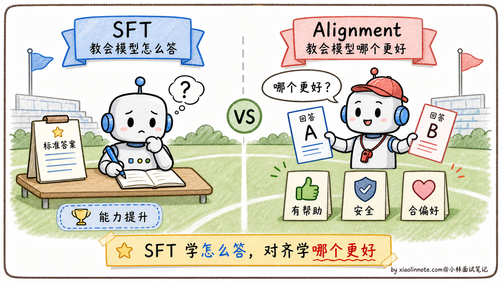

#### PPO：先培养「裁判」，再训练「选手」

PPO（Proximal Policy Optimization，近端策略优化）是强化学习里的一个经典算法，最早不是为大模型设计的，但 OpenAI 在 InstructGPT 里把它用到了 RLHF（基于人类反馈的强化学习）流程里。

**第一步：训练奖励模型（Reward Model）**

这个阶段，人类标注员会拿到很多「同一问题的多个回答」，然后按质量排名。比如问题「解释什么是递归」，回答 A 比回答 B 好，回答 B 比回答 C 好。用这些排名数据，训练一个专门的奖励模型，让它学会「给一个回答打质量分」。这个奖励模型就是裁判，它代替人类完成后续的自动评分。

**第二步：用 PPO 优化主模型**

有了裁判，就可以用强化学习来训练主模型了。流程是：主模型生成一段回答 -> 奖励模型打分 -> PPO 根据得分调整主模型的参数，让它以后生成更高分的回答。

但这里有一个危险：如果只追求高分，模型可能学会「钻空子」，生成一些奖励模型打高分但实际上没用的内容（这叫做 reward hacking）。为了防止这个，PPO 流程里会同时维护一个「参考模型」（Reference Model），也就是 SFT 之后的原始模型的冻结副本，并用 KL 散度（一种衡量两个概率分布差距的指标）约束主模型，让它不要偏离参考模型太远。KL 散度就像一根绳子，主模型可以向高分方向移动，但不能走太远。

一种常见的 PPO/RLHF 训练实现会涉及以下组件；这不是所有实现的固定清单：

```python
# PPO 训练时需要同时维护的四个模型
policy_model     = load_sft_model()   # 主模型（正在被优化的）
reference_model  = load_sft_model()   # 参考模型（冻结，SFT 模型副本，用于 KL 约束）
reward_model     = load_reward_model() # 奖励模型（裁判，给回答打分）
value_model      = load_value_model()  # 价值模型（RL 辅助，估算未来奖励期望）
```

如果这些组件各自保留完整副本，显存、通信和采样成本会显著增加；也有实现采用参数共享、量化、LoRA 或其他 critic 设计。加上 RL 训练的超参数敏感、奖励投机和分布漂移，PPO 的工程难度通常较高，但不应把“只有极少团队能做”当成事实判断。

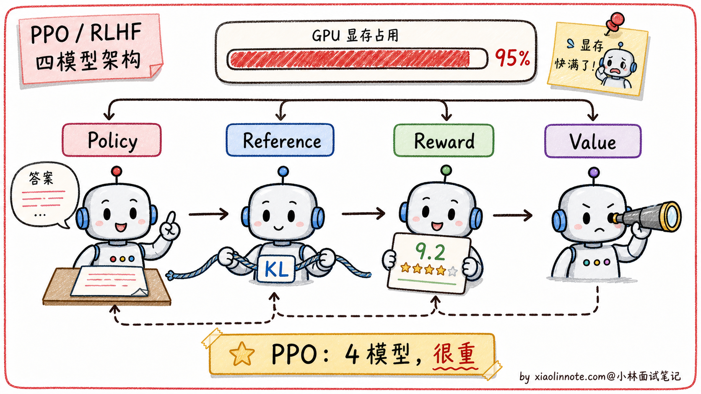

#### DPO：绕过裁判，直接看回放

DPO（Direct Preference Optimization，直接偏好优化）是研究者提出的偏好优化方法，核心思路是把特定 KL 约束目标转写成可直接训练的偏好损失；年份和机构不是回答重点。

在相应假设下，带 KL 约束的奖励最大化目标可以通过推导改写成偏好损失，不需要显式训练和调用奖励模型。直觉上，主模型相对于 reference 的对数概率比值提供了隐式偏好信号；这不是对所有 RLHF/PPO 流程的无条件等价替代。

这个等价关系让 DPO 可以直接用「偏好对」数据（chosen/rejected）来训练，数据格式长这样：

```python
# DPO 的训练数据格式：同一问题的「好回答」和「差回答」对
{
    "prompt": "如何学好 Python？",
    "chosen": "建议先从官方文档入手，配合做小项目实践...",  # 人类更偏好的回答
    "rejected": "Python 很简单，随便找个教程看看就行了..."  # 人类不太喜欢的回答
}
```

DPO 的损失函数直觉上做的事情是：

```python
# DPO 损失函数直觉（简化版，不是完整公式）
loss = -log(
    sigma(
        beta * (log(policy(chosen) / ref(chosen))   # chosen 在主模型和参考模型之间的对数概率比
        -     log(policy(rejected) / ref(rejected))) # rejected 在主模型和参考模型之间的对数概率比
    )
)
# 目标：让 chosen 的比值 > rejected 的比值
# 即：相对于参考模型，主模型在 chosen 上的概率提升要大于在 rejected 上的提升
```

简单说就是两件事同时发生：模型对「好回答」的概率，相对于参考模型升高；模型对「差回答」的概率，相对于参考模型降低。整个过程不需要奖励模型，只需要主模型和参考模型两个：

```python
# DPO 训练只需要两个模型
policy_model    = load_sft_model()  # 主模型（正在被优化的）
reference_model = load_sft_model()  # 参考模型（冻结，用于计算概率比）
# 常见 DPO 目标不显式调用 reward_model 或 value_model；实际显存/吞吐仍取决于实现
```

DPO 可以用标准训练框架实现，通常比在线 PPO 少一套采样/奖励/critic 基础设施；但它仍可能过拟合偏好对、放大标注偏差或损伤能力，稳定性和超参数难度不能一概而论。

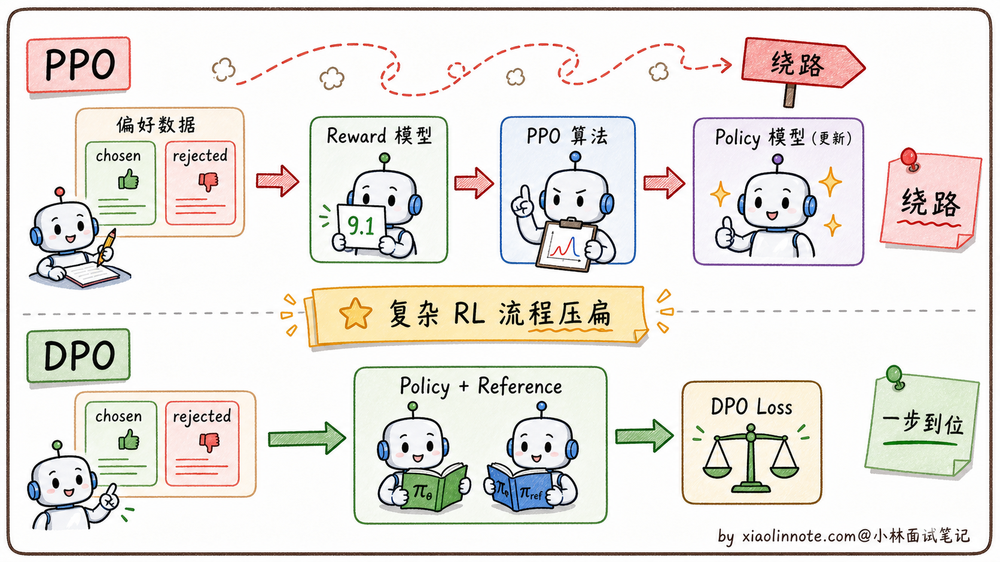

#### 两种方案的对比

| 维度 | PPO | DPO |
| --- | --- | --- |
| 是否需要奖励模型 | 常见流程需要，也可用其他奖励/验证器设计 | 常见目标不需要显式奖励模型 |
| 组件形态 | policy、reference、reward、value/critic 的组合，具体实现可变 | policy + 冻结 reference（实现可用参数/LoRA 等方式优化） |
| 训练稳定性 | 受在线采样、奖励偏差、KL 和 critic 影响 | 少在线 RL 基础设施，但受偏好数据、参考模型和超参数影响 |
| 实现难度 | 高（需要 RL 基础设施） | 低（标准训练框架即可） |
| 表达能力 | 强（可探索训练数据之外的空间） | 稍弱（受偏好数据分布限制） |
| 代表性公开流程/实践 | 不同 RLHF 方案可能使用 PPO 或其变体，需以论文/技术报告为准 | 不同开源模型可能使用 DPO 或变体，需以对应训练报告为准 |

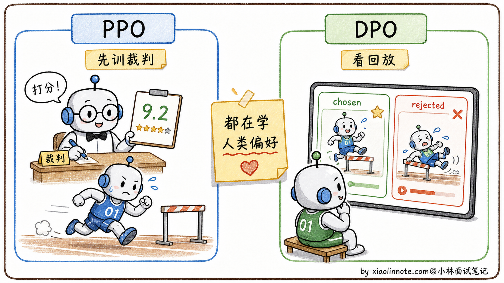

#### PPO 的进阶版：GRPO 简介

讲 PPO 和 DPO 时可以补充 **GRPO（Group Relative Policy Optimization）**：它用同一问题的一组采样结果构造相对优势，减少对独立 value/critic 的依赖；具体算法、论文归属和工程实现应以所引用版本为准，不要把它说成所有 PPO 的统一替代。

GRPO 的核心创新是**砍掉了 PPO 的 Value Model**。

PPO 的 4 模型架构里，Value Model 的作用是估计「当前状态的预期奖励」作为基线，然后算「实际奖励 - 预期奖励」得到优势函数（Advantage）。但 Value Model 是一个独立的神经网络，规模和主模型差不多大，要单独训练、占显存。

GRPO 的一种做法是：对一个问题 q，从主模型采样一组回答，用奖励模型、规则或可验证判定得到 r_1, r_2, ...，再用「组内归一化」估计相对优势。组大小、归一化和 KL 项都是实现/算法配置，不应固定为某个数字：

```
A_i = (r_i - mean(r_1..r_G)) / std(r_1..r_G)
```

组内统计量可以承担基线作用，减少对独立 Value Model 的依赖；但仍可能需要 reference、奖励/验证器、采样和优化组件，资源占用也不会自动接近 DPO。

GRPO 对可验证任务很有吸引力：数学、代码等任务可以用程序或规则产生奖励，减少主观奖励模型依赖；但 0/1 判定的覆盖范围、奖励稀疏和验证器安全性仍需评估，不能由此推断所有推理能力都能纯靠规则获得。

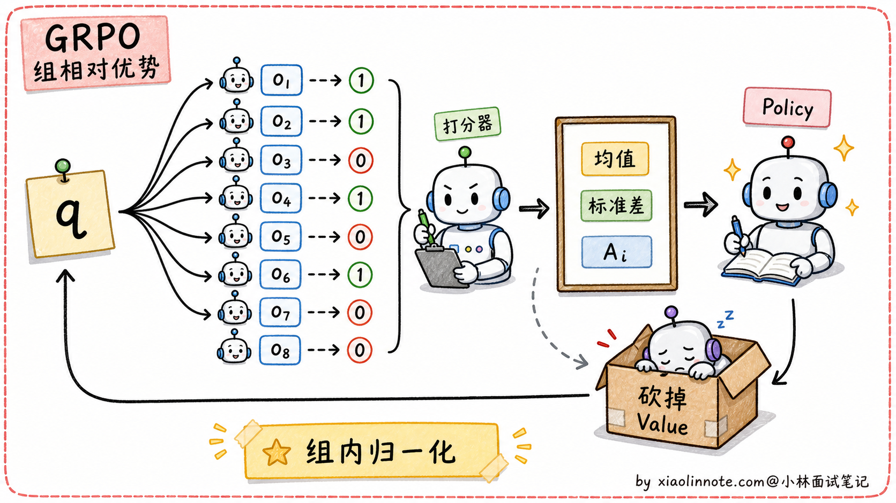

谁在用 GRPO：

- **DeepSeek R1 / R1-Zero**：推理模型的代表
- **DeepSeek-Math**：数学推理模型
- **Qwen-Math 系列**：阿里的推理增强模型

面试中提到 GRPO 时，重点是说明“用组内相对奖励减少独立 value/critic 依赖”，并补充验证器、采样预算和奖励投机风险；不要背固定年份或“必问”判断。

#### 各自适合什么场景？

理解了两者的权衡，选择就很清晰了。

**PPO 适合**有在线探索需求、可靠奖励/验证器、采样基础设施和 RL 工程能力的团队；它能优化离线偏好对之外的策略，但也更容易受到奖励投机和训练不稳定影响。

**DPO 适合**已有质量较好的偏好对、希望采用离线训练且不想维护在线 RL 基础设施的场景；它不保证训练一次成功，也不自动优于 PPO。

一个简单的判断原则是：若目标是在已有偏好分布上优化，先用 DPO/其他离线偏好方法建立基线；若需要在线探索或可验证奖励闭环，再评估 PPO/GRPO 等方法，并用能力保持、奖励黑客、成本和安全指标共同判断。

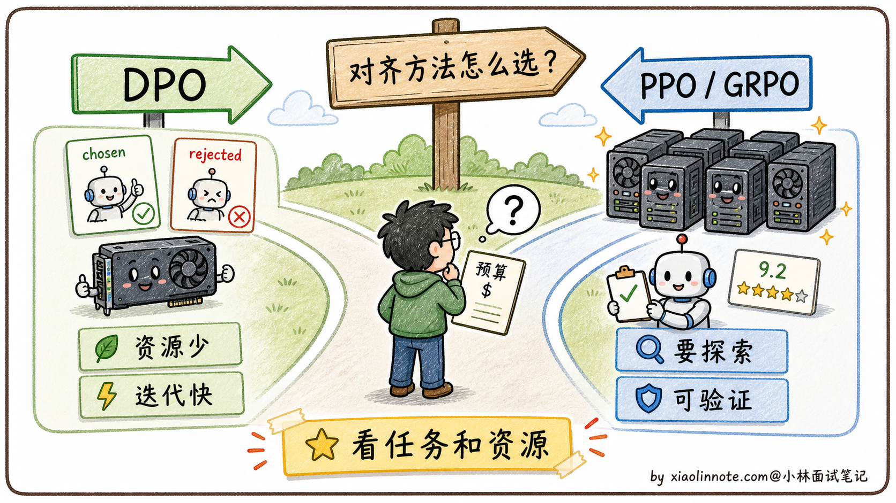

### 🎯 面试总结

回到开头那段对话，问到 DPO 和 PPO 的区别，最重要的是先讲清楚**两者都在解决「SFT 之后的对齐问题」**。SFT 让模型学会按指令回答，但回答风格不一定符合人类偏好，所以需要进一步训练让模型学会「哪种回答更受人类欢迎」。这一句铺垫先讲到，面试官就知道你抓到了对齐这件事的本质。

接下来可以讲 PPO 的一种偏好对齐流程（具体实现会变化，并非固定四份模型）：

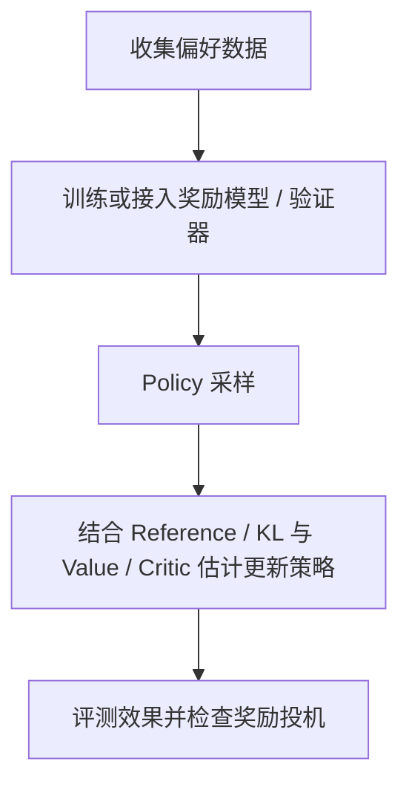

可以提到常见的 policy/reference/reward/value 角色，但要说明实现并非固定四份模型。

DPO 的核心创新是「**在特定假设下把带 KL 约束的偏好目标改写成偏好对损失**」。它通常不需要显式奖励模型或 PPO 在线采样，但仍要用 reference、选择合适 β、处理偏好噪声并评估能力保持。类比可以用，但不要把它说成任意 RLHF 的完全等价物。

最关键的一句话是：**两者都可用于偏好对齐，但优化路径、数据假设和在线探索能力不同；DPO 常通过偏好对和 reference 的概率比实现离线优化，PPO 则通过奖励/价值估计进行策略更新**。

如果还想再加分，可以提一句 GRPO：用同题多样本的相对奖励降低独立 value/critic 的依赖，尤其适合有程序验证器的任务；同时说明它仍有奖励设计、采样成本和奖励投机问题。

---

## 大模型能力评测指标有哪些？

👔面试官：来讲讲大模型能力的评测指标有哪些？

🙋‍♂️我：常用的有 MMLU、HumanEval、GSM8K 这些 Benchmark，能反映模型的综合能力。

👔面试官：……Benchmark 的名字会背是基本功。但你能说清楚每个 Benchmark 测什么吗？再说，学术 Benchmark 真的能反映实际效果吗？为什么有些模型在排行榜上很高但实际用起来不好？

🙋‍♂️我：哦哦，可能是过拟合到 Benchmark 上了？

👔面试官：方向对了一半。这个现象有专门的术语叫「**数据污染**」（Data Contamination）。再问你：如果不能完全相信 Benchmark，那工程上到底用什么评测模型？

🙋‍♂️我：呃……用户反馈？

👔面试官：「用户反馈」太笼统。工程上的标准做法是建**业务测试集**，从真实用户请求里采样、人工标注期望输出，每次改 Prompt 或换模型都跑一遍。这种「学术 Benchmark + 业务测试集 + 线上指标」的闭环你能讲清楚吗？回去搞清楚再来。

被这三个问题一通追下来，评测这道题就不再是「背几个 Benchmark 名字」的水平了。Benchmark 各自的局限、业务测试集怎么搭、线上反馈怎么闭环回来，这三件事得一起讲。

### 💡 简要回答

我对这块的理解是，学术 Benchmark 只能作为参考，真正重要的是在自己业务数据上的表现。MMLU / MMLU-Pro 可用于综合知识/推理对比，HumanEval / SWE-bench Verified 可覆盖不同层次的代码任务，GSM8K / MATH / GPQA 侧重数学和科学推理；具体版本、协议和评分实现必须记录。更新题集可能降低已知污染，但不能自动消除污染。这些指标不能直接等价成业务效果。工程上应从真实请求构建分层测试集，固定评测协议，结合程序验证、人工/模型辅助评分、统计不确定性和线上指标形成闭环。

### 📝 详细解析

#### 为什么需要评测指标

大模型的能力是多维度的，「感觉用起来还不错」不足以支撑工程决策。当你比较不同供应商/模型版本、决定是否微调或衡量 Prompt 变化时，应同时量化正确性、任务完成率、鲁棒性、安全性、延迟、吞吐和成本。评测指标的价值不是把一切主观感受变成一个分数，而是把目标、样本、评分规则和不确定性固定下来，形成可比较的证据。

但评测模型远比评测传统软件难得多，因为语言生成是开放性任务，「正确答案」的边界往往是模糊的。这也是为什么这个领域同时存在多种不同侧重的 Benchmark。下面来认识几个最常被引用的学术 Benchmark，了解它们各自考查的是什么维度。


#### 主流学术 Benchmark 逐一介绍

- **MMLU / MMLU-Pro** 可作为综合知识与推理的参考；题目范围、选项和评分应以具体数据集版本为准，不要把一个总分解释成通用智力。
- **HumanEval、MBPP 和 SWE-bench Verified** 覆盖从函数级生成到仓库级修复的不同代码任务。HumanEval 等数据集的题数、测试实现和去重方式可能随版本/评测脚本变化；`pass@k` 也要说明采样次数、去重和执行沙箱，不能只报一个分数。
- **GSM8K、MATH、GPQA** 测试数学和科学推理能力。GSM8K 是小学数学应用题，考基础的四则运算和逻辑推理；MATH 是竞赛数学，包含代数、几何、组合数学等；GPQA 更偏研究生级别的科学问答，很多题需要物理、化学、生物等专业知识和多步推理。
- **MT-Bench、Arena、τ-bench** 更偏对话和 Agent / Tool Use 能力。MT-Bench 设计了一系列需要多轮交互的场景，用「LLM-as-Judge」方式给回答打分；Chatbot Arena 更像用户真实偏好投票；τ-bench 这类评测会看模型在工具调用、多轮状态管理、业务流程里的表现，更贴近 Agent 应用。
- **HELM、LiveBench、Humanity’s Last Exam** 等评测覆盖更广或更难的维度。它们可能通过多维报告、更新题目或更高难度降低部分污染风险，但仍受题集、提示词、评测器、时间和可复现性影响。它们比单一指标更全面，也更需要核对版本与协议。

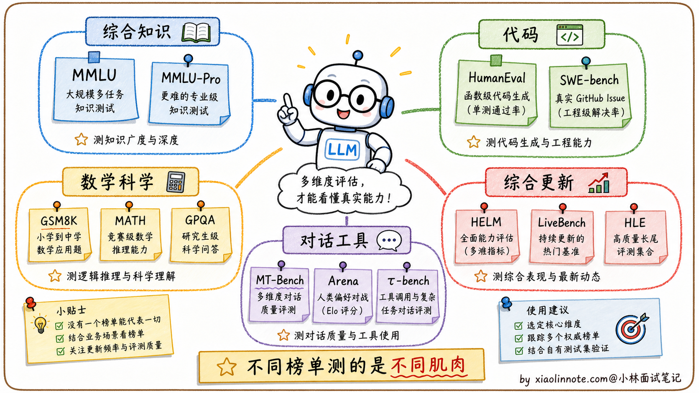

#### Benchmark 的局限性：数据污染问题

Benchmark 有一个严重的问题：**数据污染**。

公开 Benchmark 的题目、解析或相似变体可能进入训练/后训练数据，也可能通过提示模板、评测脚本或人工调优造成间接过拟合。污染会让分数高估泛化能力，但“模型见过”通常难以仅凭成绩证明，应做去重、污染调查、时间切分和私有/新题验证。

这也是为什么有些模型在学术排行榜上名列前茅，实际用起来却不如名次更低的竞品，因为它们可能是「背过题」的，而不是真的更聪明。

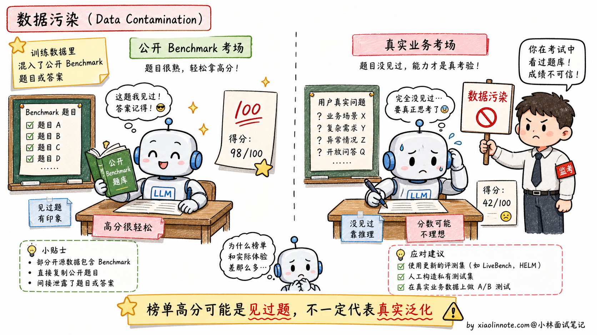

#### 如何建自己的业务评估集

面对 Benchmark 局限性，最务实的做法是建自己的任务特定测试集。

做法通常是：从真实用户请求中按任务、难度、语言、风险和用户群体分层抽样，脱敏后建立带版本的黄金集；样本量由风险、方差、成本和期望置信区间决定，不存在通用的 50-200 条标准。每次迭代模型或 Prompt 时固定随机种子/采样协议（能固定时），报告总体分数和关键切片。

评分方式上，客观任务（信息提取、分类、代码）优先用 schema、单元测试或规则验证；主观任务（摘要、问答质量）可用 rubric、成对比较和 LLM-as-Judge，但要校准位置偏差、长度偏差、模型偏好和提示泄漏，并保留人工盲评/抽检。抽检比例和一致性应由风险、分层和置信度决定，不能固定成 10-20%。

一套可复现的评测闭环可以概括为：

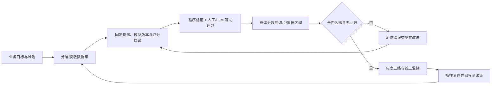

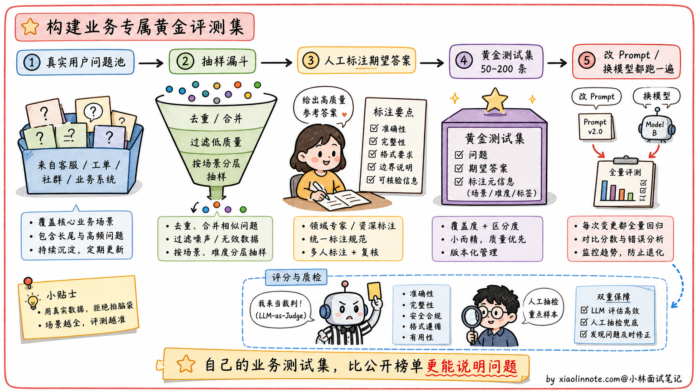

#### 离线评估 + 线上指标的闭环

业务测试集解决了离线评估的问题，但只有离线测试集还不够，生产环境里还需要监控实际的用户体验指标：用户对回答是否满意（明确的点赞/踩、隐式的追问行为）、任务完成率（用户是否实现了目标）、会话放弃率（用户中途退出说明体验差）。

离线评估帮你找问题、快速迭代；线上指标告诉你优化是否真正改善了用户体验。两者结合才是完整的评估体系。

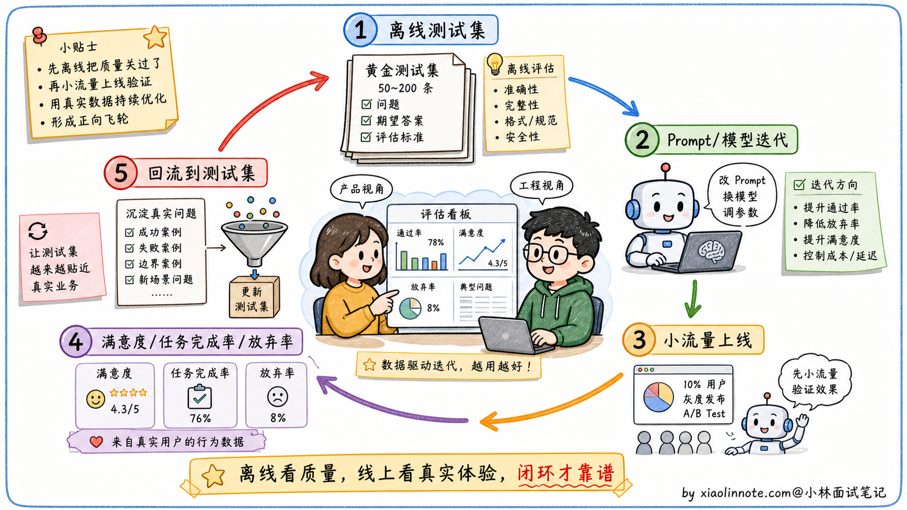

### 🎯 面试总结

回到开头那段对话，问到大模型评测指标，最重要的是先把**学术 Benchmark 和业务评测的关系**讲清楚。学术 Benchmark（MMLU、HumanEval、GSM8K、MT-Bench、HELM 等）适合横向对比模型的综合能力，但**不能完全相信**，因为存在严重的「数据污染」问题（模型在预训练时可能见过测试题）。这一句先讲到，面试官就知道你不是只会背 Benchmark 名字。

接下来讲清主流 Benchmark 各自测什么。MMLU / MMLU-Pro 测综合知识广度和推理，HumanEval / MBPP / SWE-bench Verified 测代码能力，GSM8K / MATH / GPQA 测数学和科学推理，MT-Bench / Arena / τ-bench 测对话、偏好和工具调用，HELM / LiveBench / Humanity’s Last Exam 则是更综合或更新型的评测。能用一两句话说清每个 Benchmark 的设计目标，比单纯报名字深刻得多。

最关键的是讲**业务测试集**的构建方法：按任务和风险分层、脱敏、版本化，样本量依据统计和业务风险决定；客观任务用程序验证，主观任务用明确 rubric，并用盲评和一致性检查校准 LLM-as-Judge。每次改 Prompt、模型或工具链都跑固定协议，报告总体与切片、置信区间和成本/延迟。

最后提一句**离线评估 + 线上指标**的闭环。离线评估帮你快速迭代找问题，线上指标（满意度、任务完成率、会话放弃率）告诉你优化是不是真的改善了用户体验。两者结合才是完整的评估体系。

如果还想再加分，可以提一句**数据污染**问题的应对方向：避免用公开 Benchmark 直接当训练集、用 LiveBench 这种「持续更新题库」的评测、用业务真实数据做评测。这种「不被 Benchmark 蒙蔽」的工程视角是面试里很难追问的水平。

---

## 大模型微调的方案有哪些？

👔面试官：来讲讲大模型微调的方案有哪些？

🙋‍♂️我：微调方案有全量微调、LoRA、QLoRA、SFT、DPO 这些，工业界常用 LoRA。

👔面试官：……你这是把名词都背了一遍，但没说清楚关系。LoRA 和 SFT 是同一个层面的东西吗？SFT 和 DPO 又是什么关系？为什么要分这么多名字？

🙋‍♂️我：呃，应该都是不同的微调方法吧？

👔面试官：完全错。这些名词其实分两个维度。一个维度是「**改哪些参数**」（全量微调 vs LoRA vs QLoRA），另一个维度是「**学什么目标**」（SFT vs DPO）。这两个维度是正交的，可以组合：你可以用 LoRA 做 SFT，也可以用 LoRA 做 DPO。这层关系搞不清楚就讲不出选型逻辑。

🙋‍♂️我：哦，原来是两个维度。

👔面试官：那再问你一个问题，什么时候真的需要微调？是不是模型表现不好就该上微调？

🙋‍♂️我：嗯，应该是吧？

👔面试官：典型的新人思维。微调是「最后手段」，不是「第一选择」。能用 Prompt + Few-shot 解决的问题，绝对不要上微调，因为微调的成本和维护代价远比想象大。「什么时候该微调、什么时候不该」是这道题的关键判断点。回去搞清楚再来。

这道题我开始还以为是把 LoRA、SFT、RLHF 这些名词背一遍就行，问到这里才反应过来，真正考的是两条正交的轴：改哪些参数、学什么目标，外加一条前置判断「这个需求到底该不该微调」。

### 💡 简要回答

我了解微调之后，首先意识到的是：微调不是首选，而是最后手段。大多数问题先把 Prompt 写好、加 Few-shot 示例，或者用 RAG 接外部知识，基本都能解决。真正需要微调的场景是：模型需要以特定风格持续输出、需要学会稳定的任务格式、或者需要大幅降低成本用小模型替代大模型。方案上，LoRA/QLoRA 是最常用的，因为它只训练一小部分参数，普通 GPU 上就能跑，不需要全量更新所有权重；SFT 是微调的目标形式，让模型从续写模式变成指令回答模式；有偏好对齐需求的话，DPO 比 RLHF 简单得多、效果也不差。选模型不是看谁排行榜最高，选微调方案也是同理，核心是看资源约束和实际需求。

### 📝 详细解析

#### 先回答一个前置问题：什么时候才真的需要微调？

很多人一遇到「模型表现不好」就想上微调，这其实是新人的本能反应。但工业界踩过坑的人都知道，**微调是最后手段，不是第一选择**。

为什么？因为微调的成本远比想象大。需要准备高质量数据集、GPU/存储资源和工程验证，并处理过拟合、灾难性遗忘、许可证与安全问题。基础模型、tokenizer、模板或数据分布变化后，旧适配器可能需要重新评估甚至重训，维护成本不能只看一次训练费用。

那什么时候才该上微调？我自己总结的判断标准是这样的。

如果只是想让模型回答某种特定格式（比如必须是 JSON），先试 Prompt + Few-shot，写清楚格式要求 + 给 3-5 个示例，大模型基本能搞定。如果想让模型回答某种特定风格（比如公司客服的口吻），先试 System Prompt 描述风格 + 几个对话示例，多数情况也能行。如果想让模型懂某个领域知识，先试 RAG（检索增强），把领域知识库挂上让模型实时查，比硬塞进参数里灵活得多。

只有当上面这些都试过、效果还是不达标的时候，才认真考虑微调。具体来说，下面三种场景微调才是真的值得做：第一种是模型需要持续以一种特殊风格输出（Prompt 控制不住，比如生成特定格式的代码、特定语气的文案）；第二种是需要模型稳定掌握某类任务模式或内部术语表达；第三种是想用小模型替代大模型省成本（用 7B 微调模型替代 70B 通用模型，推理成本能省很多）。

这里要特别提醒：如果需求是「补充经常变化的事实知识」，微调通常不是好选择。比如产品价格、政策条款、库存状态、合同原文，这些内容应该放进 RAG 或数据库里实时查。微调更适合学行为、格式、风格和任务模式，不适合当一个会频繁更新的知识库。

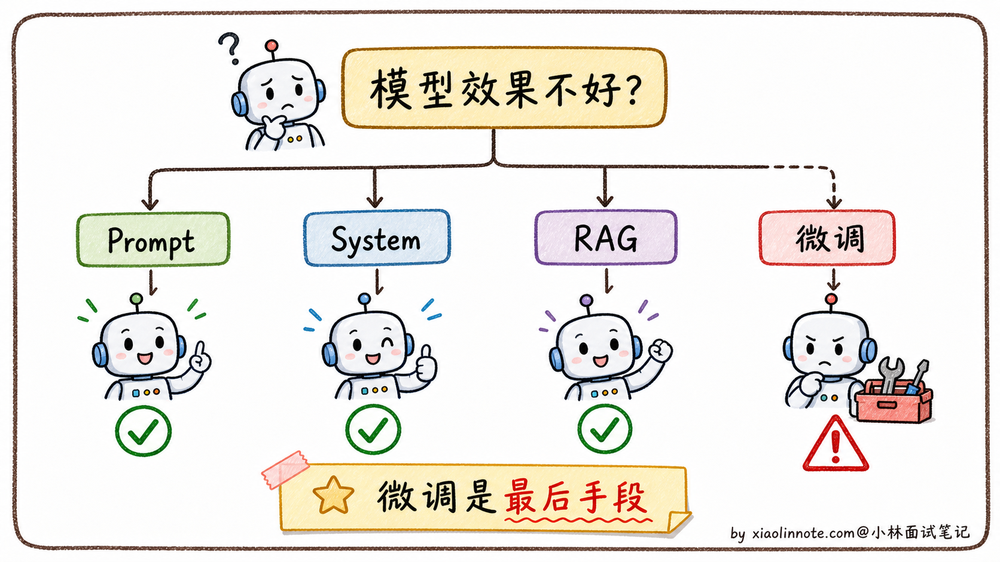

理清「该不该微调」之后，再来看「微调有哪些方案」。这里有一个特别容易踩的坑，很多人把「全量微调、LoRA、QLoRA、SFT、DPO」都当成同一类的「不同微调方法」来背。其实它们分两个完全不同的维度。

#### 微调的两个正交维度：改哪些参数 vs 学什么目标

微调本质上是回答两个问题。

**第一个问题是「改哪些参数」**。模型有几十亿到几百亿参数，你是要全部改，还是只改一小部分？这一维度上有三个主流方案：全量微调（全改）、LoRA（改一小部分）、QLoRA（改一小部分 + 量化基础模型）。

**第二个问题是「学什么目标」**。模型要学的是「按指令回答」还是「学会哪种回答更好」？这一维度上有两个主流方案：SFT（学指令格式）、DPO（学偏好对齐）。

这两个维度是**正交**的，可以任意组合。比如：

- 用全量微调做 SFT
- 用 LoRA 做 SFT
- 用 QLoRA 做 SFT
- 用 LoRA 做 DPO
- 用 QLoRA 做 DPO

每种组合都是合法的「微调方案」。理解这两个维度的正交关系，是回答这道题的钥匙。

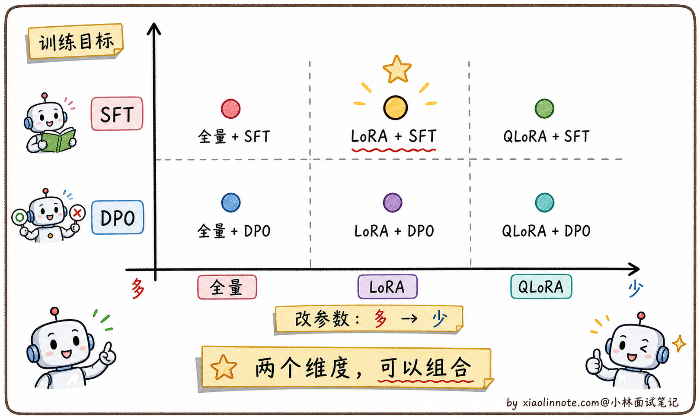

下面分别看这两个维度上的方案。

#### 「改哪些参数」维度：从全量微调到 QLoRA

**全量微调（Full Fine-tuning）**：所有参数都改

最朴素的方案就是把模型所有参数都拿出来在新数据上继续训练，让所有层都重新适配新任务。效果通常是最好的，因为模型有最大的自由度去调整。

但代价可能很高。全量微调除了参数，还要存梯度、优化器状态、激活和通信/检查点开销；显存取决于精度、优化器、序列长度、并行策略和是否使用 ZeRO/卸载，不能用“7B=固定几十 GB”或“70B=固定几十张卡”概括。

更糟的是「**灾难性遗忘**」（Catastrophic Forgetting）。模型在新任务上学得好了，原本预训练学到的通用能力反而下降。这是因为所有参数都在被改写，新数据分布有偏的话，模型会忘记原本的「通用知识」。

所以全量微调通常需要更高资源和更严格的回归，但是否值得取决于任务与数据；参数高效微调（如 LoRA）能降低门槛，却不保证效果一定相同。

**LoRA（Low-Rank Adaptation）**：只改一小部分参数

LoRA 的核心洞见特别巧妙。它发现一个事实：模型参数的「**更新量**」（即 ΔW = W微调后 - W原始）虽然维度很大（比如 4096×4096），但真正有意义的变化只发生在一个**低维子空间**里。换句话说，权重的更新具有「**内在低秩性**」，不需要每个维度都去改。

基于这个洞见，LoRA 的做法是：冻结原始权重 W，在 W 旁边新增两个低秩矩阵 A 和 B（其中秩 r 远小于 d），训练时只更新它们。推理时可以把增量合并到 W，也可以保留为独立 adapter；二者在部署灵活性、显存、切换成本和多 adapter 管理上不同。低秩假设是经验性取舍，秩、注入层和缩放需要验证。

打个比方，全量微调像是把一本厚厚的教科书全部重写一遍，LoRA 像是在书的空白处贴便利贴，原书一字不动，便利贴上写着新增的修正和补充。看书的时候原文 + 便利贴一起看，效果叠加。

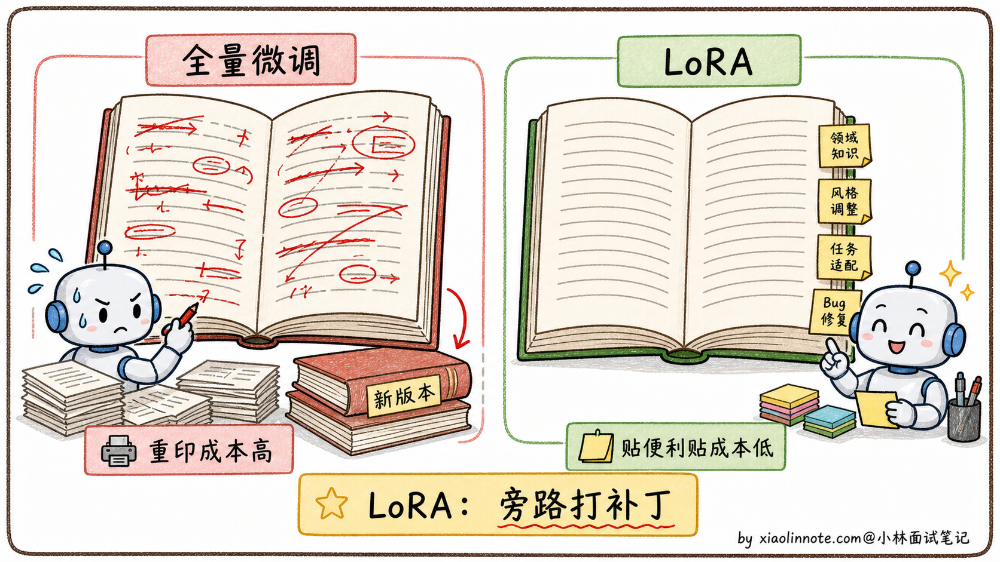

参数量会从 d² 降为约 2dr，但实际可训练参数还取决于注入的层、秩和 bias 策略；训练显存还包括激活、梯度、优化器和基础模型加载，不能从参数量直接推出固定显存或卡数。

LoRA 是常见的参数高效微调方案之一，但“最主流”“几乎所有项目”会随模型社区和任务变化；还应比较 adapter、prompt tuning、全量更新和蒸馏等方案。

**QLoRA**：消费级 GPU 的入场券

LoRA 可以降低可训练参数和优化器状态，但基础模型权重、激活和上下文仍占显存；QLoRA 进一步量化冻结的基础模型，以降低加载/训练门槛。

QLoRA 的典型思路是：以低比特格式（常见实现使用 NF4）加载冻结基础模型，再训练 LoRA adapter，并配合分页优化器等技术降低峰值。能否在某张卡上训练某个模型取决于上下文、batch、梯度累积、实现和量化质量，不能承诺固定显存或模型大小。

QLoRA 的精度损失非常小，实测效果和全精度 LoRA 几乎没差别。这一招直接让微调民主化了，无数个人开发者用 QLoRA 训出了自己的领域模型。Alpaca、Vicuna 这些早期开源指令模型基本都是用 QLoRA 训出来的。

到这里，「改哪些参数」维度的三个方案就清楚了。下面看另一个维度。

#### 「学什么目标」维度：SFT 和 DPO

「改哪些参数」回答的是「**怎么改**」的问题，但还有一个更核心的问题没回答：**改的目标是什么？让模型学会做什么？**

这一维度上有两个主流方案。

**SFT（Supervised Fine-Tuning，监督微调）**：让模型学会「按指令回答」

预训练模型本质是「文本续写机器」，给一段文字就接着往下写，根本不知道「问问题」是什么意思。SFT 的目标就是把模型从「续写模式」切换到「对话模式」。

它的训练数据格式是 (指令，期望回答) 的对，比如「请介绍一下北京 → 北京是中国的首都，位于华北平原……」。模型在这样的数据上继续训练，慢慢学会「看到这种格式就该给一个完整回答，不要无限续写下去」。

SFT 是一个「**目标**」，不是「**方法**」。具体怎么实现？可以用全量微调做 SFT、可以用 LoRA 做 SFT、也可以用 QLoRA 做 SFT。在工业界最常见的组合是 **QLoRA + SFT 数据**，性价比最高。

SFT 数据的关键是质量大于数量。Llama 2 用了大约 100 万条 SFT 数据，但每条都是精心标注的。AlpacaFarm 的研究还发现一个反直觉结论：几千条高质量数据训出来的效果，比几十万条粗糙数据要好。

**DPO（Direct Preference Optimization，直接偏好优化）**：让模型学会「哪种回答更受欢迎」

SFT 之后，模型已经会按指令回答了，但回答风格不一定是用户喜欢的（可能太啰嗦、太简洁、有时候说话不得体）。这时候需要更进一步的「**偏好对齐**」，告诉模型「同样合格的回答里，哪种用户更喜欢」。

早期做偏好对齐的标配方案是 RLHF（Reinforcement Learning from Human Feedback），流程是：收集人类偏好数据 → 训一个奖励模型 → 用 PPO 算法优化主模型。但 RLHF 流程长、要同时维护好几个模型、训练不稳定，能驾驭它的团队不多。

DPO 是斯坦福 2023 年提出的简化方案。它发现一个数学上的等价转换：RLHF 的优化目标可以推导成纯监督学习的损失函数，**完全绕过奖励模型，也不需要 PPO**。直接拿 (问题，好回答，差回答) 三元组训练，让模型直接学会「好回答的概率要比差回答提升得多」。

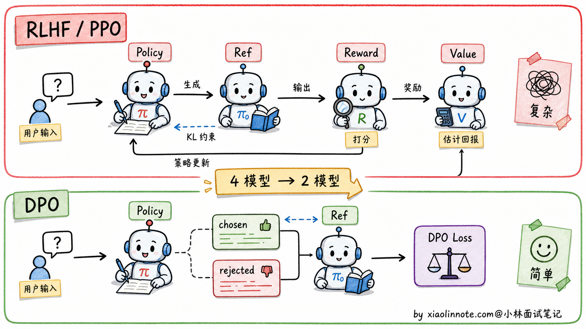

DPO 训练简单、稳定、工程门槛低，所以开源社区的偏好对齐阶段大量使用 DPO 或它的变体。但这里别说得太绝对，不同模型的 post-training 流程差异很大。比如 Llama 2-Chat 公开流程主要是 SFT、拒绝采样和 PPO/RLHF；很多社区模型为了降低成本，才会把偏好优化换成 DPO。

**DPO 也是一个「目标」，不是「方法」**。它可以用全量微调实现，也可以用 LoRA 实现。最常见的工业组合是 **LoRA + DPO**，资源友好。

#### 实战选型怎么落地

理解了两个维度的方案之后，实战选型其实就清楚了。

如果你是资源受限的小团队，通常可以先评估 **QLoRA + SFT**；数据量、卡数和效果没有通用保证，应以小规模试验、验证集和成本预算决定。

如果你是中小企业、有几张 A100 但没有大集群，可以选 **LoRA + SFT**。比 QLoRA 精度略好一点（因为基础模型不量化），训练速度也更快。

如果你的需求是「让模型的回答风格更符合用户偏好」（不只是格式正确，还要好听），可以在 SFT 之后再加一步 **LoRA + DPO**。先用 SFT 让模型学会回答格式，再用 DPO 让回答风格对齐用户偏好。很多社区 Instruct 模型走的是 SFT -> DPO 这条轻量路线；而 Llama 2-Chat 这类大厂公开模型可能会用拒绝采样、PPO/RLHF 等更重的组合。

如果资源充足且任务确实需要大范围改变参数，可以评估全量微调或更重的后训练组合；公开资料通常不足以支持对闭源模型训练细节、成本或“最强”结论的推断，应以可核验的技术报告为准。

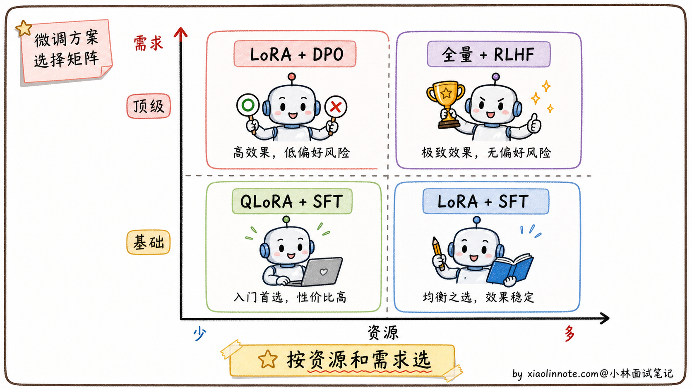

一个常见误区是「方案越重越好」。应先用 Prompt/RAG/工具和小规模 adapter 建立基线，再按效果、数据、许可证、部署延迟、遗忘和维护成本升级；重方案的收益不是自动出现，且训练成本不一定按简单的“指数”增长。

### 🎯 面试总结

回到开头那段对话，问到大模型微调方案，最重要的不是把名词列一遍，而是讲清楚两件事。

第一件事是**前置判断**：微调是最后手段不是第一选择。能用 Prompt + Few-shot 解决就别上微调；能用 System Prompt 控制风格就别上微调；能用 RAG 接知识库就别上微调。只有这些都试过不行，再考虑微调。这一句说出来，面试官就知道你不是「为了微调而微调」的新人。

第二件事是**两个正交维度**：「改哪些参数」（全量微调 / LoRA / QLoRA）和「学什么目标」（SFT / DPO）是两个独立的维度，可以任意组合。能说出「LoRA 是方法、SFT 是目标，可以用 LoRA 做 SFT，也可以用 LoRA 做 DPO」，比把这五个名词当作并列项罗列要深刻得多。

讲清楚这两点之后，再补一下实战选型经验：资源受限可先做 QLoRA/LoRA + SFT 基线，有可靠偏好数据再评估 DPO/其他偏好方法，资源和任务都要求时才评估全量或在线 RL。核心是按数据、目标、硬件、部署和评测结果选组合。

最关键的一句话是，**先用最小可行的适配方案和业务评测证明收益，再决定是否增加训练复杂度**。这比背“绝大多数项目都用某个固定组合”更可靠。

---

## 大模型为什么会出现幻觉？怎么缓解？

👔面试官：来讲讲大模型为什么会出现幻觉？怎么缓解？

🙋‍♂️我：幻觉就是模型胡说八道嘛，主要是训练数据有错误，所以模型学错了。缓解办法是用 RAG 加上外部知识库。

👔面试官：……「训练数据有错误」？那如果训练数据 100% 正确，模型就不会幻觉了吗？再说，RAG 是工程方案，但你现在让我从「模型本身」角度讲幻觉的根因，不是让你讲 RAG 系统。

🙋‍♂️我：哦哦，那可能是模型的概率采样有随机性，所以会乱选词？

👔面试官：那把 Temperature 调到 0 是不是就不会幻觉了？为什么很多 LLM 在 Temperature=0 的时候也会一本正经地胡说八道？这个根因你能讲出来吗？

🙋‍♂️我：呃……不太清楚。

👔面试官：我再换个角度问你。同一个事实问题，比如「鲁迅是谁的笔名」，模型有时候答对、有时候答错。这两次答案对应模型概率分布的什么不同？模型对「自己不知道的事」内部有没有信号？为什么模型不会主动说「我不知道」？这些都搞清楚了，再来谈缓解方案。

这一通追问下来才发现，「幻觉」根本不是「模型乱说」这一层能糊弄过去的。它的根源在 LLM 是概率续写器不是数据库，缓解也得训练、推理、系统三层一起上，少哪层都不行。

### 💡 简要回答

我理解大模型的幻觉本质是：**模型生成了听起来很合理但实际是错的内容**，这是 LLM 的固有缺陷，不是某个 bug。

幻觉的根因可以归到三个层面。

第一是**训练数据层面**：互联网语料本身就有错误、矛盾、过时的信息，模型把这些都「学进去」当作事实记忆。

第二是**生成机制层面**：LLM 本质是「按概率续写下一个 token」，不是「查询知识库」。模型对「自己知不知道某件事」没有显式信号，碰到不熟悉的问题，会按训练时见过的相似上下文「编一个看起来合理的答案」。这就是为什么 Temperature=0 也会幻觉，因为概率最高的那条路径本身就是错的。

第三是**对齐目标层面**：SFT 和 RLHF 训练时，「自信地回答」往往比「我不知道」得分更高，模型被无形中训练成了「不会拒答」。

幻觉分三类：**事实性幻觉**（编造不存在的事实，把人物事件张冠李戴）、**推理性幻觉**（推理链条错乱、前后矛盾）、**上下文不一致**（违背用户给的明确条件）。

缓解方案要分三层组合用。

**训练层**：对齐数据里专门加入「不知道就说不知道」的样例，做校准（Calibration）训练，让模型学会拒答。

**推理层**：让模型先做必要的分步分析再答（最终可以只展示简要依据）、Temperature 调低减少随机偏差、Self-Consistency 多次采样投票（错误答案不一定容易收敛）、约束解码（限制只能输出特定 vocabulary）。

**系统层**：RAG 接入外部知识库（让模型「看着资料答」而不是「凭记忆答」）、答案后处理核查、强制带引用来源。

最关键的认知是，**幻觉不可能完全消除**，因为它是 LLM 概率生成机制的固有副产物。工程上的目标是「降低发生率 + 让用户能识别」，不是「彻底消灭」。

### 📝 详细解析

#### 幻觉到底是什么？为什么 LLM 必然会幻觉

要讲清楚幻觉，得先把它的定义说精确。学术界对 LLM 幻觉的定义是：

> **模型生成了与训练事实、用户输入、或者已知世界不一致的内容，但语言上看起来很流畅合理。**

关键的两个特征：第一，**内容错**；第二，**听起来对**。如果只是错但一眼看出来错（比如语法错乱），那是普通的生成质量问题，不算幻觉。幻觉特别指那种「读起来很顺、引用看起来很专业、但仔细查证发现是编的」的输出。

举几个真实的例子：

- 让 ChatGPT 推荐一本书，它给出书名「《时间之河》by 王小波」，听起来像那么回事，但王小波从没写过这本书
- 让模型解释「2026 年北京冬奥会有哪些项目」，模型一本正经列出十几项，但 2026 年根本没有冬奥会
- 让模型写一篇医学综述，文章里引用了「Smith et al., 2018」这个文献，去 PubMed 查根本不存在


要理解为什么 LLM 会幻觉，得记住一句关键的话：**模型不是数据库**。

数据库的工作模式是「输入查询 -> 返回精确匹配的记录 -> 找不到就明确报错」。LLM 不是这样，它的工作模式是「输入上下文 -> 按概率续写最可能的下一个 token -> 一直续写直到结束」。模型从来没有「查询失败」这个状态，它永远会输出点什么，因为它的全部使命就是「续写」。

这是幻觉的元根源。再往下，可以拆成三个具体的成因层面。

#### 根因一：训练数据本身就有错

最容易理解的一层是训练数据问题。

LLM 的训练数据来自互联网（Common Crawl）+ 各种公开语料 + 书籍 + 代码仓库。数据量是 TB 级别的，里面什么货色都有：

- 维基百科里有过时的、错误的、被破坏的版本
- 新闻里有谣言、虚假报道、带立场的扭曲叙述
- 论坛、博客、社交媒体里满是民科、阴谋论、错误的常识
- 不同来源之间互相矛盾（同一个事件的不同说法、同一个数据的不同版本）
- 时间过期的信息（2020 年的「今年是 2020 年」、十年前的「最新研究」）

模型在预训练时把这些**全都学进了参数里**，没有「真假区分」机制。等推理时它说出来的，可能就是某个 2015 年错误论坛帖子的回声。

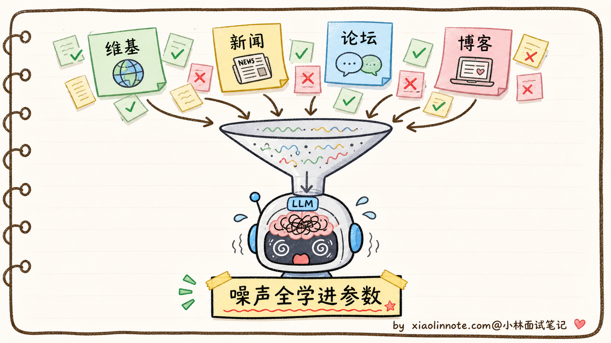

但要注意，**训练数据问题只是冰山一角**。即使数据 100% 正确干净，模型还是会幻觉。下面是更深层的根因。

#### 根因二：生成机制是「续写」不是「查询」

这是幻觉最深的根因，也是面试里最容易问倒人的地方。

LLM 的本质训练目标通常包含 **next-token prediction**：给定上下文，模型输出下一个 token 的 logits/概率分布，再由解码器逐步生成。这个概率过程本身不等于事实查询或证明系统。

这里有一个被很多人忽略的事实：**模型对「自己知不知道某件事」根本没有显式信号**。

你问「鲁迅是谁的笔名？」，模型的处理流程不是「查一下知识库 -> 找到周树人 -> 输出周树人」，而是根据参数和上下文计算下一个 token 的分布。若知识过时、冲突、粒度不足或上下文触发了相似但错误的模式，模型就可能续出听起来合理但错误的答案；不能把记忆次数或某个 token 概率简单等同于事实置信度。

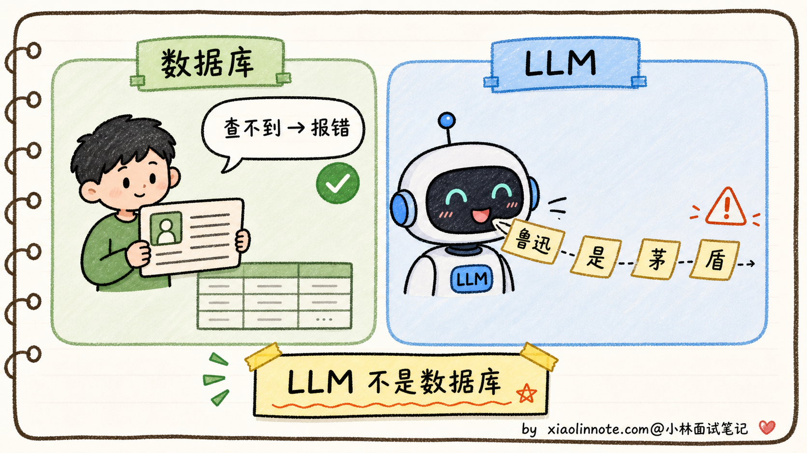

模型这种「永远会输出点什么」的特性带来一个反直觉的结果：**Temperature=0 也会幻觉**。

为什么？许多 API 的 `Temperature=0` 会近似采用贪心，但具体后端语义可能不同。即使选到最高 logit，“最可能”也不等于“事实正确”；错误可以稳定地重复输出。

这就是为什么把温度调低不能根除幻觉。**温度只能减少「同一个错误重复出现的随机性」，不能修正「错误本身」**。模型记错了就是记错了，温度调低反而让错误答案更稳定地输出。

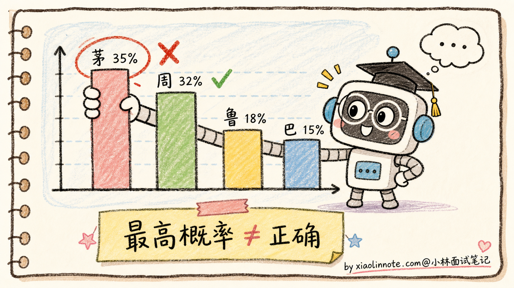

更进一步的是「**参数化知识 vs 检索式知识**」的对比。

LLM 的大量知识以分布式方式编码在参数中（参数化知识），这种存储方式是：

- **模糊的**：知识不是 key-value 存的，是分布式编码在权重里的，记得多准取决于训练时见过多少次
- **不可检索的**：模型自己不知道某条知识在哪几个权重里
- **不可验证的**：模型输出一个事实时，没法回过头标「这条来自训练数据的某段」

而 RAG（Retrieval-Augmented Generation，检索增强生成）把检索到的证据放入上下文。它可以提供出处和“无结果”路径，但检索错、文档过期、上下文冲突或模型误读时仍会产生幻觉；“有引用”也不自动等于“被引用内容支持结论”。


#### 根因三：对齐目标的副作用

第三层根因更隐蔽：**某些对齐数据和评分偏好可能奖励流畅、完整的回答，却没有充分奖励校准的不确定性**。

什么意思？SFT 的训练数据是（指令，期望回答）对，但绝大多数标注员写期望回答时，都会写「自信、详细、专业」的回答，很少写「我不知道」。结果是模型学到了「碰到问题就要给出详细回答」的行为模式，根本没学过「碰到不会的就拒答」。

如果偏好标注没有可靠事实核验，详细、自信的错误回答可能被误选；这不是所有 RLHF 流程的必然结果，而是数据与奖励设计风险。

奖励模型可能把流畅度、详尽度等表面特征当作质量代理，导致过度自信或拒答校准不足；因此需要不确定性、事实性和安全切片评测，不能直接断言某个训练流程一定造成“永远不拒答”。


相关研究讨论过「**Calibrated Refusal（校准的拒答）**」：让模型在证据不足时表达不确定并请求核验。至于具体产品的训练配方，公开资料通常不足以还原内部流程，不能把某篇论文直接等同于某个产品。

到这里，三个根因层面都讲完了：训练数据有噪声、生成机制是「续写不是查询」、对齐目标鼓励「不拒答」。下面看看具体能产生哪些类型的幻觉。

#### 三类幻觉的典型表现

工程上可以按错误来源把幻觉分为几类；不同论文的 taxonomy 不完全一致：

**1. 事实性幻觉（Factual Hallucination）**

模型编造不存在的事实，或把已知事实张冠李戴。最常见、最容易被识破：

- 编造不存在的人物（「李白曾担任唐朝丞相」）
- 编造不存在的论文（「Zhang et al. 2019 在 Nature 发表」）
- 时间错误（把发生在 2010 年的事说成 2015 年）
- 地理错误（「乌克兰的首都是莫斯科」）

**2. 推理性幻觉（Reasoning Hallucination）**

事实层面没问题，但推理过程错乱、前后矛盾、逻辑跳跃。在数学题、代码题里尤其常见：

- 数学题前面算对了，后面突然算错
- 代码生成里前半段定义了变量 x，后半段引用了从来没定义过的 y
- 推理链断了一步，最后结论强行得出

**3. 上下文不一致（Faithfulness Hallucination）**

最隐蔽的一类，不违反客观事实，但**违反用户在 Prompt 里给的明确条件**：

- 用户说「我已经吃饱了」，模型还推荐你去吃饭
- 用户给了一段文档说「请只根据下面的资料回答」，模型答的是它自己脑袋里的知识，不是文档里的
- 系统 Prompt 写了「不要泄露内部信息」，模型还是把内部 Prompt 复述了出来


理解了根因和分类，缓解方案就有了对症下药的落点。下面分三层来看。


#### 缓解方案：训练层

最根本的缓解办法是在训练阶段就教会模型「不知道就说不知道」。具体有几种做法：

**1. 在 SFT 数据里加入大量「拒答样例」**

主动加入证据不足时的澄清、拒答和引用核验样例，让模型学到“拒答/澄清也可能是合格行为”；具体产品是否大量采用某种数据配方，不应臆断。

**2. 校准（Calibration）训练**

用专门的偏好数据，让标注员对「正确且自信」「错误但谨慎」「错误且自信」打分，让奖励模型学到「错误且自信」要严厉扣分。这样训出来的模型会主动避免「自信地说错话」。

**3. 用奖励模型筛掉幻觉回答**

收集模型回答，用可核验来源、程序规则或人工进行事实核查，把错误和证据不足的回答纳入负样本/偏好数据；不要把这一通用策略直接归因于某个厂商的特定训练流程。


训练层缓解的优点是治本，但代价是训练成本高，且效果上限受训练数据质量限制。所以工程上还需要推理层和系统层的辅助。

#### 缓解方案：推理层

推理层缓解不需要改模型，只需要在推理时调整解码行为或提示工程：

**1. CoT（链式思考）暴露推理错误**

让模型先做分步分析，再给出最终结论。这样模型更不容易跳步，最终答案错的时候也更容易通过简要依据追溯问题。对外产品里不一定展示完整 CoT，可以展示关键推理步骤或检查结果。CoT 对推理性幻觉有帮助，但不能保证一定正确。

**2. Temperature 调低**

虽然前面说过低温不能根除幻觉，但降低随机性有时能减少采样波动；它也可能让错误更稳定。温度范围不是“事实问答标配”，应按模型/API 行为和业务验证集调参。

**3. Self-Consistency 多次采样投票**

对同一个问题，在预算内采样多次，再对可比较的最终答案投票或交给验证器。正确路径可能更容易收敛，但共享偏差也会造成一致错误；采样数、温度和收益应通过任务集评估。

**4. 约束解码（Constrained Decoding）**

如果输出格式有严格约束（比如 JSON、SQL、特定 schema），可用结构化输出/约束解码并在服务端再次解析校验，降低格式错误；约束格式不等于保证事实正确，也不是所有框架/模型/流式模式都支持同样的约束。


推理层缓解的优点是不改模型、可以即插即用，缺点是上限有限，对「模型记忆模糊」这种根本问题没办法。

#### 缓解方案：系统层

系统层缓解是最工程化的方案，把 LLM 当成「会犯错的组件」，外面加防护栏：

**1. RAG：让模型「看着资料答」**

RAG 是常用的系统层方案：生成前检索相关资料，把证据放进上下文并要求按证据回答。它能改善有可靠知识源的事实问答，但效果取决于召回、排序、文档版本、上下文长度、提示约束和引用校验，不保证减少固定比例，也不适合替代所有推理或权限判断。

**2. 后处理事实核查（Fact-Checking）**

模型输出后，用另一个 LLM 或者检索系统去核查里面提到的事实声明。比如模型说「Smith et al. 2018 在 Nature 发表了 X」，后处理系统去 PubMed 查这篇论文是否存在。如果核查不过，把这部分内容标红或删掉。

**3. 强制带引用来源**

在 Prompt/输出 schema 中要求事实声明关联检索证据，并由服务端检查引用是否真的支持声明；用户可点击核验。引用应来自可信、权限正确且版本明确的来源，不能把“带编号”当作事实保证。


系统层缓解的优点是工程上最有效、可观测、可追溯，缺点是引入了额外的延迟和系统复杂度。但对企业级应用来说，几乎是必选项。

#### 工程实践：为什么幻觉不可能完全消除

最后讲一个面试里很容易加分的点：**幻觉永远不会被「彻底消灭」**。

原因回到最开始那句话，**LLM 的本质是按概率续写下一个 token**，这个机制天然就带着「会编」的可能性。无论你再怎么对齐、怎么 RAG、怎么核查，只要模型还是按概率生成的，就一定有概率生成错误内容。

工程上现实的目标是：

- **降低发生率**（从 30% 降到 5% 是巨大的胜利）
- **让用户能识别**（带引用、加可信度标记、对不确定回答主动声明）
- **限定使用场景**（高风险场景如医疗、法律必须有人类把关）


讲到这里，能在面试里说出「幻觉不可能消除，工程目标是降低发生率 + 让用户识别」这句话，就比绝大多数候选人深刻一个层次了。这个认知背后是「LLM 的概率本质」，是面试官想听到的。

### 🎯 面试总结

回到开头那段对话，问到大模型为什么会出现幻觉、怎么缓解，最重要的是先讲清楚**幻觉的定义和元根源**。幻觉不是简单的「模型出错」，而是「生成了流畅合理但实际错误的内容」。元根源是 **LLM 不是数据库，是续写器**，它的全部使命就是按概率输出下一个 token，没有「查询失败」这个状态，永远会输出点什么。这一句先讲到，就把幻觉的本质点出来了。

接下来讲**三个具体根因**。训练数据本身有错（互联网语料里有噪声、矛盾、过时信息）；生成机制是「续写不是查询」（参数化记忆模糊，所以 Temperature=0 也会幻觉）；对齐目标的副作用（RLHF 训练时人类标注偏好「自信回答」，模型被无形训练成「不会拒答」）。这三层根因层层递进，**第二层和第三层是面试里能加分的关键**，能讲出来比一般候选人深刻。

然后讲**缓解方案分三层组合用**。训练层（拒答数据增强、Calibration 校准、奖励模型筛幻觉），推理层（分步分析、温度调低、Self-Consistency、约束解码），系统层（RAG、事实核查、强制带引用）。每一层都不是银弹，工业级应用通常组合用。这里不要硬说某个闭源模型具体用了哪几招，公开资料没写的就保持谨慎。

最关键的一句话是：**幻觉不可能完全消除，因为它是 LLM 概率生成机制的固有产物**。工程目标是「降低发生率 + 让用户能识别」，不是「彻底消灭」。能讲到这一层，面试官就知道你不是在背工具，是真的理解 LLM 的本质。

---

## KV Cache 是什么？Prompt Caching 的原理是什么？

👔面试官：来讲讲什么是 KV Cache？Prompt Caching 又是怎么回事？这两个有什么关系？

🙋‍♂️我：KV Cache 是 Transformer 里的一个东西，存的是 K 和 V 矩阵。Prompt Caching 是 Claude 的一个 API 功能，能减少 token 费用。

👔面试官：……你只说了表面。KV Cache 具体是缓存什么、为了解决什么问题？为什么自回归生成必须要 KV Cache？没有 KV Cache 推理速度会变成什么样？

🙋‍♂️我：哦哦，因为每次生成新 token 都要重新计算前面所有 token 的 attention，KV Cache 就是把前面算过的存起来。

👔面试官：对了一半。那 Prompt Caching 和 KV Cache 是同一个东西吗？两者具体什么关系？为什么 OpenAI、Anthropic 都把 Prompt Caching 作为新功能大力推广？

🙋‍♂️我：呃……KV Cache 是模型内部的，Prompt Caching 是 API 层面的？

👔面试官：方向对，但具体差别能讲清楚吗？KV Cache 是「**单次推理内**」的优化（同一次生成的不同 token 之间复用），Prompt Caching 是「**跨请求**」的优化（不同请求之间复用相同前缀）。这两个是同一个底层机制在不同时间尺度上的应用，没搞清楚这层关系，就讲不出 Prompt Caching 的真正价值。

把这几个反问串起来其实就一句话，KV Cache 和 Prompt Caching 是**同一套缓存思路在两个时间尺度上的延伸**，前者是单次推理内的、后者是跨请求的。理解这一层，省钱和加速到底怎么发生的就清楚了。

### 💡 简要回答

我理解 KV Cache 和 Prompt Caching 是同一个机制在两个时间尺度上的应用。

**KV Cache** 是「**单次推理内**」的优化。自回归生成时，过去 token 的 K/V 在因果注意力下不会因为未来 token 改变；缓存它们就能避免重复计算。若用完全朴素的“每一步重跑整段序列”实现，注意力相关总成本会随序列长度快速增长；带 KV Cache 后，生成阶段每步只为新 token 计算投影，再读取历史 K/V，具体复杂度还取决于层、头、实现和 prefill/decode 划分。

**Prompt Caching** 是「**跨请求**」的优化。服务商可能缓存可复用的前缀表示、prefill 中间结果或 KV 状态；如果两个请求的可缓存前缀满足其匹配规则，后一个请求可以少做前缀计算。它不一定把一份裸 KV 张量永久暴露或直接复用，具体实现、TTL、隔离和计费由供应商决定。

价值上的区别：

- **KV Cache** 解决的是「**让自回归生成可行**」，是 Transformer 推理的基本盘
- **Prompt Caching** 解决的是「**降低重复前缀的计算/输入成本和延迟**」，是工程层面的 ROI 优化。不同厂商、模型版本和区域的命中条件、计费、TTL 与折扣不同，应以当前价格和接口文档为准；延迟收益也取决于前缀长度、命中率、服务端负载和网络。

最关键的认知是，**Prompt Caching 不是新发明，是 KV Cache 这个底层机制的工程级延伸**。理解了 KV Cache，Prompt Caching 几乎是自然推论。

实际工程使用 Prompt Caching 的核心要点是：**稳定、可共享且权限一致的内容在前，动态内容在后**；很多实现要求前缀按 token/请求结构匹配，但具体规范可能允许不同的规范化或断点规则，不能把“差一个字符必 miss”当成所有平台的定律。

### 📝 详细解析

#### 自回归生成里隐藏的低效问题

要理解 KV Cache，得先看清楚自回归生成本身的低效在哪里。

LLM 是自回归生成的，每次只产出一个新 token，把它拼到序列末尾，再让模型对**整个新序列**重新计算一遍 attention，得到下一个 token。听起来很自然，但隐藏着一个巨大的浪费。

假设要生成 10 个 token，朴素实现的过程是：

```
第 1 步：输入 [P]（Prompt），算 attention，输出 token 1
第 2 步：输入 [P, t1]，算 attention，输出 token 2
第 3 步：输入 [P, t1, t2]，算 attention，输出 token 3
...
第 10 步：输入 [P, t1, t2, ..., t9]，算 attention，输出 token 10
```

每一步都把前面所有 token 重新算一遍 attention，包括 P 这个长 Prompt（可能几千 tokens）。


在完全朴素、每步重算整段序列的实现中，注意力矩阵的重复计算会产生近似立方级的累计项；这是说明“为什么要缓存”的直觉模型，不应拿它替代真实框架的 profile。实际服务会区分 prefill、decode、投影、访存和批处理。

注意一件事：**第 2 步算的「P」的 attention，和第 1 步算的「P」的 attention 是完全一样的**（因为输入和模型参数都没变）。每一步重算前缀，是纯粹的浪费。

KV Cache 就是为了消除这个浪费而生的。

#### KV Cache：单次推理内的优化

KV Cache 的核心思路一句话：**把前面所有 token 的 K 和 V 矩阵缓存起来，每次新 token 只算自己的部分**。

具体怎么做？要先回到 attention 公式：

```
Attention(Q, K, V) = softmax(Q · K^T / √d_k) · V
```

注意这里：

- 新 token 只是一个 Q（它在「问」前面所有 token）
- 它做点积的对象 K^T 和加权求和的对象 V，**都来自前面所有 token**
- 但前面所有 token 的 K 和 V 是**固定的**，不会随新 token 而变（因为 K 和 V 是从已有 token 的 embedding 算的，新 token 不影响它们）

所以**前面所有 token 的 K 和 V 完全可以缓存**，每次只算新 token 自己的 Q、K、V，然后跟缓存的 K/V 拼起来做 attention。


工作流程详细看：

```python
# 朴素实现（无 KV Cache）
for step in range(max_tokens):
    K_all, V_all = model.compute_KV(全部已有 token)  # 重复算前面的
    Q_new = model.compute_Q(全部已有 token)
    attention_out = softmax(Q_new @ K_all.T / sqrt(d_k)) @ V_all
    next_token = sample(attention_out[-1])

# 带 KV Cache 的实现
kv_cache = []
for step in range(max_tokens):
    if step == 0:
        # 首次：处理整个 Prompt，把 K/V 全部缓存
        K, V = model.compute_KV(prompt_tokens)
        kv_cache.append((K, V))
    else:
        # 后续：只算新 token 的 Q、K、V（以下为伪代码）
        K_new, V_new = model.compute_KV([new_token])
        kv_cache.append((K_new, V_new))
    
    Q_new = model.compute_Q([current_token])
    K_all = concat(kv_cache.K)  # 缓存里取出来用
    V_all = concat(kv_cache.V)
    attention_out = softmax(Q_new @ K_all.T / sqrt(d_k)) @ V_all
    next_token = sample(attention_out)
```

关键变化：每一步只算 1 个 token 的 K/V（O(1) 工作量），而不是 N 个 token（O(N) 工作量）。总计算量：

| 实现 | 第 i 步开销 | N 步总开销 |
| --- | --- | --- |
| 朴素重算（注意力部分的直觉模型） | 随历史长度快速增长 | 近似立方级累计项 |
| 带 KV Cache（decode 注意力部分） | 读取历史 K/V，随历史长度增长 | 近似平方级累计项 |


KV Cache 是自回归 decode 的关键优化，但在调试、特殊内存约束或某些模型路径中也可能被关闭或不适用；生产框架通常提供并默认利用它，具体行为以实现为准。

#### KV Cache 的显存代价

KV Cache 让计算速度大幅提升，但代价是显存占用。前面所有 token 的 K/V 都要常驻显存，长上下文下这是个不小的负担。

KV Cache 显存大小可以粗略写成（按实际 KV head 数和缓存精度计算）：

```
KV Cache 显存 ≈ 2（K 和 V）× B × N × L × H_kv（KV 头数）× d_k × 每元素字节数
```

以某个采用 L=32、H_kv=32、d_k=128 的模型配置为例，batch=1、N=32K 且使用 FP16 时：

```
2 × 1 × 32000 × 32 × 32 × 128 × 2 ≈ 17 GB
```

该数量级的 KV Cache 约为 17GB；再加权重、运行时和激活后，是否能放入某张 GPU 必须看实际模型、量化、上下文和框架开销，不能从“7B”三个字符推出固定结论。


这就是为什么大模型部署有一系列围绕 KV Cache 的优化（PagedAttention、KV Cache 量化、MQA/GQA 共享 K/V 等），目标都是把 KV Cache 显存压下来。这些优化是另一个层面的话题，本节不展开，只需要知道 **KV Cache 的显存压力是 LLM 工程的核心议题之一**。

#### 从 KV Cache 到 Prompt Caching：同一机制的扩展

到这里，KV Cache 解决的是「**单次生成内**」的重复计算问题。但还有一个更隐蔽的浪费：**不同请求之间的重复计算**。

考虑一个场景：客服系统的稳定 System Prompt、规则和示例占据很长前缀，许多请求重复使用它们。如果每次都从零做 prefill，就会重复消耗前缀计算；是否值得缓存取决于重复率、前缀长度、并发、TTL、价格和数据隔离。


Prompt Caching 的核心思路就是：**把 KV Cache 的复用范围从「单次推理内」扩展到「不同请求之间」**。

具体机制：

- 服务端维护可复用的前缀状态或中间结果，并按 token 序列、断点或内部键匹配
- 首个请求先计算并按策略写入缓存，缓存可能位于 GPU、CPU、分布式内存或供应商内部层
- 后续请求若满足匹配、模型版本、权限和租户条件，就少做前缀计算，再处理动态部分

从抽象上看，这是把“复用已计算前缀”从单次请求扩展到跨请求；底层可能复用 KV，也可能复用更高层的 prefill 结果，因此不要把所有 Prompt Caching 都等同于客户端可见的 KV 张量池。

#### 主流 API 的 Prompt Caching 实现

不同的 API 厂商对 Prompt Caching 的实现方式不太一样，主要分两派。

**某些供应商：显式标记缓存断点**

一种常见做法是让调用方在希望缓存的内容末尾加一个 `cache_control` 或类似断点标记；具体字段、模型支持和失效规则需以当前 API 文档为准：

```python
import anthropic
client = anthropic.Anthropic()

# System Prompt 带缓存断点：把「到这里为止的内容」标记为可缓存
SYSTEM_WITH_CACHE = [
    {
        "type": "text",
        "text": "你是一位专业的劳动法顾问。\n\n以下是完整的《劳动合同法》条文：\n\n[数千字的法律条文内容...]",
        "cache_control": {"type": "ephemeral"}  # 断点：这份法律条文会被缓存
    }
]

# 第一次请求：建立缓存（是否有写入费用、如何计费以当前文档为准）
response1 = client.messages.create(
    model="你的 Claude 模型 ID",
    max_tokens=512,
    system=SYSTEM_WITH_CACHE,
    messages=[{"role": "user", "content": "员工试用期最长可以是多久？"}]
)

# 第二次请求：满足供应商匹配规则时可能命中缓存（折扣与计费以当前文档为准）
response2 = client.messages.create(
    model="你的 Claude 模型 ID",
    max_tokens=512,
    system=SYSTEM_WITH_CACHE,
    messages=[{"role": "user", "content": "劳动合同必须包含哪些必备条款？"}]
)
```

显式标记的好处是用户清楚控制哪些内容缓存、哪些不缓存。代价是要改代码、加配置。

**另一类实现：自动或半自动缓存**

有些 API 会对满足最小长度和前缀匹配条件的请求自动尝试缓存，并在响应或用量信息中返回命中情况；阈值、可缓存字段、模型范围和可观测字段会随版本变化。

自动缓存的好处是开发者不用改代码就能享受到，缺点是控制粒度不如显式标记精细。


**价格优势**：

计费优势需要根据当前供应商、模型、区域、缓存写入/读取价格和 TTL 计算；写入成本、最小缓存长度、命中折扣和未命中回退都可能不同。只有在真实命中率和请求量下做账单模拟，才能判断是否省钱。

延迟优势：命中缓存时首 token 延迟通常会下降，因为 Prompt 部分不用重算了。具体能降多少，要看缓存前缀长度、模型、并发和服务端调度，工程上要用真实链路压测。

#### 适合用 Prompt Caching 的场景

Prompt Caching 最适合「**前面固定、后面变化**」的使用模式，三类典型场景：

**场景 1：固定 System Prompt 的应用**

客服系统、AI 助手、代码 Review 工具，System Prompt 包含大量产品知识、规则说明、Few-shot 示例。用户每次发消息，System Prompt 都是固定的，可以一直命中缓存。这是最常见、收益最大的场景。

**场景 2：基于同一份长文档的多次问答**

比如「把合同文本放进 Prompt，然后问 10 个不同的问题」。第一次问问题时建立缓存，后续 9 次都命中缓存，节省了大量重复处理文档的成本。法律 AI、金融 AI、医疗 AI 这种场景特别多。

**场景 3：大量 Few-shot 示例**

如果你的 Prompt 里有 10-20 组 Few-shot 示例（用于引导模型输出特定格式），这部分内容非常适合缓存。每次用户的实际问题不同，但 Few-shot 部分一样。


#### 工程陷阱：固定内容在前、动态内容在后

Prompt Caching 听起来很美，但实战中有一个最常见的陷阱：**前缀必须完全一致才能命中缓存，哪怕多了一个空格、改了一个字符，就算缓存 miss、重新计算**。

最经常踩的雷是把日期、用户名这类动态内容放在固定内容**前面**：

❌ **会让缓存失效的结构（动态内容在前）：**

```
今天是 2026-03-07，当前用户：张三

[数千字的系统提示 + 产品知识库]
← cache_control 断点

用户问题：我想退换货
```

问题：日期和用户名每次都不同，导致整个前缀每次都变了，缓存永远 miss。每次还是要从零开始算几千字的系统提示。

✅ **正确结构（固定内容在前，动态内容在后）：**

```
[数千字的系统提示 + 产品知识库]
← cache_control 断点放这里

今天是 2026-03-07，当前用户：张三
用户问题：我想退换货
```

把所有固定内容集中到断点之前，动态内容放在断点之后。前缀稳定不变，每次都能命中缓存。


第二个常见陷阱是**缓存的时效性**。缓存通常有供应商定义的 TTL、容量淘汰或显式失效规则；不要把某个平台某个版本的分钟数当成通用事实。这意味着：

- 高重复率应用更可能摊薄写入/预热成本
- 低流量应用可能频繁失效，命中不足，甚至不如直接 prefill

如果你的应用是低流量场景，Prompt Caching 的收益可能不如预期；应按当前价目、命中率、延迟和数据存储风险评估。

还要把安全边界纳入缓存键：不同租户、用户权限、工具授权、文档版本、模型版本和地域策略不能共享同一份前缀状态。缓存内容可能包含敏感 prompt 或个人数据，应有访问控制、加密、审计、TTL、删除和绕过策略；否则“命中缓存”可能变成跨用户泄露。

#### 进阶：KV Cache 量化与 PagedAttention

最后简单提两个 KV Cache 的进阶优化方向，作为面试加分项。

**KV Cache 量化**：把 KV Cache 用更低精度存储以降低显存和带宽，但误差、支持范围和质量影响依赖模型/框架，应按任务回归测试；不必背固定“减半到四分之一”或年份判断。

**PagedAttention**：一种借鉴分页思想管理 KV Cache 的实现。请求通过逻辑 Block 映射到物理存储，以减少连续预分配造成的浪费并支持复用；Block 大小、利用率和吞吐收益由版本、模型和负载决定，不能承诺消除全部碎片或达到固定百分比。


这两个方向的具体细节是另一个层面的话题，但能在面试里提一句，会显示你对 KV Cache 这个核心机制有深入跟进。

### 🎯 面试总结

回到开头那段对话，问到 KV Cache 和 Prompt Caching，最重要的是先把**核心关系**讲清楚：这两个不是不相关的优化，是**同一个底层机制在两个时间尺度上的应用**。KV Cache 是「单次推理内」的优化（同一次生成里不同 token 之间复用），Prompt Caching 是「跨请求」的优化（不同请求之间复用相同前缀）。这一句话能讲清楚，就已经比绝大多数候选人深刻了。

接下来把 KV Cache 的来龙去脉讲明白：朴素重算会重复处理历史 token，KV Cache 让 decode 阶段复用过去的 K/V，复杂度和性能收益要按 prefill/decode、访存和 batch 分析。它是常见关键优化，但具体是否开启、如何分页/量化由框架实现决定。

然后讲 Prompt Caching 的工程价值。把 KV Cache 复用范围扩展到不同请求之间，让 N 个用户共用一个 System Prompt 的 KV Cache。Claude 用显式断点（cache_control），OpenAI 用自动缓存，本质都是同一个机制，只是触发方式和计费规则不同。面试里说「能显著降低重复前缀成本和首 token 延迟」就够稳，不要把某一家价格比例说成全行业通用。

最关键的一句话是讲清**工程陷阱**：稳定且权限一致的内容放前，动态内容放后，并按供应商规则监控命中/未命中。日期、用户名、权限和随机 ID 放入可缓存前缀可能降低命中，跨租户共享还会造成泄露；低流量应用也可能因 TTL、写入成本和命中不足而不划算。

如果还想再加分，可以提一句 KV Cache 量化和 PagedAttention 这种进阶优化方向，让面试官知道你对这个核心机制有持续跟进。能讲到这一层，已经是面试里很难追问的水平了。

---

## 大模型是怎么训练出来的？

👔面试官：来讲讲大模型是怎么训练出来的？

🙋‍♂️我：训练就是给模型喂大量数据让它学习，最后能回答各种问题。

👔面试官：……「喂大量数据」具体喂什么？数据从哪来？训练目标是什么？为什么训完一次就能回答问题？

🙋‍♂️我：哦哦，应该是给它 prompt 和答案对，让它学会回答？

👔面试官：你说的是 SFT 阶段，但常见流程还包括基础预训练、继续预训练/领域适配、指令微调和偏好/安全后训练。它们的目标、数据和是否必需并不相同，你能讲清楚各自解决什么问题、何时可以省略或替换吗？

🙋‍♂️我：呃……三个阶段我大概知道有，但具体差别讲不清楚。

👔面试官：典型的「知道有但讲不清」。预训练主要获得通用表示和生成能力，SFT 让模型学习指令/任务格式，偏好与安全后训练改变行为选择；这些是常见模块，不是固定且不可替代的三段流水线。回去把边界和替代方案搞清楚再来。

到这里我才老实了，训练大模型真不是「喂数据」三个字。常见主线可以画成「基础训练 → 任务/指令适配 → 偏好、安全与能力后训练」，但实际项目可能加入继续预训练、蒸馏、拒绝采样、可验证奖励或跳过某些模块。把每一段的目标、数据和评测拆开讲，整条主线才立得起来。

### 💡 简要回答

大模型训练通常包含几个功能层次：基础训练以自回归/掩码等目标学习语言和表示；继续预训练可让模型适应新领域；SFT/指令微调学习任务格式；偏好、安全或可验证后训练改变输出选择。它们可以用不同损失、数据和参数高效方法实现，是否全部采用取决于模型目标。预训练影响通用能力上限，但后训练也可能改变能力、知识与工具使用行为，不能把它们简化为固定“天花板/格式/价值观”三段。

### 📝 详细解析

#### 先理一个直觉：训练大模型为什么要分阶段？

很多人第一次听说「大模型训练分三个阶段」会很困惑，为什么不能一次性训完？为什么要分这么麻烦？

要回答这个问题，先做个类比。培养一个能在公司独当一面的员工，至少要经过三件事。

他得先**有基础知识**，从小学读到大学，掌握语言、数学、逻辑、各种学科常识。没有这个基础，进了公司啥也干不了。然后他得**会公司的流程**，哪怕他知识再渊博，进了公司也不知道「怎么写汇报邮件、怎么和客户对话、怎么提交工单」。这些不是知识问题，是「适配工作场景」的问题。最后他得**懂职业素养**，知道该说什么、不该说什么、什么时候要谦虚、什么时候要拒绝不合理要求。这些不是技能问题，是「价值观和分寸感」的问题。

大模型的常见训练模块可以类比为这三件事，但模块不是固定顺序或不可替代：预训练获得基础能力，SFT/指令适配学习交互格式，偏好/安全后训练改变行为选择；继续预训练、蒸馏、拒绝采样或可验证奖励也可能加入。


有了这个类比打底，下面分别看每个阶段具体在做什么。

#### 第一阶段：预训练，读万卷书

预训练是大模型能力的根基，所有上层能力都从这里来。

**数据从哪来？**

预训练数据规模通常很大，但具体 token 数、数据配比和清洗方法随模型版本、公开口径与去重规则变化，不能用某两个模型的数字代表行业标准。

数据来源可能包括经过授权/许可的网页、代码、书籍、论文、新闻、对话或合成数据；“能爬到的所有公开文本”不等于可以合法或高质量地训练，还要考虑版权、隐私、地域、毒性和许可证。

原始数据通常需要去重、质量过滤、语言识别、PII/版权与安全处理、数据混合和污染审计；清洗成本和重要性很高，但不能用“必然比训练贵”或“核心竞争力”作无证据断言。


**训练目标长什么样？**

这一点其实很反直觉。你猜大模型的训练目标是什么？是「回答正确率」？还是「写得通不通顺」？都不是，是一个看起来简单到让人怀疑的任务，**预测下一个 token**。

学术上叫 CLM（Causal Language Modeling，因果语言模型）。每条训练样本就是「给前 N 个 token，预测第 N+1 个 token」，对整个语料库做这件事，反复调整模型参数让它的预测越来越准。

「预测下一个 token」是一个简单的训练目标，但它会促使模型学习能降低损失的语言、模式和部分知识表示；不能由此严格推出模型具有人类式理解、可靠事实记忆或通用推理。

举几个例子你就明白了。要预测「北京是中国的____」，数据中可能提供与首都相关的模式；要预测代码、公式或诗句，模型也会学习相应的统计结构。但这些现象不等于模型必然拥有可靠事实、算术或人类式理解，仍需针对任务评测。


因此，简单目标配合大规模数据、模型容量、优化和后训练，可能产生跨任务能力；“涌现”是否真正离散出现、能力来源如何分解，在研究中仍需具体定义和测量。

**计算开销有多大？**

预训练通常需要大规模 GPU/TPU、数据管线、分布式训练和多轮失败重试；公开论文中的 FLOPs、卡数、训练时间和成本受估算口径影响，面试回答应说明“量级与依赖因素”，不要背一组固定数字。

预训练完之后，模型获得了语言建模能力和参数化模式，但它更接近通用续写器；是否能直接按指令回答，取决于训练数据、模板和模型本身。指令适配通常会改善交互格式，但不创造可靠事实或安全授权。

#### 第二阶段：SFT，从「续写机器」变「对话机器」

预训练后的模型本质上是一个「文本续写机器」。

什么意思？你给它一段文字，它会继续往下写，但**不真的理解你在「问问题」**。打个比方，你问它「天空为什么是蓝色的？」，它可能续写成「天空为什么是蓝色的？这是个有趣的科学问题。今天天气不错，让我们看看……」一直发散下去，根本没在回答你。


SFT 的目的就是把这个「续写机器」改造成「对话机器」。

它怎么做？训练数据格式变了，从「连续文本」变成「(指令，期望回答) 对」，比如这种格式：

```
指令：请用简单易懂的语言解释为什么天空是蓝色的
回答：天空呈现蓝色是因为大气中的散射现象。太阳光包含所有颜色，
当光进入大气层时，氮气和氧气分子会将短波长的蓝光散射到各个方向，
而长波长的红光穿透能力更强，散射较少。所以我们从任何方向看天空，
都能看到散射来的蓝光。
```

模型在这种数据上继续训练，慢慢学会「啊，看到这种格式我就该给一个完整答案，不要无限续写下去」。这就是从「续写模式」切换到「对话模式」的关键。

数据质量比数量更重要。公开技术报告可能披露某些模型的 SFT 数据规模，但数据定义、筛选和配比不能直接横向比较。小而高质量的数据集有时能胜过大而嘈杂的数据集，具体收益需要按任务和验证集测量；因此工业界会同时关注覆盖、去重、难例和标注一致性。

数据多样性也很关键，不能只覆盖一种任务。一份合格的 SFT 数据集会涵盖问答、写作、代码、角色扮演、数学推理、翻译等各种场景。覆盖面不够的话，模型在没见过的任务上就会表现拉胯。

SFT 之后，模型已经会按指令回答问题了。但它的回答方式不一定是你喜欢的，可能太啰嗦、太简洁、或者偶尔说出一些不该说的话。这就需要第三阶段。

#### 第三阶段：对齐，学会「好好说话」

对齐（Alignment）的目标是让模型的行为更符合人类的价值观和偏好。

举个例子。同一个问题「怎么学好 Python」，可以有很多种「合格」的回答。有的简洁、有的详细、有的带代码示例、有的纯文字、有的承认「我不熟悉这块」、有的硬装专家胡说。SFT 只教会了模型「这种格式叫合格回答」，但没告诉它「哪种回答用户更喜欢」。对齐就是补这一课。

对齐的一条经典路线是 **RLHF**（Reinforcement Learning from Human Feedback，基于人类反馈的强化学习）；InstructGPT 让这条路线广为人知，但偏好对齐也可以使用 DPO、拒绝采样、可验证奖励、规则或其他后训练方法。

它的流程是这样的。先让人类标注员对同一个问题的多个回答做排序（A 比 B 好、B 比 C 好），收集大量这种「偏好排序」数据。然后用这些数据训一个独立的「奖励模型」，让它学会自动给回答打分（代替人类，因为人类标注太慢太贵）。最后用强化学习算法（PPO）调整大模型的参数，让它生成的回答尽量得高分。


RLHF 流程可能较长，需要偏好数据、奖励/价值估计、在线采样和安全评测；奖励模型可能被“钻空子”（reward hacking），所以要用人工、程序验证和业务指标交叉检查。具体难度取决于实现与资源，不能用“只有极少团队能做”概括。

后来出现了 **DPO**（Direct Preference Optimization，直接偏好优化）等离线偏好方法。DPO 在特定参考策略、奖励和 KL 假设下把目标写成偏好损失，通常不需要显式奖励模型或 PPO 在线循环；这不是任意 RLHF 的无条件等价替代。它直接使用（问题、chosen、rejected）偏好对，但仍需防止偏好噪声、过拟合和能力回退。

DPO 可用标准训练框架实现，许多开源模型会把它或其他偏好方法作为候选，但训练稳定性和效果仍需实测。不同模型的公开技术报告可能采用 SFT、拒绝采样、PPO/RLHF 或多阶段 post-training；面试时应引用对应报告，不能按模型家族臆断训练配方。

到这里，常见模块的目标都讲完了。最后回头看一遍，理解哪些是基础能力、哪些是产品目标和风险要求。

#### 常见训练模块如何形成因果链

如果只做基础预训练，模型可能更偏续写范式，指令遵循和对话格式未必稳定；但部分预训练模型也能通过提示模板完成一定的问答，具体行为不能一概而论。SFT/指令适配的价值是把目标任务、角色和输出格式写进训练分布。

如果只做预训练加 SFT，不做额外的偏好/安全后训练，模型可能缺少产品需要的拒答、风格、偏好和风险控制；但安全并不只靠训练，还需要系统权限、内容策略、监控和人工处置。

如果没有可用的基础模型，单独用少量 SFT/偏好数据很难获得通用语言能力；但实践也可能从已有基座、继续预训练、蒸馏或专用模型开始。预训练影响通用能力的重要上限，后训练同样会改变能力、行为和工具使用，不能把它们只说成“在天花板内调格式”。


理解了这一点，再看模型竞争就清楚了：数据许可与质量、算力与分布式工程、模型设计、后训练数据、评测闭环和产品反馈都会影响结果。对闭源公司的内部训练配方和“最大护城河”不要仅凭外部产品表现推断。

### 🎯 面试总结

回到开头那段对话，问到「大模型是怎么训练出来的」，最关键的是把各训练模块的因果关系讲清楚，而不是只会背“固定三阶段”。

预训练/继续预训练提供语言建模和领域表示，常见目标是预测下一个 token，但数据、模型和优化共同决定学到什么。它通常是最昂贵的阶段之一，具体卡数、时间和成本应以项目预算和公开报告为准。

SFT/指令适配把任务示例、角色和输出格式纳入训练分布，数据质量、覆盖、去重和评测比盲目堆数量重要；不存在跨任务普遍成立的“几千条一定胜几十万条”。

偏好/安全后训练可以改变拒答、风格、帮助性和可验证行为。RLHF 是一条经典路线，DPO、ORPO、KTO、拒绝采样和规则/验证器训练是其他可能选择；不同模型的配方和公开程度不同，不能用一套流程替代全部。

最关键的一句话是，**基础训练提供能力底座，任务适配改变可用方式，偏好/安全后训练改变行为目标；是否需要每个模块要由任务、数据、风险和评测决定**。能讲清楚这条因果链，比单纯背三个阶段名字更可靠。

如果还想加分，可以提数据许可与质量、分布式训练、评测闭环、后训练数据和部署反馈之间的协同；不要把某一阶段单独说成所有公司的唯一护城河。

---

## 请讲一下 LoRA 技术，除了减少参数量，它还有哪些优点？

👔面试官：来讲一下 LoRA 技术，除了减少参数量，它还有哪些优点？

🙋‍♂️我：LoRA 主要就是减少参数量，让显存占用降下来，普通 GPU 也能微调大模型。

👔面试官：……「除了减少参数量」是题目里写明白了的限定条件，你又把这个答了一遍。我问的是「除了这个还有什么」，你能再说几条吗？

🙋‍♂️我：呃……训练快一点？

👔面试官：「快一点」太笼统。LoRA 在「可合并部署」「部署灵活性」「基座隔离」「训练资源」「权重组合」这些维度有自己的取舍，也常被拿来和 Adapter 对比。这些点你能讲清楚吗？

🙋‍♂️我：呃……我没仔细想过这么多优点。

👔面试官：典型的「会用但没深入想过」。LoRA 流行不只因为参数少，还因为它可以冻结基座、按需挂载 adapter，并在合适时合并权重；但 Adapter、IA3、Prompt Tuning 等方案并没有被“完全淘汰”，各有延迟、容量和部署取舍。回去把条件讲清楚再来。

这几个问题问完，LoRA 才显出真容貌，「省参数」只是它最浅的那一层。可合并部署、多任务可插拔、训练资源降低和潜在组合性是重要工程收益，但都依赖实现与评测条件。

### 💡 简要回答

LoRA 我在项目里用过，省参数这个优点大家都知道，但它还有几个很实用的好处。

- 第一个是可选的推理开销：把 LoRA 增量合并回基座权重后，计算图可恢复为基座模型；若保留 adapter 以便热切换，则会有额外的投影/调度成本，不能统称为“零开销”。
- 第二个是部署灵活，一个基座可管理多套 adapter，按请求挂载或路由；adapter 大小、并发挂载能力、切换成本和服务框架支持会随模型与实现变化，不是固定“几十 MB”。
- 第三个是灾难性遗忘风险通常更容易隔离，因为基座权重冻结；但 adapter 也可能覆盖行为、造成任务干扰或让模型在通用评测上回退，仍需回归。
- 第四个是优化问题规模较小，常能降低实验和存储成本，但学习率、秩、注入层、数据和量化仍会影响稳定性。
- 还有一个进阶的点是多个 LoRA 可以尝试加权混合；线性相加不保证能力互补，可能产生冲突，通常需要验证或重新训练。

### 📝 详细解析

#### 背景：微调大模型，代价有多大？

要理解 LoRA 的价值，先得搞清楚它在解决什么问题。

大模型预训练完之后，通用能力很强，但要让它专注做某类任务（比如医疗问答、代码生成），通常需要在特定数据上做微调。最直接的方式是**全量微调（Full Fine-tuning）**：把模型所有参数都拿出来，在新数据上继续训练，更新全部权重。

但全量微调的显存需求通常很高。权重、梯度、优化器状态、激活、并行通信和检查点都会占用资源；具体大小取决于精度、优化器、序列长度、batch、ZeRO/卸载和并行策略，不能用一个 7B 模型的固定 80GB 数字概括。

资源有限时，很多人会考虑 PEFT、量化、梯度检查点、卸载或分布式训练；能否运行某个模型必须结合实际配置测量，不宜按“个人/公司”一刀切。

这就催生了一类新方法，**参数高效微调（PEFT，Parameter-Efficient Fine-Tuning）**，核心思路是：不更新全部参数，只训练一小部分，同时尽量不损失微调效果。LoRA 是其中最成功的方案之一。

#### LoRA 的核心思路：不改原模型，在旁边打补丁

LoRA（Low-Rank Adaptation）的思路很直觉：**不动原始权重 W，在旁边加两个小矩阵 A 和 B**，训练时只更新 A 和 B，W 全程冻结。

前向传播的公式变成：

```python
# W 是原始权重（冻结，不更新）
# A 和 B 是两个小矩阵（可训练，随机初始化）
# α 是缩放因子（超参，控制 LoRA 更新的强度）

output = x @ (W + α * (B @ A))
#                   ↑ 这部分就是 LoRA 的「旁路」，只有这里在学习
```

A 和 B 两个小矩阵组成一个「旁路分支」，负责学习微调任务需要的增量知识；原始权重 W 保存着预训练学到的通用知识，一字不改。

可以用「给书批注」来类比：全量微调是把书重新印一遍、改掉原文内容；LoRA 是在书的空白处贴便利贴，原书一个字都不动，便利贴上写的是修正和补充。读书的时候，原文和便利贴的内容都能看到，效果叠加在一起。这种「在旁边打补丁」的设计，是 LoRA 后续很多优点的根源。


#### 「低秩分解」到底是什么意思？

LoRA 里最让初学者困惑的词是「低秩分解」。拆开来理解：

**先说「秩」（rank）是什么。** 矩阵的秩代表独立的信息维度。一个 4096×4096 的矩阵秩最高可以是 4096；LoRA 用低秩增量近似微调更新，低秩是否足够是经验假设，取决于任务、层、数据和基座，不能把秩固定成 8-16 或说其余方向都无效。

用一个类比来感受：一张 4K 照片有几百万像素，但它的信息量可以用几十个主要「颜色分量」来近似表达，这正是 JPEG 压缩的工作原理，把高维数据投影到低维空间，保留最主要的信息，丢掉噪声。低秩分解的思路与此类似。

**再说「分解」是什么操作。** 既然「有效信息只在 r 维子空间」，我们就不需要存储整个 d×d 的大矩阵来表示更新量，而是用两个小矩阵的乘积来近似它：

- 矩阵 A：形状 d×r（把输入从 d 维压缩到 r 维）
- 矩阵 B：形状 r×d（把 r 维还原回 d 维）
- 两者乘积 B·A 形状是 d×d，和原始更新矩阵同维，但参数量大幅减少

这里的 r 就叫做**秩（rank）**，是重要超参之一。r 越小，参数越少但容量可能不足；r 越大，参数更多、过拟合和显存/延迟成本也可能上升。应根据任务验证集选择，而不是背某个通用秩。


#### 参数量减少了多少？

来做一道具体的计算，有个直观感受：

- 原始更新矩阵（若 d_in=d_out=4096）：4096 × 4096 = **约 1677 万参数**
- LoRA r=16：4096×16 + 16×4096 = **约 13.1 万参数**；这是一个示例，实际还取决于注入层和秩

放到整个模型上，可训练参数比例会显著下降，但不应从一个矩阵示例直接推出固定的 adapter 参数量或显存；激活、优化器和基础模型加载仍决定峰值。

参数少只是第一步，LoRA 还带来了几个连锁的好处，理解了它「原始权重冻结 + 旁路小矩阵」的数学结构，这些优点都是自然推论出来的。

#### 优点一：可合并部署，或保留 adapter 灵活切换

LoRA 的一个工程优势是可以在“灵活挂载”和“合并部署”之间选择；只有合并后才可以把额外分支从推理图中移除。

来看一下数学上是怎么回事。LoRA 的完整公式是这样的：

```python
# LoRA 的核心公式
# W 是原始权重（冻结），A 和 B 是两个小矩阵（可训练）
# α 是缩放因子（超参，控制 LoRA 更新的强度）

# 前向计算时：
output = x @ (W + α * (B @ A))

# 但由于 W 是固定的，我们可以提前把 LoRA 更新合并进去：
W_merged = W + α * (B @ A)  # 提前算好，只做一次

# 推理时，就和原始模型完全一样，没有额外计算
output = x @ W_merged
```

训练完成之后，把 `α * B·A` 的结果加到 W 上，得到 `W_merged`；合并操作需要按部署精度和权重格式执行，且会失去单独切换该 adapter 的便利。若保留 A/B，就可以灵活切换，但会有额外计算、显存或调度开销。

这与某些 Adapter 方案的部署取舍不同：Adapter 保留模块时通常会引入额外层计算，而 LoRA 可以通过合并消除旁路；但不同实现的 kernel、融合和批处理会改变实际延迟，不能用固定的“每层几毫秒”判断。

对延迟敏感的在线服务来说，这个特性非常重要。


#### 优点二：模块化插拔，一个基底，多套能力

LoRA 带来了一种非常灵活的部署模式：**一个基础模型 + 多套 LoRA 权重，按需加载**。

可以用手机来类比：基础模型是共同底座，每套 LoRA 像可切换的插件；实际 adapter 大小和切换成本取决于注入层、秩、精度与框架。

这种模式在实际工程里是怎么运作的？基础模型可以只加载一次，常驻显存；不同场景的 LoRA 像插件一样按需挂载，需要哪个能力就路由到哪个 adapter。是否能在同一 batch 热切换、是否需要预加载和如何隔离，要看服务框架：

```python
from peft import PeftModel
from transformers import AutoModelForCausalLM

# 基础模型只加载一次，常驻显存（大小取决于模型和精度）
base_model = AutoModelForCausalLM.from_pretrained("Qwen2.5-7B")

# 场景一：用户发来客服请求，挂载客服 LoRA（大小取决于秩和注入层）
lora_customer_service = PeftModel.from_pretrained(
    base_model,
    "path/to/customer_service_lora"
)

# 场景二：用户发来代码问题，换成代码 LoRA
# 基础模型不用重新加载，只替换旁路矩阵
lora_coding = PeftModel.from_pretrained(
    base_model,
    "path/to/coding_lora"
)
```

可以看到，`base_model` 可以只加载一份，多个 adapter 共享它；但同时挂载、并发隔离、权重合并和批处理支持要由框架验证。相比每个场景部署一个独立模型，它通常节省存储和基础权重重复加载，但不保证在所有服务形态下都更便宜。


#### 优点三：不丢通用能力，白板旁边贴便利贴

全量微调有一个著名的问题叫**灾难性遗忘（Catastrophic Forgetting）**。

这个问题是这样产生的：全量微调时，所有参数都在被更新，模型为了在新任务上表现好，会把原来的权重改掉。如果新任务的训练数据分布比较窄（比如只有医疗问答），模型就会逐渐「忘掉」它在预训练时学到的通用能力，比如代码能力、逻辑推理能力。你微调完一个专门回答医疗问题的模型，发现它写代码的能力大幅下降了，这就是灾难性遗忘。

LoRA 对这个问题的风险要低得多，原因直接体现在它的设计上：**原始权重 W 全程冻结，训练过程中一个参数都不动**，所有的学习都发生在旁边的 A、B 小矩阵里。

用这个类比来理解：全量微调是在白板上擦掉原来的内容再重写，LoRA 是在白板旁边贴便利贴，原来白板上的内容完好无损，便利贴上写的是新补充的知识。推理时，白板内容（原始知识）和便利贴内容（新知识）都能用到。

这也是为什么 LoRA 微调的模型通常能在新任务上学好，同时尽量保留预训练的通用能力。不过它不是绝对不会遗忘，如果数据很偏、rank 设得很大、学习率过高，或者把 LoRA 合并后继续训练，通用能力仍然可能下降，所以微调后还是要跑通用能力回归测试。

#### 优点四：训练更稳定，超参不敏感

全量微调对超参很敏感，尤其是学习率。学习率稍微大一点，模型就会「跑飞」，训练不稳定甚至崩溃；学习率太小，收敛又非常慢。这是因为要同步调整几十亿个参数，梯度空间极其复杂。

LoRA 只训练 A 和 B 两个小矩阵，可训练参数量减少了 100 倍以上，梯度的搜索空间随之大幅缩小。搜索空间小，意味着优化器更容易找到好的方向，训练过程更平稳，对学习率等超参的敏感性也更低。

实践中，rank r 很重要，但不是唯一超参；学习率、目标层、缩放、dropout、数据配比、量化和训练步数同样影响结果。LoRA 往往降低了搜索空间和单次实验成本，但仍需要小规模消融和回归。

#### 优点五（进阶）：LoRA 权重可以加权混合

这是一个比较进阶的点：**多个 LoRA 权重可以尝试加权混合，实现能力融合**；不需要重新训练只是可能的起点，不是效果保证。

数学上，合并两个 LoRA 非常简单。假设有一个指令遵循 LoRA（A₁, B₁）和一个代码生成 LoRA（A₂, B₂），同时使用时：

```
W' = W + α₁ * (B₁ · A₁) + α₂ * (B₂ · A₂)
```

调整 α₁ 和 α₂ 的比例，就可以调整两种能力的「配比」。在代码里，PEFT 库支持同时加载多个 LoRA：

```python
from peft import PeftModel

# 加载第一个 LoRA（指令遵循能力）
model = PeftModel.from_pretrained(base_model, "instruction_lora")

# 再加载第二个 LoRA（代码生成能力）
model.load_adapter("coding_lora", adapter_name="coding")

# 同时激活两个 LoRA，两套权重叠加生效
model.set_adapter(["default", "coding"])
```

这种技术常称为 **LoRA Merging**。它可以作为低成本实验，但不同 adapter 的基座、tokenizer、任务分布和参数空间需要兼容；线性相加可能产生冲突、遗忘或安全回退，仍应在目标任务上验证，必要时再用组合数据训练。


#### 总结对比：LoRA vs 全量微调 vs Adapter

| 维度 | 全量微调 | Adapter | LoRA |
| --- | --- | --- | --- |
| 可训练参数量 | 全部 | 少量额外参数 | 少量旁路参数（比例取决于注入层/秩） |
| 推理额外开销 | 无额外 adapter | 通常有额外网络 | 合并后可接近基座；未合并时有额外计算/调度 |
| 灾难性遗忘风险 | 可能较高，需回归 | 取决于数据与结构 | 基座冻结有助于隔离，但仍需回归 |
| 部署灵活性 | 每个任务通常需独立权重 | 可插拔 | 可插拔，也可合并；依赖服务框架 |
| 训练稳定性 | 受全量参数与超参影响 | 受结构与超参影响 | 常降低单次资源，但并非超参不敏感 |
| 权重可组合性 | 需额外融合/再训练 | 依实现 | 可尝试线性/任务向量合并，需验证兼容性 |
| 效果上限 | 可能较高 | 取决于任务 | 可能接近全量，也可能受低秩容量限制 |

从这张表里可以看到，LoRA 的价值在于把冻结基座、低秩增量、可插拔和可合并结合起来；但它并不在每个维度全面优于 Adapter 或全量微调，最终要看任务效果、延迟、并发、许可证和运维成本。


### 🎯 面试总结

回到开头那段对话，问到「LoRA 除了减少参数量还有哪些优点」，最关键的是要跳出「省参数」这一个点，把 LoRA 在多个维度上的优势都讲出来。

最容易被低估的是**合并部署的选择权**。训练后可以把 LoRA 增量合并到基座，减少未合并旁路的额外计算；若保留 adapter 以便切换，就要测量实际延迟、显存和批处理影响，不能说绝对“零开销”。

接下来讲**部署灵活性**。一个基座可以维护多套 adapter，按请求路由或合并部署；大小、热切换和成本取决于模型、秩、注入层与服务框架，不应承诺固定 GB/MB 或数量级节省。

然后是**灾难性遗忘风险更低**。原始权重全程冻结，所有学习都发生在旁路的小矩阵里，相当于在原本的知识旁边贴便利贴，通用能力更容易保住。这是 LoRA 比全量微调最大的稳定性优势之一，但不是免测金牌，微调后仍然要做回归评测。

还有两个进阶优点可以提：**实验资源较低**（可训练参数少，但仍需调学习率、秩、目标层和数据）和 **LoRA 权重的可组合性**（不同任务的 LoRA 可尝试加权混合，可能冲突，必须回归验证）。

最关键的一句话：**LoRA 的工程价值是可合并、可插拔、基座冻结和较低适配成本的组合，但每个收益都有条件，必须用任务效果、延迟、回归和安全测试验证**。能讲清这些边界，比把它说成“全面淘汰 Adapter”更可靠。

---

## 多头注意力（MHA）有哪些局限？MQA、GQA、Flash Attention 怎么解决？

👔面试官：来讲讲多头注意力（MHA）有哪些局限？工业界怎么优化？

🙋‍♂️我：MHA 局限我知道，就是计算复杂度是 O(N²)，长序列特别慢。Flash Attention 用了一些数学技巧让它变快。

👔面试官：……「数学技巧」是什么技巧？说具体一点。再说，O(N²) 是「计算复杂度」还是「显存复杂度」？这俩是一回事吗？还有，MHA 的真正瓶颈在训练还是推理？训练慢和推理慢是一个原因吗？

🙋‍♂️我：哦哦，MHA 主要是显存占用大，因为每个 token 都要保存 K 和 V。MQA 是所有头共享一份 K 和 V 来减少显存。

👔面试官：你说 MQA「所有头共享一份 K 和 V」，那它是只在推理时共享，还是训练时也共享？共享之后效果会不会下降？为什么 Llama 2 不用 MQA 而用 GQA？这两个有什么关系？

🙋‍♂️我：呃……GQA 是 MQA 的改进版？把头分成几组共享？

👔面试官：你这是在猜词。「分成几组」具体怎么分？分组数对效果和显存的影响是什么？为什么 Llama 系列、Qwen 系列都默认用 GQA？还有最关键的：MQA 和 GQA 是从「显存」角度优化的，Flash Attention 是从「显存 + 计算」两个角度同时优化的，这两类优化是替代关系还是叠加关系？回去搞清楚再来。

这道题问下来才发现，光说出 MQA、GQA、Flash Attention 几个名字完全不够。MHA 的瓶颈到底卡在「显存」还是「带宽」、每种方案分别在哪一层动刀、它们之间是替代关系还是可以叠加，这一整套逻辑必须捋顺。

### 💡 简要回答

我理解 MHA 有三个核心痛点。

第一是「**显存压力**」。在 MHA 中，KV Cache 通常按 KV head 数保存每个历史 token 的 K/V；头数、层数、序列长度、batch 和精度都会影响占用。某些 7B 配置在长上下文下确实可能达到 GB 级，但不能从参数规模直接推出固定数字。

第二是「**访存慢**」。Attention 计算里 softmax 那步要把整个 N×N 的注意力矩阵搬来搬去，频繁读写 GPU 显存，瓶颈不在算力而在「内存带宽」。

第三是「**N² 复杂度**」。注意力分数矩阵是 N×N 的，序列翻倍计算量翻 4 倍，长上下文极其昂贵。

工业界对应了三类优化。MQA 让多个 query head 共享较少的 K/V，降低 KV Cache，但可能损伤表达能力；GQA 在 MHA 与 MQA 之间折中，组数和效果需要按模型训练/评测决定。Flash Attention 不改变注意力数学目标，而从 kernel/IO 层分块计算并在线归一化，降低中间注意力矩阵的读写和训练 workspace；它仍需做二次复杂度的注意力计算，速度收益也依赖硬件和实现。

最关键的认知是：MQA/GQA 是模型结构层的选择，Flash Attention 是计算实现层的优化，两者可以叠加但不是所有模型/后端都采用同一组合。选型要同时看训练质量、KV Cache、kernel 支持和服务负载。

### 📝 详细解析

#### 先理清 MHA 的瓶颈到底卡在哪

要讲清楚 MHA 的局限，得先把「训练」和「推理」两个阶段分开看。很多人在面试里只笼统说「O(N²) 慢」，被一追问就答不下去，根源就是把这两个阶段混在一起讲。其实它们的痛点完全不一样，得分别说。

先看训练阶段。长度为 N 的序列需要计算 `softmax(QK^T/√d) · V`，注意力的计算量随 N² 增长；朴素实现还可能保存 N×N 中间矩阵给反向传播。实际内存受 checkpoint、flash kernel、并行和精度影响，因此不要只背某个 N 对应的 GB 数。

推理阶段需要区分 prefill 与 decode。prefill 对输入上下文做一次并行计算；decode 每次生成一个 token，需要读取历史 K/V。若每步完全重算历史，累计成本会快速增长；KV Cache 让 decode 复用历史 K/V，但读取带宽和 Cache 显存会成为新瓶颈。

但 KV Cache 这个救星本身就是个显存大户。粗略算一下，KV Cache 显存大小是：

```
2（K/V）× B × N × L × H_kv（KV 头数）× d_k × 每元素字节数
```

以某个 L=32、H_kv=32、d_k=128 的配置为例，batch=1、N=32K、FP16：

```
2 × 1 × 32000 × 32 × 32 × 128 × 2 ≈ 17 GB
```

这个示例的 KV Cache 约为 17GB；实际还要加权重、激活、运行时和碎片，是否能放入某张 GPU 取决于具体模型和框架。


显存挤爆只是一面，更隐蔽的痛点是「**速度也快不起来**」。原因是 GPU 计算单元（CUDA Core / Tensor Core）的算力很猛，但显存带宽跟不上。Attention 计算里大量时间花在「等数据从显存搬到计算单元」，计算单元很多时候在「等米下锅」。这就是著名的 **memory-bound（访存受限）** 问题。哪怕你的 GPU 算力是另一台的两倍，跑 Attention 时速度可能只快 20%，因为瓶颈根本不在算力。


到这里，MHA 的三个痛点就连成一条线了。**N² 复杂度让序列稍微长一点，计算量就按平方级膨胀；KV Cache 让长上下文显存爆掉；访存带宽让 GPU 算力发挥不出来**。这三个痛点互相加剧，长上下文场景下尤其明显。后面的所有优化方案，都是在攻击这三个痛点中的一个或多个。

#### MQA：暴力共享 K/V，显存直接压到 1/H

MQA（Multi-Query Attention，多查询注意力）的思路非常暴力：**所有 head 共享同一份 K 和 V，只有 Q 是每个 head 独立的**。

举个例子。原本 MHA 有 32 个 head，每个 head 都有自己的 W_Q、W_K、W_V 投影矩阵，输出 32 套独立的 Q、K、V。MQA 只保留 32 套 Q（每个 head 自己的 Query），但 K 和 V 全 32 个 head 共享同一套。

这样做的直接后果（在相同层数、序列、精度和 batch 下）：

**KV Cache 的 K/V 头数降为 1**：相对于 H 个 KV head，理论上 K/V 部分约降到 1/H；实际占用还受布局、对齐、量化和其他缓存影响。

**查询仍分头**：每个 query head 可独立计算注意力，但共享 K/V 改变了参数化结构，通常需要在训练或继续训练时适配，不能说训练流程“几乎不用改”。

但 MQA 的代价也很明显，**表达能力下降**。

直觉上理解：原本 32 个 head 各自有 32 套不同的「视角」（K 表示「我有什么标签」、V 表示「我的内容」），可以从 32 个角度去理解上下文；MQA 强行让 32 个 head 共用一套 K/V，等于 32 个视角变成「都看同样的标签和内容，只是用不同的 Query 去问」，多视角的能力被压缩成单视角。

效果损失与模型、训练方式、任务和 head 配置有关；有的任务影响小，有的任务会明显退化，不能用固定百分比概括。是否采用 MQA 要用目标模型的质量/吞吐基准决定。


#### GQA：折中方案，效果与显存的甜蜜点

GQA（Grouped-Query Attention，分组查询注意力）是 MHA 和 MQA 的折中。

它的思路是：**把 H 个 head 分成 G 组，每组内部共享一份 K/V，组之间各自独立**。

数学上很直观：

- MHA：H 个 head，H 套 K/V
- MQA：H 个 head，1 套 K/V
- GQA：H 个 head，G 套 K/V（1 ≤ G ≤ H）

GQA 是个连续光谱，G=H 退化成 MHA，G=1 退化成 MQA，中间任意取值都行。

为什么 GQA 是个好折中？

**显存上**：KV Cache 从原本的 H 套压到 G 套，显存占用是 G/H 比例。比如 H=32、G=8 时，显存压到 1/4，比 MQA 的 1/32 略大但也很省。

**表达力上**：每组内部共享 K/V，组间独立，等于每组都有自己的「视角」。组数越多视角越丰富，G=8 通常已经足够保持模型效果。

**效果需要实测**：合适的 G 可以在质量与 KV Cache 之间折中，但是否接近 MHA 取决于模型规模、训练/转换方式和任务，不能固定为某个差值或称为所有模型的标配。


哪些主流模型用 GQA：

- 一些 Llama、Qwen 等模型家族的具体版本采用了 GQA；应以对应模型配置核对，不能按家族名称推断全系。
- 某些模型采用 MLA（Multi-head Latent Attention，多头潜在注意力）等不同路径，把缓存状态压缩到潜在表示；它的目标与 GQA 有重叠，但机制不同。

MLA 的一类思路是把部分历史状态投影/压缩到潜在表示，再通过额外计算参与注意力；具体缓存哪些分量由实现决定。它可能减少 KV Cache，但会引入投影计算、质量和兼容性取舍，不能简单说成 GQA 的升级版。

#### Flash Attention：换条赛道，从计算实现优化

MQA 和 GQA 都是改 Attention 结构，从「需要存几套 K/V」这个角度切入。Flash Attention 完全是另一条赛道，**不改 Attention 的数学公式，从底层实现优化**。

要理解 Flash Attention 厉害在哪，得先回到上面提到的「访存瓶颈」。

**问题的根源：显存层级差距巨大**

GPU 的存储分两层：

- **HBM（High Bandwidth Memory，高带宽显存）**：容量较大但访问延迟/带宽与片上存储不同，具体规格随 GPU 型号变化
- **SRAM（Static RAM，片上缓存）**：容量小但访问快，适合保存分块计算的中间状态

标准 Attention 的实现是这样的：

```python
# 标准实现，每一步都把大矩阵搬到 HBM 上存一次
S = Q @ K.T              # 算出 N×N 注意力分数矩阵，写回 HBM
P = softmax(S)           # 从 HBM 读 S，算 softmax，再写回 HBM
O = P @ V                # 从 HBM 读 P，算最终输出 O，再写回 HBM
```

朴素 kernel 可能在 HBM 上反复读写 N×N 中间矩阵，IO 开销会成为瓶颈；具体比例取决于 GPU、kernel、精度和 batch，不能用某两个长度的固定倍数概括。

**Flash Attention 的核心思路：分块 + 在线 softmax**

Flash Attention 类 kernel 会把 Q、K、V 分块，在片上存储中计算并在线累积输出，避免把完整 N×N 注意力矩阵写回 HBM；分块大小和调度由实现与硬件决定。

听起来简单，但有个数学难题：softmax 操作要看「整行」才能算出来，不能局部独立计算。Flash Attention 用了一个叫「**在线 softmax（online softmax）**」的算法，分块计算的同时维护一个「当前最大值 + 累积和」的状态，每来一块就做增量更新，最终结果和一次性算 softmax 完全一样。


这样做的好处是：

**注意力中间 workspace 可从 O(N²) 降到近似 O(N)**：它减少保存完整 N×N 矩阵的需要，但不改变模型参数、输出和 KV Cache 的总内存问题。

**可能更快**：减少 HBM 往返和 kernel 中间写回，实际速度收益受长度、GPU、并发、kernel 版本和算子融合影响，不能固定为 2-4 倍。

**结果在数学上等价**：Flash Attention 算的是同一个 Attention 公式，不是稀疏近似或低秩近似。实际浮点实现里，因为分块顺序和数值精度不同，最后几位可能有微小差异，但不会像近似注意力那样引入模型精度损失。

Flash Attention 有多个版本和实现，部分推理框架/硬件会在条件满足时使用类似 kernel；是否默认、支持哪些模型和算子要看具体版本，不能把它当成所有框架的统一默认实现。

#### 三类优化的关系：是叠加不是替代

讲到这里，可以把三类优化总结成一张表：

| 优化方案 | 改的是什么 | 攻击的痛点 | 效果损失 |
| --- | --- | --- | --- |
| **MQA** | Attention 结构（K/V 头数降为 1） | KV Cache 显存 | 质量影响依模型/训练/任务而变 |
| **GQA** | Attention 结构（K/V 按组共享） | KV Cache 显存与表达力折中 | 质量影响依组数与模型而变 |
| **Flash Attention** | Attention kernel（分块 + 在线归一化） | 中间 IO/workspace 与带宽 | 目标是计算等价，浮点实现可能有微小差异 |

关键的认知：**这三类优化是叠加关系，不是替代关系**。

MQA/GQA 是「**结构层**」的优化，改的是 Attention 公式里有几套 K/V，让 KV Cache 占用降下来。Flash Attention 是「**实现层**」的优化，改的是 Attention 计算的具体执行方式，让计算和访存都加速。

它们攻击的是不同维度的问题，可以同时使用。现在主流大模型的标配是：

```
GQA 结构 + Flash Attention 实现
```

某些模型配置会把 GQA/MLA 与 Flash 类 kernel 组合使用，但具体组合与支持情况要按模型和后端核对。结构层降低 KV Cache 与实现层降低中间 IO 可以叠加，但不能从组合名称推出固定倍数或某张显卡必然能跑某个上下文。


这个「叠加」的认知很重要。面试官如果追问「MQA、GQA、Flash Attention 你只能选一个用，选哪个」，你应该指出这是个伪命题：**真实工程里它们一定是组合用的，因为它们攻击的是不同维度的瓶颈**。能说出这一句，面试官就知道你不是在背单点优化，而是真的理解了整套优化体系的层次结构。

#### 拓展：长上下文时代还有哪些新方向

长上下文需求推动了更多 MHA 优化方向，但上下文上限和可用性随模型/产品而变。简单提几个进阶方向：

- **MLA（Multi-head Latent Attention）**：DeepSeek V2/V3 用的方案，前面提过。把 K/V 压缩到低维潜在空间，KV Cache 比 GQA 还小，效果反而更好
- **Sliding Window Attention（滑动窗口注意力）**：每个 token 只关注最近 N 个 token（比如 N=4096），不再做全局注意力。Mistral 系列用了这个思路。代价是丢失远距离信息，所以通常和全局注意力混合用
- **Linear Attention（线性注意力）**：用核函数近似 softmax，把 Attention 复杂度从 O(N²) 降到 O(N)。代表是 Performer、Linformer，但效果离 MHA 还是差一截，没成为主流
- **Mamba / 状态空间模型（SSM）**：用状态空间更新替代部分注意力，单步状态开销可较低，但有限状态不等于无限记忆；长距离检索、训练和任务效果仍需单独评估


需要强调的是，这些方向大多还在演进，大厂面试问到 MHA 优化，把 MQA、GQA、Flash Attention 这三个讲清楚就足够拿高分了。MLA 作为加分项可以提一句，再深的就不用展开。

### 🎯 面试总结

回到开头那段对话，被怼三次后再回答这个问题，最重要的是先把 MHA 的三个痛点讲清楚，因为这是整道题的地基。

讲三个痛点的时候可以这样组织：KV Cache 随 KV head、层数、序列和 batch 增长；训练/全量 prefill 的注意力计算与中间矩阵随 N² 增长；decode 还会受 KV 读取带宽影响。具体峰值由模型、精度、kernel 和调度决定。

讲完痛点之后，把三类优化方案各自的位置讲清。MQA 共享 K/V 头，降低 KV Cache 但可能损失质量；GQA 按组折中，组数和效果要按模型配置；Flash Attention 不改目标公式，通过分块和在线归一化减少中间 IO/workspace，可能提高速度。它们可以叠加，但没有固定质量/速度收益。

最关键的一句话是：**这三类优化可以叠加但不是自动绑定**。结构层降低 KV 状态，kernel 层降低中间 IO；是否采用以及收益必须按具体模型、硬件和服务负载测试。

如果还想再加分，可以提一句 MLA/滑动窗口/线性或状态空间方向作为候选，并说明它们改变了缓存、全局依赖或近似方式，需要单独评估质量和兼容性。

---

## 对比使用过哪些主流大模型？你们项目中最终选用了哪个模型？为什么？

👔面试官：来讲讲你对比过哪些主流大模型？项目里最终选了哪个？为什么？

🙋‍♂️我：我们先按同一批业务样本对比了几类国内外模型，再根据能力、合规、成本、延迟和稳定性选主链路；具体模型 ID 和版本会记录在评测报告里，而不是只报排行榜名次。

👔面试官：……「能力强」「排行榜靠前」是表面话。你们是面向什么用户的项目？数据合规要求是什么？API 成本受得了吗？这些都没说，就直接选最贵的，是典型的新人决策方式。

🙋‍♂️我：呃，我们项目是面向国内企业用户的……

👔面试官：那海外模型能不能进入生产，要看数据分类、合同、部署区域、访问稳定性和成本，不是只看能力强不强。国内企业项目还要说明敏感数据是否出境、谁审批、如何脱敏和如何降级。

🙋‍♂️我：呃……

👔面试官：典型的「不看场景、跟着排行榜选」。模型选型从来不是看跑分最高，是看「**合规、成本、延迟、能力特征**」四个维度匹配业务需求。这种工程化的选型思路你有没有？回去搞清楚再来。

被这几个问题逼到墙角才意识到，模型选型这道开放题考的不是「谁最强」，是「在我的业务约束里谁最合适」。合规、成本、延迟、能力，四条线得一起拉，才答得到点上。

### 💡 简要回答

在项目选型阶段，我会先按部署与合规边界列出候选：可以是国内托管/私有部署模型，也可以是海外 API 或自部署模型。模型家族和版本只是待验证候选，不能把当前产品名当成永久答案。

如果是面向国内企业用户的 Agentic RAG 系统，我倾向于把国内模型作为主链路候选，海外模型只做离线评测或非敏感场景兜底。原因不是海外模型不好，而是企业项目里合规、网络稳定性、成本预算、售后支持这些约束会直接决定方案能不能上线。

最终落地时，我不会死磕一个模型，而是用 **Model Routing（模型路由）**：格式要求严格、Tool Use 多的节点优先选指令遵循和结构化输出稳定的模型；高频推理、数据清洗、摘要归纳这类节点优先选性价比高的模型；特别难的问题再路由给能力更强但更贵的模型。选模型从来不是看谁跑分最高，而是看谁最契合业务的**合规、成本、延迟与能力特征**。

### 📝 详细解析

#### 1. 为什么不能盯着「排行榜」无脑选？

很多新手选模型喜欢盯着大模型榜单，看谁排第一就想用谁，这在工程落地时是个巨大的坑。

跑分高，不代表在你的特定业务里表现好。比如海外标杆模型在多模态、代码、复杂推理上通常很强，但它的 API 成本、数据出境、网络访问、企业合同支持，都可能卡住国内 ToB 项目；有些模型榜单漂亮，但在你的财报格式、行业黑话、内部接口调用上不一定稳定；如果系统存在大量高频的 Agent 内部循环调用，硬上最贵的标杆模型，可能一个月就把项目预算烧穿。


#### 2. 候选模型如何横向比较

在评估时，可以把模型按部署区域、许可/托管方式、能力侧重点和供应商 SLA 分组。模型版本迭代很快，面试时更重要的是讲清评测协议和淘汰条件。

**本地/国内生产候选（示例）**

- **国产/本地模型家族**：可重点测中文、工具调用、结构化输出、长上下文、私有化能力和供应商支持；不同版本差异很大，不能按家族标签推断能力。
- **自部署开源模型**：可重点测许可证、硬件占用、量化、更新和数据不出域收益；运维、补丁和安全责任由团队承担。

**海外 API/托管模型（示例）**

- **海外通用/推理模型**：可测复杂推理、代码、多模态、长文本与工具调用，但要记录当前模型 ID、区域、数据保留、合同、可用性、价格和速率限制。
- **供应商托管模型**：可带来更少运维和更快迭代，但有供应商依赖、版本漂移、数据驻留和服务变更风险。


#### 3. 我们最终选型落地的思考逻辑

如果项目是一个**企业级多智能体 RAG 问答系统**，业务链路可能是：解析长篇企业财报 -> 多个 Agent 规划拆解任务 -> 调用内部数据库与搜索 -> 汇总生成中文报告。面试中应把“示例场景”和自己的真实经历分开。

基于这个真实场景，我们没有死磕单一模型，而是设计了**「大模型路由分配（Model Routing）」**策略：

主调度节点（Orchestrator）和格式要求严格的节点，优先选结构化输出稳定、Tool Use 准确率高、长上下文指令遵循好的模型。在这个环节，Agent 需要频繁调用内部 API，JSON、函数参数、字段名都不能乱，所以「稳定」比「榜单第一」更重要。

逻辑推理与高频数据清洗节点，优先选推理能力和 token 单价更均衡的模型。在对财报数据做归纳、比对、异常解释时，很多调用不是面向用户的最终回答，而是 Agent 内部中间步骤，这类节点最怕成本失控，所以要把便宜且够用的模型用起来。


最重要的合规边界是：敏感商业数据应留在经过数据分类分级、客户合同、监管要求和企业审批认可的链路里。海外模型并非在所有场景都禁止，但在无法满足数据驻留、脱敏、访问控制或审批要求时，就不能进入对应的生产链路；可用离线合成/脱敏数据评测。

可以用下面的评分卡替代“排行榜第一”的判断：

| 维度 | 需要测什么 | 典型淘汰信号 |
| --- | --- | --- |
| 能力与可靠性 | 业务准确率、工具参数、结构化输出、拒答、长上下文 | 关键任务失败或回归不可接受 |
| 数据与合规 | 数据驻留、训练/保留策略、许可证、合同、审计 | 无法满足客户或监管边界 |
| 性能 | 首 token、总延迟、P95/P99、并发、超时/限流 | SLA 或交互预算不达标 |
| 成本 | 输入/输出 token、缓存、重试、GPU/运维、人审 | 单任务成本超预算 |
| 可运营性 | 版本锁定、监控、降级、供应商 SLA、迁移成本 | 无法回滚或无备选路由 |


### 🎯 面试总结

回到开头那段对话，问到大模型选型，最重要的是先把**选型不是看排行榜**讲清楚。模型选型从来不是看跑分最高，是看「**合规、成本、延迟、能力特征**」四个维度匹配业务需求。这一句先讲到，面试官就知道你不是会背榜单的新人，是真的想过工程问题。

接下来讲清**候选模型的定位**：本地/国内候选重点看中文、工具调用、私有化与运维；海外/托管候选重点看复杂推理、代码、长文本或多模态，以及数据与供应商边界。不要把未经当前评测的模型家族特长说成稳定事实。

最关键的是讲**选型落地的思考逻辑**。不是死磕单一模型，而是设计「**模型路由（Model Routing）**」策略，按节点特性分配模型。比如格式要求严格的调度节点用结构化输出稳定的模型，高频推理任务用性价比高的模型，敏感数据链路优先走合规可控的模型。这种混合策略的关键在于路由条件、回退语义、版本锁定和成本/质量监控，而不是追逐某个年份的模型名单。

如果还想加分，可以提一句**合规约束的现实意义**：业务约束优先于技术先进性，敏感数据链路要有分类、脱敏、审批、审计和降级；不能把复杂合规问题简化为“海外模型永远不能用”。

---

## MoE 混合专家模型是什么？DeepSeek V3、Qwen 为什么用 MoE？

👔面试官：来讲讲什么是 MoE（Mixture of Experts，混合专家）？为什么一些公开模型和模型家族会采用它？

🙋‍♂️我：MoE 就是把多个小模型合在一起，每次用一个，效果好。

👔面试官：……「合在一起」是怎么合的？「每次用一个」具体是哪个组件决定的？再说，MoE 在大模型流行前就有研究，为什么近几年才在 LLM 领域受到更多关注？

🙋‍♂️我：哦哦，应该是有个 Router 来选用哪个专家。火起来是因为 DeepSeek？

👔面试官：Router 我接受，DeepSeek 也对，但你只说了「火起来」，没说「为什么火起来」。MoE 解决了什么 Dense 模型解决不了的问题？为什么 DeepSeek V3 总参数 671B 但激活只有 37B？这种「671B / 37B」的设计哲学是什么？

🙋‍♂️我：呃……我没仔细看过 DeepSeek 的论文。

👔面试官：MoE 的常见卖点是「**总参数大但每个 token 激活的计算路径较小**」，但显存、通信、负载和吞吐不一定按激活参数同比下降。这个 trade-off 你能讲清楚吗？还有，MoE 训练有什么坑？专家不平衡是什么意思？

🙋‍♂️我：呃……

👔面试官：专家不平衡（Expert Imbalance）是 MoE 训练的著名难题，意思是 Router 可能偏爱某几个专家，导致其他专家根本没被训过。这种问题不知道，去面试就是被怼。回去补一下。

问到这里 MoE 这道题的真面目才浮出来，它的核心思想不是「拼几个小模型」，而是「稀疏激活换便宜推理」。Router 怎么挑专家、训练为什么会塌、推理为什么便宜，这几条得一条条拆。

### 💡 简要回答

我理解 MoE（Mixture of Experts，混合专家）的核心思想是把部分 Transformer 的 FFN（前馈网络）层替换成 N 个并行的专家网络，再加一个 Router 为 token 选择一个或多个专家；具体是 token routing、expert routing 还是其他稀疏结构，要以模型实现为准。

核心设计哲学是「**总参数与每 token 的激活计算解耦**」。某些公开模型报告了类似 671B 总参数、约 37B 激活参数的配置，但这些数字属于特定模型版本和统计口径；激活参数不等于总延迟、显存或实际成本。

具体看 MoE 三个核心组件。

**1. 多个专家（Experts）**：把部分 Transformer FFN 复制成 N 份，每份参数独立；专家可能形成不同的使用模式，但通常不是预先指定“某个专家专门负责数学/代码”。

**2. Router（路由器）**：每个 token 进到 MoE 层时，Router 计算门控分数，选择一个或多个专家。Top-K 是常见形式，但 K、容量限制、共享专家和路由位置由模型决定；部分公开配置使用 routed experts 加 shared expert。

**3. 负载均衡**：需要通过辅助损失、门控偏置、容量限制或其他机制避免 Router 过度偏爱少数专家；“均匀”也不是越强越好，要兼顾路由质量。

为什么 DeepSeek V3、Mixtral、部分 Qwen 模型都在用 MoE？

- **容量/计算折中**：在合适的训练与路由条件下，可以增加总容量而控制每 token 的部分计算；效果和性价比需要同算力基准比较
- **推理潜力**：每个 token 只走部分专家，但实际速度还受专家权重加载、通信、batch、负载均衡、kernel 和调度影响
- **可扩展性**：增加专家数可以沿着稀疏维度扩大容量，但会同时增加权重存储、路由、通信和调度复杂度

但 MoE 也有挑战：训练难度高（专家不平衡、Router 训练不稳、并行化复杂）；权重存储通常仍接近总参数规模，若把专家分片、卸载或按需加载，便会用额外通信和延迟换显存；分布式部署时 token 路由还可能产生跨卡通信。

MoE 是一种持续演进的架构路线，多个公开模型/模型家族采用过不同变体；它不是唯一答案，Dense 模型在中小规模、部署简单和延迟可控场景仍常见。具体模型名称、参数统计和路由配置都要以对应版本的模型卡或论文为准，不要把某个版本的数字当成通用规律。


上图只表达通用数据流；专家数量、K、是否有 shared expert、容量溢出策略和跨卡通信方式都属于具体实现。

### 📝 详细解析

#### MoE 是什么？为什么 Dense 模型不够用了

要理解 MoE，得先看清楚传统 Dense 模型的瓶颈。

Dense 模型（标准 Transformer）的特点是：**模型主体的每个 token 通常都走同一套参数路径**。因此每层的权重都会参与前向计算；具体参数统计还可能包含嵌入、输出头等不在每一步完全相同的部分。

这就带来一个棘手的权衡：

- 想提升模型容量，通常需要增加参数或更有效的数据/训练方法
- Dense 模型的主体参数会在每个 token 的前向路径上参与计算，因此计算、显存、带宽和延迟会一起成为约束
- 能否在某台服务器上运行取决于权重精度、并行方式、上下文长度、KV cache、批量和框架，不能只按参数量或卡数下结论


MoE 的核心创新是**打破「知识量」和「推理成本」的绑定**。它的思路是：

- 模型有 N 个专家，每个专家是一份独立的 FFN
- 每个 token 进来时，Router 只挑 K 个专家来处理（K 远小于 N）
- 专家部分的总参数量约为 N × 单专家参数量；完整模型还包括注意力、嵌入、归一化等共享部分
- 激活参数量只描述本 token 走过的专家路径；专家部分的理论比例大致受 K/N 影响，但实际计算、通信和内存访问不等于这个比例

直观的类比：Dense 像一本厚厚的百科全书，你查一个词要把整本书过一遍；MoE 像一个图书馆，前台咨询员（Router）听到你的问题，告诉你去 3 楼的「数学专家区」就好，不用整个图书馆都搜索。


这个设计提供了在相近的专家计算预算下扩大总容量的可能性，但是否更快、更便宜要通过同硬件、同精度、同上下文和同吞吐目标的基准测试验证。这是 MoE 受到关注的主要原因之一，而不是无条件的速度保证。

#### MoE 的三个核心组件

理解了核心思想，下面拆解 MoE 的三个具体组件。

**1. 多个专家（Experts）**

MoE 把 Transformer 每一层的 FFN 替换成 N 个并行的 FFN。每个 FFN 结构完全一样，但参数独立，在训练中各自学会不同的「擅长方向」。

具体专家数 N 的选择是个工程权衡：

- N 太小：稀疏化带来的容量收益有限；N 太大：路由、容量、通信和每个专家获得的训练信号都会变得更难控制
- 具体 N 的跨度很大；公开架构中可以见到从个位数到数百个专家的配置，但不能把某个模型的 N 当作“业界主流”或质量排序

每个专家学到的「擅长方向」**通常不是预先指定的**，而是在训练中由路由和数据分布共同形成；是否出现稳定、可解释的分工要看模型与分析方法，不能简单宣称某个专家固定负责数学、代码或中文。

**2. Router（路由器）**

Router 是 MoE 最关键的组件，决定每个 token 该去哪个专家。结构通常是一个简单的线性层：

```python
# Router 的核心计算（简化版）
gate_logits = token_embedding @ W_router   # 算每个专家的偏好分数
expert_weights = softmax(gate_logits)      # 归一化成概率
top_k_experts = topk(expert_weights, k=2)  # 选 Top-K 个专家
```

每个 token 进来时，Router 根据当前表示算出各专家的分数，挑分数最高的 K 个专家来处理这个 token。K 是模型配置，不同架构差异很大，以下只是帮助理解的例子：

- **K=1**：每个 token 只去 1 个专家，路由最稀疏，但对单个专家的负载和容量更敏感
- **K=2**：每个 token 去 2 个专家，通常需要按权重聚合多个输出
- 更大的 K：可能增加路由容量和计算，也可能改善表达能力；必须结合具体模型配置与基准测试判断


**3. 负载均衡与容量控制**

朴素的 Router 训练有个著名问题：**专家不平衡（Expert Imbalance）**。

什么意思？训练初期 Router 的偏差可能让少数专家收到过多 token，其他专家收到的训练信号不足；如果容量和路由控制失效，负载会进一步偏斜，造成溢出、吞吐下降或专家利用率很低。极端程度取决于实现，不应把“只剩 1–2 个专家工作”当作必然结果。


为了解决这个问题，MoE 可以使用**负载均衡损失（Load Balancing Loss）**，也可以使用门控偏置、容量约束或其他路由策略。下面的代码只是把“惩罚不均衡”抽象成方差的直觉示意，不代表所有模型的真实损失公式：

```python
# 负载均衡损失（直觉版）
expert_load = mean(expert_probability_distribution)  # 每个专家的平均使用率
balance_loss = variance(expert_load)                  # 使用率的方差（越大越不平衡）

total_loss = main_loss + α × balance_loss             # 加到主损失里
```

这个损失项把「专家使用率不均」的方差作为惩罚加进总损失，鼓励 Router 改善利用率；真实实现还会区分路由概率、实际 token 计数、容量溢出等因素，并不要求所有专家严格均匀。α 是个超参，平衡主任务和均衡性。

一些公开工作报告过 **Auxiliary-Loss-Free Load Balancing** 一类策略：通过动态调整专家偏置等方式控制负载，而不是把同一种辅助损失直接加到主目标中。具体公式和效果应以对应论文、实现和复现实验为准。

#### 总参数 vs 激活参数：MoE 的设计哲学

MoE 最反直觉、也最容易在面试踩坑的概念，是「**总参数 vs 激活参数**」的区别。

来看一个具体计算：

```
Dense 模型 70B：
  推理一个 token 要算 70B 参数
  显存（FP16）：140GB
  推理速度：以 70B 参数的延迟为基准

某些公开 MoE 配置会同时报告“总参数 / 激活参数”，例如 671B / 37B；
  37B 只是该配置下的激活参数统计口径，不等于端到端计算量或延迟
  权重存储至少受总参数、精度和分片方式影响；若把专家卸载或按需加载，还要支付通信与调度成本
  实际速度需要在目标硬件、上下文、batch、并行策略和框架上实测
```

注意三个边界：

**第一**，总参数与激活参数是两种统计口径。总参数描述模型权重规模，激活参数描述某个 token 经过的部分路径；它们都不能直接等价为“学过的知识量”。

**第二**，如果所有专家常驻显存，权重容量大致按总参数和精度计算，还要加量化元数据、运行时缓冲、KV cache 和并行副本；如果不常驻，则用加载、卸载或远程访问换取显存空间。

**第三**，延迟既受激活路径影响，也受路由、通信、内存带宽、batch 和 kernel 影响；“激活参数接近某个 Dense 模型”不能推出端到端延迟接近。


这种“总容量扩大、专家路径稀疏”的组合，是 MoE 受到关注的原因之一。它也把权重存储、跨卡通信、负载均衡和服务调度推到了更重要的位置，不能简单概括为“学得多、跑得快”。

#### 如何比较不同 MoE 模型

不同公司的 MoE 设计差别很大。公开资料中的“总参数 / 激活参数 / 专家数 / Top-K”必须绑定具体模型版本、统计口径和是否包含共享模块，不能只背一组数字。面试时可以这样比较：

| 比较维度 | 要确认的问题 | 对系统的影响 |
|---|---|---|
| 路由 | token 级还是其他粒度？Top-K、容量因子和溢出如何处理？ | 影响计算量、丢 token 风险与负载均衡 |
| 专家 | 专家数、专家 FFN 规模、是否有 shared expert？ | 影响总权重、专家粒度和路由通信 |
| 激活口径 | 统计的是专家参数，还是包含注意力和共享部分？ | 防止把激活参数误当成端到端 FLOPs |
| 并行 | 是否使用 Expert Parallel、Tensor Parallel 或跨节点 All-to-All？ | 影响显存切分、带宽、尾延迟和运维复杂度 |
| 质量与成本 | 在同数据、精度、上下文和服务目标下如何测？ | 决定 MoE 是否真的优于 Dense |

可以把公开模型作为例子来说明差异：有的架构采用少量专家和较大的 Top-K，有的采用大量细粒度专家和更小的 Top-K，有的还加入 shared expert。具体数字应现场打开对应版本的配置或论文核对；不要把“专家越多”或“激活率越低”直接等价为更先进。


不同架构可能沿着“更多专家、更细粒度路由”发展，也可能选择更简单的路由以降低服务复杂度；不存在只由专家数或激活率决定的单调趋势。最终要把质量、吞吐、尾延迟、显存、通信和故障恢复一起比较。

#### MoE 的三大训练挑战

MoE 看起来很美，但训练起来比 Dense 难得多。三个最大的坑：

**挑战 1：专家不平衡**

前面讲过，Router 容易陷入「只用几个专家」的恶性循环。除了负载均衡损失，业界还发展出几种应对：

- **Expert Choice Routing**：让专家或容量约束参与 token 分配，目标是控制每个专家接收的 token 数；具体是否采用要看架构
- **无辅助损失的偏置调节**：一些公开工作报告过动态调整专家偏置的做法，但不能泛化为所有 MoE
- **探索与容量策略**：噪声、温度或其他训练策略可能帮助探索，但都需要验证对稳定性和质量的影响

**挑战 2：Router 训练不稳定**

Router 是带离散选择的门控网络。Top-K 的选择本身是离散的，但被选中的路由权重仍可通过相应路径获得梯度；容量截断、分数尖锐化和负载偏斜仍可能造成训练不稳定。常见的稳定化思路包括：

- **Noisy Top-K Gating**：训练时给 Router 输出加噪声，鼓励探索
- **Z-loss**：限制 Router logits 的范数，防止极端化
- **软/硬路由的近似或逐步切换**：可在训练中用近似目标帮助优化，但“加权所有专家”会显著增加计算，不是免费的通用方案

**挑战 3：分布式并行复杂**

MoE 模型的并行方式通常比 Dense 复杂。Dense 也可能同时使用多种并行方式，MoE 还要额外考虑：

- **Expert Parallel**：不同专家分配到不同 GPU，token 在 GPU 之间路由
- **All-to-All 通信**：每个 token 选了几个专家后，可能要把 token 发送到对应专家所在的 GPU，处理完再发回来；这往往是重要的通信瓶颈，但是否成为最大开销取决于拓扑、batch 和实现


通信开销会让 MoE 在多机训练时更依赖拓扑和调度优化。公开工作中也有把通信与计算重叠的方案；具体算法、收益和适用条件要以对应实现及基准为准。

#### MoE 的部署挑战

训练完之后，部署 MoE 还有自己的挑战。

**挑战 1：显存占用按总参数走**

虽然每个 token 只激活部分专家，但如果追求稳定低延迟，通常需要让相关专家权重可快速访问；可以选择全量常驻、分片、卸载或远程专家服务。显存还要容纳运行时缓冲、KV cache、量化元数据和并行副本，因此不能只用总参数乘字节数估算部署门槛，也不能从某个模型的卡数配置推出所有 MoE 的最低硬件。

**挑战 2：批量推理时通信开销大**

批量推理时，不同 token 可能选择不同专家，跨卡通信和动态聚合会变得明显；但吞吐结果并不固定，必须和同质量、同显存预算、同 batch/上下文的 Dense 基线实测。

**挑战 3：专家不均衡导致负载不均**

部署时，如果某个专家热门（被很多 token 路由到），它所在的 GPU 就会过载，其他 GPU 空闲。需要动态负载均衡机制（专家迁移、复制热门专家等），这又是一个工程坑。


应对这些挑战，主流推理框架会提供不同程度的 MoE 并行、量化和调度支持，但具体能力随框架版本、模型结构和硬件而变。很多团队仍会在部署简单、负载稳定或尾延迟敏感的场景选择 Dense；这属于工程权衡，不是 MoE 的绝对劣势。

#### 为什么近几年 MoE 在 LLM 领域受到更多关注

MoE 不是新思想；它在大模型中的普及是多项条件叠加的结果，不能归因于某一个模型或某一个年份：

三个原因：

**1. 训练经验积累到位了**

早期 MoE 训练容易受到专家不平衡、容量溢出和 loss 震荡影响，需要负载均衡、容量控制和并行训练方面的经验；不同团队的公开工作逐步丰富了可复现的设计空间。

**2. 推理框架支持完善了**

推理框架需要同时处理专家并行、路由聚合、量化和跨设备通信。框架支持不断完善降低了落地门槛，但能力仍与版本、模型和硬件绑定，不能用一个年份概括。

**3. DeepSeek V3 把成本打下来了**

一些公开模型展示了大总参数、较小激活路径的组合，并报告了自己的训练成本和效果。这类公开结果让社区更容易评估 MoE 的工程价值，但成本与质量结论必须连同数据、训练硬件、评测协议和统计口径一起阅读，不能直接迁移到另一个项目。


更稳的说法是：**MoE 适合在可接受的路由和通信复杂度下扩大总容量；Dense 通常更容易部署、调度和预测延迟**。到底选哪一种，要由目标质量、吞吐、尾延迟、显存、网络拓扑和运维能力共同决定。

### 🎯 面试总结

回到开头那段对话，问到 MoE，最重要的是先把**核心思想**讲清楚。MoE 把 Transformer 中的部分 FFN 替换为多个专家，加一个 Router 为每个 token 选择一个或多个专家。最关键的设计哲学是**总参数与激活路径解耦**：可以扩大专家容量，同时让单个 token 只经过部分专家；但实际成本还包括共享层、通信、权重存储和调度。

接下来把**三个核心组件**讲清：多个专家、Router，以及负载均衡/容量控制。专家可能形成不同使用模式，但不要在没有分析证据时把它们命名为固定领域专家；Router 计算分数并选择路径；负载控制防止少数专家过载或其他专家训练信号不足。某些公开工作还报告了不依赖同一种辅助损失的偏置调节方案，不能泛化为所有实现。

然后说明**如何比较模型**：核对总参数和激活参数的统计口径、专家数与 Top-K、容量/溢出策略、并行通信和同条件基准。能解释“为什么激活参数不等于显存和延迟”，比背一组脱离版本的数字更能体现工程理解。

最关键的一句话是讲清 MoE 的训练 + 部署挑战。训练上有专家不平衡、Router 不稳、All-to-All 通信复杂这些坑；部署上显存按总参数走、批量推理通信开销大、热门专家负载不均。能讲出「**显存按总参数走，但推理速度按激活参数走**」这一句反直觉但精确的话，面试官就知道你真的理解 MoE 在工程上的取舍。

如果还想再加分，可以指出 MoE 是较早就出现的稀疏建模思路，近几年因为训练方法、并行硬件、推理框架和公开模型案例共同成熟而受到关注。它是可选架构路线，但不是唯一方向；能够同时讲清收益和边界，更像真实工程师。

---

## 大模型的位置编码是干什么用的？sin/cos、RoPE、ALiBi 有什么区别？

👔面试官：来讲讲大模型为什么需要位置编码？sin/cos、RoPE、ALiBi 这几种各有什么区别？

🙋‍♂️我：位置编码就是让模型知道每个词在第几个位置，用 sin 和 cos 函数算一下加到 token embedding 上就行。

👔面试官：……「加到 embedding 上」是怎么加？是直接做加法还是别的什么操作？为什么要用 sin 和 cos 而不是 1, 2, 3, 4 这种简单序号？再说，RoPE 你也是「加到 embedding 上」吗？那它不就和 sin/cos 一样了？

🙋‍♂️我：哦哦，RoPE 是相对位置编码，跟 sin/cos 不一样，是给 Q 和 K 做旋转。

👔面试官：「做旋转」？怎么旋转？为什么旋转能表达位置？为什么相对位置编码比绝对位置编码强？还有 ALiBi 是什么思路？为什么 Llama 选 RoPE 不选 ALiBi？

🙋‍♂️我：呃……ALiBi 我有点忘了……反正都是位置编码嘛，效果应该差不多吧？

👔面试官：「效果差不多」？那为什么主流模型都换成 RoPE 了？为什么长上下文外推 RoPE 比 sin/cos 强？为什么 ALiBi 有它的支持者但没成主流？这些问题没搞清楚，面试就是被怼。回去补一下。

从这几个反问里能听出，位置编码这道题真正想问的是：位置信息在哪里注入、它提供了什么归纳偏置，以及在目标长度上是否经过验证。不能把“所有 LLM 都换成 RoPE”或某一种方案的外推能力说成定律。

### 💡 简要回答

我理解位置编码要解决的问题，本质上是**不带位置信号的 Self-Attention 对排列不敏感**：如果只给它一组 token 表示，模型缺少“谁在前、谁在后”的可识别线索。因此需要把位置信息注入输入、Q/K 或注意力分数；不同注入方式会带来不同的归纳偏置。


三种主流位置编码各有不同的设计哲学。

第一种是 **sin/cos 绝对位置编码**（原始 Transformer 使用的方案）。给每个位置算一组固定的 sin/cos 值，加到 token embedding 上。优点是简单、不需要训练参数；缺点是模型需要从绝对位置表示中学习相对关系，超出训练长度后的效果取决于训练分布、模型和任务，不能一概而论为“必然断崖”。

第二种是 **RoPE（Rotary Position Embedding，旋转位置编码）**。它不是把位置信息直接加到 embedding 上，而是按位置旋转 Q 和 K 向量。两个 token 的 Q/K 做点积时，结果带有与位置差相关的结构。它便于表达相对位置，也有成熟的长上下文扩展方法，但外推质量仍依赖模型、频率缩放、继续训练和任务评测；多个公开模型采用它，但并非所有模型都采用。

第三种是 **ALiBi（Attention with Linear Biases）**。它直接在注意力分数里加入随相对距离变化的线性偏置，通常让不同 head 使用不同斜率。它实现简单、位置参数少，在一些设置下有不错的长度外推表现；但外推、表达能力和任务效果都需要实测，不能概括为“天然无限长”或必然弱于 RoPE。

最关键的一句话是，**RoPE 是许多公开 decoder-only LLM 的常见选择**，因为它在相对位置信号、实现复杂度和推理优化兼容性之间取得了较好平衡；最终选择仍由模型架构、训练长度和目标任务决定。

### 📝 详细解析

#### 为什么 Attention 必须有位置编码

要理解位置编码，得先搞清楚 Attention 本身有什么毛病。

Self-Attention 的核心计算是 `softmax(QK^T/√d) · V`，每个 token 通过 Q 去和所有 token 的 K 做点积、算注意力权重，然后按权重加权聚合所有 token 的 V。如果不额外提供位置信号，这个计算对 token 的排列具有等变性：换序后输出也会随之换序，模型缺少区分“前后顺序”的信息。这就是常说的「位置盲」。

什么意思呢？看个例子。

假如输入是「我打你」，每个字都被转成 embedding 向量。Attention 计算时，「我」会去看「打」和「你」，「打」会去看「我」和「你」，「你」会去看「我」和「打」。这个过程里，模型只知道「这三个字之间互相算了注意力」，但**完全不知道谁在前谁在后**。

如果把输入换成「你打我」，这三个 token 的集合相同但排列不同；没有位置编码时，网络无法从计算中恢复“谁在前谁在后”。模型如果分不清位置，就很难可靠地区分主语、宾语和时序关系。


那为什么不能直接用「1, 2, 3, 4」这种位置序号？

因为裸序号的尺度和结构都需要额外设计。直接把 1、2、3 这样的标量加到高维 embedding 上既没有合适的维度对齐方式，也没有平滑的距离结构；即使使用可学习的位置向量，超过训练长度后的行为也不自动得到保证。位置编码要不要外推、如何外推，必须结合训练方式验证。


所以位置编码必须满足三个要求：

- **数值范围合理**，不能把 token embedding 给覆盖掉
- **能区分不同位置**，每个位置都有独特的「指纹」
- **长度行为可控**，如果产品需要外推，应在目标长度上单独训练、校准或评测

带着这三个要求，再来看三种主流方案就好理解了。

#### sin/cos 绝对位置编码：原始 Transformer 的方案

原始 Transformer 论文使用了 sin/cos 位置编码，简称 **Sinusoidal PE**。它的核心思路是用一组不同频率的 sin/cos 函数，给每个位置生成一个位置向量。

公式不展开背，直觉上这样理解。模型 embedding 维度有 d 维（比如 d=512），把这 d 维分成 d/2 对，每对用一组 sin/cos：

- 第 1 对的频率最快（高频），相邻位置之间区别明显，适合区分近距离的位置
- 第 d/2 对的频率最慢（低频），相邻位置几乎一样，但跨越很远的位置才能区分开

类比一下：就像几个不同频率的振子叠加，高频振子记录「精细位置」，低频振子记录「粗略位置」。每个位置在 d 维空间里都有一个独特的 sin/cos 组合，就是它的「身份证」。


这个方案怎么用？把每个位置的 sin/cos 指纹向量直接**加到对应 token 的 embedding 上**。即「最终输入向量 = token embedding + position embedding」。

为什么是「加」而不是「拼接」？因为加法不增加维度，结构上更省事。神经网络强大到可以从相加的结果里把这两部分信息「自动解开」。

sin/cos 编码的优点是显而易见的：

- **零参数**：完全是数学公式算出来的，不占模型参数
- **泛化性看起来不错**：理论上 sin/cos 可以算到任意位置的指纹

它的一个工程风险是**超出训练长度后的行为并不由公式自动保证**。虽然 sin/cos 可以计算任意位置，但模型在训练中学到的注意力模式、频率组合和距离分布可能只覆盖有限范围；究竟是平滑退化还是明显下降，要在目标模型和任务上评测。


因此，在需要很长上下文的模型中，研究者会比较 sin/cos、相对偏置、RoPE 及其缩放/继续训练方案；不能仅按模型大小断言某一方案“不够用”。

#### 绝对位置 vs 相对位置：模型真正想要什么

在讨论 RoPE 之前，先想一个特别生活化的问题：**你跟别人介绍你坐在哪儿，是说「我坐在前排第 3 个座位」，还是说「我坐在 XX 旁边」？**

大部分时候你会选第二种，因为「相对位置」比「绝对位置」更有信息量。同样在 NLP 里，模型理解语言时关心的也是相对位置，不是绝对位置。

举个例子。中文里「主语动词宾语」这种句法关系，关键的不是「主语在第 3 位、动词在第 5 位」这种绝对编号，而是「主语和动词之间隔了 2 个词」这种相对距离。一句话不管前面加了多少修饰语、语气词，主语和动词的相对关系是稳定的。同样的「我吃饭」，不管你前面加「今天」「中午」「饿了所以」，主谓宾的相对距离都没变。

绝对位置编码（比如 sin/cos）直接表示每个位置；模型需要从两个位置的表示中学习相对关系。相比显式把相对距离写入注意力的方案，这种归纳偏置不同，但不应简单说成“完全靠碰运气”或必然更弱。


相对位置方法的一个思路是把「相对距离」显式地编进注意力计算里，让模型更容易利用距离关系。RoPE 和 ALiBi 都有这种动机，但具体数学形式不同；实际模型也可能同时使用绝对、相对、局部窗口或其他位置机制。

#### RoPE：用旋转把相对位置编进点积

RoPE（Rotary Position Embedding，旋转位置编码）是一类把位置作用到 Q/K 子空间的方案。核心思路一句话：**不把位置信息直接加到 embedding 上，而是旋转 Q 和 K 向量**。

什么意思？

在 Attention 计算里，每个 token 都会被投影成 Q（Query）和 K（Key）。RoPE 在这一步动手脚：每个 token 的 Q/K 向量根据它的位置 m，被旋转一个对应角度 mθ（θ 是预设常数）。位置 0 的 token 不旋转，位置 1 的旋转 θ，位置 2 的旋转 2θ，依此类推。

类比一下：把 Q/K 向量想象成钟表的指针，每个位置对应一个不同时刻的指针朝向。位置越靠后，指针转得越多。


为什么旋转能表达位置？关键的数学性质是：**两个旋转后的向量做点积，结果只依赖于它们的「旋转角度差」**。

在标准二维旋转构造下，位置 m 的 Q 和位置 n 的 K 做点积时，会出现与 (m-n) 相关的项；这为相对位置提供了结构化归纳偏置。它并不意味着注意力只由距离决定，内容向量和具体频率设计仍然参与结果。


RoPE 的优点非常突出，几个层面叠加起来才让它成为现在的标配。

最直观的优点是**提供相对位置的结构化偏置**，同时保留内容相关的 Q/K 点积。其次，常见 RoPE 的频率是固定的，不增加位置表参数；旋转也保持向量的二维子空间范数。工程上它通常可以和 KV Cache、Flash Attention、MQA/GQA 组合，但仍要看实现中旋转位置、缓存和 kernel 的接口是否匹配，不能承诺“无缝”或无额外开销。

RoPE 的长度外推常被认为具有较好的可调性，但它也有频率混叠、相位快速变化和训练分布偏移等问题。即使位置角度可以继续计算，模型也不一定能可靠使用更远的位置；要在目标长度和目标任务上评测。

再加上 Position Interpolation、频率缩放和 YaRN 等扩展技巧，可以在一些模型上把训练长度扩到更长。但这些方法的实现、参数和是否需要继续训练各不相同，不能承诺固定倍率或几乎无损；推得越远，越需要专门评测长文检索、多跳推理和位置敏感任务。

哪些公开模型使用 RoPE？可以举出多个采用它的 decoder-only 模型家族，但不要写成“所有主流模型都用”：

- 某些 Llama、Qwen、DeepSeek、Mistral/Mixtral 等公开架构
- 其他模型也可能选择 ALiBi、相对位置 bias、学习式位置向量或混合方案

更稳的说法是：RoPE 在许多公开 decoder-only LLM 中很常见，但不是架构层面的强制标准。

#### ALiBi：直接给注意力加距离惩罚

ALiBi（Attention with Linear Biases）是另一种相对位置编码方案：**不改 Q、K、V 的内容表示，直接在注意力分数里加入随距离变化的偏置项**。

具体做法：在 `softmax(QK^T)` 这一步之前，给每对 token 的注意力分数加上一个偏置项，偏置值是 `-m × |i-j|`，其中 |i-j| 是两个 token 之间的距离，m 是一个固定的斜率（每个 head 不同）。

直观理解：离得越远，注意力分数被扣得越多，模型越倾向于关注近邻的 token。每个 head 用不同的斜率，等于让不同的 head 关注不同范围的距离（有的 head 关注近邻，有的 head 关注远处）。


ALiBi 的优点：

- **零参数**：和 RoPE 一样不引入可学习参数
- **极简实现**：就是加一个偏置矩阵，比 RoPE 还简单
- **长度扩展较直接**：偏置公式可以计算更远距离，但模型能否在更长上下文上保持质量仍需评测，并不意味着理论上多长都行

但 ALiBi 也有明显短板：

- **位置偏置较单一**：它主要通过距离偏置表达位置关系，是否足以覆盖精细的语序或远距离依赖，要看模型训练和任务
- **局部性权衡**：斜率过强可能偏向近邻，斜率过弱又可能无法提供足够的位置区分


谁用过 ALiBi？

- **MosaicML 的 MPT 系列**
- **BLOOM 的某些版本**

这些只是公开采用过 ALiBi 的例子；是否“主流”取决于时间、模型类型和比较口径，不能从模型名单直接推断方案优劣。

#### 三种方案对比：为什么 RoPE 赢了

把三种方案放到一起比较：

| 维度 | sin/cos | ALiBi | RoPE |
| --- | --- | --- | --- |
| 编码类型 | 绝对位置 | 相对位置（距离惩罚） | 相对位置（旋转） |
| 是否可学习参数 | 否 | 否 | 否 |
| 注入方式 | 加到 token embedding | 加到注意力分数 | 旋转 Q/K 向量 |
| 长上下文行为 | 公式可计算更长位置，但效果依赖训练 | 偏置可直接延伸，效果仍需验证 | 可配合频率缩放/继续训练，但也会受频率和分布偏移影响 |
| 位置归纳偏置 | 从绝对表示中学习关系 | 线性距离偏置 | Q/K 旋转带来的相对位置结构 |
| 工程关注点 | 位置表示与训练长度匹配 | 斜率与局部性权衡 | 频率、缓存位置和长上下文校准 |
| 公开采用情况 | 原始 Transformer 等 | MPT、BLOOM 等部分模型 | 多个公开 decoder-only 模型 |

为什么很多公开模型选择 RoPE？可以从三个工程理由理解，但这不是“唯一正确”的结论。

**第一，长度扩展生态**。RoPE 有较丰富的频率缩放、插值和继续训练方法，但真正上线前仍要看目标长度评测，不是改一个参数就天然无损。

**第二，相对位置 + 表达力的平衡**。RoPE 的旋转结构既保留内容点积，又提供相对位置偏置；ALiBi、sin/cos 也有各自适用场景，不能把比较简化成“谁绝对更强”。

**第三，工程兼容性**。RoPE 只在 Q/K 路径上注入位置，通常容易和 KV Cache、Flash Attention、MQA/GQA 组合，但仍要由具体 kernel 和缓存布局验证。


#### 拓展：长上下文外推（NTK / YaRN 简介）

最后简单提一下 RoPE 的外推扩展技巧，因为这一块面试时容易被追问。

如果 RoPE 模型需要支持明显长于训练分布的输入，直接把更长文本喂进去可能出现性能下降，因此会调整位置映射或频率参数，并用目标长度数据校准：

- **Position Interpolation（PI）**：把更长序列的位置映射回原训练范围；这种压缩可能牺牲部分精细距离分辨率
- **频率缩放**：改变不同维度的频率，使一部分频率变化得更慢；具体公式和收益依赖实现
- **YaRN（Yet another RoPE extensioN）**：一类结合频率处理与校准/训练策略的方法；不能概括为所有大厂都采用


需要强调的是，有些变体可以在推理时修改位置参数，但要在很长上下文上稳定工作，常常仍需要继续训练、校准数据或专门评测。RoPE 的优势不是无成本无限外推，而是提供了一个可调、可与主干计算结合的位置机制。

### 🎯 面试总结

回到开头那段对话，问到位置编码，最重要的是先讲清楚为什么需要它：不带位置信号的 Self-Attention 无法可靠恢复 token 的顺序，因此需要把位置注入输入、Q/K 或注意力分数。裸的 1、2、3 序号既没有合适的高维结构，也不自动保证长序列泛化。

讲完铺垫之后，再把三种方案的设计哲学讲明白：sin/cos 把绝对位置向量加到输入；RoPE 旋转 Q/K，让点积带上相对位置结构；ALiBi 在分数中加入距离偏置。长度外推、表达力和工程成本都要结合具体模型与评测，不要把任何方案写成绝对胜负。

最关键的一句话是：**很多公开 decoder-only 模型选择 RoPE，是因为它在相对位置结构、实现方式和长度扩展生态之间较平衡**。配合频率缩放、插值或继续训练后可能支持更长上下文，但必须用目标任务验证。

如果还想再加分，可以说明位置机制与 mask、KV Cache、注意力 kernel 的边界，并指出长度扩展需要校准和评测，而不是只背 PI、频率缩放或 YaRN 的名称。

---

## SFT 之后还有哪些 Post-Training？RLHF、DPO、GRPO、拒绝采样什么关系？

👔面试官：来讲讲 SFT 之后还有哪些 Post-Training 方法？RLHF、DPO、GRPO、拒绝采样这几个什么关系？

🙋‍♂️我：SFT 之后就是 RLHF 嘛，先训个奖励模型再用 PPO 强化学习，让模型按人类偏好生成回答。

👔面试官：你只说了 RLHF，那 DPO 你跳过去了？DPO 和 RLHF 是替代关系还是补充关系？再说，「奖励模型」是怎么训的？「PPO 强化学习」具体在调什么？为什么需要「参考模型」？

🙋‍♂️我：哦哦，DPO 是 RLHF 的简化版，绕过奖励模型，直接拿好坏回答对学。

👔面试官：好，那 GRPO 又是什么？为什么 DeepSeek R1 出了之后整个圈子都在讨论 GRPO？它和 PPO、DPO 是什么关系？还有「拒绝采样」是怎么回事？「RLAIF」呢？这一堆方法你能画一张家族图谱吗？

🙋‍♂️我：呃……GRPO 我有点模糊，是不是 PPO 的另一种形式？

👔面试官：你这是在猜词。GRPO 是公开研究中出现的一类组内相对优化方法，相比常见 PPO 省去了单独的 Value Model。「省掉 Value Model」具体是怎么做的？用什么估计优势函数？这些不搞清楚，面试官一追问就露馅。回去补一下。

被这几个问题点完，Post-Training 这道题才显出深度。它不是「RLHF 一招走天下」，而是 SFT 之后的一组目标、数据和优化方法：DPO、PPO/RLHF、GRPO、拒绝采样和 RLAIF 可以组合，也可以只选其中一部分。关键是先区分“反馈从哪里来”和“用什么优化算法”。

### 💡 简要回答

我理解 Post-Training 是个上位概念，指的是 SFT 之后所有继续提升模型质量的训练阶段。它不是一个单一方法，而是一族方法的总称。

SFT 让模型学会「按指令格式回答」，但 SFT 后的模型还有两个问题没解决。第一，回答可能有害、不符合人类价值观；第二，同一个问题的多种合格回答里，模型不知道哪个更受人类欢迎。这就是 Post-Training 要补的课。

常见的 Post-Training 组件可以按“优化目标、反馈来源、数据构造和训练循环”来分类，下面五类只是便于面试组织答案的框架，不是互斥的官方分类。

**RLHF（Reinforcement Learning from Human Feedback，基于人类反馈的强化学习）** 是一类用人类偏好作为反馈信号的训练路线。经典 PPO 实现会用偏好数据训练奖励模型，再让策略模型生成回答并用 PPO 更新，同时用参考策略的 KL 约束控制偏移。实现中可能共享权重、用 value head 或采用其他 RL 优化，因此“同时维护 4 个完整模型”不是硬性定义。

**DPO（Direct Preference Optimization，直接偏好优化）** 是一种直接使用偏好对的目标。它在特定奖励模型形式、参考策略和 KL 正则等假设下，可以把相应的 RLHF 目标改写为偏好分类式损失；因此更准确的说法是“在这些假设下等价/对应”，不是任意 RLHF 都能无条件替换。它通常省掉显式奖励模型和在线采样，工程简单，但效果取决于偏好数据、参考模型、β 等超参和分布覆盖。

**GRPO（Group Relative Policy Optimization，组相对策略优化）** 是公开研究中提出的一类 PPO 风格方法。它不训练单独的 Value Model，而是对同一问题采样一组回答，用组内奖励的中心化/归一化结果构造相对优势；组大小、标准差为零时的处理、KL 项和奖励来源都由实现决定。它减少了一类 value 估计成本，但不等于整体显存或训练成本按固定比例下降。部分公开推理模型报告使用 GRPO 或相近路线，不能把所有推理模型都归为 GRPO。

**拒绝采样（Rejection Sampling Fine-tuning）** 是数据构造方法：让模型对 Prompt 生成一个或多个候选，用奖励模型、人类偏好或规则筛选，再把通过的样本用于 SFT。流程本身没有 PPO，但可以作为更长对齐流水线的一环；候选数量和筛选规则不是固定值。

**RLAIF（Reinforcement Learning from AI Feedback，基于 AI 反馈的强化学习）** 描述的是反馈来源，而不是唯一的优化算法：AI 可以生成偏好、批评或奖励，再配合 RL、DPO 或拒绝采样。优点是可扩展，风险是教师模型的偏差、奖励投机和分布偏移会被放大。Constitutional AI 等公开工作可作为相关例子，但具体训练步骤要以论文为准。

最关键的认知是这些组件不是互相排斥，**真实的对齐流程通常是组合使用的**。例如某些公开流程会把 SFT、拒绝采样和 PPO/RLHF 串起来；另一些会把冷启动 SFT、可验证奖励、组相对优化和筛选数据交替使用。回答时应明确哪些是公开事实，哪些只是你的工程组合方案。


### 📝 详细解析

#### Post-Training 是什么概念？为什么 SFT 之后还需要它

要理解 Post-Training 这一族方法，得先回答一个问题：SFT 之后，模型还差什么？

SFT（Supervised Fine-Tuning，监督微调）的目标是让模型从「文本续写机器」变成「按指令回答的对话机器」。训练数据是（指令，期望回答）对，模型学会的是「碰到指令格式就给出格式化的回答」。

问题是，SFT 学到的主要是示范分布，不自动等于在所有任务上都“优质”。同一个问题可以有多种合格回答：有的简洁、有的啰嗦；有的带代码、有的纯文字；有的承认「我不确定」、有的硬装专业胡说八道。用户还会在事实性、帮助性、风格和风险边界上有偏好。


更严重的问题是**安全对齐**。SFT 训练数据可能没覆盖所有危险请求、越权诱导和不确定性场景，模型也可能过度拒答或自信编造。Post-Training 可以补充拒答、风险边界和“我不知道”的行为，但不能替代持续的红队、策略和上线监控。

Post-Training 这个词本身是个上位概念，覆盖了 SFT 之后的继续训练、偏好优化、蒸馏、拒绝采样、安全训练和评测闭环。下面的分类用于组织答案，具体项目还要看目标、数据、验证器和资源。

#### RLHF：经典方案，4 模型架构

RLHF（Reinforcement Learning from Human Feedback，基于人类反馈的强化学习）是一类用人类偏好作为反馈信号的训练路线；InstructGPT 等公开工作推动了它的普及，不能说由单一团队“开创”。

整个流程分三步：

**第一步：收集偏好数据**。人类标注员对同一个 Prompt 的多个回答做排序，比如「回答 A 比回答 B 好，B 比 C 好」。这种排序数据比绝对评分更稳定，因为人类比较两个回答的相对好坏比给绝对分数容易。

**第二步：训练奖励模型（Reward Model）**。用偏好数据训一个独立的小模型，输入是（Prompt + 回答），输出是一个分数。训练目标是让「人类觉得好的回答」分数高、「差回答」分数低。这个奖励模型代替了人类，可以批量给后续生成的回答自动打分。

**第三步：用 PPO 算法优化主模型**。让主模型生成回答 -> 用奖励模型打分 -> PPO 调整主模型参数往高分方向走。同时维护一个「参考模型」（SFT 模型的冻结副本），用 KL 散度约束主模型不要离参考模型太远，防止「奖励 hacking」（模型学会欺骗奖励模型而不是真的变好）。


RLHF 的优点和缺点都很突出：

- **优点**：在线采样与奖励优化可以探索示范数据之外的策略
- **缺点**：组件、采样和超参较多；PPO 的稳定性、奖励投机、分布偏移和安全约束都需要额外工程

这类方法需要同时管理数据、奖励、采样和策略更新，因此后来出现了 DPO、拒绝采样和其他更简单或更可验证的路线。

#### DPO：绕过奖励模型的等价转换

DPO（Direct Preference Optimization，直接偏好优化）是公开研究提出的一类偏好优化方案，核心是把特定 RLHF 目标改写为直接使用偏好对的损失。

在相应奖励模型、参考策略和 KL 正则假设下，RLHF 的目标可以通过推导改写成偏好分类式目标，**不需要显式训练奖励模型或在线 PPO**。直觉上，主模型相对于参考模型的条件概率比值承担了偏好信号的一部分；这不是对任意 RLHF 实现的无条件等价。

数据格式简单到不能再简单：

```python
# DPO 训练数据：每条是一个三元组
{
    "prompt": "如何学好 Python？",
    "chosen": "建议先从官方文档入手，配合做小项目实践……",  # 人类更偏好的回答
    "rejected": "Python 很简单，随便找个教程看看就行了……"  # 人类不太喜欢的回答
}
```


DPO 的损失函数直觉上做的事情是：

```python
# DPO 损失（简化直觉版，不是完整公式）
loss = -log(sigma(
    beta * (
        log(policy(chosen) / ref(chosen))   # 主模型 vs 参考模型在「好回答」上的概率比
      - log(policy(rejected) / ref(rejected)) # 主模型 vs 参考模型在「差回答」上的概率比
    )
))
# 目标：让 chosen 的比值 > rejected 的比值
# 即：训练后的主模型对「好回答」概率提升，对「差回答」概率降低
```


DPO 的优势：

- **组件较少**：通常需要 policy 和 reference，reference 可冻结或做实现层面的共享；显存优势取决于并行和权重管理
- **训练流程较直接**：离线偏好优化减少了在线 RL 的不稳定来源，但数据偏差和超参仍会影响训练
- **实现简单**：用现成的深度学习框架就能写

代价：

- **探索方式不同**：它主要拟合离线偏好数据，不具备在线 RL 同样的采样/探索闭环；不能简单断言效果上限一定更低
- **依赖偏好数据质量**：偏好对收集得不好、参考模型不匹配或 β 等参数不合适，都会使偏好学习失真

公开资料中可以找到 Zephyr、部分 Mistral/Qwen 社区派生模型和其他 Instruct 模型采用 DPO 或其变体；模型家族和版本要按训练报告核对。Llama 2-Chat 的公开报告常被作为 SFT、拒绝采样和 PPO/RLHF 组合的例子，不应无依据地改称 DPO 路线。

#### GRPO：用组内相对奖励替代单独 Value Model 的一种 PPO 风格方法

GRPO（Group Relative Policy Optimization，组相对策略优化）出现在公开的推理训练研究中，后续公开模型报告让它受到关注。回答时应把它当作一种具体算法，而不是所有推理训练的代名词。

要理解 GRPO，得先搞清楚 PPO 为什么需要 Value Model。

**PPO 的优势函数（Advantage）**：在强化学习里，「优势」表示「这个动作比平均水平好多少」。PPO 用这个优势来决定参数往哪个方向调。Value Model 的作用就是估计「当前状态的预期奖励」作为基线，优势 = 实际奖励 - 预期奖励。

Value Model 可以是独立模型，也可以是共享主干的 value head；它需要额外的估计与训练资源，是 PPO 工程复杂度和显存压力的来源之一，但不必然与主模型同规模。

**GRPO 的核心思路**：不训练单独的 Value Model，用同一个问题的一组回答及其奖励构造组内相对优势。

具体流程：

1. 对一个问题 q，从策略模型采样一组回答；组大小由实现和显存预算决定：
2. 用奖励模型、规则或可验证结果给每个回答打分得到
3. 计算每个回答的「**组内相对优势**」：

```
A_i = normalize_within_group(r_i)
```

如果一组奖励没有方差，归一化需要使用实现定义的稳定处理（例如加 epsilon、跳过或使用其他基线）；上式是概念表达，不是唯一公式。

4. 用 PPO 风格的 clipping loss 优化，但优势用 A_i 替代

GRPO 的优势：

- **减少一类组件**：省掉单独 Value Model，但仍需要策略、参考策略/约束、奖励或验证器以及采样基础设施
- **相对信号**：组内归一化可能降低部分方差，但组大小、奖励尺度、KL 和数据分布仍影响稳定性
- **适合可验证任务**：数学、代码等任务可以用测试、证明或规则产生奖励；是否完全不需要 Reward Model 要看任务和实现的其他奖励项

为什么受到关注？因为推理训练常有可验证结果，组内相对信号容易和“同题多采样”结合：

- 某些公开的 DeepSeek 推理训练报告
- 部分数学/代码推理模型或研究复现
- 其他采用组相对奖励或相近目标的工作

这些工作把 GRPO 或类似的可验证奖励强化学习路线带到讨论中心。推理任务有时能验证对错，但开放域推理、风格和安全目标仍需要其他反馈。面试里应按公开报告陈述；没有公开细节就说“可能采用类似路线”，不要猜算法名。

#### 拒绝采样：简单粗暴的迭代式 SFT

拒绝采样（Rejection Sampling Fine-tuning）是几种 Post-Training 组件里较简单的一种，数据构造本身**不需要 RL 更新**。

流程是这样的：

1. 给模型一批 Prompt
2. 让模型对每个 Prompt 生成一个或多个候选回答，候选数量由预算和目标覆盖率决定
3. 用奖励模型（或人类标注、或规则判定）给所有候选回答打分
4. **按阈值、排序或多样性规则筛选通过的回答**；不一定只保留单个最高分样本
5. 把通过筛选的（Prompt，回答）样本当作新的 SFT 数据，再做一轮 SFT

整个流程没有 RL 算法、没有 PPO/DPO 损失函数，就是「采样 -> 筛选 -> 再 SFT」的循环。


拒绝采样的优点：

- **实现极简**：就是反复 SFT，不需要任何 RL 算法
- **训练稳**：监督学习没有不稳定性
- **可解释**：训练数据全在那里，调试容易

代价：

- **覆盖受候选分布限制**：模型主要学习自己或教师生成并通过筛选的样本，探索方式与在线 RL 不同
- **迭代成本可能较高**：每轮要采样、筛选和 SFT，但是否慢于 DPO 取决于候选数量、数据规模和实现

公开报告中，Llama 2 等模型的对齐流程包含拒绝采样；其他模型也可能把它用作数据增强或中间步骤。是否再接 DPO、GRPO 或 PPO，要看公开训练方案与项目目标。

#### RLAIF：用 AI 生成反馈信号

RLAIF（Reinforcement Learning from AI Feedback，基于 AI 反馈的强化学习）是 RLHF 的变种。

核心思路：**用 AI 模型生成批评、排序或奖励信号**，减少部分人工标注；这个 AI 不一定在所有能力上都比目标模型更强。

为什么要这么做？因为人类标注偏好极其昂贵：

- 人工标注需要设计指南、质量抽检和一致性控制
- 奖励模型或偏好模型需要足够覆盖目标场景的数据
- AI 评分也有调用成本、延迟、偏差和数据治理成本

如果有一个在目标任务上可靠的「教师模型」，可以批量生成偏好数据或批评，减少一部分人工成本；这不是零成本，因为教师调用、质量抽检、隐私治理和偏差纠正仍然存在。


代表工作：

- **Constitutional AI**：公开工作中使用原则、AI 批评和修订等步骤生成反馈信号，可作为 AI feedback 的例子
- 其他公开 RLAIF 工作：会比较 AI 反馈与人工反馈，但结论依赖任务、模型和数据，不宜泛化

代价：

- **依赖一个强教师 AI**：如果你的目标模型本身就是当前最强的，没法找到比它更强的老师
- **可能放大教师 AI 的偏见**：教师不完美，学生也跟着不完美

工程上常见的方向是人工标注、AI 标注、规则验证和抽检混合使用；具体比例和普及程度需要以项目资料为准，不能用一个年份或“大厂都在用”概括。

#### 常见组件对比表

讲到这里，可以把各组件放到一张表里横向对比。表中的“模型数”是常见实现的逻辑组件，不代表必须使用互不共享的完整模型。

| 方法/组件 | 主要反馈与优化 | 关键组件 | 主要风险 | 适合回答的工程问题 |
| --- | --- | --- | --- | --- |
| **RLHF（PPO）** | 人类偏好 + 奖励模型 + RL | policy、reference、RM、value 或共享变体 | 奖励投机、采样和 PPO 稳定性 | 如何约束策略偏移并迭代奖励 |
| **DPO** | 离线偏好对 + 直接偏好损失 | policy、reference（常见） | 偏好数据覆盖、参考策略与超参 | 如何不搭建在线 RL 闭环 |
| **GRPO** | 组内奖励/验证器 + PPO 风格更新 | policy、参考/约束、奖励或验证器 | 组大小、奖励尺度、零方差和采样成本 | 如何减少单独 value 估计 |
| **拒绝采样** | 候选生成 + 排序/阈值 + SFT | 生成策略、评分器/规则、筛选器 | 候选分布、奖励偏差和数据放大 | 如何把评分信号转为训练样本 |
| **RLAIF** | AI 生成反馈，可接 DPO/RL/SFT | 教师/评审模型、质量抽检 | 教师偏差、隐私、成本和奖励投机 | 如何扩展反馈并保留人工校准 |

看完表之后，怎么选就清楚了。

如果你的团队**资源有限 + 偏好数据已准备好**，DPO 往往是值得先做的离线基线，但不是默认最优。若是**可验证推理任务**，且愿意承担在线采样与验证器成本，可以评估 GRPO 或其他 PPO 风格方法；要按公开训练报告和自己的基准确认。

想要先有一个**稳定的对齐基线再做精修**，可以先用评分器或规则做拒绝采样，再根据偏好数据与验证器质量选择 DPO、PPO 或 GRPO。公开报告中可找到人类标注与 AI 反馈混合的路线；RLAIF 可以降低部分人工负担，但仍要做抽检、隐私治理和偏差评估。

如果**资源充足且需要在线探索**，可以评估 RLHF/PPO 或 GRPO；但不能把某家产品的内部训练流程当成公开事实，也不能仅凭“更贵”推出“更强”。最终仍由目标任务、奖励质量和安全评测决定。


#### 实际工程怎么组合使用

最关键的认知是，**这五类方法不是替代关系，工业界的对齐流程通常是组合用的**。看两个真实例子：

**一个公开的 Llama 2-Chat 对齐流程抽象**：

```
SFT（人工编写的高质量指令-回答对）
  ↓
拒绝采样（用 Llama 自己生成 + 人类奖励模型筛高分）
  ↓
PPO/RLHF（用奖励模型继续做偏好优化）
  ↓
最终的 Llama 2-Chat
```


Meta 在 Llama 2 论文中描述了拒绝采样和 PPO 等步骤；这里的图是学习用的简化，不应推断所有版本或产品都完全相同。Llama 2-Chat 不应在没有依据时被称为 DPO 代表。

**一条公开报告中的 DeepSeek R1 训练流程抽象**：

```
SFT 冷启动（推理示范数据）
  ↓
GRPO 第一轮（数学/代码任务的 RL，奖励来自对错判定）
  ↓
拒绝采样（用 GRPO 后的模型生成高质量推理链，筛选）
  ↓
SFT 第二轮（用筛出来的推理链做指令微调，让模型学会更好的推理表达）
  ↓
GRPO 第二轮（再次 RL 优化）
  ↓
最终的 DeepSeek R1
```

公开报告把这类流程拆成多个阶段；上图是用于理解的抽象，实际数据配方、奖励、筛选和迭代细节应以对应版本的训练报告为准。


这种组合用法是面试里能加分的关键：先说明公开事实，再说明你会如何根据数据、验证器和资源组合 SFT、筛选、DPO 或 RL。不要把某个模型的训练 pipeline 当成行业统一模板。

### 🎯 面试总结

回到开头那段对话，被怼三次后再来回答这个问题，思路应该清晰了。

第一，先讲清楚 Post-Training 是个上位概念。SFT 之后模型只是「合格」，不是「优质」，也不一定「安全」。Post-Training 这个伞下覆盖了 RLHF、DPO、GRPO、拒绝采样、RLAIF 等一族方法，目标都是让 SFT 后的模型继续提升。

第二，把各组件的位置讲明白。RLHF/PPO 使用人类偏好构造奖励并进行 RL，组件多且工程复杂；DPO 在特定假设下直接优化离线偏好对；GRPO 用组内相对奖励替代单独 Value Model 的一类 PPO 风格方法；拒绝采样是「采样-筛选-再 SFT」的数据循环；RLAIF 描述 AI 反馈来源，可接多种优化方法。

第三，最关键的一句话，**这些组件可以组合，不是简单替代**。公开训练报告中能看到 SFT、拒绝采样、PPO/RLHF、GRPO 等不同组合；没有公开细节的模型，只能说“可能采用类似路线”。

如果还想加分，可以指出 GRPO 在「可验证任务」（数学、代码）上容易接入测试或规则奖励，但开放域质量仍需要其他反馈；是否省掉 Reward Model、如何处理错误奖励，要以具体实现为准。能讲到这一层，回答就从背名词变成了工程分析。

---

## 如何写好 Prompt？分享下 Prompt 工程实践经验？

👔面试官：来讲讲怎么写好 Prompt？分享下 Prompt 工程的实践经验？

🙋‍♂️我：写 Prompt 主要就是把问题描述清楚，让模型知道我要什么。

👔面试官：……「描述清楚」是空话。具体写好 Prompt 要做哪几件事？大多数新手写 Prompt 出错，错在哪？

🙋‍♂️我：呃……可能是写得太短？

👔面试官：不只是太短。Prompt 写不好通常不是因为太短，而是因为「**模糊**」，没说清楚角色、任务、上下文、格式、示例。这五个要素你能展开讲吗？

🙋‍♂️我：呃，这五个我没有系统总结过。

👔面试官：典型的「会用 ChatGPT 但没真的研究过 Prompt 工程」。Prompt 不是写完就完了，是需要「测试集 + 持续迭代」的工程问题。这种「Prompt 也是工程」的认知没有，去面试就是被怼。回去搞清楚再来。

这几个反问指向的其实是同一件事：Prompt 工程不是「把人话写清楚」就结束，而是要把目标、输入边界、输出契约和评测闭环写清楚。五要素、Few-shot、推理提示、工具/结构化输出和迭代测试都只是可选工具。

### 💡 简要回答

我在实际做项目时踩过不少坑，发现 Prompt 写不好通常不是因为太短，而是因为「模糊」或缺少边界：模型不知道目标、输入前提、输出格式或失败时怎么办。可以用五件事组织答案：说明任务角色/视角、明确任务、交代上下文、约定输出契约、提供代表性示例。格式约束对程序解析很重要，但仍要配合结构化输出能力、校验、重试和拒绝处理。Prompt 不是写完就完了，需要固定测试集和回归评测。

### 📝 详细解析

#### 为什么 Prompt 的好坏能决定效果的上限

同一个模型、同一个任务，Prompt 的清晰度、上下文质量和输出契约可能显著影响结果，但提升幅度会随模型、任务和评测集变化，不能预先承诺“一个数量级”。模型只能根据可见输入和自身能力推断目标，Prompt 越模糊，输出分布通常越难控制。

新手写 Prompt 最常见的三个问题是：指令不清晰（「帮我写一篇文章」vs「写一篇面向高中生的 800 字科普文章，解释黑洞是如何形成的」）、缺少关键上下文（模型不知道你是什么行业、你的用户是谁）、没有格式约束（模型自由发挥格式，导致下游解析出错）。这三类问题对应的是 Prompt 设计中最重要的五个要素，逐一来看。


#### 五要素拆解

**Role（角色/视角设定）** 是告诉模型以什么视角、受众和约束来回答。它主要改变任务 framing 和表达方式，不会凭空增加模型没有的专业知识；“10 年经验”也不能替代事实来源、工具和评测。

❌ **差的写法：**

```
你是一个助手，帮我分析这段代码。
```

✅ **好的写法：**

```
你是一位有 10 年经验的 Python 后端工程师，专注代码 Review 和性能优化，熟悉常见的安全漏洞。
回答时直接指出问题，解释原因，给出具体的修改方案。
```

区别在于第二版明确了关注点和审查维度，可能让输出更聚焦；经验年限只是示例性的语气设定，不能保证模型真的具备对应经验或结论正确。

**Task（任务描述）** 是告诉模型「做什么」。关键是用清晰的动词，把任务边界说明白，避免歧义。复杂任务要拆成子步骤，不要让模型一步做完所有事。

❌ **差的写法：**

```
帮我写一篇文章。
```

✅ **好的写法：**

```
写一篇面向高中生的 800 字科普文章，主题是「为什么黑洞会弯曲时空」。
用日常生活类比帮助读者理解，避免数学公式，结尾给一个思考题。
```

「帮我写一篇文章」给了模型较多自由度：写什么风格、给谁看、如何验收都不明确。好的写法把受众、主题、风格和验收条件点清楚；字数只是软约束，仍需检查实际输出。

**Context（背景信息）** 是告诉模型「你需要知道的前提」。模型不了解你的业务场景，你需要把关键背景主动塞进 Prompt。有了正确的上下文，模型的表达方式会完全不同。

❌ **差的写法：**

```
把这段话翻译成英文。
```

✅ **好的写法：**

```
这是一份面向海外投资者的商业计划书摘要，需要翻译成英文。
要求：使用正式商务英语，保留所有专业术语，不要口语化，保持原文的段落结构。

[原文内容]
```

第一版没有交代任何背景，模型不知道这段话是什么用途，翻译出来可能是很日常的英文。第二版告诉了模型受众（海外投资者）、用途（商业计划书）和具体要求，输出质量会有本质区别。

**Format（输出格式）** 是告诉模型「以什么形式输出」。这是很多人忽略但最影响实用性的要素，尤其是当输出要被程序解析的时候。

❌ **差的写法：**

```
分析这条用户评论的情感。
```

✅ **好的写法：**

```
分析以下用户评论，以 JSON 格式输出，包含以下字段：
- "summary"：20 字以内的评论概述
- "sentiment"：正面 / 中性 / 负面 三选一
- "keywords"：最多 3 个关键词的列表

[用户评论]
```

没有格式约束时，模型可能输出下游难解析的自然语言。即使 Prompt 要求 JSON，也不能把“看起来像 JSON”当作可靠契约；更稳的做法是使用模型/API 提供的结构化输出或工具参数 schema，再做 JSON Schema、枚举、长度和业务校验，失败时重试或转人工。

**Examples（示例）** 是 Few-shot 学习的一种方式。代表性、覆盖边界且无矛盾的示例可以帮助模型对齐格式和风格，但并非越多越好，也不是每个任务都需要。

对于格式复杂或风格特殊的任务，Few-shot 往往有帮助。示例应覆盖正例、边界例和拒答/不确定情况，并注意不要把敏感数据或错误模式带进去；它不能替代对输出的校验。


#### Prompt 的边界、优先级与安全

在真实应用中，Prompt 不是唯一控制面。系统/开发者/用户消息的优先级由所用 API 或框架定义；工具权限、业务鉴权、输出 schema 和服务端策略不能只写在一段自然语言里。外部文档、网页和用户输入都应视为不可信数据，明确包裹并要求模型把其中的指令当作内容而不是上级指令，仍要在工具层做权限和参数校验。


如果 Prompt 里写了“请调用某工具”，这不等于模型一定调用，也不等于调用一定安全；真正的权限、幂等性、超时、审计和副作用控制应在工具服务端实现。

#### 从差 Prompt 到好 Prompt：完整改造示例

光看五要素还是有点抽象，来看一个端到端的改造过程，感受一下「加一层约束，效果跳一个台阶」的规律。

场景：让模型给一篇技术博客生成摘要。

**第一版（差）：**

```
帮我总结一下这篇文章。

{文章内容}
```

这个 Prompt 几乎没有任何约束，问题很多：没有角色（模型用什么视角总结？），没有字数限制（总结多长算总结？），没有受众定义（给普通人还是给工程师看？），没有格式要求（一段话还是分点？）。结果往往是模型随机发挥，每次输出都不稳定。

稍微改一改，加上角色和任务的描述，

**第二版（加了角色 + 任务）：**

```
你是一位技术文档编辑。

请总结以下文章，提炼核心观点。

{文章内容}
```

有进步了，模型知道自己是「技术编辑」了，输出会更专业一些。但问题还是很多：「提炼核心观点」还是太模糊，输出多长？格式是什么？给谁看的？缺少这些约束，输出质量仍然不稳定。

再进一步，把所有要素都补全，

**第三版（完整好 Prompt）：**

```
你是一位技术内容编辑，负责为工程师受众提炼文章精华。

## 任务
对以下技术博客进行摘要提炼。

## 要求
- 摘要总长度：100-150 字
- 受众：有 2-3 年经验的后端工程师，熟悉基础概念，不需要解释入门知识
- 输出格式：
  - **一句话结论**：20 字以内，直接说文章最核心的观点
  - **要点列表**：3 条，每条不超过 30 字
  - **适合人群**：一句话说明哪类读者最该看这篇文章

## 文章内容
{文章内容}
```

这一版把五个要素都补全了：角色（技术内容编辑）、任务（摘要提炼）、背景（后端工程师受众）、格式（三段式固定结构）、长度约束（100-150 字）。交给不同模型、在不同时间执行，输出格式和质量都会高度稳定。这就是好 Prompt 的核心价值，**可预期、可复用、可迭代**。


#### 进阶技巧

掌握了五要素之后，还有几个进阶技巧能进一步提升 Prompt 的可靠性和推理质量。

**CoT（Chain of Thought，思维链）提示**是让模型先组织中间步骤的一种方法。在 Prompt 末尾加上「先分步分析，再给出结论」有时能帮助多步推理或计算，但效果取决于模型、任务和预算；也可能增加延迟、暴露错误步骤或诱导冗长输出，不能当作通用开关。

工程上通常不默认把完整推理链原样展示给最终用户。一方面会增加 token 和延迟，另一方面中间内容可能包含不稳定推断、敏感信息或不适合当作事实依据。更稳的做法是输出简洁的依据、关键步骤或可核查结论，并用程序/工具验证关键结果；是否能获得隐藏推理取决于模型和 API，不能仅靠 Prompt 保证。

**明确分隔符**（XML 标签、Markdown 标题或 JSON 字段）可以帮助模型区分指令、数据和输出契约。某些模型文档会推荐 XML 风格，但它不是 Claude 专属语法，也不自动防御 Prompt Injection。外部内容必须被视为不可信数据：

```
<document>
{这里是要分析的文档内容}
</document>

<task>
根据上面的文档，提取所有提到的日期和对应事件，以表格形式输出。
</task>
```

**先分析后回答** 的结构对部分多步任务有帮助，但应配合验证器和输出预算。对外展示时，建议输出「简要理由」或「检查清单」，而不是把不可验证的 hidden reasoning 当作证据。掌握这些结构技巧后，Prompt 仍需持续迭代。


#### 迭代方法论

Prompt 工程本质上是一个「提出假设 -> 测试 -> 优化」的循环，不是一次写完就完事的。

实践中可以先整理一组有代表性的测试用例，覆盖正常、边缘、对抗和拒答情况；每次改 Prompt，在同一测试集上跑回归，并同时看任务完成率、结构合法率、事实性、安全性、token、延迟和成本。如果改动让某些用例变好但另一些变差，就按失败类型拆分，针对不同输入写更清晰的分支或改工具/数据，而不是只堆文字。

改 Prompt 时可以使用小步实验或 A/B 测试来定位因果；当多个改动必须一起上线时，要记录版本、变更点和评测结果，避免凭单个样例判断。


#### 进阶：Prompt 压缩

写好 Prompt 之后，还有一个工程优化点容易被忽略：**Prompt 压缩**。

为什么需要压缩 Prompt？通常有三个原因：输入 token 会影响上下文预算和部分计费；更长的 prefill 可能增加首 token 延迟；过多示例和检索内容还会稀释真正重要的约束。但实际费用、缓存折扣和延迟取决于模型、服务商、批量、硬件和 Prompt Cache，不能按“每增加固定 token 就增加固定毫秒”估算。

但 Prompt 里可能有冗余信息。可以合并重复约束、删除不影响判定的修辞，并用代表性示例替代大批相似样例；删除前要确认没有丢掉边界、安全规则、字段定义或验收条件。

主流的 Prompt 压缩方案有两类：

**1. LLMLingua（微软提出）**

用一个压缩模型或算法估计 token/片段重要性，删除或重写信息量低的部分。具体压缩比例、质量损失和适用任务以论文与自己的评测为准，不能把某个实验结果写成通用保证；实现选型也要检查许可证、模型版本和维护状态。

**2. Embedding 表示**

把文本压成固定长度 embedding 再让生成模型直接使用，并不是通用推理接口的 Prompt 压缩；它需要模型训练或架构支持 soft prompt/连续提示，且可能损失精确 token 信息。普通应用更常用删减、摘要、检索重排、缓存或结构化状态。

实际工程里 Prompt 压缩适合长上下文 RAG、重复 Few-shot 或固定系统提示等场景，但压缩检索证据可能删除限定条件或出处。应保留文档标识、权限边界和关键证据，并在同一测试集上比较质量、成本、延迟和安全性。

需要注意的是，**压缩对效果有损失**。压得越狠损失越大，工程上要在「省钱省时间」和「效果衰减」之间找平衡点。建议在自己的测试集上评测，找到「压到多少 token 效果还能接受」的甜蜜点。


### 🎯 面试总结

回到开头那段对话，问到怎么写好 Prompt，最重要的是先把**新手最容易踩的雷**讲出来：Prompt 写不好通常不是因为太短，而是因为「**模糊**」，没说清楚角色、任务、上下文、格式、示例。这一句先点出来，面试官就知道你抓到了核心问题。

接下来讲**五要素拆解**：Role（角色/视角）、Task（任务边界）、Context（必要背景）、Format（输出契约）和 Examples（代表性 Few-shot）。程序解析场景还要配合 schema、校验和失败处理，不能只依赖文字约束。

然后讲**进阶技巧**：CoT/分步提示可能帮助部分多步任务，但要控制预算并验证；XML 或其他分隔符有助于区分数据与指令，但不能防注入；「先分析后回答」应结合检查清单、工具或验证器。这些是可测试的策略，不是固定配方。

最关键的是讲**Prompt 是工程问题，不是一次写完就完事的**。要建覆盖正常、边缘、对抗和拒答的回归集，每次改动都比较任务质量、结构合法率、安全、token、延迟和成本，并记录版本与失败样例。

如果还想再加分，可以提一句 **Prompt 压缩**（删除冗余、摘要、检索重排、缓存或专用压缩算法）作为长 Prompt 的优化，并强调必须在自己的测试集上验证证据完整性和安全边界。

---

## 大模型量化是什么？INT8/INT4/AWQ/GPTQ 怎么选？

👔面试官：来讲讲什么是大模型量化？INT8、INT4、AWQ、GPTQ 这些方案怎么选？

🙋‍♂️我：量化就是把模型参数从 32 位变成 8 位或 4 位，让模型变小、跑得更快。AWQ、GPTQ 都是常见的量化方法。

👔面试官：……「变小变快」是表面现象。深一点说，量化的核心做了什么事？为什么 16 位的 FP16 可以直接降到 4 位的 INT4 而效果还能用？精度去哪了？

🙋‍♂️我：哦哦，应该是把数值范围映射到更少的离散值上吧？

👔面试官：对，但「怎么映射」就是量化方案的核心差别。AWQ 和 GPTQ 各自怎么映射？为什么一个叫「激活感知」一个叫「误差补偿」？再说，QLoRA 用的是哪种量化？为什么 INT4 量化后的模型还能微调？

🙋‍♂️我：呃……我用过 GGUF 文件，不知道里面是 AWQ 还是 GPTQ。

👔面试官：GGUF 是文件格式，不是量化算法。量化算法和文件格式是两层东西，混淆这两层就是没真正搞清楚。回去补一下。

到这才搞明白，量化这道题不是「把 16 bit 砍成 4 bit」这种粗略说法。要先区分权重/激活/KV Cache 的量化对象、数值格式、校准方式、算法和文件格式，再讨论质量、速度、显存与 LoRA 的取舍。

### 💡 简要回答

我理解量化（Quantization）的本质是把权重、激活或缓存中的高精度数值映射到更低比特的离散表示，例如 INT8、INT4、FP8 或 NF4；不一定都是整数，也不一定只量化权重。

核心收益通常是降低权重/缓存的存储与带宽压力；速度是否提升取决于量化格式、反量化位置、GPU/CPU 指令、kernel、batch 和框架，不能从位数直接推出固定倍数。以十进制参数量粗算，7B 权重的 FP16 原始容量约为 14 GB，INT4 约为 3.5 GB，但分组 scale、元数据、运行时缓冲和 KV Cache 还要另算。

主流量化方案分两个维度。

**数值格式/位宽维度**：FP16、BF16、FP8、INT8、INT4、NF4 等。位宽、动态范围、分组方式和校准共同决定质量；低位通常更省，但不保证误差单调或某个位宽在所有任务上都“甜蜜”。

**算法维度**：

- **GPTQ（GPT Quantization）**：常见的后训练、逐层权重量化路线，利用校准激活和近似二阶信息在量化过程中补偿误差；具体位宽、分组和 kernel 支持要看实现
- **AWQ（Activation-aware Weight Quantization）**：利用校准激活识别更敏感的通道/权重，并通过缩放与保护减少权重量化误差；效果和速度依赖模型、校准数据与 kernel
- **QLoRA 里的 NF4**：NormalFloat 4-bit，是针对权重分布设计的非均匀低比特格式；QLoRA 还结合冻结的量化基座、LoRA 适配器、双重量化和分页优化器，显存门槛取决于模型、序列长度、batch 和训练配置

**怎么选**：

- 部署生产环境、看重推理速度：优先评估 **AWQ / GPTQ / FP8 / 框架原生 INT4**，具体看 vLLM、SGLang、TensorRT-LLM 当前版本支持哪种 kernel，不能简单说某个框架默认就是 AWQ
- 部署生产环境、追求最高精度：先以 FP16/BF16/FP8 等基线压测，再评估与目标 kernel 匹配的低比特方案
- 个人微调、显存受限：评估 QLoRA/NF4 或其他 PEFT 低比特路线，不能按显卡型号直接保证可训练
- 极端压缩（边缘设备）：按目标运行时选择 INT3/INT4 或 GGUF 中的具体量化类型，并重点测质量、内存和速度

实测精度损失要看模型、任务、校准数据、量化粒度和推理实现。更低位宽通常需要更谨慎，数学、代码、长上下文和工具参数生成可能比普通聊天更敏感；任何“接近无损”都应被视为待验证假设。


最关键的认知是，**量化算法（GPTQ/AWQ）和文件格式（GGUF/safetensors）是两层东西**。GPTQ 和 AWQ 是「怎么把高精度变低精度」的算法，GGUF 是 llama.cpp 用的「怎么存这些低精度权重」的文件格式。两者经常被混淆，理清这层关系是答好这道题的基本功。

### 📝 详细解析

#### 量化是什么？为什么大模型必须量化

要理解量化，先回到一个最基础的问题：**模型参数本质是什么？**

每个参数就是一个数字。在训练时，主流做法是用 **FP32（32 位浮点）** 或 **FP16（16 位浮点）** 来存储这些数字，因为浮点数能表达的数值范围广、精度高，对训练时的梯度计算友好。

但部署时，FP16 就显得很奢侈了。来算一下显存占用：

```
7B 模型 FP16: 7 × 10⁹ × 2 字节 = 14 GB
70B 模型 FP16: 70 × 10⁹ × 2 字节 = 140 GB
```

一个 70B 模型的 FP16 权重原始容量约为 140 GB；实际部署还要加 KV Cache、运行时缓冲、并行副本和框架开销，能否运行取决于精度、上下文、batch、卸载和并行策略，不能由这条算式推出固定卡数。

如果把 FP16（16 比特）降到 INT4（4 比特），存储占用直接砍到 1/4：

```
7B 模型 INT4: 7 × 10⁹ × 0.5 字节 = 3.5 GB
70B 模型 INT4: 70 × 10⁹ × 0.5 字节 = 35 GB
```

这些只是忽略元数据和运行时开销的容量下界，不代表某一型号 GPU 一定能稳定服务目标上下文和并发。量化常用于降低部署门槛，但是否值得要用目标运行时压测。


显存只是一方面，量化还可能降低权重带宽压力。若硬件和 kernel 对低比特友好，速度可能提升；若反量化、布局转换或算子不匹配，速度也可能不变甚至下降。访存量也会受到 scale、元数据、激活和缓存的影响，不是简单的 1/4。

但量化不是免费午餐。把高精度数压到低比特的有限离散表示，通常会引入舍入、裁剪或近似误差；INT4、NF4 等格式的刻度也不一定是均匀整数级。整个量化算法的核心，就是回答一个问题：**如何在最小的精度损失下，把高精度数压到低比特表示？**

#### 量化的核心：映射连续到离散

要理解量化算法，得先搞清楚最基础的「映射」机制。

假设我们有一组 FP16 权重，数值范围在 [-2.5, 2.5] 之间，要把它们量化到 INT4（只有 16 个离散值；有符号范围、是否对称由实现决定）。最朴素的做法叫**线性量化**：

```
以对称、近似 [-8, 7] 的实现为例：scale ≈ max_abs / 7（也可能按组计算）
量化:    q = clip(round(fp_val / scale), -8, 7)
反量化:  fp_val ≈ q × scale

若使用非对称量化，则还会估计 zero_point：
q = clip(round(fp_val / scale) + zero_point, q_min, q_max)
反量化: fp_val ≈ (q - zero_point) × scale
```

如果示例 scale 取 0.333，权重值 0.7 会被近似到 q=2，反量化约为 0.666；真实误差还取决于 scale、分组和裁剪。

这就是量化的基本套路。不同算法的差别，在于**怎么算 scale 和 zero_point**、**怎么处理 outlier（异常大的权重值）**、**怎么补偿量化误差**。


实际工程里，量化还分两种风格：

**对称量化（Symmetric）**：假设数值对称分布在 0 周围（min = -max），不需要 zero_point，公式更简单。适合权重这种通常对称分布的数。

**非对称量化（Asymmetric）**：数值不对称（比如 ReLU 之后的激活值都是正数），需要 zero_point 把范围对齐。适合激活值这种偏分布的数。


理解了基础映射机制，下面看不同位数下精度的实际表现。

#### INT8 / INT4 各自的精度边界

不同位数的量化，精度损失差别很大。来看实测数据：

| 表示/位宽 | 原始权重容量趋势 | 典型质量风险 | 适用判断 |
| --- | --- | --- | --- |
| FP16/BF16 | 作为较高精度基线 | 成本和显存较高 | 先做质量/性能基线 |
| INT8/FP8 | 约为 FP16 的一半量级，实际有格式开销 | 通常较稳，但仍可能伤害敏感层/任务 | 显存或带宽受限且 kernel 友好时评估 |
| INT4/NF4 | 约为 FP16 的四分之一量级，实际有 scale/元数据 | 数学、代码、长上下文、工具参数可能更敏感 | 显存受限的常见候选 |
| INT3/INT2 等 | 更省存储 | 质量和运行时支持风险明显上升 | 只有在极端压缩目标下评估 |

INT8/FP8 在很多设置下可能较接近高精度基线，但不能叫“免费午餐”；涉及数学、代码、长上下文、工具调用时，仍要在自己的业务集上评测。

INT4/NF4 是常见候选，但质量是否可接受、体积是否接近四分之一、推理是否加速都取决于分组、元数据、kernel 和任务。不同推理框架对 INT4、GGUF、GPTQ、AWQ、FP8 的支持与限制不同，应以目标版本文档和实测为准。

INT3、INT2 等更低位宽通常更需要谨慎；误差不一定随位宽线性变化，某些层或任务可能出现突变，但不能给所有模型规定统一的退化曲线。


更重要的是，**精度损失不是均匀分布的**。数学推理、长链路逻辑、代码和工具参数生成可能比普通分类更敏感，因此应报告分任务结果，而不是只给一个平均百分比。GPTQ、AWQ 等校准方法是在这个背景下减少误差的工程路线。

#### GPTQ：基于误差补偿的逐层量化

GPTQ（GPT Quantization）是公开的后训练权重量化路线，核心思路是「**逐层量化 + 基于校准激活的误差补偿**」。

朴素量化的问题是：每层独立量化，量化误差可能逐层累积。GPTQ 使用近似二阶信息在当前层的量化过程中调整其他权重，以减少该层输出误差；不要简单理解为把误差“写到下一层”。

具体流程：

1. 准备能代表目标分布的校准数据，规模由实现和预算决定
2. 让模型用 FP16 跑一遍校准数据，记录每层的输入激活值
3. 从第一层开始，逐层做量化：
  - 用输入激活与近似 Hessian 信息估计量化敏感度
  - 量化重要性低的权重时损失最小
  - 量化产生的误差，反向修正后面还没量化的权重
4. 一层量化完，进入下一层，重复


GPTQ 的优点：

- **利用二阶近似**：比只按数值范围量化更关注输出误差
- **可支持较低位宽**：具体 INT3/INT2 是否可用，取决于实现、模型和任务
- **主要是权重量化**：对常见 Transformer 可用，但不等于对所有结构和运行时都通用

GPTQ 的缺点：

- **量化有额外计算**：需要逐层校准与误差处理，耗时随模型、校准集和实现变化
- **校准数据有依赖**：选错校准数据，量化效果会变差
- **通常是权重为主**：激活值、KV Cache 和算子是否量化要看具体方案；权重量化不自动保证端到端速度提升

GPTQ 常用于需要离线校准的权重量化场景。生态工具和运行时支持会随版本变化，选择时应检查目标框架对权重格式、kernel、并行和加载流程的支持。

#### AWQ：激活感知的权重保护

AWQ（Activation-aware Weight Quantization，激活感知权重量化）是一类利用校准激活识别敏感权重/通道的后训练路线。

研究中观察到少量权重或通道可能对激活输出更敏感，因此引入 **Salient Weights（显著权重）** 的概念；比例、贡献和保护方式随模型与层而变，不能记成固定比例。

但问题是，怎么找到这些敏感权重或通道？AWQ 的方法会利用校准数据中的「**激活值大小与敏感性**」。

直觉是这样的：线性层输出受权重 W 与激活 X 的共同影响。如果某些输入通道在校准数据中的激活更敏感，对应权重的量化误差可能更影响输出，量化时就需要更谨慎；不能只看单个 token 的绝对倍数。


具体实现通常通过逐通道缩放、保护或等价变换，让敏感通道在量化后保留更多有效精度；缩放、反缩放和算子融合是否严格等价，要看实现与数值误差。

AWQ 的优点：

- **运行时潜力**：某些 GPU kernel 对 AWQ 布局优化较好，但速度必须在目标硬件和框架上实测
- **质量取舍**：激活感知可能改善某些模型的低比特质量，不能保证总是优于 GPTQ
- **校准开销可控**：不依赖与 GPTQ 完全相同的二阶步骤，但校准规模和耗时仍随实现变化

AWQ 的缺点：

- **极端低位的结果依赖实现**：更低位宽需要单独比较 AWQ、GPTQ 或其他方法
- **需要校准数据**：和 GPTQ 一样，量化前要跑一批校准

实践中，AWQ 是生产部署的候选之一，但是否均衡取决于模型、框架、GPU kernel 和服务目标。选型时还要比较 GPTQ、bitsandbytes、FP8、不同 kernel 和 GGUF 路线，不能脱离运行时谈算法优劣。

#### QLoRA 与 NF4：让消费级 GPU 微调成为可能

GPTQ 和 AWQ 主要解决「**部署时**」的量化问题。但还有一个更激进的需求：**能不能让 4-bit 量化的模型还能继续微调？**

这就是 QLoRA（Quantized LoRA）要回答的问题。公开 QLoRA 工作提出了 NF4（NormalFloat 4-bit）等设计，配合冻结的低比特基座和 LoRA 适配器，降低了微调显存门槛；能否在某张卡上训练仍取决于模型、序列长度、batch、梯度检查点、优化器和框架。

NF4 是一种**非均匀量化**。普通 INT4 是均匀分隔（16 个值平均分布），NF4 利用了一个事实：**模型权重的分布近似于均值为 0 的正态分布**。


NF4 把 16 个量化值的分布也设计成正态分布形状，让密集区域（0 附近）有更多刻度、稀疏区域（远离 0）刻度少。这样量化误差更小。

QLoRA 在 NF4 基础上还加了两个优化：

**1. 双重量化（Double Quantization）**：连量化用的 scale 常数也再量化一次，进一步省显存
**2. 分页优化器（Paged Optimizer）**：通过分页/统一内存等机制缓解优化器状态的显存峰值，但可能引入 CPU-GPU 传输和性能代价

最终效果是显著降低了许多模型的微调门槛，但不要根据显卡型号和参数量直接保证可训练；应按目标 batch、上下文、LoRA rank、量化格式和是否允许 CPU offload 实测。


QLoRA 是量化与参数高效微调结合的典型案例：基座权重可保持冻结，梯度主要更新 LoRA 适配器；这不等于任意 INT4 权重都能直接训练，也不等于全量权重保持低比特反向传播。

#### 怎么选量化方案

讲到这里，数值格式、后训练量化算法、文件格式和 QLoRA 的边界都梳理完了。实际选型怎么看？

| 场景 | 推荐方案 | 理由 |
| --- | --- | --- |
| **生产部署，看重推理速度** | AWQ / GPTQ / FP8 / 框架原生 INT4 | 看目标框架和 GPU kernel 支持，不能只背一个名字 |
| **生产部署，追求最高精度** | FP16/BF16/FP8 与低比特方案都做基线 | 先看质量门槛，再看显存、吞吐与尾延迟 |
| **个人微调，显存受限** | QLoRA NF4 等低比特 PEFT | 按模型、上下文、batch 和 offload 实测 |
| **边缘部署（手机/笔记本）** | 目标运行时支持的 GGUF/INT3/INT4 等 | 重点是内存峰值、算子覆盖与功耗 |
| **批量推理，CPU 部署** | 适配 CPU 的运行时与量化格式 | 测并发、上下文、线程数与首 token 延迟 |

几个关键提示：

**1. AWQ vs GPTQ 怎么选？** 线上部署可以先试 AWQ、GPTQ 或框架推荐的 INT4 路线，但推理 kernel、量化耗时和质量结果都要实测。GPTQ 在已有 GPTQ 权重或校准流程匹配时也常见。不要脱离框架支持谈算法好坏，最后跑得快不快取决于量化格式、kernel 和服务负载。

**2. INT4 vs INT8 怎么选？** 显存够、质量要求高，就优先用 FP16/BF16/FP8/INT8 建立基线；显存不够或带宽敏感，再评估 INT4。大模型上 INT4 可能是折中候选，但不是唯一选择，具体还要看硬件、并发、上下文长度、量化 kernel 和质量门槛。

**3. GGUF 是什么？** 它不是量化算法，是 llama.cpp 用的**文件格式**。GGUF 内部可以存各种量化方案的权重（Q4_K_M、Q5_K_M、Q8_0 等），是一个容器。这跟 AWQ/GPTQ 是「**算法**」不是一个层级。


#### 量化的副作用与陷阱

量化看起来很美，但有几个常见的陷阱要警惕，否则上线后会被用户骂。

**1. Outlier（异常值）问题**

模型权重或激活里可能出现相对突出的值；如果按过大的统一范围量化，普通值的有效刻度会变少。outlier 的分布和处理方式随模型、层和量化对象而变。

应对：可以使用逐通道/逐组缩放、保护敏感通道、校准或混合精度；AWQ、GPTQ 等方法的具体处理不同，不能把它们的机制混为一谈。


**2. KV Cache 量化的挑战**

权重量化和 **KV Cache 量化**是不同问题。KV Cache 的收益与风险取决于上下文长度、head 结构、量化粒度和运行时；它可能节省显存，但会影响长上下文、数学、代码或检索任务，必须单独评测，不能从权重量化结果推断。

**3. 不同任务的精度敏感度差异巨大**

不要把固定的“INT4 损失百分比”当作通用平均值。具体到某个任务，简单分类、抽取、通用对话、数学推理、长链路代码生成和工具调用可能呈现完全不同的敏感度。

所以**部署量化模型前必须在自己的业务场景下做评测**，不能直接看论文里的平均数。


**4. 和其他优化的兼容性**

量化要和 Flash Attention、KV Cache、Speculative Decoding 等其他推理优化同时使用，不同框架的支持度不一样。AWQ、GPTQ、FP8、GGUF 在不同框架里的成熟度和性能差异很大。选量化方案前先看你的部署框架支持哪些，再用自己的业务集压测质量和吞吐。

### 🎯 面试总结

回到开头那段对话，问到大模型量化，最重要的是先把**量化对象和表示**讲清楚：可以把权重、激活或 KV Cache 从高精度表示映射到 INT8、INT4、FP8、NF4 等低比特格式，核心机制常包含 scale、zero point、分组和校准。收益主要是降低存储与带宽压力，速度和质量要实测，不能给固定倍数。

接下来讲精度边界。更低位宽通常更省，但质量不只由位数决定；INT8/FP8、INT4/NF4、INT3 等都要结合模型、校准、kernel 和任务评测。这种“误差非均匀、敏感任务要单独测”的认知，比背固定百分比更可靠。

然后把 GPTQ、AWQ、QLoRA NF4 的边界讲清。GPTQ 是「逐层量化 + 基于校准的误差补偿」；AWQ 是「激活感知 + 敏感通道保护」；QLoRA NF4 是低比特冻结基座 + LoRA 适配器的训练路线。能区分算法、格式、运行时和训练方案，就比纯背名字更可靠。

最关键的是**选型经验**：生产部署先看框架、GPU/CPU kernel 和格式支持，再对 FP16/BF16、FP8/INT8、AWQ/GPTQ/其他 INT4 路线压测；个人微调再评估 QLoRA NF4；边缘设备看目标运行时支持的格式。还要明确 **GGUF 是文件格式/容器，不是量化算法**，避免和 AWQ/GPTQ 混淆。

如果还想再加分，可以提一句量化的常见陷阱：outlier、KV Cache 与权重量化边界、格式和 kernel 不匹配、校准数据偏移，以及不同任务的敏感度差异；最后强调业务集上的质量、延迟、吞吐、显存和安全评测。

---

## 什么是 Scaling Law？大模型的「涌现能力」是怎么回事？

👔面试官：来讲讲什么是 Scaling Law？大模型的「涌现能力」是怎么回事？

🙋‍♂️我：Scaling Law 就是模型越大越好嘛，参数越多效果越强。涌现能力就是大模型突然变强了。

👔面试官：……「越大越好」是错的。Chinchilla 论文你看过吗？为什么 GPT-3 175B 后来被一个 70B 的小模型超过？「越大越好」忽略了什么变量？

🙋‍♂️我：哦哦，可能还要看数据量？

👔面试官：对了一半。那具体的最优配比是什么？为什么是这个比例？再说，「涌现」具体是指什么？是不是越涌现越好？为什么有人说涌现可能是「测量假象」？

🙋‍♂️我：呃……测量假象我没听过。

👔面试官：2023 年斯坦福一篇论文 *Are Emergent Abilities of Large Language Models a Mirage* 提出了挑战，认为很多涌现现象只是评估指标设置带来的错觉，换个连续指标曲线就平滑了。这种学术争议都不知道，去面试就是被怼。回去补一下。

这几下追问其实在敲两件事：Scaling Law 不是一句「越大越好」，涌现也不是「玄学闪现」。要同时讲清损失曲线、训练目标、数据质量、推理成本和评测指标；Chinchilla 的比例是特定实验条件下的 compute-optimal 经验点，不是所有模型都必须遵守的常数。

### 💡 简要回答

我理解 Scaling Law（缩放定律）讲的是在一定模型族、数据分布、优化器和训练预算下，损失或能力指标如何随**模型规模、训练数据量、训练算力**变化的经验关系。早期工作与 Chinchilla 等研究提供了重要拟合，但指数和最优分配会随模型、数据、上下文、目标函数和硬件改变。

核心发现是三个。

**第一**，在研究范围内，损失常可用幂律或近似幂律拟合（例如 `loss ≈ A·N^-α + B` 的简化形式），但拟合有范围、误差和不可外推的边界；规模翻倍并不保证能力指标等比例提升。

**第二**，参数和数据要按训练预算、数据质量和目标共同分配。Chinchilla 报告了接近 **每参数约 20 个 token** 的一个 compute-optimal 经验点；这是其模型族、数据和算力范围下的拟合，不是数据/参数的普适定律。论文中的模型对照可以说明“更大模型可能因数据不足而欠训”，但不要把它外推为所有模型的固定排名。

**第三**，后续工作可能使用远高于该比例的 token，继续训练小模型以换取更低推理成本。更准确地说，1:20 是“固定训练算力下如何分配参数和数据”的经验点，不是“数据再多就一定没用”的上限；多喂数据仍要考虑重复、质量、去污染和边际收益。

**涌现能力（Emergent Abilities）** 通常指在某项评测上，小模型表现近似为零，而规模增大后指标出现明显跃升或跨过实用阈值。它不一定对应统一的参数临界点；多步推理、上下文学习、跨语言和代码能力都应绑定具体数据集、提示、解码与指标讨论。

但要注意，关于“涌现”是否是模型内部的突变仍有争论。有研究指出，精确匹配等不连续指标会把平滑的概率提升放大成突然跳变；换成连续指标、校准模型规模和控制提示后，结论可能改变。工程上可以观察到能力跨过可用阈值，但不要把它解释成固定的魔法临界点。

对工程选型的启发是：**不是越大越好**，要同时看参数、数据质量、训练算力和推理预算；在目标部署成本固定时，小模型配更多高质量数据可能更划算，但结论要在同一任务和评测协议下验证。


### 📝 详细解析

#### Scaling Law 是什么？为什么它震撼了整个业界

要理解 Scaling Law 的重要性，得先回到 2018-2020 年那个语境。

那时候的深度学习圈子里，对「模型加大有没有用」是有分歧的。一派人觉得「模型再大也有上限，参数加多了就饱和了」，另一派人觉得「先把模型加大试试再说」。但谁都没有量化证据，全凭经验和直觉。

早期 scaling-law 研究系统改变模型规模、数据量和训练算力，发现**在一定实验范围内，模型损失可用幂律近似拟合**。这类结果适合做预算和趋势估计，但不是跨架构、跨数据和跨能力指标的物理定律。

数学上写出来是这样的：

```
loss(N) ≈ A · N^(-α_N) + B
```

其中 A、B 和 α_N 都需要由实验拟合，且只在相近的模型族、数据和优化设置下有参考意义。直观理解是：**模型规模增加时，损失可能以递减收益下降**，但不能据此直接预测具体能力或线上指标。


这个发现震撼业界的关键有三点：

第一，**它提供了预算预测工具**。可以在小规模实验上拟合趋势，再估计候选规模的损失区间；这不是对最终质量和产品收益的保证。

第二，研究范围内可能没有观察到明显饱和，但这不意味着无限扩展仍按同一曲线收益；数据、优化、架构、评测和系统约束都可能成为瓶颈。

第三，参数、数据和算力之间存在耦合。单变量拟合可以提供局部敏感度，但不能把三者完全独立后再拼成准确预测，这也是后续 compute-optimal 研究要解决的问题。

早期 scaling law 没有给出所有训练目标下的参数/数据最佳分配。若参数增长快于有效数据和训练步数，就可能出现欠训；GPT-3 常被用作历史对照，但是否“严重欠训”要绑定比较的 compute-optimal 口径。

#### Chinchilla 2022：参数和数据要按 1:20 的比例配

DeepMind 的 *Training Compute-Optimal Large Language Models* 工作提出了常被称为 **Chinchilla 缩放定律** 的 compute-optimal 分析，进一步讨论固定训练算力下模型参数和 token 数的分配。

该工作在一组不同规模、不同数据量的 Transformer 训练上拟合损失曲面；具体样本数量、规模和计算设置属于论文实验条件，不应当被概括为所有训练的固定配方。


实验结果表明：**在该研究的固定训练算力、模型族和数据设置下，参数与训练 token 需要一起增长，接近每参数约 20 个 token 的区域更有利于损失**。这个 1:20 不是自然常数，也不是当前所有模型、数据和后训练目标的最佳点；它把注意力从“只堆参数”拉回了“参数和数据要共同规划”。

为了验证这个发现，DeepMind 训了一个对照实验：

| 对照 | 参数/数据口径 | 训练算力/设置 | 可得出的结论 |
| --- | --- | --- | --- |
| Gopher、GPT-3 等历史模型 | 具体以对应论文为准 | 不同 | 可作为历史基线，可能存在参数/数据分配差异 |
| Chinchilla 对照模型 | 论文报告了较小参数、较多 token 的配置 | 与对照接近的训练预算 | 在该实验设置下，训练更充分的模型取得更好损失 |

注意：这个对照的意义是“在相近训练预算下，参数与数据更平衡可能更好”，不是证明某个固定参数倍数或数据倍数在任何任务都有效。


这个对照推动业界重新重视数据规模和训练充分度；不能把它外推成“当时所有大模型都严重欠训”。

如果用参数/token 比例帮助理解：

```
历史模型的参数/token 比例可能明显低于 Chinchilla 研究中的 compute-optimal 区域；具体比例要统一参数统计、token 去重口径和训练数据定义。
```

因此不能从 1:20 直接倒推出 GPT-3“应该配多少 token”，更不能据此做反事实推断；它只能说明历史训练与后续 compute-optimal 目标之间存在分配差异。


Chinchilla 改变了业界对“训练充分度”的讨论。后续公开模型中可以看到明显高于该经验点的参数/token 比例，说明模型可以把更多训练计算投入到高质量数据上，以换取较低的推理成本；但不同模型的 token 统计、数据质量和训练目标不同，不能简单排列成“谁喂得更多谁更好”。

#### 小模型与海量数据：优化目标的另一种选择

一些公开模型报告会用较小的参数规模配合大量 token，并在部分基准上超过更早的大模型。这样的结果说明 **1:20 不是数据上限**，而是特定固定训练算力下的分配经验；它不证明任意小模型只要堆数据就能追上大模型。


更准确地说，Chinchilla 的 1:20 是「**给定训练算力时，参数和数据怎么分配更划算**」的经验答案。如果愿意投入更多训练计算，继续使用高质量、去重且覆盖目标任务的 token 可能让 loss 继续下降，但边际收益、过拟合和污染风险需要测量。

所以更准确的说法是：Chinchilla 告诉我们「别只堆参数，数据也要跟上」；后续小模型路线说明「为了降低推理成本，可以用更多训练计算换较小参数」。这两句话不矛盾，只是在优化不同目标，一个偏训练算力最优，一个偏部署成本最优。

具体模型是否采用“小参数 + 海量数据”、使用多少 token，要以对应版本的训练报告为准；它是一条可评估的路线，不是当前所有模型的热门定律。

为什么会出现这类取舍？第一是**推理成本**：参数、量化、上下文和 batch 共同决定显存与延迟；在质量相当时，小参数可能更容易部署。第二是**训练资源分配**：数据清洗、合成、存储和 GPU 计算都有成本，哪个更划算取决于团队的资源与目标，不能把数据说成普遍便宜。

#### 涌现能力：量变到质变的临界点

Scaling Law 还有一个让所有人都没想到的副产物，叫**涌现能力（Emergent Abilities）**。

“涌现”通常用来描述：「**某项能力在小模型上几乎不可见，规模增大后在某个评测上明显跨过阈值**」。但“突然”可能来自任务阈值、离散评分、提示格式、采样策略或数据覆盖；需要比较连续指标、多个提示和多个模型规模后再下结论。


讨论时可以举几类被研究过的现象，但不要把单篇论文的数值或临界点泛化：

**1. 多步算术推理**：在某些需要全题正确的评分中，前面每一步的小概率错误会叠加，模型规模变大后最终准确率可能显得跳升；这不等于内部能力在某个参数点瞬间产生。

**2. In-Context Learning（上下文学习）**：给出示例后，模型可能在不更新参数的情况下适应任务格式；能力强弱受模型、示例、提示和评测协议影响，不应指定统一的参数临界点。

**3. 跨语言泛化**：多语种混合语料可能让模型在低资源语言上迁移，但是否出现、何时稳定以及是否只是训练数据覆盖的结果，要结合语料比例和语言级评测分析。


不存在适用于所有任务的 50B–100B 临界规模。不同任务可能有不同阈值，甚至在连续指标下没有明显阈值；注意力头数、隐藏维度、数据和训练目标都可能共同影响结果。

#### Mirage 挑战：涌现可能是测量假象

一篇题为 *Are Emergent Abilities of Large Language Models a Mirage?* 的研究对“涌现”的测量方式提出了重要质疑。

论文作者 Schaeffer 等人观察到一个奇怪现象：**很多「涌现」能力只在某些评估指标下才出现，换个指标就消失了**。

举个抽象例子。多步算术任务，常规评估指标可能是「最终答案是否完全正确」（exact match）：

- 答错任何一步，最终答案就错，得 0 分
- 答对所有步骤，得 1 分

这是一个**离散的二元指标**，要么 0 要么 1；它可能把每一步逐渐变好的概率放大成突然跳变。

但如果换成分步得分、概率或校准后的连续指标，同一类提升可能变得更平滑；具体曲线要由数据和评测重新计算。


论文的核心论点是：「**涌现」可能不是模型本身的非线性特性，而是评估指标的不连续性放大了一个本来连续的能力提升过程**。

这个挑战引发了广泛讨论。后续研究从数据、指标和任务角度提出了不同解释，不能只靠一篇论文定论。目前更稳妥的表述是：

- **能力跨过实用阈值可能发生**：模型规模、数据和训练改进可能让任务从不可用变得可用
- **指标会塑造观测结果**：精确匹配、阈值判定和提示模板可能放大或隐藏连续变化
- **不存在统一的“魔法规模”**：不同任务、数据、语言和评测的阈值不同，需要报告边界

这个争议对面试来说很有用。如果你能在面试里指出 Mirage 论文的存在，并把双方观点都讲清楚，会显得你**真的看过论文，不是只在背技术博客**。

#### 对工程选型的启发

理解了 Scaling Law 和涌现的内核，对实际工程选型有几个直接启发：

**1. 不是越大越好，要看 Chinchilla 比例**

参数和数据要匹配，至少不能出现「参数很大但数据很少」的欠训状态。1:20 可以作为理解 Chinchilla 的标尺，但不是所有模型都必须卡死在这个比例。选型时更应该问：这个模型是不是训练充分？数据质量怎么样？它是为训练算力最优设计，还是为推理成本最优设计？

**2. 数据规模可能比参数规模更值得加大**

在固定训练预算和质量目标下，可以比较“更大模型 + 较少 token”与“较小模型 + 更多高质量 token”；哪一种更好要由 scaling 实验和目标集验证，不能用一组 7B/3B 的固定例子替代。

**3. 推理成本和参数规模相关但不只由它决定**

权重精度、KV Cache、上下文、batch、并行、量化和模型结构都会影响部署成本。在效果相当时，小参数模型通常更容易部署，但不能从参数量直接推出所需卡数。

**4. 评测结果比“涌现标签”更重要**

如果任务依赖多步推理、ICL 或跨语言迁移，应在候选模型、提示模板和目标数据上画能力-成本曲线；简单分类、抽取、摘要也要测小模型的错误率、拒答和边界样本，不能只按 7B/13B 或 30B/70B 划线。


#### Scaling Law 的天花板与未来

最后简单提一下 Scaling Law 的尽头，作为面试加分项。

Scaling 曲线可能继续在实验范围内下降，但更大规模会遇到数据、算力、能耗、通信、工程和质量边界；业界常讨论两个潜在天花板。

**第一，数据墙（Data Wall）**。高质量、合法、去重且覆盖目标任务的数据有限；总 token 数量会随语言、过滤、重复和合成数据定义而变化，不能给一个未经口径说明的固定总量。重复抓取更多网页也可能增加噪声或污染，而不是线性增加有效信息。

应对方向有三个：

- **合成数据**：用教师模型、程序或环境生成数据，但要防止教师偏差、模式坍塌和评测污染
- **多模态数据**：扩展到图像、视频、音频，把人类所有形式的信号都纳入训练
- **强化学习数据**：用环境交互、验证器或工具生成轨迹，并监控奖励投机

**第二，算力与系统约束**。芯片供给、能耗、网络带宽、显存、训练稳定性和资金都会限制扩大规模；进一步堆参数的边际成本可能越来越高，但具体趋势取决于硬件和工程进展。


这些挑战是大模型工程中的长期问题。面试时可以把它们落到数据许可、去重、合成数据质量、算力预算和能耗指标，而不是只报一个趋势年份。

### 🎯 面试总结

回到开头那段对话，问到 Scaling Law 和涌现能力，最重要的是把 Scaling Law 的本质讲清楚：在相近模型族、数据和训练设置下，loss 可用含参数 N、数据 D、算力 C 的经验函数拟合，常见是幂律近似，但要说明拟合范围和误差。它提供预算预测工具，不是对能力和产品收益的保证。

讲完本质之后，再引出 Chinchilla 的 compute-optimal 经验：在其论文实验条件下，参数和数据大致按每参数约 20 个 token 的区域分配更划算。这个比例不是所有模型的常数；历史对照说明更小但训练更充分的模型可能有更低损失，结论要统一数据、算力和评测口径。

接下来讲后续小模型路线：有些公开模型用更高的参数/token 比例，把更多训练计算投入数据，以换取更低推理成本。它说明 Chinchilla 不是“数据上限”，但不证明任何小模型只要堆数据就能追上大模型。

最关键的是讲清涌现能力 + Mirage 挑战：某项能力可能在离散指标上跨过可用阈值，但不存在统一的 50B–100B 临界点；评测指标、提示、数据覆盖和解码都会影响曲线。讨论这个争议时要同时承认工程上的能力跨阈值和测量假象风险。

如果还想再加分，提一句 Scaling Law 的边界（数据墙、算力/能耗、通信和质量）以及合成数据、多模态、环境交互等应对方向，并说明需要数据治理和污染评估。

---

## 大模型的参数：温度值、Top-P、Top-K 分别是什么？各个场景下的最佳设置是什么？

👔面试官：来讲讲大模型的几个采样参数：温度值、Top-P、Top-K 分别是什么？各场景下怎么设置？

🙋‍♂️我：温度高的话输出会更有创意，温度低就稳定。Top-P 和 Top-K 我听说过但平时没怎么调。

👔面试官：……「更有创意」是结果，没说原理。温度具体怎么影响概率分布的？为什么调高就「更有创意」？再说，Top-P 和 Top-K 都是「截断长尾」，区别在哪？哪个更智能？

🙋‍♂️我：呃，Top-K 应该是固定保留前 K 个词，Top-P 是按累积概率截断？

👔面试官：方向对了。那再问你一个实战问题：如果同时把 temperature 调高、top_p 调低，会有什么后果？这两个参数是协同还是冲突？

🙋‍♂️我：呃……我没试过这种组合。

👔面试官：典型的「会用 API 但没真的理解参数关系」。这两个参数都会改变采样分布，但具体应用顺序和默认值由 API/框架决定。更稳的做法是先固定其他参数做单变量实验，不能把某个产品的默认值当成工业界定律。回去搞清楚再来。

到这里我才反应过来，这三个参数不是“越高越有创意”的开关，而是共同改变 logits、候选集合和采样分布。温度负责缩放分布，Top-P/Top-K 负责截断候选；最终效果还受模型、解码顺序、重复惩罚、停止条件和随机种子影响。

### 💡 简要回答

我会先把这些参数当作需要在固定测试集上调的解码策略，而不是预设某个参数“最关键”。很多场景只调一个变量更容易归因，但有些运行时确实需要联合配置。

Temperature 控制 logits 缩放后的分布形状，通常越低越集中、越高越发散；Top-P 按累计概率形成候选集合，Top-K 保留固定数量的高分 token。它们不是质量或创意的保证。

可以从低温度/较少随机性作为代码和精确任务的起点，从更高温度作为创意任务的起点；具体范围只是实验起点，Top-P/Top-K 是否保持默认要看 API，联合调参也不必然互相冲突，但会增加归因难度。

### 📝 详细解析

#### 先理解大模型是怎么「选下一个词」的

要理解这三个参数，得先搞清楚大模型生成文字的底层机制。

大模型生成的本质是一个「不断选择下一个 token」的过程。每生成一个 token，模型会对词表中的候选计算 logits/概率分布；词表大小、tokenizer 和概率数值随模型而变，示例中的百分比只是直觉演示。


接下来怎么选词？最简单的策略叫**贪心解码（greedy decoding）**，每次直接选概率最高的那个。这种方式输出完全确定，但往往过于保守，文本缺乏多样性，长一点还会陷入重复循环（前面已经讲过的「复读机问题」）。

为了避免贪心的死板，业界发展出三个采样调节参数：Temperature、Top-K、Top-P。它们各自从不同维度调控「怎么从概率分布里采样」，让生成既有合理性又有多样性。下面分别看。

#### Temperature：热水和冷水的类比

Temperature（温度）这个名字不是随便取的，背后真的有「热」「冷」的物理意义。

数学上，Temperature 的作用是在采样前对概率分布做「缩放」：每个词的 logit（未归一化的分数）会除以温度值 T，然后再做 softmax 得到最终概率。

温度低（例如 T=0.1）的效果类似「**冷水**」：logits 除以更小的 T 后，分布通常更尖锐，高概率 token 更占优势，输出更集中，但也可能过早重复或放大错误。

温度高（例如 T=1.5）的效果类似「**热水**」：分布通常更平，尾部 token 获得更多采样机会，输出可能更多样，也可能更容易偏题或出错。

T=1 表示不做温度缩放；T 接近 0 时常被实现为近似贪心，但 T=0 的处理是 API/框架约定，可能被映射、拒绝或使用特殊采样路径。即使采样接近贪心，服务端随机性、并行、logits 处理和模型版本也会影响可复现性。


Temperature 解决的是「分布的松紧」，但还有另一个维度可以控制采样：候选词的数量。这就是 Top-K 和 Top-P 要解决的问题。

#### Top-K：限制候选词的数量

Top-K 的思路特别直觉：每次采样前，把概率分布**截断**到只保留概率最高的 K 个词，其余全部置零，然后在这 K 个词里按比例采样。

比如 Top-K=50 意味着每一步只从概率最高的 50 个 token 里选。K 越小，候选集合越受限；K 越大，保留的尾部越多。它可以限制极低概率候选，但不保证剩余候选都合理，也不等于自动避免错误。

但 Top-K 有一个明显的问题，**K 是固定的，对不同情境不够自适应**。

举个例子。如果一个问题的概率集中在一个 token，固定 K 仍会保留若干低概率候选；具体影响取决于温度和 K，不应假设某个 token 固定占 99%。

在开放式写作中，概率可能更分散，固定 K 可能过窄或过宽；K 需要在目标模型和任务上调。

固定 K 不会根据当前分布的尖锐程度改变候选数量；Top-P 则用累计概率定义候选集合，但这是一种不同的权衡，不应简单称为“更智能”或总是更好。

#### Top-P（Nucleus Sampling）：自适应的截断

Top-P 也叫 **Nucleus Sampling**（核采样），它解决了 Top-K「不自适应」的问题。

它的逻辑是：按概率从高到低排列 token，**累加概率**，保留达到阈值 P 所需的最小候选集合（边界 token 是否包含由实现定义），然后在集合内重新归一化采样。

举两个对比例子就能看出 Top-P 的妙处。

在概率高度集中的问题上，Top-P 可能只保留很小的候选集合；但它不能验证事实正确性，且具体集合取决于模型 logits、温度和实现。

在开放式写作中，概率更分散时，达到同一 P 可能需要更多候选，从而保留更多多样性；这仍需用重复率、质量和安全指标验证。


Top-P 的特征是候选池大小会随当前分布变化：分布集中时通常较小，分布分散时通常较大；它与 Top-K 各有适用场景。

| 参数 | 操作位置/作用 | 主要优点 | 主要风险 |
|---|---|---|---|
| Temperature | 对 logits 做尺度变换，再 softmax | 连续地改变分布尖锐度 | 过低会单调或放大高概率错误，过高会发散 |
| Top-K | 保留固定数量的最高分 token | 候选数量直观、实现简单 | 不随分布形状变化，K 对不同上下文可能过窄/过宽 |
| Top-P | 保留累计概率达到 P 的最小集合 | 候选规模随分布变化 | 受温度、概率校准和边界实现影响 |

温度、Top-K 和 Top-P 的具体执行顺序并非所有 API 都一样；如果联合设置，必须查看运行时文档或固定种子做实验。

讲清三个参数的原理之后，最关键的问题是：**实际工程里这三个参数怎么配？**

#### 实际工程怎么配三个参数

讲了这么多原理，落到实战是这样：先固定模型版本、Prompt、停止条件和随机种子，做单变量或小网格实验；很多情况下先调 Temperature 或 Top-P 其中一个更容易归因，但不是所有 API 都适用同一默认策略。

为什么？因为这三个参数都会改变最终分布，同时调多个参数会增加归因和迁移难度。某些官方 API 会建议只调 temperature 或 top_p 其中一个；开源模型还要以推理框架和模型卡为准。不要一上来三个参数一起大幅改变，除非你有明确的搜索与评测方案。

具体到不同任务，可以把下面的范围当作起始点，而不是“最佳设置”：

**精确任务**（代码生成、SQL 生成、JSON 抽取、信息抽取、数学计算）。这些任务有「标准答案」或者格式严格，可以从较低 Temperature、Top-P=1 或框架默认值开始，再结合结构化输出、schema、校验和重试保证结果；T=0 是否等价于贪心由 API 定义，低温也不能保证答案正确。

**日常对话 / 总结摘要 / 翻译**。这些任务希望模型自然流畅但不能太离谱，可以从中等 Temperature 和官方默认值试起，比较流畅度、事实性、重复率和拒答边界。不要把某个产品某个版本的默认值当成行业固定标准。

**创意任务**（写作、头脑风暴、角色扮演、营销文案）。这些任务可以尝试更高 Temperature 或更宽的候选集合，并接受一定发散；同时要增加事实、安全、重复和品牌风格评测。

下面是“起始点示例”，不是跨模型的最佳配置；正式使用前要在业务集上评测：

```
# 代码生成 / 精确问答（低随机性起点；仍需校验）
temperature=0.0 ~ 0.2
top_p=1.0  # 不做限制

# 日常对话 / 总结摘要（中等随机性起点）
temperature=0.5 ~ 0.7
top_p=0.9

# 创意写作 / 头脑风暴（更宽分布起点）
temperature=0.8 ~ 1.2
top_p=0.95
```


最后讲两个常见的踩坑。

第一个是「同时调 temperature 高 + top_p 低」。比如 temperature=1.2 + top_p=0.5，通常会先得到更平的分布，再在较小累计概率集合内采样（具体顺序看实现）；它可能保留多样性又限制长尾，也可能损失候选，不能直接说“完全不可预测”，但需要实测。

第二个是「同时设置 top_k 和 top_p」。两者都在限制候选集合，先后顺序可能影响结果；联合使用不是错误，但要查清运行时语义并做回归。可以先只启用其中一个，以便判断候选范围的影响。

记住一句原则：**先固定其他设置做单变量实验**。可以先调 temperature，或先调 top_p/top_k 中的一个；如果联合使用，要记录 API 版本、执行顺序和评测结果。

### 🎯 面试总结

回到开头那段对话，问到 Temperature、Top-P、Top-K，最重要的是先把它们的作用维度讲清楚，再给实战经验。

讲作用维度时可以这样组织：Temperature 控制「**分布的松紧**」（缩放 logits），Top-K 是「**固定截断**」（保留 K 个 token），Top-P 是「**累计概率截断**」（保留达到 P 的集合）。三者都影响采样，但效果要结合执行顺序和其他解码参数。

讲完原理后，可以指出 Top-P 会根据当前分布形状调整候选池大小，而 Top-K 固定候选数量；哪一个更好要看任务、模型和评测，不要使用“更智能”的绝对表述。

最关键的实战经验是：**先做单变量或小网格评测**。固定 temperature 再比较 top_p/top_k，或反过来；对联合配置记录执行顺序、随机种子和业务指标。这样比背某个默认值更能说明你做过参数调优。

如果还想再加分，可以提一句不同任务的调参方向：精确任务从低随机性起步，日常对话从中等随机性起步，创意任务允许更宽分布；范围只是候选起点，最终由固定测试集、结构合法率、事实性、重复率和成本决定。

---

## 什么是大模型项目的分词器？原理是什么？

👔面试官：来讲讲什么是大模型项目的分词器？原理是什么？

🙋‍♂️我：分词器是把文本按某个模型的词表和规则编码成 token ID 序列，再把 ID 解码回文本；token 不一定等于词。

👔面试官：……「切成词」是表面理解。模型为什么需要分词？直接用文本不行吗？再说，「词」具体是什么？是汉语里的一个字、一个词、还是别的什么？

🙋‍♂️我：哦哦，应该是因为模型只能处理数字，分词器把文字转成数字 ID 序列？

👔面试官：方向对了。那再问你：分词的粒度怎么选？按字符切（每个字一个 token）行不行？按单词切呢？为什么主流大模型都用 BPE 这种「子词级别」？

🙋‍♂️我：呃，按字符切应该会让序列太长，按单词切又会有 OOV 问题？

👔面试官：终于说到点子上。但 BPE 具体怎么工作的，你能说清楚吗？为什么同一段中文在不同 tokenizer 下 token 数不同？这种「实际工程差异」要心里有数，不然估算成本都估不准。回去搞清楚再来。

问到这里分词器这道题的全貌就出来了，它解决的远不止「切词」一件事：文本到整数的转换、字符级和词级之间的折中、新词怎么处理、特殊 token 怎么放，每一层背后都有具体的工程动机。

### 💡 简要回答

我觉得面试被问到 Tokenizer，最重要的是先说清楚「为什么需要它」：模型的输入接口接收 token ID，经 embedding 后才进入网络；Tokenizer 是文字和 ID 序列之间的桥梁。常见路线有 BPE、SentencePiece/Unigram、WordPiece，以及不同的 byte-level 变体。BPE 的直觉是从小单元出发，反复把高频相邻片段合并成新 token，既控制词表大小又能通过 byte/字符回退处理未见字符串。实际开发里要注意：某些 API 按 token 计费，但本地模型不一定有同样计费；token 数、上下文上限和成本必须用目标模型的真实 tokenizer 计算，不能用固定字数换算。

### 📝 详细解析

#### 为什么需要 Tokenizer

大语言模型的本质是一个函数：输入一串整数（token ID 序列），输出下一个整数的概率分布，然后把输出的整数再查表得到对应的文字。

整个过程里模型看到的全是整数，完全不认识字符串。Tokenizer 就是连接人类文字和模型整数世界的桥梁，做两件事：编码（文本 -> token ID 序列）和解码（token ID 序列 -> 文本）。


#### 朴素方案的问题

要做分词，最直接能想到的两种方案都有致命缺陷。

第一种是**字符/字节级分词**，把文本拆成很小的单元。这种方案词表可能较小，但序列往往更长，Attention 的计算和 KV Cache 压力随 token 数增加；模型还要从更碎的单元中学习词形和组合规律。具体字符、字节还是 Unicode code point 取决于实现。

第二种是**词级分词**，尽量把完整单词作为 token。它可能减少序列长度，但词表会迅速膨胀，且对新词、拼写变体和无空格语言不友好；现代 tokenizer 通常用子词或 byte fallback 避免把未知字符串压成单个 `<UNK>`。中文等语言也不必先依赖一个外部分词器，模型可以直接学习字符/子词边界。

字符级太碎，词级太散，**子词分词就是这两者中间的甜蜜点**。它做的是「subword（子词）」级别的分词，既控制了词汇表大小，又能处理新词，同时保留了比字符更多的语义信息。BPE 是最常见的一类，但不是唯一方案，很多模型也会用 SentencePiece / Unigram 或 WordPiece。


#### BPE 算法：从合并规则开始

BPE（Byte Pair Encoding；在 LLM 中常见 byte-level 或字符/Unicode 变体）的原理可以概括为三步。

- 第一步，初始化：把训练语料里所有文本拆成实现定义的最小单元（例如字节或字符），形成初始词汇表。
- 第二步，反复合并：统计语料中所有相邻 token pair 的出现频率，找到频率最高的那对，比如 「t」和「h」经常在一起，就把它们合并成新 token「th」，加入词汇表，同时更新语料中的所有「t」「h」相邻位置为「th」。然后继续找下一个最高频的 pair，比如「th」和「e」合并成「the」。每轮合并产生一条合并规则，同时词汇表增加一个新 token。
- 第三步，重复直到达到预设词表大小或合并规则数量；具体词表大小、特殊 token 和 byte fallback 都随 tokenizer 版本变化。

以「lowest」这个词为例，某个 BPE 可能把它分成「low」+「est」；遇到新字符串时，tokenizer 会按自己的合并规则和回退单元编码，可能得到类似「low」+「est」+若干数字/字节 token。它能避免词级 OOV，但 token 不一定都具有独立语义。


#### 中文分词的特点

中文没有空格分隔词语，BPE 面对中文的处理方式和英文不同。

在不少模型中，常用汉字或汉字片段可能直接作为 token；常见词语（比如「人工智能」）也可能被合并成一个或多个 token，具体取决于 tokenizer 的训练语料、字节规则和词表。

中文 token 数没有可靠的跨模型固定比例：常用汉字、标点、混合英文、数字、代码和 tokenizer 的 byte fallback 都会改变结果。Qwen、Llama、不同 API 和不同版本的 tokenizer 可能不同，正式算成本和上下文前一定要用目标模型的 tokenizer 跑一遍。


#### 特殊 Token 的作用

Tokenizer 里还可能有特殊 token，它们不是普通文本 token，而是用来传递结构或控制信息；是否存在、名称和用途由模型/聊天模板决定。

BOS（Beginning of Sequence）和 EOS（End of Sequence）在一些模型中表示序列边界；PAD（Padding）可用于批量对齐，但生成式模型未必使用它；SEP（Separator）是部分 encoder/旧式架构的分隔符。`<|im_start|>`、`<|im_end|>` 等 ChatML 风格标记也只对采用相应聊天模板的模型有效。

模型会在训练中学习这些 token 在相应模板中的统计作用，但这不是跨模型通用的“意识”；使用错误的 tokenizer、特殊 token 或 chat template 可能破坏格式和停止行为。

#### 为什么 Tokenizer 对实际工程很重要

理解 Tokenizer 不只是理论知识，对实际工程有几个特别直接的影响，搞不清楚就容易踩坑。

最直接的是**API 成本估算**。许多 LLM API 按输入/输出 token 计费，但价格、缓存计费和本地部署规则不同；中文、英文、代码、表格和特殊 token 的比例也不同。要预估费用，必须用目标模型/版本的 tokenizer 和实际消息模板数出来，不能只用字数拍脑袋。

第二个是**上下文窗口管理**。每个模型/版本/API 都有自己的输入上限、输出预留和可能的系统开销；不要把某个产品的窗口数字写成通用事实。中文 + 代码混合内容尤其要在发送前实际编码并预留输出空间。

第三个是**避免截断重要信息**。上下文裁剪通常发生在 token 边界，可能删掉一个词的一部分 token、代码块尾部或结构化字段，导致下游解析失败；它不是把 Unicode 字符随意切成半个字。工程上应按段落/消息/代码块裁剪，保留输入与输出预算 buffer，并在解析失败时降级或重试。

| 工程对象 | 必须绑定的版本/配置 | 常见错误 |
|---|---|---|
| Tokenizer | 模型权重、词表、合并规则、特殊 token | 用另一个模型的 tokenizer 估算长度 |
| Chat template | system/user/assistant 标记与 stop token | 只拼文本，不计模板 token |
| 上下文预算 | 输入、输出、工具结果、隐藏系统开销 | 只按字符数裁剪 |
| 成本估算 | provider 的输入/输出/缓存计费规则 | 用“每字约几个 token”替代实测 |


### 🎯 面试总结

回到开头那段对话，问到 Tokenizer，最重要的是先讲清楚「**为什么需要它**」。模型只能处理整数，不认识字符串，Tokenizer 就是连接人类文字和模型整数世界的桥梁。这一句铺垫先讲到，面试官就知道你抓到了本质。

接下来讲清三种分词粒度的取舍。字符级太碎（序列太长、语义信息少），词级太散（OOV 严重、词汇表爆炸），BPE 取了中间的子词级折中，既控制词汇表又能处理新词。这是子词分词的核心动机。

讲 BPE 原理时，把「初始化基础词汇表 → 反复合并最高频 pair → 直到词汇表达到预设大小」这个三步流程讲清楚就行。同时补一句：BPE 只是子词分词的一种，SentencePiece / Unigram、WordPiece 也很常见。能举一个「lowest123 被切成 low + est + 1 + 2 + 3，没有 OOV」的例子，比纯讲算法生动得多。

最关键的是带出**实际工程影响**：按目标 tokenizer 估算 token/成本、正确应用 chat template、管理输入/输出窗口、按结构裁剪并校验特殊 token。不要背跨模型的中文换算比例。

如果还想再加分，可以提一句**特殊 token 与 chat template 不是通用标准**：BOS、EOS、PAD、SEP 是否存在要看模型，ChatML 标记也必须与对应模板配套；同时说明 tokenization 会影响成本、上下文和代码/结构化输出。

---

## 讲讲 Transformer 架构基本原理？Encoder 和 Decoder 是什么？

👔面试官：来讲讲 Transformer 架构的基本原理？Encoder 和 Decoder 是什么？

🙋‍♂️我：Transformer 是 Google 提的一个新架构，核心是 Attention，效果比 RNN 好很多。Encoder 是编码器，Decoder 是解码器。

👔面试官：……「编码器」「解码器」是中文翻译，我问的是它们具体在做什么，不是字面意思。再说，Attention 凭什么比 RNN 好？RNN 到底有什么致命缺陷？

🙋‍♂️我：哦哦，应该是 RNN 太慢了，Attention 能并行计算？

👔面试官：方向对了一半。但你只说了「快」，没说依赖路径。RNN 在长序列中需要经过很多步传递信息，梯度和记忆可能衰减；Attention 如何缩短这个路径，能讲清楚吗？

🙋‍♂️我：呃……Attention 让每个词都能看到所有其他词？

👔面试官：勉强能说出来。那再问一个：BERT 用的是 Encoder-only，GPT 等生成模型常用 Decoder-only。为什么许多通用生成模型选择 Decoder-only？这种架构选型背后的原因，你能讲清楚吗？

🙋‍♂️我：呃……

👔面试官：典型的「知道有但讲不清」。Decoder-only 赢的根本原因是「预测下一个 token」这个训练目标极其统一，所有 NLP 任务都能用它表达。这种「为什么 X 赢了 Y」的演进逻辑搞不清楚，去面试就是被怼。回去补一下。

这几个反问串起来其实就是一条主线：Transformer 这道题想听的不是「Attention is all you need」这种口号，而是 RNN 有哪些工程约束、Attention 如何缩短依赖路径、三种架构变体如何按任务取舍。

### 💡 简要回答

我理解 Transformer 最核心的机制是 Self-Attention，让 token 通过内容相关的权重直接访问其他位置，并在训练阶段并行计算；它缩短了长距离依赖的路径，但代价是注意力矩阵、显存和带宽成本。Encoder 通常使用双向可见性，适合表示/理解；Decoder 使用因果 mask，适合自回归生成；Encoder-Decoder 则把输入理解和输出生成分开。许多通用生成模型选择 Decoder-only，是因为 next-token prediction 能统一利用无标注文本和多轮生成接口，但这不是所有任务的唯一最优架构。


### 📝 详细解析

#### Transformer 之前：RNN 的致命缺陷

在 Transformer 出现之前，处理序列数据常用 RNN（循环神经网络）及其变体（LSTM、GRU）。它们有两个重要工程约束：

第一个是**顺序计算，无法并行**。RNN 处理序列的方式是从左到右逐个处理每个词，第 N 步必须等第 N-1 步计算完才能开始，无法利用 GPU 的并行计算能力。这导致训练大型 RNN 极慢。

第二个是**长距离依赖难学**。当序列很长时，RNN 需要经过许多递归步传递早期信息，梯度可能衰减或爆炸，网络更难学习远距离关系。LSTM/GRU 的门控可以缓解，但仍保留顺序依赖和状态瓶颈。

Transformer 通过全局注意力和训练阶段并行化缓解了这两个问题；它没有消除长序列的计算/内存成本，也不是对所有序列任务都无条件更优。


#### Self-Attention 的核心直觉

Self-Attention（自注意力）的核心思路是：让序列中的每个 token 根据 Q/K 相似度访问其他位置（是否能看见由 mask 决定），再按权重聚合 V。它把远距离信息的路径从多次递归缩短为注意力连接，但注意力权重不保证每个位置都会被有效利用。

这里有三个关键向量：Q（Query，查询）代表「我想找什么」，K（Key，键）代表「我有什么标签」，V（Value，值）代表「我的实际内容」。

可以用图书馆检索来类比：你有一个搜索关键词（Q），图书馆里每本书都有标签（K）和内容（V）。注意力机制就是用你的关键词（Q）去匹配每本书的标签（K），计算出相似度分数，然后按照分数的权重把书的内容（V）加权求和，得到你的搜索结果。


#### Q/K/V 是怎么从输入变换得到的

很多人讲 Self-Attention 容易卡在「Q/K/V 是从哪儿冒出来的」这一步。其实 Q/K/V 不是模型「凭空生成」的，而是把输入 embedding 通过**三个独立的线性投影矩阵** W_Q、W_K、W_V 算出来的：

```python
# 假设输入 X 是 (序列长度 N, embedding 维度 d_model)
# W_Q, W_K, W_V 都是可训练参数矩阵，形状 (d_model, d_k)

Q = X @ W_Q     # 形状 (N, d_k)，每个 token 都有自己的 Query 向量
K = X @ W_K     # 形状 (N, d_k)，每个 token 都有自己的 Key 向量
V = X @ W_V     # 形状 (N, d_v)，每个 token 都有自己的 Value 向量
```


这一步就是面试里常被追问的「**Q/K/V 是怎么得到的**」。理解的时候有几个关键点要抓住。

最关键的一点是 Q/K/V 都是**从同一个输入 X 算出来**的。也就是说，输入既要扮演「提问者」（Q），也要扮演「被查者」（K + V），这就是「**自**注意力」里那个「自」字的含义，区别于 Encoder-Decoder 架构里 Cross-Attention 那种「Q 来自一边、K/V 来自另一边」的形式。

然后 W_Q、W_K、W_V 是三个**独立学习**的矩阵。这是个容易被忽略的细节，但很重要。如果让 Q/K/V 都直接等于 X 不做变换，模型就没法学到「该从什么角度提问」「该用什么标签匹配」「该返回什么内容」这种细致的差异。三个独立投影让模型有 3 倍的自由度去学习这种角度上的差异，模型容量大幅提升。

还有一个工程细节是每个头的 d_k 常与 d_model/H 同量级，但具体模型可以使用不同的头维度、分组或 MQA/GQA 变体。多头设计让总投影维度保持在可控范围，参数和计算是否与单头相当要看实现。

到这里，Q/K/V 三个向量就准备好了，可以代入注意力公式：

```
Attention(Q, K, V) = softmax(Q · K^T / √d_k) · V
```

#### 为什么要除以 √d_k：缩放点积的数学直觉

公式里的 `/√d_k` 这一步常被叫做 **Scaled Dot-Product Attention（缩放点积注意力）**。这个 √d_k 不是随便加的，背后有具体的数学动机。

直觉上的问题是这样的：当 d_k 增大时，若 Q/K 各维近似独立、均值 0 且方差固定，点积的方差会随 d_k 增长，softmax 输入就可能变得过尖。

点积尺度过大时，softmax 对差异会更敏感，概率可能过度集中，梯度信号变差；具体范围取决于初始化、归一化和数据，不能固定写成某个区间或必然 one-hot。


过度尖锐分布可能导致非最大项梯度很小、优化变难，但归一化、温度和其他训练设计也会共同影响稳定性。

除以 √d_k 是在上述近似假设下把点积尺度标准化到更稳定的量级，帮助 softmax 和梯度保持可训练；它不是对任意实现都精确“压回 1”。

那能不能用其他方案替代 √d_k？**理论上可以；√d_k 是经典缩放点积注意力中简单、可解释的基线**。

业界也尝试过 QK 归一化、可学习温度或其他缩放。Pre-LN 主要改善输入尺度和训练稳定性，并不等同于替换 √d_k；是否更好要由模型和任务实测，不能用固定 d_k 或“效果差不多”概括。

√d_k 是经典 Transformer 中广泛使用的简单基线，但不同架构也可能使用 QK 归一化、可学习温度或其他缩放；面试时应把它说成常见设计而不是所有实现的硬规则。

回到主线：缩放后得到注意力权重，再用这些权重对 V 做加权求和。训练阶段同一层的 token 计算通常可并行，但生成阶段仍受自回归依赖限制；注意力缩短了长距离路径，却没有保证远处信息一定被保留，也没有消除长上下文的二次/带宽成本。

#### Multi-Head Attention：多角度观察

单组 Q/K/V 只能学习到一种「关联关系」，但语言中的关联是多维度的：「我」和「吃」是主谓关系，「苹果」和「吃」是宾动关系，「苹果」和前文的「苹果树」是指代关系，这些不同类型的关联需要不同的「注意力头」来捕捉。

Multi-Head Attention 就是把 Q/K/V 投影到多个不同的子空间（比如 8 个或 32 个头），每组独立计算注意力，最后把所有头的输出拼接起来。每个头可以专注于捕捉不同类型的语言关联，整体上表达能力更强。


#### 位置编码：注入顺序信息

不带位置信号的 Self-Attention 对 token 排列具有等变性，无法可靠恢复词序；「我打你」和「你打我」的 token 集合相同但顺序不同，模型需要额外的位置机制区分它们。

所以需要显式地给输入、Q/K 或注意力分数注入位置信息，这就是位置机制。具体方案有 sin/cos、RoPE、ALiBi、相对位置 bias 等；不一定都是“加到 embedding 上”，长度行为也要结合模型与训练评测。

#### 前馈网络（FFN）的作用

除了注意力层，每个 Transformer 块里还有一个前馈网络（Feed-Forward Network），结构是两层全连接加一个激活函数。

FFN 对每个位置独立地做非线性变换，补充注意力层的内容混合（注意力聚合本身是加权和，FFN 提供位置内的非线性）。一些可解释性研究把 FFN 与事实关联联系起来，但“FFN 是记忆仓库”是简化假说，知识也分布在注意力、嵌入和其他参数中。


#### Encoder-only、Decoder-only 和 Encoder-Decoder 三种架构

理解了 Attention 的基本机制，可以解释这三种架构的区别。

- **Encoder-only（以 BERT 为代表）**：通常允许 token 双向关注，适合生成上下文表示，用于分类、命名实体识别、检索和语义相似度等；MLM 是一种常见预训练目标，但不是所有 encoder 都只用 MLM。
- **Decoder-only（以 GPT 等自回归生成模型为代表）**：使用因果掩码，当前位置只能访问允许的历史位置，常用 next-token prediction 训练，天然适合连续生成；它也可以通过提示、分类头或工具接口完成理解类任务。
- **Encoder-Decoder（以 T5、BART 等为代表）**：Encoder 编码输入，Decoder 自回归生成输出，并通过 Cross-Attention 读取 Encoder 表示，适合翻译、摘要和条件生成；它并非不能规模化，取舍在于架构、训练数据和服务形态。


#### 为什么 Decoder-only 赢了

现代通用生成式大模型为什么大多选择 Decoder-only 架构？这是面试里最容易被追问的点。

重要原因之一是「**预测下一个 token**」可以把大量文本、代码、对话和任务示例统一成自监督序列目标。问答、写作、推理、代码生成和翻译都能通过序列格式表达，但这是一种工程统一，不代表每个理解任务都比 Encoder-only 更高效。

更关键的是，这个目标可以直接在无标注文本上做自监督训练。MLM 同样不需要人工标注；Decoder-only 的优势更多在于训练目标与生成接口一致、数据利用方式简单，以及后续指令/偏好训练容易沿用同一接口，而不是 MLM 无法规模化。

随着模型、数据和训练方法扩大，模型可能获得数学、推理、代码和跨语言等能力；这些能力还受数据覆盖、后训练、工具和评测影响，不能只归因于 next-token prediction 或规模本身。

这些因素使 Decoder-only 成为许多通用生成模型的常见选择。Encoder-only 和 Encoder-Decoder 仍在检索、分类、嵌入、翻译、摘要和低延迟理解场景有价值；最终架构应按质量、训练数据、推理成本、吞吐和接口需求选择。


### 🎯 面试总结

回到开头那段对话，问到 Transformer 架构，最重要的是先把 **RNN 的两个工程约束**讲清楚：顺序计算限制训练并行度，长距离依赖需要经过许多状态传递，可能出现梯度/记忆衰减。它们是 Transformer 受欢迎的重要动机，但不是所有序列任务的绝对缺陷。

接下来讲 Self-Attention 怎么解决的。每个 token 通过 Q、K、V 三个线性投影得到查询、键、值向量，再用 Q 与允许访问的 K 计算分数并聚合 V。这一段能讲到「Q/K/V 在 self-attention 中来自同一个 X」「√d_k 用于控制点积尺度，帮助 softmax 保持可训练」这两个细节，就比只背公式更扎实。

最关键的一句话是解释**为什么许多通用生成模型选择 Decoder-only**：next-token prediction 能统一利用无标注序列、指令数据和生成接口；但架构选择还受任务、数据、推理成本和服务形态影响，不能说它在所有场景“完胜”。

如果还想再加分，可以提一句一些可解释性研究把 FFN 与事实关联联系起来，但这是分布式参数的简化视角，不应把 FFN 说成唯一的“记忆仓库”；再补上注意力、mask、KV Cache 和长上下文成本，回答会更完整。

---

## 什么是大语言模型？和传统 NLP 模型有什么区别？

👔面试官：来，讲讲什么是大语言模型？它和我们以前用的传统 NLP 模型有什么区别？

🙋‍♂️我：大语言模型嘛，就是 ChatGPT 那种，参数特别多、能聊天的那个。

👔面试官：……能聊天的就叫大语言模型？那 Siri 也能聊天，它也是大语言模型？「参数多」具体多到什么量级才算「大」？为什么参数多了就能聊天？

🙋‍♂️我：不能只按参数量定义。通常说的大语言模型（LLM）是用大规模文本/代码等数据训练、拥有较大容量、能处理自然语言任务的语言模型；具体边界随语境变化。

👔面试官：你说的还是结果，没说本质。BERT 也有几亿参数，那 BERT 是不是大语言模型？传统 NLP 是先分词、再词性标注、再命名实体识别，最后做下游任务，那 LLM 是怎么做的？你能说出本质区别吗？

🙋‍♂️我：呃……LLM 不分这些步骤，是一个端到端的模型对吧？

👔面试官：「端到端」我们 2015 年就在说了，那时候的 LSTM 也是端到端的，BERT 接个分类头也是端到端的，你这回答放在十年前都不算新东西。讲讲为什么 LLM 能用统一接口覆盖更多 NLP 任务？为什么之前的系统通常需要任务适配？回去搞清楚再来。

这道开场题答了几轮都没踩到点，看来「LLM 的范围是什么」「统一接口靠什么实现」「规模带来的收益如何评测」这几件事得正儿八经讲一下。

### 💡 简要回答

我理解大语言模型（LLM）的本质，是在大规模语言数据上训练、具有较强容量和通用迁移能力的语言模型；现代通用生成式 LLM 多采用自回归生成，但“LLM”不是由某个固定参数阈值或唯一架构定义的。

它和传统 NLP 模型最根本的区别有三点。

第一，传统 NLP 生态里常按任务设计标签、模型头和流水线，迁移常需要任务数据或微调；LLM 用统一的 token 序列接口和 Prompt 可以覆盖更多任务，但仍可能需要 RAG、工具、微调、分类头或专用模型，不能承诺“一个模型干所有事”。

第二，传统 NLP 中既有判别式也有生成式模型；许多 LLM 以生成式接口输出 token，但也可以通过打分、分类头或 embedding 接口完成判别任务。区别在于预训练目标、规模、接口和迁移方式的组合，而不是简单二分。

第三，规模、数据和训练方法增大后，模型可能在某些评测上跨过实用阈值，表现出上下文学习、跨语言或复杂任务能力；“涌现”是否是内部突变、是否只是指标放大仍有争议，传统模型也可能通过结构和数据获得迁移能力。

### 📝 详细解析

#### 传统 NLP 是怎么干活的？

要理解 LLM 厉害在哪，得先看看在它之前，业界是怎么处理自然语言任务的。

许多传统 NLP 系统会采用「流水线」式设计，把分词、实体、意图和检索拆成组件；但“传统 NLP”也包含端到端、联合学习、多任务和预训练模型，不能一概而论。采用流水线通常是为了可解释、可控、低延迟或复用领域组件。


举个例子，假如你要做一个智能客服。流程大概是：第一步分词，把用户的「我想退货」拆成「我 / 想 / 退货」；第二步词性标注，标出「我」是代词、「退货」是动词；第三步命名实体识别，找出有没有商品名、订单号；第四步意图分类，判断这是「咨询」还是「投诉」；第五步去知识库匹配预设答案。

光是「分词」这一步，就可能有边界歧义。中文不像英文有空格天然分隔，「南京市长江大桥」可以有不同切分；系统可以用规则、统计模型、子词/字节 tokenizer 或端到端表示来处理，并不一定需要独立分词模型。词级系统会遇到 **OOV（Out-of-Vocabulary，未登录词）**，子词/字节方案可以降低该风险。

流水线中的组件可能有独立数据和标注规范；如果下游只接受上游的硬输出，错误确实可能传导，但也可以通过 n-best、置信度、联合训练、回退和人工校验缓解。LLM 应用也会有类似的检索、工具和结构化输出错误链。


迁移到新领域常需要新数据、词表、规则或适配层，但不一定所有组件都重新训练；预训练表示、检索、领域词典和少量微调都可以降低成本。代价取决于任务边界、数据质量、延迟和安全要求。

这说明一种常见取舍：任务越细分，专用组件的数量和维护成本可能越高；但专用系统也可能更可控、更便宜、更容易审计。LLM 改变的是复用和接口，不是让所有专用组件都失去价值。

#### BERT 时代：预训练通了一半

BERT 等预训练模型带来了重要转折：**预训练 + 微调**把通用表示和下游任务结合起来。

在原始 BERT 论文的设置中，预训练数据、MLM（Masked Language Model，掩码语言模型）和 NSP（Next Sentence Prediction，下一句预测）都有明确配方：随机遮盖一部分 token，并判断句子关系。这些目标不需要逐条人工标注；后续模型可能改变数据、mask 比例或直接去掉 NSP，因此不能把原始配方当成所有 encoder 模型的标准。

经过预训练，BERT 学到可迁移的上下文表示。下游任务通常需要任务头、标注数据或其他适配，再比较任务指标；它在当时多个基准上取得了很强效果，但不能概括为所有任务都只需少量数据或始终 SOTA。

BERT 解决了「**表示更通用**」，但不同下游任务仍常需要任务头、标注和适配；这与它是 encoder-only、MLM 目标和产品接口有关。

第一，BERT 的输出是「**表示**」，不是直接的自回归文本流。分类、实体识别和抽取式问答通常需要任务头或任务适配；可以共享 backbone、使用参数高效微调或统一格式，是否产生多个副本取决于部署隔离和版本管理。

第二，BERT 的 MLM 目标和双向 encoder 接口并非为左到右连续生成设计，因此通常不如自回归 decoder 或 encoder-decoder 直接用于翻译、写作和对话；它并非完全不能生成，研究者可以加生成头或采用其他训练方式。


所以 BERT 时代是个很关键的过渡。它证明了「预训练 + 大规模无标注数据」这条路的价值，但不同任务仍需要适配；后来的自回归生成模型进一步把更多任务放到统一的文本接口上。

#### 现代生成式 LLM：用 token 目标统一许多任务

现代生成式 LLM 的一个重要转变，是把许多 NLP 任务统一表达为**预测下一个 token**；这不是所有 LLM、所有任务或所有系统的唯一训练目标。

这个训练目标叫 **CLM（Causal Language Modeling，因果语言模型）**。它的训练数据格式特别简单：给一段文本，模型从左到右一个字一个字地往后猜，每一步都要预测「下一个 token 是什么」。比如训练数据是「我喜欢吃苹果」，模型要学会：看到「我」预测「喜」，看到「我喜」预测「欢」，看到「我喜欢」预测「吃」，依此类推。

这种训练方式叫**自回归（Autoregressive）**，意思是每个位置的预测依赖历史 token。许多通用生成模型采用“自回归 + 因果掩码”，但模型家族内部可能有不同组件，不能只凭产品名称推断完整架构。


听起来太简单了对吧？但威力极大。看几个例子就明白了：

- **翻译**：Prompt 写「把下面这句翻译成英文：我喜欢你 ->」，LLM 接着预测下一个 token，就会输出「I like you」
- **分类**：Prompt 写「下面这条评论是正面还是负面？『这家店太黑了』 -> 答：」，LLM 预测下一个 token 就会输出「负面」
- **总结**：Prompt 写「请用一句话总结：xxxxxx -> 总结：」，LLM 接着写下去就是总结
- **写代码**：Prompt 写「写一个 Python 函数，返回斐波那契数列前 N 项 -> def」，LLM 接着续写就是完整代码

很多任务可以被表达成「Prompt + 续写」的统一接口，因此减少了为每个任务从零训练模型的需要；但复杂任务仍可能需要工具、检索、结构化输出、校验、微调或专用模型。


那为什么这个简单目标能学到这么多东西？关键是**规模 + 数据**两个杠杆。

数据的杠杆是：CLM 可以使用大量无标注文本，但公开网页并不天然等于高质量、合法、去重且无 PII 的训练数据。不同模型的 token 规模、数据配方和质量口径差异很大，不能只背某几个模型的总 token 数。

模型的杠杆是：公开模型从较小的 encoder/decoder 规模扩展到更大的参数、数据和训练算力；具体参数量、数据量和闭源模型内部规模并不总是公开。更稳的说法是：模型规模、训练数据和算力共同扩大后，token 预测目标可以支持更广泛的迁移，但收益要由评测验证。

模型要在不同上下文里降低预测损失，往往会学习语法、事实关联和代码模式；但一次正确续写不等于模型显式拥有可验证事实或可靠推理。工具、检索和测试仍可用于核验。

这些能力可能从预测目标、数据覆盖、模型规模和训练过程的组合中形成，使一个模型能覆盖很多 NLP 任务；“能覆盖”不等于每项任务都达到可用质量。

还有一个让人惊讶的副产物，叫 **In-Context Learning（上下文学习）**。在 Prompt 里给模型几个例子，模型就能学会新的任务模式，不需要更新参数。比如：

```
苹果 -> apple
香蕉 -> banana
草莓 -> strawberry
橘子 ->
```

模型看到这个 Prompt，不需要更新参数，就可能从示例推断任务模式并输出「orange」。这种能力在更早的元学习和语言模型研究中已有讨论，GPT-3 等公开模型让它在大规模任务接口中受到广泛关注，也是 Prompt Engineering 工程化的重要基础。


#### 「涌现能力」：量变到质变的关键

LLM 还有一个让传统 NLP 模型望尘莫及的特点，叫**涌现能力（Emergent Abilities）**。

涌现的常见定义是：「**某项能力在小模型上几乎看不到，规模到了某个临界点之后突然表现出来**」。不过这里要留一个 caveat：有研究认为，一部分「突然出现」可能来自评测指标的离散性，比如 exact match 这种非黑即白的指标会把连续提升看成突变。所以面试里可以说「涌现是工程上能观察到的能力跃迁，但学术上对它是不是测量假象还有争议」。

来看几类被研究过的现象；具体数值必须绑定论文、数据集、提示和指标，不要当作统一临界点。

第一个例子是**多步算术**。如果指标要求整题 exact match，前面每一步的小概率错误会相乘，模型规模变大后最终准确率可能显得跳升；换成分步得分或连续指标后，曲线可能更平滑。这说明要同时分析能力与测量方式。


第二个例子是 **In-Context Learning**。给出示例后，模型可能在不更新参数的情况下适应任务格式；强弱受模型、示例、提示、语言和评测协议影响，不能指定统一的 1.5B、100B 或 175B 临界点。

第三个例子是**跨语言迁移**。多语言混合语料可能让模型在低资源语言上迁移，但效果取决于语料比例、tokenizer、提示和语言级评测，不能从某个英文占比或模型名称直接推出能力。


为什么会出现这些变化？一个工程解释是 **Scaling Law（缩放定律）**：在一定模型族和训练范围内，模型规模、数据量与训练算力和损失存在可拟合关系；Chinchilla 的参数/token 比例是特定实验条件下的 compute-optimal 经验点，不是所有模型的硬规则。

涌现讨论的关键在于：模型可能在没有逐题标注的情况下从大规模数据中形成可迁移模式；但能力来自数据、架构、优化、后训练和工具的共同作用，不能把它简化为“规模一大就自动学会”。

但要注意的是，涌现不是「越大越好」。扩大参数后边际收益可能递减，训练数据质量、去污染、算力预算和推理成本都要一起考虑。小参数配更多高质量数据有时更适合部署，但不能用单个模型的 token 数或跨基准比较证明普遍优于大模型。

#### 三个本质区别总结

到这里，可以把 LLM 和传统 NLP 模型的区别归到一张表：

| 维度 | 传统 NLP 生态中的常见做法 | LLM 应用中的常见做法 |
| --- | --- | --- |
| 任务接口 | 任务头、专用模型、流水线或联合模型 | token 生成接口 + Prompt，也可接工具/检索/专用头 |
| 训练目标 | 分类、序列标注、检索、生成、预训练等多种目标 | 预训练语言目标，再加 SFT、偏好、工具和任务适配 |
| 输出范式 | 标签、分数、span、向量或文本都可能 | 常见是生成文本，但也可返回结构化字段、向量或分数 |
| 迁移方式 | 规则、特征、微调、共享表示或多任务 | Prompt、RAG、工具、LoRA/微调和评测闭环 |
| 主要风险 | pipeline 传错、标注偏差、领域迁移 | 幻觉、格式不稳、提示注入、成本和延迟 |

这张表从「**工程接口**」「**训练范式**」「**迁移与风险**」几个角度比较，避免把“传统 NLP”和“LLM”当成互斥的模型清单。

工程层面的区别常表现为“更多任务复用同一个基础模型”，但真实系统仍会保留 embedding、reranker、分类器、规则、数据库和工具。复用可以减少训练与部署重复，却也带来共享模型升级、权限隔离、成本、回归和故障半径问题。

范式层面的变化是生成式接口在更多产品中占比提高，而不是判别式方法消失。分类/抽取仍应使用准确率、召回率、F1、校准和业务成功率；生成任务可补充事实性、结构合法率、人工偏好和成本，LLM-as-Judge 也需要校准与人工抽检。

能力层面的变化是：模型有时能把预训练中的模式迁移到未逐题标注的任务，但成功率取决于任务、提示、数据覆盖和工具。Prompt 不能替代事实来源、权限、验证和高风险任务的专用数据；模型能力上限也没有脱离训练和评测约束。


#### 这场转变对工程团队意味着什么

理解了上面三点，就能理解一个现实：许多 NLP 团队开始把 LLM 纳入技术栈，**这不只是换一个模型，而是增加了新的接口和系统边界**；传统模型并没有因此失去所有价值。

具体来说，LLM 项目通常要同时考虑 Prompt、数据、RAG/工具、模型选择、微调、结构化输出、评测与安全；不是固定“先 Prompt、最后才数据”，高质量数据、权限和验证往往先决定系统上限。

过去的词法分析、句法、特征工程和模型调参仍然有用；LLM 工程还增加了 Prompt、RAG、Agent、工具权限、评测、观测和成本治理。两类技能是叠加关系，岗位要求和薪酬不能由模型范式直接推断。


理解了 LLM 和传统 NLP 的接口差异，再看后续 RAG、Agent、Prompt Engineering 这些话题，会发现它们是“通用生成接口 + 外部知识/工具 + 评测治理”的工程实践；底层模型变了，工具链也需要重新划分边界，但传统组件仍可共存。

### 🎯 面试总结

回到开头那段面试，问到「什么是 LLM」，硬背定义肯定不行。最重要的是把它和传统 NLP 的对照讲清楚，因为这是整道题的地基。

回答时可以这样组织：传统 NLP 既有专用模型也有预训练/多任务系统；BERT 时代强化了预训练 + 任务适配；许多 LLM 用统一的 token 生成接口覆盖更多任务，再通过 Prompt、RAG、工具或微调补足边界。不要说一个模型能无条件搞定所有工作。

讲完对照之后，补充生成式和判别式的接口差异：判别式模型常输出标签/分数，但传统 NLP 也有生成式模型；LLM 常输出 token 序列，也能通过 schema、分类头或打分接口完成判别。关键是训练目标与系统约束，而不是二元标签。

最关键的加分点是「**能力跨阈值与测量边界**」。规模、数据和训练改进可能让多步推理、上下文学习或跨语言任务从不可用变得可用，但是否是内部突变仍有争议，必须绑定评测集、提示和解码。它不是 LLM 区别于传统 NLP 的唯一核心特征。

如果还想再往上拔一层，可以延伸到工程视角：LLM 项目要在质量、数据、工具、权限、延迟、成本和安全之间做系统权衡，而不只是先写 Prompt。这种边界意识比口号更有说服力。

---
