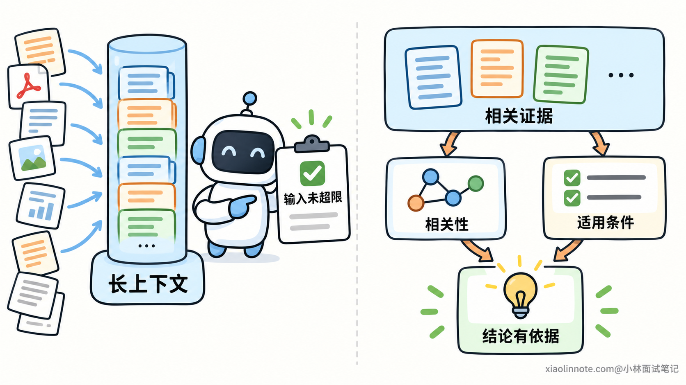
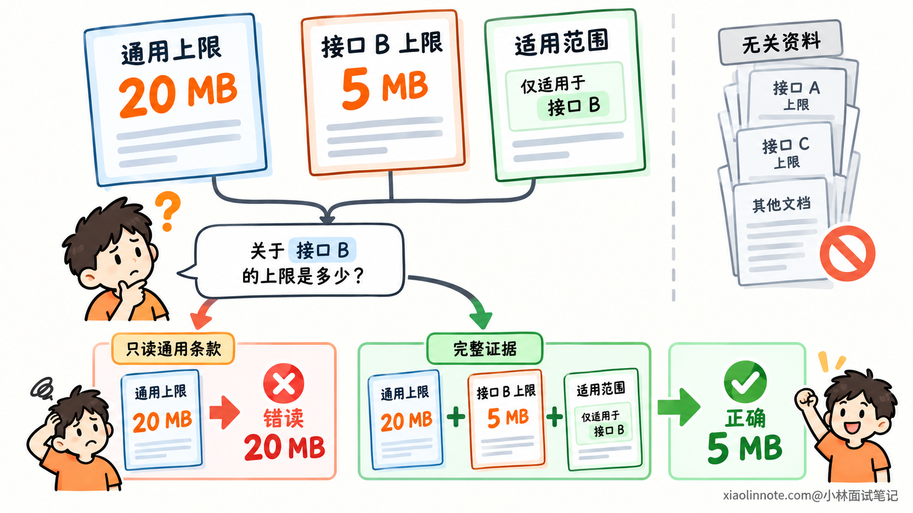
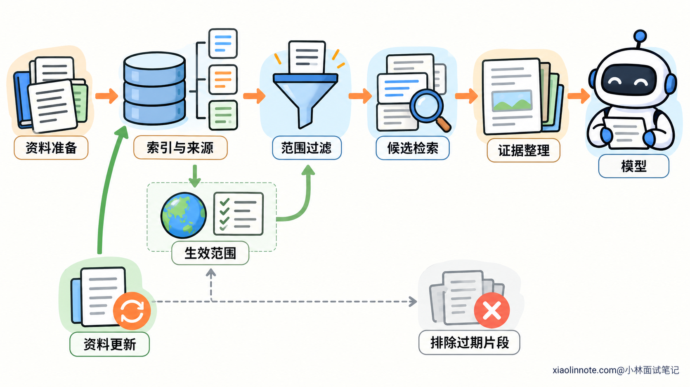
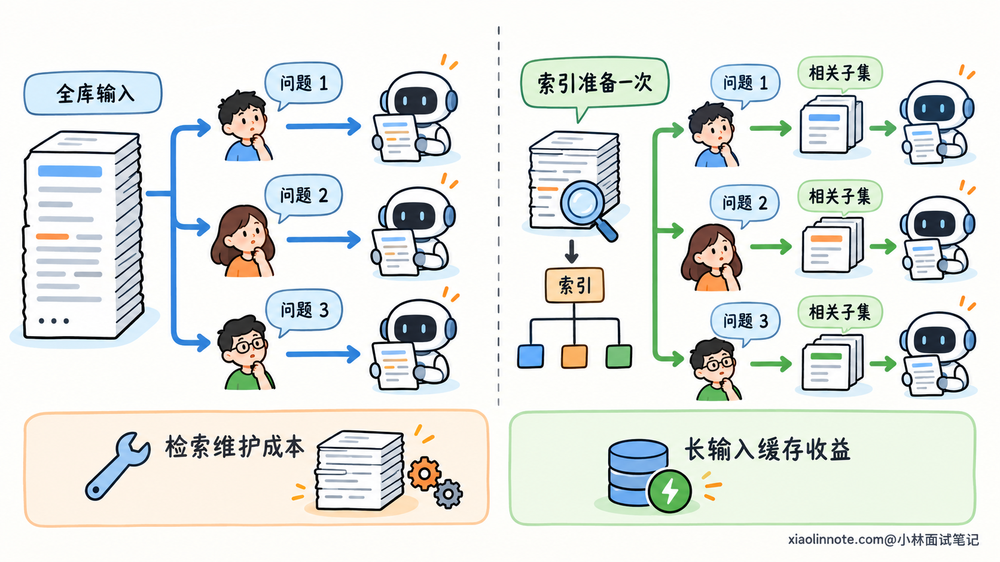
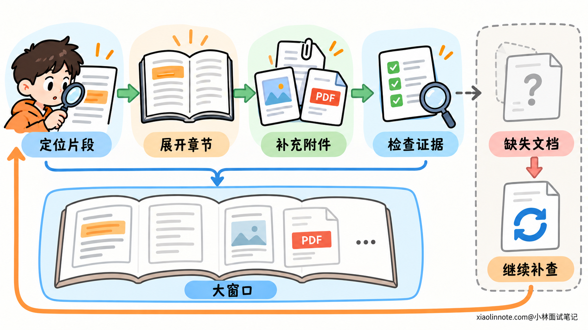

# 上下文窗口很大时为什么还需要 RAG？

> 原文：[上下文窗口很大时为什么还需要 RAG？](https://xiaolinnote.com/ai/rag/22_rag_long_context.html) · 小林面试笔记


👔面试官：模型的上下文窗口已经很大了，为什么还需要 RAG？

🙋‍♂️我：因为知识库还装不下。等窗口够大，把全部资料放进去就不需要检索了。

👔面试官：装得下只是容量条件。里面有无关资料、不同版本和互相引用的条款，这次问题应该依据哪些内容？

🙋‍♂️我：那 RAG 就是为了省 Token，全文输入的效果肯定更好。

👔面试官：材料多不等于有效证据多，模型对长文本的利用也需要验证。全文就一定比选过的材料更适合当前任务吗？

🙋‍♂️我：那取最相似的几段，内容少而且相关，答案应该就准确了。

👔面试官：一段里是通用规则，另一段里是例外条件。后者没被检索到，模型依据前者回答，会错在哪里？

咱们从读取容量和证据选择的区别讲起，再看长上下文与检索各自解决什么问题。

## 💡 简要回答

上下文窗口决定模型一次能读多少资料，RAG 则负责从外部资料中找出当前问题需要的证据。即使整个知识库都装得下，也不代表每份资料都相关、都有效，或者模型一定能把分散的条件全部用对。

RAG 可以在生成之前检索并整理材料，把相关内容和适用版本交给模型，减少无关信息，也避免每次处理整个资料库。外部资料更新以后，通过更新内容和索引就能让后续回答使用新证据，不需要先重新训练模型。不过版本、权限和索引刷新都要实际实现，不能只靠向量相似度判断。

它也不是每个任务都必须用。资料少、需要整体理解时，直接读全文可能更合适；检索可能漏掉例外或跨段关系。大窗口反而能帮助 RAG 读得更完整，比如先定位相关文档，再读取完整章节。两者可以配合，取舍要看证据是否充分，以及整条链路的效果和成本。

## 📝 详细解析

### 窗口变大，扩大的是读取容量

把资料都放进模型，和让模型正确使用这些资料，中间还隔着什么？

上下文窗口规定一次请求能够容纳的内容范围。它通常用 Token 衡量，Token 是模型处理文本等输入的单位，不能直接等同于字数。

窗口更大，模型就有机会同时读取更多章节、文件和任务材料。原来必须分开看的内容，现在可能放在一次请求里分析，这对整体理解有直接帮助。

但窗口本身没有选择资料，也没有把外部知识自动装进模型。文件还要由应用读取，业务数据还要从相应系统获取，之后才能成为本次输入。

更进一步，资料进入请求以后，模型还要判断哪些与问题相关，哪些条件适用，以及哪些证据能够共同支撑结论。

因此，可以分开理解两项能力：容量表示「能接收多少」，有效利用表示「能否从这些内容中得出符合要求的结果」。前者增加，不等于后者在任意任务上都已经得到保证。



RAG 是 Retrieval-Augmented Generation，也就是检索增强生成。它在生成之前从外部资料中查找相关内容，再让模型依据取回的材料回答。它可以缓解窗口不足，但作用并不限于把超长资料压进一个小窗口。

### 材料越多，为什么不一定意味着证据更充分？

回答质量需要的，是适用且足够完整的证据，并不是输入越长越好。

无关内容不会因为能被放进去，就对问题产生帮助。它增加了模型需要区分的材料；重复说法、不同版本和相近主题，也可能让模型混用条件。

模型对长文本的利用，还可能受到内容位置与组织方式影响。有些模型和任务中，关键信息放在中间，比放在开头或末尾更难被可靠利用。这类表现通常叫「中间信息利用不足」，程度会随模型、内容和任务变化，需要在实际使用的模型上验证。

这个问题也不只是「找到一个词」。定位一条信息，与结合多处信息完成判断，是不同要求。模型可能找到了一个明确数字，却没有同时应用另一处限定条件。

举个示意例子，一份说明里有两条规定：

```text
通用规则：上传文件的上限是 20 MB。
接口 B 的特殊规则：上限为 5 MB。
```

问题针对接口 B 时，两条内容都相关，但特殊规则决定最终答案。只找到了通用规则，或者忽略了它与接口 B 的范围关系，就会答成 20 MB。

RAG 可以先围绕问题缩小材料范围，减少无关内容，让模型重点处理相关证据。但它也可能只检索出通用规则，漏掉特殊规定，所以筛选本身必须考虑证据完整性。



这就出现了真正的取舍：全文可能把无关和冲突内容一起带进来，检索可能把必要内容提前筛掉。不能仅凭输入长短判断谁更准确。

### RAG 把资料选择提前到生成之前

要控制证据范围，RAG 通常把工作分成资料准备和在线查询两部分。

资料准备时，系统解析内容，按需要组织章节或片段，并建立查找索引。索引可以基于关键词，也可以基于文本含义，作用是帮助问题找到候选材料。

在线查询时，根据当前问题查找候选，再筛选、排序和整理证据，最后交给模型理解与回答。

```text
资料解析与索引准备
        |
        v
用户问题 -> 候选检索 -> 适用性筛选与证据整理 -> 模型回答
```

这样，资料获取不再全部压在每一次模型推理中。应用可以显式控制从哪里取、取哪些版本，以及这次提供了什么依据。

「相关」与「适用」需要区分。相似度高，表示内容可能谈论同一主题；它不能单独判断规则是否已经生效、是否属于当前对象。

例如新版本下个月才生效，问题问的是本周，就不能只因为文件更新日期最新而采用新规则。系统需要记录版本与生效范围，再按问题条件选择。

外部资料变化后，也可以独立更新内容和索引。下一次请求得到新证据，模型就能依据它作答，不必把每次变更都训练进参数。

但索引不是自动保鲜的。原文件更新了，索引仍然保存旧内容，就可能继续召回旧证据。更新和失效处理需要有实际机制。



权限也属于资料进入模型前需要确定的边界。RAG 可以在获取环节加入权限过滤，但真正判断访问权的是授权机制，不能交给模型或相似度分数。

这些能力并非 RAG 独有。全文输入也可以先选择正确版本、过滤权限并记录来源。RAG 的价值，是在较大的外部资料集合里，提供一种按问题获取有效子集的方式。

### 不必每次读取整个资料库，成本才可能随问题缩小

除了回答质量，还要看一项能力被反复调用时，重复处理了多少资料。

假设资料库共有 30 万 Token，一次问题相关的内容只有约 5000 Token。这里的数字只是示意资料规模，不包含指令、问题和输出。

如果每次都全文输入，模型就要处理这份大集合；如果先检索出必要证据，模型输入可以围绕较小范围组织。问题越局部，全库读取里可能重复处理的无关材料越多。

索引则把一部分资料处理提前完成，后续多个问题可以复用。这也是检索对高频知识问答有价值的原因：资料库规模很大，不代表每一次回答都必须读取同样大的输入。

不过，RAG 自己也有开销。解析、索引维护、在线检索、排序和追加读取，都需要时间与计算；资料变化频繁时，还要不断更新。

长上下文也可能利用前缀缓存，减少重复处理相同输入的部分费用或延迟。缓存收益取决于实现、命中情况和资料变化，不能直接用原始输入长度推出总成本。



因此，成本比较要包括资料准备、检索、模型处理与补读，而不是只比较一次请求的 Token 数。资料很少、只处理一次时，建立复杂检索链路未必划算；大量局部问题反复访问同一资料库时，按需读取通常更值得评估。

### 大窗口与检索配合，怎样保留必要的完整性？

既然检索会遗漏，能不能利用大窗口减少这种损失？可以，但需要改变对检索结果的使用方式。

检索命中一个片段，可以先把它当作位置线索，再读取所属的完整章节。正文引用附件或另一项规则时，继续补齐对应材料，避免只拿一段孤立文字作结论。

大窗口让这类扩展更容易。它可以容纳较完整的相关文档，让模型理解前后定义、条件和相互引用，而不必只压缩成几个短片段。

这时检索负责缩小查找范围，长上下文负责在该范围内进行较完整的阅读。容量与资料选择分别发挥作用。

但读取命中文档的全文，仍然补不回完全没有召回的另一份重要资料。检索之后还要检查当前证据能否回答问题，缺少范围、条件或依据时继续补查，而不能因为结果有几段文字就认为足够。

对要求全量总结或检查所有例外的任务，排名靠前的少量结果尤其不能代替完整范围。相关性排名告诉你哪些内容更像问题，不证明没有遗漏。



选择方式可以依据任务来判断：

| 任务与资料特点 | 更适合评估的方式 |
| --- | --- |
| 少量资料，需要通读、总结或整体比较 | 直接使用长上下文 |
| 大资料库，问题集中在局部事实 | 检索后组织相关证据 |
| 需要跨段条件或文档关系 | 检索定位，再扩大阅读范围 |

验证时也要看问题有没有答全、规则有没有用对，之后再比较延迟和成本。同样模型与资料下，全文能做对而 RAG 做错，可能需要检查召回遗漏；全文混用不同版本，则需要检查输入范围和资料组织。

所以，大窗口降低了必须切碎资料的压力，却没有让资料获取与证据选择失去意义。是否需要检索，要根据当前任务判断，不必让所有请求都走同一条路线。

## 🎯 面试总结

开头把 RAG 当成窗口太小的补丁，忽略了读取容量与证据选择的区别。能放下全部资料，不代表每份都相关、有效，也不代表必要条件已经被完整利用。

RAG 在生成前获取并整理证据，能够减少无关输入、复用索引处理，并让来源和适用范围更容易管理。但它可能遗漏重要条件，版本、权限与内容更新也需要真正实现，不能靠检索名称自动获得。

全文与检索都有取舍。少量资料的整体理解可以直接读全文，大资料库的局部查询可以按需检索，关系复杂时再扩大阅读范围。大窗口与 RAG 可以配合，最终依据是证据完整性、任务效果和总成本。

---
