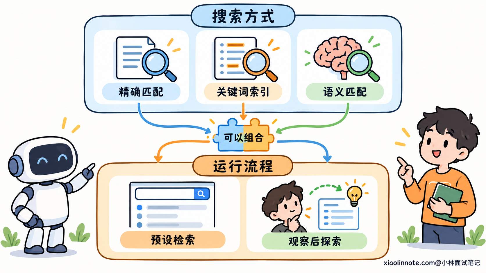
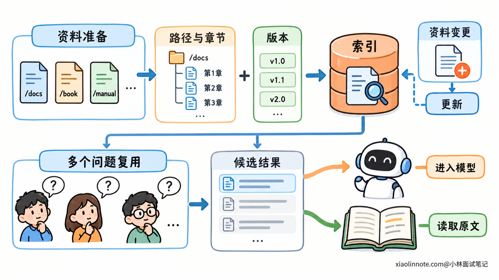
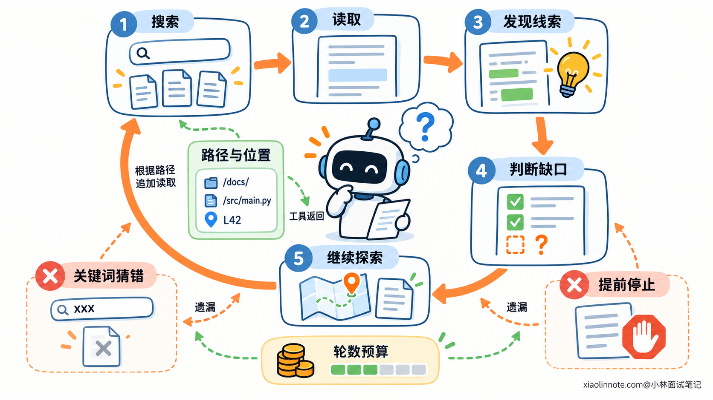
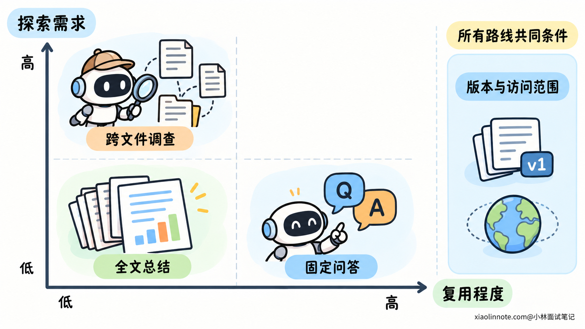
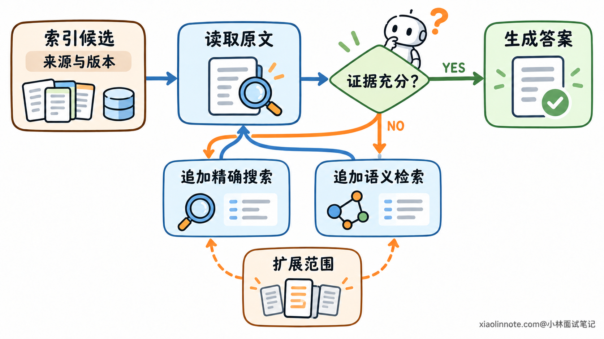

# RAG 与 Agent 自主文件检索应该如何选型？

> 原文：[RAG 与 Agent 自主文件检索应该如何选型？](https://xiaolinnote.com/ai/rag/23_rag_vs_file_search.html) · 小林面试笔记


👔面试官：Agent 可以自己搜索和读取文件，什么时候还需要预建索引的 RAG？

🙋‍♂️我：RAG 能做语义匹配，文件搜索只能查关键词，所以应该优先用 RAG。

👔面试官：明确的错误码可能更适合精确搜索。Agent 也可以调用语义检索，你比较的是搜索算法，还是取资料的流程？

🙋‍♂️我：那让 Agent 全部自己找，就不用维护索引了，而且它能一直读到正确答案。

👔面试官：它没想到的目录和关键词怎么办？每次重新探索要花多少轮，找到一个相关文件就足够了吗？

🙋‍♂️我：固定问答用 RAG，复杂任务用自主搜索，两套互不干涉就行。

👔面试官：索引可以先定位候选，Agent 再读原文、追踪引用。为什么一定要分开？你得先说明各自解决的环节。

咱们先把搜索方式和检索流程分清，再看任务要求怎样决定选型。

## 💡 简要回答

这里比较的是常见的预建索引 RAG 和 Agent 在运行时自主查找文件，主要看任务是否需要根据中间结果继续探索。广义上，Agent 搜索外部资料再回答，也属于检索增强，二者并不是完全对立的技术。

资料量大、同类问题多，且答案通常能从明确的知识范围里找到，预建索引更容易复用资料处理成本，也便于控制查询链路。需要沿引用、配置或代码关系逐步追查时，自主检索更灵活，读到什么就能决定下一步查什么，但探索轮数和成本也更容易波动。

关键词还是语义匹配，是另一项选择。RAG 可以用关键词索引，Agent 也可以调用语义检索。实际可以让索引先定位候选文件，再由 Agent 读取原文、核对版本并补查关联材料。最终要比较任务完成情况、证据完整性和总开销；少量资料需要通读时，直接读取全文也可能最简单。

## 📝 详细解析

### 先区分搜索方式与取资料的流程

为什么一提到 RAG 和文件搜索，就容易变成「语义检索与关键词检索谁更强」？因为我们把实现中常用的工具，误当成了整个方案的定义。

RAG 的基本含义是获取外部证据，再用这些证据辅助生成。它不要求只能用向量，也不要求所有任务都只检索一次。

这道题里的 RAG，主要指常见的预建索引方案：提前处理资料，收到问题后检索候选、整理内容，再交给模型。

自主文件检索强调的是运行过程。Agent 可以列目录、搜索内容、读取文件，然后根据新的观察继续决定取什么资料。

所以有两个需要分开的维度。

搜索方式决定怎样匹配内容。精确字符串、正则表达式、关键词索引和语义索引，都属于这一层。

取资料的流程决定什么时候搜索、读到什么以后是否继续，以及下一步由谁选择。固定检索链路和由模型推动的探索循环，属于这一层。

一个 Agent 完全可以先调用语义索引，再用精确名称搜索文件；一个预建索引也可以同时支持关键词和语义匹配。不能仅凭用了 grep 或向量库，就推断整个任务怎样运行。



这也是选型的起点：先明确需要什么样的资料获取过程，再决定该给它配哪些搜索入口。

### 预建索引，把资料组织成本提前并复用

文件很多时，每个请求都从头浏览目录、读取正文，会重复做大量工作。预建索引把一部分组织工作放到问题到来之前。

系统先解析资料，保留内容和来源，根据需要组织成章节或片段，再建立方便查找的索引。关键词索引帮助定位明确名称，语义索引帮助寻找用词不同但意思接近的内容。

收到问题以后，系统在索引里找候选，按任务条件筛选、排序和整理，再把相关证据交给模型。

```text
资料解析与组织 -> 建立索引
                       |
用户问题 -> 查询候选 -> 整理证据 -> 模型理解与回答
```

它的价值首先是复用。资料解析和索引建立可以服务很多请求，不必让每个问题都重新探索相同集合。

对于流程相对固定的问答，检索步骤也容易单独观察和改进。找不到正确材料，可以检查查询与索引；候选很多但选错，可以检查排序与范围。检索阶段和生成阶段有较明确的交接。

不过，候选只是「值得阅读的材料」，不是已经证明的答案。相似度高不等于适用，索引中的摘要也可能省略条件。必要时仍要读取完整章节，并核对来源与版本。

索引还要维护。资料已经改变，索引没有刷新，就可能继续返回旧内容。记录原始位置与版本，既方便补读，也方便识别当前候选是否过期。



这条路线更适合把明确的资料集合做成可重复使用的查询入口。它能减少重复组织，却不能提前知道每个复杂任务后续会出现什么线索。

### 自主检索，把资料获取放进观察与决策循环

自主检索的关键，是下一次搜索能够由上一次观察决定。

Agent 先取得目录或候选位置，调用搜索工具，读取命中内容。读到一个新名称、一条引用或一个异常，再据此继续查找。直到证据足够，或者发现当前范围内无法完成任务。

```text
当前问题与已知线索 -> 选择搜索或读取动作 -> 工具返回观察
          ↑                                      |
          +------ 判断还缺哪些证据 <--------------+
```

它获得的灵活性来自这个反馈过程。有些问题开始时只能描述症状，具体需要读哪些文件，要等取得部分材料以后才知道。把查找放进循环，就能随信息变化调整方向。

例如一份说明引用另一份配置，配置又指向实际实现。下一份材料的入口来自刚读到的内容，未必直接出现在用户最初的问题里。

但是，循环也会消耗时间。搜索、读取、判断可能需要多轮工具与模型调用，不同任务走的轮数不同，延迟和读取量就会波动。

主动搜索也不天然完整。猜错关键词、忽略目录，或者找到一份相关材料就提前停止，都可能让必要证据一直没被读到。

工具返回方式会影响探索质量。先提供路径、命中位置和必要片段，让 Agent 判断再读哪里，通常比一次返回几千行杂乱内容更容易继续。文件很长时可以分段读取，但要保留回查入口。



搜索入口也要适合线索。grep 或 rg 做的是词面和模式匹配，明确错误码、字段名很适合这类工具。用户的模糊描述与资料用词不同，则可能需要语义候选定位，或者先从目录说明中获取真实术语。

模型生成同义词，再交给 grep 搜索，是模型改变了搜索策略，不是 grep 本身获得了语义理解。把两层分清，才知道找不到资料时该改什么。

### 选型重点：任务的探索需求与重复处理成本

两条流程理解以后，选型可以先看任务所需的证据是否容易预先确定。

如果问题集中在固定资料中的局部事实，通常有相对明确的知识范围，预建索引能快速提供候选。大量相似请求还可以共享准备与优化工作。

如果任务需要沿关联不断追查，下一步材料取决于前一步结果，自主探索的反馈能力就更有价值。它允许中途改变方向，而不必把第一批召回内容当成全部范围。

资料组织也会影响成本。目录和名称清楚时，主动搜索容易获得入口；资料规模很大、命名又不直观时，索引可以帮助缩小范围。

更新方式同样重要。经常变化的工作区若要建索引，需要处理同步成本；直接读文件能够读取当前可见内容，但目录可能是旧副本、错误分支或未更新的挂载。因此，两种方式都要确认自己读的是哪份资料。

接着比较响应要求。固定检索链路通常更容易给步骤设定上限；自主探索要限制搜索轮数、读取量和总预算。实际延迟还受索引、文件系统和外部服务影响，不能只按架构名称推断速度。

| 主要需求 | 更值得评估的路线 |
| --- | --- |
| 大量资料上的高频局部问答 | 预建索引与相对固定的检索链路 |
| 依赖新观察、需要追踪关联的任务 | Agent 自主探索 |
| 大范围里入口难找，找到后还要深入核查 | 索引定位后继续探索 |
| 少量资料，需要完整阅读与整体理解 | 直接读取全文 |

证据完整性仍然是共同要求。查到一个答案，与证明已经检查所有文件，是两种任务。取排名靠前的几个候选，或者 Agent 搜了几轮，都不能自动证明范围没有遗漏。

权限也不随方案变化。索引检索、路径搜索和原文读取，都应由程序按当前身份控制。一个文件能被搜索到，不代表用户就有权读取它。



验证选型时，要比较整项任务是否完成、证据是否充分、总延迟和费用，而不是只看一次搜索快不快。多读几轮可能值得，也可能只是搜索策略反复走偏，需要结合记录判断。

### 索引定位与原文探索，可以共同完成资料获取

常见的组合方式，是让索引负责找到候选入口，让 Agent 负责阅读原文并判断还缺什么。

索引结果最好保留来源路径、位置和版本。这样 Agent 能从候选回到实际材料，检查摘要有没有省略条件，原文件是否已经变化。

读完以后，如果证据足够，就可以回答；如果出现引用、相关配置或新的未知点，再调用文件搜索、语义检索或其他工具补查。

两部分分别承担不同环节：提前组织资料可以减少盲搜，运行时观察则决定怎样继续阅读。

第一批候选也不能成为后续探索的围墙。它们解释不了问题时，应允许改变查询或查找其他目录，而不是只在候选文件里反复寻找一个并不存在的答案。



组合后仍需要控制成本。一个本来能直接回答的短问题，不一定值得运行多轮探索；一个明确需要通读的任务，也不必先做一轮可能漏内容的检索。

因此，选择的对象是资料获取流程。预建索引、自主探索和全文读取各有用途，可以按任务组合，重点是用合适的代价获得足够且可核对的证据。

## 🎯 面试总结

开头把 RAG 与文件搜索当成语义和关键词的对立，混淆了搜索方式与运行流程。预建索引提前组织资料，自主探索根据新观察选择下一步；两种流程都可以使用不同搜索入口。

索引的收益是复用与候选定位，代价是维护和召回遗漏；自主检索的收益是沿线索深入，代价是多轮开销与方向误判。资料规模、更新方式和任务是否需要探索，决定哪种路线更适合。

索引先定位、Agent 再读原文并补查，可以结合两者的能力。最终仍要核对证据范围、资料版本和实际完成效果，不能把命中相似内容或搜索了很多轮，当成任务已经完成。

---
