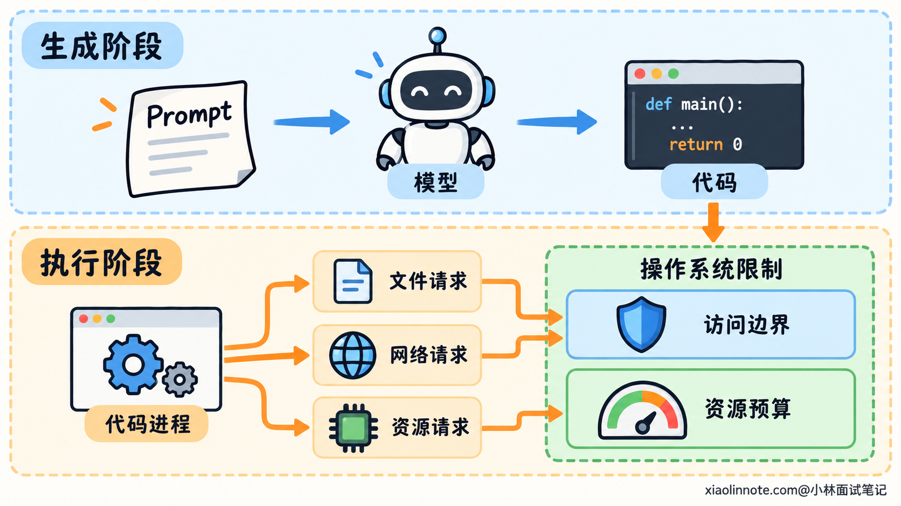
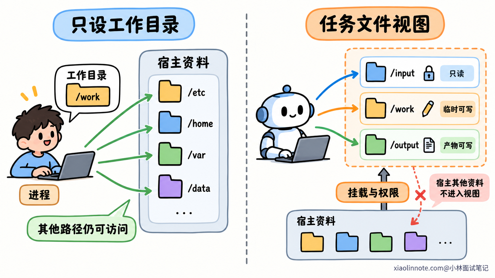
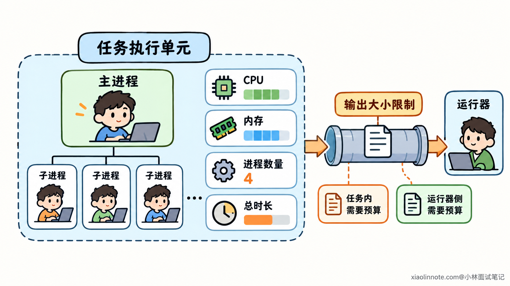
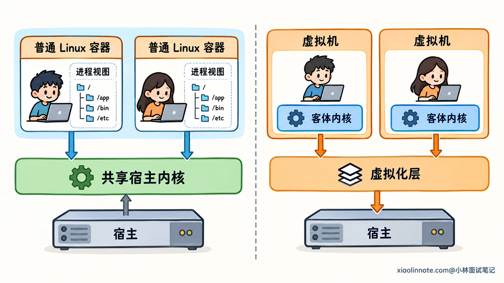
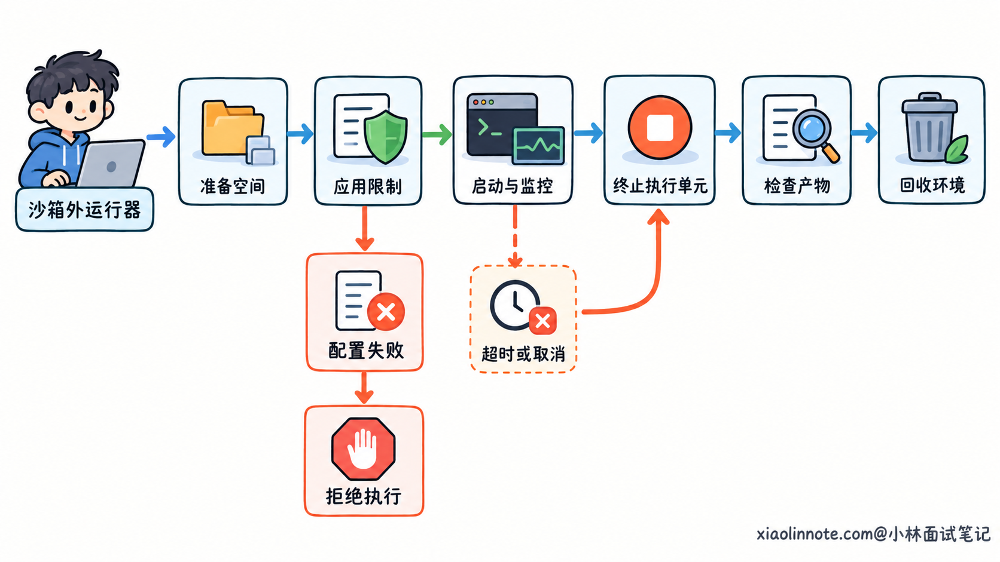

# Agent 的代码执行沙箱应该如何设计？

> 原文：[Agent 的代码执行沙箱应该如何设计？](https://xiaolinnote.com/ai/tools/21_execution_sandbox.html) · 小林面试笔记

👔面试官：Agent 能生成并执行代码，这个代码执行沙箱应该怎样设计？

🙋‍♂️我：在 Prompt 里规定代码只能完成当前任务，不允许访问其他文件。

👔面试官：文件访问发生时，操作系统会读取这段 Prompt 吗？代码写错了，真正拦住它的是什么？

🙋‍♂️我：把代码放进 Docker 容器，和宿主隔离就行。

👔面试官：如果你把宿主目录以可写方式挂进去，代码仍然可以改文件。容器到底隔离了哪些能力，又开放了哪些能力？

🙋‍♂️我：那只开放任务目录，再给执行设一个超时。

👔面试官：超时之前就可能耗尽内存，后台子进程也可能一直运行。资源怎么限制，任务结束后又怎样回收？

咱们从代码怎样获得权限讲起，把沙箱的访问边界、资源预算和运行管理逐层拆开。

## 💡 简要回答

核心是让代码只拿到当前任务需要的权限，并把资源消耗限制在预算里。模型生成的代码要按不可信代码处理，不能只靠 Prompt 约束，也不应该直接继承宿主的全部权限。

执行环境可以只提供本次任务的输入，把输入设为只读，给临时目录和输出目录写权限，用低权限身份运行。网络按需开放，宿主凭据和管理接口不交给代码。资源限制则要覆盖 CPU、内存、进程数量和运行时间，并作用于整个任务的进程集合，而不只是启动的那个进程。

容器可以作为实现，但需要检查挂载、权限和网络配置，而且普通 Linux 容器共享宿主内核。面对任意用户代码或更高的隔离要求，可以评估虚拟机等更强边界，同时考虑启动成本和兼容性。

任务由沙箱外的运行器管理：准备输入，启动受限执行，超时或取消时终止整个执行单元，核对并导出允许的产物，最后清理环境。沙箱负责限制代码的影响范围，结果是否符合业务要求，还要另外验证。

## 📝 详细解析

### 为什么要限制运行环境，而不是只检查代码？

模型生成了一段看起来正确的代码，就可以直接运行吗？这里容易漏掉一个事实：程序真正能做什么，取决于它运行时拥有的能力。

操作系统处理文件读取、网络连接和进程创建时，检查的是进程身份、访问权限和系统规则。它不会因为代码来自一个「数据分析任务」，就自动只允许分析数据。

如果程序使用宿主账号运行，它就可能获得该账号能访问的文件和服务。生成代码中的一个错误路径，或者依赖里的额外操作，都可能使用这些权限。

Prompt 可以影响模型怎样生成代码，代码审查也可以发现问题，但它们不能代替运行时限制。一次真实访问发生时，必须有执行环境能够拒绝超出范围的操作。

这就是沙箱要解决的核心问题：让代码在一个受限环境里运行，只获得完成任务所需的能力，即使它的行为偏离预期，影响范围也有边界。

这个边界至少包含两方面。访问限制决定能接触哪些文件、网络和系统能力；资源限制决定能消耗多少计算、内存和其他资源。

两者不能互相代替。代码看不到宿主文件，仍然可能占满内存；代码只运行几秒，也可能在几秒内读走敏感数据。因此，沙箱不能只做其中一项。

### 按任务分配最小能力，建立真正的访问边界

设计访问边界，可以从一个问题开始：这段代码为了完成当前任务，实际需要什么？

所需输入、可写产物位置、必要依赖和外部接口明确以后，只把这些能力交给执行环境。没有任务依据的能力，默认不开放。这就是最小权限的含义。

文件是最容易理解的一部分。常见做法是给每个任务独立空间，分别准备只读输入、可写临时区和输出区。运行依赖预先准备，代码不必修改用户原始数据或宿主系统。

但工作目录不等于文件边界。工作目录只决定相对路径从哪里开始计算，程序仍然可能访问绝对路径或父目录。

真正的限制需要文件系统视图和访问权限配合。比如让环境只看到必要目录，再规定哪些路径可读、哪些可写。Linux 的 namespace 可以提供独立的挂载等视图，但挂进去的内容仍要按实际权限处理。

如果把整个用户目录挂进去，沙箱就得到了这些文件的访问能力；如果以可写方式挂载，代码也可能修改它们。不是目录出现在容器里以后，就自然与宿主原文件断开了关系。

网络同样是一种能力。隔离出独立网络环境，只解决视图和连接环境的问题，不等于已经限制出站目标。

任务不需要联网时，可以不提供外部网络访问；确实需要时，再通过网络策略或受控接口限制。只开放必要查询能力，通常比让代码任意连接所有外部和内部地址更容易检查。

文件只读也不能防止数据外传。代码虽然不能修改输入，仍然可以读取内容；如果同时拥有任意网络访问，就可能把内容发出去。所以文件和网络权限要一起考虑。

凭据尤其不应该无差别继承。宿主环境变量里的数据库密码、云端密钥和管理接口，不应因为启动子进程就全部进入代码环境。必须使用的外部能力，可以由沙箱外的工具代理，用受限身份执行，再返回必要结果。

这样，权限是在任务开始前明确分配的。外部材料或生成代码即使写着「需要更多权限」，也不会自行改变执行环境的配置。

### 资源限制解决的是另一类问题

访问边界收紧以后，仍然需要控制资源消耗。无限循环、不断分配数组、持续创建子进程，都可能在不读取任何敏感文件的情况下影响其他任务。

资源限制的对象应该是整项任务，而不是单个程序。

假设主程序创建了几个后台进程，随后自己退出。如果只统计或停止主程序，后台进程仍可能继续占用机器。需要把它们归入同一个受控执行单元，一起计量、限制和终止。

Linux 的 cgroup 就能把一组进程组织起来，按组管理 CPU、内存以及任务数量等资源。它提供的是资源账本和限额，不能代替文件访问控制。

CPU 和时间也要区分。CPU 配额限制一段时间内占用多少计算资源；总运行时限限制从启动到结束可以持续多久。

一个程序等待外部响应时，几乎不用 CPU，却可能一直不退出。另一个程序持续计算，即使只跑很短时间，也可能挤占其他工作。所以限 CPU 不等于限总时长，超时也不等于限制瞬时资源消耗。

内存和进程数量同样要单独控制。内存可能在超时前迅速增长，限制一组进程与线程的数量则可以抑制无限创建任务。

| 限制对象 | 主要约束什么 |
| --- | --- |
| CPU | 计算资源占用 |
| 内存 | 任务可使用的内存规模 |
| 进程与线程数量 | 任务不断创建执行单元的行为 |
| 总运行时间 | 等待或执行持续过久 |
| 文件与输出大小 | 临时数据、产物和日志无界增长 |

文件和输出大小不能只靠前几项间接限制。磁盘空间需要配额或其他存储控制，日志接收也要有上限，避免沙箱没耗尽资源，外面的运行器先被大量输出拖垮。

具体额度要依据任务需要确定。过松可能影响其他任务，过紧会阻止正常执行；限制触发后应记录清楚原因，让调用方分辨是程序错误，还是预算不足。

### 容器是否够用，取决于隔离边界和代码可信程度

最小权限和资源预算明确以后，才适合决定使用什么执行环境。

普通 Linux 容器通过独立的文件、进程和网络等视图组织环境，并配合权限和资源机制运行任务。它比较轻，启动与部署通常方便，因此可以作为沙箱的一种基础实现。

但容器里的进程最终仍然使用承载它的宿主内核。应用视图分开了，不代表底层已经变成两套独立操作系统。

这会带来两类需要分别检查的问题。

一类是配置把能力重新交了出去。例如开放敏感挂载、特权模式，或把能管理容器的高权限控制接口交给代码，都会扩大实际操作范围。环境看起来在容器里，程序却可能借这些入口影响宿主。

另一类来自共享内核。即使配置合理，运行代码仍会与宿主内核交互，内核和隔离实现的漏洞需要纳入风险判断。

用低权限身份运行、移除不需要的特权能力，并限制不必要的系统调用，可以收紧这条边界。系统调用是程序请求内核执行操作的入口，限制它就是减少代码能够直接请求的内核操作。

这里不需要追求一个只允许极少操作、却连正常依赖都运行不了的配置。应该根据任务验证必要能力，保留需要的部分，而不是遇到兼容问题就把限制全部关闭。

如果执行的是任意用户提交的代码，或者需要更强的任务间隔离，可以评估虚拟机等方案。虚拟机中有独立的客体内核，代码先与这套内核交互，再由虚拟化层连接宿主，与普通容器直接共享内核的边界不同。

更强边界也有启动、资源和运维成本，而且依然需要正确配置。把宿主敏感文件共享给虚拟机，仍然是在授权它访问这些文件。选择环境不能替代前面的最小权限设计。

因此，容器或虚拟机的选择，要结合代码来源、可接触的数据、任务间隔离要求和允许的成本。工具名称本身不是完整的安全结论。

### 沙箱外的运行器，要管理完整的执行生命周期

环境配置正确以后，还需要一个沙箱外的运行器，负责准备、启动、观察、终止和回收任务。

它应该处于生成代码不能修改的管理边界之外。否则代码可以改变自己的限制或回收逻辑，前面的设计就失去约束作用。

启动前，运行器分配任务空间、放入允许的输入、应用权限与资源配置。配置没有成功时，不应退回到不受限的宿主执行，以免「为了让任务跑起来」直接绕过边界。

执行中，运行器跟踪状态与预算，处理超时和用户取消。终止要覆盖整个执行单元，并确认相关进程已结束，不能只停止接收输出，让后台任务继续运行。

代码运行结束，产生的文件也不能立即获得宿主权限。代码返回一个路径，运行器需要按约定检查真实产物，只导出允许范围内的文件，并限制类型、大小和数量。

例如输出目录里有一个符号链接，指向目录外的文件。仅检查路径文字以 output 开头，仍然可能导出不该读取的内容。运行器需要核对实际对象，不能把代码给出的任意路径当成宿主读取指令。

普通批处理任务可以先停止执行单元，再检查和复制产物，减少检查期间文件继续变化的问题。交付完成后，清理临时数据、撤销临时访问能力，保留必要且受控的诊断记录。

任务之间也要隔开。复用基础运行环境可以减少启动开销，但不能因此继承上一任务的数据、后台进程或凭据。没有确认清理成功的环境，不应直接交给下一位用户。

最后，沙箱验证的是操作是否在能力和资源边界内，并不直接证明计算结果正确。文件生成成功，只说明产物存在；内容是否满足任务要求，仍需要业务规则或测试检查。把隔离与结果验证分别落实，代码执行才有完整依据。

## 🎯 面试总结

开头依赖 Prompt，遗漏了实际访问由进程权限和运行环境决定；只说放进容器，又没有说明开放了哪些能力；只加超时，则没有控制瞬时资源消耗和后台执行。

沙箱设计的重点，是按任务分配最小能力，并对整个执行单元设置资源预算。访问边界管能接触什么，资源预算管能消耗多少；容器可以组合这些机制，共享内核的边界是否满足要求，还要结合代码来源判断。

运行器负责从输入准备到终止、产物检查和环境回收，避免任务结束后仍留下进程、数据或权限。沙箱限制执行影响，业务验证检查结果，两部分分别承担职责。

---
