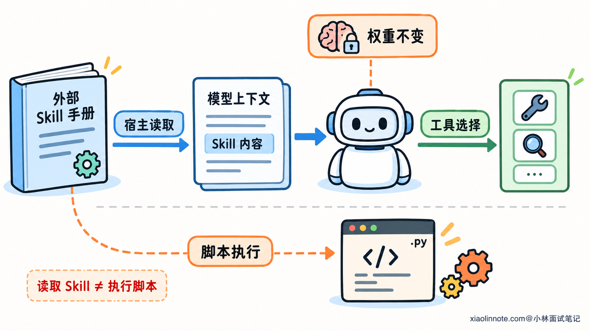
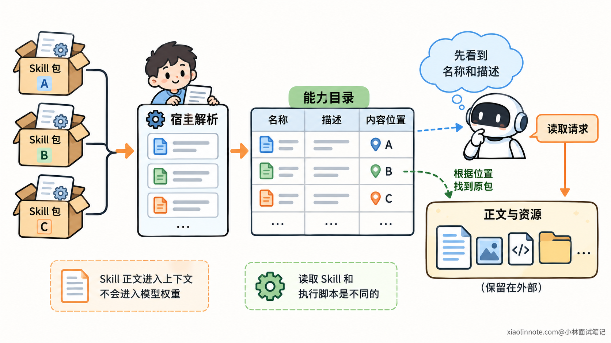
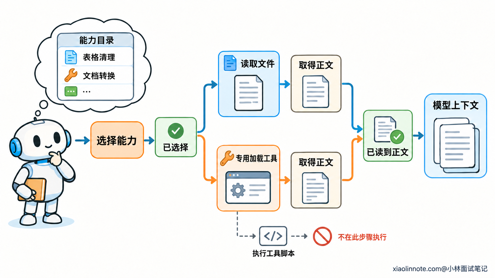
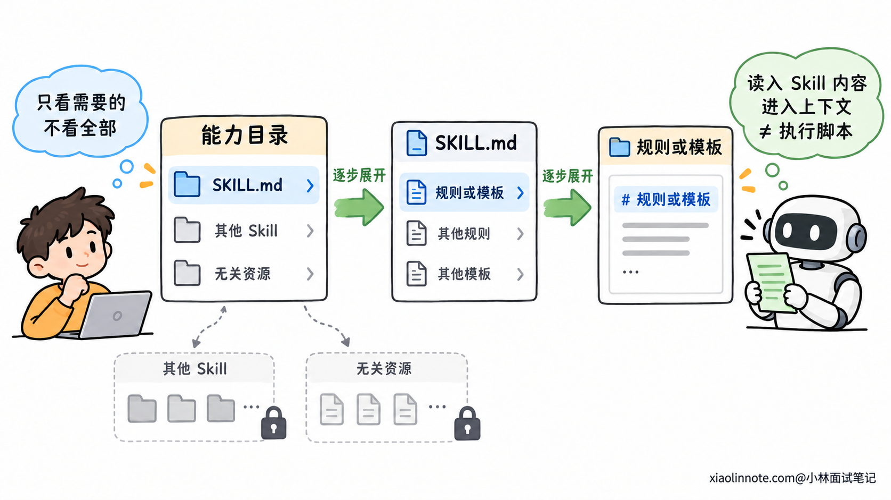
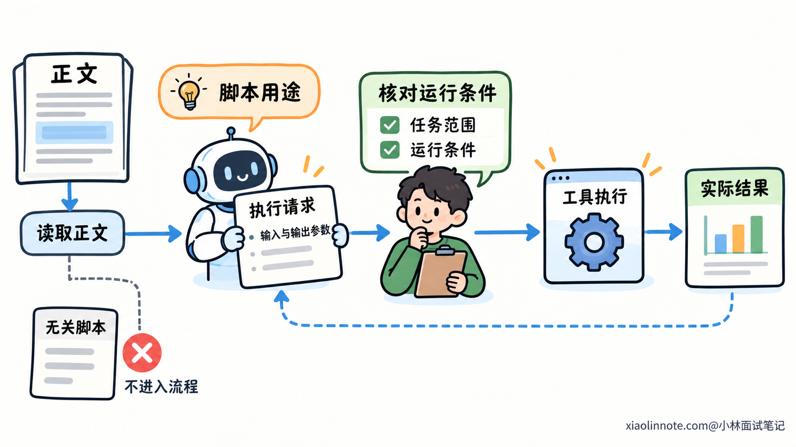

# Agent 的 Skill 加载机制是如何实现的？

> 原文：[Agent 的 Skill 加载机制是如何实现的？](https://xiaolinnote.com/ai/tools/22_skill_loading.html) · 小林面试笔记


👔面试官：Agent 安装了很多 Skill，任务来了以后，怎么找到并加载需要的那个？

🙋‍♂️我：启动时把所有 [SKILL.md](http://SKILL.md) 都放进 Prompt，模型就知道该怎么做了。

👔面试官：一次任务只用到少数能力，为什么让模型同时读几十份无关手册？上下文够用吗？

🙋‍♂️我：那只看文件名，匹配到关键词以后就算加载成功。

👔面试官：文件名只能提供一点线索。正文还在磁盘上，模型没有读到具体步骤，怎么按它操作？

🙋‍♂️我：选中以后读取正文，再把包里的脚本都运行一遍。

👔面试官：参考文件、模板和脚本分别用来做什么？读取一份操作说明，怎么就变成执行所有程序了？

咱们先看 Skill 内容怎样影响模型，再把发现、激活和资源取用这几步串起来。

## 💡 简要回答

Skill 通常采用渐进式加载。宿主先发现可用的能力包，读取 [SKILL.md](http://SKILL.md) 里的名称和描述，形成一份轻量目录。模型根据任务和描述判断需要哪个 Skill，或者由用户明确指定，再把对应正文读进上下文。

正文提供操作步骤，详细参考、模板和脚本留在包里，执行到需要它们的步骤时再取用。这样模型先知道有哪些能力，用到时才读具体方法，不需要启动就加载所有手册和资源。

这里的加载主要是在补充模型当前的工作信息，不会更新模型参数，也不等于执行脚本。脚本仍然要通过工具调用，由宿主检查参数和权限后运行。文件发现、正文读取和上下文维护由宿主完成，所以安装了 Skill，不代表模型已经读到了它，更不代表相关操作已经发生。

## 📝 详细解析

### 加载 Skill，实际上是把工作方法交给模型

一份操作手册保存在磁盘上，为什么还需要「加载」？因为模型作出判断时，只能使用当前请求中提供的材料，以及运行程序通过工具交给它的信息。

文件存在，并不会自动改变模型这次看到的内容。要让它按手册工作，宿主需要把相关指令送进上下文。

这里的宿主，就是组织模型调用、提供工具和管理任务的应用程序。模型可以提出读取请求，真正找到文件、取得内容并传回去的，仍然是宿主和工具。

Skill 通常把一套工作方法组织成能力包。核心文件 [SKILL.md](http://SKILL.md) 写明用途和操作步骤，还可以配上参考资料、模板与脚本。

加载正文以后，模型获得的是「这类任务应该怎样处理」的信息。它可以据此选择步骤和工具，但模型权重没有更新。

这与程序导入一个代码库不同。Markdown 指令不会因为被读到，就成为已经执行的代码。它影响模型的后续决策，具体操作还需要工具完成。



理解这一点以后，加载机制的目标就清楚了：让模型在需要的时候得到适合当前任务的工作方法，而不是把所有文件搬进每一轮输入。

### 先用元数据建立能力目录

模型还没读正文，怎么知道应该读哪一份？这就需要一层比正文更短的描述。

开放的 Agent Skills 格式在 [SKILL.md](http://SKILL.md) 顶部使用 YAML frontmatter，也就是 Markdown 正文之前的结构化信息。最基本的两个字段是 name 和 description，分别说明能力名称和适用任务。

例如下面是一份元数据示意：

```yaml
---
# name 标识能力包，标准格式下与目录名对应
name: table-cleaning
# description 提供选择依据，说明处理对象与任务范围
description: 清理已有表格中的重复行和字段格式，适用于数据整理，不负责生成业务统计口径。
---
```

宿主从允许使用的目录、服务或内置包中发现 Skill，解析元数据，保存名称、描述和内容位置，再把可用目录提供给模型。

名称便于识别，描述帮助选择。只写「处理文件」，模型很难区分表格清理、文档转换和图片压缩；说明处理对象与任务边界，才有具体的匹配依据。

内容位置也必须保留。模型决定使用 table-cleaning 后，宿主需要知道去哪里读取正文，不能只有一个名字而没有实际来源。



这一阶段叫发现，不等于正文已加载。宿主可以把全文预先缓存到内存里，但只有实际交给模型的部分才会占用本轮模型输入。程序缓存与模型上下文，是两个不同位置。

目录本身也有成本。Skill 很多时，宿主可以按可见范围或相关性筛选目录，但要保留找到所需能力的途径。渐进式加载减少的是无关正文和资源的预载，并不是让所有能力信息都零成本出现。

### 选中 Skill 后，正文才进入上下文

有了目录，接下来才是激活。

模型根据任务与描述选择 Skill，常见做法是调用文件读取工具，打开对应 [SKILL.md](http://SKILL.md)。文件内容作为工具结果返回，后续模型调用才获得具体步骤。

如果模型没有文件读取能力，也可以提供专用加载工具。模型提交 Skill 标识，宿主查询登记信息，取出正文并返回。用户显式指定某个 Skill 时，宿主也可以直接加载，不必重新猜测名称。

这些方式的共同点是：选择与内容交接必须接起来。模型输出「使用某个 Skill」，只表达了一个选择；只有正文真正进入上下文，才具备按它工作的材料。

从发现到加载，可以这样理解：

```text
宿主发现能力包 -> 提供名称与描述 -> 选择所需 Skill
                                      |
                                      v
后续模型按指令工作 <- 正文进入上下文 <- 实际读取内容
```

正文通常包含执行顺序、必要检查和交付要求。它需要提供足够的主流程，让模型读完知道从哪里开始；只有一句「详细内容见附件」，模型仍然缺少下一步依据。

选择也可能出错。描述相似、范围不清，会导致误选；任务缺少关键要求时，也可能需要先澄清。自动匹配提供的是一种选择机制，不是安装以后就必然使用正确能力的保证。



发现位置、触发方式和内容传递由宿主实现，Skill 格式则约定包内内容怎样组织。不同产品的具体入口可以不同，但都需要把可用信息交给模型，文件不会自行生效。

### 正文与资源分层，形成渐进式加载

正文读进来了，为什么不顺便把包里的所有文件都读完？因为有些内容只在某一类步骤中才需要。

参考资料可以保存复杂规则，模板可以规定交付格式，脚本可以实现确定的处理过程。把它们拆出来，正文就能聚焦主流程，任务再按需要继续展开。

一个包可以组织成这样：

```text
table-cleaning/
├── SKILL.md                   # 名称、描述和主流程
├── references/field_rules.md  # 特定字段的详细说明
├── assets/report_template.md  # 输出模板
└── scripts/clean.py           # 可执行的处理程序
```

模型读到某一步需要字段规则，再读取 references 中对应文件；需要指定交付格式，再获取模板。没有进入这些步骤的任务，就不必携带它们。

这就是渐进式加载，也常叫渐进式披露：先用少量信息找到能力，再读取工作方法，最后按当前步骤取用细节。

| 层次 | 提供什么 | 主要解决什么问题 |
| --- | --- | --- |
| 元数据 | 名称与适用描述 | 当前任务该选哪个能力 |
| 操作正文 | 主流程与必要要求 | 选中以后怎样开展工作 |
| 辅助资源 | 详细参考、模板和脚本 | 当前步骤需要哪些额外材料或实现 |

这三层不是三个必须无条件读完的列表。资源层尤其要根据正文与当前任务选择。安装包有十个参考文件，不意味着每次激活都得把它们加入上下文。



引用还需要定位到正确位置。按开放格式组织的相对资源路径，从 Skill 根目录解析，不应落到用户项目里的同名文件。远程包也需要等价的资源定位方式，不能返回一段正文却让引用全部失效。

资源取用也不总是把文本送给模型。模板可能直接复制给处理程序，脚本可能由执行工具读取运行，图片或其他资产则按任务使用。只有需要模型理解的内容，才需要进入它的上下文。

### 加载说明与执行脚本，分别由什么完成？

Skill 正文提到「运行 scripts/clean.py」时，模型得到的是操作指令。读取这句话，不会自动启动 Python，也不会修改任何表格。

真正执行还要经过工具调用。请求中明确输入、输出与必要参数，宿主找到程序并检查执行条件，运行以后把实际结果交回 Agent。

脚本的作用是把适合固定实现的步骤交给程序完成。它可以减少模型反复生成相同处理代码，但不要求把全部源码先放进上下文。只要操作说明足够、入口明确，执行工具就可以直接运行它。

包里的其他程序也不必连带执行。清理、检查和上传可能分别服务不同步骤，只有当前任务需要且获准的操作才进入执行链。

加载权限与执行权限同样不同。允许读取手册，不等于允许修改任意文件或访问外部服务。第三方 Skill 即使结构合法，也仍然需要按来源和操作影响判断是否可信。

宿主可以依据受信任的配置管理可用工具，具体字段怎样生效取决于实现。Skill 正文不能靠声明「需要更高权限」，自行改变操作系统或业务接口的限制。



最后还要区分「以前加载过」和「当前仍能使用」。长任务整理上下文以后，正文可能不再完整保留。记录已激活的名称与来源，能够帮助重新取回，但一个加载标记不能代替丢失的具体规则。

当前需要的指令仍在上下文里，就不必重复注入；关键细节已经丢失，就按来源重新读取。重读时还要核对实际内容版本，避免正文用一套流程，脚本却换成不兼容的另一套实现。

到这里，发现、选择、读取和执行各自有了明确作用。遇到「Skill 没生效」，也可以据此检查是目录没有暴露、能力选错、正文没读到，还是执行条件没有满足，而不用把这些问题混成一件事。

## 🎯 面试总结

开头一次加载全部内容，忽略了任务只需要少量相关能力；只匹配名称，又没有把正文真正交给模型；读到脚本就全部执行，则混淆了指令加载和实际操作。

核心机制是渐进式加载：宿主先用元数据建立目录，选中后读取正文，执行到相关步骤时再取用参考、模板或脚本。名称与描述帮助选择，正文提供方法，资源补充必要细节。

加载改变的是当前上下文，脚本运行仍然由工具和执行环境完成。安装、可见、正文已读取与动作已执行，是不同状态；把它们区分清楚，才能理解 Skill 怎样进入 Agent 的工作过程。

---
