# LLM 工具调用面试题

## 什么是 Function Calling ？原理是什么？

👔面试官：来聊聊 Function Calling 吧，说说它是什么、原理是怎样的？

🙋‍♂️我：Function Calling 就是让大模型直接调用 API 嘛，模型自己去访问网络、查数据库，然后把结果返回给用户。

👔面试官：模型「自己」去访问网络？你确定？模型有直接执行代码的能力吗？它能联网吗？

🙋‍♂️我：呃……那应该是模型输出一段调用指令，然后……后端代码去执行？但我记得好像模型输出的就是自然语言，开发者自己解析文本去调用的吧？

👔面试官：你说的那是 Function Calling 出现之前的土办法，靠 if/else 解析自然语言，极其脆弱。Function Calling 的核心就是模型输出结构化的 JSON，而不是自然语言。你连「模型只负责决策、代码负责执行」这个最基本的分工都没搞清楚，工具定义的 schema 怎么写、两轮对话的流程是什么、并行调用怎么做，这些都回去好好看看吧。

好，这段面试踩的雷还挺典型的，很多人一上来就把「模型决策」和「代码执行」搞混了。下面我把 Function Calling 的完整机制拆开讲清楚。

### 💡 简要回答

Function Calling 我的理解是这样一套机制：开发者用 JSON schema 把工具描述好传给模型，模型判断需要调工具的时候不输出自然语言，而是直接输出一段结构化的 tool_calls JSON，告诉你「我要调哪个函数、参数是什么」，你的代码拿到这段 JSON 去真正执行，把结果塞回对话，模型再生成最终答案。

最小流程通常是「一次模型请求 + 一次工具执行 + 一次后续模型请求」，但真实系统不应把它硬编码成两轮：模型可能一次返回多个调用，也可能在拿到结果后继续调用其他工具，直到满足停止条件或触发预算/权限限制。

我觉得最核心的设计是，模型全程只做决策，执行的事情一律由宿主代码完成，职责分得很清楚。

### 📝 详细解析

#### 背景，Function Calling 解决了什么问题

LLM 在没有 Function Calling 之前，想让模型帮你调工具，完全靠解析自然语言。模型输出「我需要查一下北京的天气」，你再写 if/else 判断它「说」的是要查天气，然后手动去调 API。这个做法极其脆弱，模型换个说法，你的 if/else 就失配了，也根本没办法标准化。

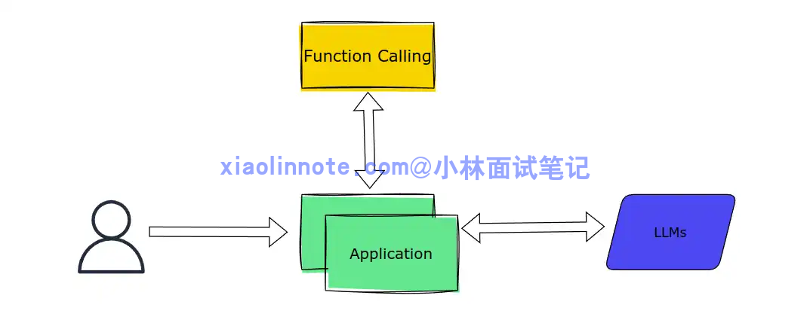

Function Calling（也常被厂商称为 tool use / tool calling）把这件事变成了结构化消息：模型返回工具名、参数和调用标识，宿主程序按提供商约定的消息格式解析并执行。它在 2023 年前后被 API 厂商广泛产品化，但并不存在一套所有厂商完全相同的消息协议；字段名、终止原因、并行调用和结构化输出能力都要以具体 API 版本为准。

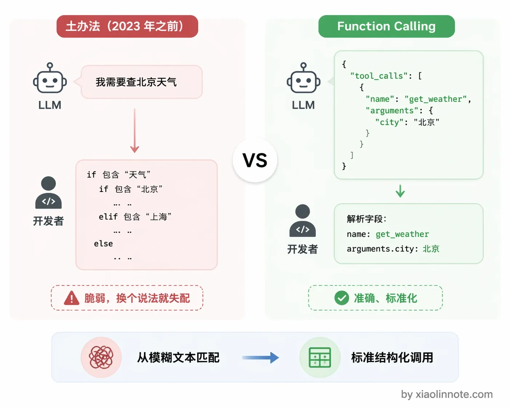

#### 三个角色，把 Function Calling 理解成一场任务委托

理解 Function Calling 的关键是搞清楚谁做什么。可以把这套流程理解成一场「任务委托」：

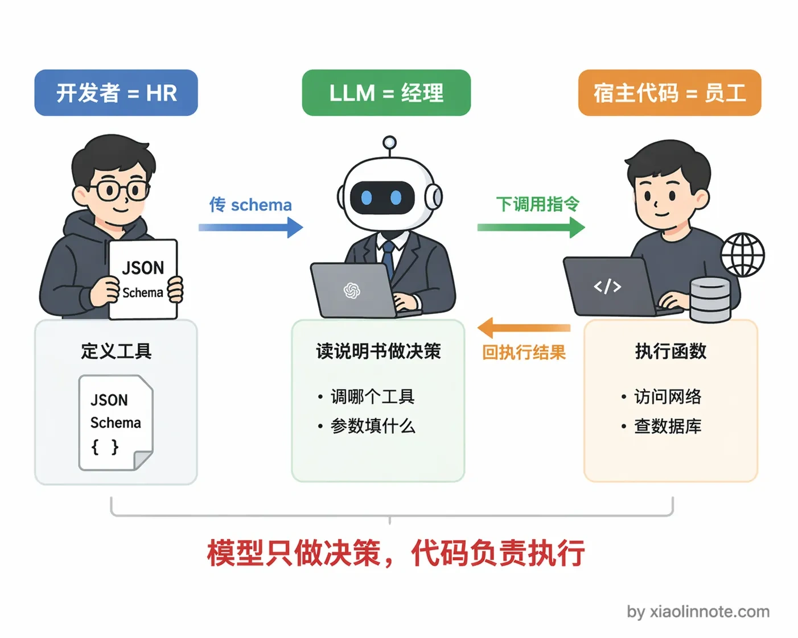

开发者是 HR，负责给每个工具写「职位说明书」，就是 JSON schema，告诉模型「我们有哪些工具、每个工具能做什么、需要哪些参数」。模型是经理，读完说明书之后决定「这个任务需要调哪个工具、参数填什么」，然后把指令下达出来。你写的代码是员工，真正去跑函数、访问网络、查数据库，把结果汇报回来。

关键点：模型全程只是在「下指令」，它不亲自执行任何代码，也没有直接访问网络的权限。执行的事一律由宿主程序代码完成，这个分工要想清楚。

#### 工具定义，schema 的每个字段都有含义

工具 schema 就是一份结构化的「工具说明书」，用 JSON 格式写，告诉模型这个工具叫什么、能做什么、需要哪些参数。

```python
tools = [
    {
        "type": "function",
        "function": {
            "name": "get_weather",          # 工具的唯一标识，模型输出 tool_calls 时会用这个名字
            "description": "查询指定城市的实时天气，包含气温、天气状况、风向风速，仅支持中国大陆城市",
            "parameters": {
                "type": "object",
                "properties": {
                    "city": {
                        "type": "string",
                        "description": "城市名称，如「北京」「上海」，不要带省份前缀"
                    },
                    "unit": {
                        "type": "string",
                        "enum": ["celsius", "fahrenheit"],
                        "description": "温度单位，默认用摄氏度"
                    }
                },
                "required": ["city"]
            }
        }
    }
]
```

其中最关键的字段是 `description`。这里停一下，你想一个问题：如果 description 写得含糊，模型会怎么表现？答案是它会「瞎猜」，比如你只写「获取天气」，模型可能拿到一个带英文名的城市也照样调，拿到「这周天气如何」这种时间跨度不对的问题也硬往里塞，调完之后发现返回的数据根本对不上。模型在决定「要不要调这个工具、参数怎么填」的时候，能依赖的唯一依据就是这段描述。

你可以对比一下：「获取天气」和「查询指定城市的实时天气，包含气温、天气状况、风向风速，仅支持中国大陆城市」，对模型判断准确率的影响差距是很明显的。写得越清晰，模型的选择越准确。参数的 `description` 同理，格式要求、示例值、限制条件都要写进去，模型才能正确填写参数。

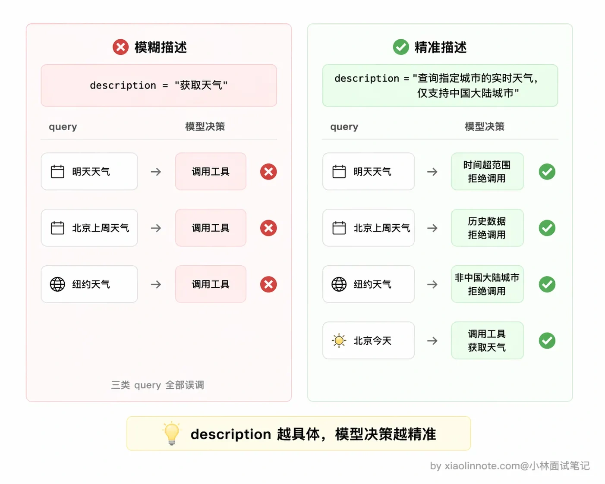

#### 完整的调用流程：模型决策—宿主执行—结果回填的循环

Function Calling 的运行时本质上是一个可重复的闭环：模型提出调用请求，宿主校验并执行，随后把成功或失败结果回填给模型。模型可以直接结束，也可以继续提出下一轮调用。

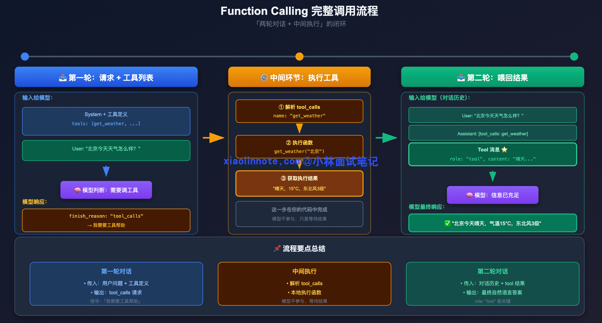

第一次请求把工具定义和用户问题传给模型。如果需要工具，模型会返回结构化调用请求；`finish_reason: "tool_calls"` 只是某些 Chat Completions API 的终止字段示例，不是跨厂商保证，不能只靠这个字段判断。应同时检查响应中的工具调用块，并处理拒绝调用、格式错误或普通文本回答。

拿到这个信号之后，中间环节就交给你的代码了。你的代码解析 tool_calls 拿到函数名和参数，找到对应的函数跑一下，拿到执行结果。

然后把工具执行结果按对应 API 的消息格式回填，再次调用模型。结果既可能让模型给出最终答案，也可能触发下一轮工具调用；循环必须有最大轮数、总 token/时间预算和人工确认边界。

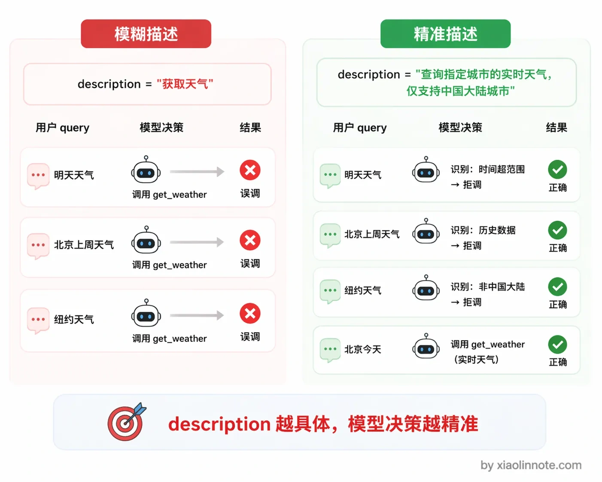

```python
import openai, json

client = openai.OpenAI()
messages = [{"role": "user", "content": "北京今天天气怎么样？"}]

# 第一轮：把工具定义和问题一起传给模型
response = client.chat.completions.create(
    model="gpt-4o",
    messages=messages,
    tools=tools,
    tool_choice="auto"  # auto 让模型自己判断要不要调，也可以设 required 强制调
)
msg = response.choices[0].message

finish_reason = response.choices[0].finish_reason  # Chat Completions 示例；其他 API 字段可能不同
if finish_reason == "tool_calls" and msg.tool_calls:
    tool_call = msg.tool_calls[0]
    func_args = json.loads(tool_call.function.arguments)  # 仍需按 schema 做类型/范围校验

    # 中间执行：你的代码真正去跑函数
    result = f"{func_args['city']}今天晴，15°C，东北风 3 级"

    # 第二轮：把工具结果塞回对话，再问一次模型
    messages.append(msg.model_dump(exclude_none=True))  # SDK 对象先序列化为 assistant 消息
    messages.append({
        "role": "tool",
        "tool_call_id": tool_call.id,  # 和 tool_calls 里的 id 对应
        "content": result
    })
    final = client.chat.completions.create(model="gpt-4o", messages=messages, tools=tools)
    print(final.choices[0].message.content)
    # 输出：北京今天天气晴朗，气温 15°C，东北风 3 级，适合外出。
```

#### 并行工具调用

看完单个工具的流程，再来想一个问题：如果用户一口气问了好几件事，比如「帮我查北京、上海、广州三个城市的天气」，模型一次该调一个工具，还是可以同时调多个？这就要说到 Function Calling 的并行调用设计。

当用户的问题需要多个工具才能回答时，模型可以在一次响应里同时输出多个 `tool_calls`，`tool_calls` 是个列表，不只有一条。比如用户问「帮我查北京和上海的天气」，模型会一次返回两个调用请求，分别对应两个城市。

为什么要这么设计？你想一下，如果没有并行调用，模型先说「我要查北京天气」，你执行完喂回去，模型再说「我要查上海天气」，又一轮对话，这样两个工具串行要跑两轮，每一轮都有一次模型推理和一次工具执行的延迟，总耗时很长。有了并行调用，模型一次把两个调用请求都输出来，你的代码可以同时执行这两个工具（比如用 Python 的 `asyncio.gather` 或者多线程），拿到所有结果后一次性塞回对话，再调一次模型就拿到综合了多个工具结果的最终答案。整个过程从「两轮对话」压缩成了「一轮对话 + 并行执行」，总耗时大幅降低。

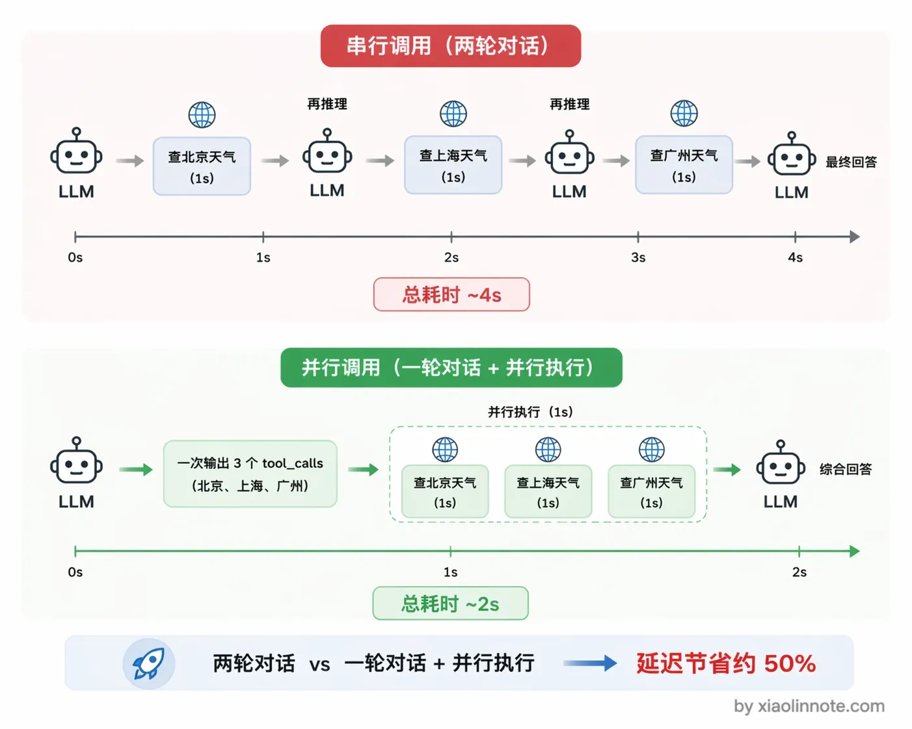

不过要注意一点，并行调用的前提是这些工具之间没有数据依赖，而且宿主必须为每个调用分别做权限、超时、限流、重试和结果关联。

查北京天气和查上海天气互不影响，可以并行；但如果是「先查用户的订单号，再用订单号去查物流」，第二个调用依赖第一个的结果，这种就只能串行，模型也会正确地分两轮来输出。

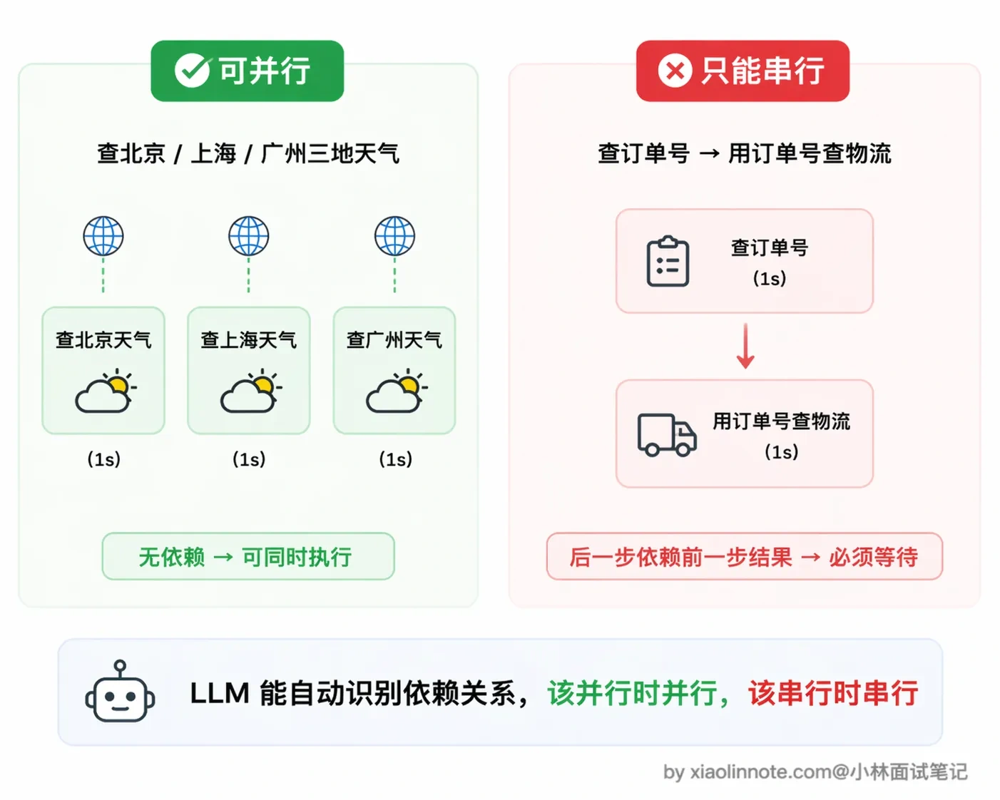

#### 工程边界：结构化请求不等于安全执行

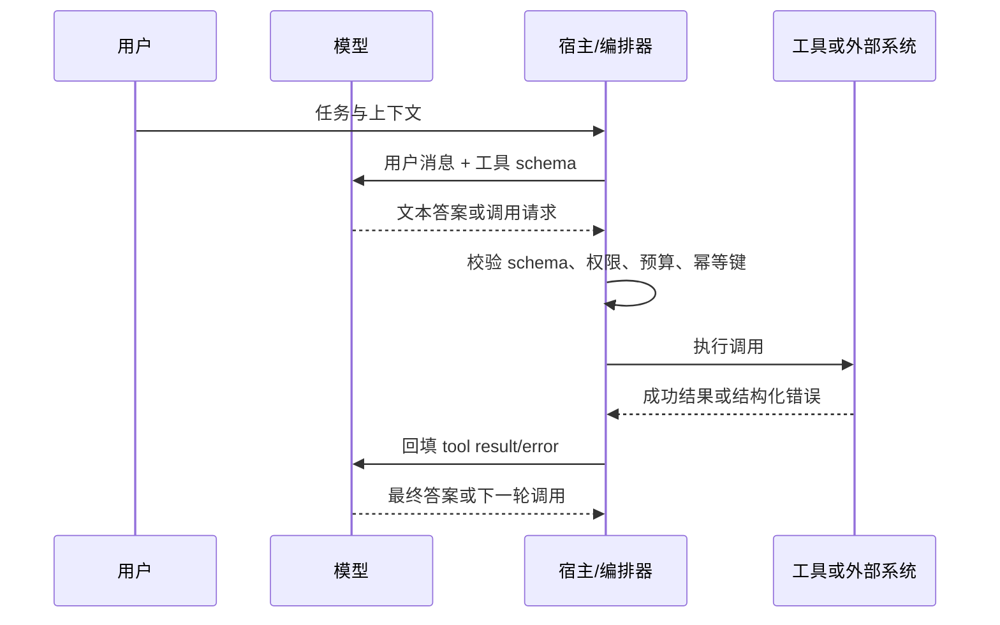

| 环节 | 必须回答的问题 | 常见故障 |
| --- | --- | --- |
| 选择 | 是否真的需要外部事实或副作用？ | 过度调用、工具选择错误 |
| 参数 | 参数是否符合 schema、租户和业务约束？ | JSON 可解析但语义非法 |
| 执行 | 是否需要确认、超时、限流、幂等和审计？ | 重试造成重复扣款/写入 |
| 回填 | 结果是否标明来源、状态和可重试性？ | 把错误当成功结果继续推理 |
| 收敛 | 何时停止，预算耗尽怎么办？ | 无限调用、成本和延迟失控 |

### 🎯 面试总结

回头看开头的面试对话，踩的雷其实很典型。

第一个误区是以为模型能「自己」去访问网络、执行代码，这是对 Function Calling 最常见的误解。面试时一定要强调：模型全程只负责决策，输出结构化的 JSON 调用请求，真正执行工具的是你的宿主程序代码，这个职责分工是整个机制的核心设计。

第二个误区是把 Function Calling 和靠解析自然语言调工具的做法搞混了。它的关键改进是结构化调用消息和明确的宿主执行边界，但具体字段与控制语义仍是提供商相关，并不自动提供权限、幂等或安全保障。

面试回答这道题，可以按「schema → 模型提出结构化调用 → 宿主校验/执行 → 回填结果 → 循环收敛」展开；补充并行调用、依赖关系、错误/重试、权限确认和成本预算。`finish_reason` 可作为某一 API 的实现细节举例，不要说成通用协议字段。

把这几个点讲清楚，再强调「模型决策、代码执行」的分工原则，这道题就稳了。

---

## LLM 是如何学会调用外部工具的？

👔面试官：说说大模型是怎么学会调用外部工具的？

🙋‍♂️我：大模型本身就很聪明嘛，参数量够大，涌现能力一出来，自然就会调用工具了，不需要额外训练吧？

👔面试官：涌现能力说的是参数量到某个阈值后，模型突然展现出小模型没有的理解和推理能力，这是「量变引起质变」。但工具调用要的是输出可解析的结构化 JSON，这是预训练语料里根本不存在的模式，不是参数量大了就自动会的。没训练过的模型遇到「查天气」只会说「我需要查天气 API」，而不是输出可解析的 JSON 调用请求。你说说到底是怎么训练出来的？

🙋‍♂️我：那应该是用 SFT 微调出来的吧？给模型喂大量工具调用的样本，它学会了就行了。

👔面试官：SFT 只解决了「会不会调」的问题，但「该不该调」呢？用户问「1+1 等于几」，模型也去调计算器工具，这不是画蛇添足吗？SFT 之后还有一个关键阶段你完全没提到，回去把 RLHF 在工具调用训练中的作用搞清楚再来。

看得出来，很多人把「格式学会了」和「策略边界可靠」混为一谈。下面把训练信号与运行时防线分开说明：SFT、偏好优化、强化学习、约束解码和宿主校验都可能参与，具体组合取决于模型与产品。

### 💡 简要回答

这道题我分两块来讲：模型怎么被训练出工具调用能力，以及训练好之后运行时是怎么工作的。

训练层面常见但并非唯一的组合是：

- **SFT（监督微调，Supervised Fine-Tuning）或其他后训练**：用正例、非调用反例、并行/依赖调用和失败处理示范，学习消息格式与基本行为；
- **偏好优化、强化学习或验证器训练**：把「该不该调、调用是否有帮助、失败后是否安全收敛」变成偏好或可验证的训练信号。RLHF（基于人类反馈的强化学习）只是其中一种路线，并非所有模型都使用它。

运行层面，每次请求时，你的应用代码把工具描述（叫 schema，可以理解为工具的说明书）传给模型，模型如果判断需要工具，就输出一段结构化的 `tool_calls` JSON；你的代码拿到这段 JSON 去真正执行，把结果塞回对话，模型再给出最终答案。

有一点非常关键：模型全程只是在「下指令」，真正执行工具的是你的代码，不是模型本身。这套「模型决策、代码执行」的运行时机制，就是我们常说的 **Function Calling**。

### 📝 详细解析

#### 原始 LLM 的世界，为什么不会调工具

想象一个人从出生到成年，只生活在文字的世界里，读过几乎所有的书，却从没接触过任何工具，没用过锤子、没开过车、也没见过 API 是什么。你突然跟他说「去帮我查一下天气 API」，他最多只会用语言描述「我需要查天气 API 来获取数据……」，绝对不会真的去操作工具。

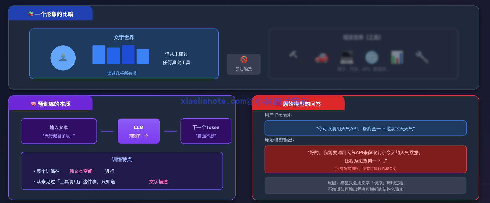

预训练主要通过预测 token 学习语言、代码和交互模式；训练语料中也可能出现 API 文档、JSON、函数调用示例或代理轨迹。因此不能说预训练模型「从未见过工具调用」。更准确的说法是：仅凭通用预训练，不能保证它遵循某个提供商的工具消息协议、正确选择工具并稳定输出符合 schema 的参数；这些能力通常还需要专项后训练、运行时约束和宿主校验。

工具调用能力不是参数量一大就必然出现，而是模型训练与运行时共同形成的。可以用一句更稳妥的话概括：**示范/后训练教格式和策略，宿主程序负责把不可信输出变成受控执行**。

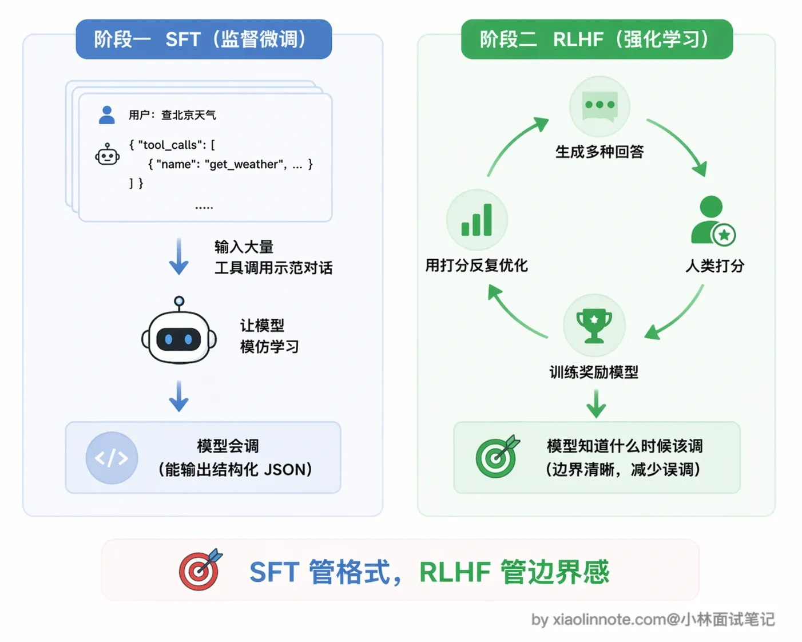

#### 第一阶段：SFT，让模型「见过」工具调用

SFT 是 Supervised Fine-Tuning（监督微调）的缩写，核心思路非常直接：给模型看大量正确的示例，让它学会模仿。就像培养一名新员工，前期让他看几百份填好的工单，他自然就学会了「遇到这类问题该怎么写工单、该走哪个流程」。

要让模型学会工具调用，就要构造专门的训练数据。一条完整的训练样本长这样：

首先是 **System 消息**，也就是工具说明书，列出模型现在有哪些工具可用，每个工具叫什么名、能做什么事、需要什么参数，模型从这里「认识」工具。接着是 **User 消息**，就是用户的提问，比如「北京今天天气怎么样？」。

然后到了最关键的部分：**Assistant 的调用请求**。注意，这里的「正确答案」不是自然语言回答，而是结构化 JSON，类似 `{"tool_calls": [{"name": "get_weather", "arguments": {"city": "北京"}}]}`。这就是模型需要学会输出的东西。为什么是 JSON 而不是自然语言？因为 JSON 格式固定、机器好解析，你的代码才能准确读到「调哪个工具、参数是什么」。

再往后是 **Tool 消息**，模拟工具返回的数据，比如「晴，15°C，东北风3级」。最后是 **Assistant 的最终回答**，模型看到工具结果后，给出自然语言答案：「北京今天天气晴朗，气温15°C……」。

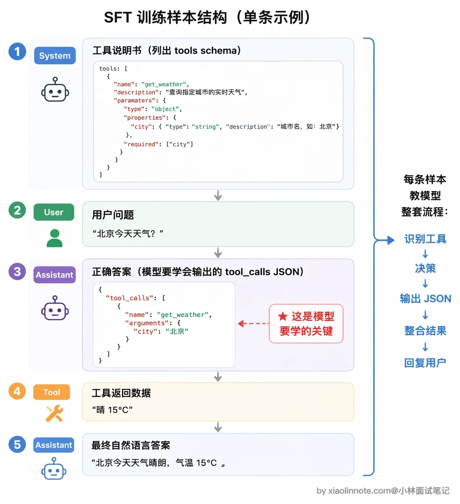

样本规模没有通用门槛；关键是覆盖工具定义、无需工具、参数边界、并行/依赖调用、权限确认、失败/超时和多轮上下文。训练集还应保留独立验证集，避免只学会模板而没有泛化。

训练数据可以来自人工标注、程序合成、真实调用轨迹或强模型蒸馏；自动生成必须做 schema、业务规则和安全审查，不能把某个具体模型或某个数量说成行业固定做法。

#### SFT 的短板，会了，但不知道「该不该调」

SFT 让模型学会了「调工具」这个动作，但它不知道什么时候该调、什么时候不该调。你可以想象一个刚培训完的新员工，过于热情，每件事都想走流程，有人问他「1+1 等于几」，他也要去查手册，这明显多此一举，直接回答就行。

为什么会这样？因为 SFT 的训练样本里，「该调的场景」占了绝大多数（毕竟我们就是要教它调工具），模型在模仿的过程中会过拟合这种「积极调用」的倾向，没看过足够多的「不该调」反例。再加上训练信号只告诉它「这是正确答案」，没有告诉它「为什么不该调也是一种正确」，所以它的边界感天然就弱。

SFT 之后的模型也有类似的毛病：可能对简单问题也尝试调工具，或者遇到工具调用失败时不知道该怎么处理，行为边界感很弱。

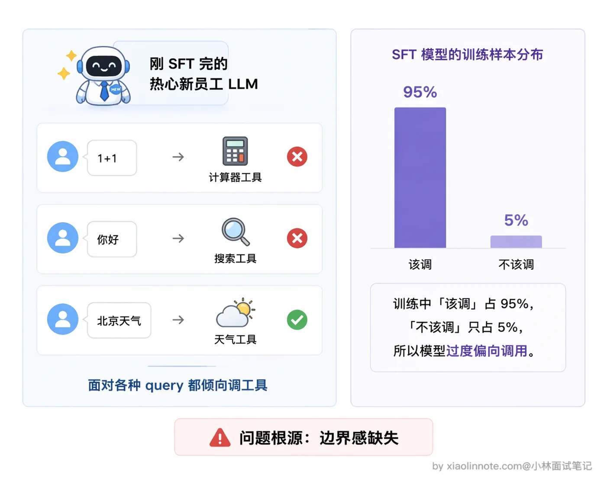

这个问题需要更多的反例、偏好/验证信号和运行时约束共同解决，不应归因于某一个必选训练阶段。

#### 第二阶段：RLHF，用反馈建立边界感

RLHF 是 Reinforcement Learning from Human Feedback（人类反馈强化学习）的缩写。如果说 SFT 是让新员工看示例学规范，那 RLHF 就是老板持续给他的工作表现打分，帮他建立判断力。

它的流程分四步：

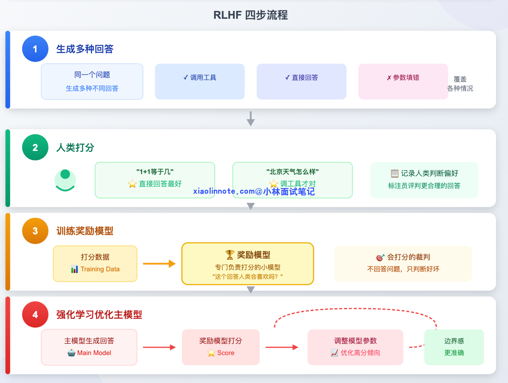

第一步是生成多样回答。对同一个问题，让模型生成几种不同的处理方式，有的调了工具，有的直接回答，有的参数填错了，故意覆盖各种情况。

第二步是人类打分。标注员评判哪种回答更合理，比如「1+1 等于几」直接回答最好，「北京天气怎么样」调工具才对。这批打分数据就记录了人类的判断偏好。

第三步是训练奖励模型。用这批打分数据，单独训练一个小模型，专门负责打分，它不回答问题，只判断「这个回答人类会喜欢吗」。你可以把它理解成一个「会打分的裁判」。

这一步很关键，也容易被忽略：奖励模型的打分能力本身就是从人类标注员的偏好数据里学出来的，换句话说，人类的判断被「蒸馏」进了这个裁判。所以如果人类标注员自己水平不稳定、标准不一致，奖励模型就会学到一个歪的打分标准，后面主模型再怎么被它优化，方向也是歪的。

第四步是用强化学习优化主模型。拿奖励模型的打分不断调整主模型的参数，让主模型越来越倾向于产出「高分回答」，也就是边界感更准确的工具调用行为。

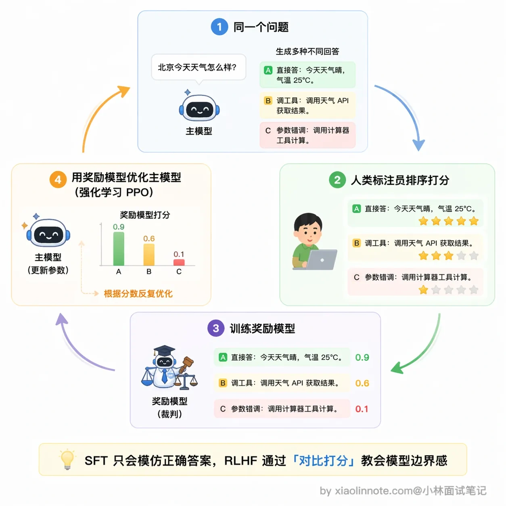

经过合适的正负样本与反馈，模型可能学会更细的边界：能直接回答的就直接回答，需要实时数据或副作用操作时才调用。但这不是训练后就可以放弃工程防线；应用仍应检查权限、参数、数据新鲜度、超时、幂等和人工确认。

RLAIF（AI Feedback，AI 反馈）是用模型生成偏好或评价信号的路线之一。它可以扩展数据，但会继承评审模型的偏差，不能笼统地说与人工反馈效果相当；应通过独立任务集和安全集验证。

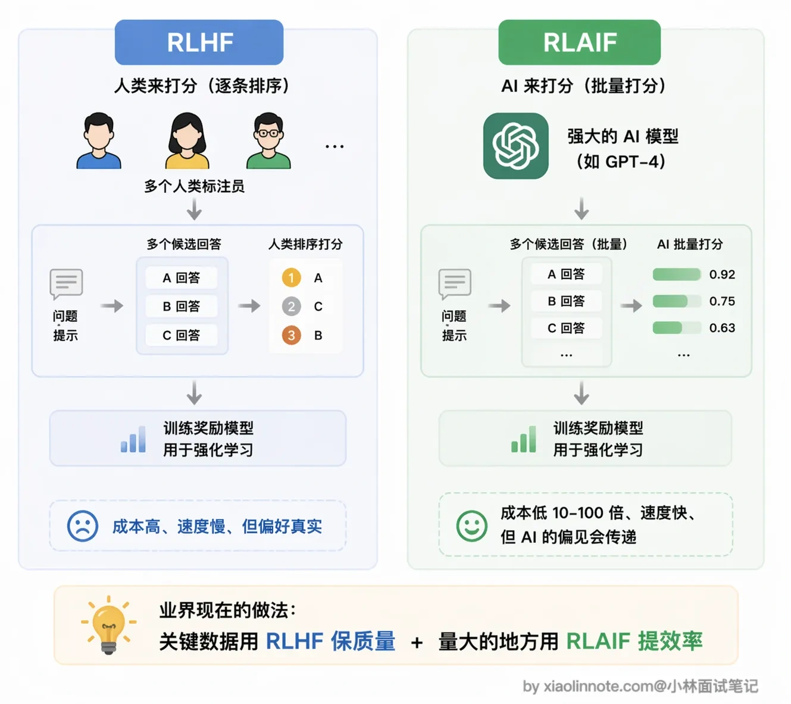

#### 运行时，训练好之后怎么用

训练阶段结束，模型上线了。每次你的应用调用模型时，流程是这样的：

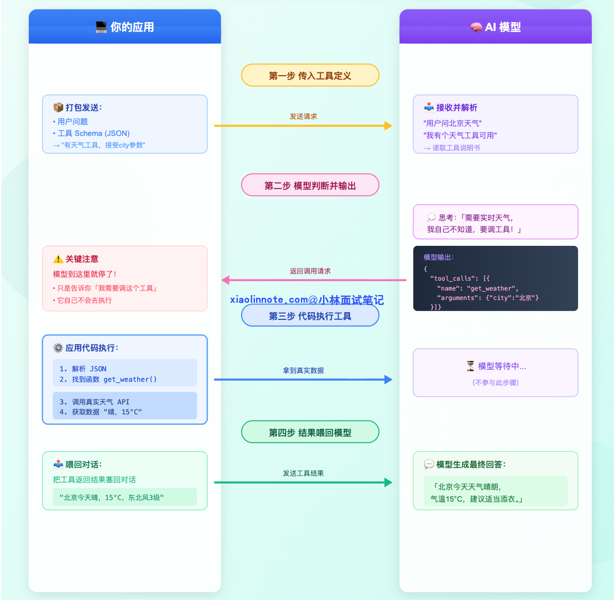

首先，你的应用代码把「有哪些工具可用」打包成 JSON 格式（叫做 schema，也就是工具的说明书），连同用户的问题一起发给模型。比如告诉模型：「你现在有一个天气查询工具，接受 city 参数，返回该城市的实时天气。」

模型读完工具定义和用户问题后，做了一个判断：这个问题需要查实时天气，我自己不知道，需要工具帮忙。于是它不直接回答，而是输出一段结构化的 JSON：

```python
{
    "tool_calls": [{
        "name": "get_weather",
        "arguments": {"city": "北京"}
    }]
}
```

注意，**模型到这里就停了**，它只是告诉你「我需要调这个工具，参数是这个」，它自己不会去执行。

接下来就轮到你的代码上场了。你的应用代码解析这段 JSON，找到对应的函数，真正去调天气 API，拿到实际数据。

拿到结果之后，你把工具返回的结果（比如「北京今天晴，15°C，东北风3级」）塞回对话历史，再次调用模型，模型这才组织成一句话回答用户。

这套「模型输出结构化调用请求 -> 代码执行 -> 结果喂回」的机制，有一个专有名词：**Function Calling**。换句话说，Function Calling 就是大模型工具调用能力在运行时的具体实现形式。

#### 一个关键认知：模型只负责「决策」，不负责「执行」

这是理解工具调用最重要的一点。

模型在整个过程中只做了一件事：判断要调哪个工具、参数填什么，然后把这个决策用 JSON 格式输出出来。真正去跑函数、访问网络、查数据库的，是你写的宿主程序代码。

这个分工设计得很合理：LLM 擅长理解意图和推理，但不应该有直接操作系统资源的权限；宿主程序负责执行，可以做权限控制、参数校验、执行沙箱等安全措施。这样的设计让工具调用既灵活又安全，是目前主流工具调用框架的核心设计原则。

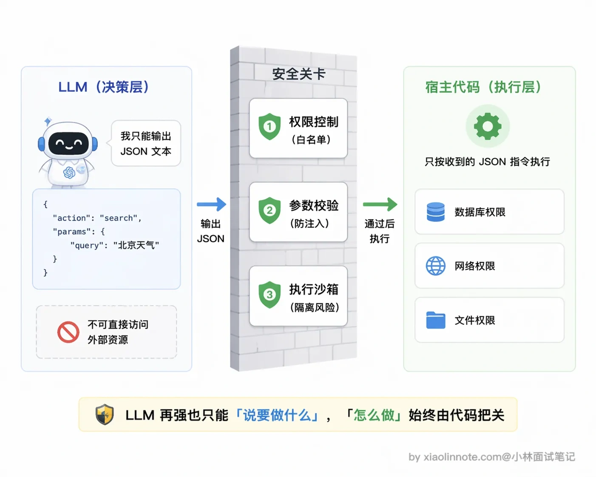

### 🎯 面试总结

回顾开头的面试对话，第一个雷是以为参数量够大就自然会可靠调工具。预训练可能提供相关先验，但不能保证符合具体 API 的消息协议和业务安全边界；这些需要后训练、约束和宿主侧验证共同完成。

第二个雷是把 SFT 与 RLHF 说成固定的二阶段流水线。SFT 常用于学习示范与格式，偏好优化/强化学习/验证器可用于塑造边界，但是否采用、如何组合都要看模型和任务。

面试回答这道题，核心要讲清楚两个阶段各自的作用。

面试时可以回答：训练数据应同时覆盖调用、非调用、并行/依赖、失败与拒绝场景；后训练信号让模型偏向有帮助且安全的选择；运行时再由 schema 校验、权限策略、超时/重试、幂等键和人工确认兜底。

另外要提到运行时的 Function Calling 机制，模型只负责决策输出 JSON，代码负责执行，这个分工设计是关键认知。

如果能再补充 RLAIF 作为 RLHF 的低成本替代方案，就更完整了。

---

## 大模型的 Function Call 能力是怎么训练出来的？

👔面试官：详细说说大模型的 Function Call 能力是怎么训练出来的？

🙋‍♂️我：应该就是在预训练阶段，训练语料里包含了一些 API 调用的代码，模型自然就学会了吧？

👔面试官：预训练学到的是「预测下一个 token」，模型最多能描述「我要调 API」，但不会输出结构化 JSON 调用请求。这是两个完全不同的东西，你把预训练和专项微调搞混了。

🙋‍♂️我：哦，那就是 SFT 微调，给模型看很多工具调用的样本对吧？那训练数据只要包含正常的单工具调用场景就够了？

👔面试官：单工具调用只是最基础的场景。多工具并行调用、工具调用失败后重试、不需要工具直接回答、多轮对话中的工具调用，这些场景训练数据里都要覆盖到，缺一个就会在对应场景翻车。而且你还是只提了 SFT，RLHF 阶段怎么解决「该不该调」的边界感问题，训练数据从哪来，这些关键环节一个都没讲到，回去好好整理一下。

确实，Function Call 的训练远不止「喂点样本」这么简单。下面我把两个训练阶段、训练数据的构造和来源、以及各自解决什么问题，完完整整地讲一遍。

### 💡 简要回答

Function Call 的能力主要靠两个训练阶段来培养，这两个阶段解决的是不同的问题。

第一个常见环节是 SFT，就是给模型看包含工具定义、用户问题、结构化调用、工具结果和最终答案的完整样本，让它学习消息格式与基本流程。但样本还必须包含「不调用」和安全拒绝等反例，否则可能形成过度调用倾向。

第二个环节可以是偏好优化、强化学习或基于规则/单元测试的验证器训练：让模型倾向于选择真正有帮助、权限合规且能收敛的调用。RLHF 是一种可选实现，不是所有模型的必经阶段。

一句话总结：示范学习格式和基本行为，偏好/验证信号与运行时策略共同塑造「何时调、怎样安全地调」。

### 📝 详细解析

很多人以为 Function Call 是大模型「聪明」之后自然就会的东西，其实不是。就算是 GPT-4，如果没有经过工具调用的专项训练，它遇到「北京今天天气怎么样」这个问题，顶多也就输出一句「我需要查询天气数据」，这是在**描述**一个意图，而不是在**输出**可以被程序解析和执行的结构化 JSON。这两件事之间有本质的差距。

为什么不能只依赖预训练？因为预训练语料中的 API、代码和 JSON 形式多样，通常没有与你的工具 schema、消息角色和业务边界一一对应的监督轨迹；模型可能有先验，却不保证遵循某个具体工具协议。

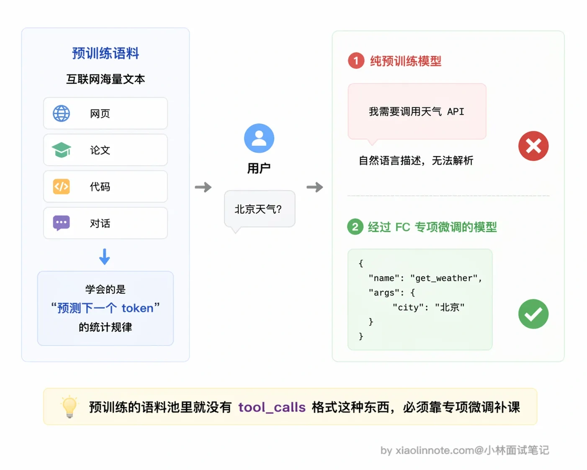

预训练主要优化下一个 token 的预测目标，学习到的是广泛的统计规律；而「看到这组 schema，在这个权限和时效条件下，输出某个可执行调用」还包含策略、协议和业务约束。专项后训练能补齐这些模式，但不能替代宿主侧验证。

Function Call 的核心训练分两个阶段，每个阶段解决不同的问题，缺一不可。

#### 阶段一：SFT，让模型「学会怎么调」

SFT（Supervised Fine-Tuning，监督微调）的核心动作很简单：给模型喂大量正确示例，让它通过模仿来学习。对 Function Call 能力来说，就是构造「包含完整工具调用流程的对话样本」，一条样本里包含所有角色的消息。

一条完整的训练样本大概是这样的结构：首先是 system 消息，里面注入了工具的定义，工具叫什么名字、是干什么用的、接受哪些参数。模型是从这里「认识」工具的，就像你给新员工一份工具手册，告诉他公司有哪些系统可以用。接着是 user 消息，就是用户的提问，比如「北京今天天气怎么样」。

然后是关键的一步：assistant 的消息不是自然语言，而是结构化的 JSON 调用请求，类似 `{"tool_calls": [{"name": "get_weather", "arguments": {"city": "北京"}}]}`，这是「正确答案」，是模型通过训练需要学会输出的内容。之后是 tool 角色的消息，是工具执行后返回的结果，比如「晴天，15°C，东北风 3 级」。最后 assistant 再出现一次，根据工具结果给出最终的自然语言答案。

这套完整的对话结构覆盖了整个调用链路。模型通过反向传播（backpropagation）来学习：给定样本里的正确 JSON 调用，当模型输出的内容偏离这个正确答案时，损失函数就会产生惩罚信号，梯度往回传，一点点调整模型内部的参数权重，让下次输出更接近正确格式。

大量样本反复训练，模型就把这套「看到工具定义 + 看到用户问题 -> 输出规范 JSON」的模式「记住」了。就像背单词，看一遍不够，反复遇到、反复纠错，最终形成了肌肉记忆。

##### 训练数据需要覆盖哪些场景

训练数据的多样性直接决定了 Function Call 能力的上限，不能只有「正常调一个工具」这一种情况。

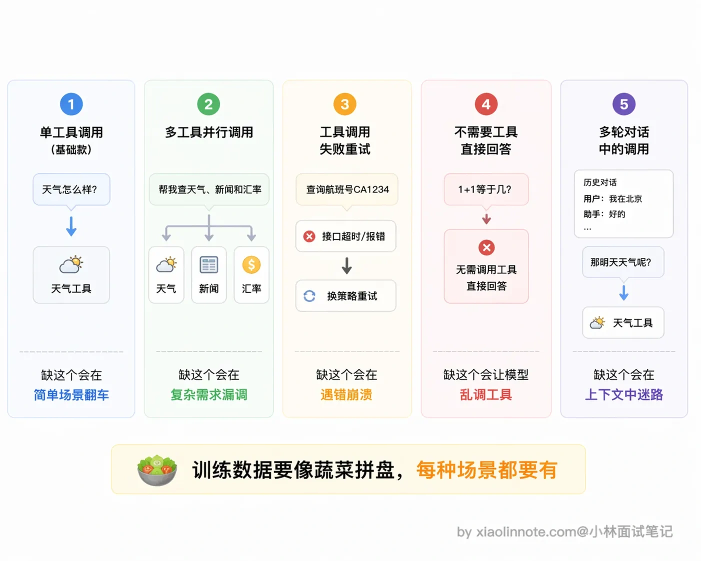

好的训练数据至少要覆盖这几类场景。最基础的当然是**单工具调用**，一个问题对应一个工具，这是入门款。但光有这个远远不够，还需要**多工具并行调用**的样本，比如用户问「帮我查北京和上海的天气」，模型应该一次性输出两个调用请求而不是傻乎乎地一个一个来，如果训练数据里没见过这种场景，模型就不知道可以并行。

另一个容易忽略但非常关键的场景是**工具调用失败后的处理**。现实中工具不可能百分百成功，API 超时、参数格式不对、权限不足，各种错误都有可能出现，模型要能识别错误信息并换个方式处理，而不是直接崩掉或者傻傻地重复同样的调用。

还有一类场景很多人想不到：**不需要调工具、直接回答**。这个其实非常重要，「1+1 等于几」「帮我总结这段话」这类问题完全不需要工具，模型得学会判断「我能自己解决，不用调」。如果训练数据里全是「调用工具」的正例，模型就会形成「遇到问题就调工具」的惯性，该直接回答的时候也去调，画蛇添足。

最后是**多轮对话中的工具调用**，上下文里已经有过工具结果，模型要能正确理解和引用之前的结果，而不是无视历史重新调用。这些场景的覆盖程度，直接影响模型在实际使用中的表现，缺哪个就会在哪个场景下翻车。

##### 训练数据从哪来

构造 Function Call 训练数据主要有两种方式。

第一种是**人工标注**，雇标注员，给定用户问题和工具定义，让他们写出正确的调用示例。这种方式质量好，因为人写的样本准确度有保障，但成本极高，通常只用于核心种子数据的构造，没法大规模扩展。

第二种是**程序合成或模型辅助生成**，可用已有模型生成候选轨迹，再用 JSON Schema、业务模拟器、权限规则和人工抽查过滤。自动生成能扩展覆盖面，但上游模型的错误、偏见和不安全调用会被传递，不能把某个上游模型称为固定的行业标准。

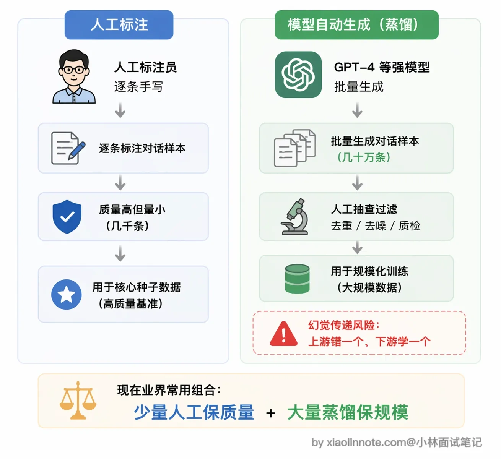

#### 阶段二：后训练与验证，对齐「该不该调」的边界感

SFT 之后，模型已经学会了「怎么调工具」，但还有一个问题没解决：**什么时候应该调工具，什么时候直接回答**。

如果 SFT 样本大多是「正确调用」的例子，模型可能学得偏激，遇到什么问题都想调工具；因此数据要明确呈现无需调用、拒绝越权、等待用户确认和工具不可用等分支。

「1+1 等于几」不应该调计算器，直接回答 2 就行；「帮我总结这段文字」完全不需要任何工具，直接做就行；只有「北京今天天气」这类需要实时数据的问题才应该调。

这种边界感可以通过偏好数据、规则/单元测试、可执行模拟器和强化学习等方式塑造；具体路线取决于任务，不应把它简化成「必须 RLHF」。

RLHF（Reinforcement Learning from Human Feedback，人类反馈强化学习）的流程分四步。

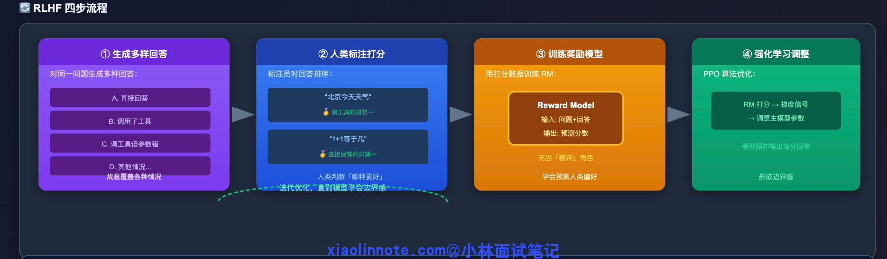

- 第一步是生成多样回答。对同一个问题，让模型生成多种回答，有直接回答的，有调了工具的，有调了工具但参数填错的，故意覆盖各种情况。
- 第二步是人类标注打分。标注员对这些回答进行排序，比如「北京今天天气怎么样」这道题，调了天气工具的回答排第一，因为不调工具就没法给出准确的实时数据；「1+1 等于几」这道题，直接回答 2 的排第一，调计算器工具的反而是画蛇添足，排末尾。
- 第三步是训练奖励模型。用这批打分排序的数据，单独训练一个神经网络，叫做「奖励模型」（Reward Model，RM）。奖励模型学会了一件事：给定一个问题和一种回答，预测人类会给这个回答多少分。它不直接回答用户，只负责打分，相当于一个专门评判「哪种回答更好」的裁判。
- 第四步是用强化学习调整主模型。拿奖励模型的打分信号，通过 PPO（Proximal Policy Optimization，近端策略优化）等强化学习算法持续调整主模型的参数，让主模型越来越倾向于输出「奖励模型打高分」的回答。

你可能会好奇，为什么偏偏是 PPO？

强化学习算法那么多，选 PPO 有两个很务实的理由：一是它相对稳定，训练过程不容易崩（传统策略梯度算法很容易因为单步更新太大把模型直接调废）；二是它内置了一个 KL 散度约束，强迫新模型和旧模型的输出分布不要差得太远，这样就不会出现「为了讨好奖励模型，模型把自己训成只会重复几句套话的怪胎」这种退化情况。RLHF 本质上要让模型在「追求高奖励」和「保持语言能力」之间走钢丝，PPO 在这个平衡上是目前公认好用的工具。

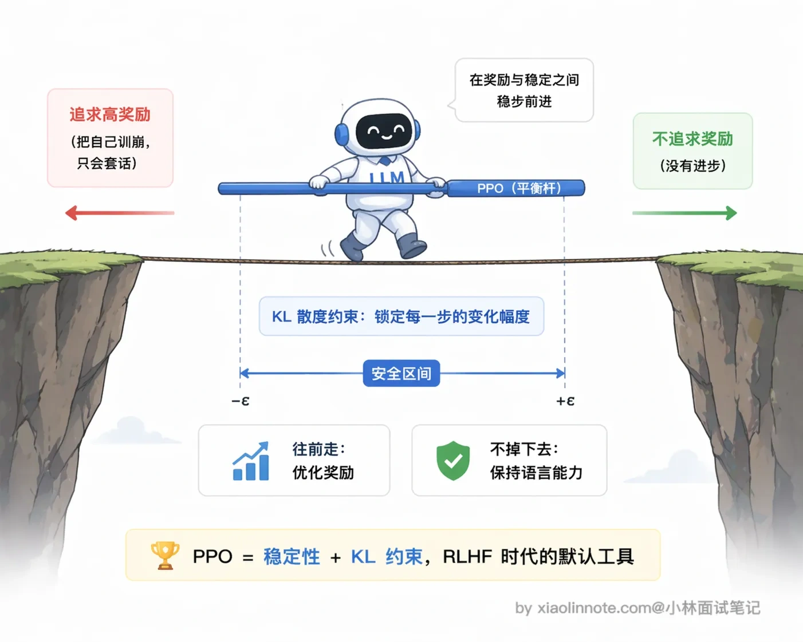

经过足够多的迭代，模型就学会了那种边界感：该调工具时调，能直接回答时不折腾。

##### RLAIF：用 AI 代替人工打分

RLHF 最大的痛点是人工标注成本极高，标注员需要专业背景，打分慢、价格贵，很难大规模扩展。

RLAIF（Reinforcement Learning from AI Feedback）是它的改进版。你可以这么理解：RLHF 是请一群专业的人类评委来给模型的回答打分，质量很高但请评委的成本也很高；RLAIF 就是换成了一个「AI 评委」，用更强的 AI 模型（比如 GPT-4）来代替人类标注员做这个打分的活儿，成本能低 10-100 倍，速度也快得多。

不过代价也很明显：「AI 的偏见会传递」。如果打分的 AI 本身对某些场景的判断有偏差或者盲区，这些偏差也会被学进去。打个比方，如果 AI 评委觉得「遇到数学题都应该调计算器工具」，那被它训练的模型也会学到这个倾向，哪怕有些简单算术不用调工具。所以打分 AI 的质量很关键，选什么模型来当评委、怎么设计评分标准，都需要仔细考虑。现在业界很多模型训练都在混用 RLHF 和 RLAIF，在关键数据上用人工保质量，量大的地方用 AI 提效率，两者互补。

#### 两个阶段各司其职

SFT 解决的是「会不会」的问题，RLHF 解决的是「该不该」的问题。

只有 SFT 而没有 RLHF 的模型，可能遇到什么问题都冲动地调工具；反过来，只有 RLHF 而没有 SFT，模型连工具调用的格式都输不出来，奖励信号根本没地方发力。

两个阶段配合起来，才能训练出「知道怎么调、也知道什么时候该调」的工具使用能力。

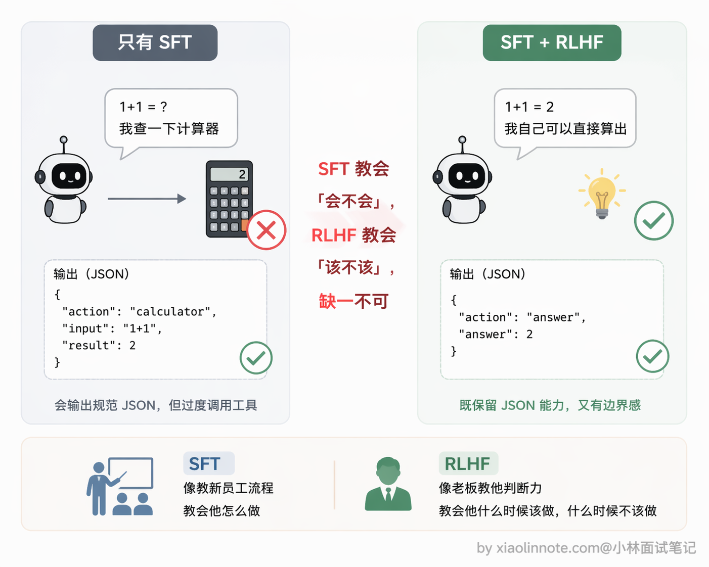

### 🎯 面试总结

回看开头踩的雷，第一个误区是以为预训练就能学会 Function Call，实际上预训练只学了「预测下一个 token」，模型最多会描述意图，不会输出结构化 JSON，这必须靠 SFT 专项训练。第二个误区是以为训练数据只覆盖单工具调用就够了，实际上多工具并行、调用失败重试、不需要工具直接回答、多轮对话中的调用，这些场景都必须覆盖，缺哪个就在哪个场景翻车。

面试回答这道题，要把两个训练阶段讲清楚。

SFT 阶段通过「system 工具定义 + user 问题 + assistant JSON 调用 + tool 执行结果 + assistant 最终回答」这样的完整对话样本来训练，让模型通过反向传播学会整套流程。

RLHF 阶段通过人类对多种回答的偏好排序训练奖励模型，再用 PPO 等强化学习算法调整主模型，建立「该不该调」的边界感。

训练数据来源也要提到：人工标注质量高但成本高用于种子数据，模型自动生成（Self-Instruct / Distillation）成本低量大但要注意幻觉传递的风险。

一句话总结：SFT 教会怎么调，RLHF 教会什么时候调。

---

## 什么是 MCP（模型上下文协议）？讲讲它的核心内容？

👔面试官：说说什么是 MCP？它的核心内容是什么？

🙋‍♂️我：MCP 就是一个工具调用框架吧，跟 Function Calling 差不多，都是让模型调用外部工具的。

👔面试官：MCP 是协议，不是框架，跟 Function Calling 更不是一个层面的东西。Function Calling 解决的是「模型怎么输出调用请求」，MCP 解决的是「工具怎么标准化接入」。你把这两个搞混了，说说 MCP 到底要解决什么问题？

🙋‍♂️我：呃……MCP 是为了让工具接入更方便？就是 Anthropic 搞的一个 API 标准，让 Claude 能调更多工具？

👔面试官：MCP 是开放协议，不是只给 Claude 用的。它解决的是工具接入碎片化的问题，工具实现一次、到处复用，任何支持 MCP 的客户端都能接入。Client-Server 架构、三类核心能力 Tools/Resources/Prompts 的区别、底层 JSON-RPC 通信机制，这些核心内容你一个都没提到，回去补课吧。

看来 MCP 这个概念确实容易和 Function Calling 搞混。下面我从「MCP 到底要解决什么问题」出发，把它的架构、三类核心能力、底层通信机制完整讲清楚。

### 💡 简要回答

MCP（Model Context Protocol，模型上下文协议）是由 Anthropic 发起、后来开放演进的协议。它主要解决的是「宿主应用接工具、资源和提示模板时接口碎片化」的问题；具体支持哪些能力要以协议版本和客户端实现为准。

在 MCP 出现之前，每接一个新工具都要单独写集成代码、处理认证、适配格式，而且这套代码和具体模型强绑定，换个模型就得重写，非常繁琐。

MCP 的思路是把发现、调用和上下文交换标准化：工具提供方按协议实现一个 MCP Server，支持相同版本与能力的客户端可以减少定制适配，但仍要处理版本、认证、权限、schema 映射和错误语义。它降低集成成本，不等于「任何客户端零代码兼容」。

协议定义了三类能力：Tools 用于执行有副作用的操作，Resources 是只读数据，Prompts 是提示词模板，底层通信用 JSON-RPC 2.0。

我把它理解成给「AI 接工具」这件事定了一套行业标准。

### 📝 详细解析

#### 没有 MCP 之前，接工具有多麻烦

想象你要给 Claude 接入 GitHub 工具。你得手写 GitHub API 的调用代码、处理认证（OAuth token 怎么传）、处理各种返回格式、把 API 响应转成模型能理解的格式……好不容易接好了。

结果过了两个月，Claude 升了个版，接口有变化，你的对接代码得改。更麻烦的是，你同时接了十个工具，每个工具都有自己的一套对接代码，各自的格式、认证方式、错误处理逻辑都不一样。现在产品方说，这套工具也要给 Cursor 用，不好意思，你得重写一遍，因为 Cursor 和 Claude Desktop 的接入方式完全不同。

这就是 MCP 出现之前，AI 工具生态的真实状态：**碎片化、难复用、强绑定**。每个工具、每个模型都是一座孤岛，接一个新工具就要重新搭一座桥。

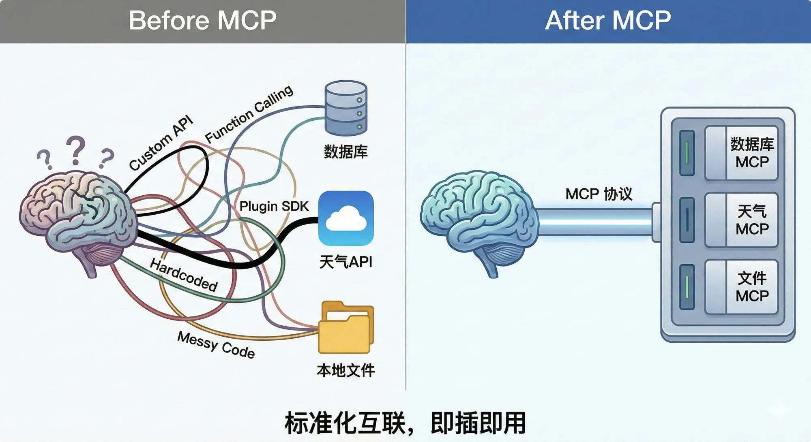

#### MCP 的核心思路，定一套行业标准接口

MCP（Model Context Protocol，模型上下文协议）的设计思路，可以用 USB 接口来类比。在 USB 标准出现之前，鼠标用这个接口、键盘用那个接口、打印机又是另一个，换台电脑就要愁接口不兼容。USB 出现之后，所有外设统一接口，任何设备插到任何电脑都能工作，设备厂商只需要做一次适配，全球所有 USB 电脑都能用。

MCP 做的是同一件事：为「AI 接工具」这件事定了一套统一的协议标准。工具提供方（比如 GitHub 官方）按 MCP 规范实现一个 MCP Server，里面封装好各种操作。任何支持 MCP 的 AI 客户端，Claude Desktop、Cursor、各种 Agent 框架，都能直接连上这个 Server，自动发现里面的工具并使用，不需要写任何定制化对接代码。工具只需要实现一次，到处复用。

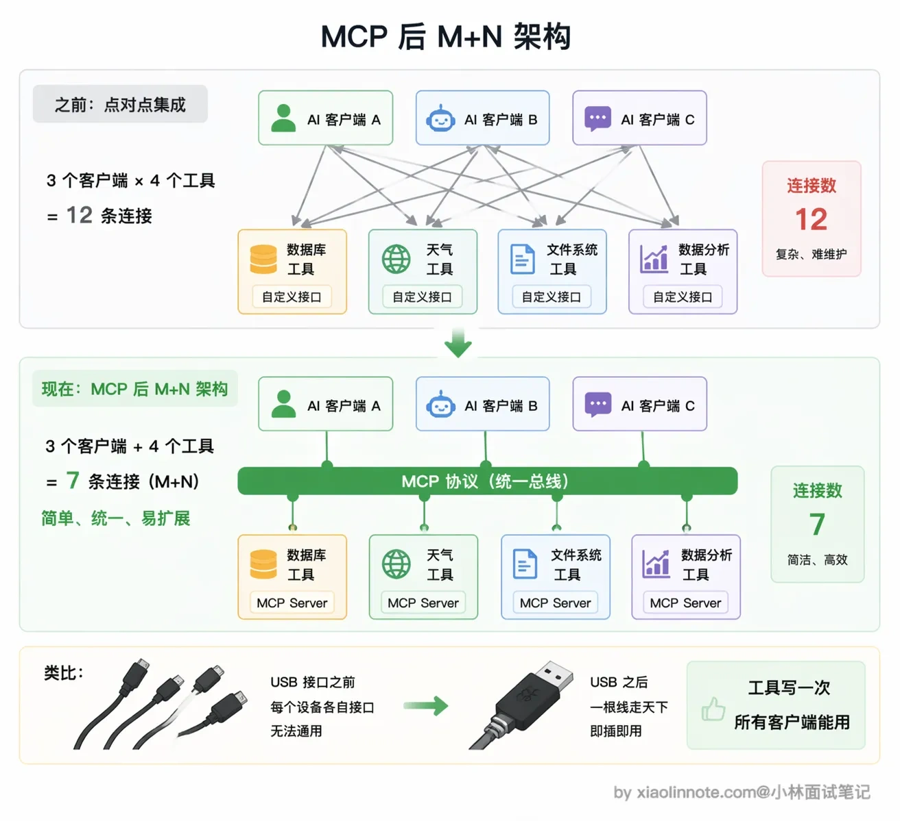

#### MCP 的 Client-Server 架构

MCP 采用标准的 Client-Server 架构。

Server 是工具的实现方。比如 GitHub 官方维护一个 GitHub MCP Server，里面封装了「列出 PR」「创建 Issue」「搜索仓库」「查看 Diff」等操作；Client 是 AI 应用那一侧，比如 Claude Desktop 或 Cursor，连上 Server 之后就自动获得了这些工具能力。

一个 Host 可以管理多个 MCP Client，每个 Client 通常维护与一个 Server 的会话。Host 可以同时连接多个 Server，但是否只改配置就能使用，取决于客户端、Server 版本和认证方式；高风险工具仍需要宿主策略或用户确认。

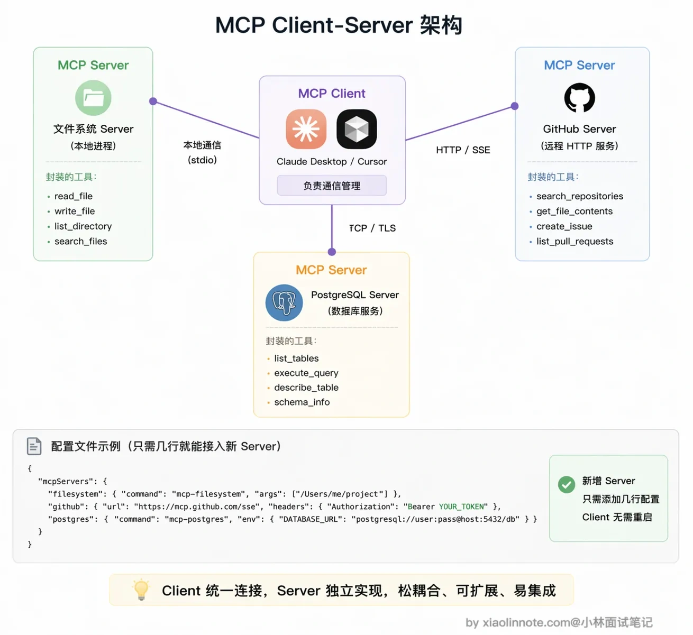

#### 三类核心能力，Tools、Resources、Prompts

MCP Server 可以向 Client 暴露三类能力，各有各的定位。

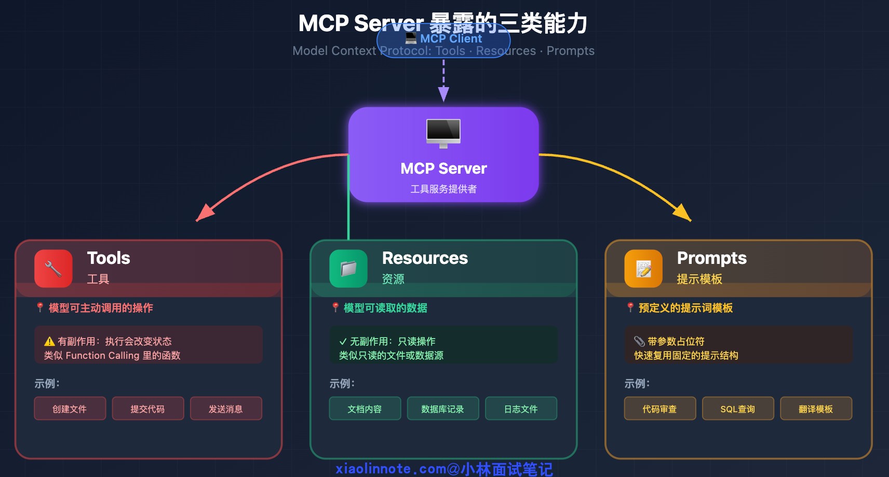

先说 **Tools（工具）**，这是可被调用的操作，对应 Function Calling 里的「函数」概念。它们既可以是只读查询，也可以有副作用；创建文件、提交代码、发送 Slack 消息属于高风险示例，需要宿主做权限、确认、审计和幂等控制。MCP 设计上鼓励人类能够拒绝调用，但是否弹确认框不是协议自动保证的。

再说 **Resources（资源）**，它表示可读取的上下文数据，可支持列表、读取，某些实现还支持订阅或变更通知。它通常是只读语义，但「只读」不等于「无敏感性」或「无需授权」：日志、数据库记录和文档都可能包含个人数据、租户数据或提示注入，仍要做访问控制、脱敏和来源标记。

最后是 **Prompts（提示模板）**，这个能力很多人容易忽略，但在团队协作场景下特别有用。Prompts 就是预定义的提示词模板，带参数占位符，解决的是「每次都要手写重复 prompt」的问题。举个例子，你的团队有一套固定的代码审查标准 prompt，接受「编程语言」和「代码内容」两个参数，调用时只需传入参数值，就能自动展开成完整的提示词，不用每次从头写。把公司积累的优质 prompt 封装成 MCP Prompts，所有人都能复用，统一标准，这在实际工程中很实用。

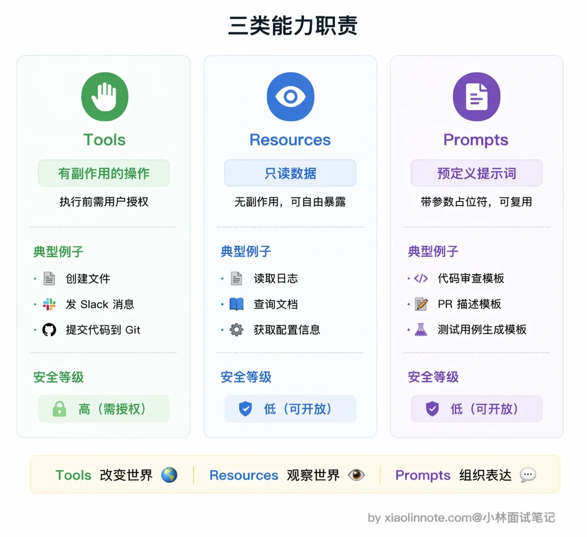

#### 底层通信，JSON-RPC 2.0 是什么

理解 MCP 的底层，先要知道 JSON-RPC 是什么。

JSON-RPC 是一种轻量级的远程函数调用协议，用 JSON 格式来表达「调用」这件事。核心非常简单：客户端发一个 JSON 请求，里面说清楚「调哪个方法、参数是什么、这次请求的 ID 是多少」；服务端执行完，返回一个 JSON 响应，里面是执行结果或者错误信息。用 JSON 而不是二进制格式，好处是易读、易调试、语言无关，任何编程语言都能轻松实现。MCP 用的是它的 2.0 版本（JSON-RPC 2.0），相比 1.0 加了批量请求、通知消息等功能。

在传输层，当前规范定义了两种标准方式。

第一种是 **stdio（标准输入输出）**，Server 作为本地子进程运行，Client 通过管道和它通信，Server 从 stdin 读消息，把结果写到 stdout。这种方式适合本地工具，不需要网络，启动快、延迟低，Claude Desktop 接本地 MCP Server 用的就是这种方式。

第二种是 **Streamable HTTP**，Server 作为 HTTP 服务部署在远程，Client 通过 HTTP 连接和它通信。这种方式适合远程部署的工具服务，或者需要多个 Client 共享同一个 Server 的场景，比如团队共用一个部署在服务器上的数据库 MCP Server，所有人的 AI 客户端都连同一个地址就行。

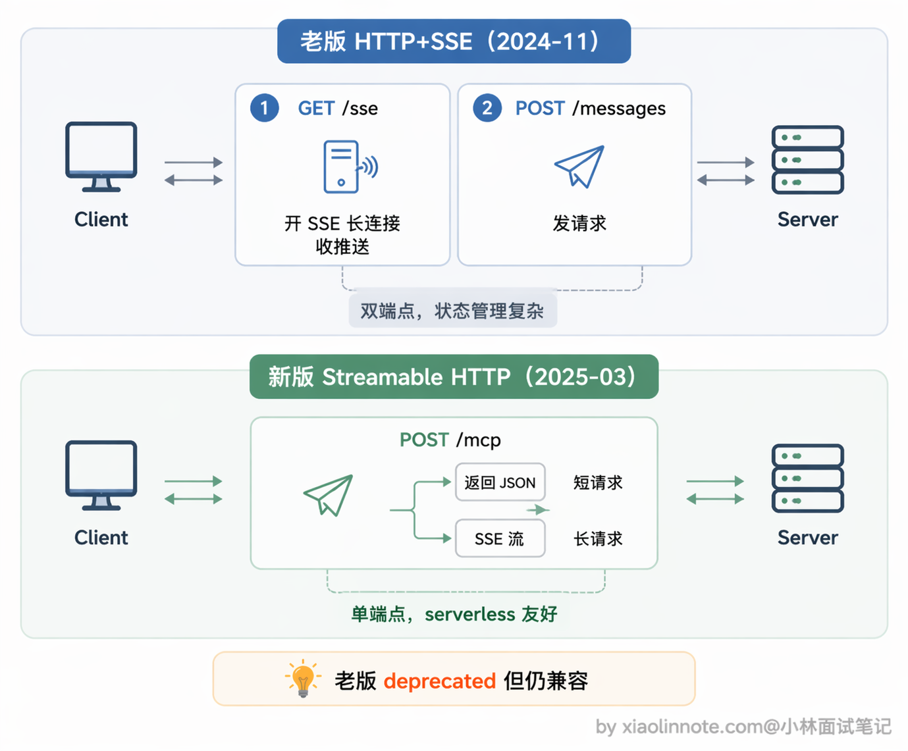

这里有个演进要说清楚：较早版本使用过 HTTP + SSE 的双端点方案；当前规范将 Streamable HTTP 作为标准传输，并保留兼容旧服务的说明。学习或实现时要锁定具体协议版本，不要把旧版部署经验当成所有服务的现状。

Streamable HTTP 不是「只有 SSE」：客户端向一个 MCP endpoint 发 POST，Server 可以返回普通 JSON，也可以返回 `text/event-stream`；GET 是否提供独立的 SSE 监听也由 Server 能力决定。断线不等于取消，若要取消应发送协议取消通知；HTTP 部署还要处理 Origin 校验、认证、会话、重连和代理缓冲。

#### MCP 生态发展这么快，背后的原因是什么

MCP 是 Anthropic 在 2024 年底发布的，发布后发展速度很快，主要有两个原因。

第一个原因是**可复用的协议与 SDK**。SDK 能隐藏 JSON-RPC、生命周期和传输细节，但生产 Server 仍要补齐认证、参数校验、错误映射、权限和运维；示例代码行数不代表生产接入成本。

第二个原因是生态复用：社区或厂商可能提供现成 Server，但维护者、权限范围、版本兼容和安全状况各不相同。采用前应检查来源、锁定版本、最小化权限并做隔离测试，不能把「现成」等同于「可信」。

不同 AI 客户端对 MCP 的协议版本、传输、认证和能力支持并不完全一致；接入前应查看客户端与 Server 的兼容矩阵。

#### 一次 MCP 会话的因果链

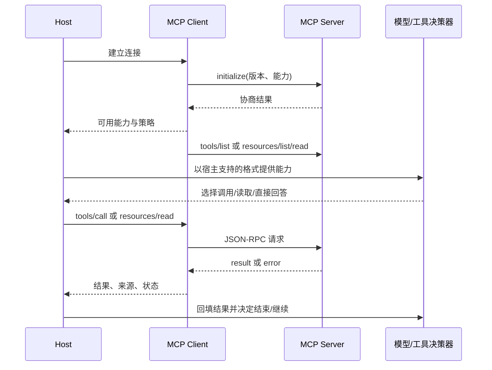

初始化阶段要协商协议版本和能力；正常阶段再执行 `tools/list`、`tools/call`、资源读取或通知。工程上还要设置超时、取消、重连、审计和最大调用预算。

### 🎯 面试总结

回看开头的面试对话，最典型的误区就是把 MCP 和 Function Calling 搞混了。Function Calling 解决的是「模型怎么输出结构化的工具调用请求」，而 MCP 解决的是「工具怎么标准化接入、一次实现到处复用」，两者是不同层面的东西。另一个常见错误是以为 MCP 是 Anthropic 专属的，实际上它是开放协议，任何支持 MCP 的客户端都能接入。

面试回答这道题，首先要说清楚 MCP 解决的核心问题：工具接入碎片化，每接一个新工具都要单独写对接代码，换个客户端又得重写。

然后讲 Client-Server 架构，Server 是工具实现方，Client 是 AI 应用侧，一个 Client 可以连多个 Server。

重点要区分三类核心能力：Tools 是有副作用的操作（需要授权），Resources 是只读数据（无副作用），Prompts 是可复用的提示词模板。

底层通信用 JSON-RPC 2.0，传输层支持 stdio（本地）和 Streamable HTTP（远程）两种方式，早期的 HTTP+SSE 双端点方案在 2025 年 3 月的规范更新里被标记为 deprecated，推荐用单端点的 Streamable HTTP。

最后可以提一下 MCP 的价值：它把能力发现、调用和上下文交换放到一个可协商协议里，但复用效果取决于版本兼容、认证、权限和宿主适配，不能把协议本身当成安全边界。

---

## MCP 由哪几部分组成？

👔面试官：说说 MCP 由哪几部分组成？

🙋‍♂️我：MCP 就是一个协议嘛，主要就是 Client 和 Server 两部分，Client 发请求，Server 返回结果，跟普通的 HTTP 接口差不多。

👔面试官：就 Client 和 Server？那 Host 是什么角色？而且你说「跟 HTTP 接口差不多」，MCP 的能力类型你了解吗？Server 能暴露哪些东西？

🙋‍♂️我：Host 应该就是 Client 的别名吧？Server 暴露的就是工具，比如调 API、读文件这些，都算工具。

👔面试官：Host 和 Client 是两个不同的角色，Host 是宿主应用，Client 是 Host 里负责通信的模块，一个 Host 可以连多个 Server。而且 Server 暴露的不只是 Tools，还有 Resources 和 Prompts，三者职责完全不同，你把只读数据和有副作用的操作混为一谈了。另外底层的传输协议你也没提，消息格式和传输方式这一层也是 MCP 的核心组成部分。

好吧，MCP 的组成确实不是「Client + Server」这么简单，下面我从三个层次把它拆清楚，看完你就知道每一层各自负责什么了。

### 💡 简要回答

MCP 由三层组成，可以从角色、能力、协议三个维度来理解。

角色层有三个：Host 是 AI 应用本身（比如 Claude Desktop），Client 是 Host 里负责和 Server 通信的模块，Server 是工具提供方实现的独立进程，一个 Host 可以同时连多个 Server。

能力层定义了 Server 能暴露三类东西：Tools 是有副作用的操作（比如创建文件、调 API），Resources 是只读数据（比如读取文档内容），Prompts 是预定义的提示词模板。

协议层是底层通信：消息格式使用 JSON-RPC 2.0，当前规范定义 `stdio`（本地子进程通信）和 Streamable HTTP（HTTP POST/GET，可选 SSE 流）两种标准传输。旧版 HTTP+SSE 仍可能存在，兼容时要锁定协议版本。

这三层合在一起，就是 MCP 的完整组成。

### 📝 详细解析

#### 先建立整体感：三层来看就清楚了

很多人第一次接触 MCP 会被各种概念搞乱，什么 Host、Client、Server、Tools、Resources、Prompts、JSON-RPC、stdio、SSE……一堆名词扔过来，确实容易懵。其实你只要把它拆成三层来看就清楚了：第一层是角色架构，搞清楚谁和谁在通信；第二层是能力类型，搞清楚 Server 能暴露什么东西给模型用；第三层是传输协议，搞清楚消息是怎么传的。

这三层各自独立、互不耦合，合在一起就是 MCP 的完整骨架。下面我一层一层拆开来讲。

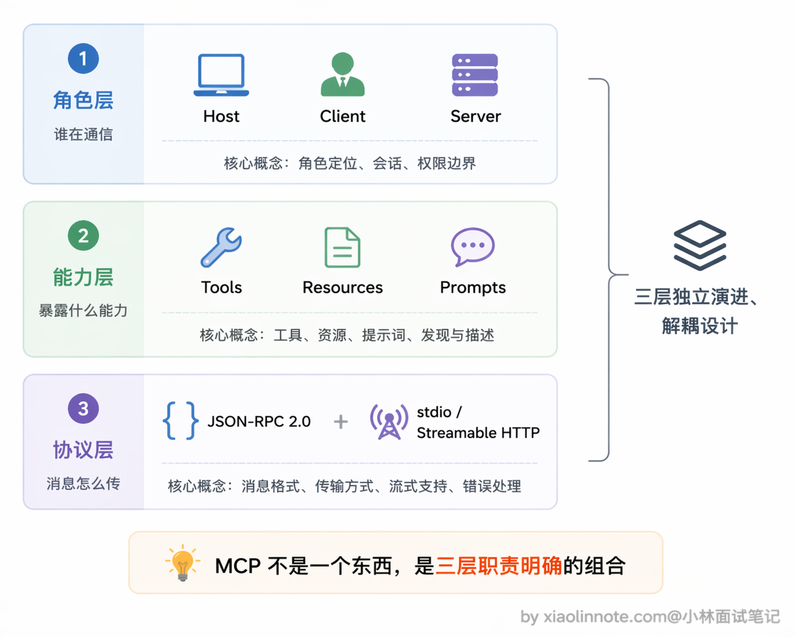

#### 第一层：角色架构，Host / Client / Server

MCP 定义了三个角色，弄清楚每个角色负责什么是理解整个系统的关键。

先说 Host。Host 是整个系统的宿主，也就是你在用的 AI 应用本身，比如 Claude Desktop、Cursor、Windsurf。Host 负责启动和管理所有 MCP Client，控制连哪些 Server、什么时候断开连接，是整个 MCP 系统的调度中心。你可以把 Host 理解成一家公司，它决定要和哪些外部供应商（Server）合作，并派出自己的联络员（Client）去对接。

再说 Client。Client 是 Host 内部的连接模块，一个 Client 对应一个 Server 连接。它负责三件事：初始化和 Server 的连接、向 Server 查询「你有哪些工具/资源/模板」（能力发现）、把模型的调用请求转发给 Server 并把结果带回来。Client 是 Host 派出的「驻场联络员」，专门负责和某一个 Server 打交道，Host 本身不直接和 Server 说话。

最后是 Server。Server 是提供能力的一方，可以是本地子进程，也可以是远程服务；它对外暴露工具、资源和提示模板。标准化能减少 Host 的定制代码，但 Host 仍需处理版本、认证、权限、模型侧 schema 映射和结果展示，所以不是「任何客户端无条件直连」。

三者的关系用图来看是这样的：

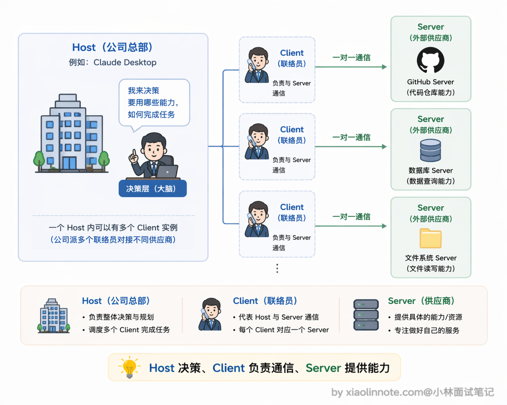

一个 Host 可以同时管理多个 Client/Server 会话，但是否把所有能力都暴露给模型要由宿主按任务、租户和权限筛选；工具列表越大也会增加选择噪声与上下文成本。

#### 第二层：能力类型，Tools / Resources / Prompts

理解了角色分工，接下来看 Server 到底能暴露什么给 Client。很多人以为 Server 就只提供「工具」，其实不止，MCP 定义了三类能力，每类解决不同的需求，设计上有明确的职责分工。

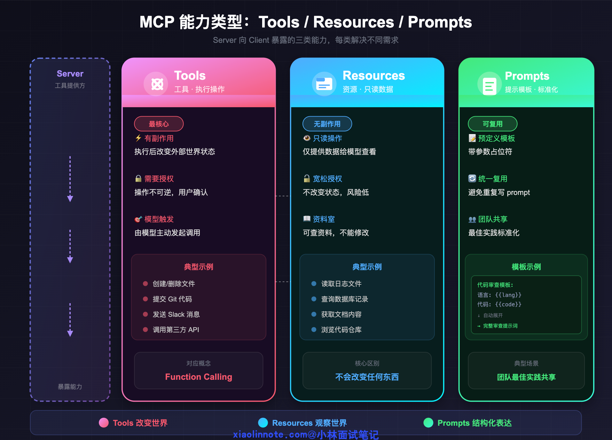

第一类是 Tools（工具），是可调用的操作，既可以只读，也可以有副作用。创建文件、提交代码、发送 Slack 消息属于高风险例子；由模型触发不等于自动获准，宿主应结合用户确认、权限、幂等键、审计和回滚设计。

第二类是 Resources（资源），是可读取的上下文数据；通常没有写副作用，但内容仍可能敏感、动态或包含不可信指令，不能因为「只读」就跳过访问控制、脱敏和来源标记。资源还可能支持订阅和变更通知，不能一概当作静态文件。

第三类是 Prompts（提示模板），这是预定义的提示词模板，带参数占位符。它解决的是「每次都要手写重复 prompt」的问题。比如把团队固定的代码审查标准封装成模板，接受「编程语言」和「代码内容」两个参数，调用时只需传参，自动展开成完整提示词，不用每次从头写。这个能力特别适合团队内部的最佳实践共享，把积累的优质 prompt 模板化，所有人统一复用，标准也更一致。

三者的本质区别可以这样记：Tools 改变世界，Resources 观察世界，Prompts 结构化表达。

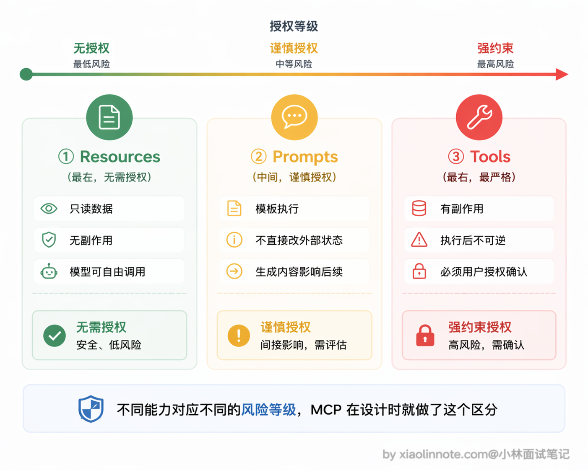

#### 第三层：传输协议，JSON-RPC 2.0 + 传输方式

Client 和 Server 之间的通信由两部分组成：消息格式和传输方式，这两层是解耦的。

**消息格式**统一用 JSON-RPC 2.0。每条消息是一个 JSON 对象，格式固定：Client 发请求时说清楚「调哪个方法、参数是什么、这次请求的 ID 是多少」，Server 返回响应时带上执行结果或错误信息，通过 ID 匹配请求和响应。用 JSON 格式的好处是易读、易调试、任何编程语言都能实现，不管 Server 是 Python 写的还是 TypeScript 写的，消息格式是一样的。

```jsonc
// Client 向 Server 查询工具列表
{"jsonrpc": "2.0", "id": 1, "method": "tools/list", "params": {}}

// Server 返回工具列表
{"jsonrpc": "2.0", "id": 1, "result": {"tools": [{"name": "read_file", ...}]}}

// Client 请求调用某个工具
{"jsonrpc": "2.0", "id": 2, "method": "tools/call", "params": {"name": "read_file", "arguments": {"path": "/tmp/log.txt"}}}
```

那消息格式定了，怎么传呢？MCP 支持两种传输方式，适合不同的部署场景。

第一种是 stdio（标准输入输出），Server 作为本地子进程运行，Host 通过操作系统的管道和它通信，Server 从 stdin 读请求、把结果写到 stdout。这种方式适合本地工具，通常不需要额外端口，但仍有子进程权限、依赖、环境变量、恶意 Server 和本地文件访问风险，不能把「无网络」等同于「安全」。

第二种是 **Streamable HTTP**，Server 作为 HTTP 服务独立部署，Client 通过 HTTP 连接和它通信。一次 POST 可以得到普通 JSON 或 SSE 流，GET 是否提供服务端推送由能力决定；远程部署还必须处理认证、Origin 校验、会话、重连、代理超时和多租户隔离。

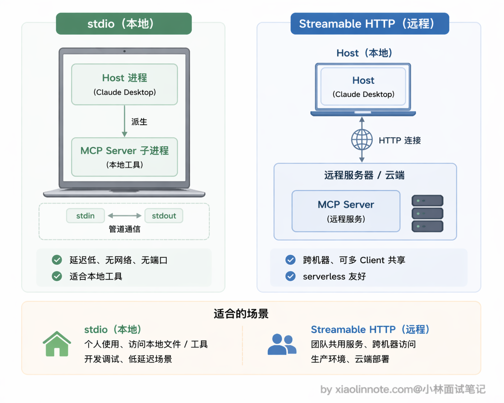

这里有个演进要说清楚：较早版本的远程传输方案叫「HTTP + SSE」，是双端点结构；当前规范使用单一 MCP endpoint 的 Streamable HTTP，并保留兼容旧服务的路径。实现时要锁定协议版本，不要把某个版本的状态说成所有客户端的现状。

Streamable HTTP 不是「内部仍然就是 SSE」：Client 用 POST 发送 JSON-RPC 消息，Server 可以直接回 JSON，也可以返回 `text/event-stream`；断线不自动等于取消，服务端还可提供事件恢复。它减少端点数量，但不自动解决负载均衡、认证或代理缓冲问题。

#### 角色、能力与传输的边界

| 层次 | 主要问题 | 典型对象 | 不应混淆 |
| --- | --- | --- | --- |
| 角色 | 谁负责调度和通信？ | Host / Client / Server | Host 不是 Client 的别名 |
| 能力 | Server 暴露什么？ | Tools / Resources / Prompts | Resources 只读不等于无需授权 |
| 消息 | 消息如何表达？ | JSON-RPC request/response/notification | JSON-RPC 不负责业务权限 |
| 传输 | 消息如何到达？ | stdio / Streamable HTTP | SSE 是 HTTP 的一种事件表示，不是全部 MCP |

正常会话可以抽象为下面的生命周期；列举、读取和调用可以重复多次，通知也可能异步到达：

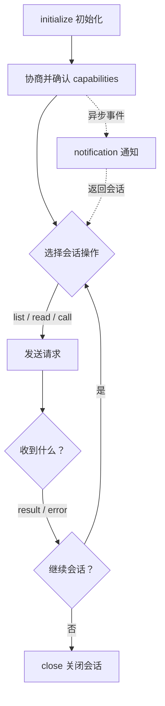

实现还应给请求设置超时，区分可重试错误与副作用错误，并记录调用者、工具名、参数摘要和结果状态。

这里有一个很重要的设计点：消息格式（JSON-RPC 2.0）和传输方式（stdio / Streamable HTTP）是解耦的，同一套 JSON-RPC 消息可以跑在任意传输层上，切换传输方式不影响上层的工具调用逻辑。这个设计让 MCP Server 既可以轻量地作为本地进程运行，也可以作为正式的微服务部署，实现方式灵活但协议层始终一致。

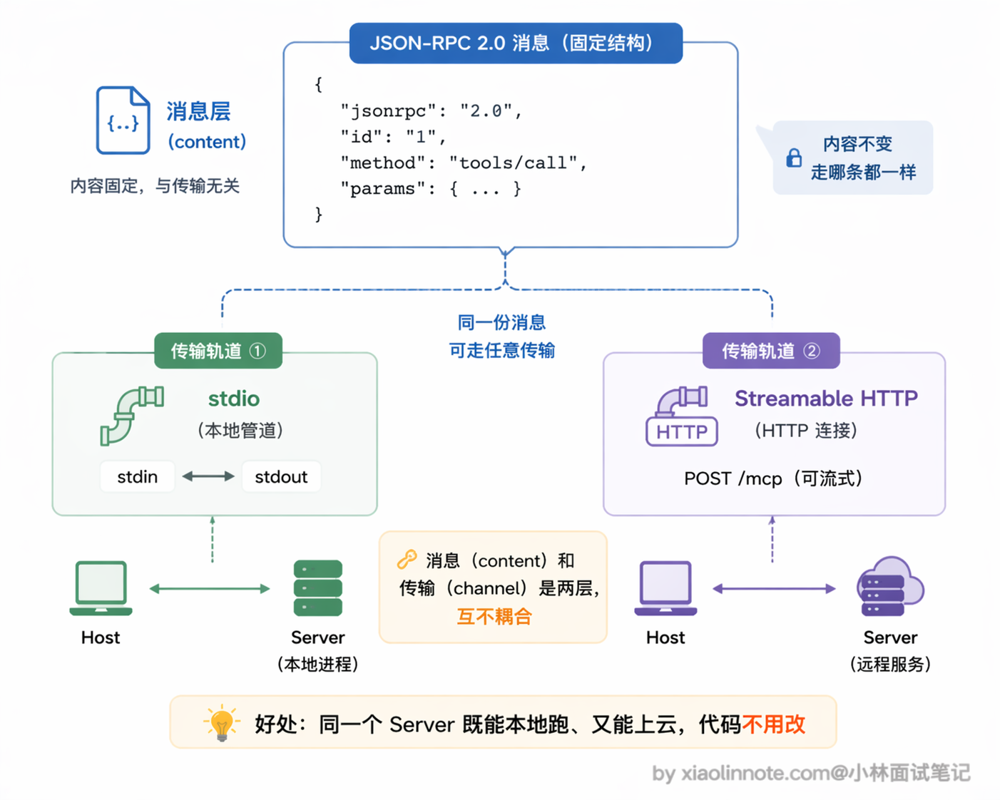

### 🎯 面试总结

回到开头踩的雷，最大的问题是把 MCP 简单理解成「Client + Server」的二元结构，忽略了 Host 这个角色。

面试回答这道题，第一个要点是三层结构要说清楚：角色层（Host / Client / Server）、能力层（Tools / Resources / Prompts）、协议层（JSON-RPC 2.0 + stdio / Streamable HTTP）。

特别是 Host 和 Client 的区别，Host 是宿主应用本身，Client 是 Host 内部负责和 Server 通信的模块，一个 Host 可以同时连多个 Server，这个一对多的关系是 MCP 的核心设计。

第二个容易踩的雷是把 Server 暴露的能力全归为「工具」。Tools、Resources、Prompts 三者职责分明，Tools 有副作用、改变外部状态，Resources 是只读数据、没有副作用，Prompts 是提示词模板。面试时说清楚三者的区别，尤其是 Tools 和 Resources 的本质差异（有无副作用），会让面试官觉得你真正理解了 MCP 的设计意图，而不是只停留在表面。

第三个要提到的是协议层的解耦设计：消息格式和传输方式是独立的，JSON-RPC 2.0 定义了消息长什么样，stdio 和 Streamable HTTP 定义了消息怎么传，两者互不耦合，这也是 MCP 灵活性的来源。

---

## MCP 和 Function Calling 有什么区别？有没有实际跑过 MCP？

👔面试官：来聊聊 MCP 和 Function Calling 的区别吧。

🙋‍♂️我：MCP 就是 Function Calling 的升级版嘛，MCP 出来之后 Function Calling 就被淘汰了，以后工具调用都走 MCP 就行了。

👔面试官：淘汰？MCP 底层靠什么驱动的你知道吗？它可离不开 Function Calling。这两个根本不是同一层面的东西，你把层次搞混了。

🙋‍♂️我：哦，那 MCP 应该就是给 Function Calling 包了一层壳吧？功能上没什么本质区别，就是写法不一样而已？

👔面试官：如果只是写法不一样，Anthropic 为什么要专门设计一个协议出来？Function Calling 解决的是单次调用的格式问题，MCP 解决的是工具怎么标准化管理、跨项目复用和自动发现的问题，两者的抽象层次完全不同。你真跑过 MCP 吗？接入一个 MCP Server 需要写多少代码，你知道吗？

看来这两个概念的层次关系确实容易搞混，下面我把它们各自解决什么问题、怎么配合工作的逻辑理清楚。

### 💡 简要回答

我理解这两者不是竞争关系，解决的不是同一层面的问题。

Function Calling 是「调用语言」，定义的是模型怎么表达「我要调哪个函数、参数是什么」；MCP 是「工具生态协议」，定义的是工具怎么标准化打包、注册和被 AI 客户端发现。

在常见的 Host 中，MCP 工具会被适配成模型 API 能理解的工具定义，模型再通过原生 tool calling、结构化输出或其他策略选择调用；但 MCP 协议本身是 Host/Client 与 Server 之间的协议，并不规定模型必须使用某家厂商的 Function Calling。

打个比方：Function Calling 像 HTTP 请求格式，MCP 像 REST API 的设计规范加服务注册发现机制，两者是不同层次的东西。

关于实际跑过的经验，可以描述为：在支持 MCP 的客户端中配置一个本地或远程 Server，完成初始化和能力发现，再由 Host 决定哪些工具暴露给模型。配置减少了重复接入，但权限、认证、版本兼容和用户确认仍需验证，不能笼统说「完全不用写对接代码」。

### 📝 详细解析

#### Function Calling 有了，为什么还需要 MCP？

很多人第一次看到 MCP 会有一个直觉困惑：Function Calling 不是已经能调工具了吗，模型想用工具直接定义 schema 就行，为什么还要再搞一个协议出来？

这个困惑的根源，是把「能调工具」和「管好工具」混在一起了。这两件事完全是不同层次的问题。

有一个很好的类比可以帮你理解：HTTP 协议出来之后，我们已经能在网络上传数据了，为什么还需要 REST API 规范？

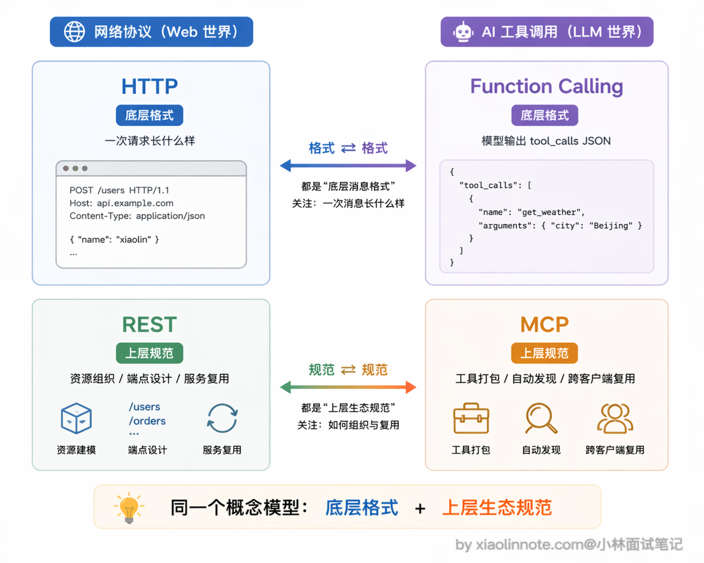

因为 HTTP 解决的是「怎么传」（一次请求长什么样、用什么方法、怎么编码），REST 解决的是「怎么组织和管理」（资源怎么命名、端点怎么设计、状态怎么表达、多个服务之间怎么复用同一套约定），两者是不同层次的事。

Function Calling 和 MCP 也是同样的关系：Function Calling 管「一次函数调用请求长什么样」，MCP 管「一堆工具怎么被组织、发现、跨项目复用」。前者是格式，后者是规范+生态约定，少了谁这套机制都运转不起来。

#### Function Calling 解决的是「一次调用」的格式问题

从开发者视角看，Function Calling 回答的是这几个问题：工具定义用什么格式传给模型？模型想调工具时怎么表达「我要调哪个函数、参数是什么」？工具执行结果怎么喂回对话？

它定义的是单次调用的消息格式，仅此而已。每次使用，开发者都要手动写工具的 schema 定义，手动写调用逻辑，手动处理结果。Function Calling 本身没有任何工具管理、工具发现、跨项目复用的概念。

#### Function Calling 的痛点，每次都是一次性的

那「每次手动」到底有多痛？你可能觉得复制一份 schema 也没多大工作量，但工具一多、项目一多，问题就暴露出来了。

假设你在 A 项目里定义了 10 个工具的 schema 和对接逻辑。现在 B 项目也要用这些工具，怎么办？把那 10 个 schema 定义复制过来，把对接逻辑重写一遍。好，写完了。但 A 项目用的是 Claude API，B 项目换成了 GPT-4，两边的 Function Calling 格式不完全一样，又得各自维护一套适配代码。这还没完，如果某个工具的接口改了呢？你得去每个用到它的项目里逐一更新，漏改一处就是 bug。

把这个账算一下你就知道痛点的规模了：假设你团队里有 5 个应用，每个应用要接 8 个工具，也就是 40 份工具对接代码在维护。某天 GitHub API 的某个字段变了，你要在 5 个地方同步改，只要其中一个忘了，那个应用在凌晨报警；再假设你要从 Claude 迁到 GPT-4，这 40 份代码里的 Function Calling 格式全要重新适配一遍，整个组的季度就这么交代了。

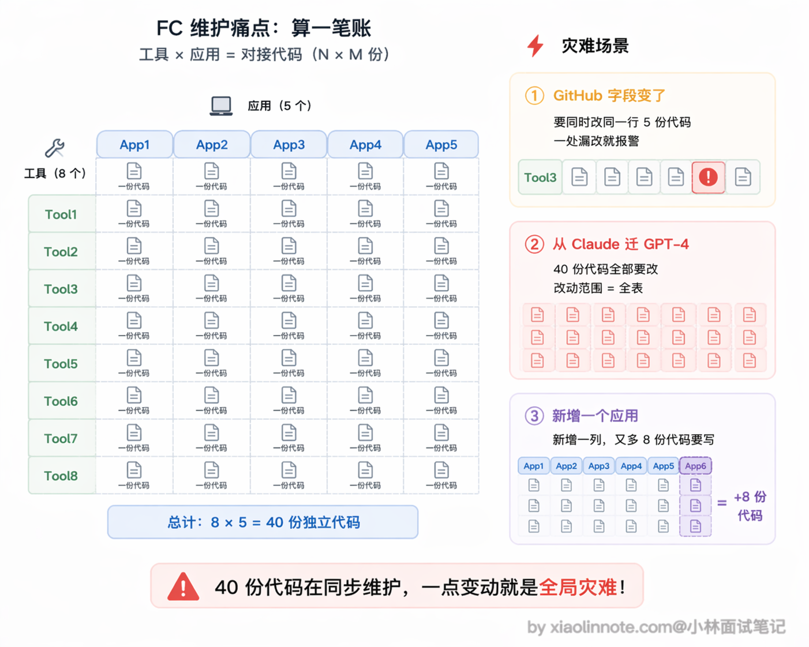

有没有发现问题？同一个工具，换个项目就要重新对接一遍，每次都是一次性的手工活。这就是 Function Calling 解决不了的核心问题：**工具的管理、复用和跨平台兼容**。

#### MCP 解决的是「工具生态」的问题

既然痛点是「每个应用各自维护一套工具定义」，那解决思路也就很自然了：把工具做成独立的标准化服务，谁要用就来连，不用每次都重写一遍。这就是 MCP 的核心思路。

工具提供方实现一个 MCP Server；stdio 模式通常是本地子进程，Streamable HTTP 模式也可以是远程服务。Server 暴露标准能力描述，客户端可以自动发现，但仍要做版本、认证、权限、结果映射和安全审查。

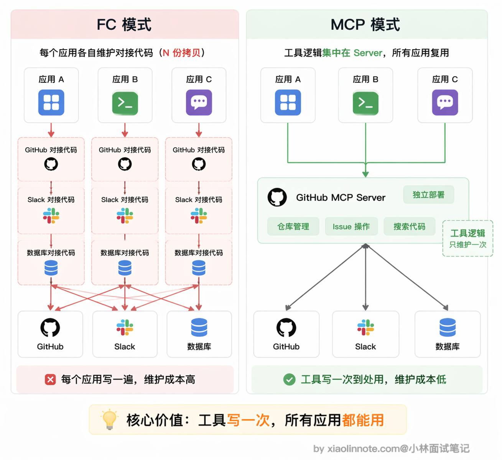

这带来的改变是集成边界更稳定：工具提供方可以复用 Server，客户端减少重复的 API 适配，但不同客户端的能力、版本、认证和模型映射仍可能不同。MCP 降低重复劳动，不保证所有客户端天然兼容。

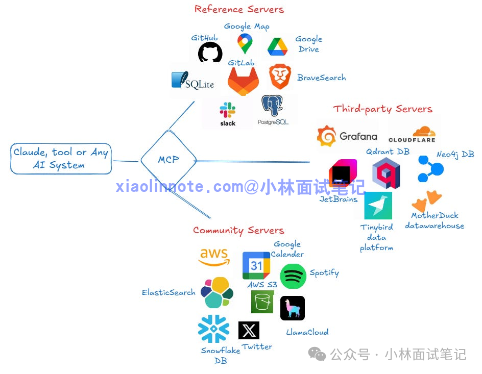

#### 最关键的联系：Host 需要一个模型侧的调用机制，但 MCP 不等于 Function Calling

这是很多人没想清楚的一点：二者在不同边界上工作。模型 API 的工具调用是「模型如何表达选择」；MCP 是「Host 如何发现、连接和调用外部能力」。一个 Host 可以把 MCP 工具翻译成某厂商的 tool schema，也可以通过自定义策略或结构化输出驱动工具。

当 MCP Client 连上 Server 后，通常会通过 MCP 的 `tools/list` 发现工具（不是所有 SDK 都把它暴露成名为 `list_tools` 的本地方法），Host 再把选中的能力映射到模型 API 或自己的决策器。模型提出调用后，Host/Client 将请求路由到 `tools/call`，把结果或错误以模型 API 能接受的形式回填。

从**模型的视角**来看，它通常只看到 Host 提供给它的工具描述，不一定知道这些工具来自 MCP；但 Host 也可以显式说明来源，或不使用模型原生工具调用。MCP 的发现、schema 映射、路由、执行结果返回主要发生在宿主层。

这也意味着：如果模型不支持某种原生 Function Calling，Host 仍可能用结构化输出、命令路由或人工/程序策略来驱动 MCP；只是可靠性和实现成本取决于该机制。真正的必要条件是 Host 有可控的「模型选择 → 参数校验 → 工具执行」通路，而不是某个固定字段名。

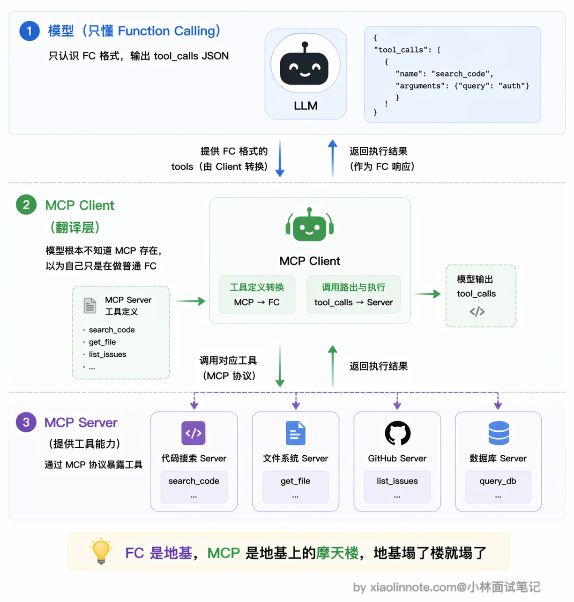

#### 实际体验，接入一个 MCP Server

以 Claude Desktop 接入文件系统 MCP 为例。只需要编辑 `claude_desktop_config.json`，加入如下配置：

```json
{
  "mcpServers": {
    "filesystem": {
      "command": "npx",
      "args": [
        "-y",
        "@modelcontextprotocol/server-filesystem",
        "/Users/yourname/Documents"
      ]
    }
  }
}
```

这几行配置告诉 MCP Client：用 `npx` 这个命令启动文件系统 Server，把 `/Users/yourname/Documents` 目录作为允许访问的范围。`command` 和 `args` 组合起来就是启动 Server 进程的命令行，MCP Client 会把它作为子进程启动，通过标准输入输出和它通信。

配好之后重启 Claude Desktop，它会自动启动这个 Server 进程，自动发现里面提供的工具。然后你直接问 Claude「帮我读一下 Documents 里的 [report.md](http://report.md)」，Claude 会自动调用文件系统工具完成任务，全程你没写一行对接代码。

如果想自己写一个 MCP Server，其实也很简单。核心就三步：首先用 `@app.list_tools()` 装饰器告诉 Client 这个 Server 提供哪些工具及其参数格式，然后用 `@app.call_tool()` 装饰器实现每个工具的真实执行逻辑，最后用 stdio 方式运行，让 Client 能通过管道和它通信。

完整的代码如下：

```python
import asyncio
from mcp.server import Server
from mcp.server.stdio import stdio_server
from mcp.types import Tool, TextContent

# 1. 创建一个 Server 实例，名字叫 "calculator"
app = Server("calculator")

# 2. 定义工具列表 (告诉 Client 我有什么功能)
@app.list_tools()
async def list_tools() -> list[Tool]:
    return [
        Tool(
            name="add_numbers",
            description="计算两个数字的和",
            inputSchema={
                "type": "object",
                "properties": {
                    "a": {"type": "number", "description": "第一个数字"},
                    "b": {"type": "number", "description": "第二个数字"}
                },
                "required": ["a", "b"]
            }
        )
    ]

# 3. 实现工具的具体逻辑
@app.call_tool()
async def call_tool(name: str, arguments: dict) -> list[TextContent]:
    if name == "add_numbers":
        a = arguments.get("a", 0)
        b = arguments.get("b", 0)
        result = a + b
        
        # 返回结果，必须是 TextContent 格式
        return [
            TextContent(
                type="text",
                text=f"计算结果: {result}"
            )
        ]
    
    # 如果工具名不认识，返回错误
    return [TextContent(type="text", text=f"未知工具: {name}")]

# 4. 启动 Server (使用标准输入输出模式)
async def main():
    async with stdio_server() as (read_stream, write_stream):
        await app.run(
            read_stream,
            write_stream,
            app.create_initialization_options()
        )

if __name__ == "__main__":
    asyncio.run(main())
```

整个 Server 加起来不超过 30 行代码，Anthropic 开源的 MCP SDK 把底层通信都封装好了。

然后编辑你的 `claude_desktop_config.json`，添加这个 Python 服务：

```json
{
  "mcpServers": {
    "calculator": {
      "command": "python",
      "args": [
        "/path/to/your/calculator_server.py"
      ]
    }
  }
}
```

注意这里的路径要改成你自己实际存放文件的绝对路径，如果你的系统中 Python 命令是 `python3`，也要把 `command` 对应改过来。

配好之后重启 Claude Desktop，直接输入「帮我算一下 25 加 17 等于多少」，Claude 就会自动调用你写的 `add_numbers` 工具并返回结果。整个过程你只写了工具逻辑本身，所有的通信、发现、调用路由都由 MCP 框架搞定了。

#### 什么时候选哪个

如果只是临时给自己的应用接一两个工具，Function Calling 就够用了，简单直接，不需要引入额外的进程和协议。

但如果工具多了、需要跨项目复用、或者想直接用社区里已有的成熟 Server（GitHub、数据库、浏览器自动化都有现成的），MCP 就值得上了。接一个新工具就是在配置文件里加几行，重启后自动生效，比手写对接代码省事很多。

做 Agent 系统的话更应该考虑 MCP。工具来源杂、数量多，如果全靠手写 Function Calling 来维护，工具定义代码会散落在各处，很难管理。MCP 的自动发现和统一管理能让架构干净很多，新增工具不需要改主程序逻辑，接上 Server 就行。

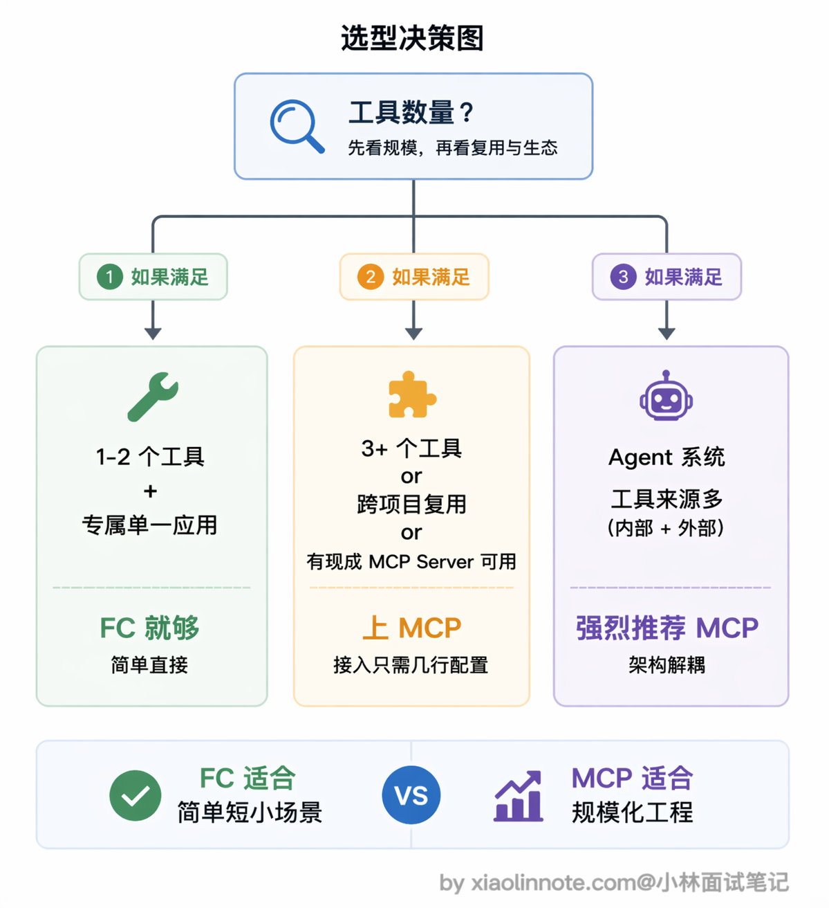

#### 一张边界图：不要把两条链路压成一层

```text
模型 API / 决策器
  └─ tool calling、结构化输出或自定义策略
        ↓ Host 适配、权限、确认、预算
MCP Client ── JSON-RPC + stdio/Streamable HTTP ── MCP Server
        ↓                                      ↓
    结果/错误回填                         外部 API、文件、数据库
```

MCP 也不会自动提供权限、幂等、沙箱和审计；这些属于 Host、Server 与业务系统共同承担的工程边界。

### 🎯 面试总结

回到开头的面试对话，最大的雷就是把 MCP 当成 Function Calling 的「替代品」或「升级版」，这是很多人的第一反应，但完全搞反了两者的关系。

面试回答这道题，第一个必须说清楚的点是：Function Calling 解决的是单次调用的消息格式问题，MCP 解决的是工具生态的标准化管理和复用问题，两者是不同抽象层次的东西。

第二个关键点是：MCP 与模型侧 tool calling 是可组合但不等价的两条链路。Host 可以把 MCP 工具映射为原生 tool schema，也可以用其他结构化决策方式；工具发现、路由、权限、确认和错误处理发生在 Host/Client/Server 边界上。

如果能再补充实际跑过 MCP 的经验就更好了，比如在 Claude Desktop 里配置过哪些 MCP Server、接入流程是什么样的，这些实操细节能让面试官看到你不是只背概念。要避免的误区是：不要说 MCP 就是「换了个写法的 Function Calling」，也不要说两者是竞争关系，它们是上下层的配合关系。

---

## Function Calling 也属于工具调用，请问什么场景下使用 Function Calling，什么场景下使用 MCP？

👔面试官：Function Calling 和 MCP 都能做工具调用，那具体什么场景下该选哪个？

🙋‍♂️我：这个简单，小项目用 Function Calling，大项目用 MCP 就行了，主要看项目规模。

👔面试官：项目规模大就一定要用 MCP？如果一个大项目的工具只在内部用、不需要复用呢？你的判断维度太单一了，规模只是其中一个因素。

🙋‍♂️我：那应该是看工具数量吧？工具少就 Function Calling，工具多就 MCP，毕竟 MCP 能自动发现工具。

👔面试官：工具多确实是一个考虑因素，但不是唯一的。如果社区已经有现成的 MCP Server，哪怕只需要一个工具，你还自己手写 Function Calling 去对接 API 吗？还有部署环境的限制、工具复用需求、是不是在做 Agent 系统，这些维度你都没考虑到。场景选型不能只看一个指标。

看来场景选型比想象中复杂，不是一刀切的事，下面我把各种场景的判断逻辑梳理清楚。

### 💡 简要回答

如果只是给单个应用接一两个工具、工具逻辑与业务代码强耦合、场景临时且不需要复用，直接使用模型厂商的 tool calling 接口往往更简单；这里的「Function Calling」指模型侧调用格式，不等于完整的执行安全方案。

如果工具需要跨项目或跨团队复用、需要独立部署与版本治理、或存在可审查的现成 MCP Server，MCP 值得评估；它也会引入会话、认证、兼容性、进程/网络和观测成本。

判断不能只看「是否会复用」，还要看信任边界、部署限制、延迟、故障隔离、权限模型和团队运维能力。会复用只是强信号，不是自动结论。

做 Agent 系统时可以用 MCP 管理跨进程/跨团队能力，但小型 Agent 也完全可以先用内嵌适配器；工具数量多时还要做按需暴露、命名空间、权限和 schema 压缩，不能把 MCP 当作规模增长的唯一解。

### 📝 详细解析

#### 先建立一个直觉：内嵌 vs 独立

Function Calling 的工具定义通常由应用代码提供，执行适配器可以内嵌、也可以再调用内部服务；它不强制工具和应用部署在同一进程。

MCP 把 Server 与 Client 之间的发现和调用标准化。stdio 常见于本地子进程，Streamable HTTP 可连接远程服务；是否能直接复用仍取决于版本、认证、权限、能力映射和客户端实现。

这个「内嵌 vs 独立」的本质区别，直接决定了两者各自适合的场景。

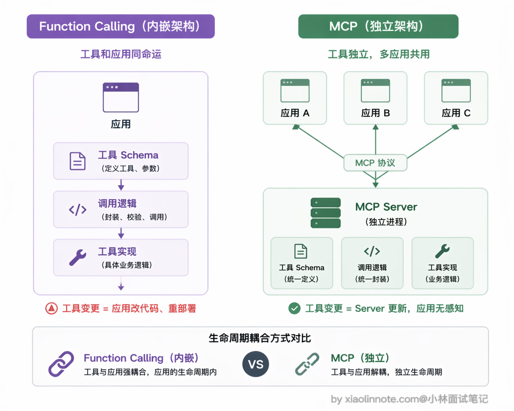

#### Function Calling 的适用场景

什么时候用 Function Calling 就够了？简单来说，就是「轻量、临时、不需要复用」的场景。

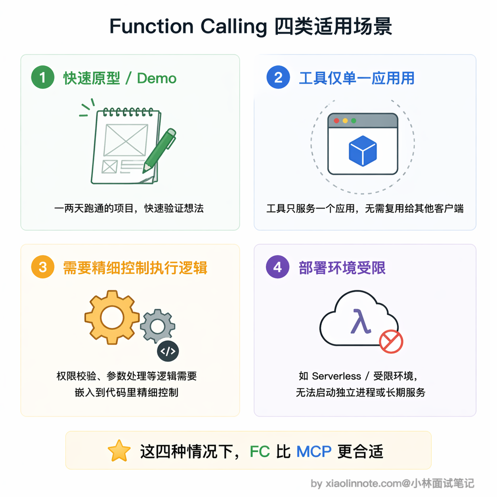

最典型的就是做快速原型和 Demo。你的目标是跑通一个想法或做演示，直接在代码里定义 schema 和调用逻辑就行，不需要启动任何额外进程，也不需要额外配置。这种场景下搞 MCP 完全没必要，你花在搭 Server 上的时间可能会超过原型本身的价值。

再比如工具只为这一个应用服务的情况。假设你在做一个内部工具，里面有一个查本公司私有数据库的接口，这个接口绝不会被任何其他地方用到，那用 Function Calling 把逻辑直接写在项目里反而更清晰，何必额外维护一个独立的 MCP Server 进程呢？

还有一种情况是你需要对工具的执行逻辑做精细控制。Function Calling 的调用逻辑完全在你的代码里，想加权限校验、参数二次处理、特殊错误处理、调用链路追踪，都可以直接嵌进去。MCP Server 是独立进程，这类定制逻辑要额外传递或约定，不如直接写在调用代码里方便。

最后还有一个容易被忽略的因素：部署环境的限制。某些受限的云环境或 Serverless 平台不允许启动子进程，stdio 模式的 MCP Server 就没法用了。这种情况只能退回 Function Calling，工具逻辑都写在主进程里，反而是最稳妥的选择。

#### MCP 的适用场景

那什么时候该上 MCP 呢？一句话概括：只要工具不是「自己用、用一次就扔」，MCP 基本都值得考虑。

最核心的场景就是工具需要跨项目或跨团队复用。想想看，同一套 GitHub 操作工具，你自己的 Claude Desktop 要用、同事的 Cursor 要用、团队的 CI/CD Agent 也要用。如果用 Function Calling，意味着三处各维护一份 schema 和调用代码，工具接口一变就要同步改三处，漏改一个就出 bug。MCP 的做法就优雅多了：工具封装成独立 Server，任何人在配置文件里加几行就能接进来用，维护的责任在 Server 那一侧，所有客户端自动受益。

还有一个特别务实的理由：社区已经有现成的 MCP Server 了。GitHub、Slack、PostgreSQL、Puppeteer、Google Maps 这类高频工具，都有经过测试、文档完整的官方或社区 MCP Server。你不需要自己写一遍，直接配置就能用：

```json
// 在 claude_desktop_config.json 里加几行，一行工具代码都不用写
{
  "mcpServers": {
    "github": {
      "command": "npx",
      "args": ["-y", "@modelcontextprotocol/server-github"]
    }
  }
}
```

这种情况下还用 Function Calling 手写 GitHub API 的调用代码，那就是重复造轮子了，完全没必要。

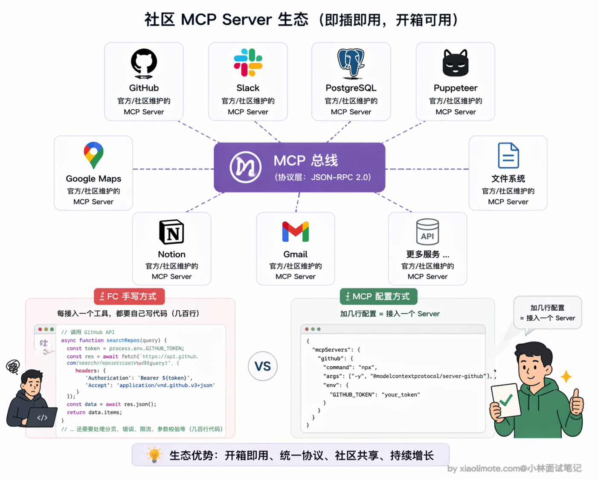

另外，当工具规模起来、MCP 的管理优势就很明显了。这里不想给一个绝对的数字门槛（比如「超过 3 个就要上 MCP」），因为实际判断要看几个维度综合：工具的复杂度（每个工具的 schema 和调用逻辑是几行还是几十行）、团队规模（是一个人维护还是多人协作）、变更频率（工具接口经常改还是基本稳定）。如果你的工具平均复杂度不低、团队里好几个人都在碰这些代码、接口还时不时调整，那就算只有 5 个工具也会很快把你拖进维护泥潭。反过来，两个极其简单、几乎不动的工具，没必要为它们引入一套独立 Server。

为什么工具多了 Function Calling 就会难维护？因为工具的 schema 定义和调用逻辑会散落在代码各处，新加一个工具要改应用代码，工具有 bug 也要进应用代码改，出问题时定位链路很长。MCP 的自动发现机制正好解决这个问题，主程序不感知具体工具，只连 Server，新增工具只需要在 Server 里加实现，主程序完全不需要改动。

最后，如果你在构建 Agent 系统，MCP 是一种可选的模块化边界。它可以把代码执行、文件系统、数据库和外部 API 隔离为不同 Server，但也要承担网络/进程失败、认证、版本、监控和工具选择噪声；小规模系统用内嵌适配器也可能更可靠。

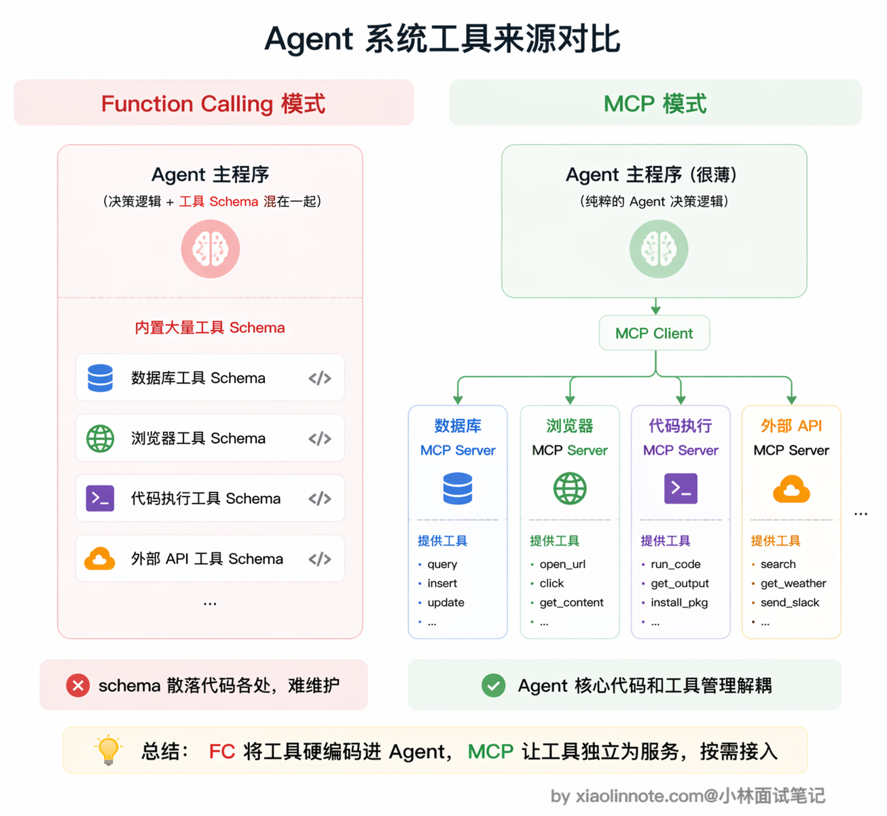

#### 一个实用的判断方法

碰到「用 Function Calling 还是 MCP」这个选择题，其实不需要纠结太久，按几个问题依次过一遍就清楚了。

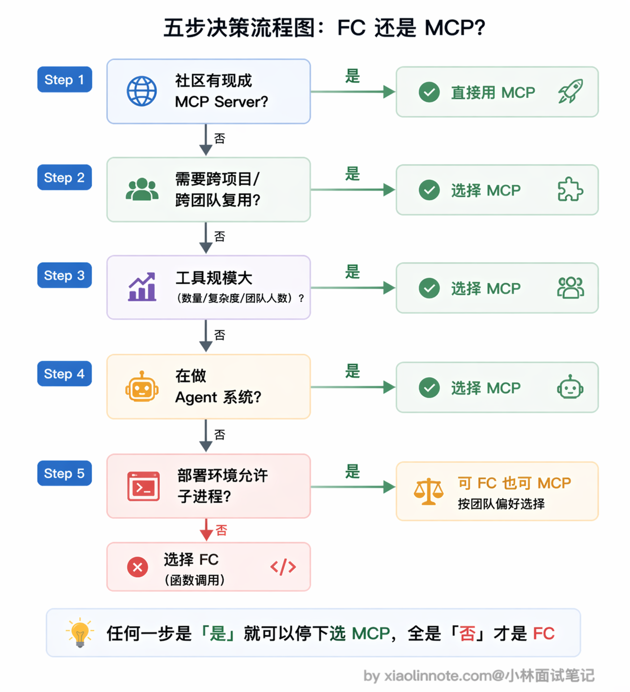

首先看社区有没有现成的 MCP Server，有的话直接用，不要重复造轮子，这是最省事的路径。

如果没有现成的，那就看这个工具需不需要在多个项目或多人之间复用，需要复用就选 MCP，一次封装到处用。

接着综合看工具数量、复杂度、团队规模和变更频率，只要规模一上来（不一定是数字门槛，而是「感觉到散乱」的那个拐点），用 MCP 统一管理会比散落在代码各处的 Function Calling 清爽很多。

然后考虑你是在做正式的 Agent 系统还是 Demo 原型，正式系统选 MCP 更利于长期维护，Demo 的话 Function Calling 上手更快。

最后别忘了检查部署环境，如果平台不允许启动子进程，那 Function Calling 就是更稳妥的选择。

总结成一句话：短期、单应用、强业务耦合的工具可以先用内嵌 tool calling；跨应用复用、独立权限/生命周期和生态接入明显时再评估 MCP。两者可以组合，但 MCP 不必然建立在某家模型的 Function Calling API 之上。

#### 选型对比：把「复用」放回完整约束中

| 维度 | 应用内 tool calling | MCP Server |
| --- | --- | --- |
| 集成速度 | 少一层协议，原型快 | 需实现/配置生命周期与传输 |
| 复用 | 由应用自己封装适配器 | 通过标准发现降低重复接入 |
| 信任边界 | 通常在同一应用内更直观 | 跨进程/网络，认证和隔离更重要 |
| 延迟与故障 | 少一跳，链路较短 | 多一跳，需处理断线、超时、重连 |
| 治理 | 代码库内统一测试 | Server 可独立版本、权限、审计 |
| 适合 | 少量、专用、低复用工具 | 跨应用、远程、多团队共享能力 |

面试时说明「为何选它、失败如何降级、谁批准副作用、怎么控制成本」比背一个工具数量阈值更有说服力。

### 🎯 面试总结

回到开头的面试对话，最典型的误区就是用单一维度来做选型判断，比如只看项目规模或只看工具数量。

面试回答这道题，核心是展示你有多维度的判断框架：首先看社区有没有现成的 MCP Server，有就直接用，不要重复造轮子；其次看工具有没有跨项目复用的需求，有就选 MCP；再看工具规模（数量、复杂度、团队规模、变更频率综合判断），规模起来了就考虑 MCP 统一管理；最后还要考虑部署环境限制和是否在做 Agent 系统。

另一个容易踩的雷是只说「什么时候用 MCP」而忽略了 Function Calling 的适用场景。快速原型、工具只为单一应用服务、需要精细控制执行逻辑、部署环境受限这四种场景，Function Calling 反而是更好的选择。面试官想听到的是你能根据具体场景做出合理取舍，而不是一刀切地倾向某一个方案。

---

## 为什么有些特定的推理模型不支持 MCP 协议？

👔面试官：为什么有些推理模型不支持 MCP 协议？

🙋‍♂️我：应该是这些模型比较新，还没来得及做 MCP 的适配吧，等厂商更新一下 SDK 就能支持了。

👔面试官：这不只是 SDK 适配问题。要区分模型 API 是否提供工具调用、推理/工具消息如何序列化、Host 是否能在工具结果后继续发起模型请求，以及 MCP Client 是否能完成能力映射。你得从这几层分析。

🙋‍♂️我：嗯，推理模型会先生成思维链再回答。那是不是因为思维链太长了，占满了上下文窗口，没空间放工具定义了？

👔面试官：上下文窗口不是唯一核心。推理与工具调用的交错会影响消息协议、隐藏推理内容的处理、服务端状态和训练分布，但这并不是理论上不可兼容。你要区分「某个模型/API 版本未开放」和「所有推理模型都不能调用工具」。

这个问题的本质是生成范式的冲突，下面我从推理模型的工作机制开始，把这个冲突的来龙去脉讲清楚。

### 💡 简要回答

我理解更准确的说法是：某些模型或 API 版本没有把推理阶段与工具调用的交错协议、状态管理和安全策略设计好，因此暂时不开放或限制工具调用；这不是 MCP 与推理模型的必然冲突。

推理模型可能生成额外的内部推理 token，产品/API 是否暴露、如何计费和如何与工具消息交错取决于实现。工具调用可以发生在推理段之前、之后，或由支持交错思考的接口在中间发生；Host 通常通过新一轮请求把工具结果和必要的可见上下文发回模型，而不是要求模型服务永久保留一条可暂停的「思维链」。

MCP 是 Host/Client 与 Server 之间的协议，不规定模型侧一定使用 Function Calling。若某模型 API 没有可控的工具选择/结构化输出通路，Host 可以降级为程序规则或另一模型，但自动代理能力会受限；因此应说「该产品组合暂不支持」，不要说「MCP 天然不支持推理模型」。

常见工程方案包括：在推理段结束后调用工具；支持工具结果回填后的新一轮推理；或显式支持 interleaved thinking（交错思考）。具体模型、端点和版本的能力必须查对应官方文档，不能从模型家族名推断。

### 📝 详细解析

#### 先弄清楚推理模型是什么

普通模型的工作方式很直接：问题进来，答案出去，收到输入就开始生成 token，一路生成到结束。

推理模型（Reasoning Model）不一样。它在给出最终答案之前，会先生成一大段「内部思考」（thinking tokens），在思考里自言自语地推演、验证、反驳，甚至推翻自己前面的结论重来，直到把问题想清楚了，再输出面向用户的最终答案。代表模型有 OpenAI o1/o3 系列、DeepSeek-R1、Claude 的扩展思考（Extended Thinking）模式。

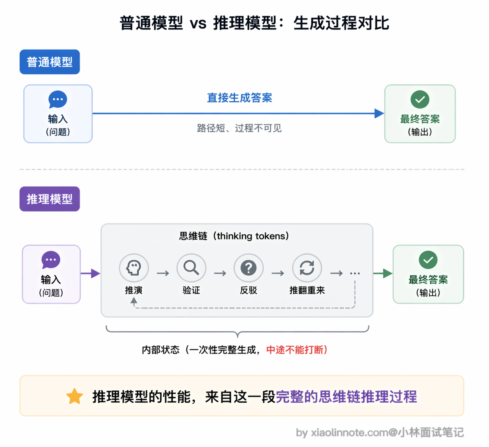

这套「先思考再回答」的机制常被用于复杂推理，但它与工具调用的兼容性取决于协议设计与训练，不是模型类别的硬性定律。

#### 工具调用的本质是「中途暂停」

要理解冲突，先要搞清楚工具调用的完整流程。

工具调用不是一次性生成完成的，它天然是多轮交互：第一步，模型生成调用请求，表达「我要查北京天气，调 `get_weather` 工具，参数是 city=北京」；第二步，**停下来等宿主程序去执行这个工具**；第三步，拿到工具返回的结果；第四步，继续生成，把工具结果纳入后续推理，最终给出答案。

整个流程的核心是第二步，宿主在收到结构化调用后暂停当前请求，执行工具，再发起后续模型请求。对任何模型都可以这样做；差别在于服务端是否保留/返回推理状态、是否允许把工具结果插入上下文、以及 API 是否规定可接受的消息序列。


#### 为什么有些实现会把工具交错做得更保守？

模型的生成请求本来就是可结束的；工具结果回来后，模型可以用重建的消息历史重新推理。这样可能增加输入 token、延迟和成本，也可能丢失未公开的中间状态，但不是「只能整个重来所以不能用工具」的协议结论。

#### 「那保存状态再恢复不就行了？」

有人可能会问：那暂停时把状态保存起来，工具执行完再恢复，不就解决了？

如果服务端要保存可恢复的 KV Cache，确实会占用显存或外部缓存，并受 TTL、并发、序列长度和缓存管理影响；如果不保存，就需要重建上下文。两者都是性能/成本权衡，不能直接推出「吞吐量腰斩」等固定结论。工具本身的网络延迟、结果大小和重复输入也应单独计入预算。


更难解决的是一致性问题。思考过程中途接入工具结果，等于在模型「想到一半」时改变了输入。模型之前的思路是基于「我还不知道工具结果」建立的，突然工具结果来了，模型需要重新校准，之前的推理链和新来的工具结果可能是矛盾的，怎么融合？这个「思考状态一致性」的问题没有简单的解法。

#### 训练目标上的冲突

除了生成范式，训练和消息协议也需要共同设计。推理模型的后训练可能使用强化学习、验证器或其他信号来提高复杂任务表现；工具使用训练还要让模型在合适时机输出结构化调用请求，并正确处理工具结果，并非天然互斥。

如果训练与 API 设计不充分，常见失败模式包括：工具调用块格式错误、把参数写进不可见推理、工具结果回填后重复调用、拒绝处理错误，或在工具与答案之间丢失状态。早期某些模型可能因此限制工具调用，但这属于产品/版本取舍，不能概括所有推理模型。


#### 早期推理模型的真实情况

某个模型家族的预览版、正式版或不同 API 端点可能有不同工具能力。回答面试题时应引用明确的模型快照/端点文档，不能把早期版本限制推广到整个家族；事实不确定时只说「该版本未开放或支持有限」。

#### 后来是怎么解决的，折中方案

一种工程解法是：**让工具调用发生在一个可结束的推理段之后**。

具体做法是：模型先生成一个可见的调用请求或阶段性结果，Host 执行工具，再把工具结果作为新消息发回模型。这样不要求服务端暂停一条无限长生成，但会增加一次请求和上下文重建成本。

代价是：思考阶段完全感知不到工具结果，模型只能基于自己的已有知识来推理，工具数据只有在「答案生成阶段」才能引入。

对于那种「需要先查到某个数据，再基于这个数据做复杂推理」的任务，这个方案是有局限的，模型没办法带着工具结果去深度推理。但对大多数场景来说，先想清楚再调工具已经够用。

有些产品还提供 interleaved thinking（交错思考），允许在工具调用之间继续推理；是否支持、输出哪些 thinking 内容、能否与 MCP 组合必须按具体 API 文档确认。


但你要知道这个内在限制的本质仍然存在，各家的解法都是在「保证推理质量」和「支持工具调用」之间做权衡。

#### 为什么某个模型/API 不支持时，MCP 体验会受影响？

一个常见 Host 链路是：MCP Client 连接 Server、发现工具，Host 再把选中的工具映射为模型可用的结构化接口；模型决定调用后，Host/Client 路由到 Server，执行结果再回填。这里的模型接口可以是原生 tool calling，也可以是其他结构化决策机制。

「MCP 工具定义 → 模型决策接口」是 Host 的适配层，是链路中的一个工程环节，不是 MCP 协议的强制层。

如果某模型端点不支持原生 Function Calling，Host 仍可使用约束 JSON、命令分类器、人工选择或另一个模型来发起 MCP 调用，但自动选择的可靠性、成本和安全边界会变化。若产品没有任何可控的结构化决策通路，才会表现为「该组合暂不支持 MCP」。

所以更准确的关系是「模型/API 的调用接口能力影响 Host 如何使用 MCP」，而不是「MCP 天然依赖 Function Calling」。

#### 面试时可画出的状态链

```text
模型请求 ──> [推理/输出调用] ──> Host 校验与权限 ──> MCP tools/call
    ↑                                      │             │
    └──── 工具结果 + 可见上下文 + 错误 ─────┴─────────────┘

可选实现：
1. 原生 tool calling
2. 结构化输出/约束解码
3. 程序策略或人工选择
```

面试回答应区分四个层面：模型能力、模型 API 消息协议、Host 编排、MCP 传输/Server；再说明额外的请求、KV/输入缓存、工具延迟和错误重试如何影响成本与性能。


### 🎯 面试总结

回到开头的面试对话，最常见的误区有两个：一是以为不支持 MCP 只是「还没适配」，把结构性的技术冲突当成了工程进度问题；二是把原因归结为上下文窗口不够大，没有抓到真正的矛盾点。

面试回答这道题，建议讲清楚四层：推理内容可能不可见且由 API 控制；工具调用是可结束的消息往返；某些版本因为训练、序列化、安全或产品策略暂不开放工具；MCP 只是 Host 与 Server 的能力协议，Host 需要另行提供模型决策适配。

如果能再补充方案就更加分：采用推理段后工具调用、工具结果回填后的新一轮推理，或支持交错思考；但模型名和能力要以具体版本的官方文档为准。

同时也要点出折中方案的本质权衡：各家的解法都是在「保证推理质量」和「支持工具调用」之间找平衡点。

---

## Skill 是什么？

👔面试官：说说 Agent Skill 是什么？

🙋‍♂️我：Skill 就是提示词嘛，把常用的 prompt 保存下来，下次用的时候直接贴上去就行了，跟复制粘贴差不多。

👔面试官：就是「复制粘贴 prompt」？那我每次开新对话都要手动贴一遍，团队里十个人每个人贴的还不一样，这算什么「能力」？你觉得这样能规模化吗？

🙋‍♂️我：那……可以把 prompt 写到一个共享文档里，大家统一从那里复制？

👔面试官：你说的是人工流程管理，不是技术方案。Skill 的核心不是「保存 prompt」，而是把指令、脚本、模板打包成一个模块，Agent 能自动发现它、按需加载它，根本不需要人手动去贴。你连 Skill 和普通 prompt 的区别都没搞清楚，更别提它和 MCP 工具的关系了。

好，这段对话踩的雷很典型，很多人一上来就把 Skill 等同于「保存好的 prompt」。下面我把 Skill 的本质和设计思路拆开讲清楚。

### 💡 简要回答

Agent Skill 是把「指令、脚本、模板」一体化打包成可复用能力包的机制，关键在于三件事：Agent 能自动发现它、按需加载它、在需要时调用里面的脚本和资源。它不只是「存 prompt」，而是一份 Agent 能自己翻阅的「操作手册 + 工具箱」。每个 Skill 是一个文件夹，里面有一份 [SKILL.md](http://SKILL.md) 指令文件，还可以带上脚本、模板、参考文档这些资源。

它和普通 prompt 最大的区别是：Skill 能被 Agent 自动发现和按需加载，不用你每次手动输入；和 MCP 工具的区别是：MCP 给 Agent 提供外部工具和数据的访问能力，而 Skill 教 Agent 拿到这些工具和数据之后该怎么用。

不同 Agent 平台对「Skill」的命名和目录约定并不完全相同。以 Claude Code 当前文档中的 Skill 为例，核心通常是 `.claude/skills/<name>/SKILL.md`，可附带参考资料、模板和脚本；具体字段、作用域和加载策略要以实现版本为准，不应把某个平台的日期或约定写成行业统一标准。

### 📝 详细解析

#### 为什么需要 Skill？从「重复贴 prompt」的痛点说起

你一定遇到过这种情况：每次让 AI 帮你做代码审查，你都要贴一大段指令，告诉它「检查这几类问题、用这种格式输出、重点关注安全漏洞」。第一次贴的时候还好，第二次、第三次你就开始烦了，每次新对话都要从头贴一遍，漏掉某个细节就会导致输出质量不稳定。

这还只是一个人的情况。如果是团队协作呢？十个人做代码审查，每个人贴的 prompt 都不一样，有的人关注安全，有的人关注性能，审查标准完全没法统一。


你可能想到把 prompt 写到一个共享文档里让大家复制，但这本质上还是靠人工去维护和执行，版本一多就容易乱，更新了文档但有人还在用旧版的 prompt，质量把控根本做不到。

Skill 要解决的就是这个问题：把那些你反复在用的指令、流程、模板，打包成一个标准化的模块，Agent 自己知道什么时候该用它、怎么用它，不再依赖你手动复制粘贴。

#### Skill 的结构长什么样

在采用该约定的实现中，一个 Skill 通常是一个文件夹，里面最核心的是一份 `SKILL.md`，再加上一些可选的辅助资源。目录结构和 frontmatter 字段由具体平台解释，不能假设所有 Agent 都能直接执行同一份 Skill。

```
code-review/                  # Skill 文件夹，名字就是这个 Skill 的标识
├── SKILL.md                  # 核心指令文件（必须有）
├── scripts/                  # 可选：可执行的脚本
│   └── check_security.py     # 比如一个安全检查脚本
├── references/               # 可选：参考文档
│   └── review_standards.md   # 比如团队的审查标准文档
└── assets/                   # 可选：模板、资源文件
    └── report_template.md    # 比如审查报告的输出模板
```


`SKILL.md` 的内容通常分为两部分：顶部是由平台解析的 YAML frontmatter，正文用 Markdown 写指令和步骤。来看一个示例：

```yaml
---
name: code-review
description: "对代码进行全面审查，检查 bug、安全漏洞和性能问题，输出结构化审查报告"
---

# 代码审查 Skill

## 指令

### 第一步：理解代码上下文
阅读提交的代码，理解它的功能和所属模块，确认修改范围。

### 第二步：逐项检查
按以下维度逐一检查：
1. 功能正确性：逻辑是否有 bug，边界条件是否处理了
2. 安全性：是否有注入、XSS、权限绕过等漏洞
3. 性能：是否有 N+1 查询、不必要的循环、内存泄漏风险
4. 可读性：命名是否清晰，关键逻辑是否有注释

### 第三步：输出报告
使用 assets/report_template.md 的模板格式，输出结构化的审查报告。
```

你会发现，这和普通 prompt 的区别就很明显了。普通 prompt 只是一段文字，用完就没了；而 Skill 是一个完整的文件夹，里面的指令、脚本、模板可以持续维护、版本管理，团队里所有人用的都是同一份。

#### 渐进式加载：Skill 最聪明的设计

Skill 最让人眼前一亮的设计，不是「能打包」这件事本身，而是它的加载方式。

你可能会想，既然 Skill 可以打包那么多东西，Agent 启动的时候是不是要把所有 Skill 的内容全部读进来？想象一下这个账：假设你有 20 个 Skill，每个 Skill 的指令加上参考文档平均 2000 token，全部加载就是 4 万 token 打底。现在市面上常见的模型上下文窗口是 20 万 token，光 Skill 就吃掉了五分之一，剩下的要分给系统提示、对话历史、用户文件，留给模型真正思考的空间就很紧张了。更糟的是，这 20 个 Skill 里大部分在当前这一次任务里根本用不上，加载了也是白加载。

所以 Skill 用了一套叫「渐进式加载」（Progressive Disclosure）的三层机制来解决这个问题。


- 第一层是「只看元数据」。某些 Agent 会在启动时加载 Skill 的名称和描述，让模型决定是否相关；具体 token 开销取决于实现和描述长度，不存在通用的 30～50 token 配额。
- 第二层是「按需加载正文」。当任务与某个 Skill 相关时，运行时再读取 `SKILL.md`；也可能要求用户显式调用，或由策略禁止自动调用。
- 第三层是「需要时再取」。如果实现支持渐进式加载，执行过程中再读取模板或参考文档；脚本是否允许执行、由谁批准、是否在沙箱中运行，则属于宿主安全策略。

这个设计用一个类比就很好理解：Skill 就像公司给新员工准备的入职手册。你入职第一天不会把整本手册从头到尾看完，而是先扫一眼目录，知道里面有「报销流程」「请假制度」「代码规范」这些章节就行了。等你真的要报销了，再翻开「报销流程」那一章仔细看。这样既不会信息过载，又确保你需要的时候能找到。


为什么这个设计这么重要？因为 context window 是 Agent 最宝贵的资源。如果把所有 Skill 的全部内容一股脑塞进去，真正有用的用户任务信息反而会被淹没，Agent 的注意力被分散，输出质量反而下降。渐进式加载的本质就是「让 Agent 只在需要的时候获取需要的知识」，这和人类的工作方式其实是一样的。

#### Skill 和 Tool、Prompt 分别是什么关系

这三个概念经常被混淆，但它们处于完全不同的层次，用一个类比就能讲清楚。


你可以把 Tool（包括 MCP 工具）想象成公司给员工配的电脑、软件和数据库访问权限。有了 Tool，Agent 就能「做事」，比如查数据库、调 API、读写文件。但光有工具不够，你给一个新人配了一台电脑和所有系统权限，他也不知道该按什么流程做代码审查，不知道先查什么、后查什么、用什么格式输出报告。

Skill 就是那份「操作手册」和「SOP 流程」。它教 Agent 拿到这些工具之后，该按什么步骤、什么标准、什么格式来完成一个具体的工作流。所以 Tool 和 Skill 的关系是互补的：Tool 提供能力，Skill 提供知识和流程。

那 Prompt 呢？Prompt 就像你口头跟员工说的一句话指令，比如「帮我看看这段代码有没有问题」。这句话说完就没了，下次你还得再说一遍。Prompt 是一次性的、临时的，而 Skill 是持久化的、可复用的。

还有一个容易搞混的是 Slash Command（斜杠命令）。Slash Command 通常由用户显式触发；Skill 是否能被自动发现和调用取决于宿主配置，也可能被设置为只能手动触发。自动触发不是 Skill 格式本身的安全保证。


#### Skill 的跨平台边界

有些平台把 Skill 作为可复用的 Markdown 工作流，有些平台还扩展了脚本、权限、隔离上下文和调用控制。即使目录结构相似，也不能据此推断 Claude Code、API、IDE 或其他 Agent 平台的行为完全一致；迁移时要检查 frontmatter、工具权限、资源路径和执行沙箱。


为什么要把规范开放？核心原因是 Skills 的设计足够简单。一个 Skill 就是一个文件夹加一份 Markdown 文件，不需要安装特殊的运行时，不需要学新的编程语言，任何支持文件系统的 Agent 平台理论上都能实现这套格式。这种「零门槛」的设计让它有希望成为跨平台的通用约定。

如果多个平台都采用相近的目录约定，Skill 内容有机会复用，但复用的是指令和资源，不是自动获得工具权限。移植前应重新审查外部内容、脚本、网络访问、密钥和副作用操作。

#### 安全边界：Skill 是不可信输入的一部分

Skill 文件可能来自仓库、插件市场或第三方压缩包；正文、参考资料和脚本都可能包含提示注入、越权指令或供应链风险。加载 Skill 时应把它视为配置代码：锁定来源和版本，最小化允许的工具，隔离工作目录，禁止脚本默认拿到生产凭据，并对副作用操作设置人工确认。

### 🎯 面试总结

回到开头踩的雷，最常见的误区就是把 Skill 等同于「保存好的 prompt」。更稳妥的回答是：Skill 是某个平台约定的可复用指令/知识/工作流包，可选地带参考资料或脚本；自动发现、按需加载和可执行权限都由宿主实现。

第二个关键点是渐进式加载的设计：元数据、正文、辅助资源可以分层加载，但要注明这是具体 Agent 的策略，不是所有 Skill 实现的硬性协议。

第三个要讲清楚的是关系：MCP/Tool 提供外部能力，Skill 提供知识与流程；二者可以组合，也可以分别使用。MCP、Function Calling 与 Skill 不是严格的上下层依赖，宿主负责适配和权限控制。

---

## MCP 和 Agent Skill 的区别是什么？

👔面试官：MCP 和 Agent Skill 有什么区别？

🙋‍♂️我：它们都是给 Agent 加能力的吧？MCP 是用工具列表来描述 Agent 能做什么，Skill 也是描述 Agent 能做什么，本质上差不多，只是格式不同。

👔面试官：「本质上差不多」？那你觉得为什么要搞两套东西，一套不就够了？如果真的差不多，为什么 MCP 和 Skill 的结构、加载方式、使用场景完全不一样？

🙋‍♂️我：嗯……可能 Skill 就是一种更高级的 prompt 模板？把常用的指令保存下来，比 MCP 多了一些描述信息？

👔面试官：你又把 Skill 降格成「prompt 模板」了。Skill 可不只是一段指令文字，它是一个完整的文件夹，里面有指令、脚本、模板、参考文档，而且能被 Agent 自动发现和按需加载。MCP 给 Agent 提供的是工具和数据的访问能力，Skill 教 Agent 拿到这些工具之后该怎么用。一个是「能力」，一个是「知识和流程」，层次完全不同。你把这两者的定位和分工搞清楚。

好，这段对话的误区很典型，很多人把 MCP 和 Skill 当成同类概念。下面我把两者各自的定位和配合方式拆开讲清楚。

### 💡 简要回答

MCP 和 Agent Skill 不是同类概念，不是竞争关系，而是互补的。

MCP 解决的是「Agent 怎么获得外部能力」，它把数据库、API、文件系统这些外部工具标准化封装成服务，Agent 通过 MCP 就能查数据、调接口、读写文件。

Skill 解决的是「Agent 拿到这些能力之后，该按什么步骤、什么标准来完成任务」，它把完成某类工作的知识和流程打包成可复用的模块。

简单记：MCP 主要解决外部能力的发现与调用，Skill 主要承载知识、约束与工作流。两者经常组合，但不是必须绑定；Skill 可以使用宿主内置工具、脚本或人工步骤，MCP 也可以被程序直接调用。

### 📝 详细解析

#### 从定位说起：两者解决的不是同一个问题

很多人第一次接触这两个概念会觉得它们都跟「Agent 能做什么」有关，但仔细一想会发现，两者的目的和工作层次完全不同。


MCP 解决的是「Agent 怎么获得外部能力」。没有 MCP 之前，Agent 就是一个只会说话的语言模型，你让它查数据库它查不了，让它读文件它读不了，让它调 API 它也调不了。MCP 把这些外部工具标准化封装成独立的服务，Agent 连上 MCP Server 就能用这些工具了。所以 MCP 解决的是「从无到有」的问题，让 Agent 有能力去操作外部世界。

Skill 解决的是另一类问题：「Agent 有了这些能力之后，该怎么用」。你想，Agent 现在能查数据库了、能读文件了、能调 API 了，但面对一个「帮我做代码审查」的任务，它该先做什么后做什么？检查哪些维度？用什么格式输出？这些「知识和流程」，就是 Skill 要提供的。

用一个类比就很好理解。MCP 就像给新员工配电脑、装软件、开各种系统权限，这些是他「能做事」的前提。但光有电脑和权限是不够的，你还得给他一份操作手册，告诉他做代码审查的时候先检查什么、后检查什么、用什么标准判断、最后用什么模板写报告。这份操作手册就是 Skill。


#### MCP：让 Agent 有「手」

理解了两者的定位差异，先来展开看看 MCP。为什么说它是 Agent 的「手」？因为如果没有 MCP，Agent 就只会「说话」，不会「做事」。

MCP Server 暴露的 Tools、Resources、Prompts 是可由 Host 管理的能力。模型侧是否用 Function Calling、是否看到完整 schema、结果如何回填，都由宿主与模型 API 的适配决定。Tool 通常粒度较小，但可以是只读或有副作用；schema 也必须经过权限和来源审查。

简单说，MCP 让 Agent 从「只会聊天」进化成了「能真正干活」，这是一切上层能力的前提。

#### Skill：给 Agent 一份「操作手册」

有了 MCP 之后，Agent 确实能查数据、调 API 了，但面对一个复杂任务，它怎么知道该按什么顺序用这些工具？该关注哪些维度？该用什么标准判断质量？这就是 Skill 要解决的问题。

以 Claude Code 当前的实现为例，Skill 通常是包含 `SKILL.md` 的目录，可附带脚本、参考文档和模板；其他 Agent 的目录、frontmatter 和执行权限可能不同。它是工作流/知识的封装，不自动授予任何工具或网络权限。

Skill 和普通 prompt 最大的区别在于两点。

- 第一，某些宿主支持自动发现和按需加载，另一些宿主要求显式调用；不能把自动激活当作格式保证。
- 第二，渐进式加载是常见的上下文策略，但描述长度、加载时机、正文上限和辅助资源策略都由实现决定。脚本执行还要受沙箱、权限和人工确认控制。

所以 Skill 的粒度比 MCP 工具粗得多。MCP 的粒度是单个函数调用，比如 `read_file`、`query_database`；Skill 的粒度是一个完整的工作流程，比如「代码审查」「数据分析报告」，内部可能涉及好几个步骤、调用好几个工具。


#### 两者怎么配合工作

看到这里你可能会想，既然 MCP 提供工具、Skill 提供流程，那它们在实际系统里是怎么配合的？咱们用一个代码审查的场景走一遍就清楚了。

用户对 Agent 说「帮我审查一下这次提交的代码」。Agent 收到任务后，先扫描自己可用的 Skill 列表，发现有一个叫 code-review 的 Skill 和这个任务匹配度很高。于是 Agent 加载它的 [SKILL.md](http://SKILL.md) 正文，读取里面的执行流程。这份 [SKILL.md](http://SKILL.md) 长这个样子：

```yaml
---
name: code-review
description: "对代码进行全面审查，识别 bug、安全漏洞和性能问题"
---

# 代码审查

## 第一步：读取待审查的代码文件
读取用户指定的代码文件，理解功能和修改范围。

## 第二步：执行安全检查
运行 scripts/check_security.py 对代码做自动化安全扫描。

## 第三步：输出审查报告
使用 assets/report_template.md 的模板格式，输出结构化审查报告。
```

你看，[SKILL.md](http://SKILL.md) 的作用就是告诉 Agent「做什么、按什么顺序做」，它就是一份操作手册。

但 Skill 只定义了流程，真正「动手」的时候还是得靠 MCP。Agent 执行第一步「读取代码文件」，需要调用文件系统 MCP Server 提供的工具：

```python
# Skill 第一步说：读取待审查的代码文件
# Agent 发现 MCP 有 read_file 工具，于是调用它
code = mcp_client.call_tool("read_file", {
    "path": "src/auth.py"    # 要审查的文件路径
})
```

执行第二步「安全检查」时，Agent 可以在宿主允许的沙箱中运行 Skill 自带脚本，也可以改用内置工具或人工检查。可执行脚本是安全边界，不是 Skill 天然拥有的权限。

执行第三步「输出报告」时，Agent 加载 Skill 的 `assets/report_template.md` 模板，按照里面定义的格式把审查结果整理成结构化报告返回给用户。

整个流程的分工非常清晰：Skill 扮演「编排者」，定义了做什么、按什么顺序做、用什么标准做；MCP 扮演「执行者」，提供了每一步需要调用的具体工具。两者配合起来，Agent 才能既知道「该怎么做」，又有能力「真正去做」。


再看一个稍复杂的场景，你就能感觉到这种分工的威力。假设 Skill 定义的流程里有一步「如果改动涉及数据库表结构，额外执行权限合规检查」，这就是条件分支。

Agent 读到这条指令时，会先调用一个 MCP Tool 去扫描这次提交有没有改数据库 schema，拿到结果（布尔值）之后再决定要不要走那条分支；如果要走，就再调另一个 MCP Tool（比如 `query_permission_policy`）去查合规规则，最后根据结果决定审查报告里是否要加一条严重级警告。

整个过程里，Skill 就像项目经理，拿着流程图和判断标准指挥执行；MCP 提供的每个 Tool 就像专业工人，各自只管做好一件小事。

缺了 Skill，Agent 可能缺少领域流程；缺了 MCP，Skill 仍可以使用内置工具、脚本或 API 适配器。两者的组合常常有价值，但不是互相不可替代的硬依赖。

#### 组合时的请求生命周期


审查一个组合时，至少要问：Skill 内容是否可信？工具是否最小权限？脚本是否隔离？副作用是否需要确认？失败是否可重试且幂等？


### 🎯 面试总结

回到开头对话踩的雷，最大的误区就是把 MCP 和 Skill 当成同类概念来对比。面试回答这道题，第一个必须说清楚的是两者的定位差异：MCP 提供工具和数据的访问能力，解决的是「Agent 怎么做事」；Skill 提供完成任务的知识和流程，解决的是「Agent 该怎么做事」。一个是能力，一个是知识。

第二个关键点是粒度差异。MCP 通常描述可发现的远程能力，Skill 通常描述知识与工作流；两者的实际粒度、schema 可见性和加载方式取决于宿主。

第三个加分点是讲清楚两者的配合方式：Skill 给出流程与验收标准，Host 可以把 MCP 或内置工具作为执行能力；二者之间由 Host 负责适配、权限、错误处理与审计，而不是把 Skill 当成自动获得工具权限的脚本。

---

## Function Calling、Skill、MCP 这三个有什么区别？

👔面试官：Function Calling、Skill、MCP 这三个概念有什么区别？

🙋‍♂️我：这三个都是让模型调用外部工具的方式吧？Function Calling 是 OpenAI 的方案，MCP 是 Anthropic 的方案，Skill 也是 Anthropic 的方案，它们是不同时期搞出来的竞争方案。

👔面试官：竞争方案？那你觉得一个系统里只需要选其中一个用就行了？它们是可以互相替代的？

🙋‍♂️我：也不完全是替代关系……它们应该各有侧重？比如 Function Calling 管函数调用，MCP 管工具标准化，Skill 管流程模板？但我不太确定它们之间有没有层级关系。

👔面试官：你前半段说的方向沾边了，但关键问题是你没搞清楚这三者的层级依赖。它们不是并列的三个方案，而是从底到顶的三层架构：Function Calling 是最底层的调用语言，MCP 在它之上做工具标准化，Skill 在最上层把使用工具完成任务的知识和流程封装成可复用模块。你把每层解决什么问题搞清楚，三者的区别就一目了然了。

好，这段对话踩的雷挺典型的，很多人一上来就把这三个当成平行的竞争方案，或误以为它们有固定的上下层依赖。下面按「边界」而不是按虚构的层级拆开讲清楚。

### 💡 简要回答

这三个概念可以组合，但不是严格的三层协议栈，也不要求彼此全部存在。

Function Calling / tool calling 是模型 API 侧的一种结构化调用接口，解决的是「模型如何表达要调用哪个能力以及参数」。字段和语义由具体提供商定义。

MCP（Model Context Protocol，模型上下文协议）解决的是「Host/Client 如何发现、连接和调用外部工具、资源与提示模板」，可降低跨应用复用成本；它不规定模型必须使用某家的 Function Calling。

Agent Skill 通常是宿主约定的知识、指令和工作流包，解决的是「任务按什么原则与步骤完成」。它可以使用 MCP，也可以使用内置工具、脚本或人工确认。

简单记就是：模型侧 tool calling 是「表达动作的格式」，MCP 是「能力连接与发现协议」，Skill 是「可复用的任务知识/流程」。

### 📝 详细解析

#### 为什么会有三个概念

这三个概念放在一起确实很容易让人迷惑，但它们解决的是不同边界的问题。实际系统可以只用其中一个，也可以用 Host 把它们组合起来。

怎么理解呢？咱们先建立一个直觉感受：Function Calling 是「模型说：我要调这个函数」，MCP 是「工具服务说：我能提供这些函数」，Skill 是「操作手册说：用这些工具按这个流程做」。你看，三句话的主语不一样，说话对象不一样，粒度也不一样，这就是三者的本质差异。

再从时间线来看就更清楚了。

Function Calling 是最先出现的，当时的核心问题是「模型只会生成文本，怎么让它能触发外部调用」，所以 Function Calling 解决的是最基础的调用协议问题。

后来大家发现每个应用都要自己写代码对接各种工具，重复劳动太多。MCP 提供了一种标准化的工具/资源连接方式，但复用仍受版本、认证、权限和客户端能力约束。

另一个独立问题是：Agent 面对复杂任务不知道该按什么流程、什么标准做。Skill 这类机制用于复用知识和流程；它不必等 MCP 出现，也不必把所有执行能力都放在 MCP 中。

三者的出现背景不同，自然解决的是不同层次的东西。


#### 从「谁和谁通信」来看三者位置

理解三者最清晰的切入点是：每个机制发生在哪两个角色之间。


**Function Calling** 发生在模型 API 与宿主程序之间，是结构化调用接口。模型生成某种 provider-specific 的调用块，宿主校验、授权、执行并按对应格式回填结果。

**MCP** 发生在 AI Host 内的 Client 与 Server 之间，是工具、资源和提示模板的发现/调用协议。Host 可以把 MCP 工具映射成某家模型的 tool schema，但这只是组合方式，不是 MCP 的强制依赖。

**Skill** 发生在 Agent 运行时与可复用知识/工作流包之间。是否自动发现、如何加载 `SKILL.md`、脚本是否能执行，都由宿主实现。一个 Skill 可以调用多个 MCP 或内置工具，但不是必须如此。


#### 三者的组合关系，而非固定层级

搞清楚三者各自的位置，接下来要问的是：它们能怎样组合？答案是存在常见适配链，但没有唯一、强制的层级。


常见组合是：Skill 提供流程 → Host 选择内置或 MCP 能力 → 模型用 tool calling 表达动作 → Host/Client 校验并执行。但也可能是：Skill 直接指导脚本；程序直接调用 MCP；模型用约束 JSON 而不是原生 tool calling。因此不要把「Skill → MCP → Function Calling」说成唯一依赖链。


用做菜来类比就很好理解。

Function Calling 是你的「手」，能拿刀、能点火、能翻锅，这是最基础的操作能力。MCP 是你的「厨房」，里面有各种厨具和食材，刀在抽屉里、调料在架子上、食材在冰箱里，你走进厨房就知道有哪些东西可以用。Skill 是那份「菜谱」，告诉你先热锅凉油、再放姜蒜爆香、然后下主料翻炒、最后调味出锅。

跳过某一层不一定意味着系统不能工作：没有 Skill 可以用临时提示和程序流程；没有 MCP 可以用内置函数或服务适配器；没有原生 Function Calling 可以用约束输出或人工/程序路由。代价是复用性、可靠性、上下文成本或开发成本不同。


#### 用一个完整故事串联三者

把三者放在同一个场景里感受一下各层分工。用户对 Agent 说「帮我分析最近三个月的销售数据，找出下滑的产品线，给改进建议」。

首先是 **Skill 层**在起作用。Agent 收到任务后，扫描自己可用的 Skill 列表，发现有一个叫「数据分析报告」的 Skill 和这个任务高度匹配。于是 Agent 加载这个 Skill 的 [SKILL.md](http://SKILL.md) 正文，读取里面定义的分析流程：第一步从数据库取数据，第二步用 Python 做趋势分析，第三步按模板写分析报告。Skill 就像一份菜谱，把整个任务的步骤和标准安排得明明白白。

然后是 **MCP 层**在起作用。执行第一步「从数据库取数据」的时候，Agent 的 MCP Client 已经连着数据库 MCP Server 和 Python 执行器 MCP Server，自动知道有 `query_database` 和 `run_python` 这些工具可用。MCP 就像厨房，里面的厨具和食材随时可以取用，不需要任何手动配置。

最底层是 **Function Calling** 在起作用。模型判断需要查数据库，输出 `tool_calls: query_database(sql="SELECT product, revenue FROM sales WHERE date >= '2026-01-01'")`，MCP Client 把这个请求路由到数据库 Server 执行，拿到结果后模型继续处理。接着模型输出调用 Python 执行器的 Function Calling，对数据做趋势分析。最后 Agent 按 Skill 里定义的报告模板把结果整理成结构化的分析报告返回给用户。

整个流程里 Skill 做可复用流程，MCP（若采用）做外部能力连接，模型侧调用接口表达动作，Host 负责把三者串起来并守住权限、错误和成本边界。


### 🎯 面试总结

回到开头对话踩的雷，最大的误区是把三者当成竞争方案或固定三层协议栈。面试回答时分别说清：模型侧调用接口、Host/Server 能力协议、Skill 工作流约定；再说明常见组合与可替代路径。

第二个关键点是用类比帮面试官快速理解。Function Calling 是「语言」，让模型能说出要调什么函数；MCP 是「工具箱」，把工具标准化打包，随时插拔；Skill 是「操作手册」，教 Agent 用工具箱里的工具按什么流程完成工作。

面试时可以用完整场景串起来：Agent 按 Skill 定义的流程执行，Host 从 MCP 或内置适配器取得能力，模型通过某种结构化决策接口提出调用，宿主做权限/参数/错误处理。最后补充失败降级、幂等、审计、延迟和 token 成本，回答会比背层级更可靠。

---

## 什么是 A2A 协议？它和 MCP 协议的区别是什么？

👔面试官：说说什么是 A2A 协议，它和 MCP 有什么区别？

🙋‍♂️我：A2A 是 Google 出的一个协议，我理解它就是 MCP 的竞品吧，Google 想自己搞一套标准来替代 MCP。

👔面试官：竞品？MCP 解决的是什么问题，A2A 解决的又是什么问题，你搞清楚了吗？这两个协议面向的对象都不一样，怎么会是竞品？

🙋‍♂️我：那 A2A 应该是用来让 Agent 调用工具的另一种方式？就是和 MCP 一样连工具，只是协议格式不同？

👔面试官：A2A 全称是 Agent-to-Agent，注意看名字，是 Agent 到 Agent，不是 Agent 到工具。MCP 是 Agent 连工具和数据，A2A 是多个 Agent 之间互相通信协作。一个向下连工具，一个向外连 Agent，方向完全不同。你再想想，为什么需要多个 Agent 协作，单个 Agent 不够用吗？

确实，A2A 和 MCP 经常被放在一起比较，但很多人把它们的定位搞混了。下面我从「单个 Agent 的天花板」讲起，把 A2A 的设计思路和它与 MCP 的关系理清楚。

### 💡 简要回答

A2A（Agent-to-Agent）是一个面向 Agent 间协作的开放协议，最初由 Google 推动；项目治理、版本和绑定会演进，工程上应以当前规范与对端 Agent Card 为准。

我理解它和 MCP 的区别是这样的：MCP 解决的是「单个 Agent 怎么连工具和数据」，A2A 解决的是「多个 Agent 之间怎么分工协作」。

一个 Agent 通过 A2A 可以把任务委托给另一个 Agent，接收方通过能力声明告诉调用方支持的交互方式；协议模型可覆盖直接消息、带状态的长任务、流式更新和 webhook/push，具体能力要协商。

两者是互补的，不冲突：MCP 向下连工具，A2A 向上连 Agent，在复杂的多 Agent 系统里这两个通常都要用到。

### 📝 详细解析

#### 为什么单个 Agent 不够用，上下文和专业边界

要理解 A2A 是干什么的，得先把「单 Agent 的天花板」搞清楚。

一个 Agent 可以抽象为模型、状态/上下文、策略编排、工具与输出；每个维度都有边界。拆成多个 Agent 可能隔离上下文与权限，但也会增加通信、协调、重复上下文和失败面。

首先是工具数量的限制，你不可能给一个 Agent 装 100 个工具，模型处理起来效率极低，容易混乱。

其次是上下文窗口的限制，128K tokens 听起来很多，但复杂任务积累的中间产物，搜索结果、草稿、反思记录，会很快把窗口塞满，后面的生成根本顾不上前面写了什么。

最后是专业能力的限制，同一个 Agent 既做代码审查又做市场分析，不如专门为各自任务配置或微调的 Agent 效果好。

举一个具体任务：「帮我做一份 AI 编程工具的竞品分析报告，要有行业趋势、技术对比、商业模式分析和 SWOT」。让单个 Agent 做这件事，问题是：搜索结果和草稿会把上下文撑满，等到写 SWOT 时，前面的行业趋势分析早就被挤出了有效注意力范围；而且市场调研和技术分析需要不同的知识侧重，一个 Agent 很难全面兼顾。


你可能会问，拆成多个 Agent 协作，上下文压力就真的变小了吗？

关键就在这里：调度 Agent 把「做行业趋势分析」委托给市场 Agent，市场 Agent 自己去搜几十个网页、写草稿、反复迭代，这些中间过程都在它自己的上下文里。任务做完，它只把最终结论（比如一份几百字的摘要）通过 A2A 返回给调度 Agent。

调度 Agent 可以只接收摘要或结构化产物，从而隔离部分中间过程；但这不是 A2A 自动完成的，摘要可能丢失证据，调用方仍需要求来源、版本、置信度和可追溯 artifact。


解决方案很自然：把任务拆开，交给不同的专业 Agent 并行处理，最后汇总。一个「调度 Agent」负责任务拆分，「市场分析 Agent」专门做趋势调研，「技术研究 Agent」专门做工具对比，每个只需聚焦自己擅长的部分，整体效果远好于一个 Agent 包揽所有。

#### 多 Agent 的基础问题，Agent 之间怎么互相认识？

多 Agent 系统有一个绕不开的基础问题：Agent A 要把任务委托给 Agent B，它得先知道 B 能做什么。但怎么知道呢？

最笨的方案是写死配置：A 的代码里硬编码「B 可以做竞品分析」。这样太脆了，B 的能力一变，A 的代码就得改，根本没法维护。

更好的方案是让 B 主动「发名片」，声明自己能做什么，A 来查。这就是 A2A 里 **Agent Card** 的设计思路。

Agent Card 是用于发现和协商的 JSON 元数据，通常描述身份、endpoint、技能/能力、认证要求以及是否支持流式或 push；URI 和字段随规范版本变化，当前对端提供的 Agent Card 才是兼容性依据。调用方不应只凭公开名片信任远端，还要验证来源、TLS、认证和权限范围。

Agent Card 里最关键的是 **Skill 列表**，每个 Skill 描述一类能力，比如「竞品分析」「行业趋势分析」，并带有示例输入。调度 Agent 用这些 Skill 描述来做任务路由决策，「这个任务和哪个 Agent 的哪个 Skill 最匹配？」。


这套机制让多 Agent 系统更容易做能力发现和路由；但 schema 变化、认证、版本、错误语义和业务编排仍可能需要配置或代码变更，不能保证新增 Agent 完全零改动。


#### Task，A2A 里的一等公民

A2A 里任务协作的基本单位是 **Task**。

调度 Agent 把一段任务委托给另一个 Agent，就是创建一个 Task；接收方执行这个 Task；完成后把结果作为 Task 的产出（artifacts，可以是文本、文件等）返回。

Task 是带状态的工作单元。常见状态包括 submitted、working、completed、failed、canceled、rejected 或 input-required 等，具体枚举以版本规范为准；调用方要处理非成功终态、需要补充输入和取消竞态。


为什么需要这么完整的状态机？因为 A2A 专门为**长时间任务**设计。

一个「竞品分析」任务可能要跑几分钟，先搜索、再整理、再写报告，不可能让调度 Agent 同步等着。

所以调度 Agent 提交任务后可以去处理其他事情，通过轮询、流式订阅或 push notification（若对端声明支持）接收更新。长任务仍需要超时、取消、重复投递、幂等键和 artifact 持久化策略。

调度 Agent 的视角可以保持在 Task、状态和 artifacts 上，而不必知道 B 的内部工具调用；但「黑盒」不代表不需要可观测性。生产系统仍要记录 trace、输入输出摘要、权限主体、版本和失败原因。

#### A2A 的架构本质，Agent 的微服务化

如果你有后端开发经验，A2A 会让人联想到微服务，但它不是普通微服务的同义词。

在微服务架构里，服务通过 API 互调；A2A 借鉴了发现、认证和异步任务等思想，同时增加 Agent Card、Task、Artifact 与能力协商，不能只把「服务」换成「Agent」。

怎么理解这个对应关系呢？Agent Card 就像 API 文档，告诉别人「我能做什么、怎么调用我」。Task 状态机就像异步消息队列，支持提交任务后去做别的事、完成了再来取结果。而 `.well-known` 下的 Agent Card 就像微服务注册中心里的一条记录，让其他 Agent 能自动发现你。

当前常见绑定基于 HTTP(S)，但可用操作、流式和 push 能力由 Agent Card/版本声明；支持 A2A 不等于所有系统都能无条件互操作，也不等于不需要认证和业务适配。这个设计理念与 MCP 都强调边界标准化，但面向对象不同。


#### A2A 和 MCP 的关系，一纵一横，各管一层

理清两者关系最简单的方式是看方向：MCP 是 Agent 向下连工具，A2A 是 Agent 向外连其他 Agent。

具体来说，一个专业 Agent 内部，用 MCP 连各种工具，比如数据库、浏览器、代码执行器，用 Function Calling 让 LLM 触发这些工具调用，这是「纵向」的连接。而多个 Agent 之间需要分工协作的时候，就用 A2A 来互相通信、委派任务、接收结果，这是「横向」的连接。两个协议解决的是完全不同维度的问题，不存在谁替代谁。

打个比方，MCP 就像公司里每个员工的「工具箱」，决定了这个人能用什么工具干活。A2A 就像公司里的「协作流程」，决定了不同岗位的人怎么分工、怎么交接任务。工具箱和协作流程是两回事，缺了哪个都不行。


在一个复杂的多 Agent 系统里，这两者可以同时使用：MCP 负责某个 Agent 与工具/资源的连接，A2A 负责 Agent 间任务协作；也可以只采用其中一种或使用内部 RPC。选择取决于边界、复用、认证、延迟和运维成本。

#### A2A 请求生命周期与安全检查


调用方要验证 Agent Card 和认证信息，限制租户与数据范围，给任务设置超时/预算，使用幂等键避免重试重复执行，并把远端消息和 artifacts 当作外部输入而不是可信指令。


### 🎯 面试总结

回到开头的面试对话，最大的雷是把 A2A 当成 MCP 的「竞品」或「替代方案」，这说明没搞清楚两者面向的对象完全不同。

面试回答这道题，第一个必须说清楚的点是定位差异：MCP 是 Agent 向下连工具和数据源，A2A 是多个 Agent 之间向外互相通信协作，一纵一横，各管一层。

第二个关键点是 A2A 的核心机制：Agent Card 用于能力/认证发现，Task 与 Artifact 用于跟踪和交付，轮询、流式或 push 支持异步协作；它借鉴微服务思想，但不等同于普通微服务。

还要说清楚「为什么需要 A2A」，也就是单 Agent 的天花板问题：工具数量有限、上下文窗口有限、专业能力有限，复杂任务需要拆分给不同的专业 Agent 并行处理。

最后强调两者是可互补而非必然竞争：MCP 面向 Agent 与工具/资源，A2A 面向 Agent 与 Agent；是否同时使用，要用任务边界、信任边界、延迟、可观测性和运维成本来判断。

---

## MCP 协议通常采用什么通信方式？

👔面试官：MCP 协议通常采用什么通信方式？

🙋‍♂️我：MCP 应该是用 WebSocket 吧？因为需要双向通信，Client 发请求、Server 推结果，WebSocket 全双工正好合适。

👔面试官：MCP 并没有用 WebSocket。你想想，MCP 有本地工具和远程工具两种场景，本地场景需要走网络吗？

🙋‍♂️我：本地的话……应该也是走 HTTP 吧，在本机起个服务，Client 通过 localhost 访问？

👔面试官：想复杂了。本地场景用的是 stdio，直接通过进程的标准输入输出通信，根本不需要网络。远程场景才用 HTTP，而且不是 WebSocket，是 SSE。另外不管哪种传输方式，底层消息格式统一用 JSON-RPC 2.0，这一点你也没提到。传输方式和消息格式是解耦的，这个设计是 MCP 灵活性的关键。

看来通信方式这块确实有不少容易搞混的地方，下面我把 MCP 的消息格式和两种传输方式都讲清楚。

### 💡 简要回答

MCP 支持两种主要的传输方式，分别适用于不同场景。

本地场景用 stdio，Client 把 Server 作为子进程启动，通过标准输入输出通信，通常不用开端口，减少了网络暴露面；但仍需审查启动命令、环境变量、文件权限和子进程的工具权限。我用 Claude Desktop 接本地工具走的就是这种方式。

远程场景现在推荐用 Streamable HTTP，Server 作为独立的 HTTP 服务部署，多个 Client 可以共享同一个 Server，适合团队统一管理工具服务。

较早的 MCP 规范（例如 2024-11-05）定义过「HTTP + SSE」双端点方案；当前规范以 Streamable HTTP 为远程传输主线，旧实现仍可能为了兼容而保留，但不应把历史方案当成新项目默认方案。

不管哪种传输方式，底层消息格式都统一用 JSON-RPC 2.0，传输方式只影响「怎么传」，消息协议本身不变。

### 📝 详细解析

#### MCP 的消息格式：JSON-RPC 2.0

在说传输方式之前，先说消息格式，因为不管用哪种传输方式，消息格式都是同一套。

那为什么 MCP 选了 JSON-RPC 2.0 呢？

其实原因很朴素：MCP 需要一种「Client 调用 Server 的方法，Server 返回结果」的通信模式，这本质上就是远程过程调用（RPC）。

而 JSON-RPC 2.0 是现成的、足够轻量的 RPC 规范，用 JSON 格式易读易调试，任何编程语言都能实现，不管 Server 是 Python 写的还是 TypeScript 写的，消息格式都一样，不需要额外的序列化工具。


每条消息就是一个 JSON 对象，格式固定：

```jsonc
// 请求消息（Client -> Server）
{
  "jsonrpc": "2.0",
  "id": 1,                        // 请求 ID，用于匹配响应
  "method": "tools/call",         // 调用的方法名
  "params": {
    "name": "take_screenshot",    // 工具名
    "arguments": {"url": "https://example.com"}
  }
}

// 响应消息（Server -> Client）
{
  "jsonrpc": "2.0",
  "id": 1,                        // 对应请求的 ID
  "result": {
    "content": [{"type": "image", "data": "...base64..."}]
  }
}
```

JSON-RPC 本身只定义消息格式，不关心底层怎么传输，MCP 在此基础上定义了两种传输层实现。

#### 传输方式一：stdio（标准输入输出）

stdio 是 MCP 最常用的传输方式，适合**本地工具**的场景。

工作原理：MCP Client（比如 Claude Desktop）在启动时，把 MCP Server 当作一个**子进程**启动，然后通过进程的标准输入（stdin）发送请求、从标准输出（stdout）读取响应。两个进程在同一台机器上运行，通过操作系统的管道通信。

这里的「管道」到底是什么？

你可以把它理解成操作系统在内存里给这两个进程分配的一段先进先出的小缓冲区：Client 往里塞一行 JSON，Server 从缓冲区的另一头读出来处理；Server 处理完再往另一条管道里塞一行 JSON，Client 从那头读。

整个过程不经过网卡、不经过 TCP/IP 协议栈，数据在 RAM 里走了一趟就到了，所以延迟天然比网络请求低得多，也不需要序列化成网络可传输的字节流。


stdio 方式有几个很明显的优点。

- 首先延迟极低，进程间通信比走网络快得多，数据直接在操作系统管道里流转，几乎没有开销。
- 其次通常不需要开端口，网络暴露面较小，但这不等于“没有安全问题”：Server 仍可能读取本地文件、访问网络或继承敏感环境变量。通常由 Client 管理子进程生命周期，但异常退出、僵尸进程、日志泄漏和权限隔离仍需显式处理。

在实际使用中，你只需要在配置文件里告诉 Client「用什么命令启动 Server」就行了，比如在 Claude Desktop 的 `claude_desktop_config.json` 里这样配置：

```json
{
  "mcpServers": {
    "filesystem": {
      "command": "npx",               // 启动命令
      "args": ["-y", "@modelcontextprotocol/server-filesystem", "/tmp"],
      "env": {}                       // 环境变量（可选）
    }
  }
}
```

#### 传输方式二：Streamable HTTP（当前标准的远程传输）

远程场景下，Server 作为独立的 HTTP 服务运行，Client 通过网络连接访问。MCP 当前推荐的远程传输方式是 **Streamable HTTP**。

Streamable HTTP 的核心设计是用一个 MCP HTTP 端点（常见路径是 `/mcp`，但路径由部署决定）接收 JSON-RPC 消息。Client 通常通过 POST 发送请求，Server 可以返回 `application/json` 的一次性响应，也可以返回 `text/event-stream` 事件流；Client 还可以按规范使用 GET 建立服务器到客户端的事件流。是否保持流、是否复用会话以及断线如何恢复，取决于具体请求和实现，不能简单等同于“永远不需要长连接”。

Streamable HTTP 的优点很明确。Server 可以部署在云端，多个 Client 共享同一个 Server，这对团队来说特别实用，比如团队共用一个部署在服务器上的数据库 MCP Server，所有人连同一个服务就行，不需要各自在本地跑一份。而且支持跨机器访问，不局限于本地环境，适合需要统一管理工具服务的团队或平台。


当然，相比 stdio 多了网络开销，延迟会略高一些，而且你还需要处理认证、网络中断重连等在本地场景下完全不用操心的问题。

#### 为什么 SSE 被弃用了

你可能看到一些早期的 MCP 教程还在讲 SSE（Server-Sent Events，服务器推送事件）传输方式。更准确的说法是：HTTP + SSE 双端点是较早规范的历史方案；当前 Streamable HTTP 将请求入口与流式响应放进同一 MCP 端点，兼容策略取决于 Server 和 SDK 版本，新项目应以所依赖的当前规范和 SDK 文档为准。

为什么要替换？原因是架构上有一个小尴尬：Client 向 Server 发请求要走 POST 端点，Server 向 Client 推数据要走另一条 SSE 长连接端点，同一个对话被拆成了两条通道。这带来的具体问题是状态管理复杂，比如 Client POST 了一条消息之后网络突然断了，那条消息到底被处理了没、SSE 流会不会推回结果，Client 没有一个简单的办法判断，出问题时排查链路很长。


Streamable HTTP 的做法是把这两条通道合并成一个端点：Client 照样 POST 发请求，Server 根据情况决定返回「一个普通 JSON」还是「一条 SSE 流」，不需要 Client 提前开另一条连接。

注意这里的关键：Streamable HTTP 仍可使用 SSE 事件流（`Content-Type: text/event-stream`），但它不等于“只有 SSE”，也不保证所有实现都以同样方式处理断线、重连、会话和鉴权。实际部署仍需配置认证、Origin 校验、超时、代理缓冲、限流与重放/恢复策略。


### 🎯 面试总结

回到开头踩的雷，最常见的误区就是想当然地以为 MCP 用 WebSocket 或者 HTTP REST 接口。

面试回答这道题，首先要说清楚 MCP 常见的两类传输：本地可用 stdio（标准输入输出，Server 作为子进程运行，通过管道通信），远程可用 Streamable HTTP（Server 作为 HTTP 服务部署，通过 MCP 端点处理 JSON-RPC 请求，并可按需返回 JSON 或事件流）。stdio 减少网络暴露面但不自动消除本地权限风险；Streamable HTTP 便于共享部署，但必须考虑认证、会话、断线、代理与多租户隔离。

第二个要点是消息格式和传输方式的解耦。不管用 stdio 还是 Streamable HTTP，MCP 都以 JSON-RPC 2.0 消息表达请求、响应、通知和错误；但会话、鉴权、重连和能力协商仍受传输与实现影响，不能说“切换传输完全不影响行为”。

最后可以加分提一句传输方案的演进历史：早期远程实现常见 HTTP + SSE 双端点，当前规范主线是 Streamable HTTP（单个 MCP 端点，按请求返回 JSON 或事件流）。重点不是背日期，而是说明“JSON-RPC 消息层”和“stdio/HTTP 传输层”分离，并补充鉴权、断线恢复和代理兼容等生产问题。

---

## 说说 WebSocket 和 SSE 通信的区别及局限性？

👔面试官：说说 WebSocket 和 SSE 通信的区别及局限性？

🙋‍♂️我：SSE 和 WebSocket 都是长连接，区别就是 SSE 比较简单，WebSocket 比较复杂。做 AI 对话的话，WebSocket 更好，因为它功能更强大，全双工嘛。

👔面试官：「功能更强大就更好」？那为什么 OpenAI、Anthropic 的流式 API 全都用 SSE 而不是 WebSocket？你得从实际场景出发去分析，不能只看功能强不强。

🙋‍♂️我：可能是因为 SSE 更简单吧？不过我觉得 SSE 就是 WebSocket 的简化版，功能上是 WebSocket 的子集，没什么本质区别。

👔面试官：这个理解不对。SSE（Server-Sent Events，服务器推送事件）是定义在 HTTP 响应之上的事件流格式，WebSocket 则是在 HTTP 握手后切换到独立的双向协议，两者不是简单的父子关系。SSE 受浏览器、HTTP 版本、代理缓冲和重连语义影响；WebSocket 则需要额外设计会话、扩展、鉴权和横向扩展。选型要看场景需求，不是简单的「谁是谁的子集」。

看来 SSE 和 WebSocket 的区别远不止「简单 vs 复杂」这么表面，下面我从底层原理到实际局限，把两者的核心差异和各自的坑都讲清楚。

### 💡 简要回答

我觉得最核心的区别是通信方向：SSE 是服务端单向推，客户端只能接收，想发消息只能另起一个 HTTP 请求；WebSocket 是全双工，双方都可以随时主动发消息。

对于 LLM 流式输出这种「模型持续推送增量、用户主要接收」的场景，基于 HTTP 的事件流通常够用，而且容易接入现有鉴权、代理和可观测链路；具体供应商的流式接口和事件格式仍需以其文档为准，不能把某两家产品的实现当成行业统一要求。

WebSocket 的复杂性只有在真正需要双向实时交互的时候才值得引入，比如用户要在模型说话过程中随时打断。

两者各有局限：SSE 在 HTTP/1.1 浏览器连接模型下可能受同源并发连接数限制，并且需要处理文本事件、代理缓冲、超时和重连；WebSocket 连接有状态、横向扩展和断线恢复需要额外设计，也可能被不支持 Upgrade 的中间设备影响。大多数以文本增量为主的对话可以先采用 HTTP 流式方案，再根据双向实时需求升级。

### 📝 详细解析

#### 先从 HTTP 的本质说起

要真正理解 SSE 和 WebSocket 的区别，不能只看它们各自的功能列表，得先回到更底层的问题：它们到底在解决什么问题？答案是普通 HTTP 做不到的事情。

标准的 HTTP 请求是「一问一答」模型：客户端发请求，服务端返回响应，连接关闭（或者进连接池等待下次复用）。

服务端在任何时候都不能主动「推」数据给客户端，它只能被动等客户端来问。你可以把它想象成打电话：你说一句「你好」，对方回一句「你好」，然后挂电话，这条线就断了。这套机制在传统 Web 里够用，但 AI 对话场景不行。


模型生成一个完整回答需要几秒甚至十几秒，如果等全部生成完再一次性返回，用户只能干瞪着空白屏幕等待，体验极差。我们需要的效果是：模型生成一个词就推一个词，用户实时看到文字逐渐出现，就像 ChatGPT 那样一个字一个字「打」出来。这就需要连接保持打开、服务端能主动持续往外推数据，HTTP 的「问一答一然后断」做不到这件事。


#### SSE：用普通 HTTP「撑开」一条单向水管

SSE（Server-Sent Events，服务器推送事件）是定义在 HTTP 响应之上的事件流格式，不是 WebSocket 的简化版，也不只属于 HTTP/1.1。客户端发起一个普通 HTTP 请求并声明 `Accept: text/event-stream`，服务端保持响应打开，按 SSE 格式写入事件；HTTP/2 或 HTTP/3 是否可用、代理是否正确转发，则取决于浏览器和基础设施。

它的做法是：客户端发一个普通 HTTP GET 请求，但在请求头里声明 `Accept: text/event-stream`，告诉服务端「我想收流式数据」。服务端收到后，不关闭连接，而是保持连接持续打开，不停往里写数据。


这条连接在技术上仍然是一个 HTTP 响应，响应体可以持续一段时间并在服务端需要时结束。可以把它理解为「一根从服务端流向客户端的单向水管」，水（数据）只能从服务端流向客户端；客户端若要提交消息或取消任务，需要另发 HTTP 请求或关闭连接。


有必要讲一下 SSE 的消息格式是什么样的，因为这直接决定了它为什么这么好用。

SSE 的数据不是 JSON，而是一种非常简单的纯文本格式，每条消息以 `data:` 开头，后面跟数据内容，结尾是两个换行符。

浏览器的 `EventSource` API 可以消费符合 SSE 约定的 GET 事件流；但带自定义鉴权头、POST 请求体或更复杂的事件协议时，应用也常用 `fetch`/其他 HTTP 客户端自行解析流。实际产品看到的 `data: {...}` 只是常见应用负载，不是 SSE 强制的 JSON 结构。

浏览器专门有一个叫 `EventSource` 的内置 API 来处理这种格式，你只需要打开这个连接，注册一个 `onmessage` 回调函数，每收到一条消息就自动触发，完全不用自己解析底层数据流，用起来非常方便。

SSE 之所以成为 LLM 流式输出的行业标准，还有一个很关键但容易被忽视的原因：文字传输天然适合 TCP 的可靠有序传输。模型输出是一个个 token 组成的连续文本，如果中间某个 token 丢了，整段话的意思可能完全变了，顺序乱了更是无法阅读。

所以你希望每个 token 都准确到达、不乱序，这恰恰是 TCP 的强项。你愿意等网络重传，因为等来的是正确的内容。这和语音场景（WebRTC）完全相反，那里 TCP 的重传机制会造成不可接受的延迟，所以语音要换 UDP；但文字场景里 TCP 反而是你的朋友，你需要它。

#### WebSocket：从 HTTP 升级成真正的双向信道

理解了 SSE 是怎么回事，WebSocket 就很好对比了。WebSocket 是一个独立的协议，建立在 TCP 之上，但不是 HTTP 的特性。它的建立过程有一个特殊的「握手仪式」：客户端先发一个看起来像普通 HTTP 请求的东西，但请求头里带了一句话「我想升级成 WebSocket」。

服务端如果同意，回一个 `101 Switching Protocols` 的响应，从这一刻起，这条 TCP 连接就「变性」了，不再遵循 HTTP 的一问一答规则，变成了一条双方都可以随时说话的全双工信道。你可以把这个转变想象成：原来是对讲机（你说完按按钮让对方说），升级成了电话（双方都可以随时开口，谁都不用等谁）。


和 SSE 最本质的区别是通信方向。SSE 只有服务端能主动推，客户端想发消息必须另起一个 HTTP 请求，两个方向用了两套机制；WebSocket 是真正的双向，客户端和服务端都可以随时主动发消息，对方立刻就能收到，没有任何「谁先说话」的限制，一条连接搞定两个方向。

用「用户要在模型说话中途打断」这个场景来感受两者的差别：用 SSE 时，客户端可以关闭事件流，同时通过独立的取消 HTTP 请求或任务接口通知服务端；如果服务端只把断开当作网络事件而没有取消语义，模型任务可能仍会继续消耗资源。用 WebSocket 时，可以在同一条连接里发送「停止」指令，但服务端仍需定义消息格式、请求 ID、取消确认和超时，不能把“同一连接”当成自动可靠的取消机制。


#### SSE 的局限：不只是「单向」那么简单

说完了两者的核心区别，接下来要聊它们各自的局限性了，这往往是面试官追问的重点。先看 SSE。

SSE 的单向性带来的第一个设计问题，是应用层常见的「双通道」组合。

SSE 只能从服务端推向客户端，用户发消息通常走独立的 POST 请求或其他 HTTP 请求；同一个对话因此要靠 conversation ID、request ID 或任务 ID 关联起来。也可以只用一个长轮询/流式 POST，具体取决于客户端和服务端的 API 设计。

服务端收到 POST 请求后，找到对应的 SSE 长连接，把模型输出推过去。对于简单场景这套机制够用，但状态管理比 WebSocket 的单一通道复杂，出问题时排查链路也更长。


第二个容易被忽视的坑是 HTTP/1.1 下的浏览器同源并发连接模型。

许多浏览器对同一来源的 HTTP/1.1 并发连接有实现相关的上限，常见实现约为 6 条，但这不是 SSE 协议规定的固定数字。HTTP/2/HTTP/3 的多路复用通常能缓解这个问题，但浏览器、反向代理和网关的流数、空闲超时和缓冲配置仍可能造成排队或断流。

第三个是 SSE 只能传文本这条限制。

SSE 的事件体按文本处理；如果把二进制放进文本事件，通常要 Base64 编码，理论上会增加约三分之一的数据量，另外还要承担解码和分片开销。它不是传二进制媒体的合适抽象，但并不意味着任何二进制都“必须”这样传：可以另设 HTTP 下载、WebSocket 二进制帧或 WebRTC 媒体轨道。实时语音通常更适合 WebRTC，但仍要结合设备、网络和服务端能力选型。

还有一个实现细节是断线重连。浏览器客户端通常支持按 `retry` 和 `Last-Event-ID` 约定尝试重连，但“断了接着上次继续”不是自动保证的：服务端需要持久化事件 ID、定义重放窗口，并处理重复事件、过期任务和鉴权失效。否则重连可能丢失中间内容，也可能重复消费，应用必须具备幂等或去重逻辑。

#### WebSocket 的局限：有状态带来的扩展麻烦

WebSocket 最麻烦的问题是「有状态」。

每条 WebSocket 连接在建立时通常会落到某一台后端服务器，连接对象和部分会话状态保存在该实例；如果业务状态没有外置，后续处理就需要会话亲和或稳定路由。通过共享状态、消息代理或连接网关，可以降低对固定实例的依赖，但会增加一致性和运维复杂度。

当你想横向扩容、加新的机器时，新机器接不到老连接，老连接的用户无法迁移到新机器，扩容的效果大打折扣。

常见的解决办法是把连接状态外移到 Redis 等共享存储，通过发布订阅机制把消息中转到正确的服务器，但这让架构明显变复杂，多了一跳，延迟也增加了。

相比之下，SSE 仍然会占用一个长 HTTP 响应，不能把它简单当成普通短请求任意转发；负载均衡器需要正确处理长连接、超时、缓冲和重连，应用状态也要跨实例可恢复。它通常更容易接入 HTTP 基础设施，但不等于横向扩展自动简单。


第二个实际部署中频繁踩的坑是代理和防火墙穿透。

某些企业代理、老版本 CDN 或安全网关可能不支持或不允许 WebSocket 的 `Upgrade` 握手，导致连接建立失败；是否发生取决于具体网络路径和配置。

SSE 使用普通 HTTP 语义，通常更容易接入现有代理，但仍需关闭不当的响应缓冲、配置心跳与空闲超时，并确认代理不会截断 `text/event-stream`。

MCP 的远程传输也体现了这种分层取舍：当前 Streamable HTTP 在单个 MCP 端点上按请求返回 JSON 或事件流，具体会话、鉴权和重连策略仍由规范与实现共同决定（详见 13 题）。不能简单概括为“所有 MCP 都是 HTTP + SSE”。


第三个是 WebSocket 没有内置的请求-响应配对机制。HTTP 里每个请求有自己的响应，天然一一对应。WebSocket 里消息就是消息，服务端发来一条消息，你不知道它对应哪个请求，需要自己在消息里加请求 ID，在客户端维护请求 ID 到等待回调的映射表，才能实现「发出一条消息，等待特定响应」的语义。

说起来不难，但实现起来是不少的工作量，而且一旦断线重连，那些还在等待响应的请求该怎么处理，也需要专门设计重试逻辑。

#### 在 AI 场景下怎么选？

大原则是「单向推就用 SSE，真正需要双向才上 WebSocket」。文字对话天然是单向推：模型在说话，你在看，你想回复直接发一个新的 POST 就行，SSE 完全够。只有当你需要客户端在任意时刻主动说话，比如实时打断、多人协同编辑、游戏类实时同步，才值得引入 WebSocket 的复杂度。

| 场景 | 推荐方案 | 原因 |
| --- | --- | --- |
| LLM 流式文字输出（ChatGPT 风格） | SSE | 单向推送够用，轻量，HTTP 原生支持，运维简单 |
| 多轮对话（用户发消息 + 模型回复） | SSE + 普通 POST | 用户发消息走 POST，模型回复走 SSE，解耦简单 |
| 需要用户中途打断模型输出 | WebSocket | 需要客户端在流式输出中途主动发消息 |
| 多人协同（多用户同时编辑、实时同步） | WebSocket | 频繁双向消息，SSE + POST 的双通道架构太繁琐 |
| 实时语音对话 | WebRTC | 音频流需要 UDP + 低延迟，WebSocket 的 TCP 重传是瓶颈 |
| MCP 远程 Server | 按所用规范选择 Streamable HTTP 等传输 | 关注单端点请求/响应、事件流、认证、会话、断线恢复和代理超时，不要只背历史传输名称 |

对以文本增量为主的 LLM 对话，HTTP 流式响应通常已经足够；但供应商、浏览器客户端和取消语义可能不同，应以实际接口契约为准。只有当双向实时事件、低延迟控制或多方协同带来的收益超过连接管理成本时，才引入 WebSocket。


### 🎯 面试总结

回到开头踩的雷，最大的误区是觉得「WebSocket 功能更强大所以更好」，或者把 SSE 当成 WebSocket 的简化版。

面试回答这道题，第一个核心要点是通信方向的区别：SSE 是服务端单向推送，客户端想发消息要另起 HTTP 请求；WebSocket 是全双工，双方都可以随时主动发消息。这是两者最本质的差异，不是「简单 vs 复杂」的关系。

第二个要点是各自的局限性，这往往是面试官追问的重点。

SSE 的三个坑要记住：HTTP/1.1 浏览器同源连接数可能受实现上限影响、事件体按文本处理且二进制会带来编码开销、断线恢复需要服务端事件 ID/重放和应用层幂等；此外还要排查代理缓冲与空闲超时。

WebSocket 的三个坑也要说到：连接状态让横向扩展需要会话亲和或共享消息层、Upgrade 可能被特定代理或防火墙拦截、协议本身不提供应用层请求-响应/重试语义（需要自己维护请求 ID、超时、取消和断线恢复）。

第三个要点是选型原则：先看通信方向、可靠性和取消语义，再看基础设施约束；单向增量推送可优先考虑 HTTP 事件流，真正需要双向实时控制时再考虑 WebSocket。能说出判断依据，并说明断线、重连、鉴权和代理配置，比单纯罗列功能差异更有说服力。

---

## 为什么要用 WebRTC 协议？它和 WebSocket（WS）在 AI 对话流中的核心差异是什么？

👔面试官：为什么 AI 实时语音要用 WebRTC？它和 WebSocket 在 AI 对话流中的核心差异是什么？

🙋‍♂️我：WebRTC 主要面向实时媒体，能够在合适的网络条件下建立点对点路径，并配套处理媒体时序、拥塞和丢包；WebSocket 是可靠的 TCP 消息通道，通常经过服务端，但也能承载音频。两者不是单纯按“谁延迟低”排序，要看媒体与控制面的需求。

👔面试官：你说的 P2P 只是 WebRTC 可能采用的一种路径，不是核心保证。关键是 WebSocket 的消息通道基于 TCP，而 WebRTC 媒体通常使用 RTP/RTCP over UDP，并通过 ICE 在必要时回退到 TCP/TLS 或 TURN 中继；它们对时序、丢包和拥塞的处理不同，你知道这意味着什么吗？

🙋‍♂️我：TCP 丢包会重传，UDP 不重传。但是 TCP 重传不是好事吗？能保证数据完整啊，语音也需要完整传输吧？

👔面试官：语音对实时性更敏感。TCP 的可靠有序字节流可能因丢包重传产生队头阻塞；实时媒体则通常允许有限丢包，并用抖动缓冲、纠错或丢包隐藏维持播放。但 WebRTC 并不等于“UDP 永不回退”，也不保证所有音频处理都由协议本身完成，需要区分媒体栈、浏览器能力和应用代码。

原来语音和文字对网络的要求完全不同，下面我就从这个根本差异出发，把 WebRTC 和 WebSocket 的核心区别讲透。

### 💡 简要回答

我理解核心原因是：WebSocket 提供可靠有序的 TCP 消息流，而实时媒体更关心播放时序和可控延迟；WebRTC 为媒体提供 RTP/RTCP、抖动缓冲、拥塞控制、加密和 ICE 等配套机制。它并非简单的“TCP 换 UDP”。

语音通常可以容忍少量可隐藏的丢包，却很难容忍持续增长的端到端延迟；TCP 的重传和队头阻塞可能让实时播放等待缺失数据。具体体验还受编码器、抖动缓冲、网络和设备影响。

WebRTC 的实时媒体通常优先使用 UDP 上的 RTP/RTCP，但 ICE 也可能选择 TCP/TLS 候选或 TURN 中继。接收端可结合抖动缓冲、前向纠错、选择性重传和丢包隐藏等机制处理损伤，效果与编码器、实现和网络条件有关，不能用固定延迟数字承诺。

另外，浏览器/媒体栈通常能提供回声消除（AEC）、噪声抑制（NS）、自动增益控制（AGC）和自适应发送能力，但启用方式与效果依赖平台；WebSocket 本身不提供这些媒体能力，应用需要另接采集、编码和质量控制组件。

所以，支持 WebRTC 接入的实时语音 API 往往把 WebRTC 用作媒体平面，把 WebSocket/HTTP 或其他通道用作控制和信令平面；这不是说 TCP “根本不能传语音”，而是可靠消息通道通常需要自行承担媒体时序、丢包和设备处理。

### 📝 详细解析

要理解为什么语音场景需要 WebRTC，得先想清楚一个问题：传输文字和传输语音，对网络的要求本质上是不同的。

传输文字时，你希望每个字符都能准确到达，顺序不能乱，丢一个字母整段话可能就不对了。所以 TCP 的可靠有序传输对文字来说是刚需，你愿意等网络重传，因为等来的是完整正确的内容。

传输语音时，时序和端到端延迟会直接影响打断、轮次切换和重叠说话。具体可接受范围取决于编码、缓冲、网络和交互设计，不宜用单一的 200ms/400ms 阈值替代测量。


在这个场景里，短时少量丢包有时可以由编码器或丢包隐藏减轻；但等待重传让播放延迟持续积累，会破坏实时交互。更准确的工程目标是“在可接受的音质、丢包和延迟之间平衡”，而不是绝对地“只要丢包不要延迟”。

WebSocket 底层是 TCP，因此一个连接内的消息按序交付，丢包可能造成队头阻塞。它仍可用于低并发、控制面或对可靠性要求高的音频上传；若用它承载实时媒体，应用必须自己设计分片、时钟、抖动、编码、丢包和背压策略。

#### WebRTC 的根本：选择 UDP，主动放弃可靠性

WebRTC 是一组面向实时通信的标准和实现协作，覆盖媒体轨道、RTP/RTCP、加密、ICE、数据通道等部分。它常优先使用 UDP，但 ICE 允许在受限网络中选择其他候选或 TURN 中继；因此“WebRTC = UDP”是有用的简化，却不是完整定义。

UDP 本身不提供可靠有序交付，但 WebRTC 的不同子协议和媒体实现可以在应用语义上增加反馈、纠错或选择性重传。音频媒体与 DataChannel 的可靠性选择也不同，不能把整个 WebRTC 归结为“永不重传”。

这听起来很不可靠，但对实时媒体来说，允许有限损伤可以避免所有后续内容等待。WebRTC 音频实现可能结合抖动缓冲、前向纠错、反馈重传和「丢包隐藏（Packet Loss Concealment，PLC）」等策略；PLC 不是保证“插值后人耳完全感知不到”，效果取决于编码器、丢包形态和实现。


这是一个典型的工程权衡：用偶尔轻微的音质损失，换取稳定的低延迟。对语音通话而言，这是正确的取舍。

#### WebRTC 不是单一协议，而是一套协议组合

你可能以为 WebRTC 就是一个协议，跟 WebSocket 一样，换个名字而已。其实不是，WebRTC 更像是一套「协议全家桶」，在 UDP 之上叠加了好几层协议，每层各管一件事，组合在一起才能完成实时音视频通信。


媒体常见的底层路径是 UDP，但最终候选也可能是 TCP/TLS 或 TURN 中继；“低延迟”来自媒体协议、拥塞控制与播放策略的组合，而不是 UDP 单独保证。

WebRTC 使用 DTLS 完成密钥协商，并通常通过 DTLS-SRTP 保护 RTP 媒体；DataChannel 则有自己的 SCTP over DTLS 语义。把 DTLS 简化成“UDP 版 TLS”有助于入门，但实际组合还包括证书指纹、密钥协商和媒体加密。

加密通道建好之后，媒体数据用 SRTP（Secure RTP）传输。

RTP 是专门为实时媒体设计的协议，每个包都带时间戳和序列号，接收方可以知道包的时序和是否有丢失，配合 RTCP 做传输质量的监控和反馈。你可以把 RTP 理解成「给每个音频包贴了标签」，接收方根据标签知道这个包应该排在哪里、前面有没有包丢了。

在连接建立阶段，WebRTC 使用 ICE（Interactive Connectivity Establishment）框架来处理 NAT 穿透，这是实际部署中最复杂的部分，后面单独解释。


#### SDP 信令：WebRTC 握手的「协商书」

WebRTC 建立连接前，双方需要互相告知对方自己的能力：支持哪些音视频编解码格式、网络地址是什么、加密参数是什么。这个协商过程通过 SDP（Session Description Protocol）来完成。

SDP 本身只是一种格式，不规定如何传输。双方需要通过一个「信令通道」来交换 SDP，这个信令通道可以是 WebSocket、HTTP 或者任何能双向传输的方式，WebRTC 不关心。这就是为什么用 WebRTC 做 AI 语音时，还是需要一个 WebSocket 连接：WebSocket 负责信令交换（告诉对方「我的网络地址是 xxx，我支持 Opus 编解码」），真正的音频流走 WebRTC 的 UDP 通道。两者各司其职，不是替代关系。


#### NAT 穿透：ICE/STUN/TURN 解决的问题

现实中大多数用户都在路由器后面，没有公网 IP，直接用内网地址互相连接是行不通的。WebRTC 用 ICE 框架来解决这个问题，ICE 会按优先级依次尝试三种连接方式：


ICE 会收集并连通性检查多类候选：本地候选、STUN 发现的服务器反射候选，以及 TURN 分配的中继候选。最终路径可能是直连，也可能是 TURN 中继；连通性与延迟不能只凭“家庭网络通常能打洞”来保证。

你可能会问，为什么有些情况下打洞会失败、非得走 TURN？

打洞失败可能来自对称 NAT、严格防火墙、UDP 被阻断、地址映射变化或企业网络策略等。此时可以使用 TURN 中继，但流量和带宽成本会转移到中继服务器，也不再是端到端直连。

这三层降级保证了 WebRTC 在各种网络环境下都能建立连接，只是在最差情况下退化成类似 WebSocket 经过服务器中转的模式。

#### WebRTC 内置的音频处理能力

WebRTC 不只是一个传输协议，而是一套媒体、加密、连通性和设备能力的组合。浏览器媒体栈常提供 AEC、NS、AGC、编码和拥塞控制等能力，但具体开关、效果和平台支持需要实测；WebSocket 不会自动提供这些能力。


回声消除（AEC）是其中最重要的一个。当你用扬声器外放 AI 的声音时，麦克风会同时把这段声音采集进去，如果不做处理，AI 就会听到自己说话的回声，形成反馈循环。WebRTC 内置了多年优化的回声消除算法，能实时识别并消除这部分回声，让对话不产生干扰。

噪声抑制（NS）解决环境噪声问题，比如用户在嘈杂的咖啡厅说话，WebRTC 会自动把背景噪声过滤掉，只传人声。自动增益控制（AGC）解决音量不稳定的问题，说话声音太小时自动放大，太大时自动降低，保证对方听到稳定的音量。

最后是基于反馈的拥塞和发送控制：实现可以根据 RTCP 反馈、丢包、往返时间和可用带宽调整发送策略。它不能保证网络波动时永不卡顿，生产系统仍需监控 jitter、RTT、丢包、音频能量和用户打断成功率。

#### 实时语音 API 选择 WebRTC 的决策逻辑

以支持 WebRTC 接入的实时语音 API 为例：用户说话时服务端持续接收媒体，模型输出也持续返回，交互需要支持双向流动和打断。具体产品的协议、事件和鉴权方式以其当前文档为准。

这个场景对技术方案的要求包括可测量的端到端延迟、双向媒体、可靠的打断语义、回声控制、鉴权和降级路径。延迟预算应拆成采集、编码、上行、排队、模型首包、下行、播放缓冲等阶段，而不是套用一个固定阈值。

把这些要求综合起来看，WebSocket 可以承担控制、事件或可靠音频片段传输，但实时媒体能力需要应用自行补齐；WebRTC 为媒体提供了更完整的协议栈和浏览器集成。最终选型仍应根据 API 支持、网络可达性、TURN 成本和服务端运维能力验证。


#### WebSocket 和 WebRTC 的核心差异总结

| 维度 | WebSocket | WebRTC |
| --- | --- | --- |
| 传输/媒体语义 | TCP 可靠有序消息流 | RTP/RTCP 媒体路径常优先 UDP，也可经 ICE/TURN 使用其他路径 |
| 连接模式 | 通常客户端到服务端 | 可直连，也可经 TURN 中继；不保证 P2P |
| 延迟 | 受排队、重传、服务端处理和网络影响 | 受编码、抖动缓冲、拥塞、网络路径和服务端处理影响 |
| 丢包处理 | TCP 负责可靠有序交付，可能出现队头阻塞 | 媒体实现可结合反馈、纠错、重传和 PLC，策略可配置/实现相关 |
| 音视频支持 | 仅提供消息传输，需自行处理采集、编码和媒体时序 | 浏览器/媒体栈通常提供较完整的采集、编解码和实时控制能力，但效果依赖平台 |
| 连接建立 | 简单，HTTP Upgrade 即可 | 复杂，需要信令交换 + ICE NAT 穿透 |
| 适合场景 | 文字/数据实时双向通信 | 实时音视频通话 |
| 实现复杂度 | 低 | 高（信令服务器、STUN/TURN 服务器都要自建或使用云服务） |

选型原则是：先区分媒体平面与信令/控制平面。文字增量可用 HTTP 流或 WebSocket；实时语音可优先评估 WebRTC，但要把信令、ICE、TURN、鉴权、录音合规和降级方案纳入总成本。WebRTC 复杂度真实存在，直连也不保证，不能把“低延迟”当成未经测量的承诺。

### 🎯 面试总结

回到开头踩的雷，最大的误区是觉得 WebSocket 和 WebRTC「都能传语音，差别不大」。

面试回答这道题，第一个核心点是抽象层不同：WebSocket 是可靠有序的 TCP 消息通道；WebRTC 是包含媒体、加密、ICE 和实时反馈的一组能力，媒体路径通常使用 RTP/RTCP 并优先 UDP，但可能回退或走 TURN。实时语音更重视时序和延迟预算，因此会在可接受音质、丢包与延迟之间做权衡。

第二个要点是媒体工程边界。浏览器/媒体栈常提供 AEC、NS、AGC、编解码、抖动和拥塞控制，但这些不是 WebSocket 协议提供的，也不是所有平台效果一致；用 WebSocket 做实时媒体需要自行组合这些能力。

第三个加分点是连接建立机制：应用通过任意可用信令通道交换 SDP/候选，ICE 使用 STUN/TURN 完成连通性检查，媒体再走选中的安全路径。WebSocket 可以做信令，但不是必需品；它与 WebRTC 是“控制面配合媒体面”的关系，而不是二选一。

---

## 有没有用过大模型的网关框架？网关层解决了什么问题？

👔面试官：有没有用过大模型的网关框架？网关层主要解决什么问题？

🙋‍♂️我：网关就是一个代理层嘛，主要是做负载均衡的，把请求分发到不同的模型 API 上，避免单个 API 被打满。

👔面试官：只是负载均衡？那我直接用 Nginx 做反向代理不就行了，为什么还需要专门的 LLM 网关？

🙋‍♂️我：嗯……LLM 网关应该还有一些额外功能，比如可以统一接口格式？然后可能还有缓存？但我不太确定跟普通 API 网关有什么本质区别。

👔面试官：你只说到了冰山一角。LLM 网关可以把供应商适配、密钥托管、路由、限流、配额、可观测性和安全策略集中起来；但它不是万能安全层，缓存和自动重试还会引入数据串租户、重复副作用和结果过期等风险。你把「没有网关时的痛点」和「网关怎么解决这些痛点」系统性地梳理一遍。

好，这段对话踩的雷很常见，很多人把 LLM 网关等同于普通的 API 网关或反向代理。下面我把网关的定位和它解决的核心问题拆开讲清楚。

### 💡 简要回答

以 LiteLLM 等 LLM 网关为例，我理解网关本质上是架在应用和模型 API 之间的中间层，主要解决几个实际问题；具体能力、兼容度和安全状态必须以选定版本的官方文档和部署评估为准。

第一是多模型统一接口，业务代码只调一个地方，想换模型只改网关配置，不用动应用代码；第二是 API Key 集中管理，不用每个服务都存一份，降低泄漏风险。

第三是限流和配额，可以给不同团队分别设 token 预算，防止某个团队把整个公司的额度用光；第四是成本追踪，所有请求的 token 用量都在网关记录，方便统计哪个服务最烧钱。

还有一个可选能力是语义缓存：在确认租户、权限、提示词版本、数据新鲜度和个性化条件都兼容时，语义相近的请求才可能复用结果。命中缓存并不等于安全或正确，缓存键和返回结果必须做隔离与审计。

### 📝 详细解析

#### 先建立直觉：网关是什么，放在哪

在讲功能之前，先搭一个清晰的架构感知。没有网关时，你的应用直接对接各个模型 API：应用 -> OpenAI API、应用 -> Anthropic API、应用 -> 其他 API。

有了网关之后，调用链变成：应用 -> 网关 -> OpenAI/Anthropic/其他 API。


网关就是一个**中间人**，坐在你的应用和各个模型 API 之间。你的应用只认识网关，不需要直接对接多个 API。这个「中间人」的定位是理解网关所有功能的基础，它集中拦截和处理了所有出入流量，所以能在这个位置统一做很多事情。

#### 没有网关时的痛点

一个 AI 产品可能同时使用聊天、代码、嵌入或语音模型。这里的模型名只是随时间变化的示例；每家厂商的 SDK、鉴权、参数、流式事件、工具调用和错误语义都有差异。如果不做网关或适配层，这些差异会渗透到每个业务服务里。


这会带来一连串的麻烦。

首先是安全问题，API Key 散落在各个服务的配置文件里，任何一处泄露都是安全事故。想象一下：某个工程师离职，他存在本地开发机或者内部文档里的 OpenAI Key 没有及时清理，过两周被扫到，黑客拿去跑批量请求，几千美元的账单是一个晚上就能烧出来的。

然后是重复劳动，每个服务都要自己写重试和限流逻辑，你写一套我写一套，版本还不一样，出了 bug 很难排查。更糟的是，不同服务的同一个逻辑（比如「429 了要指数退避重试」）很容易各写各的，A 服务对了、B 服务错了，出问题时先要花半小时搞清楚是哪个服务的重试逻辑在作怪。

再来是成本黑箱，你想知道整个系统这个月花了多少钱、哪个团队用得最多，根本没法统计，因为各服务各记各的。月底财务来问「这笔 3 万美元的 OpenAI 账单分摊给哪个业务线」，你只能两手一摊。

最头疼的是灵活性问题，想给某个团队限制每天的调用量？得改代码。想把某个任务从 GPT-4o 换成 Claude？还是得改代码。典型的场景是：周五下班前某个工程师无意中跑了一个死循环脚本，一晚上把下一周的 token 预算吃光，周一用户打开产品全是 429 报错，这种事一年只要发生一次，你就会意识到配额管理不能指望各服务自觉。

这些问题看起来五花八门，但其实都源自同一个根本原因：没有一个集中的地方来统一管理这些「横切关注点」。


有了网关之后，真实 API Key 可以集中托管，业务服务使用短期凭证或网关分配的虚拟 Key；但网关本身必须做密钥轮换、最小权限、审计和隔离，不能把“集中”误解成“天然安全”。路由可以在网关配置，但模型能力差异、输出格式、工具调用和成本变化仍可能要求业务做兼容。重试、限流、超时可集中实现，但必须区分可安全重试的请求与已产生部分输出或外部副作用的请求。

#### 多模型统一接口：换模型对业务代码隐形

这个功能理解起来很简单。一些 LLM 网关会对外暴露 OpenAI 兼容接口，但兼容通常是“常用请求形状兼容”，不保证所有参数、流式事件、工具调用、错误码和多模态能力都一致。接入时要用目标业务的回归集验证，而不是只改 `base_url`。

举个具体例子，假设你的业务代码原来是 `openai.chat.completions.create(model="gpt-4o", ...)`，接入网关后只需要改两个地方：把 `base_url` 指向网关地址，把 `api_key` 换成网关分配的虚拟 Key，其他代码一行不动。


网关收到请求后，根据路由配置决定把请求发到某个供应商或区域。业务层可以屏蔽部分供应商差异，但不能假设底层模型完全隐形：上下文长度、工具协议、内容政策、延迟、价格和输出质量都可能变化。A/B 测试和成本优化需要保留模型标识、版本、路由原因和评测结果。

#### 负载均衡和故障转移：可靠性兜底

模型 API 并不是 100% 可靠，OpenAI 会偶发 503，某个地区的节点会超时，高峰期会被限流。单独对接时，业务层需要自己处理这些异常，而且往往处理不完整。


有了网关，可以为一个逻辑模型配置多条路由，并根据超时、限流、区域或健康检查选择备用路径。但故障转移不是“业务完全无感”：已经产生部分流式输出时切换会造成重复或拼接错误，非幂等工具调用可能被执行两次，供应商之间的安全策略和输出格式也可能不同。应使用请求 ID、幂等键、明确的重试预算和可观测的降级结果。

#### 限流和配额：防止一个团队把额度用光

没有配额管理时很容易出现这样的情况：研发团队为了测试跑了一个批量脚本，一个小时内消耗了当天绝大部分 token 额度，导致产品团队的用户反馈系统整个下午都在报错。


有了网关的配额管理，可以按租户、团队、项目或虚拟 Key 做请求数、并发数、输入/输出 token 预算和金额预算。token 用量可能要在响应后才能准确得到，流式或失败请求还需定义计费规则，因此应允许预估、预留和最终结算，并把超额、排队和拒绝原因记录下来。

#### 成本追踪和可观测性：知道钱花在哪

网关可以集中记录模型/版本、路由、输入输出 token（若供应商提供）、首 token 延迟、总延迟、错误率、重试、取消和估算成本。这让你可以分析哪个接口最贵、哪个路由最慢；但日志不能默认保存原始 prompt/回答，应按敏感数据策略脱敏、采样和设置保留期。

有了这些数据，成本优化才有依据，比如发现某个接口消耗了 40% 的 token，但实际上可以用便宜得多的模型替代。网关通常可以直接对接 Langfuse、Prometheus 等监控系统，不需要在业务代码里手动埋点，数据天然集中。

#### Prompt 安全和内容过滤：统一的安全防线

在网关层可以统一做部分输入输出安全校验，包括敏感信息识别、供应商出境策略、内容审核和基础 prompt 注入检测。但网关看不到所有业务语义，也不能仅靠字符串过滤解决工具越权；授权应在工具/业务服务再次校验，输出也要按租户和数据分类处理。

集中在网关做的好处是策略可统一发布、审计和回滚，但业务服务仍需承担领域授权、数据最小化和最终执行前校验；网关故障、绕过网关的内部调用或策略误判都要有检测与补救。


#### 语义缓存：省钱的同时降延迟

普通 HTTP 缓存是精确匹配，请求内容一字不差才能命中缓存。但 LLM 的问题往往有大量语义相近的变体：「北京今天热吗」「北京现在天气怎样」「今天北京气温多少」，三个问题本质上是同一个需求，但精确匹配全部 miss，每次都要打底层模型，就是三次完整的 LLM 调用费用。

语义缓存解决的正是这个问题。它的核心原理是：把用户问题先转换成一个向量（embedding，你可以把它理解成这句话的「数字指纹」。

意思相近的句子，指纹在向量空间里的位置也可能接近），然后在向量数据库或其他索引里做相似度搜索。只有当相似度、租户、权限、上下文版本、工具状态和时效条件都满足时，才可复用历史结果；否则应回源模型。即使命中，也要保留命中原因和失效策略。

完整流程如下。缓存命中不能只看语义相似度，还要同时通过上下文、权限、版本和时效检查：


整个过程对业务层透明，它就像一个智能的「语义感知」缓存层。


不过语义缓存要用好，不能只调一个通用阈值。阈值受 embedding 模型、距离度量、语言、领域和风险等级影响，应通过带标签的正/负样本和线上回放评估。天气、股价、库存、权限和个性化回答还需要把时间、地域、用户/租户和数据版本放入缓存键，必要时直接绕过缓存。

另一个要注意的是缓存有效期和失效触发器。实时数据应绑定 TTL 或源数据版本；知识库、权限、提示词、模型版本或工具结果变化时也应主动失效。缓存内容可能含有个人数据和供应商输出，需要加密、访问控制、租户隔离和删除流程。

语义缓存最适合的场景是高频重复的问答，比如客服机器人，用户总是问差不多的产品问题，命中率可以非常高，省下的调用费用很可观。但对于需要个性化或者强实时性的问答，就要在网关层识别出来，直接绕过缓存走 LLM。


#### 常见网关框架对比

说了这么多网关的功能，你可能想知道实际开发中用哪个框架比较好。

网关选型不宜按“最活跃”“支持多少模型”或未经核验的安全事件下结论。应按目标供应商覆盖、协议兼容、部署方式、鉴权/配额、流式和工具调用支持、审计、性能、升级节奏与安全公告进行版本化评估；表中的项目只是待验证的类别示例。

| 框架 | 类型 | 特点 |
| --- | --- | --- |
| 方案类别 | 适合关注的维度 | 主要风险/代价 |
| --- | --- | --- |
| 通用 LLM 网关（如某些 OpenAI 兼容网关） | 供应商适配、路由、配额、日志、流式与工具调用兼容度 | 兼容接口不等于语义完全一致，升级需回归 |
| 现有 API 网关扩展 | 复用组织的鉴权、限流、审计和网络治理 | token/模型路由/流式观测可能需要自研 |
| 自研适配层 | 精确控制数据边界、路由与业务协议 | 供应商适配、故障切换、计费和安全维护成本高 |
| 托管网关服务 | 少运维、快速接入多供应商 | 数据驻留、供应商依赖、费用和可观测性需审查 |

### 🎯 面试总结

回到开头对话踩的雷，最常见的误区就是把 LLM 网关等同于普通的负载均衡器或反向代理。面试回答这道题，首先要说清楚网关的定位：它是架在应用和模型 API 之间的中间层，集中拦截和处理所有出入流量，所以能在这个位置统一做很多事情。

核心功能方面，必须提到的几个点：多模型统一接口（业务代码只调网关，换模型只改配置）、API Key 集中管理（不散落在各服务里，降低泄漏风险）、按团队做 token 配额（防止某个团队把整个公司的额度用光）、成本追踪（知道哪个服务最烧钱）。

如果还能提到语义缓存可以加分，但必须同时说风险：用向量相似度匹配只能作为候选，需校验租户、权限、提示词/模型版本、实时性和个性化条件；命中后跳过模型虽可能省钱降延迟，也可能返回过期、越权或不适用答案。

要避免的误区：不要把网关说成“自动解决一切”的黑盒，也不要把普通 API 网关的能力和 LLM 专属能力绝对分开。面试时可以按“适配与路由 → 可靠性 → 配额与成本 → 安全与数据边界 → 观测与评测”回答，并说明流式部分输出、非幂等工具调用、缓存隔离和供应商差异如何处理。

---

## 工具很多时，Agent 如何做 Tool Routing，减少 Token 并避免选错工具？

👔面试官：如果一个 Agent 接了上百个工具，你会怎么做 Tool Routing？

🙋‍♂️我：把所有工具的名称、描述和参数都放进 Prompt，让大模型自己选，它理解能力强，工具多一点也没关系。

👔面试官：上百份 Schema 全塞进去，不仅占 Token，相似工具还会互相干扰。每轮都让模型读一遍，成本和延迟怎么控制？

🙋‍♂️我：那我先按业务分成几个 Agent，每个 Agent 只挂一类工具，这样不就行了吗？

👔面试官：这是 Multi-Agent Routing，决定任务交给哪个 Agent。Tool Routing 决定的是当前 Agent 此刻能看到、能选择哪些工具，两者不是一回事。即使拆成多个 Agent，每个 Agent 内部仍然可能有几十个工具。

🙋‍♂️我：那就用 Embedding 搜出最相似的几个工具，排第一的直接执行。

👔面试官：相似不等于可调用。用户权限、租户隔离、工具状态和参数条件都没检查，而且检索也可能漏召回。正确做法不是「向量搜一下就调用」，而是先做确定性过滤，再分层召回候选，最后让模型精选，并为低置信度和失败情况准备兜底。

工具一多，难点已经不只是让模型「会调用」，而是怎样让它在当前这一刻只看到少量、相关而且有权使用的工具。下面我们沿着一条完整链路把这件事说清楚。

### 💡 简要回答

工具很多时，我不会把全部 Schema 都塞给模型，而是做分层 Tool Routing。

首先维护统一的工具注册表，给工具补齐命名空间、标签、适用场景、参数 Schema、权限、风险等级和可用状态。每次请求先用产品范围、租户、用户角色、环境和当前任务状态做硬过滤，把无权调用或当前不可用的工具直接隐藏。

接着做两级召回。一级用规则或轻量分类模型判断工具类别，比如检索类、订单类、支付类；二级在相关类别内，用关键词、BM25、Embedding 或混合检索召回少量候选工具。最后只把候选工具的完整描述和 Schema 动态绑定给 LLM，让它判断是否调用、选哪个工具以及怎样填参数。

Tool Routing 路由的是「工具候选集」，Multi-Agent Routing 路由的是「任务由哪个 Agent 接手」，这两个层次可以配合，但不能混为一谈。

上线后我会同时看候选工具的 Recall@K、最终工具选择准确率、无工具场景的拒选准确率、参数合法率、任务成功率、工具 Schema Token、端到端延迟和越权暴露率。低置信度时优先澄清或扩大召回，不能让模型猜一个高风险工具直接执行。

### 📝 详细解析

#### 为什么不能把全部工具都塞进 Prompt？

假设一个企业 Agent 同时接了客户、订单、支付、审批、知识库和运维系统，每个系统又暴露十几个工具。模型每轮调用前如果都要读完整的工具名称、描述和参数 Schema，会出现四类问题。

第一类是 Token 问题。工具定义本身属于模型输入，会和系统提示、聊天历史、检索资料一起占用上下文。工具越多，留给当前任务和证据的空间越少，输入成本也会增加。Prompt Cache 可以降低重复输入的费用和部分处理开销，但它没有让模型当前可见的工具变少，也不能从根本上解决候选混乱。

第二类是选择混淆。比如同时存在 `order_get`、`order_search`、`order_detail` 和 `after_sale_query`，它们的描述又都写着「查询订单信息」，模型很容易在相似选项之间选错。问题往往不是模型完全不懂，而是工具边界根本没有讲清楚。

第三类是权限风险。如果普通客服没有退款权限，却仍然把 `payment_refund` 暴露给模型，就等于让模型先看到了不该看的能力。即使最终执行层会拒绝，这种设计也扩大了误调用和提示词注入的攻击面。

第四类是延迟问题。更长的输入需要更多传输和模型预处理，模型还要在更大的候选空间里做判断。不过这里不要说成「路由一定更快」，因为额外的分类或检索也有耗时。工程目标是比较端到端延迟，在减少大模型输入与增加一次轻量路由之间找到平衡。


#### 先分清 Tool Routing 和 Multi-Agent Routing

这两个概念名字相似，但路由的对象不同。

Tool Routing 回答的是：「当前这个 Agent 为完成这一步，应该看到哪些工具，最终调用哪个工具？」它的输入通常是用户请求、当前任务步骤、权限和工具元数据，输出是一个候选工具集合，或者在候选集合中选出的具体工具。

Multi-Agent Routing 回答的是：「当前任务或子任务应该交给哪个 Agent？」它路由的是研究 Agent、编码 Agent、审核 Agent这类角色，输出通常是下一位执行者或一次 Handoff。

举个例子，用户说「查询订单 A100，确认未发货后帮我取消」。Orchestrator 把任务交给订单 Agent，这是 Multi-Agent Routing；订单 Agent 当前先看到 `order_get`，确认状态后再看到 `order_cancel`，这是 Tool Routing。

两层路由可以同时存在。先选 Agent 能缩小业务边界，Agent 内部再选工具能缩小能力边界。但不能为了规避工具过多，就无原则地拆出几十个 Agent，否则只是把工具目录变成了 Agent 目录，任务切换、状态同步和调试成本反而会上升。


#### 第一步，建立可路由的工具注册表

工具路由不能只依赖一个含糊的 `description`。先把每个工具整理成一张结构化的「工具卡片」，后面的规则过滤、检索和评测才有依据。

一张实用的工具卡片通常会包含这些信息：

| 信息 | 作用 | 示例 |
| --- | --- | --- |
| 唯一名称与命名空间 | 避免同名，支持按业务分组 | `orders.get_detail` |
| 能做什么 | 帮助理解工具能力 | 查询单个订单的实时详情 |
| 什么时候用 | 给出正向边界 | 已知订单号且需要状态、金额或商品明细 |
| 什么时候不用 | 区分相似工具 | 批量模糊查找订单时不要使用 |
| 输入输出 Schema | 约束参数与返回结构 | `order_id` 为必填字符串 |
| 标签 | 支持规则和检索 | 订单、查询、只读 |
| 权限与风险 | 决定能否暴露、是否审批 | `order:read`、低风险 |
| 状态与环境 | 排除不可用工具 | 仅生产环境、当前健康 |
| 版本与成本 | 灰度和调度参考 | v2、预估高延迟 |

命名最好体现「业务域 + 动作」，例如 `orders.search`、`orders.get_detail`、`orders.cancel`。描述里不仅要写功能，还要写适用条件和排除条件。参数 Schema 要有清楚的类型、必填项、枚举、格式和字段说明。

为什么这些细节很重要？因为路由器和最终的 LLM 都不是在读工具实现代码，它们主要依靠工具卡片来判断。如果两个工具的描述高度重叠，后面换再强的模型也只是在猜。

命名空间和标签还能提供稳定的一级索引。用户提到「退款」，可以先命中 `payments` 和 `orders` 两个命名空间，再在里面精确选择，而不是扫描整个企业工具库。

#### 第二步，先做确定性过滤

分层路由的第一步不是相似度搜索，而是先把「绝对不能选」的工具排除掉。

静态过滤处理长期不变的边界。比如客服 Agent 只允许使用客户、订单和知识库工具，开发环境禁止挂真实支付工具，某个产品版本只启用 v2 接口。这类规则可以在 Agent 初始化或工具注册时用 Allowlist、Blocklist 固定下来。

动态过滤则跟每次运行的上下文有关。常见条件包括当前租户、用户身份与角色、功能开关、地区、会话阶段、任务状态、工具健康状态，以及是否已经收集到关键参数。OpenAI Agents SDK 的官方文档也提供了按运行上下文动态启停工具，以及对 MCP 工具做静态或动态过滤的机制。

这里有一个安全原则要特别强调：先鉴权，再做相关性召回。检索器只能在「当前请求有权看到的工具集合」里搜索，不能先从全库召回，再指望 Prompt 告诉模型「这个不能用」。而且隐藏工具只是减少暴露，执行工具时仍要在服务端重新鉴权，因为权限还可能取决于具体参数和资源归属。

例如同一个 `orders.get_detail` 工具，用户可能有权查询自己的订单，却无权查询另一个租户的订单。路由阶段只能判断这个工具是否大体可见，执行阶段还必须根据 `order_id` 再校验资源级权限。

#### 第三步，用粗分类缩小业务域

经过权限过滤后，候选仍然可能很多，这时可以先做一级粗分类。

边界很清楚的请求优先用规则。例如明确出现订单号并询问物流，就把请求路由到「订单 + 物流」类别；当前工作流已经进入付款确认节点，就只开放支付查询类工具。规则速度快、可解释，也方便审计。

表达方式比较多、规则难以覆盖时，可以使用轻量分类模型或小参数 LLM，把请求分到检索类、查询类、生成类、执行类，或者订单、支付、审批等业务域。小模型只负责粗分，不直接决定高风险动作，所以输出空间小，成本也更容易控制。

粗分类要偏向高召回。如果一句话同时涉及「查订单」和「取消订单」，应该保留订单查询和订单操作两个类别，而不是只给一个标签。分类器不确定时，也可以跳过这一层，直接进入范围更大的工具检索。

#### 第四步，在候选域里检索工具

工具达到几十个甚至更多时，可以把允许召回的工具卡片建成索引，根据当前请求或任务步骤检索 Top-K 候选。

关键词或 BM25 适合匹配产品名、接口名、字段名和缩写，比如用户明确提到「Jira」「SKU」或 `order_id`。Embedding 更擅长语义匹配，比如用户说「包裹还在路上吗」，也能召回描述为「查询物流轨迹」的工具。实际项目可以做混合检索，再用分数融合或轻量 Reranker 排序。

检索内容也不应只有一句工具描述。名称、业务标签、适用场景、排除条件、参数名和少量调用示例都可以进入索引。论文研究也表明，大规模工具选择可以先检索少量相关工具，再交给 LLM 做最终选择；对于复杂请求，还可以先把用户表达改写成更适合检索工具说明的查询。

但要记住，工具检索追求的是「别漏掉正确工具」，不是「排第一就直接执行」。Embedding 相似度只表达语义接近，不代表用户有权限、参数满足，也不代表这个工具一定能完成任务。检索结果应该进入下一层精选和校验。


#### 第五步，只把候选工具动态绑定给 LLM

前面几层筛完之后，才轮到大模型做自己擅长的精细语义判断。系统把当前任务上下文，以及少量候选工具的完整描述和 Schema 绑定给模型，让它完成三件事：判断是否真的需要工具、选择一个或多个工具、填写结构化参数。

这种「先召回，后精选」的设计，把 LLM 从上百个相似选项中盲选，变成在一个小候选集里做判断。OpenAI 和 Anthropic 的官方工具搜索能力都支持延迟加载工具，也就是工具先留在目录中，需要时再把相关定义加载进模型上下文。OpenAI 还建议用命名空间组织相关工具，Anthropic 的工具搜索则可以根据名称、描述、参数名和参数说明发现工具。

少数高频、低风险工具可以常驻，比如只读搜索和帮助工具；长尾工具按需加载。这样能减少一次额外检索的概率，也不会让大批低频 Schema 长期占着上下文。

动态绑定只是决定「模型此刻看见什么」，执行前仍要经过参数 Schema 校验、权限校验、风险策略和必要的人工审批。Tool Routing 不能替代执行层安全。

下面用一段伪代码把这条链路串起来：

```python
def route_tools(query, context, registry):
    # 先执行硬过滤，未经授权的工具不能进入检索范围
    allowed = registry.filter(
        product=context.product,
        tenant=context.tenant,
        role=context.role,
        environment=context.environment,
        healthy_only=True,
    )

    # 用规则或轻量分类器召回一个或多个业务类别
    domains, confidence = classify_domains(query, context.task_state)
    if confidence >= 0.7:
        allowed = allowed.in_domains(domains)

    # 混合检索只负责召回，不直接触发工具执行
    candidates = hybrid_retrieve(
        query=query,
        tool_cards=allowed,
        top_k=6,
    )

    # 返回少量完整 Schema，交给主模型做最终选择和参数生成
    return bind_full_schemas(candidates)
```

示例里的阈值和 Top-K 只是说明控制点，不是通用最优值。真实项目要根据评测集中的召回率、Token、延迟和误选情况调参。

#### Skill 渐进加载怎样参与 Tool Routing？

Skill 和 Tool 可以一起解决上下文膨胀，但分工不一样。

Skill 更像任务操作手册。Agent 启动时先看 Skill 的名称和简短描述，匹配到当前任务后再加载详细步骤，需要模板或脚本时继续按需读取。这种渐进式加载避免把所有工作流程一次性塞进上下文。

Tool 是可执行能力，Tool Routing 决定当前步骤要暴露哪些能力。一个 Skill 被选中后，可以进一步告诉 Agent「这项任务先使用 `orders.get_detail`，满足条件后再使用 `orders.cancel`」，也可以把检索范围缩小到某个工具命名空间。

所以常见链路是「用户请求 -> 匹配 Skill -> 加载任务流程 -> 根据当前步骤路由 Tool」。Skill 能帮助缩小工具候选，但它不能替代权限过滤和执行鉴权，更不能因为 Skill 里写了某个工具名，就绕过用户当前的权限。


#### 工具描述和 Schema 质量决定路由上限

路由链路再复杂，也救不了一组互相说不清边界的工具。

工具名称要具体，避免 `query_data`、`process` 这类泛化命名。描述应该同时回答「做什么」「何时用」「何时不用」「返回什么」。相似工具之间要直接写出差异，例如「已知唯一订单号时使用详情查询，按手机号或时间范围查找时使用订单搜索」。

参数 Schema 要尽量收紧。能用枚举就不要放任任意字符串，必填项要明确，日期、ID 和数值范围要写清楚。少量高质量的正例和反例，也能帮助模型理解调用边界。Schema 约束解决的是格式合法性，业务合法性仍要在工具内部校验。

如果两个工具总是被混淆，不要只修改 Prompt。先检查它们是不是职责重叠，能否合并，或者把一个大而全的工具拆成边界清楚的查询与执行工具。工具设计本身，就是 Tool Routing 的一部分。

#### 怎么评估 Tool Routing？

只看最终回答对不对，很难知道问题出在召回、精选、参数还是执行。评测时要把链路拆开看。

第一层看候选召回。单工具任务可以看 Recall@K，也就是正确工具是否进入 Top-K；多工具任务还要看所需工具是否召回完整，避免只找到了其中一个。与此同时记录候选集大小和工具 Schema Token，防止为了提高召回把候选集无限放大。

第二层看模型精选。关注最终工具选择准确率、相似工具误选率、该直接回答时是否错误调用工具，以及应该调用工具时是否漏调。参数层再看 Schema 合法率、必填参数完整率和参数事实正确率。

第三层看业务结果。包括任务成功率、工具执行失败率、端到端延迟、模型调用成本、澄清率和人工接管率。安全上还要单独观察未授权工具暴露率、越权调用拦截情况和高风险操作审批覆盖率。

评测集不要只收集「一句话明确命中一个工具」的简单题，还要加入相似工具形成的 Hard Negative、多意图请求、不需要工具的请求、缺少参数的请求、无权限请求和历史 Badcase。上线后保留每层路由的候选、分数、过滤原因和最终调用 Trace，出错时才能判断是召回漏了，还是模型选错了。

#### 路由失败怎么兜底？

Tool Routing 一定会有不确定的时候，系统必须让这些不确定和失败保持可控。

如果没有候选或召回置信度太低，可以改写查询后扩大类别和 Top-K 再检索一次。仍然不确定时，让用户补充缺失信息，比随便猜一个工具更可靠。

如果多个相似工具分数接近，低风险只读场景可以让 LLM 根据更完整的描述精选；涉及付款、删除、发信等高风险动作时，应进入确定性规则或人工审批，不能靠相似度直接执行。

如果首选工具不可用，可以切换到同能力的备用工具，或者降级为只读查询和人工处理。模型输出了候选集之外的工具名时，运行时必须拒绝，不能尝试「将错就错」地映射执行。

还有一种容易忽略的失败，是正确工具根本没进入 Top-K。这时让同一个 LLM 在错误候选里反思没有意义，应该回到召回层，放宽类别、改写查询，或者走默认的工具搜索入口。


### 🎯 面试总结

回到开头，把上百个工具全部塞给模型，会同时带来 Token 占用、相似工具混淆、权限暴露和延迟压力。只用 Embedding 取第一名直接执行也不稳，因为相关性不是可调用性，更不是授权。

面试时我会先说清楚 Tool Routing 和 Multi-Agent Routing 的边界。前者决定当前 Agent 能看到和调用哪些工具，后者决定任务交给哪个 Agent。它们可以上下分层配合，但解决的不是同一个问题。

然后讲完整方案：先建设包含命名空间、标签、适用边界、Schema、权限和状态的工具注册表；再按产品、租户、角色和任务状态做确定性过滤；接着用规则或轻量模型粗分业务域，用 BM25、Embedding 或混合检索召回 Top-K；最后只把少量完整 Schema 动态绑定给 LLM 做精选和参数生成，执行前再做服务端鉴权与风险控制。

最后补上工程闭环。用 Recall@K 保证候选不漏，用最终选择准确率、参数合法率和任务成功率检查模型，用 Token、延迟和成本衡量收益，用无工具拒选、越权暴露和审批覆盖率守住安全边界。低置信度时扩大召回或向用户澄清，高风险动作宁可不执行，也不能让模型猜。

---

## 工具调用格式非法、参数错误、超时或失败时，Agent 如何容错？

👔面试官：Agent 调工具时遇到格式非法、参数错误或者接口超时，你会怎么处理？

🙋‍♂️我：统一重试三次，失败后再返回错误，这样成功率会高一些。

👔面试官：参数错误和鉴权失败重试三次有什么用？下游已经过载时，所有请求一起重试，还可能把服务压得更严重。哪些错误能重试，哪些不能？

🙋‍♂️我：那就只重试超时和 5xx，使用指数退避。格式不合法时，把原始输出再交给模型修一遍。

👔面试官：如果超时发生在发邮件之后、响应返回之前呢？邮件可能已经发出，你直接重试就会发两封。还有，模型修好的参数就一定有权限执行吗？

🙋‍♂️我：可以给工具加幂等键，保证 exactly-once。权限规则也写进 Prompt，让模型自己检查。

👔面试官：幂等键需要服务端配合，Prompt 也代替不了服务端鉴权。网络断开后，调用方甚至不知道第一次操作有没有成功。你还要考虑调用前校验、结果未知、Checkpoint、人工接管和审计，不能用一句 exactly-once 把问题盖过去。

工具调用的容错难点是判断故障发生在哪一层，以及一次失败有没有产生外部副作用。多写几个 `try/except` 解决不了这两个问题。

### 💡 简要回答

我会把工具调用拆成「决策 -> 校验 -> 执行 -> 确认 -> 恢复」五个阶段，每个阶段使用不同的处理方式。

模型选错工具、JSON 不合法或缺少参数时，先用结构化输出和 Schema 拦截，再把明确的校验错误交给模型重生成。参数满足 Schema 后，服务端还要检查业务约束、用户身份、工具权限和风险级别，不能信任模型自己判断权限。

进入执行阶段后，我只对限流、连接失败和部分 5xx 这类瞬时故障做有界重试，并同时满足三个条件：调用可以安全重放、总时间预算还有余量、重试次数没有超限。退避要加抖动，遇到 `Retry-After` 就尊重服务端建议。参数错误、权限不足和明确的业务失败应该修参数、重新规划或询问用户，不能原样重试。

付款、发邮件、创建订单这类工具还要处理「结果未知」。我会在第一次调用前生成幂等键并写入 Checkpoint，重试和恢复时复用同一个键；超时后先按幂等键查询状态，确认没有执行再决定是否重试。查不清时暂停任务并转人工，避免重复副作用。

系统还需要熔断、降级、故障转移和统一的结构化错误。Trace 里记录每次调用的工具版本、参数摘要、耗时、重试决策、幂等键摘要和最终状态，敏感参数要脱敏，方便告警、复盘和审计。

### 📝 详细解析

#### 先分清故障，重试策略才不会用错

Agent 一次工具调用至少经过模型决策、宿主程序校验、远程执行和结果回传。任何一层都可能失败，但同一个「失败」提示背后的含义差别很大。

模型可能选了不存在的工具，或者输出缺少必填字段。这属于决策与格式问题，工具尚未执行。参数通过类型校验后，也可能违反业务规则，比如退款金额超过可退余额；用户还可能没有退款权限。这两类错误都应该在调用前拦住。

请求发出去之后，系统会遇到连接失败、429 限流、服务端 5xx 和超时。工具也可能正常返回一个业务失败，比如订单不存在、库存不足。最麻烦的是调用方没有收到响应，下游却可能已经完成操作，此时结果应标记为 `unknown`，不能擅自当成失败。


工程上可以把错误归到下面几类：

| 故障类别 | 常见例子 | 推荐动作 |
| --- | --- | --- |
| 模型决策或格式错误 | 工具名不存在、JSON 非法、缺少字段 | 返回结构化校验反馈，让模型有界重生成 |
| 参数或业务校验失败 | 日期范围错误、订单不存在、余额不足 | 修正可确定的格式，缺信息则询问用户，业务失败则重新规划 |
| 鉴权与权限失败 | 凭证失效、用户无权执行 | 由鉴权组件刷新可刷新的凭证，越权请求直接拒绝并审计 |
| 瞬时基础设施故障 | 连接失败、429、部分 5xx | 在安全重放和预算允许时做有界重试 |
| 明确执行失败 | 下游确认事务已回滚 | 根据业务规则降级、换工具或结束任务 |
| 副作用结果未知 | 写请求超时、连接在响应前断开 | 使用幂等键查状态或对账，不能盲目重试 |

这张表也解释了一个常见误区：HTTP 状态码只能提供线索，重试决策还要结合工具语义和执行阶段。比如连接建立前失败，服务端通常没有收到请求；读取响应时超时，服务端可能已经执行完了。

#### 调用前要过三道门

第一道门是结构校验。能使用模型原生的结构化输出或受约束解码时，先约束输出；宿主程序仍要按 JSON Schema 校验工具名、字段类型、必填项、枚举和取值范围。系统可以做少量没有歧义的规范化，比如去掉首尾空格，但不能靠正则猜出收件人、金额或文件路径。

第二道门是业务校验。`amount` 是数字，只能说明格式正确，不能说明金额可退；`date` 符合格式，也不能说明会议时间在允许范围内。工具适配层要查询当前业务状态，检查资源是否存在、版本是否冲突、前置条件是否满足。

第三道门是权限与风险校验。宿主程序依据已经认证的用户身份计算权限，并在服务端执行最小权限控制。删除数据、付款、群发消息等高风险动作还要进入审批。模型看到的 Prompt 可以解释规则，却不能充当安全边界。


#### 错误结果也要有统一协议

不少 Agent 遇到工具异常时，直接把堆栈或一句「调用失败」塞回模型。前者可能泄露内部路径和密钥，后者又缺少下一步决策需要的信息。

工具适配层应该返回统一的错误信封，例如：

```yaml
ok: false
call_id: tc_8f21
tool: send_email
error:
  category: rate_limit
  code: UPSTREAM_429
  retryable: true
  outcome: not_started
  retry_after_ms: 1200
  safe_message: 服务暂时限流
```

`category` 供策略引擎分类，`retryable` 表示当前故障是否可能恢复，`outcome` 则说明副作用状态是 `not_started`、`failed`、`succeeded` 还是 `unknown`。模型只接收经过脱敏的 `safe_message` 和必要字段，原始异常留在受控日志中。

`retryable: true` 只是一个条件。工具本身无法安全重放、任务总时限已经耗尽，或者用户已经取消任务时，调度器都不应该继续重试。

#### 重试要同时受到次数和时间约束

可靠的重试策略会同时看「错误类型、调用语义、尝试次数、剩余时间」四项信息。

连接失败、429、503 等瞬时故障可以进入重试候选。调度器为每次尝试设置超时，也为整段任务设置总 Deadline；每次准备重试前，都要确认退避等待和下一次调用不会超过剩余预算。下游返回 `Retry-After` 时优先遵守它，否则使用有上限的指数退避，并加入随机抖动，让大量实例不要在同一时刻再次冲击下游。

系统还应把重试放在一个明确的层级。SDK、工具适配层、Agent 调度层如果各重试三次，请求次数会成倍放大。通常让最了解幂等性和任务预算的一层负责重试，其他层关闭自动重试或把尝试次数纳入同一个预算。

取消也要向下传播。用户停止任务或总 Deadline 到期后，调度器应取消尚未开始的调用，并通知正在执行的工具停止可中断工作。客户端结束等待，不代表服务端代码会自动停止，工具实现仍要检查取消信号并释放连接、线程和临时文件。


#### 熔断、降级和故障转移各解决什么问题

短暂抖动适合重试，持续故障则要熔断。熔断器在连续失败或错误率达到配置条件后进入 Open 状态，让后续调用快速失败；等待冷却时间后放少量探测请求进入 Half-Open，探测成功再回到 Closed。这样可以减少无效请求占用线程和连接，也给下游留出恢复空间。

熔断后，Agent 可以返回缓存数据、切换只读模式，或者调用语义等价的备用服务。降级结果要明确告诉模型数据是否陈旧、缺少哪些字段，避免模型把残缺结果包装成完整答案。

故障转移也有边界。两个搜索服务可以通过统一结果协议互相替换；两个付款渠道如果不共享交易状态和幂等范围，贸然切换可能产生两笔扣款。备用工具必须满足相同的权限、数据一致性和副作用约束，调度器才能自动切换。

#### 幂等键有明确的生效边界

有副作用的调用要在第一次执行前生成稳定的幂等键，例如由 `run_id + step_id` 组成。后续重试、进程重启和人工恢复都复用这个键，不能每次尝试都生成新键。

服务端收到请求后，要把「幂等键、请求参数摘要、处理状态、最终结果」写入持久化存储。同一个键和相同参数再次到来时，服务端返回已有结果；同一个键却带着不同参数时，服务端应该拒绝，防止调用方误用。业务写入与幂等记录还要放在同一个事务边界内，或者使用事务消息、Outbox 和对账补偿保证状态能收敛。


「Exactly-once」很容易被说得过头。幂等键只有在服务端识别它、保留记录并覆盖完整副作用边界时才有效。下游系统不支持去重、记录已经过期、一次工具调用跨越多个系统，都可能留下部分成功。工程上更准确的目标是允许请求至少一次到达，再用幂等、去重、状态查询和补偿，让业务效果在约定范围内只发生一次。

#### Checkpoint 决定故障后从哪里继续

长任务不能只保存聊天记录。调度器在副作用调用前写入 Checkpoint，记录当前步骤、工具名、参数摘要、幂等键和 `pending` 状态；拿到确定结果后，再把该步骤更新为 `succeeded` 或 `failed`。

进程重启后，恢复器先读取 Checkpoint。已经成功的步骤直接跳过；明确失败且满足策略的步骤可以重新规划；状态为 `pending` 或 `unknown` 的步骤先向下游查询，不能重新跑完整计划。把模型推理节点和副作用执行节点分开，也能避免恢复时让模型重新生成一次付款或发送动作。

状态查询仍无法确认结果时，系统应该暂停运行，保存现场并交给人工。人工可以批准重试、修改参数、执行补偿或终止任务。高风险操作也可以在首次执行前主动暂停，让用户确认收件人、金额和影响范围。

#### 监控与审计要能还原一次调用

线上告警只有一句「工具失败」没有排查价值。一次 Trace 至少要串起 `run_id`、`step_id` 和 `tool_call_id`，并记录工具及 Schema 版本、模型与 Prompt 版本、参数脱敏摘要、调用方身份、开始结束时间、每次尝试、错误类别、重试或降级决策、Checkpoint 状态和最终结果。

指标可以关注各工具成功率、延迟分位数、重试率、熔断状态、`unknown` 结果数量、幂等去重次数和人工接管量。审计日志还要记录谁批准了高风险动作、批准了哪些参数，以及系统执行了什么。参数和工具结果可能含有个人信息或密钥，日志要做脱敏、访问控制和保留期限管理。

把调用链记录完整后，你才能回答三个生产问题：失败发生在哪一层，系统为什么选择重试或停止，这次副作用最终有没有发生。

### 🎯 面试总结

回答这道题，我会先强调「先分类，再处理」。模型格式错误、业务参数错误、鉴权失败、瞬时故障和副作用结果未知，处理方式不同，统一重试会放大故障，还可能造成重复扣款或重复发送。

调用前用结构化输出与 Schema 检查格式，再由服务端完成业务校验、权限控制和高风险审批。执行时只对满足安全重放条件的瞬时故障做有界重试，结合总 Deadline、单次超时、指数退避、抖动和取消传播。持续故障进入熔断，再根据工具语义选择降级或故障转移。

有副作用的调用要在首次执行前保存 Checkpoint 和稳定幂等键。超时后先查询状态，无法确认就转人工。幂等机制需要服务端与下游共同支持，它无法提供没有边界条件的 exactly-once 保证。

最后用结构化错误、Trace、指标和审计把整条链路串起来。面试官继续追问时，可以拿「发邮件后响应丢失」举例，按「校验 -> Checkpoint -> 携带幂等键执行 -> 超时查状态 -> 确认后恢复或转人工」讲完整闭环。

---

## 为什么要把 Agent 的工具执行流程封装成 CLI？

👔面试官：为什么要把 Agent 的工具执行流程封装成 CLI，直接调用函数不行吗？

🙋‍♂️我：命令行比较简单，模型学会一个命令就能执行工具了。

👔面试官：模型返回命令不代表程序已经运行。你把执行入口封装起来，具体解决了哪些工程问题？

🙋‍♂️我：可以让模型直接看终端输出，看到成功就继续，看到错误就重试。

👔面试官：连接成功、请求受理和任务完成不是一回事。输出里还有进度和日志，调用方怎么判断实际结果？

🙋‍♂️我：那统一输出 JSON，再放进子进程运行，就能独立复用，也能保证安全。

👔面试官：业务代码还依赖聊天状态，换个命令入口就解耦了吗？子进程继承了宿主权限，又怎么保证隔离？

咱们把工具能力、调用入口和执行环境分开看，就能理解 CLI 封装的价值，以及这些价值怎样真正实现。

### 💡 简要回答

封装成 CLI，主要是为了让工具流程能够独立运行，并被不同调用方复用。业务逻辑与聊天状态分开以后，同一套能力既能给 Agent 调用，也能给开发者调试、脚本和定时任务使用，不需要每次都启动整个 Agent 应用。

另一个好处是便于调试和自动化。CLI 有明确的参数、结果和退出状态，工具出错时，可以拿对应输入和环境单独运行，检查是工具本身的问题，还是 Agent 选错了工具、传错了参数。机器调用时，还可以把结构化结果与诊断日志分开，避免靠终端里一句「成功」判断业务是否完成。

流程里已经确定的步骤，也可以由工具代码统一组织。模型负责选择工具和填写参数，宿主负责启动 CLI、接收结果，再交回模型，内部步骤就不用每次重新编排。

不过，CLI 会增加进程启动、数据传递和部署成本，也不会自动提供权限隔离。它更适合需要独立运行、多入口复用的工具流程；只在当前程序里使用的小函数，直接调用通常更合适。

### 📝 详细解析

#### 工具能力和调用入口，是两个不同层次

Agent 使用工具时，至少发生了两件事：模型决定要采取什么动作，模型之外的程序把动作真正执行出来。

工具能力指后面这部分实际工作，比如解析文档、查询数据、转换格式或生成文件。调用入口则规定调用方怎样把请求交给这份能力，以及怎样拿到结果。

同一份能力，可以通过函数接口使用，也可以通过命令行或网络接口使用。更换入口，不必改变内部处理逻辑。

CLI 是 Command-Line Interface，也就是命令行接口。调用方指定要运行的程序与参数，程序取得输入、执行处理，再通过输出和退出状态交回结果。

它是一种程序接口。人可以在终端里输入命令，另一个程序也可以直接启动它，未必需要真的打开一个终端窗口。

例如下面是一条假设的文档转换命令，用来展示接口形态：

```text
# 程序名是 doc-tool，convert 指定操作，参数说明输入与产物位置
doc-tool convert --input notes.md --output notes.pdf
```

文件怎样解析、格式怎样转换，属于工具内部能力。命令名称、参数含义和结果返回方式，属于 CLI 入口。


所以，封装 CLI 的价值需要从调用方的需求判断。它提供了一条独立执行的通道，但业务复用和可靠运行还需要内部结构配合。

#### 把确定的工具流程交给代码，减少重复编排

「工具执行流程」可能不只包含一个函数，而是多个具有固定顺序的步骤。

例如一种文档转换流程，需要先检查格式，再读取内容，执行转换，最后核对产物是否生成。每次执行这项能力都需要这些步骤，顺序也已经明确。

如果把它们全部暴露成零散操作，让模型每次重新安排，就会增加决策和交互。它可能漏掉检查，或在转换完成前尝试读取输出。

可以把这些已经确定的步骤组织成一个业务操作。调用方给出输入和目标格式，程序按约定完成内部流程，最后交回结果。

模型仍然负责选择什么时候使用这个操作，必要时也可以根据失败结果重新决策。但它不必反复生成那些已经由开发者确定的执行细节。

这里的收益来自流程封装，本身也能通过函数或服务实现。CLI 的额外作用，是让这个封装后的流程能够被独立启动，成为不同调用方都能使用的程序入口。

流程的粒度也要合适。一个命令应该有清楚的业务目的、输入和结果；若内部需要新的用户决定，就不能为了「一步完成」悄悄猜参数或扩大权限。

比如本地生成文件和把文件发布到外部，是两项不同影响。可以分别提供明确入口；确实需要组合时，也要在命令约定中说明传播范围和执行条件，不能藏在一个普通转换操作里。


#### 从 Agent 中拆出工具，才能让同一能力被复用

为什么有些函数加了一层 CLI，还是不能独立使用？因为它依赖的东西没有变。

如果函数从当前对话里读取文件路径，从 Agent 的全局对象里拿配置，还要求初始化模型连接，那么调用方即使只想转换一个文件，也得补齐整个 Agent 环境。

要解开这种依赖，工具需要接收明确输入，返回明确结果。任务里的聊天内容和用户表达，由 Agent 理解并转换；工具只处理它收到的业务参数。

内部可以分成三部分：入口解析参数，业务核心执行处理，结果适配把返回值转换成约定格式。业务核心不要为了执行一项普通处理，就必须知道当前会话编号或模型 SDK 怎样初始化。

必须使用的运行配置仍然可以传入，比如工作目录、服务地址或受控凭据。但要把依赖讲清楚，而不是从不可见的全局状态里碰运气。

结构分清以后，CLI、函数入口和其他接口都可以复用业务核心。开发者在终端调试，自动化脚本定时执行，Agent 适配器启动命令，用的是同一份处理逻辑。

这样减少的，是多份实现之间的差异。若每个调用方各复制一遍转换代码，一处修复了格式问题，其他入口可能仍然保留旧错误。


CLI 也方便跨语言调用。另一种语言不必把业务代码导入自己的进程，只要具备启动程序和处理结果的能力，就能使用这份工具。

不过，跨语言不等于跨平台或免安装。目标机器仍然要有可执行程序、所需运行时和依赖；通过本地 CLI 调用，也不会自动变成远程服务调用。

#### CLI 接入 Agent，还需要一层执行适配

工具可以独立启动以后，模型怎样用上它？

一种方式是向模型暴露结构化业务工具。工具说明定义名称、用途和参数，模型生成调用请求，宿主程序再把这份请求映射到 CLI。

比如模型提出文档转换请求，参数包含输入文件标识和目标格式。宿主解析标识，确认访问范围，再调用固定的可执行程序。命令返回以后，宿主解析结果，把必要信息送回模型。

这层映射通常可以叫执行适配器。它接上了模型的请求格式与 CLI 的参数格式，业务核心不需要依赖模型接口。

模型输出命令或工具请求时，操作还没有发生。真正启动进程、等待结果和更新任务状态的，是宿主或其他执行程序。

另一种方式是给模型通用命令执行工具，让它直接选择 CLI 命令。这时模型能编排更广的操作，宿主也需要控制更大的执行范围。两种方式都能使用 CLI，但暴露给模型的能力不同。

CLI 与 shell 也要分清。CLI 程序解析自己的参数；shell 则是一种命令解释器，能够处理管道、重定向、变量展开等语法。

固定业务工具不一定需要 shell。宿主可以把可执行文件和参数分别交给进程启动接口，让输入文件名作为一个参数传递，避免把整段用户内容拼成命令语法。

这种做法减少了 shell 解释产生的问题，但不会代替业务参数校验。路径是否允许、参数是否触发额外操作，仍然需要工具和执行层检查。


#### 给机器使用的 CLI，需要明确输入输出契约

独立入口还要解决一个问题：调用方怎样理解它？

人可以阅读帮助文字和终端日志，程序则需要稳定约定。输入参数叫什么、哪些必须提供、类型与范围是什么，输出字段代表什么，都属于接口契约。

简单输入可以用命令参数；结构较复杂时，可以通过 stdin，也就是标准输入，传入 JSON 等数据。大文件适合传路径或受控标识，避免把整个文件塞进参数里。

同样的道理也适用于输出。人喜欢进度条和表格，机器更适合有明确字段的结果。可以提供单独的机器模式，固定编码和结构，关闭交互提示，避免程序在无人输入时一直等待。

通常可以约定 stdout，也就是标准输出，用来返回结构化结果；stderr，也就是标准错误输出，用来记录错误和诊断信息。stderr 中也可能有普通运行日志，不能看到它有内容就认定失败。

例如一个假设的文件工具，可以把业务结果约定为：

```json
{
  "schema_version": 1,
  "status": "completed",
  "artifact_path": "output/notes.pdf",
  "warnings": []
}
```

这里的字段由工具自己定义，不是所有 CLI 都具有的标准。版本字段帮助识别结构，状态说明处理阶段，产物位置方便继续读取，警告说明有无需要注意的情况。

产物路径还要放回约定的工作目录解释。另一个进程或容器未必共享文件系统，必要时要交出调用方能够获取的产物标识，而不是一条只在工具内部存在的路径。


如果日志混进机器结果，JSON 解析可能直接失败。若确实要连续输出多个事件，也需要规定逐条编码、事件类型与完成标记，不能把任意文本流当作一个 JSON 对象读取。

大量结果和日志还要控制大小。宿主可以保存完整文件，只向模型返回摘要与必要引用；读取子进程输出时应处理好各通道，避免一个通道的缓冲区满了，进程却一直等调用方读取。

#### 退出码、业务状态和实际产物，分别说明什么？

CLI 执行结束，调用方通常还会得到退出码。常见约定是 0 表示按程序约定正常结束，非零表示某种失败或其他状态，具体含义需要看工具定义。

这个数字便于脚本控制分支，但表达的信息有限。它不能独自说明处理了哪些数据、有没有警告，也不能代替业务结果和产物检查。

比如正常完成一次搜索，没有找到记录，可以是有效的空结果；也有工具用非零值表示未匹配。调用方需要遵守该工具的契约，而不是把所有非零都解释成「可以重试」。

异步操作还要区分「请求已受理」和「工作已完成」。如果 CLI 只提交了后台任务，返回成功表示提交过程完成，后续需要使用任务标识查询实际处理状态。

工具退出不代表它启动的所有工作都已经停止。本地程序可能启动了其他进程，也可能把任务提交到了远端。取消和超时要针对实际执行单元处理，不能只看入口进程是否结束。

因此，宿主可以先取得进程状态，再解析业务状态，最后按当前操作核对必要证据。文件生成要确认可访问的产物，异步任务要查看完成状态，对外写入要核对实际结果。

超时尤其需要谨慎理解。没有收到响应，不等于操作没有发生。根据操作类型，可以查询状态、沿用稳定操作标识进行去重，或保留结果未知状态等待核查。

CLI 封装提供了报告这些情况的入口，可靠语义仍然要由工具与业务系统共同实现。单纯输出一个 completed 字段，不会让未完成的任务真的完成。

#### 独立入口，让调试和自动化有共同的执行基础

Agent 任务失败，可能是模型选错了工具，也可能是参数转换有误，还可能是工具内部处理失败。把这些环节混在同一次聊天里，不容易单独检查。

工具有了 CLI，就可以跳过模型决策，使用保存的参数直接运行那段流程。开发者先观察工具能否完成，再回头检查 Agent 是否提供了正确请求。

这降低的是复现工具问题所需的条件。原来可能需要整段对话和模型选择过程，现在可以先围绕明确输入、工具版本和必要环境检查。

但它不会自动使执行结果确定。工具读取实时数据时，还要固定数据快照；使用系统时间或外部接口时，也要控制对应输入。测试中的副作用需要隔离，不能为了重现故障再次写入生产系统。

验证也可以分层进行。业务核心检查处理规则，CLI 入口检查参数、输出与退出状态，Agent 适配器检查请求映射和结果回传。每层都能明确自己负责什么。

自动化任务可以复用同一入口。定时执行、批量脚本，以及提交修改后自动运行检查的持续集成，都不需要为工具再维护一份聊天驱动方式。只要提供约定输入和环境，就能发起处理并依据结果决定后续。

版本管理同样容易落到具体对象上。记录 CLI 工具版本、配置和结果结构，调用方能够核对自己使用的实现；升级时保留兼容或明确版本切换，避免参数含义悄悄改变。


#### 选择 CLI，还要考虑运行成本和执行边界

CLI 的优势集中在独立运行、跨进程复用和通用自动化入口，并不是所有函数都值得增加这层封装。

一个只在当前程序里使用的简单计算，直接调用函数更省事。若每次处理只有很少工作，却要启动运行时、加载依赖，再编码和解析结果，入口开销可能超过处理本身。

频繁传递大数据，也可能带来额外复制和编码成本。把对象转换成 JSON 等便于传递的数据形式，通常叫序列化。函数可以直接使用进程内对象，CLI 则需要约定文本、文件或其他跨进程载体，两者成本不同。

需要长期连接或持续服务时，可以让常驻程序承担处理，CLI 只作为控制入口。这样仍然能使用命令行，但运行架构已经不只是每次启动一个短任务。

部署也是成本。调用方要知道工具安装位置、运行时、依赖和版本。CLI 减少了调用方对内部代码的依赖，却不会消除工具自己的环境需求。

最后，独立进程与权限隔离要分清。子进程通常使用被分配或继承的身份、环境与资源权限，它可以拥有和宿主相近的访问能力。加一层 CLI，并不会自动限制文件和网络访问。

限制工作目录、环境变量和执行时限能够改善运行控制；真正的权限与资源边界，还要由受限身份、隔离环境、操作系统规则和业务接口落实。

判断是否封装时，把需要复用的调用方、独立运行需求、调用频率和维护成本放在一起比较。CLI 提供一种实用入口，是否采用取决于这层入口能否解决当前工程问题。

### 🎯 面试总结

开头只把 CLI 当成命令名称，遗漏了它作为独立调用入口的作用。工具能力先与聊天状态分开，再通过明确输入和结果暴露出来，多个调用方才能复用同一份流程。

模型提出请求，宿主或执行程序启动 CLI，工具完成实际处理。确定步骤可以在工具内部组织，机器结果、诊断日志和退出状态则通过各自约定交回，业务完成仍要核对真实状态与产物。

独立入口让调试和自动化更容易，也带来进程、数据传递和部署成本。它不会自动形成安全隔离，权限仍由执行环境和业务系统控制。需要独立运行与多入口复用的能力，更适合评估 CLI；小而频繁的同进程调用，直接使用函数通常更合适。

---

## Agent 接入工具时应该如何选择 CLI 或 MCP？

👔面试官：Agent 要接入一项工具能力，应该选择 CLI 还是 MCP？

🙋‍♂️我：MCP 就是给 AI 用的，肯定比命令行更合适，把 CLI 换掉就行。

👔面试官：原来的命令还在供开发者和脚本使用，为什么一定要换？业务能力的实现和 Agent 的接入方式，是同一层东西吗？

🙋‍♂️我：那本地工具用 CLI，远程工具用 MCP。

👔面试官：MCP 可以通过标准输入输出连接本地进程，CLI 也可以请求远程接口。你的划分依据是什么？

🙋‍♂️我：CLI 已经能输出 JSON，直接让 MCP 客户端启动它就行。

👔面试官：JSON 是一种数据格式。客户端怎样发现工具、理解参数并发起调用，普通 CLI 都按 MCP 的约定处理了吗？

咱们先厘清两者各自负责的环节，再从接入需求和维护成本推导选择依据。

### 💡 简要回答

主要看调用方的接入需求和维护成本。CLI 提供命令行执行入口，MCP 约定客户端与服务端怎样发现和调用能力，两者可以组合，不一定要互相替换。

如果只有一个可控的 Agent 宿主，已经有稳定的 CLI，直接适配通常更简单：宿主维护工具说明，把模型生成的参数转换成命令参数，再解析执行结果。如果一项能力要被多个兼容 MCP 的宿主复用，MCP 就更有价值，工具描述、参数结构和调用方式可以通过统一协议提供，减少重复接入。

已有 CLI 可以由 MCP Server 包装，业务逻辑继续复用。部署位置则要单独考虑：MCP 能通过 stdio 连接本地进程，也能通过 Streamable HTTP 提供网络服务；CLI 本身也可以访问远程 API。最终还要比较依赖安装、版本维护、调用开销和权限管理，不能只按「本地用 CLI、远程用 MCP」来选。

### 📝 详细解析

#### 先分清执行入口与接入协议

接入工具，除了让某段代码运行起来，还要让 Agent 的宿主知道这项能力叫什么、接受哪些参数，以及返回什么结果。

这里的宿主，是运行模型调用、管理工具并组织任务的应用程序。模型负责根据材料选择动作，宿主负责把动作请求送到实际实现。

CLI 主要提供一个程序入口。调用方指定可执行程序、子命令和参数，程序执行后交回输出与退出状态。它可以供人在终端使用，也可以由另一个程序启动。

MCP，也就是 Model Context Protocol，规范的是客户端与能力服务之间的交互。服务端按照协议提供工具信息，客户端按照协议发现并调用它，具体业务怎样实现则留给服务端。

因此，MCP Server 后面可以连接业务函数、已有 CLI 或远程 API。MCP 规定交流方式，不要求把底层算法改写成某种新的形式。

可以把它们放在同一条链路里看：

```text
Agent 宿主 -> MCP 客户端 -> MCP Server -> CLI 或业务函数 -> 实际资源
```

CLI 可以是这条链路中的执行入口，MCP 可以是它外面的接入层。把两者作为完全互斥的选择，就会混淆它们所在的层次。


#### 直接调用 CLI，Agent 侧还需要做哪些适配？

有一个命令能执行，不代表模型自然知道该怎样使用它。

直接接入 CLI 时，通常由宿主提供工具名称、用途和参数说明。模型生成结构化请求以后，宿主把参数映射成程序参数，启动 CLI，再把真实结果转换成模型能够接收的工具返回。

比如业务工具接受一个文件标识，CLI 接受文件路径，适配器就需要解析标识，并检查路径是否处于允许范围。这项转换属于接入代码，不能仅靠命令帮助文字完成。

工具输出也需要适配。CLI 可能同时产生结果、诊断日志和退出状态，宿主需要按约定解释它们，不能把所有终端文字拼在一起就当成业务结果。

这一方式的优势是链路短，已有程序可以直接使用。调用方和命令都由同一个团队维护时，一份清楚的适配器往往就够了。

CLI 也能提供帮助或自定义机器可读描述，但普通 CLI 并没有普遍遵循一套面向 Agent 的工具发现与调用协议。如何获取说明、转换参数和理解结果，仍然需要调用方与工具协商。

另一种接法是向模型提供通用命令执行能力，让它自行选择命令。这减少了一部分专门映射，却扩大了模型可以提出的操作范围，也依赖它对命令的理解。固定业务工具和通用终端工具，是两种不同的能力暴露方式。


#### MCP 统一了哪些交互，又留下哪些实现责任？

MCP 给客户端与服务端提供共同的工具发现和调用约定。

客户端可以通过 `tools/list` 获取可用工具。工具信息包含名称、用途描述和输入 Schema。Schema 是参数的结构定义，例如字段类型、必填项和取值限制。

宿主根据这些信息，把适合当前任务的工具提供给模型。模型决定调用后，客户端通过 `tools/call` 发送工具名和参数，服务端执行并返回结果。

这里仍然有明确分工：模型生成动作请求，客户端传递请求，服务端调用实际实现。模型支持工具调用，与宿主支持 MCP，也需要分别判断；不能因为模型能生成参数，就认为它已经实现了 MCP 客户端。

协议还约定了工具结果的表达方式，包括内容、可选的结构化结果，以及错误的表示。具体业务字段仍由工具定义，不会因为接入 MCP，就让所有服务返回相同的数据含义。

这份统一约定减少了每个宿主重新设计接入格式的工作。兼容的客户端可以理解服务端提供的工具，而不必为每项能力再约定一种全新的消息方式。

不过，标准化不等于零适配。宿主仍然需要决定向模型展示哪些工具、怎样组织上下文；服务端仍然负责业务实现、参数校验、权限检查和错误处理。

不同协议版本与客户端支持的功能也可能不同。实际接入要确认双方兼容，不能把某一版本的交互细节当成所有实现永远相同的规则。


#### 本地或远程，是独立于 CLI、MCP 的部署选择

执行入口和交互协议分清以后，再看部署位置就容易了。

MCP 的 stdio 传输，是通过进程的标准输入输出交流。客户端通常启动本地服务进程，向它写入协议消息，再读取响应。这个服务可以访问本机资源，也可以在内部调用远程系统。

普通 CLI 同样可能使用标准输入输出，但通道相同不代表协议相同。

CLI 可以接收业务参数，打印一份 JSON 结果，然后退出。stdio MCP 服务则需要收发符合协议的消息，处理工具发现、调用和对应结果。JSON 只是编码形式，普通业务 JSON 不能直接当成 MCP 消息。

stdio 的协议输出还需要保持可解析，普通日志不能混进 stdout 的消息通道。服务端可以把诊断信息写到 stderr，由调用方按需要处理。

Streamable HTTP 则通过 HTTP 承载 MCP 交互，可以用于集中部署的网络服务。这样多个客户端可以连接同一服务，依赖与版本也可以集中维护。

CLI 也能访问远程系统，只是命令入口运行在调用方环境。它还可以作为某个网络服务的客户端，所以「CLI」本身没有规定业务资源必须在本机。


需要处理本机文件时，本地入口往往容易获取资源；需要多人共享一个受控后台能力时，集中服务可能便于运维。它们是资源与部署条件带来的选择，不能直接对应成 CLI 与 MCP 的分界。

#### 先比较接入复用，再比较运行和维护成本

选型的第一项依据，是谁需要调用这份能力，以及这些调用方支持什么接口。

一个可控宿主接入一个成熟命令，直接适配的成本通常较小。团队知道命令的版本和格式，工具数量也有限，就没有必要仅为更换形式增加协议层。

多个兼容 MCP 的宿主要共享能力时，标准化接入的收益更明显。服务端提供统一工具定义，客户端复用现有协议支持，能够减少各自维护一套参数与结果映射的工作。

这种收益需要实际兼容。一个宿主虽然标注支持 MCP，也可能只支持部分功能或传输方式。身份配置、结果呈现和工具选择方式，仍要在目标宿主上验证。

接入之外，还有运行成本。本地命令可能涉及进程启动、依赖加载和数据传递；本地 MCP 服务可能持续运行并占用资源；远程服务则需要处理网络延迟、连接、认证和可用性。

这些是具体实现的成本，不是某个名称天然附带的性能结论。CLI 可以连接常驻后台，MCP Server 也可能为每次调用启动一个 CLI 子进程。

部署责任同样重要。工具在各台机器运行，就要处理安装、权限和版本一致性；集中运行，就要处理共享服务的容量、身份传递与故障影响。

可以据此比较：

| 实际需求 | 更值得评估的方式 |
| --- | --- |
| 单一宿主，已有稳定命令，环境可控 | 直接适配 CLI |
| 多个兼容 MCP 的宿主共享能力 | 提供 MCP 接入层 |
| 原命令还要服务终端、脚本和自动化任务 | 保留 CLI，再按需包装 MCP |
| 能力本来就由常驻后台服务提供 | MCP Server 调用业务接口，不必绕一次 CLI |
| 依赖本机文件或设备 | 优先考虑可访问这些资源的本地部署 |
| 需要集中更新与多用户访问 | 评估网络服务及其运维、鉴权成本 |

这张表提供的是判断方向。最终实现可以组合，部署位置也需要单独选择；调用方更多，并不自动意味着每一种工具都适合集中运行。

#### 用 MCP 包装已有 CLI，怎样保留现有能力？

已有 CLI 的参数与结果稳定，且已经供开发者和自动化任务使用时，可以保留它，新增一层 MCP Server。

服务端声明业务工具，收到调用以后，把协议参数转换成 CLI 参数，启动原程序，再根据退出状态和业务结果构造 MCP 返回。

这层包装统一的是对外接入，复用的是已有执行逻辑。原 CLI 不需要理解每一个 Agent 宿主，宿主也不用直接适配命令行格式。

包装层不能只把两边的文本原样转发。参数类型、结果内容和错误语义都需要对齐。例如 CLI 正常执行但没有匹配记录，与程序启动失败，是不同情况，服务端应保留这一区别。

超时与取消也要核对实际行为。停止等待不代表底层进程已经终止，结束子进程也不代表远端任务已经取消。包装层需要与底层实现配合报告真实状态，而不是把所有异常都转成一句「失败，可重试」。


组合方式也会增加维护工作。CLI 接口升级，包装层要检查是否仍然匹配；定位故障时，需要区分协议层、参数转换、命令执行与业务后台。

如果已有业务函数方便直接调用，MCP Server 可以复用函数；如果能力已经在后台 API 中实现，也可以直接访问 API。包装 CLI 是保护既有实现的一种办法，不是 MCP 服务必须采用的结构。

#### 协议选择不能替代权限、可靠性和上下文设计

最后还要防止把标准协议当成一整套运行保障。

CLI 子进程能访问什么，取决于执行身份和环境；MCP Server 能操作什么，取决于其实现与业务权限。服务标注支持 MCP，不会自动让它拥有更严格的资源边界。

集中服务尤其需要按当前调用身份校验对象权限。工具出现在列表里，只说明它可被发现，不代表用户有权操作任何资源。工具描述里的「只读」等标注，也不能替代对实际实现的检查。

可靠性同样需要业务机制配合。协议请求失败，不一定意味着外部写操作没有发生；重复提交是否会产生重复影响，仍要靠稳定操作标识、去重和结果查询处理。

Token 成本也取决于宿主怎样向模型提供信息。CLI 可以附带很长的帮助文字，MCP 也可以只向模型提供当前需要的工具定义。暴露多少工具、描述多长、结果怎样裁剪，才会直接影响上下文占用。

因此，选型不能简单归结为「哪个更安全、哪个更省 Token」。先确定要解决的接入和部署问题，再检查对应实现能否满足权限、可靠性与成本要求，比较才有实际依据。

### 🎯 面试总结

开头想用 MCP 替换所有 CLI，混淆了执行入口与交互协议。CLI 可以提供已有能力的运行入口，MCP 可以在外面提供统一的发现和调用，两者能够组合。

本地与远程属于部署选择。MCP 可以使用 stdio 或 Streamable HTTP，CLI 也可以访问网络服务；普通 JSON 输出只是一种数据格式，不能自动成为 MCP 协议实现。

单一可控宿主直接调用成熟命令，通常容易落地；多个兼容宿主复用能力时，MCP 接入层更有价值。选择还要结合依赖部署、版本维护和运行成本，权限与可靠性则由实际执行机制保障。

---

## Agent 的代码执行沙箱应该如何设计？

👔面试官：Agent 能生成并执行代码，这个代码执行沙箱应该怎样设计？

🙋‍♂️我：在 Prompt 里规定代码只能完成当前任务，不允许访问其他文件。

👔面试官：文件访问发生时，操作系统会读取这段 Prompt 吗？代码写错了，真正拦住它的是什么？

🙋‍♂️我：把代码放进 Docker 容器，和宿主隔离就行。

👔面试官：如果你把宿主目录以可写方式挂进去，代码仍然可以改文件。容器到底隔离了哪些能力，又开放了哪些能力？

🙋‍♂️我：那只开放任务目录，再给执行设一个超时。

👔面试官：超时之前就可能耗尽内存，后台子进程也可能一直运行。资源怎么限制，任务结束后又怎样回收？

咱们从代码怎样获得权限讲起，把沙箱的访问边界、资源预算和运行管理逐层拆开。

### 💡 简要回答

核心是让代码只拿到当前任务需要的权限，并把资源消耗限制在预算里。模型生成的代码要按不可信代码处理，不能只靠 Prompt 约束，也不应该直接继承宿主的全部权限。

执行环境可以只提供本次任务的输入，把输入设为只读，给临时目录和输出目录写权限，用低权限身份运行。网络按需开放，宿主凭据和管理接口不交给代码。资源限制则要覆盖 CPU、内存、进程数量和运行时间，并作用于整个任务的进程集合，而不只是启动的那个进程。

容器可以作为实现，但需要检查挂载、权限和网络配置，而且普通 Linux 容器共享宿主内核。面对任意用户代码或更高的隔离要求，可以评估虚拟机等更强边界，同时考虑启动成本和兼容性。

任务由沙箱外的运行器管理：准备输入，启动受限执行，超时或取消时终止整个执行单元，核对并导出允许的产物，最后清理环境。沙箱负责限制代码的影响范围，结果是否符合业务要求，还要另外验证。

### 📝 详细解析

#### 为什么要限制运行环境，而不是只检查代码？

模型生成了一段看起来正确的代码，就可以直接运行吗？这里容易漏掉一个事实：程序真正能做什么，取决于它运行时拥有的能力。

操作系统处理文件读取、网络连接和进程创建时，检查的是进程身份、访问权限和系统规则。它不会因为代码来自一个「数据分析任务」，就自动只允许分析数据。

如果程序使用宿主账号运行，它就可能获得该账号能访问的文件和服务。生成代码中的一个错误路径，或者依赖里的额外操作，都可能使用这些权限。

Prompt 可以影响模型怎样生成代码，代码审查也可以发现问题，但它们不能代替运行时限制。一次真实访问发生时，必须有执行环境能够拒绝超出范围的操作。

这就是沙箱要解决的核心问题：让代码在一个受限环境里运行，只获得完成任务所需的能力，即使它的行为偏离预期，影响范围也有边界。

这个边界至少包含两方面。访问限制决定能接触哪些文件、网络和系统能力；资源限制决定能消耗多少计算、内存和其他资源。

两者不能互相代替。代码看不到宿主文件，仍然可能占满内存；代码只运行几秒，也可能在几秒内读走敏感数据。因此，沙箱不能只做其中一项。


#### 按任务分配最小能力，建立真正的访问边界

设计访问边界，可以从一个问题开始：这段代码为了完成当前任务，实际需要什么？

所需输入、可写产物位置、必要依赖和外部接口明确以后，只把这些能力交给执行环境。没有任务依据的能力，默认不开放。这就是最小权限的含义。

文件是最容易理解的一部分。常见做法是给每个任务独立空间，分别准备只读输入、可写临时区和输出区。运行依赖预先准备，代码不必修改用户原始数据或宿主系统。

但工作目录不等于文件边界。工作目录只决定相对路径从哪里开始计算，程序仍然可能访问绝对路径或父目录。

真正的限制需要文件系统视图和访问权限配合。比如让环境只看到必要目录，再规定哪些路径可读、哪些可写。Linux 的 namespace 可以提供独立的挂载等视图，但挂进去的内容仍要按实际权限处理。

如果把整个用户目录挂进去，沙箱就得到了这些文件的访问能力；如果以可写方式挂载，代码也可能修改它们。不是目录出现在容器里以后，就自然与宿主原文件断开了关系。


网络同样是一种能力。隔离出独立网络环境，只解决视图和连接环境的问题，不等于已经限制出站目标。

任务不需要联网时，可以不提供外部网络访问；确实需要时，再通过网络策略或受控接口限制。只开放必要查询能力，通常比让代码任意连接所有外部和内部地址更容易检查。

文件只读也不能防止数据外传。代码虽然不能修改输入，仍然可以读取内容；如果同时拥有任意网络访问，就可能把内容发出去。所以文件和网络权限要一起考虑。

凭据尤其不应该无差别继承。宿主环境变量里的数据库密码、云端密钥和管理接口，不应因为启动子进程就全部进入代码环境。必须使用的外部能力，可以由沙箱外的工具代理，用受限身份执行，再返回必要结果。

这样，权限是在任务开始前明确分配的。外部材料或生成代码即使写着「需要更多权限」，也不会自行改变执行环境的配置。

#### 资源限制解决的是另一类问题

访问边界收紧以后，仍然需要控制资源消耗。无限循环、不断分配数组、持续创建子进程，都可能在不读取任何敏感文件的情况下影响其他任务。

资源限制的对象应该是整项任务，而不是单个程序。

假设主程序创建了几个后台进程，随后自己退出。如果只统计或停止主程序，后台进程仍可能继续占用机器。需要把它们归入同一个受控执行单元，一起计量、限制和终止。

Linux 的 cgroup 就能把一组进程组织起来，按组管理 CPU、内存以及任务数量等资源。它提供的是资源账本和限额，不能代替文件访问控制。

CPU 和时间也要区分。CPU 配额限制一段时间内占用多少计算资源；总运行时限限制从启动到结束可以持续多久。

一个程序等待外部响应时，几乎不用 CPU，却可能一直不退出。另一个程序持续计算，即使只跑很短时间，也可能挤占其他工作。所以限 CPU 不等于限总时长，超时也不等于限制瞬时资源消耗。

内存和进程数量同样要单独控制。内存可能在超时前迅速增长，限制一组进程与线程的数量则可以抑制无限创建任务。

| 限制对象 | 主要约束什么 |
| --- | --- |
| CPU | 计算资源占用 |
| 内存 | 任务可使用的内存规模 |
| 进程与线程数量 | 任务不断创建执行单元的行为 |
| 总运行时间 | 等待或执行持续过久 |
| 文件与输出大小 | 临时数据、产物和日志无界增长 |

文件和输出大小不能只靠前几项间接限制。磁盘空间需要配额或其他存储控制，日志接收也要有上限，避免沙箱没耗尽资源，外面的运行器先被大量输出拖垮。


具体额度要依据任务需要确定。过松可能影响其他任务，过紧会阻止正常执行；限制触发后应记录清楚原因，让调用方分辨是程序错误，还是预算不足。

#### 容器是否够用，取决于隔离边界和代码可信程度

最小权限和资源预算明确以后，才适合决定使用什么执行环境。

普通 Linux 容器通过独立的文件、进程和网络等视图组织环境，并配合权限和资源机制运行任务。它比较轻，启动与部署通常方便，因此可以作为沙箱的一种基础实现。

但容器里的进程最终仍然使用承载它的宿主内核。应用视图分开了，不代表底层已经变成两套独立操作系统。

这会带来两类需要分别检查的问题。

一类是配置把能力重新交了出去。例如开放敏感挂载、特权模式，或把能管理容器的高权限控制接口交给代码，都会扩大实际操作范围。环境看起来在容器里，程序却可能借这些入口影响宿主。

另一类来自共享内核。即使配置合理，运行代码仍会与宿主内核交互，内核和隔离实现的漏洞需要纳入风险判断。

用低权限身份运行、移除不需要的特权能力，并限制不必要的系统调用，可以收紧这条边界。系统调用是程序请求内核执行操作的入口，限制它就是减少代码能够直接请求的内核操作。

这里不需要追求一个只允许极少操作、却连正常依赖都运行不了的配置。应该根据任务验证必要能力，保留需要的部分，而不是遇到兼容问题就把限制全部关闭。

如果执行的是任意用户提交的代码，或者需要更强的任务间隔离，可以评估虚拟机等方案。虚拟机中有独立的客体内核，代码先与这套内核交互，再由虚拟化层连接宿主，与普通容器直接共享内核的边界不同。


更强边界也有启动、资源和运维成本，而且依然需要正确配置。把宿主敏感文件共享给虚拟机，仍然是在授权它访问这些文件。选择环境不能替代前面的最小权限设计。

因此，容器或虚拟机的选择，要结合代码来源、可接触的数据、任务间隔离要求和允许的成本。工具名称本身不是完整的安全结论。

#### 沙箱外的运行器，要管理完整的执行生命周期

环境配置正确以后，还需要一个沙箱外的运行器，负责准备、启动、观察、终止和回收任务。

它应该处于生成代码不能修改的管理边界之外。否则代码可以改变自己的限制或回收逻辑，前面的设计就失去约束作用。

启动前，运行器分配任务空间、放入允许的输入、应用权限与资源配置。配置没有成功时，不应退回到不受限的宿主执行，以免「为了让任务跑起来」直接绕过边界。

执行中，运行器跟踪状态与预算，处理超时和用户取消。终止要覆盖整个执行单元，并确认相关进程已结束，不能只停止接收输出，让后台任务继续运行。

代码运行结束，产生的文件也不能立即获得宿主权限。代码返回一个路径，运行器需要按约定检查真实产物，只导出允许范围内的文件，并限制类型、大小和数量。

例如输出目录里有一个符号链接，指向目录外的文件。仅检查路径文字以 output 开头，仍然可能导出不该读取的内容。运行器需要核对实际对象，不能把代码给出的任意路径当成宿主读取指令。

普通批处理任务可以先停止执行单元，再检查和复制产物，减少检查期间文件继续变化的问题。交付完成后，清理临时数据、撤销临时访问能力，保留必要且受控的诊断记录。


任务之间也要隔开。复用基础运行环境可以减少启动开销，但不能因此继承上一任务的数据、后台进程或凭据。没有确认清理成功的环境，不应直接交给下一位用户。

最后，沙箱验证的是操作是否在能力和资源边界内，并不直接证明计算结果正确。文件生成成功，只说明产物存在；内容是否满足任务要求，仍需要业务规则或测试检查。把隔离与结果验证分别落实，代码执行才有完整依据。

### 🎯 面试总结

开头依赖 Prompt，遗漏了实际访问由进程权限和运行环境决定；只说放进容器，又没有说明开放了哪些能力；只加超时，则没有控制瞬时资源消耗和后台执行。

沙箱设计的重点，是按任务分配最小能力，并对整个执行单元设置资源预算。访问边界管能接触什么，资源预算管能消耗多少；容器可以组合这些机制，共享内核的边界是否满足要求，还要结合代码来源判断。

运行器负责从输入准备到终止、产物检查和环境回收，避免任务结束后仍留下进程、数据或权限。沙箱限制执行影响，业务验证检查结果，两部分分别承担职责。

---

## Agent 的 Skill 加载机制是如何实现的？

👔面试官：Agent 安装了很多 Skill，任务来了以后，怎么找到并加载需要的那个？

🙋‍♂️我：启动时把所有 [SKILL.md](http://SKILL.md) 都放进 Prompt，模型就知道该怎么做了。

👔面试官：一次任务只用到少数能力，为什么让模型同时读几十份无关手册？上下文够用吗？

🙋‍♂️我：那只看文件名，匹配到关键词以后就算加载成功。

👔面试官：文件名只能提供一点线索。正文还在磁盘上，模型没有读到具体步骤，怎么按它操作？

🙋‍♂️我：选中以后读取正文，再把包里的脚本都运行一遍。

👔面试官：参考文件、模板和脚本分别用来做什么？读取一份操作说明，怎么就变成执行所有程序了？

咱们先看 Skill 内容怎样影响模型，再把发现、激活和资源取用这几步串起来。

### 💡 简要回答

Skill 通常采用渐进式加载。宿主先发现可用的能力包，读取 [SKILL.md](http://SKILL.md) 里的名称和描述，形成一份轻量目录。模型根据任务和描述判断需要哪个 Skill，或者由用户明确指定，再把对应正文读进上下文。

正文提供操作步骤，详细参考、模板和脚本留在包里，执行到需要它们的步骤时再取用。这样模型先知道有哪些能力，用到时才读具体方法，不需要启动就加载所有手册和资源。

这里的加载主要是在补充模型当前的工作信息，不会更新模型参数，也不等于执行脚本。脚本仍然要通过工具调用，由宿主检查参数和权限后运行。文件发现、正文读取和上下文维护由宿主完成，所以安装了 Skill，不代表模型已经读到了它，更不代表相关操作已经发生。

### 📝 详细解析

#### 加载 Skill，实际上是把工作方法交给模型

一份操作手册保存在磁盘上，为什么还需要「加载」？因为模型作出判断时，只能使用当前请求中提供的材料，以及运行程序通过工具交给它的信息。

文件存在，并不会自动改变模型这次看到的内容。要让它按手册工作，宿主需要把相关指令送进上下文。

这里的宿主，就是组织模型调用、提供工具和管理任务的应用程序。模型可以提出读取请求，真正找到文件、取得内容并传回去的，仍然是宿主和工具。

Skill 通常把一套工作方法组织成能力包。核心文件 [SKILL.md](http://SKILL.md) 写明用途和操作步骤，还可以配上参考资料、模板与脚本。

加载正文以后，模型获得的是「这类任务应该怎样处理」的信息。它可以据此选择步骤和工具，但模型权重没有更新。

这与程序导入一个代码库不同。Markdown 指令不会因为被读到，就成为已经执行的代码。它影响模型的后续决策，具体操作还需要工具完成。


理解这一点以后，加载机制的目标就清楚了：让模型在需要的时候得到适合当前任务的工作方法，而不是把所有文件搬进每一轮输入。

#### 先用元数据建立能力目录

模型还没读正文，怎么知道应该读哪一份？这就需要一层比正文更短的描述。

开放的 Agent Skills 格式在 [SKILL.md](http://SKILL.md) 顶部使用 YAML frontmatter，也就是 Markdown 正文之前的结构化信息。最基本的两个字段是 name 和 description，分别说明能力名称和适用任务。

例如下面是一份元数据示意：

```yaml
---
# name 标识能力包，标准格式下与目录名对应
name: table-cleaning
# description 提供选择依据，说明处理对象与任务范围
description: 清理已有表格中的重复行和字段格式，适用于数据整理，不负责生成业务统计口径。
---
```

宿主从允许使用的目录、服务或内置包中发现 Skill，解析元数据，保存名称、描述和内容位置，再把可用目录提供给模型。

名称便于识别，描述帮助选择。只写「处理文件」，模型很难区分表格清理、文档转换和图片压缩；说明处理对象与任务边界，才有具体的匹配依据。

内容位置也必须保留。模型决定使用 table-cleaning 后，宿主需要知道去哪里读取正文，不能只有一个名字而没有实际来源。


这一阶段叫发现，不等于正文已加载。宿主可以把全文预先缓存到内存里，但只有实际交给模型的部分才会占用本轮模型输入。程序缓存与模型上下文，是两个不同位置。

目录本身也有成本。Skill 很多时，宿主可以按可见范围或相关性筛选目录，但要保留找到所需能力的途径。渐进式加载减少的是无关正文和资源的预载，并不是让所有能力信息都零成本出现。

#### 选中 Skill 后，正文才进入上下文

有了目录，接下来才是激活。

模型根据任务与描述选择 Skill，常见做法是调用文件读取工具，打开对应 [SKILL.md](http://SKILL.md)。文件内容作为工具结果返回，后续模型调用才获得具体步骤。

如果模型没有文件读取能力，也可以提供专用加载工具。模型提交 Skill 标识，宿主查询登记信息，取出正文并返回。用户显式指定某个 Skill 时，宿主也可以直接加载，不必重新猜测名称。

这些方式的共同点是：选择与内容交接必须接起来。模型输出「使用某个 Skill」，只表达了一个选择；只有正文真正进入上下文，才具备按它工作的材料。

从发现到加载，可以这样理解：

```text
宿主发现能力包 -> 提供名称与描述 -> 选择所需 Skill
                                      |
                                      v
后续模型按指令工作 <- 正文进入上下文 <- 实际读取内容
```

正文通常包含执行顺序、必要检查和交付要求。它需要提供足够的主流程，让模型读完知道从哪里开始；只有一句「详细内容见附件」，模型仍然缺少下一步依据。

选择也可能出错。描述相似、范围不清，会导致误选；任务缺少关键要求时，也可能需要先澄清。自动匹配提供的是一种选择机制，不是安装以后就必然使用正确能力的保证。


发现位置、触发方式和内容传递由宿主实现，Skill 格式则约定包内内容怎样组织。不同产品的具体入口可以不同，但都需要把可用信息交给模型，文件不会自行生效。

#### 正文与资源分层，形成渐进式加载

正文读进来了，为什么不顺便把包里的所有文件都读完？因为有些内容只在某一类步骤中才需要。

参考资料可以保存复杂规则，模板可以规定交付格式，脚本可以实现确定的处理过程。把它们拆出来，正文就能聚焦主流程，任务再按需要继续展开。

一个包可以组织成这样：

```text
table-cleaning/
├── SKILL.md                   # 名称、描述和主流程
├── references/field_rules.md  # 特定字段的详细说明
├── assets/report_template.md  # 输出模板
└── scripts/clean.py           # 可执行的处理程序
```

模型读到某一步需要字段规则，再读取 references 中对应文件；需要指定交付格式，再获取模板。没有进入这些步骤的任务，就不必携带它们。

这就是渐进式加载，也常叫渐进式披露：先用少量信息找到能力，再读取工作方法，最后按当前步骤取用细节。

| 层次 | 提供什么 | 主要解决什么问题 |
| --- | --- | --- |
| 元数据 | 名称与适用描述 | 当前任务该选哪个能力 |
| 操作正文 | 主流程与必要要求 | 选中以后怎样开展工作 |
| 辅助资源 | 详细参考、模板和脚本 | 当前步骤需要哪些额外材料或实现 |

这三层不是三个必须无条件读完的列表。资源层尤其要根据正文与当前任务选择。安装包有十个参考文件，不意味着每次激活都得把它们加入上下文。


引用还需要定位到正确位置。按开放格式组织的相对资源路径，从 Skill 根目录解析，不应落到用户项目里的同名文件。远程包也需要等价的资源定位方式，不能返回一段正文却让引用全部失效。

资源取用也不总是把文本送给模型。模板可能直接复制给处理程序，脚本可能由执行工具读取运行，图片或其他资产则按任务使用。只有需要模型理解的内容，才需要进入它的上下文。

#### 加载说明与执行脚本，分别由什么完成？

Skill 正文提到「运行 scripts/clean.py」时，模型得到的是操作指令。读取这句话，不会自动启动 Python，也不会修改任何表格。

真正执行还要经过工具调用。请求中明确输入、输出与必要参数，宿主找到程序并检查执行条件，运行以后把实际结果交回 Agent。

脚本的作用是把适合固定实现的步骤交给程序完成。它可以减少模型反复生成相同处理代码，但不要求把全部源码先放进上下文。只要操作说明足够、入口明确，执行工具就可以直接运行它。

包里的其他程序也不必连带执行。清理、检查和上传可能分别服务不同步骤，只有当前任务需要且获准的操作才进入执行链。

加载权限与执行权限同样不同。允许读取手册，不等于允许修改任意文件或访问外部服务。第三方 Skill 即使结构合法，也仍然需要按来源和操作影响判断是否可信。

宿主可以依据受信任的配置管理可用工具，具体字段怎样生效取决于实现。Skill 正文不能靠声明「需要更高权限」，自行改变操作系统或业务接口的限制。


最后还要区分「以前加载过」和「当前仍能使用」。长任务整理上下文以后，正文可能不再完整保留。记录已激活的名称与来源，能够帮助重新取回，但一个加载标记不能代替丢失的具体规则。

当前需要的指令仍在上下文里，就不必重复注入；关键细节已经丢失，就按来源重新读取。重读时还要核对实际内容版本，避免正文用一套流程，脚本却换成不兼容的另一套实现。

到这里，发现、选择、读取和执行各自有了明确作用。遇到「Skill 没生效」，也可以据此检查是目录没有暴露、能力选错、正文没读到，还是执行条件没有满足，而不用把这些问题混成一件事。

### 🎯 面试总结

开头一次加载全部内容，忽略了任务只需要少量相关能力；只匹配名称，又没有把正文真正交给模型；读到脚本就全部执行，则混淆了指令加载和实际操作。

核心机制是渐进式加载：宿主先用元数据建立目录，选中后读取正文，执行到相关步骤时再取用参考、模板或脚本。名称与描述帮助选择，正文提供方法，资源补充必要细节。

加载改变的是当前上下文，脚本运行仍然由工具和执行环境完成。安装、可见、正文已读取与动作已执行，是不同状态；把它们区分清楚，才能理解 Skill 怎样进入 Agent 的工作过程。

---
