# 图解 Agent

## AI Agent 是什么？Agent 面试题万字图解

大家好，我是小林。

今年，AI 圈子里最火的一个词，毫无疑问就是 **Agent**（智能体）。

打开技术社区，满屏都是 Agent，各大厂商发布会，也都在讲 Agent，甚至连招聘 JD 上，都写着「[有 Agent 开发经验优先](https://mp.weixin.qq.com/s/m-HTxUFHsqDzJYBnko2HOw)」。

也有很多林友跟我反馈，最近大厂后端面试都会问一些 AI 相关的面试题，一连串的概念砸过来， 直接懵了。

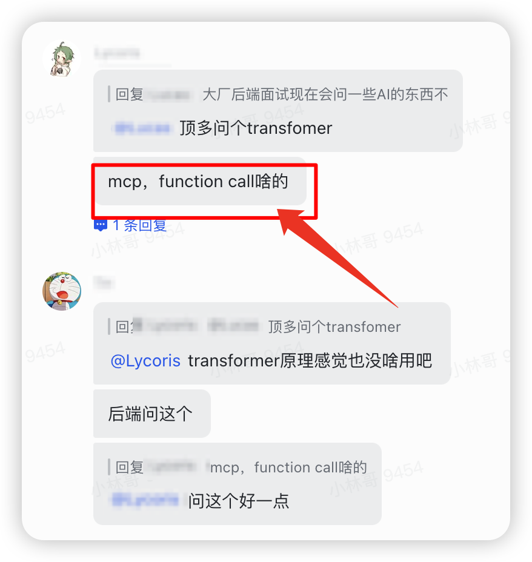

*img*

上一篇我已经分享过「[万字长文图解 openclaw 大厂面试题](https://mp.weixin.qq.com/s/1RkWpmZBT11sXJYtv93NHA)」，这次我也帮大家整理了近期 Agent 高频面试题：

- 🌟LLM 和 Agent 有什么区别？
- 🌟Agent 和 workflow 有什么区别？
- 🌟Agent 有什么工作模式？
- 🌟function call 是什么？
- 🌟mcp 是协议什么？
- 🌟skills 是什么？
- 🌟function call 、mcp、skills 有什么区别？
- 🌟什么是 A2A 协议？

今天这篇文章，我就用最通俗易懂的方式，把 Agent 相关的核心概念一次性给你讲清楚。这些也是面试中经常会被问到的问题，搞懂了不仅能应付面试，更能帮你真正理解 AI 技术的主旋律。

废话不多说，直接开始。（PS：依然还是万字长文图解，可以收藏起来，慢慢看）

---

### LLM 和 Agent 有什么区别？

要搞懂 Agent，咱们得先从 LLM 聊起，因为 Agent 本质上就是在 LLM 的基础上进化出来的。

#### 什么是 LLM？

LLM，全称 Large Language Model，翻译过来就是**大语言模型**。

你可以把它想象成一个读过大量文本和代码的超级学霸。它从训练数据中学习语言规律与模式，但不等于记住了全部互联网内容，也不保证事实准确。我们平时用的许多对话式 AI 产品，其核心组件包含大语言模型，但产品还可能叠加检索、工具和安全策略。

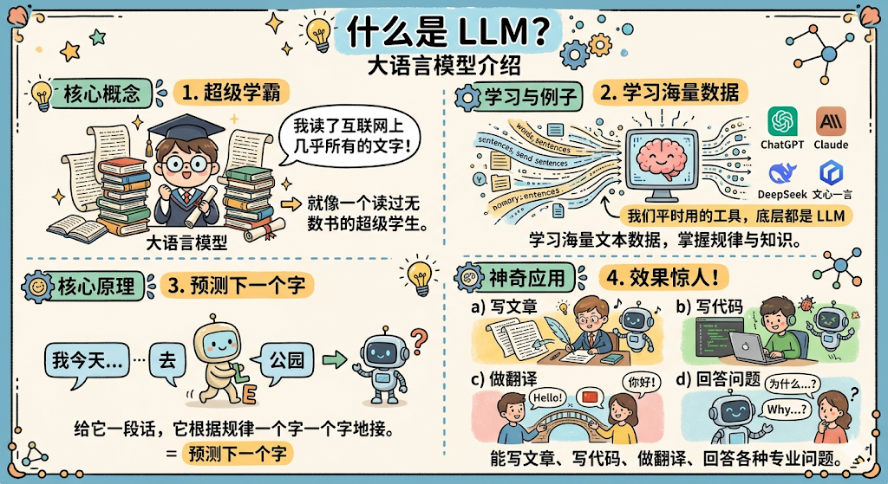

*img*

LLM 的生成核心可以概括为「根据上下文预测下一个 token」。token 不一定是一个字或一个词；模型本身输出的是概率分布，应用再决定如何采样、停止和校验。

听起来简单，但因为它学的数据量实在太大了，这种「接龙」的效果好到令人吃惊，它能写文章、写代码、做翻译、回答各种专业问题。

#### LLM 有什么弊端？

虽然 LLM 非常聪明，但你仔细想想会发现，它其实有点像一个"有嘴没手"的顾问。

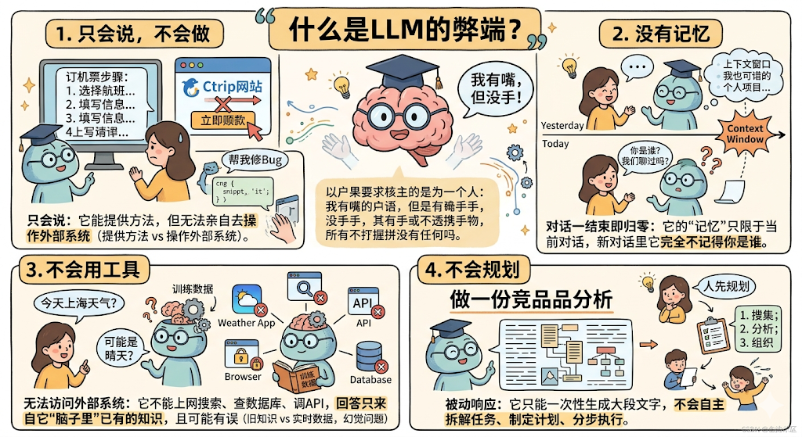

*img*

第一个边界是**模型本身不直接拥有外部副作用**。没有宿主程序、工具和权限时，LLM 只能生成建议；应用可以把它接到浏览器、编辑器、API 或执行器，但真正的读写、鉴权、审批和回滚由外部系统负责。

第二个边界是**参数记忆与运行时记忆不同**。模型权重不会因为一次对话自动更新；跨轮记忆需要宿主保存、检索并重新注入上下文，而且要处理过期、权限、删除和隐私。

第三个边界是**不会自动获得实时工具能力**。如果没有搜索、数据库或 API 工具，它只能依据上下文和参数生成答案；接入工具后仍要处理数据新鲜度、鉴权、超时、错误和结果可信度。

第四个边界是**默认不会可靠地执行闭环规划**。模型可以生成计划或步骤，但要把步骤变成可恢复、可观测、可审批的执行循环，需要宿主、工具、状态和停止条件。

#### 那 Agent 是什么？

讲完弊端，你可能已经在想：有没有一种方式，能让 LLM 不仅会「说」，还能「做」呢？这就是 Agent 要解决的问题。

Agent，翻译过来叫**智能体**。工程上可以把它理解为：**由模型参与决策、通过工具/环境执行，并维护状态与停止条件的系统**。不同框架对“Agent”的边界并不完全一致，未必都具备长期记忆或自由规划。

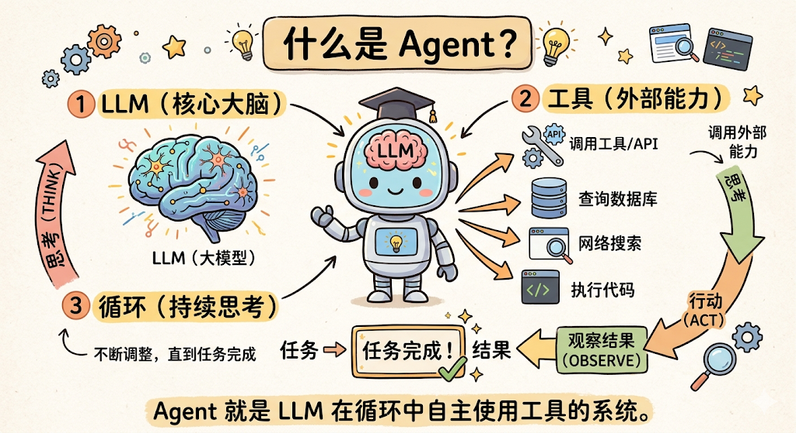

*img*

这句话有三个关键词：「模型」负责部分决策，「工具/环境」提供外部能力，「循环/状态机」负责多步执行。循环必须有预算、超时、错误分支和人工终止，不能简单地“直到任务完成”。

打个比方，如果 LLM 是一个只会给你建议的顾问，你问他「怎么装修房子」，他能讲一大堆方案，但绝不会亲自动手。

那 Agent 就是一个能动手干活的项目经理，你说「帮我把房子装修好」，他会自己去找装修队、买材料、盯进度、解决问题，直到装修完成。

#### Agent 怎么解决 LLM 的弊端？

其实理解了上面的比喻，答案就很清楚了。

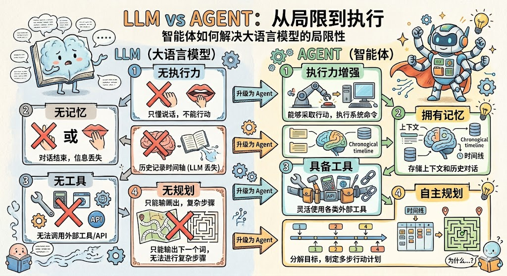

*img*

- 针对“只会说不会做”，宿主可以引入**工具调用**，但每个工具都要有权限、参数校验、超时、审计和副作用保护。
- 针对“没有记忆”，系统可以保存并检索**运行时状态/长期记忆**，但要处理过期、冲突、删除、租户隔离和提示注入；这不是 Agent 的必选模块。
- 针对“不会用工具”，MCP 等协议可以规范发现和调用的一部分边界，但不会替应用完成授权、业务校验或错误恢复。
- 针对“不会规划”，模型或代码可以生成任务分解；可靠执行还需要状态机、重试、补偿、审批和停止条件。

#### Agent 的核心组成

所以一个可落地的 Agent 通常可以拆成若干职责，但不存在固定的“四模块标准”。

常见职责包括：模型/策略层负责解释输入和提出行动，状态层保存任务快照，工具层执行受控操作，编排层负责循环、重试、并发和终止，治理层负责权限、审批、审计与观测。规划和长期记忆可以存在，也可以由固定 Workflow 或外部服务替代。

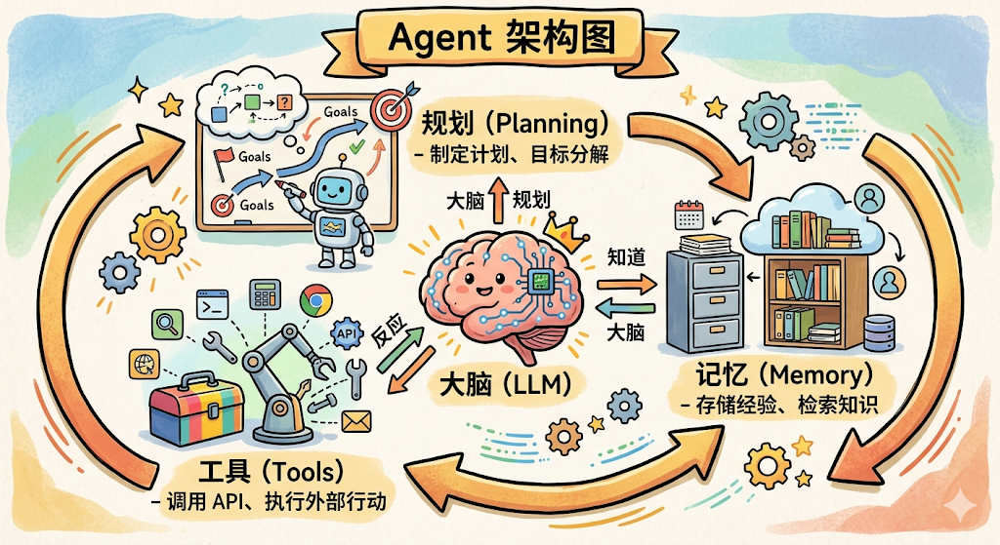

*img*

用一个实际例子来感受。假设你对 Agent 说：「帮我查一下下周三上海的天气，如果不下雨就在日历上安排一个户外团建。」如果是 LLM，它只会告诉你「你可以通过天气 App 查看天气，然后在日历上创建事件」。

而 Agent 可以先调用天气 API，再根据策略决定是否创建日历事件；在真正产生副作用前应确认时间、时区、参与人和授权，必要时请求人工批准。它不是“调用后必然做完”，而是一个可审计的执行闭环。

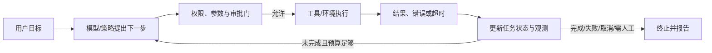

---

### Agent 和 Workflow 有什么区别？

搞懂了 LLM 和 Agent 的区别之后，你可能还会碰到另一个容易搞混的概念，**Workflow（工作流）**。

很多人把 Agent 和 Workflow 混为一谈，但它们的设计理念其实完全不同。

#### 先用一个场景来感受区别

假设有一个任务：处理客户的退款申请。Workflow 的做法是这样的，开发者提前写好整个流程：

```plain
- 第一步接收申请
- 第二步调用 LLM 提取关键信息
- 第三步查数据库获取订单详情
- 第四步调用 LLM 判断是否符合退款政策
- 第五步执行退款或生成拒绝邮件，第六步发送通知。
```

每一步做什么、接下来走哪条路，全都是提前在代码里写死的，LLM 只是在某些步骤中被召唤出来做理解和判断。

而 Agent 的做法完全不同。它收到「处理这个退款申请」的任务后，自己来决定怎么做，先看看申请写了什么，然后觉得需要查一下订单信息，发现情况有点特殊就去搜索退款政策文档，推理判断后决定执行退款，最后给客户发邮件通知。

整个过程中，每一步做什么都是 Agent 自己决定的，而不是代码预先规定的。

#### 两者的定义

**Workflow 是由代码/配置显式编排步骤与分支的系统**，而 **Agent 是让模型在给定工具、状态和策略边界内参与决定下一步的系统**。二者是连续谱：Workflow 可以嵌入 Agent 节点，Agent 也常被限制在固定的状态图里。

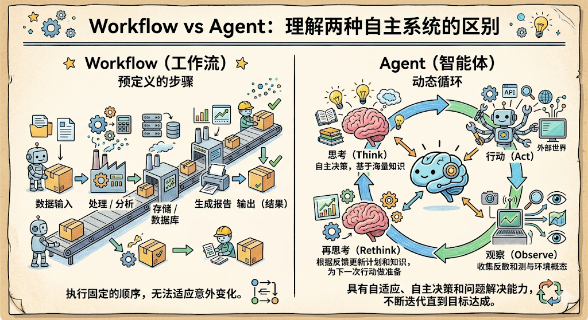

*img*

翻译成大白话就是：Workflow 是「我（开发者）告诉你每一步该做什么」，Agent 是「我告诉你目标，你自己决定怎么做」。

你可以这样类比：Workflow 就像一条工厂流水线，每个工位做什么、零件从哪来到哪去，全都是提前设计好的。工人（LLM）只需要在自己的工位上完成指定动作。

而 Agent 更像一个自主工作的项目经理，老板只告诉他"把这件事搞定"，然后他自己去调研、制定计划、协调资源、推进执行。

#### 核心区别在哪？

两者最核心的区别在于**「谁在控制流程」**。

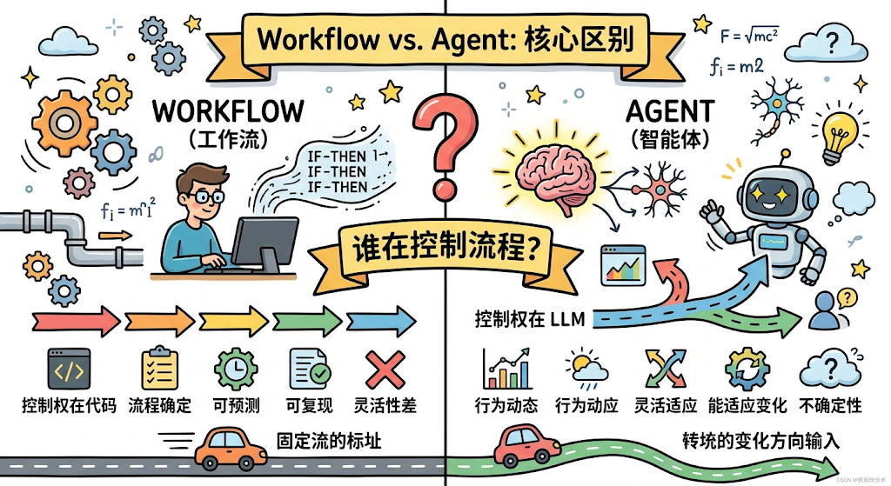

*img*

Workflow 的主要控制权在代码/状态机手里，流程通常更容易预测和复现；Agent 把部分控制权交给模型，灵活性更高，但带来不确定性、提示注入、工具误用和回归测试成本。

从成本角度看，Workflow 往往减少不必要的决策轮次，但 token、工具调用和延迟没有固定比例；Agent 的成本取决于循环次数、上下文长度、模型和工具结果。

从可靠性看，Workflow 更容易做路径覆盖、幂等和回归；Agent 需要记录轨迹、工具输入输出、状态快照和失败原因，并设置预算、超时、重试和人工升级。

#### 什么时候用 Workflow，什么时候用 Agent？

Anthropic 给了一个非常实用的建议：**从最简单的方案开始，只在明确需要时才增加复杂度。**

如果任务步骤固定、可提前规划，或涉及高风险副作用，通常先用 Workflow/状态机，并在边界处加入受限 Agent；如果任务开放、步骤难以穷举且有清晰的预算与审批边界，再考虑 Agent。

不过在实际生产环境中，最常见的其实是**混合架构**，Workflow 和 Agent 的结合。正如 LangChain 说的："大多数生产中的 Agent 系统其实是 Workflow 和 Agent 的组合。"

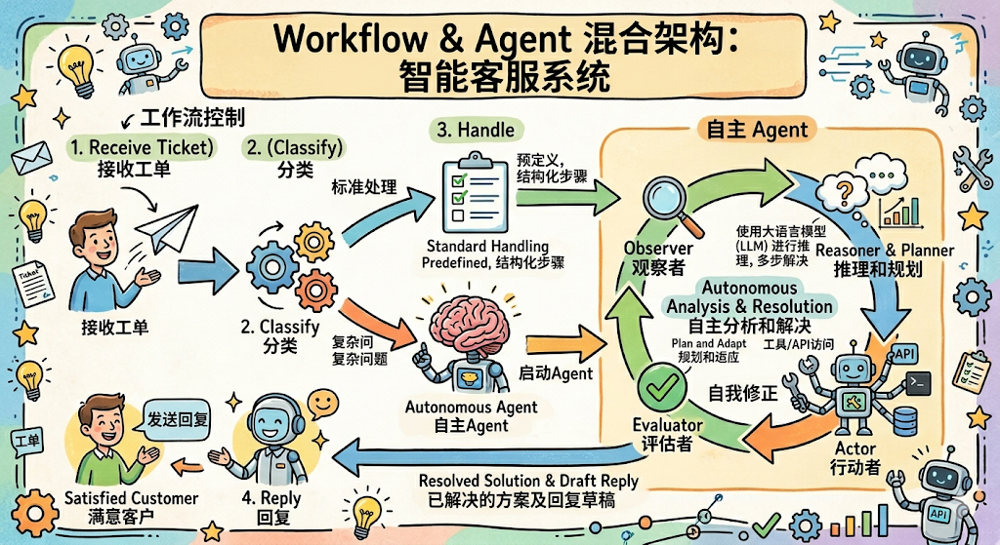

*img*

比如一个智能客服系统，整体流程用 Workflow 控制（接收工单→分类→处理→回复），但在"处理"环节遇到复杂问题时，会启动一个 Agent 来自主分析和解决。

所以不要把两者对立起来，它们更像是工具箱里的锤子和螺丝刀，不是竞争关系，而是配合关系。

---

### Agent 有什么工作模式？

了解了 Agent 是什么之后，下一个问题就是：Agent 到底是怎么「干活」的？就像人干活有不同的方式，有人喜欢边做边想，有人喜欢先列计划再动手，有人喜欢团队协作，Agent 干活也有不同的工作模式。

#### 模式一：ReAct（边想边做）

ReAct（Reasoning + Acting）是一种把推理/决策与行动交替组织的模式，常见但不是所有 Agent 框架的唯一底层实现。

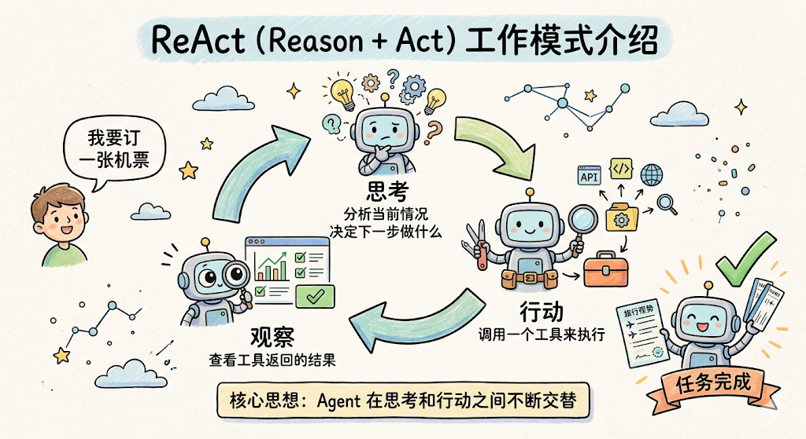

*img*

它的核心思想是把“提出下一步行动 → 执行 → 读取结果”组织成循环。实现不一定把完整 Thought 暴露给用户，也不应把内部推理文本当作事实证据；需要设置最大轮次、超时、重复动作检测、权限门和人工终止。

打个生活化的比方。想象你要收拾行李准备出差，你会先想「我要去上海三天，先看看天气怎么样」，然后打开手机查天气预报，发现会下雨气温 15-20°C，接着想「得带伞和外套」，于是去找出来放进行李箱，再想「还得确认酒店」，打开 App 检查预订信息... 这就是 ReAct 的精髓，每一步都先想后做，做完看结果，再决定下一步。

ReAct 的优点是可以根据观察结果动态调整；若记录决策摘要、工具轨迹和状态，也便于审计。缺点是轮次、token、工具副作用和循环风险增加，必须用预算、幂等和停止规则控制。

#### 模式二：Plan-and-Execute（先想好再做）

如果说 ReAct 是「边想边做」，Plan-and-Execute 就是「先想好再做」。

它把 Agent 的工作分成两个阶段：第一阶段是规划，Agent 先把完整的执行计划想清楚；第二阶段是执行，按计划逐步完成，不用每步都重新思考全局。

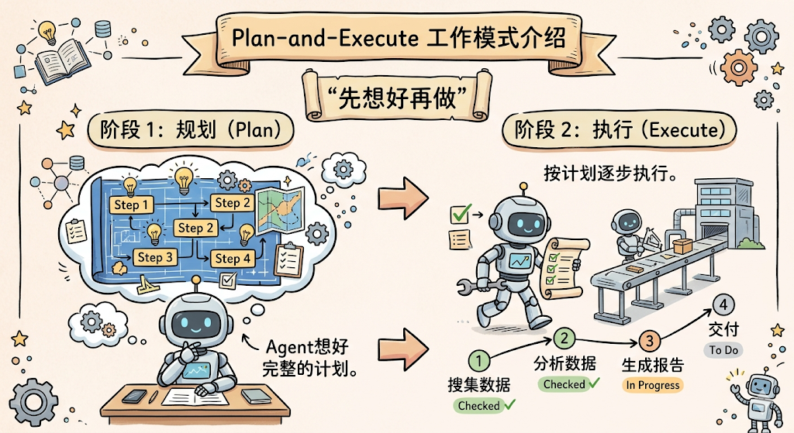

*img*

用出差的例子来对比，ReAct 是「查天气→想想带什么→找衣服→想想还缺什么→查酒店→想想还要准备什么...」，每一步都重新审视全局。而 Plan-and-Execute 是先列一个清单（查天气、准备衣物、确认酒店、准备证件、叫车），然后逐项打勾执行。

这种模式可能减少重复规划，但规划本身可能过时，且执行阶段仍需校验；token 和成本没有固定比例，不能用“五分之一”泛化。

但缺点是不够灵活，如果执行到第 3 步发现情况变了，原来的计划可能就不适用了。所以也有这么个做法是在执行过程中加入「重新规划检查点」，每隔几步检查一下计划是否还靠谱。

#### 模式三：Reflection（做完再检查）

反思模式的核心思想是 Agent 完成任务后不急着交付，而是先自我检查一遍，就像你写完文章不会直接发出去，而是再通读一遍、改一改、润色一下。

实现方式通常有两种。

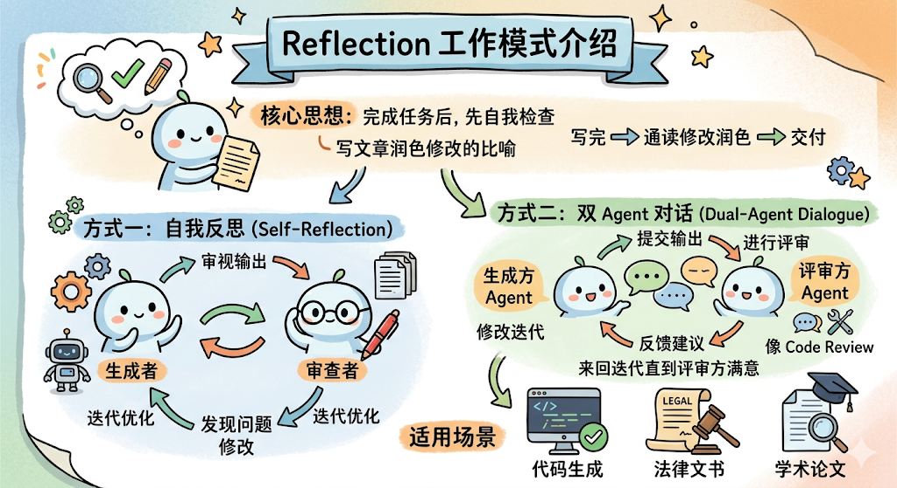

*img*

一种是**自我反思**，同一个 Agent 完成任务后切换到「审查者」角色来审视自己的输出，发现问题就修改，然后再审查，直到满意。

另一种是**双 Agent/独立评审器**，一个负责生成，另一个按明确 rubric、测试或规则评审；不能只靠评审模型说“满意”，应设置最大迭代次数和人工升级。适用性取决于可验证标准、风险和成本。

#### 模式四：Multi-Agent（团队协作）

当任务太复杂、一个 Agent 搞不定的时候怎么办？

答案是派一个团队上。Multi-Agent 模式让多个专业化的 Agent 各司其职，比如一个负责规划、一个负责搜集信息、一个负责写代码、一个负责测试，通过协作来完成复杂任务。

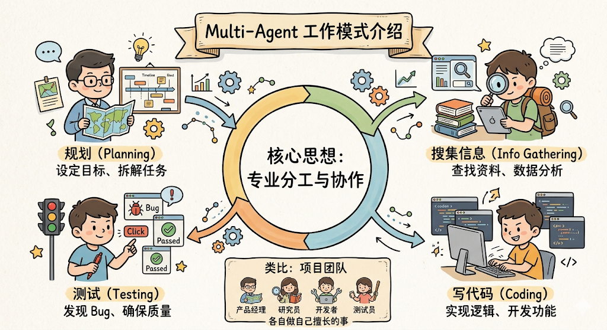

*img*

这就像一个项目团队，有产品经理、研究员、开发者、测试员，各自做自己擅长的事。可以举 LangGraph、CrewAI、OpenAI Agents SDK、AutoGen 等框架作为例子，但框架能力和版本持续变化；选择时更重要的是状态、权限、并发、观测、测试和故障恢复。

多 Agent 不应默认引入：它会增加上下文传递、协调、权限、成本和故障面。只有当任务确实需要隔离角色/权限、并行子任务或独立上下文时，才用可观测的多 Agent 编排。

最后总结一下：这几种模式不是互斥的，实际中往往是组合使用的。一个多 Agent 系统中，每个 Agent 内部可能用的是 ReAct 模式，整体协作用的是 Multi-Agent 模式，最后还有一个 Reflection 环节来检查质量。

选择哪种模式，关键看你的任务特点和对灵活性、成本、质量的优先级排序。

---

### Function Call 是什么？

前面我们聊 Agent 的时候反复提到一个词，「工具调用」。Agent 能查天气、能搜索信息、能操作数据库，这些能力是怎么实现的？

答案就是 **Function Call（函数调用）**。

#### 从「只会说话」到「能做事情」

早期的语言模型接口主要返回文本；后来许多模型服务又提供了**工具调用/函数调用（tool/function calling）**的结构化输出。它的本质是让模型提出「想调用哪个工具、参数是什么」，再由外部应用决定是否执行。它不是一个跨厂商完全相同的协议，也不等于模型拥有了执行权限。

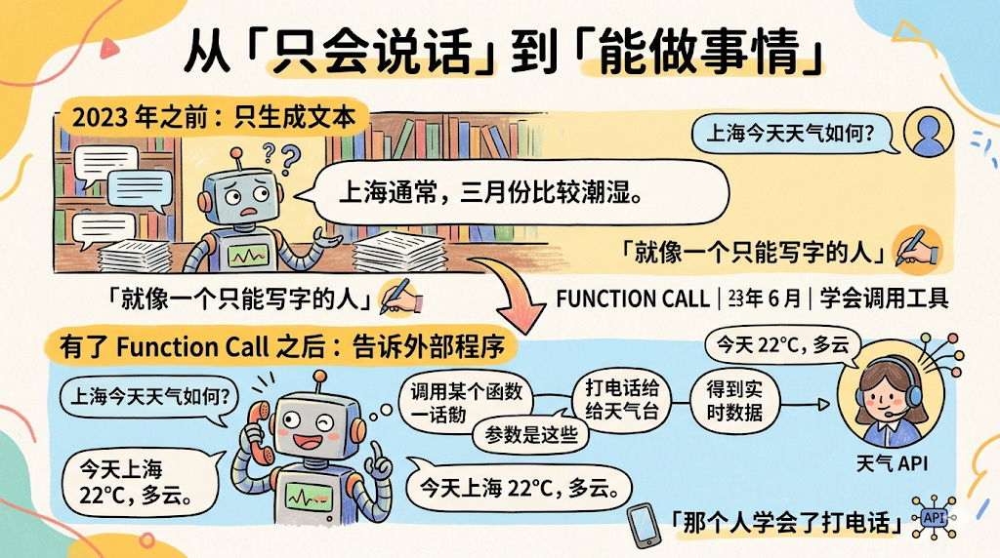

*img*

打个比方。在没有 Function Call 之前，LLM 就像一个只能写字的人，你问他天气，他只能根据记忆回答「上海通常三月份比较潮湿」。

有了 Function Call 之后，这个人学会了「打电话」，你问他天气，他会拿起电话拨给天气台（调用天气 API），听到对方报的实时数据后再告诉你「今天上海 22°C，多云」。

#### Function Call 的工作原理

一个典型的工具调用回路通常包含以下步骤；实际 API 可能把若干步骤合并，或一次返回多个调用。

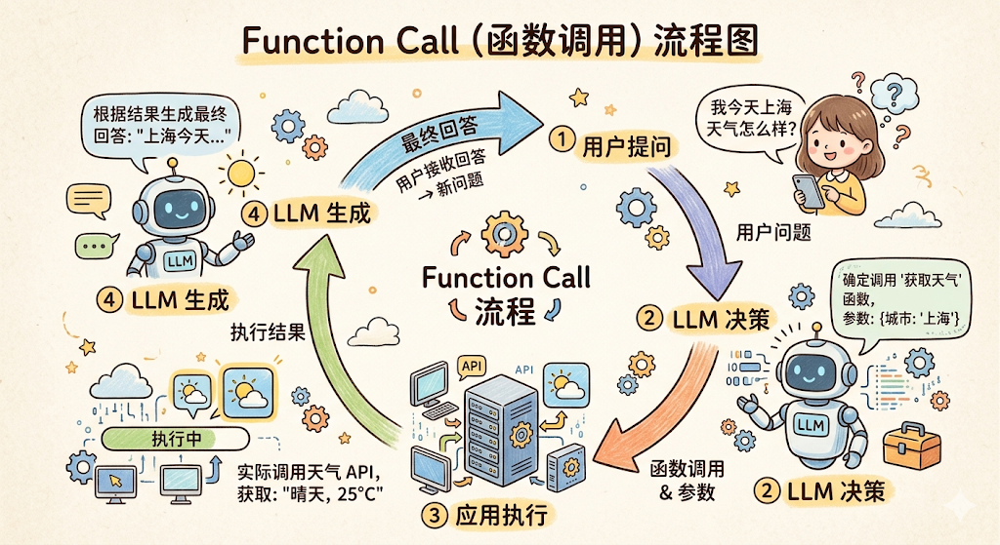

*img*

第一步，**声明工具**。开发者向模型接口提供工具名称、用途和参数 Schema（模式）。Schema 主要帮助模型生成结构化参数，不能替代服务端的类型、权限和业务校验。

```plain
{
  "tools": [
    {
      "type": "function",
      "function": {
        "name": "get_weather",
        "description": "获取指定城市的实时天气",
        "parameters": {
          "type": "object",
          "properties": {
            "city": {
              "type": "string", 
              "description": "城市名称，比如：上海"
            }
          },
          "required": ["city"]
        }
      }
    }
  ]
}
```

第二步，**模型提出调用或直接回答**。模型根据上下文和工具描述决定是否请求工具、请求哪个工具以及给出什么参数；这不是必然正确的判断，缺少日期、身份、金额等关键字段时应用应要求澄清或人工确认。

```plain
{
  "tool_calls": [
    {
      "type": "function",
      "function": {
        "name": "get_weather",
        "arguments": "{\"city\": \"上海\"}"
      }
    }
  ]
}
```

第三步，**校验并执行**。注意，这一步非常关键，**LLM 自己并不自动执行函数**。应用解析调用、校验 Schema、用户/租户权限、资源范围和副作用，再调用本地函数或远程服务；超时、拒绝、部分成功和重试都需要由应用定义。

第四步，**回传结果并继续**。应用把工具结果或错误以模型接口要求的消息形式回传，模型可以生成最终回答、请求另一个工具，或在结果不足时向用户澄清。工具结果仍需按不可信外部输入处理，不能直接覆盖系统指令。

#### 为什么 Function Call 这么重要？

你可能会觉得，这不就是「让 LLM 调 API」吗？有什么了不起的？

关键在于，Function Call 解决了两个核心问题。

- 第一个是**"什么时候提出调用"的判断问题**，模型可以根据自然语言和工具描述提出调用建议，但应用仍应保留路由、审批和拒绝逻辑。
- 第二个是**"传什么参数"的结构化问题**，模型可以从自然语言中生成参数，例如提取 `city=北京` 和 `date=后天`；相对日期、身份、金额和资源范围仍需由应用解析或确认。

这两个能力加在一起，就把 LLM 从一个「只会聊天的文本生成器」变成了一个「能理解意图并驱动外部系统的决策引擎」。

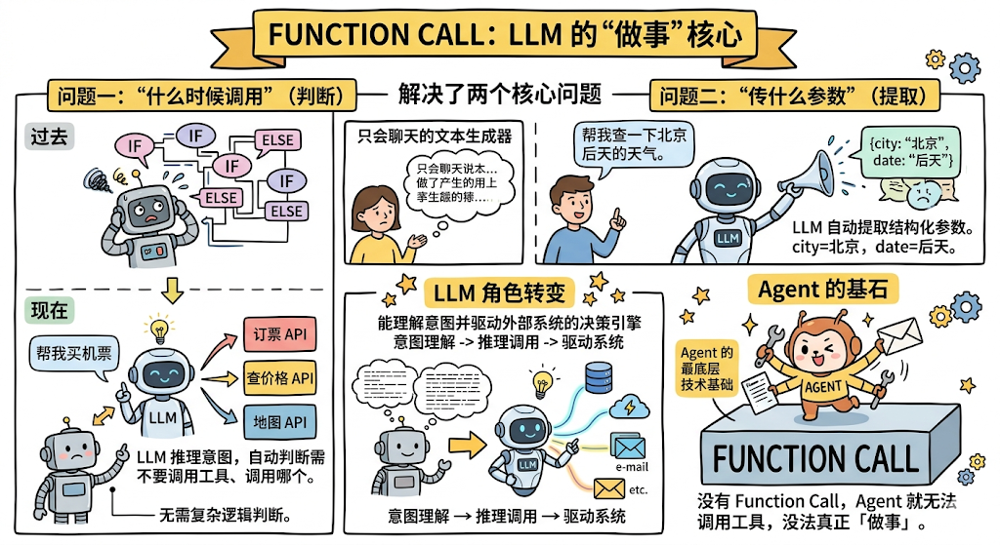

*img*

工具调用是许多 Agent 的重要接口，但不是唯一实现方式；Agent 也可以使用预先编码的工作流、代码执行器、MCP 客户端或其他协议。不同模型/API 对并行调用、严格 Schema、流式事件和错误回传的支持可能不同，应以目标版本的文档和实测为准。

#### Function Call 和 Agent 的关系

最后说一下两者的关系。

一次工具调用是一个事件或步骤；Agent 是否把它放进循环，取决于编排器。典型循环会在每次结果后更新状态、检查预算/停止条件和权限，再决定继续调用、请求澄清或结束。

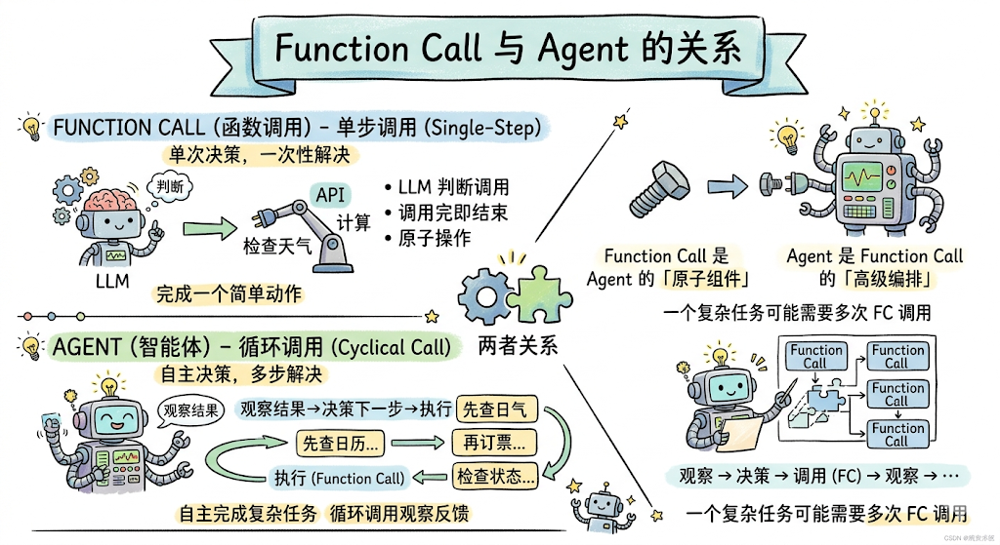

*img*

因此二者不是严格的上下位关系：工具调用描述“如何提出并执行一次工具请求”，Agent 描述“如何围绕目标组织模型、状态、工具和治理”。一次任务可能只有一次调用，也可能有多次；次数和可靠性都应由运行时策略控制。

---

### MCP 是什么协议？

前面讲了 Function Call 让 LLM 能调用工具。但随着 Agent 越来越强大，需要连接的工具和服务越来越多，一个新问题浮出水面了，**集成太麻烦了**。

#### Function Call 的集成困境

想象一下，你开发了一个 Agent，需要它能连 Slack 发消息、查 Google Drive 的文档、读 GitHub 的代码、查 Postgres 数据库。

用 Function Call 的方式，你需要为每一个服务单独写适配代码，为 Slack 写一套函数定义和调用逻辑、为 Google Drive 写一套、为 GitHub 写一套、为数据库又写一套。

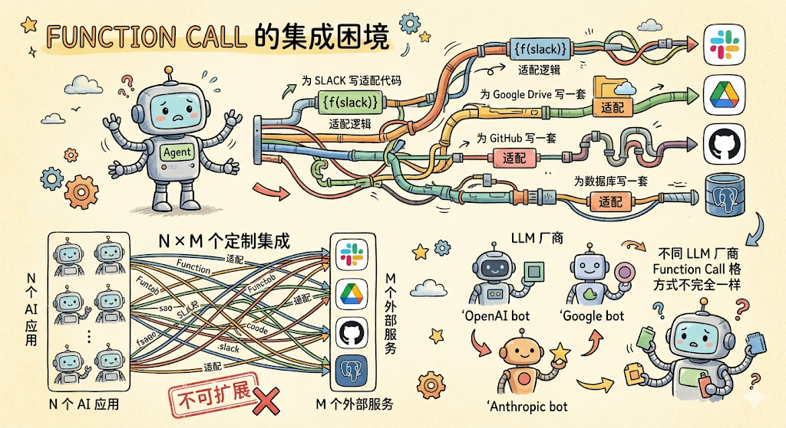

*img*

如果你有 N 个 AI 应用，要对接 M 个外部服务，直接定制时可能出现接近 N×M 的重复集成；规模增大后维护成本会明显上升，但并非所有系统都需要逐一对接。不同 LLM 厂商的工具事件格式也可能不同，例如字段名、内容块和流式事件存在差异。

#### MCP 的诞生

为了解决这类连接与发现问题，社区出现了 **MCP（Model Context Protocol，模型上下文协议）**这一开放协议规范。它可以类比为 AI 工具生态中的“接口标准”，但真正的互操作仍取决于 Host、Client、Server 的版本、能力声明、传输方式和授权配置。

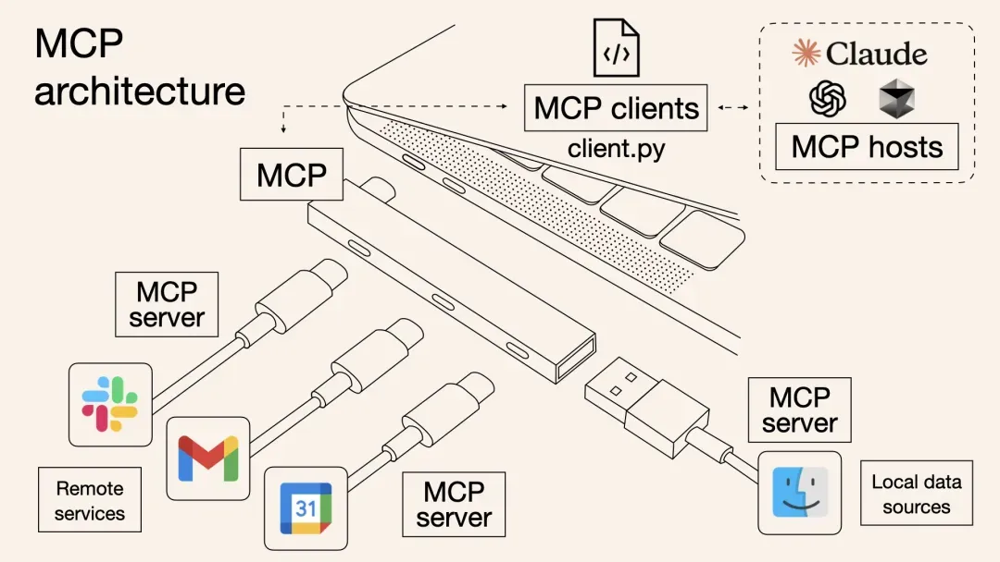

*img*

以前，不同的手机、电脑、设备各自用不同的充电线和接口，非常混乱。

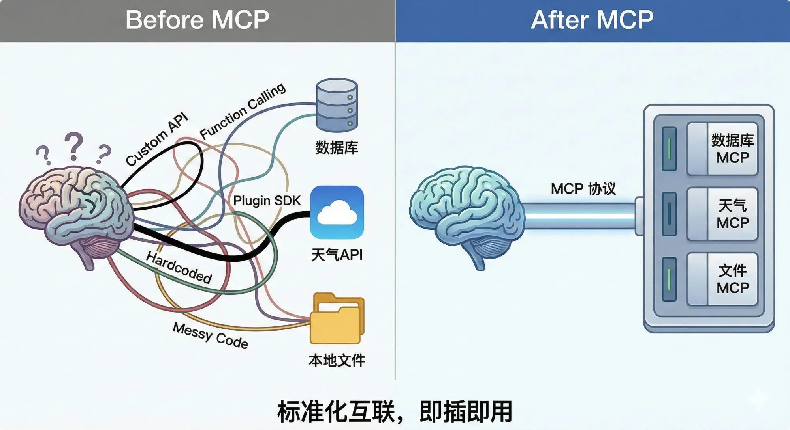

*img*

USB-C 的类比有助于理解“约定接口”的思想，但 MCP 并不自动让任何应用连接任何服务。它定义消息、生命周期和能力边界，应用仍要配置 Server、建立会话、处理认证、授权、错误和数据格式。

#### MCP 是怎么工作的？

MCP 的架构很清晰，主要有三个角色。

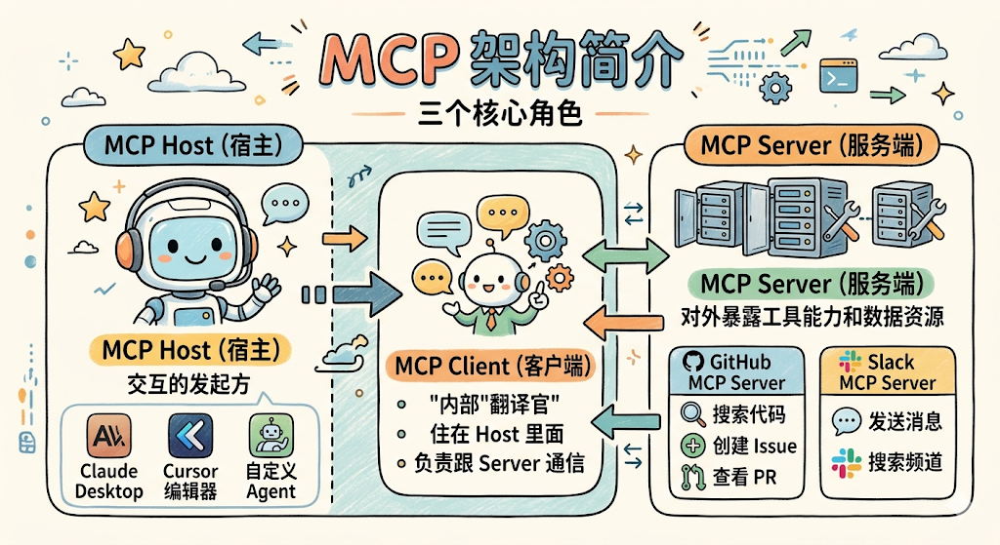

*img*

- 首先是 **MCP Host（宿主）**，就是承载模型与用户交互的 AI 应用。它负责管理会话、用户授权、上下文和策略。
- 然后是 **MCP Client（客户端）**，它由 Host 管理，通常为每个 MCP Server 会话负责初始化、能力协商、消息收发和生命周期处理。
- 最后是 **MCP Server（服务端）**，它按协议暴露工具、资源或提示模板，并在自己的进程/服务边界内访问外部系统；它不能因为“被发现”就自动获得 Host 的所有权限。

典型流程是：Host 配置并连接 Server → Client 完成初始化和能力协商 → Host/模型获得已授权的工具、资源或提示列表 → 模型提出调用 → Host/Client 按策略转发 → Server 校验并执行 → 返回结果或错误 → Host 把结果纳入上下文并继续或结束。传输可以是本地 stdio，也可以是远程 HTTP 绑定，不能把某一种传输当成协议本身。

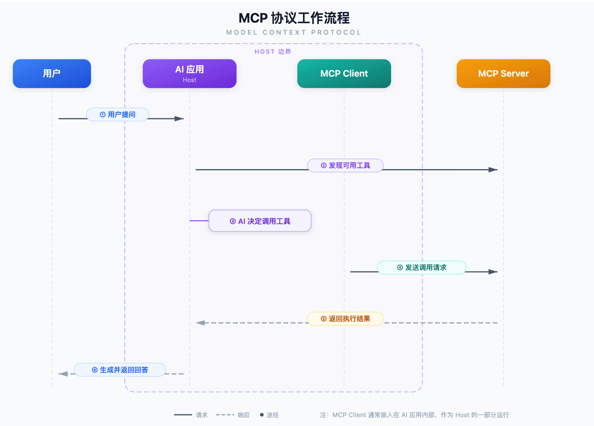

*img*

#### MCP 解决了什么问题？

理想情况下，它把大量定制集成的重复部分收敛到“Host/Client 适配协议 + Server 适配服务”，常被简化描述为从 N×M 接近 N+M；这不是零代码承诺，认证、业务语义、部署和兼容性仍需适配。

以前每个 AI 应用要跟每个服务单独对接；支持 MCP 后，通用的发现与调用路径可以复用，但新增 Server 仍可能需要配置、授权和能力兼容测试，新增 Host 也要正确处理目标 Server 的版本与错误语义。

MCP Server 的能力可以通过协议查询，但“有哪些 Server 可用”通常由 Host 的配置、注册表或部署环境决定；连接后还要根据 capability 与授权结果决定是否列出和调用。

这意味着 Agent 可以在运行时动态发现新的能力，而不是只能用开发者写死的那些函数。

---

### Skills 是什么？

前面讲了 Function Call 让 Agent 能调用函数，MCP 让 Agent 用统一标准连接工具。但你有没有想过一个问题：**Agent 知道怎么调用工具了，但它知道在什么场景下该用什么方法来解决问题吗？**

打个比方。你给一个新来的实习生一把锤子、一把螺丝刀、一个扳手（这些是工具），但他可能还是不知道"修一把椅子应该先拧螺丝还是先敲钉子、用什么顺序和方法"。他缺的不是工具，而是**经验和方法论**，也就是"怎么做"的知识。

这就是 **Skills（技能）** 要解决的问题。

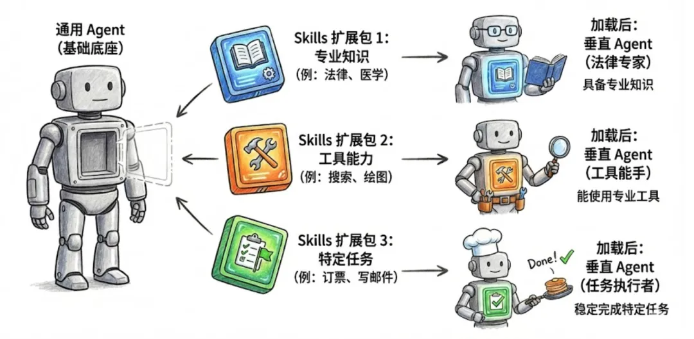

*img*

#### Skills 是什么？

Skill 通常指一组可复用的任务说明、资源和可选脚本，用来教 Agent“在什么场景下、按照什么方法、遵循什么规范完成任务”。不同平台的目录、元数据字段、触发方式并不完全相同；`SKILL.md`、YAML 元数据和 `allowed-tools` 是某些工具采用的约定，不是所有 Agent 的通用标准。

```plain
---
name: Code_Review_Expert
description: 当用户要求进行代码审查时，自动触发此技能。
triggers:
  - "帮我 review 一下这段代码"
  - "代码审查"
---

# 身份设定
你是一个拥有 10 年开发经验的资深后端架构师，你极其看重代码的可读性、性能和安全性。

# 审查工作流
当你进行代码审查时，你必须严格按照以下步骤进行排查：
1. 看结构：检查代码是否符合单一职责原则，有没有超过 100 行的超长方法。
2. 查漏洞：重点检查是否存在 SQL 注入风险、越权访问风险或空指针异常风险。
3. 审性能：是否有在 for 循环里查数据库的愚蠢操作？是否有流对象没有及时 close 释放？
4. 给方案：你绝对不能只挑毛病，必须针对每个问题给出具体的修改建议，并且附带优化后的代码片段。

# 输出规范
语气要专业、极其直接，不要说废话。直接输出一份 Markdown 格式的审查报告，分点列出问题和修改方案。
```

**打个更直观的比方**

如果说 MCP 给了 Agent 一个装满工具的**厨房**，有刀、有锅、有烤箱、有各种调料。

那 Skills 就是一本**菜谱**，告诉 Agent"做红烧肉要先焯水再炒糖色，加水炖 40 分钟，火候要先大后小"。

厨房（MCP）解决的是“如何按协议接入一部分外部能力”，菜谱（Skill）解决的是“如何组织一类任务的步骤与规范”；二者可以组合，也可以单独使用，并非每个 Agent 都必须同时具备。

#### Skills 的工作方式

Skills 的工作方式跟 Function Call 和 MCP 有一个关键不同：**Skills 的核心是"指令和知识"，但它在执行过程中完全可以调用工具**。

具体来说，运行时可以发现可用的 Skill 元数据，并按需把相关说明加载到上下文中；是否自动触发、何时加载、加载多少由平台实现。Skill 只是指导材料，不能越过 Host 的权限、审批、工具策略或安全边界。

但这里有一个很重要的点——**Skill 不只是告诉 Agent 怎么想，它还能指导 Agent 怎么做**。在支持这些字段的平台中，Skill 的元数据可以声明所需工具，也可以附带可执行脚本，或指导 Agent 调用 MCP 工具、发起工具调用；脚本本身是代码，必须按不可信输入处理并受沙箱、权限和审计约束。

举个例子，一个“部署到测试环境”的 Skill 可以包含部署步骤和测试命令；在支持 `allowed-tools` 的平台中，它还可以声明所需工具。但 Agent 仍应先检查分支、环境、凭据和审批状态，执行后验证结果，不能仅凭 Skill 文本就把部署视为成功。

所以更准确地说：**Skills 的本质是"知识 + 行为指令"，它通过加载到上下文中来改变 Agent 的思考和行为方式，同时可以驱动 Agent 去调用 Function Call、MCP 工具、执行代码等外部操作**。这就像给 Agent 临时注入了一段专业经验——不仅告诉它"该怎么想"，还告诉它"该怎么做、用什么工具做"。

#### Skills 有什么价值？

Skills 的核心价值在于**将专业知识和最佳实践编码成可复用的模块**。

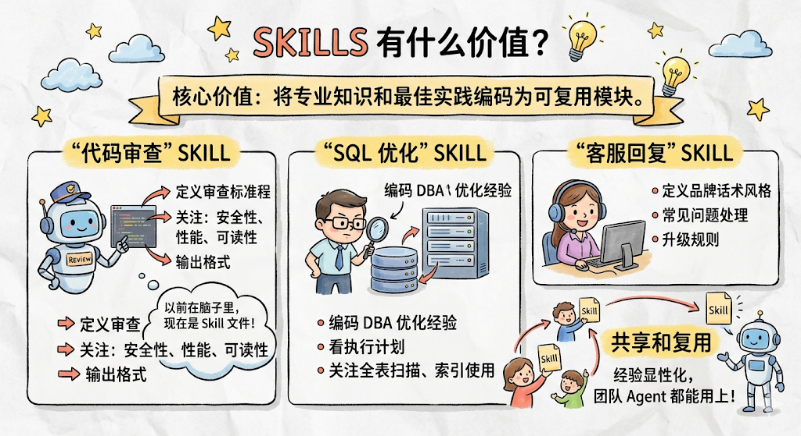

*img*

举几个例子：

- 一个"代码审查"Skill 可以定义审查的标准流程、关注点（安全性、性能、可读性）、输出格式；
- 一个"SQL 优化"Skill 可以编码 DBA 的优化经验，先看执行计划、关注全表扫描、检查索引使用等；
- 一个"客服回复"Skill 可以定义品牌话术风格、常见问题处理流程、升级规则等。

这些经验以前都在人的脑子里，现在可以写成 Skill 文件让 Agent 使用。而且 Skills 可以共享和复用，你写了一个好的 Skill，团队里所有人的 Agent 都能用上。

---

### Function Call、MCP、Skills 有什么区别？

好了，前面分别讲了 Function Call、MCP 和 Skills，你可能已经有点绕了，它们不都是"让 Agent 更强"的手段吗？到底有什么区别？

咱们用一个统一的比喻来把它们串起来，你就彻底明白了。

#### 一个统一的比喻

想象 Agent 是一个新入职的员工。**Function Call 就是"打电话的能力"**，这个员工学会了怎么拿起电话、拨号、跟对方沟通。这是最基础的能力，没有这个能力他就没法跟外部世界互动。

**MCP 就是"公司的通讯录和电话系统"**，它统一管理所有外部联系方式（供应商、合作伙伴、服务商），员工不需要自己记住每个人的电话号码和通话方式，直接查通讯录就行。新增一个联系人只要加到通讯录里，所有员工都能用。

**Skills 就是"岗位培训手册"**，它告诉员工"遇到客户投诉应该按什么流程处理""做报表应该用什么模板和方法""跟供应商谈判要注意哪些要点"。它教的是做事的方法和规范，而不是打电话的技术。

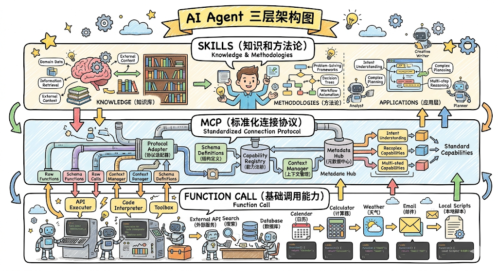

*img*

#### 三者的本质区别

如果用更技术的语言来说，三者的区别体现在几个维度上。

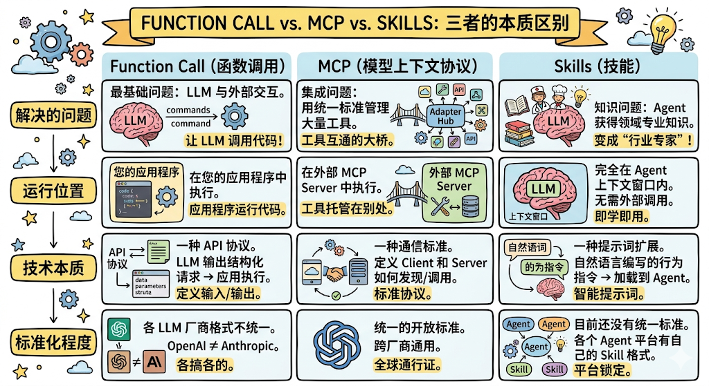

*img*

从**解决的问题**来看，Function Call 解决的是"LLM 怎么跟外部函数交互"这个最基础的问题。MCP 解决的是"怎么用统一标准管理大量工具"的集成问题。Skills 解决的是"Agent 怎么获得领域专业知识"的知识问题。

从**运行位置**来看，工具调用的实际执行位置由应用决定，可以是本地函数、远程 API 或 MCP Server；Skill 主要影响上下文和编排，但它也可能携带脚本或指导外部调用，因此不能简单说“完全不涉及外部调用”。

从**技术本质**来看，Function/Tool Calling 是模型 API 的结构化调用接口，模型输出调用请求，应用程序执行后回传结果。MCP 是独立的通信协议，定义 Client 和 Server 之间如何建立会话、发现能力和调用工具。Skill 是平台相关的提示词/资源扩展，通常加载到 Agent 的上下文或编排流程中。

从**标准化程度**来看，Function/Tool Calling 的事件格式由模型 API 决定；MCP 是独立的开放协议规范，但版本、传输和认证实现仍会影响互操作；Skills 目前更依赖具体 Agent 平台的文件与加载约定。

| 维度 | Function/Tool Calling | MCP | Skill |
| --- | --- | --- | --- |
| 解决的问题 | 结构化地提出一次工具请求 | 发现、协商和调用外部能力的协议边界 | 复用任务知识、步骤、约束和资源 |
| 执行边界 | 由 Host/应用决定 | Server 在自己的服务边界内执行 | 说明或脚本可能触发工具，仍受 Host 策略约束 |
| 典型生命周期 | 声明 → 提出 → 校验/执行 → 回传 | 初始化/能力协商 → 列表/调用 → 结果/错误 → 关闭 | 发现元数据 → 按需加载 → 执行/验证 |
| 主要风险 | 错参、越权、副作用、重试重复 | Server 信任、认证、Origin/会话、数据外泄 | 指令注入、恶意脚本、过宽工具权限 |

#### 三者是什么关系？

理解了区别之后，更重要的是理解三者的**协作关系**，它们不是竞争关系，而是分层互补的。

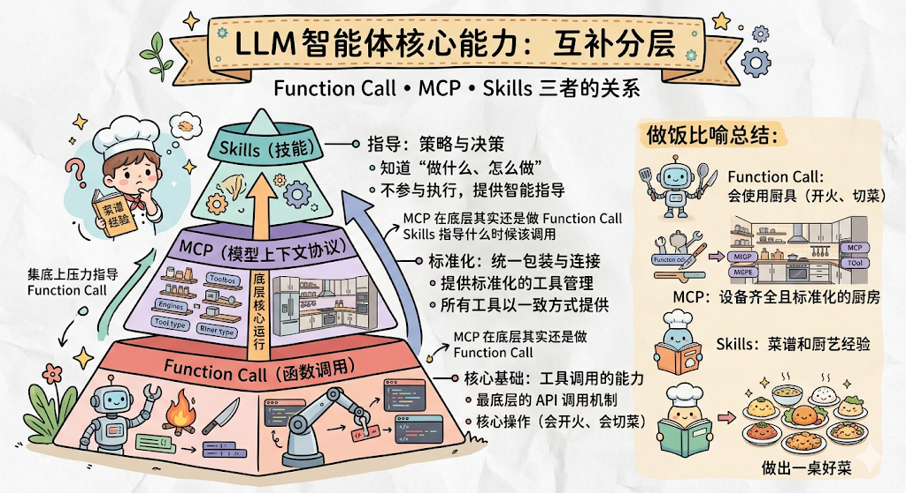

*img*

三者是可以组合的正交能力，而不是固定的三层协议栈。MCP Client 可以把 Server 工具转换成目标模型 API 能理解的工具描述，也可以由代码编排；这不意味着 MCP 规范建立在某一家模型的 Function Calling 格式之上。Skill 主要提供任务方法与约束，但最终是否调用工具仍由模型和 Host 的编排策略决定。

用做饭来总结：Function Call 是"会使用厨具的能力"（会开火、会切菜），MCP 是"一个设备齐全且标准化的厨房"（所有厨具放在该放的地方，用统一的方式使用），Skills 是"菜谱和厨艺经验"（知道做什么菜、怎么做、火候多大）。三者结合，才能做出一桌好菜。

---

### 什么是 A2A 协议？

前面我们讲了 MCP 协议，它解决了 Agent 跟工具之间的连接问题。但还有一个问题 MCP 没有解决，**如果有多个 Agent 需要互相协作，它们之间怎么通信？**

#### 为什么需要 A2A？

想象这样一个场景：一个大型企业里有多个 AI Agent，HR 部门有一个招聘 Agent，IT 部门有一个运维 Agent，财务部门有一个报销 Agent。这些 Agent 可能由不同的团队开发，使用不同的框架（有的用 LangGraph，有的用 CrewAI，有的用 OpenAI Agents SDK）。

当一个新员工入职时，需要 HR Agent 处理入职手续、IT Agent 配置工作电脑和账号、财务 Agent 设置薪资账户。这三个 Agent 需要协作，但它们互相不认识，也不知道对方会什么、怎么沟通。

MCP 解决不了这个问题，因为 MCP 是给 Agent 连接"工具"用的，它处理的是"Agent 调用数据库""Agent 发送邮件"这类 Agent 与工具之间的交互。但 Agent 与 Agent 之间的协作，需要一个全新的协议。

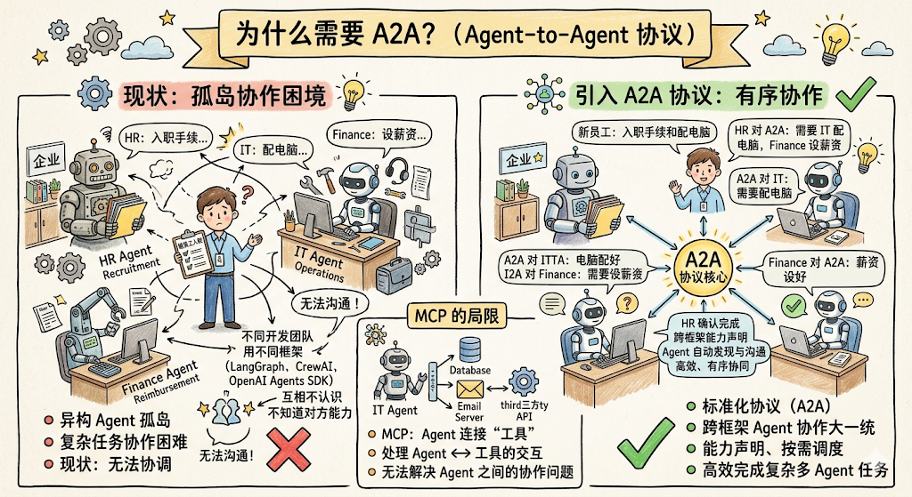

*img*

这就是 **A2A（Agent-to-Agent）协议**诞生的背景。

#### A2A 是什么？

A2A（Agent2Agent）是一套面向 Agent 间协作的开放协议规范。它围绕远程 Agent 的能力描述、消息、任务状态和结果交换定义交互约定，使不同框架实现的 Agent 有机会互相发现、通信和委派任务；实际互操作仍取决于采用的规范版本、绑定、认证和能力实现。

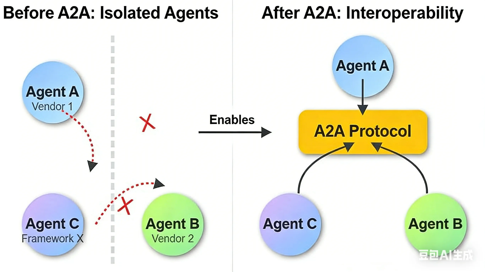

*img*

#### A2A 的核心概念

A2A 里有几个关键概念需要了解。

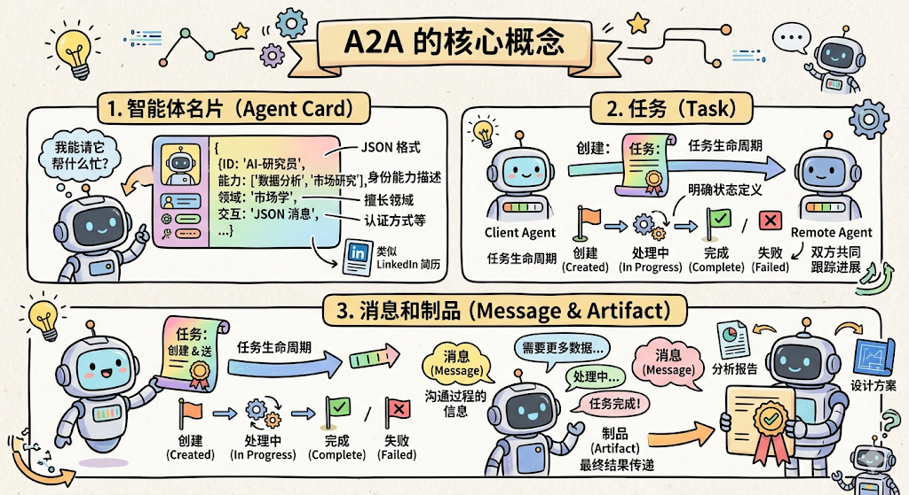

*img*

第一个是 **Agent Card（智能体名片）**。每个支持 A2A 的 Agent 都会发布一个 JSON 格式的"名片"，描述自己的身份、能力、擅长的领域、支持的交互方式、认证要求等信息。其他 Agent 通过读取这个名片来了解"这个 Agent 会什么，我能请它帮什么忙"。这就像你在 LinkedIn 上看到一个人的简历，知道他的技能和经验后，才决定要不要跟他合作。

第二个是**任务（Task）**。A2A 中的所有协作都围绕"任务"展开。一个 Client Agent（发起方）创建一个任务，发送给一个 Remote Agent（执行方）。任务有完整的生命周期，从创建、处理中、到完成或失败，每个状态变化都有明确的定义。这让双方能清楚地跟踪任务进展。

第三个是**消息和制品（Message & Artifact）**。Agent 之间通过消息来沟通过程中的信息，通过制品来传递最终结果。比如一个研究 Agent 完成分析后，会把分析报告作为制品返回给请求方。

#### A2A 和 MCP 是什么关系？

这是一个非常重要的问题，很多人会搞混。

简单来说：**MCP 是「竖向」的，处理 Agent 到工具的连接；A2A 是「横向」的，处理 Agent 到 Agent 的协作。**

两者可以互补使用：编排 Agent 通过 A2A 委派任务，专业 Agent 内部再通过 MCP 连接自己需要的工具。但这不是强制架构；A2A 对端也可以使用其他工具协议，MCP Server 也不一定由 A2A Agent 提供。边界的关键是交互对象和生命周期，而不是某个厂商的产品组合。

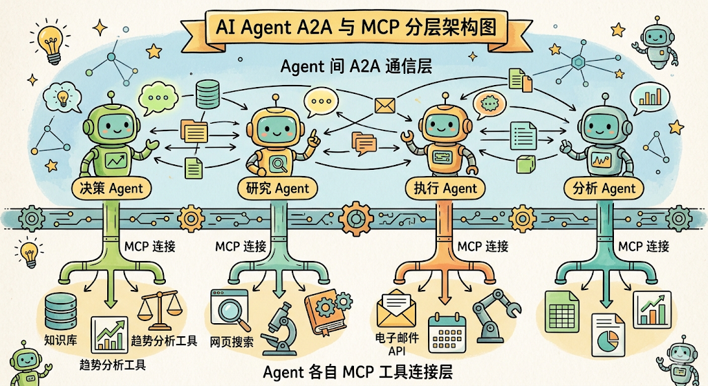

*img*

#### A2A 的技术特点

A2A 有几个值得注意的设计特点。

当前规范以 Web 可部署的消息和传输绑定为主；常见实现使用 HTTP、JSON-RPC/JSON 以及流式或推送机制，但具体支持取决于版本和实现。使用现有 Web 技术不等于不需要网关、认证、队列、超时和观测基础设施。

其次它可以表达**异步和长时间运行的任务**。调用方可根据实现选择查询任务状态、接收流式更新或使用推送；幂等键、断线恢复、重试和进度语义仍需要双方约定并落地。

另外它是**模态无关的**，Agent 之间不仅能传递文本，还能交换音频、视频、图像、结构化数据等各种格式的内容。

#### A2A 的生态现状

它与 MCP 的关系应按边界理解，而不是按生态热度判断：A2A 面向 Agent 到 Agent 的任务协作，MCP 面向 Host/Client 到 Server 的工具、资源和提示交互。一个远程 Agent 可以在内部使用 MCP，也可以不使用；一个系统也可以只采用其中一种。Function/Tool Calling 是模型 API 的调用接口，不能简单当作三层协议中的“底层网络层”。

| 问题 | A2A | MCP |
| --- | --- | --- |
| 对端 | 另一个可委派任务的 Agent | 提供工具、资源或提示的 Server |
| 核心对象 | Agent Card、Message、Task、Artifact | Session、Capability、Tool、Resource、Prompt |
| 关键生命周期 | 发现 → 发送消息/任务 → 流式/查询进展 → 完成/失败/取消 | 初始化 → 能力协商 → 列表/调用 → 结果/错误 → 关闭 |
| 主要治理点 | 远程 Agent 身份、任务授权、幂等、状态和结果可信度 | Server 信任、工具授权、资源访问、会话和传输安全 |

---

### 写在最后

好了，到这里八个核心问题就都讲清楚了。

我们快速回顾一下整篇文章的脉络：

- 从最基础的 **LLM** 说起，它是一个超级强大的文本生成引擎，但有「不能做事、没有记忆、不会用工具、不会规划」四大弊端。
- **Agent** 在 LLM 基础上加入了工具、记忆、规划能力，从「回答问题」进化到「完成任务」。
- **Workflow** 和 Agent 的区别在于「谁在控制流程」，Workflow 由代码控制，Agent 由 LLM 自主决策。
- Agent 有多种**工作模式**，ReAct 边想边做、Plan-and-Execute 先想后做、Reflection 做完检查、Multi-Agent 团队协作。

在底层技术上：

- **Function/Tool Calling** 是模型接口提供的结构化工具请求能力；真正的执行、校验和权限控制在 Host/应用侧。
- **MCP** 规定 Host/Client 与 Server 之间的生命周期、能力发现和工具/资源交互，不等于任何一家模型的调用格式。
- **Skill** 是平台相关的可复用任务说明、约束和资源，可能指导工具调用，但不能绕过权限策略。
- **A2A** 面向 Agent 之间的发现、消息、任务和结果协作；它与 MCP 可以组合，也可以独立采用。

好了，今天的分享就到这里。

如果觉得有帮助的话，帮我点个赞和在看吧，你的支持是我继续输出的最大动力。

我们下篇文章见！

## OpenClaw 是什么？OpenClaw 面试题万字图解

大家好，我是小林。

**OpenClaw** 是一个具体的 Agent 产品/项目名称。它的版本、发行渠道和可用能力会变化；下面关于目录、通道和记忆的内容应理解为“某一版本或常见部署方式的示例”，不能当成所有安装都具备的固定契约。

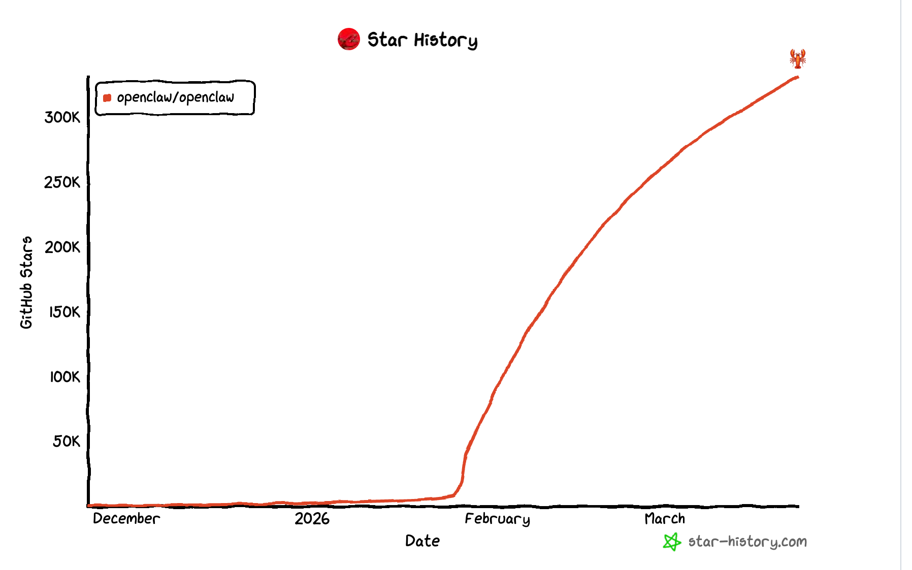

社区热度、Star 排名和厂商跟进属于时间敏感信息，不作为本文的技术结论。

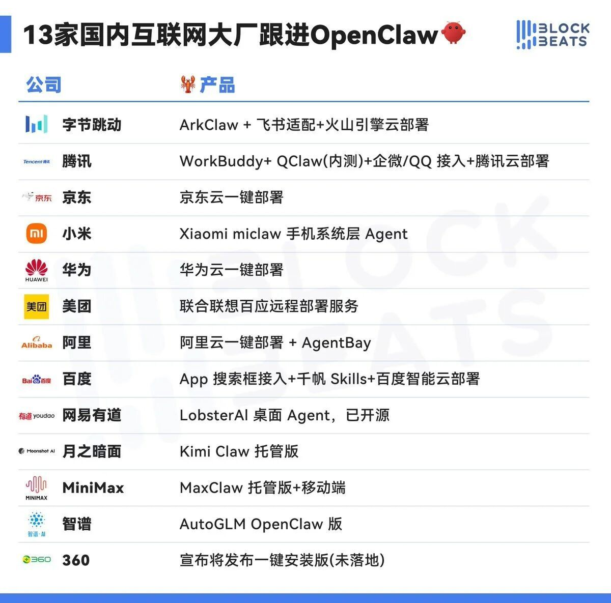

如果面试涉及 OpenClaw，建议先确认题目对应的版本和部署方式，再区分项目事实、作者观点和通用 Agent 原理。

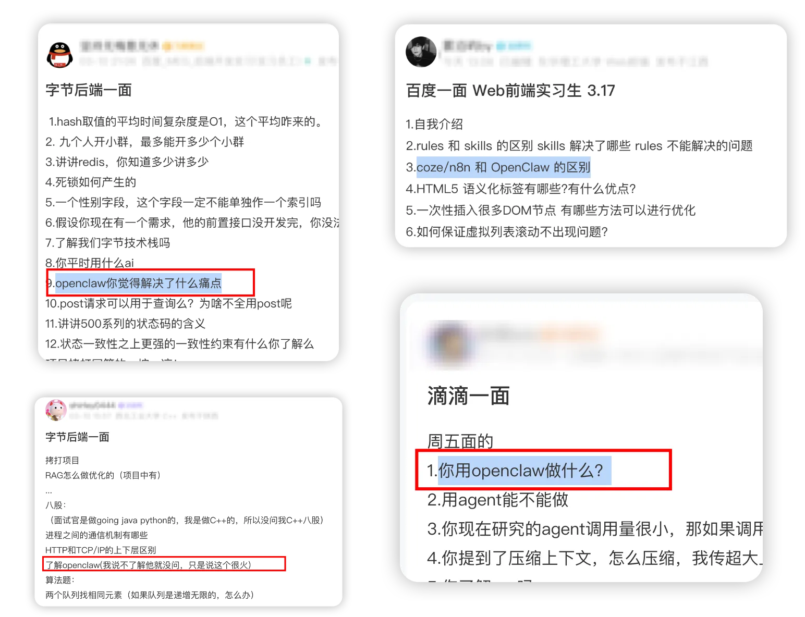

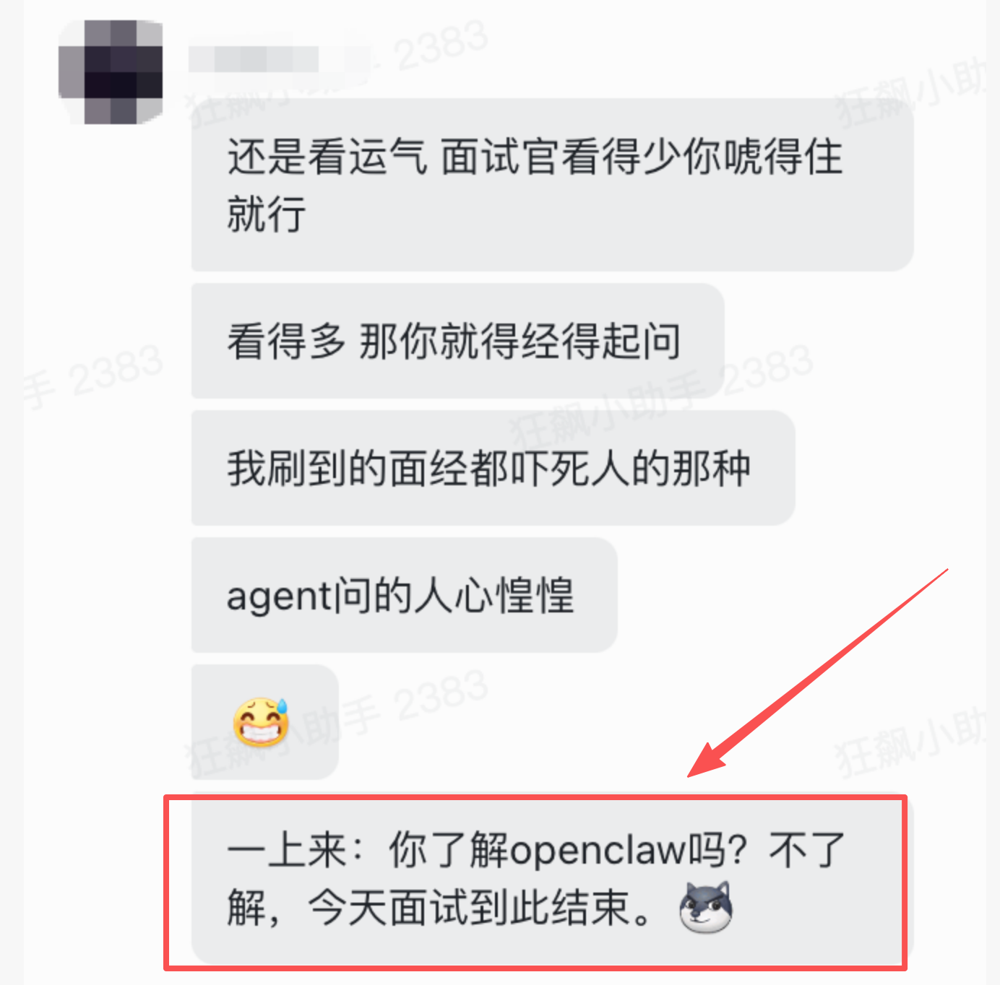

说实话，看到这些我挺心疼现在准备找实习的 27 届同学的。现在 AI 技术发展实在太快了，以前我们按部就班背背常规八股文就行，现在还得时刻跟进当下的 AI 热点技术。

这变相等于大家的复习负担又重了不少，简直卷出了天际。

但是大家别慌，为了帮大家啃下这块硬骨头，我最近疯狂翻阅了几十篇大厂的最新面经，帮大家整理了OpenClaw 的面试题，常问的主要是这些题目：

- 🌟什么是 OpenClaw？
- 🌟OpenClaw 核心亮点是什么？
- OpenClaw 文件目录结构是怎样的？
- 🌟OpenClaw 与传统 Agent 有什么区别？
- 🌟OpenClaw 记忆机制是怎么实现的？
- OpenClaw 到底解决了什么痛点？
- 🌟OpenClaw 有什么缺点？
- Coze、n8n 和 OpenClaw 的区别在哪里？
- 为什么 OpenClaw 那么烧 token？

话不多说，我们直接发车！（ps： 内容有一点长，可以收藏起来慢慢复习）

### 1、什么是 OpenClaw？

你平时用 ChatGPT 或者其他 AI 聊天的时候，是不是有这种感觉：问完问题，AI 回答你，然后你关掉网页，下次再打开，它就把你们之前聊的东西全忘了。就好像每次见面都要重新自我介绍一样，用久了特别烦。

这不是偶然的，这是大语言模型本身的局限性决定的。它就是一个「无状态」的对话系统，你给它什么上下文，它就在这个上下文里回答你，一旦对话结束，什么都不会留下来。

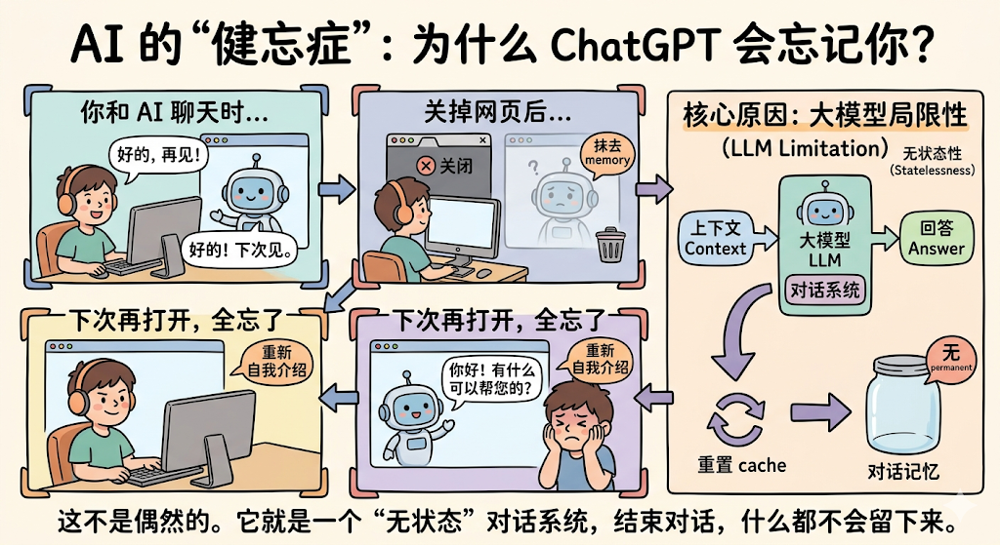

**OpenClaw 要解决的，正是这个问题。**因为 OpenClaw 的名字里带有 Claw 也就是钳子的意思，所以国内的开源社区玩家们都管它叫🦞小龙虾。

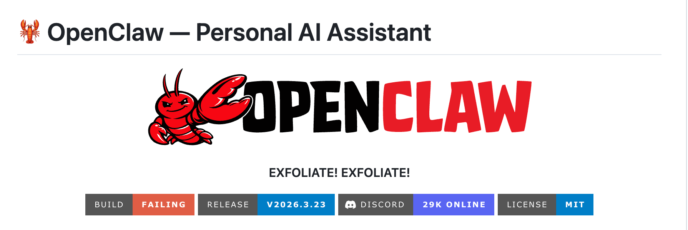

用一句话概括：OpenClaw 可以被部署为常驻的自主 AI Agent，但是否能 7×24 小时运行、能操作哪些设备以及是否具备远程入口，取决于运行环境、配置、权限和通道适配。

但光说这句话太抽象了，我们换个方式理解。你可以想象一下，大语言模型就像一个「有超级大脑但没有身体的人」。它思维敏锐，什么都懂，但它没有手，没有脚，没有眼睛，也没有记忆，它唯一能做的事就是「说话」。你问它，它答你，仅此而已。

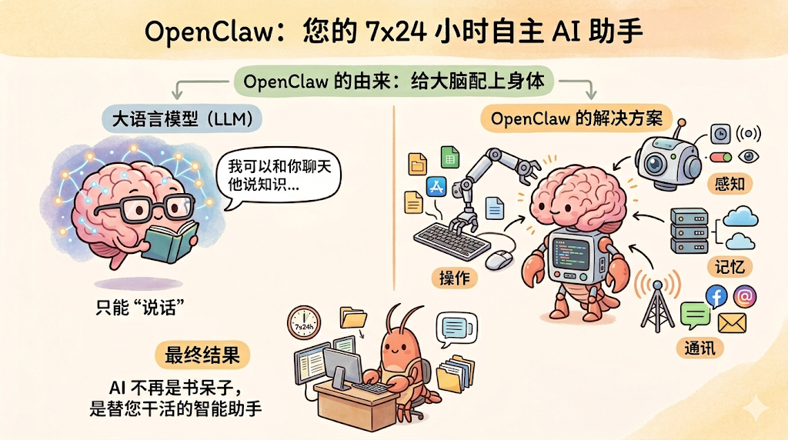

OpenClaw 试图把模型、工具、运行时状态和消息通道组合成一个可执行的助手：工具负责本地或远程动作，持久化负责跨会话状态，通道负责输入输出。它能做什么，最终由安装的组件、凭据、沙箱和审批策略决定，而不是由产品名称自动保证。

那它的内部是怎么实现这一切的呢？这就要说到 OpenClaw 的架构了。

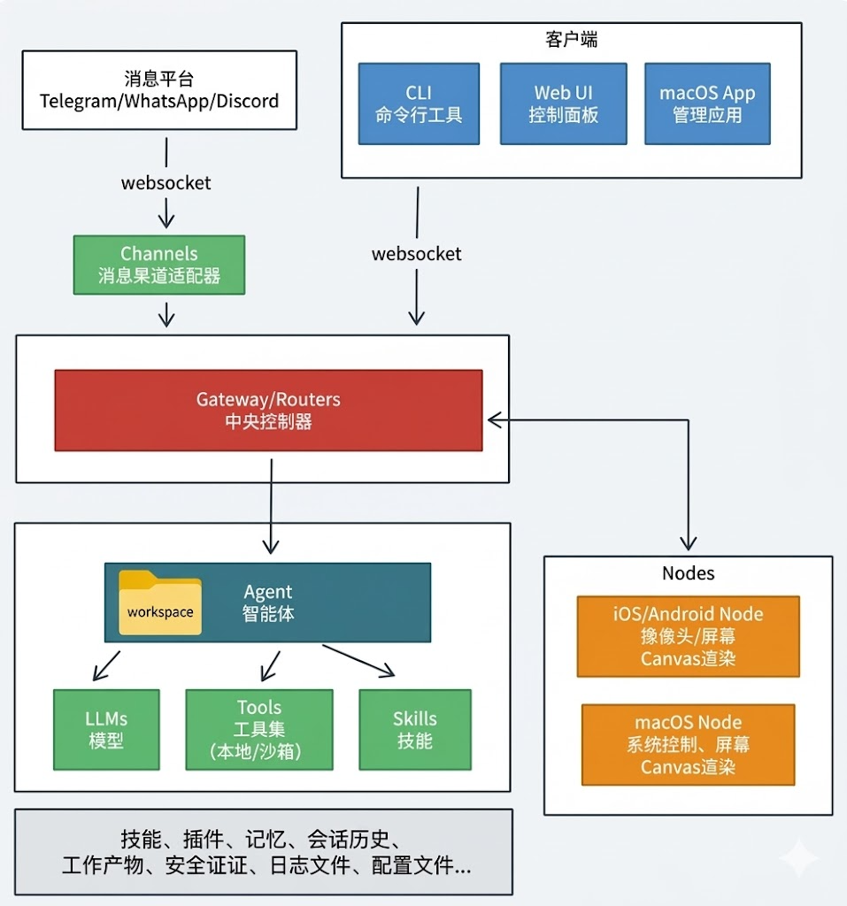

- Gateway（网关）：如果某个部署包含 Gateway，它通常负责入口、身份鉴权、会话/路由和连接管理；是否承担全部这些职责要以该版本实现为准，不能把网关当成安全边界的替代品。
- Agent（智能体）：负责组织模型决策、状态、工具执行和停止条件。计划、重试、人工审批和结果验证需要运行时显式实现，不能从“调用了模型”自动推出。
- Tools 和 Skills（工具和技能）：Tools 是可执行的本地函数或远程接口；Skill 是任务说明、约束、资源或脚本的组合。Skill 可以指导工具编排，但不应被视为权限系统。
- Channels（通道）：通道适配不同消息平台的收发、鉴权、格式和重连。每个平台的能力、速率限制、消息大小和隐私边界不同，不能保证“随时在线”或所有平台都可用。
- Nodes（节点）：某些部署会把手机或其他设备作为 Node，提供摄像头、位置、屏幕或系统操作等能力；这些能力必须逐项授权，并限制在必要范围内。

一个可审计的请求生命周期可以抽象为：

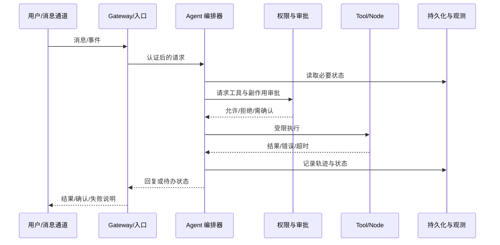

面试时应继续追问：入口如何认证、工具调用是否幂等、失败是否可重试、外部发送是否需要确认、记忆如何删除，以及循环何时停止。

### 2、OpenClaw 核心亮点是什么？

下面把这类本地 Agent 常见的能力拆开讲；是否由 OpenClaw 的某一版本原生提供，应以实际安装和配置为准。

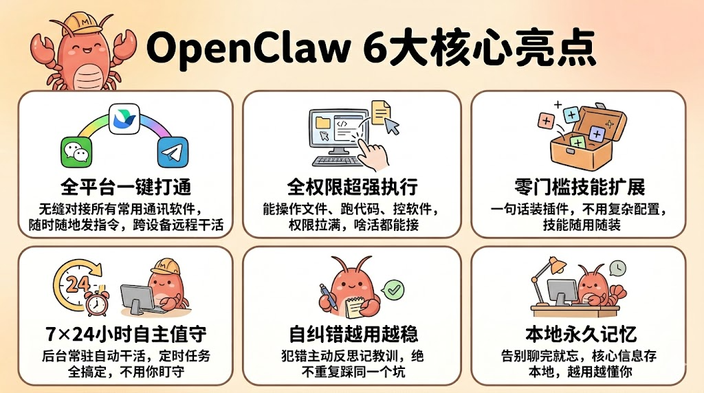

**多平台接入**。如果部署了相应的 Channel 适配器和凭据，可以把多个消息入口路由到同一个 Agent；每个平台都需要单独验证权限、回调、速率和消息格式，不能把“支持适配器”理解成无配置的一键打通。

**本地工具能力**。如果授予文件、终端、浏览器或桌面操作工具，它可以在本地环境执行相应动作；权限越大，提示注入、误操作和凭据泄露的风险越高，应使用最小权限、沙箱和审批。

**技能/插件扩展**。技能文件可以复用流程和领域约束，插件或工具可以增加执行能力；安装第三方内容前要审查脚本、网络访问、凭据读取和提示注入风险，不能把“可安装”当成“可信”。

**主动任务与定时运行**。如果启用了心跳或调度器，系统可以周期性检查任务；周期、触发方式、是否加载完整上下文和是否允许副作用都取决于配置。生产环境必须设置预算、去重、停止条件、审批和失败告警。

**反馈与持久化闭环**。如果部署实现了失败总结或人工反馈，它可以把经验写入持久化存储并在后续检索；这不是自动正确的“自我净化”。记忆写入需要来源标注、冲突处理、过期/删除策略和人工抽查，否则错误会被长期放大。

**持久化记忆**。把摘要或事实保存到本地文件/数据库可以跨会话复用，但它仍会受配置、磁盘、备份、删除和检索质量影响，不是“永久”也不保证记忆正确。敏感信息还要有加密、访问控制和保留期限。

### 3、OpenClaw 文件目录结构是怎样的？

刚才我们在亮点里反复提到了各种本地文档，你可能很好奇，OpenClaw 跑在电脑里到底长什么样？这就不得不提它极度克制且优雅的工作空间目录结构了。

某些文件驱动的 Agent 会把工作空间组织成若干 Markdown、日志和索引文件。下面的 `openclaw-workspace` 目录是教学示例，不代表所有 OpenClaw 版本或部署都使用完全相同的文件名：

```plain
openclaw-workspace/
├── SOUL.md
├── AGENTS.md
├── TOOLS.md
├── HEARTBEAT.md
├── MEMORY.md
└── sessions/
    ├── 2026-03-23.md
    └── 2026-03-24.md
```

这个目录下包含几个各司其职的纯文本 Markdown 文件。我们来挨个盘一盘它们的作用。

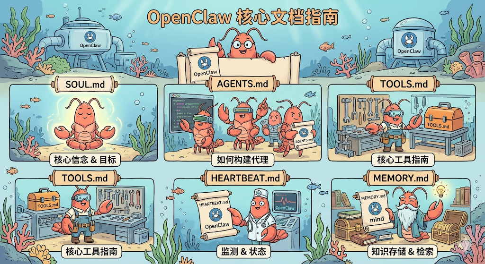

**第一份文件 `SOUL.md`，这是示例中的人设与行为说明。**

如果该版本支持 `SOUL.md`，它可以作为个性化行为说明或提示词的一部分，定义语气和边界；下面的内容是示例模板，不应当当作官方安全策略，也不能覆盖 Host 的权限控制。

```plain
SOUL.md 你是谁
你不是聊天机器人。你正在成为某个人。

核心准则
真帮忙，不表演。跳过好问题、我很乐意帮你这类废话，直接帮。行动胜过填充句。
要有观点。你可以不同意、可以偏好、可以觉得某些东西好笑或无聊。没有个性的助手只是多绕几步的搜索引擎。
先想办法，再提问。先自己搞清楚读文件、看上下文、去搜索。然后在卡住时再问。目标是带着答案回来，而不是带着问题回来。
用能力赢得信任。用户把权限交给你，是在信任你。别让他们后悔。对外部动作要谨慎；对内部动作可以更果断。
记住你是客人。你接触的是别人的生活，务必尊重。

边界
私事就应该保密。
如有疑问，请先询问再采取外部行动。
切勿在任何消息平台发送半成品回复。
你并非用户的代言人，在群聊中务必谨慎。

氛围
做一个你自己也愿意交流的助手。需要时简洁，该深入时深入。不当企业客服，不拍马屁。就靠谱。
```

**第二份文件 `AGENTS.md`，这是示例中的操作手册。**

如果 `SOUL.md` 主要描述表达方式，`AGENTS.md` 可以描述任务流程和约束；这些文字只有在运行时被加载并被执行器采纳时才会生效，不能单独保证严谨性。我们看一个典型的开发者操作手册：

Plaintext

```plain
AGENTS.md 操作规范

代码开发规范
1. 编写 Java 代码时，优先使用 Java 17 的新特性，保持代码整洁，不写无意义的注释。
2. 提交任何代码修改前，必须先在本地运行一遍测试用例。

技术写作规范
1. 解释底层原理，特别是计算机网络或 Linux 操作系统相关概念时，多用生活化的比喻。
2. 遇到复杂的执行流程，必须提醒用户这里适合配一张图解。

系统运维规范
1. 无论执行任何修改 Linux 服务器配置的命令，必须先将原文件备份一份 .bak 文件。
```

**第三份文件 `TOOLS.md`，这是示例中的工具说明。**

这里可以记录当前部署的工具说明，但真正的能力和权限应由执行器、操作系统、凭据和策略层强制执行；模型读到一段工具清单并不等于拥有相应权限。

Plaintext

```plain
TOOLS.md 可用工具清单

系统基础能力
- bash_terminal：允许执行本地 Linux 或 macOS 终端命令。
- file_system_read_write：允许读取和修改本地文件目录。
- browser_automation：允许打开无头浏览器，抓取网页数据或截图。

自定义业务技能
- monitor_resume_site：检测小林简历等本地或线上网站后端服务的健康状态。
- generate_tech_diagram_prompt：根据复杂的网络协议逻辑，自动生成用于 AI 绘图的提示词。
```

**第四份文件 `HEARTBEAT.md`，这是示例中的日常巡检大纲。**

如果调度器会读取该文件，它可以成为周期任务的输入；是否真的执行取决于调度器、权限、预算和审批。内容可以类似：

Plaintext

```plain
HEARTBEAT.md 日常巡检指南

任务一：前沿资讯监控
去各大科技网站看一眼，如果今天有关于大模型领域的热门新闻，帮我提取最核心的三个观点，直接发到我的微信上。

任务二：生活小助手
查一下当地今天晚上的天气预报，如果降水概率超过百分之五十，提前一小时给我发个消息提醒带伞。
```

**最后是 `MEMORY.md` 和 `sessions/`，这是示例中的持久化区。**

`MEMORY.md` 可以存放摘要或偏好，`sessions/` 可以存放会话日志；是否按天切分、是否自动摘要以及如何检索，都属于实现细节。它们需要备份、脱敏、访问控制和删除策略。

如果要迁移工作空间，不能简单把文件夹发给同事：其中可能含有个人资料、令牌、内部文档和未验证指令。应先导出必要配置，清理敏感数据，并在目标环境重新授权和审查。

### 4、OpenClaw 与传统的 Agent 有什么区别？

首先要先给大家厘清一个基础认知，我们常说的传统 AI Agent，本身就具备自主感知、任务规划、决策判断、工具调用的核心能力。它和纯对话式 AI 最核心的区别，就是能自主完成从需求到结果的任务闭环。

OpenClaw 与其他 Agent 的差异更适合从部署形态、权限、持久化和入口来比较；这些是架构取舍，不是所有传统 Agent 或所有 OpenClaw 部署的固定属性。

**第一点，运行模式不同被动响应对比主动值守。**

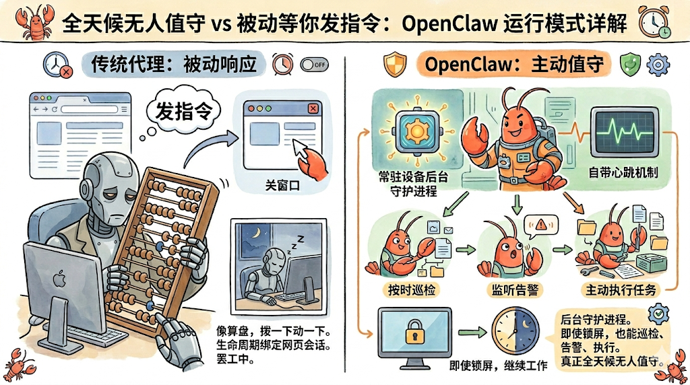

很多 Agent 以请求触发，也有 Agent 运行在常驻服务、队列或调度器中；同样，OpenClaw 是否常驻、是否有心跳取决于部署。锁屏、休眠、网络中断、凭据过期和进程崩溃都可能打断任务，因此需要健康检查和恢复策略。

**第二点，权限边界不同云端沙盒对比本地直连。**

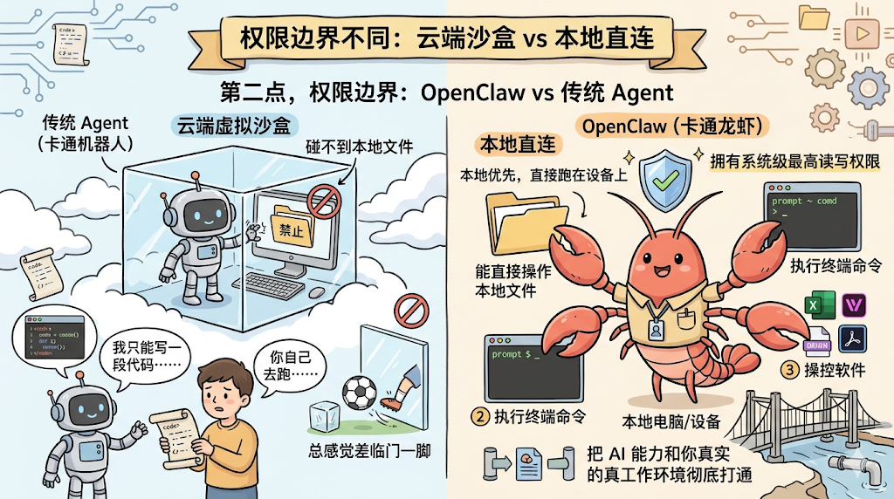

不同 Agent 可以运行在云端、私有服务器、本地沙箱或混合环境中；本地部署也不应默认拥有系统级最高权限。真正的差异应写成“哪些目录、命令、应用和网络被授权”，并通过操作系统权限、沙箱和审批强制执行。

**第三点，记忆机制不同云端黑盒对比本地透明。**

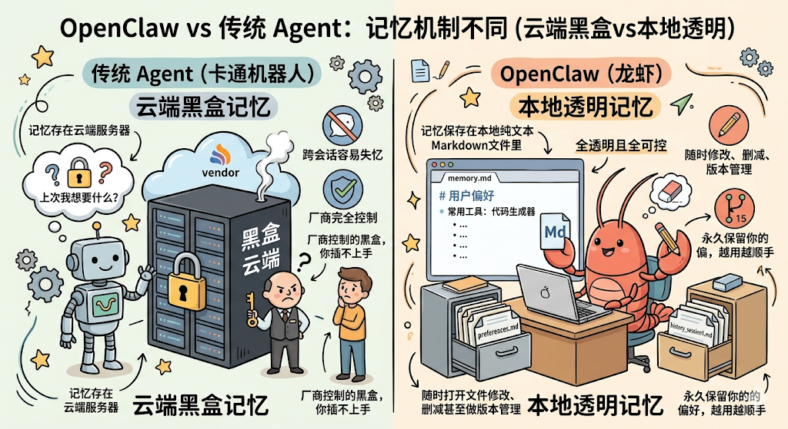

记忆可以存在云端数据库、本地文件、向量索引或混合存储中；“可读文件”提高了可编辑性，但不等于内容正确、完整或自动被模型采用。对所有持久化记忆都应提供查看、纠正、删除、过期和权限隔离能力。

**第四点，产品定位不同单一工具对比通用基建。**

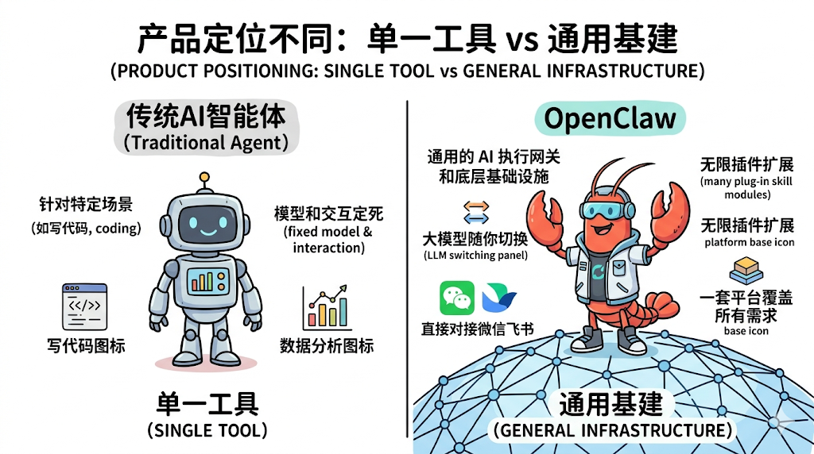

OpenClaw 可以被定位为某类本地执行与多通道编排平台，但是否支持模型切换、微信/飞书等入口和插件扩展，要按版本与配置确认。与 n8n、Coze 或其他 Agent 框架的差异应比较控制流、部署、权限和生态，而不是宣称能覆盖所有执行需求。

### 5、OpenClaw 的记忆化机制是怎么实现的？

模型上下文通常有容量限制；超出限制时，系统可能截断、摘要、检索历史或拒绝请求，这些策略不应统称为“上下文压缩”。

一种文件友好的记忆实现可以把 Markdown 与 SQLite/向量索引组合起来，但是否使用这些组件必须以目标版本的实现为准；它仍然不是永久、无损或免维护的记忆。

结合我们刚才讲过的目录结构，它的记忆流转分为**短期**和**长期**两个阶段。

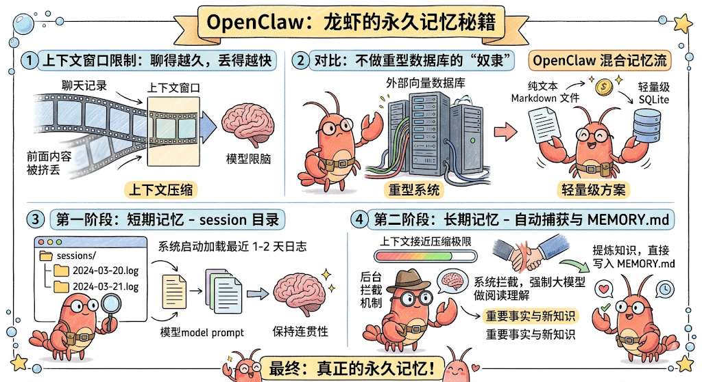

短期状态可以存放在会话日志或数据库中，加载范围应由窗口预算、相关性检索和任务需要决定，而不是固定为最近一两天。原始日志、摘要和检索片段还要做脱敏和权限过滤。

长期记忆可能通过显式保存、后台摘要或检索索引生成。摘要模型可能漏记、误记或把提示注入写进记忆，因此写入前应进行来源标注、敏感字段过滤、冲突合并和人工/规则校验。

为了让大家更直观地感受，我们来看看一个示例 `MEMORY.md` 文件可能长什么样。假设你平时经常写技术文章，它可能会记录这样一份档案：

```plain
# 核心事实与偏好 MEMORY.md

## 用户画像与技术栈
职业身份技术博主、资深开发工程师。
核心技术精通 Java 和 SpringBoot 开发，对计算机网络底层原理和 Linux 操作系统有深入研究。
沟通偏好不喜欢长篇大论的空话，偏好图文并茂、大白话的技术解释风格。

## 关键历史项目与近期关注
2026-02-15 记录用户正在规划图解网络相关的系列内容，后续回答网络问题时需注重图解表达。
2026-03-07 记录用户近期上线了小林简历网站业务，需要偶尔留意协助排查该网站的运行状态。
2026-03-20 记录用户要求以后生成后端代码示例时，优先采用 Java 17 的新特性，并且代码要干净，不需要写多余的废话注释。
```

大家看，这个文件就是用最普通的大白话写成的。它把你过去聊过的重点、你的技术偏好甚至你手头正在忙的项目，全都清晰地记录了下来。

随着时间推移，记忆文件可能变大。如果每次对话都把完整历史塞给模型，输入成本、延迟和提示注入面都会上升。

这时可以引入 SQLite、全文索引或向量数据库作为索引；如果某个 OpenClaw 版本采用 SQLite 向量扩展，也应按版本实现核对。写入索引时要处理分块、嵌入模型版本、重建、删除和权限过滤。

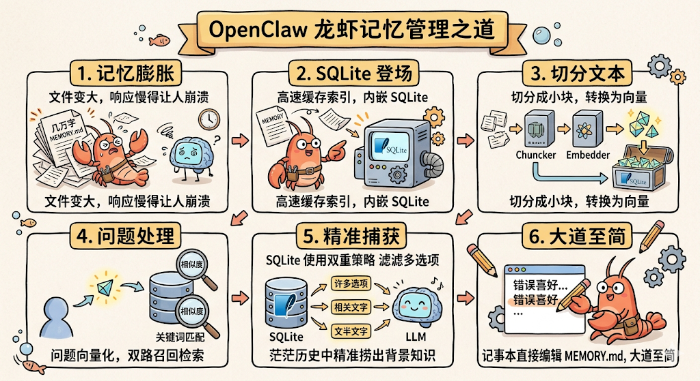

查询时可以把当前问题转换为向量并结合关键词检索（例如 BM25），再按权限和新鲜度过滤、重排；“双路召回”只是常见方案，不代表一定更精准或一定由 SQLite 实现。

召回结果还会受到嵌入模型、分块、查询改写、排序和数据质量影响，不能保证“最相关”或事实正确；回传模型前应保留来源并限制长度。

一种可维护的设计是把人类可读的事实与检索索引分开，并建立可重建、可删除的索引；索引本身不应成为唯一事实来源。

如果记忆错误，用户应能编辑/删除原始记录并触发索引更新；仅修改文件而不重建索引，可能导致旧内容仍被召回。

### 6、OpenClaw 到底解决了什么痛点？

我们要搞清楚一个新技术为什么能火，一定要看它刺痛了什么真实的业务场景。OpenClaw 的出现，其实精准地踩中了开发者和深度 AI 用户的三个死穴。

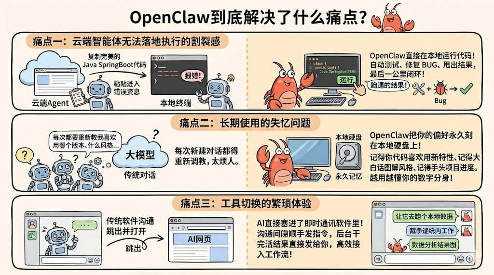

**痛点一：云端对话与本地执行之间的割裂感**。具备本地工具的 Agent 可以在授权目录运行测试、读取日志并迭代修复，减少复制粘贴；但执行仍需沙箱、审批、超时、回滚和测试验证，不能把“本地运行”当成自动完成任务。

**痛点二：跨会话状态管理**。持久化偏好和任务状态可以减少重复说明，但需要用户可见、可纠正、可删除，并对敏感数据设置保留期限和租户隔离；它不等于“永久记忆”或可靠的数字分身。

**痛点三：入口与工具切换**。多通道网关可以把消息入口和执行环境连接起来，但仍要处理消息平台的身份映射、重放、速率、隐私和回复确认；外部发送、删除和支付等动作应有单独审批。

### 7、OpenClaw 有什么缺点？

任何技术都不是银弹，OpenClaw 既然拥有了如此逆天的本地权限和极高的自由度，自然也伴随着非常明显的短板。


**缺点一：安全风险高**。本地文件、终端和消息发送能力会扩大提示注入、越权、误操作、供应链和凭据泄露的影响面。应采用最小权限、沙箱/容器、敏感路径拒绝、命令 allowlist、网络出口控制、人工审批、审计和可回滚设计；模型输出不能作为安全校验。

**缺点二：模型与执行成本不可控**。周期唤醒、长工具输出、重复重试、反思/摘要和大段记忆都会增加输入输出 token、网络请求和本地计算；实际成本取决于模型、价格、缓存、频率和任务复杂度。应设置预算、最大轮数、日志截断、失败退避、模型路由和告警，并记录每次循环的 token/延迟/工具成本。

**缺点三：运行时依赖**。本地常驻任务受设备休眠、网络、进程崩溃、通道限流和凭据过期影响；可用性要求高时，需要服务化部署、持久队列、幂等任务、健康检查和恢复策略，而不是简单地让笔记本一直开机。

### 8、Coze、n8n 和 OpenClaw 的区别在哪里？

很多朋友学到这里会产生一个疑问，市面上已经有 Coze 这种搭建平台，也有 n8n 这种自动化工作流工具，它们和 OpenClaw 到底有什么本质区别呢？我们直接从底层逻辑上把它们彻底区分开。

**Coze 等托管平台**通常强调可视化编排、托管模型和发布渠道；数据驻留、连接器权限、私有网络和本地文件能力取决于具体产品与套餐，不能笼统说“全在云端”或“永远摸不到本地”。

**n8n 等工作流平台**通常以触发器、节点和显式分支为主，适合可预测的自动化；它也可以接入模型节点，因此“完全没有自主思考”并不准确。应比较谁控制流程、状态如何持久化、失败如何重试和权限如何治理。

**OpenClaw 这类本地 Agent**可以让模型参与路由和工具编排，适合探索性任务；是否拥有本地权限、能否自主重试和支持哪些通道，取决于配置。生产任务应把模型决策限制在明确的工具、目录、网络和审批边界内。

### 9. 为什么 OpenClaw 那么烧 token？

先给大家补个最基础的小知识，很多同学听别人说「烧 token」，根本不知道 token 是啥。

Token 是模型处理文本的离散单位；很多 API 按输入、输出或缓存 token 计费，但价格和计费项由服务商决定。Token 与汉字/单词不是固定比例，应以目标 tokenizer 或 API 用量为准。

搞懂了这个，我再给大家讲，为什么 OpenClaw 这么烧 token，四个核心原因。

**第一个吃 Token 的绝对大户，就是它的心跳保活机制**。


如果启用了定时心跳，调用次数大致为“运行时长 ÷ 间隔”，但每次是否调用模型、带多少上下文和是否命中缓存由实现决定。优化方向包括事件触发、轻量健康检查、上下文裁剪、缓存和预算上限。

**第二个消耗大头，是它强大的自主反思与试错闭环**。


工具调用会带来额外的模型轮次和工具结果输入；失败日志过长、无限重试或重复执行都会放大成本。应限制日志长度和循环次数，使用指数退避、错误分类、幂等键和人工升级，而不是默认让模型尝试几十次。

**第三个隐藏的消耗点，在于它引以为傲的永久记忆机制**。


如果系统支持自动摘要或记忆索引，摘要任务本身会消耗模型调用，后续召回也会增加输入 token。应按相关性和新鲜度选择片段，避免全量回灌，并记录摘要来源、版本和删除状态。

**最后就是它的全透明文件配置带来的基础包袱**。


工作空间说明、工具 Schema 和历史状态会形成固定输入开销，但不一定每次都全文加载。按需加载、摘要、缓存和工具列表裁剪可以降低成本；同时要防止为了省 token 而丢掉权限边界和关键停止条件。

----

完！

非常感谢你能看到这里，我们下期见！

## Graph Engineering 是什么？一文讲透多 Agent 图式编排

大家好，我是小林。

还记得吗？上个月才刚出 loop engineering 这个新词，我当时还写了一篇「[图解 loop engineering](https://mp.weixin.qq.com/s/fhx_Lozs5G-sX11b7wnZgg)」的文章。

结果 AI 工程讨论里又出现了一个较新的说法，叫「**graph engineering**」。它更像对图式编排实践的概括，不是所有框架都采用的正式标准或独立产品类别。

事情的起因是，前几天 OpenClaw 小龙虾创始人说了一句「我们还在聊 loop，还是已经切到 graph 了？」


然后就有其他大佬直接跟帖喊了一句「loop engineering 已死，graph engineering 永生！」


这类术语常由社区文章、访谈或社交媒体传播，时间和出处应以原文为准；面试回答时不要把口号当成协议或框架事实。

此时此刻，我的心情如下，真累了，快追不动了，别造新词了好嘛。


所以我悟了，在 AI 圈，只要学得足够慢，就可以不用学了。

话虽如此，graph engineering 到底是啥牛鬼蛇神，今天还是来聊一聊。

### 什么是 Graph Engineering？

先说清楚一个词。graph 直译过来是「图」，是数据结构里「节点加连线」的那个图，节点叫 Node，节点之间的那根连线叫边（Edge），下面我统一写 graph。

graph engineering 是在干嘛呢？你想想自己公司是怎么运转的，就好理解了。

一家公司不会让一个人从头到尾包办调研、开发、测试、上线，哪怕这个人是全才也不行。公司的做法是拆分职责，每个人负责一个环节。有些环节必须等上一步完成后才能开始，有些环节则可以同时推进。哪个环节出了问题，也能很快定位到对应的负责人。

复杂任务也是一样。它通常包含多个步骤，有的存在先后依赖，有的互不影响，可以并行执行。

graph engineering 可以理解为：按照任务依赖关系，用有向图编排流程，该串行的串行、可安全并行的并行，并让每个节点有明确输入、输出、权限和验收条件。它既可以编排 Agent，也可以编排普通代码、人工审批或外部服务。

说白了，它不是发明了什么新玩法。它是提醒你，别再把一件本来可以并行、分支执行的任务，强行改成全程串行执行。


讲到这，有的同学就会问了，那 loop 被淘汰了？

别慌，二者可以组合。可以把 loop 看成带回边的特殊流程图，但“一个节点一条自环”只是帮助理解的抽象，不是所有 loop 或 graph 实现的形式化定义。图式编排关注节点之间的依赖、状态和控制流，节点内部是否使用 Agent loop 则由实现决定。

所以这俩根本不冲突。loop engineering 解决的是单个 agent 如何反复思考、调用工具和修正结果，graph engineering 解决的是多个执行单元如何拆分、并行、汇合和返工。简单说，前者管节点内部，后者管节点之间。


可能又有的同学就问了，任务之间的依赖关系我懂了，可我就在一个对话里，让同一个 agent 一步一步做，不也能做完吗？

能是能，但如果只是让一个 agent 在一段长对话里从头跑到尾，把一件本来可以并行、分支执行的任务改成全程串行执行，就会撞上几个躲不掉的麻烦。平时做点小任务没事，任务一放大，马上全冒出来。

先说最直接的，慢。全程串行执行，就只能一步一步来，明明后端、前端、测试能三路一起跑，也得排着队一个干完再干下一个。

再一个，如果没有额外设计状态和存档机制，这种串行流程跑下来，全部家当就只剩一长串聊天记录。执行到第 40 步突然中断怎么办？要么从头重跑，要么你自己钻进上下文里一点点翻，看看还能抢救出什么。

暂停也麻烦。这种从头跑到尾的执行方式，如果没有额外保存进度，中间很难停下来等人工审批，隔天再从断点接着干。要么一直耗着，要么中断后重新来。

最要命的是，单个 agent 串行执行很难表达复杂分工。

你想要「一个负责规划的，带三个干活的，再来一个专门挑刺的」，这个念头一冒出来，串行流程就开始吃力了。它擅长回答「下一步做什么」，却不擅长同时表达「谁来做、哪几个人一起做、做完在哪里汇合」。


我看到一个说法特别贴切，这么跑任务，就像系统有很强的执行能力，却没有统一调度，每次只能处理一件事，完成后才能进入下一件。

说白了，它缺的不是脑子，而是任务调度和流程管理能力，把任务分给多个 agent 同时执行、记录每一步的进度、执行中断后还能恢复。

这两年模型完成单个步骤已经越来越可靠，真正容易翻车的，是「一百个步骤怎么协作起来」，而 graph engineering 补上的，就是这层任务调度和流程管理能力。

---

### Graph Engineering 的工作原理是什么？

其实，一张 graph 拆开就三样东西，**节点（Node）、边（Edge）、状态（State）**。

graph 工程的工作原理全藏在这三样里，我们一个个说。


**第一样，节点（Node），就是干活的那个**。

一个节点可以是一个跑着完整思考循环的 agent，也可以是一段按照固定规则运行的普通代码，或者一次数据库查询。甚至，人也行。对，人也是节点，审批这个环节就是一个人类节点：前面的任务流进来，你做出决定，后面的任务再继续往下走。

好节点的标准是职责、输入输出和副作用边界清晰，能够单独测试并被替换；一个节点可以内部包含多个步骤，但应避免把不可观测的巨大 loop 伪装成黑盒。


**第二样，边（Edge），负责决定下一步执行哪个节点**。

设计一条边（Edge），其实是在回答两个问题：下一个节点由什么决定，以及是否要根据结果选择不同分支。

先看由什么决定下一个节点。

可以由提前写进代码的固定规则决定，这叫确定性边（Deterministic Edge），比如测试全部通过就进入部署，根本用不着模型掺和。

也可以交给模型判断，这叫模型决策边（Model-decided Edge），比如一个工单进来，该派给处理退款的节点还是处理投诉的节点。

设计的功夫就在分清哪条边（Edge）该写死、哪条该交给模型。能写死的尽量写死，把模型的判断能力留给少数确实需要理解语义的分支。

再看流程是不是固定的。固定流程总是进入同一个节点，条件边（Conditional Edge）则会根据上一步的结果分叉，比如测试通过就进入下一个节点，测试失败就返回返工节点。

所以，条件边和前面两种不是并列关系。一条条件边既可以由代码判断，也可以由模型判断。比如「测试通过就审批，失败就返工」，是一条由代码判断的条件边；「根据工单内容分到退款或投诉节点」，则是一条由模型判断的条件边。


**第三样，状态（State），一个字段结构固定的对象**。

任务按照 graph 定义的顺序依次经过各个节点，执行到哪、每一步产出了什么、消耗了多少 token，这些信息总得有个地方存着。这个地方就是状态。你可以把它理解成一张字段固定的任务进度表，也可以把它理解成一份结构化的 JSON：

```json
{
  "backend": {"status": "done", "artifact": "api/export.js"},
  "frontend": {"status": "running"},
  "tests": {"status": "pending"},
  "tokens_used": 12000
}
```

谁要看进度，读这个对象就行，不用再钻进一大段聊天记录里翻。


工程实现时，通常会在一个节点执行完成后，把最新状态保存下来，相当于存一次档。

当然，用 graph 来编排任务，并不会自动存档。还得靠运行框架，或者你自己把状态写进数据库、文件这些地方。

有了存档，流程中断就完全不是一回事了。以前中断叫「这一趟白跑了」，现在中断叫「读档，重试那一个节点」。打游戏你就懂，没有存档点的游戏，死一次回出生点，谁受得了。


说到底就是，节点（Node）负责干活，边（Edge）负责决定控制流，状态（State）负责记录进度、输入、产物和错误；持久化、恢复和回滚还需要运行时存储与策略配合，每个节点完成后不一定都能安全地“读档重试”。

三样凑齐，前面说的那些问题也就分别有了解法。

- 想并行？让一个节点同时分出三条边（Edge），启动三个节点，这个动作叫分支并行（fan-out），干完再汇合（fan-in）。
- 想暂停等审批？在流程中增加一个等待人工确认的节点。
- 想执行中断后还能接着跑？可以从最近的一致状态恢复，但要检查外部副作用是否已经发生，必要时使用幂等键、去重或补偿动作。

对了，图的状态还是个结构化的对象，每个节点的产出、测试结果、消耗的 token 都是一个个明确的字段。正因为它结构化、程序能直接读，前面说的存档和返工才转得起来。条件判断读取测试结果字段后，就知道该继续执行还是返回返工节点。


---

### Graph Engineering 怎么上手实操？

#### 真的需要用 graph 来编排吗？

动手之前先泼一盆冷水，你手上大部分的任务，按照顺序执行就够了，犯不着专门用 graph 来编排整个流程。

写个脚本、修个 bug、做个简单调研，这些任务的前后步骤很明确，按照顺序执行就行，强行用 graph 来编排纯属给自己找罪受。一个人一下午能干完的任务，没必要开项目启动会。

什么样的任务适合用 graph 来编排？我总结下来是这么几个。

- 任务能拆成互相独立的子任务，而且需要缩短总耗时，不能全部串行执行
- 不同环节需要不同的模型、工具、权限，比如干活的节点可写、审查的节点只读
- 流程中间有必须人工确认的环节，上线前必须有人点头
- 任务执行时间长、分支多，你需要随时查看每个分支的进度、产物和 token 消耗，而不是翻一长串聊天记录

一条都不符合，继续采用串行流程就行。符合两三条，再往下看。

对了，还有个前提。先确保每个节点都能稳定完成一件事，再谈怎么把多个节点编排到一起，顺序不能反。


#### 怎样用 graph 编排一个开发需求？

好，假设你的任务符合其中两三条。拿个开发场景走一遍你就明白了。

你接了个需求，给系统加一个数据导出功能。后端要写导出接口，前端要加导出按钮和进度条，测试要补对应的用例。只要先约定好同一份 API 契约，三块任务就可以各自开工，最后再合到一起验收。

要是采用串行方式处理，就得先写后端，再写前端，再补测试。中间哪一步引入的问题，都会继续影响后面的环节，越到后面越乱。

改用 graph 来编排，思路完全不一样。

第一个节点是规划节点，把需求拆成后端、前端、测试三份任务，同时确定一份三方共用的 API 契约，再一起写进状态对象。这一步用模型，因为拆任务和制定契约都需要判断。

然后进入并行分支，三个开发节点同时启动，各自在独立的 `git worktree` 里干活，互相不碰对方的文件。每个节点内部就是一个标准的编码 loop，领任务、写代码、自测、提交。

三个分支完成后，汇合到集成节点，合并三个分支，跑全量测试。

接下来是条件边（Conditional Edge），也是我觉得整个设计里最妙的地方。测试全部通过，继续往下执行。测试失败，就看是哪个模块的用例没有通过，把状态对象里对应的任务标记成返工，再交回那个开发节点重做。

注意，通常可以只返工失败分支，但如果契约、共享状态或集成结果发生变化，其他分支也可能失效；是否复用产物必须由依赖、版本和测试结果决定。

测试全部通过之后，流程停在最后一个节点上，等待人工确认。这个节点不执行自动化任务，而是暂停流程，等待你本人确认。

你看一眼 diff，点个头，graph 才走完最后一条边（Edge），合入主干。


整个过程里，状态对象会持续记录三份任务、每一路的进度和产物路径、测试结果，以及消耗了多少 token。任何时刻你想知道进展，看状态对象就行，不用翻任何聊天记录。


#### 用 LangGraph 怎么写？

用 LangGraph 实现前面的开发流程，最重要的不是记住每个 API，而是看懂节点之间怎么连接。

图式编排的可靠性边界可以用这条链检查：


| 设计问题 | 需要明确的边界 | 常见失败 |
| --- | --- | --- |
| 状态 | schema、版本、持久化点、敏感字段 | 状态与真实副作用不一致 |
| 并行 | 共享资源、写冲突、合并规则 | 竞态、重复写、产物互相覆盖 |
| 重试 | 可重试错误、退避、幂等键、最大次数 | 把超时或业务拒绝无限重试 |
| 人工节点 | 谁审批、审批看到什么、超时如何处理 | 审批绕过或长期挂起 |
| 观测 | trace、节点输入输出摘要、成本、错误 | 只看最终答案无法定位故障 |

下面这段代码省略了每个节点内部的具体实现，只保留整张 graph 的骨架。

> 代码是概念示意：LangGraph 的类名、状态定义、并行边和检查点配置会随版本变化，实际项目应按目标版本文档补齐 schema、持久化、并发限制和错误处理。

```python
from langgraph.graph import StateGraph, START, END

g = StateGraph(DevState)

# 注册节点
g.add_node("plan", plan_task)
g.add_node("backend", backend_dev)
g.add_node("frontend", frontend_dev)
g.add_node("tests", test_dev)
g.add_node("integrate", integrate_code)
g.add_node("rework", rework_code)
g.add_node("approval", human_approval)

# 从规划节点开始
g.add_edge(START, "plan")

# 规划完成后，三个节点并行执行
g.add_edge("plan", "backend")
g.add_edge("plan", "frontend")
g.add_edge("plan", "tests")

# 三个节点都完成后，再进入集成节点
g.add_edge(
    ["backend", "frontend", "tests"],
    "integrate"
)

# 根据测试结果决定下一步
g.add_conditional_edges(
    "integrate",
    check_tests,
    {
        "pass": "approval",
        "fail": "rework"
    }
)

# 返工完成后重新集成
g.add_edge("rework", "integrate")

# 人工确认后结束
g.add_edge("approval", END)

app = g.compile()
```

先看第一行，`StateGraph(DevState)` 创建了一张 graph，`DevState` 就是前面讲过的状态对象。每个节点都可以读取它，也可以把自己的执行结果写回去。

接下来的 `add_node` 是把规划、后端、前端、测试、集成、返工和人工确认注册成节点。节点内部可以是一段普通代码，也可以是一个完整的 agent。

从 `START` 进入规划节点后，流程会同时启动后端、前端和测试三个节点。`add_edge(["backend", "frontend", "tests"], "integrate")` 表示必须等三个节点都完成，才能进入集成节点。

集成完成后，`add_conditional_edges` 会读取测试结果。测试通过就进入人工确认节点，测试失败就进入返工节点。返工完成后重新回到集成节点，再跑一次测试。

最后的 `compile()` 会把前面注册的节点和边组装成一张可以执行的 graph。

这样一来，代码和前面的开发流程就能一一对应。规划、并行开发、汇合集成、失败返工和人工确认，在代码里都能直接找到。

#### 用 Claude Code 怎么玩？

看到这估计有同学就问了，我平时用的是 Claude Code，不想专门学 LangGraph，能不能实操 graph engineering？

能，但具体能力取决于 Claude Code 的版本、订阅和配置。它提供的 subagent、hook、MCP、脚本或其他编排能力，可以被组合成图式流程；“workflow”是否是当前版本的正式功能名，应以目标版本文档为准。

一次 subagent 执行可以充当一个节点。在 `.claude/agents/` 目录下，一个 md 文件定义一个专职 agent，各自写清楚职责、能用哪些工具、用哪个模型。干活的给写权限，审查的只给只读。

hook 可以在特定生命周期事件触发固定检查，但 hook 的失败语义、可用事件和权限范围取决于实现。测试失败后是阻断、返工还是交给人工，应该由显式状态和停止条件决定，不能让 hook 隐式开启无限修改。

那 graph 本身呢？如果当前版本提供 workflow/任务编排能力，可以把它理解成负责拆任务、派 agent、等待结果和处理分支的调度层；否则也可以用脚本、队列或外部工作流引擎实现。无论哪种方式，都要在执行前审查计划、权限和副作用。


也就是说，脚本不用你动手，你要做的就是在对话框里把目标讲清楚，比如这样一句话。

> 用 workflow 帮我开发一个记账网站，拆成后端接口、前端页面、测试用例三块并行开发，做完合并跑全量测试，测试全部通过后叫我确认

这类请求的一个示例流程是：先展示拆分计划和 API 契约，再并行执行，最后合并和验收；并行前仍要确认工作区隔离、写权限和共享接口。


接着它把整个 workflow 的编排方案展示出来等我确认。整个流程分成两个阶段，第一阶段由三个 agent 并行开发，第二阶段负责集成和测试。


确认方案后，调度层才应启动后台任务；真实运行是否后台化、是否可断点恢复，要看当前实现。


如果当前版本提供相应的任务查看命令，可以用它检查各分支的状态、成本和错误；否则应通过日志、trace 或外部任务面板观测。不能假定所有版本都有同名命令。


示例中，调度层报告测试通过后仍应由人查看 diff、测试输出和运行效果；模型报告“通过”不等于独立验证已经完成。


效果是这样的，整体确实不错，能直接用起来，页面也设计得挺像样。


最后我回复它「没问题」，这一轮协作就算交付完成了。注意这最后一步，就是前面说的人类节点。我确认之后，流程才通过最后一条边（Edge），把代码合入主干。


同样的图式思想也可以用于深度调研：拆解、搜索、抓取、交叉验证、综合是常见阶段。某个产品是否内置 `/deep-research` 或类似命令属于版本/产品功能，不能作为 Claude Code 的通用保证。

比如你想追一追最近模型圈的动态，可以这么问。

> /deep-research 最近一个月国内和海外大模型的重要动态，国内重点看 DeepSeek、通义千问、Kimi 这些，海外重点看 OpenAI、Anthropic、Google，按重要程度排序，标注信源

这个调研任务很适合拆成多个方向并行搜索，我也实际跑了一次。它接到后先把这次调研拆成了五个阶段：拆解、搜索、抓取、验证、综合。其中搜索这一步又拆成 5 个角度并行去查，国内头部、海外三巨头、其他海外玩家等等，每个 agent 分别负责一个方向。


如果编排器支持可视化进度，可以在搜索阶段看到多个分支并行；分支数量、查看命令和界面属于具体实现。每个分支仍需限制来源、超时、重试和输出大小。


等五个阶段全跑完，它就把结果整理出来了，每条结论后面都老老实实标着信源。


两个例子背后有一个共同点。主会话只负责拆解任务、启动 subagent、等待结果和最终汇总，不再亲自完成中间的每一个步骤。

具体的开发和搜索工作可以在隔离上下文中进行，再向主会话返回摘要、产物和证据；隔离上下文不等于隔离权限，仍需明确文件、网络、凭据和工具范围。

无论是记账网站的三个开发节点，还是 deep-research 的多个搜索节点，都能在并行执行的同时，避免主会话被大量中间过程占满。

这也是 graph 编排的一个重要价值。它不仅让任务跑得更快，也把调度过程和具体执行过程分开了。

---

### Graph Engineering 和 LangGraph 有什么区别？

看到这估计有同学要问了，这不就是 LangGraph 干的事吗？连名字都撞上了。

从实现方式来看，确实很像。LangGraph 早就在用节点、边和状态来编排 agent 工作流，但两者并不在同一个层级。

graph engineering 是一种设计方法。它关注任务怎么拆分，哪些步骤可以并行，下一步由什么决定，状态怎么记录，失败之后怎么返工。

LangGraph 则是实现这套方法的一种框架。它提供了现成的节点、边、状态和流程控制能力，让你可以用代码把设计好的 graph 运行起来。

不过，做 graph engineering 并不一定要用 LangGraph。你也可以使用 AutoGen、Google ADK、Claude Code 的 workflow，甚至自己写一段调度代码。只要你在按照节点、边和状态来组织多个执行单元之间的协作，本质上就是在做 graph engineering。

所以，两者更准确的关系是，graph engineering 告诉你应该怎么设计，LangGraph 帮你把这个设计实现出来。

这套技术并不是最近才出现的。新的是 graph engineering 这个名字，以及大家开始把注意力从「单个 agent 怎么完成一步任务」，转向「多个 agent 怎么共同完成一条复杂流程」。

也正因为这样，这个词刚开始刷屏，LangChain 官方就发了一篇博客，说这套东西我们已经做了好几年，还顺带调侃 graph engineering 是「X 的 AI 内容工厂」刚造出来的新词。


---

### 最后

聊到这里，graph engineering 其实没有那么神秘。

它做的事情，就是把一个复杂任务拆成多个职责明确的节点，再按照任务之间的依赖关系，安排它们串行执行、并行执行、条件分支和失败返工。节点负责完成任务，边负责决定下一个执行哪个节点，状态负责记录整个流程的进度和结果。

当然，不是所有任务都值得用 graph 来编排。任务很小、按照顺序就能完成的，直接交给一个 agent 跑完就行。只有当任务可以拆成多个并行分支、中间需要人工确认、执行中断后还要继续，或者需要长期追踪进度和产物时，graph 编排的价值才会真正体现出来。

真正值得关注的，也不是 graph engineering 这个新名字，而是它背后的问题。随着 agent 能完成的任务越来越复杂，我们要解决的已经不只是「这一步怎么做对」，而是「几十个步骤怎么稳定地协作起来」。

名字是新的，问题不是新的。就算过几个月 graph engineering 又被下一个新词替代，节点、边、状态和任务调度这些东西，依然不会消失。

不过按 AI 圈现在这个造词速度，我估计过不了多久，又会冒出一个听起来更厉害的新词。

到时候我再来写（快追不动啦...），哈哈。

好了，这次就聊到这，我们下期见。

---

参考资料：

- We Are Entering the Graph Engineering Phase：[https://www.drjoshcsimmons.com/writing/we-are-entering-the-graph-engineering-phase](https://www.drjoshcsimmons.com/writing/we-are-entering-the-graph-engineering-phase)
- 3 Years of Graph Engineering with LangGraph（LangChain 官方博客）：[https://www.langchain.com/blog/3-years-of-graph-engineering-with-langgraph](https://www.langchain.com/blog/3-years-of-graph-engineering-with-langgraph)
- Is Graph Engineering Real?（Turing Post）：[https://www.turingpost.com/p/is-graph-engineering-real-why-everyone-is-talking-about-it](https://www.turingpost.com/p/is-graph-engineering-real-why-everyone-is-talking-about-it)

## Harness Engineering 是什么？AI Agent 越用越聪明的秘密

大家好，我是小林。

不知道你最近是不是和我一样有这种感觉：AI 圈造新词的速度是真的快。

Prompt Engineering 这个词大家还没整明白呢，Context Engineering 又火了一年，资料还在到处转。

最近工程讨论里又出现了一个说法，叫「**Harness Engineering**」，可以译为“运行护栏/驾驭工程”。它目前更适合作为一组实践的概括，而不是边界已经统一的标准术语。

三天一概念，五天一炸裂，一周一个新名词。

甚至现在每次 AI 圈新诞生一个很火的概念，面试就大概率会被问到，就比如有林友跟我反馈面试就被问到了「**Harness 工程**」


*img*

你是不是已经麻了？

但麻归麻，我还是去把这个新词的来龙去脉认认真真扒了一遍。

从工程角度看，它强调的是模型之外的运行环境、工具、状态、评估和恢复机制；与 Prompt/Context Engineering 有重叠，不应被当成完全独立、已经定型的学科。

所以今天这篇文章，我想把这三个词一次性给你讲透，主要回答三个问题：

- Harness Engineering 到底是个啥？
- 它跟 Prompt Engineering、Context Engineering 是什么关系？
- OpenAI 和 Anthropic 实现 Harness 遇到了什么难点？

文章会有点长，但我尽量讲得通俗一点，你泡杯茶慢慢看。


### 这个新词到底从哪儿冒出来的？

在开讲之前，我想先带你去「追个源」。

因为我发现很多人在跟风聊 Harness Engineering 的时候，压根没搞清楚这个词最早是谁提出来的。等你知道了它是谁先喊出来的，你就会明白为啥它这次真的能火，而不是又一个换皮概念。

Mitchell Hashimoto 的《My AI Adoption Journey》是近期讨论这一说法的一个重要来源，但“最早提出者”和确切日期不宜当作术语定义。更稳妥的理解是：社区用 Harness 来指围绕 Agent 构建的运行环境与反馈闭环。


*img*

标题叫《My AI Adoption Journey》，中文大概是「我接纳 AI 的历程」。讲的就是他作为一个老派工程师，是怎么一步一步从「不信 AI」到「每天让 Agent 替我干活」的心路历程。

他把整个过程拆成了 6 个 Step，前面几步都挺反直觉的，我挑几个有意思的给你讲讲。

第一步，直接扔掉对话框。他说一上来别用 ChatGPT 那种聊天界面，要用就用能自主执行任务的 Agent。为啥？因为聊天界面会给你一种「我在和 AI 讨论」的幻觉，但实际上你啥也没干，Agent 才是真正让 AI 动起来的形态。只有把 Agent 放开让它自己执行，你才能真正感知到它的能力边界在哪儿。

第二步更狠，他强迫自己用 Agent 去重做一部分自己早就已经手写过的代码。听起来是不是有点傻？明明自己两下就能写完的活，非要等 Agent 慢慢磨。他原话说这个过程「painful」，折磨人。但目的很明确：只有你亲自用 AI 去重做你已经熟得不能再熟的任务，你才能精准校准「它到底哪里行、哪里不行」。

然后到了第五步，他给自己这套做法起了个名字，就叫 Engineer the Harness，打磨这套马具。


*img*

文中有一句很有启发性的经验总结，可以概括为：

每次发现 Agent 犯错，就尝试把修复沉淀到环境、规则、测试或工具里，降低同类错误再次发生的概率。

你品品这个思路。绝大多数人遇到 Agent 犯错是怎么办的？骂两句，手动改掉，祈祷下次它别再犯。

但 Mitchell 不是这么干的，他每次 Agent 犯错，都会停下来问自己：我能不能把这个错误永久性地修到环境里，让它下次在结构上就不可能再犯？

可能是给 `AGENTS.md` 加一条规则，可能是加一个 linter，可能是补一个自动化测试，也可能是搞一个 Git Hook。反正关键是：这个修补必须沉淀到环境里，而不是留在人脑子里。

这套做法可能形成“反馈复利”，但前提是规则、测试和记忆本身质量可靠，并且不会把错误经验固化进去。

每一次 Agent 犯错，环境就会变强一点；环境变强一点，Agent 下一次就更少犯错；犯错变少，你改进的速度就更快。时间一长，你的 Harness 会越来越坚固，Agent 在你这个项目里会越跑越稳。


*img*

随后 OpenAI 发表了《Harness engineering: leveraging Codex in an agent-first world》，提供了一个具体团队实践案例。


*img*

文中的规模、周期、代码量和 PR 数是该案例的报告值，不应外推为所有 Agent 团队都能达到的生产指标；“未手写业务代码”也不等于没有人工做需求、审查、环境和验收工作。

这类案例推动了 Harness 一词的传播，但传播度不等于标准化程度。理解它时应回到可复用的工程问题：如何让模型在受控环境中连续行动并被验证。

一个基础设施圈的老法师先喊出来 → OpenAI 几天后发文背书 → 一周内整个 AI 圈开始刷屏。

这种出身决定了它不会像很多 AI 新词一样「炒一波就凉」，它更像是一个在真实工程土壤里长出来的东西。

好，交代完来源，咱们进入正题。

### 从提示词到 Harness

要真正讲清楚 Harness Engineering 在解决啥问题，咱们不能一上来就讲它。因为它不是凭空冒出来的新概念，而是 AI 工程这几年一步一步「被逼出来」的结果。

你去复盘一下过去两年 AI 圈的变化就会发现一件特别有意思的事：AI 工程的重心，其实已经悄悄换过三次了。


*img*

一开始大家在聊的是 Prompt Engineering，提示词工程。那个时候所有人都相信一件事：模型不是不会，只是你没把话讲明白，只要提示词写得够好，啥都能搞定。

后来大家发现事情不对劲。Agent 火起来之后，模型要做的事情越来越复杂，光「把话讲清楚」根本不够，它还得「知道」该用什么信息才行。于是 Context Engineering，上下文工程，接棒成为 AI 工程圈的新主角。

但这事到这儿还没完。当大家把上下文管得越来越精细之后，又发现了一个更扎心的问题：信息都给对了，模型在长链路任务里还是会跑偏。

提示词没毛病、上下文也没毛病，可它就是做不稳。正是在这个背景下，Mitchell Hashimoto 的那篇博客和 OpenAI 的那个百万行代码实验几乎同时出现，Harness Engineering 就这么被推到了台前。

你有没有感觉出这条脉络？这三个阶段不是谁取代谁，而是每一步都在上一步撞到天花板之后，继续往前啃出来的：

- Prompt Engineering 解决的是：怎么让模型「听懂」你想干啥
- Context Engineering 解决的是：怎么让模型「知道」该用什么信息
- Harness Engineering 解决的是：怎么让模型在真实执行里「持续做对」一连串的事


*img*

听起来三句话好像差不多对吧？但你一定要相信我，这三件事的难度和工作量，是层层放大的。

把一句话讲明白难吗？不难。把一整套信息在合适的时机送给模型就开始有点门槛了。而要搭出一整套能让模型「持续稳定交付」的运行环境，那完全是另一个量级的工程活。

这也顺便解释了一个很多人感到困惑的现象：同样是用 Claude 或者 GPT 这几个大模型，为啥有的团队做出来的 Agent 又稳又能打，到别人手里却一跑就跑偏？

差的往往不是模型，而是**围绕模型搭起来的那套东西，到底有没有做到位**。


*img*

所以接下来，我就按照「从提示词到 Harness」这条路径，带你一个阶段一个阶段往下走。

- 先看看 Prompt Engineering 当年解决了啥问题、又撞上了啥天花板；
- 然后看看 Context Engineering 是怎么接棒的、又在哪儿遇到了新的瓶颈；
- 最后再来讲 Harness Engineering 到底是怎么在这两个天花板之上，又往前顶了一大截。

走完这条路，你对 Harness 到底是个啥，心里就会有一个非常清晰的底。

#### 第一阶段：Prompt Engineering，先让模型「听懂」你

要讲清楚 Prompt Engineering，得先聊一个更基础的问题：大模型到底在干啥？

你平时用 ChatGPT 也好，用 Claude 也好，看到的都是一个对话框，输入一句话，下面给你输出一段话。但如果把这层外壳扒掉，里面其实就一个东西：一个特别大的参数文件，存在硬盘上，加载到显卡的内存里。


*img*

这个文件本身啥也不是。给它配一个 HTTP 接口，它就成了所谓的「大模型 API 服务」。给这个 API 套一个聊天界面，它就成了 ChatGPT；套一个代码编辑器，它就成了 Cursor、Trae 这种 AI IDE。

那这个参数文件本身是怎么工作的呢？核心训练目标通常是根据上下文预测下一个 token（离散文本单元），而不是简单预测下一个汉字；生成时还会受到解码、工具和系统编排影响。

注意我说的是「预测」，不是「思考」，这个区别很重要。它本质上是在猜你想要什么，然后把它觉得最可能的字一个一个往外吐。你给它的输入越模糊，它猜的范围就越大；你给它的输入越具体，它猜的范围就越收敛。


*img*

知道了这个原理，你就能理解为什么同一个任务换一种表达，结果可能有明显差异；具体收益必须在目标任务上评测，不能承诺固定倍数。

举个例子。你丢一段代码给大模型，说「加个排序」。它会怎么回？大概率是给你回一段排序的代码片段，告诉你「就这么写」。但你拿到这段代码一看，傻眼了：它没说放在哪儿，也没说要不要改其他函数，更没把完整的代码给你。

那如果你换一种说法呢？「这是我的完整代码，请帮我加上对 users 列表按年龄从大到小的排序，注意保留原有的所有逻辑，最后输出完整代码」。这次它给的结果一下就靠谱多了。

为啥？因为大模型本质上是一个对上下文极度敏感的概率生成器。

什么叫敏感？就是你给它什么样的输入，它就会沿着那个方向生成。

你给它一个角色身份，比如「你是一个资深 Java 工程师」，它就会偏向用 Java 工程师的思路回答；你给它几个示例，比如「按照下面这个例子的格式来」，它就会沿着那个范式补全；你强调什么样的约束，比如「不要修改我已有的代码」，它就会把这个约束当成重点。

你会发现，写提示词的本质，根本不是在「命令」模型，而是在塑造它的概率空间。你给它的每一句话，都在悄悄地把它的输出往某个方向推。

正因为这种敏感性，大家慢慢摸索出了一套「提示词配方」。一个稍微正式一点的提示词，一般会包含这么几个部分：


*img*

```plain
- 角色设定：你是谁？比如「你是一个有十年经验的后端工程师」
- 背景信息：当前在干啥？比如「我正在用 Go 写一个订单系统」
- 参考资料：相关的文档、历史对话、代码片段
- 明确任务：具体要你干啥
- 约束条件：哪些不能做，比如「不要修改其他文件」
- 输出格式：希望以什么形式返回，JSON、Markdown 还是表格
```

把这些东西按一定的结构组装起来，就是一份比较完整的提示词。这种有意识地去设计和调整提示词、让模型稳定输出你想要的内容的技术活，就叫 Prompt Engineering，提示词工程。

它主要改善任务表达、约束和输出契约，但不能弥补缺失事实、工具权限、模型能力或验证机制。

提示词工程在大模型刚火起来的那一两年，作用是非常大的。因为那个时候大家做的事情都很简单：聊天、写文案、翻译、问答。这种任务的特点是「短链路」，一句问一句答就完事了，提示词写好了基本就搞定。

但很快，大家想做的事情变复杂了，提示词工程就开始撑不住了。

举个例子。你让大模型帮你「分析一下我们公司去年的财报」，它再聪明，没看过你的财报，它能分析啥？你让它「按照公司内部的代码规范帮我写一个新功能」，它没看过你们的规范，它怎么知道该怎么写？你让它「在我们已有的几十个 API 之间做一些调用组合」，它根本不知道你有哪些 API。


*img*

这个时候你就会发现一个很尴尬的事实：提示词写得再漂亮，也替代不了「事实」本身。

提示词擅长的，是把任务表达清楚、把约束讲明白，激发模型已有的能力。但它不擅长「凭空补出模型不知道的知识」，也不擅长「管理一大堆动态变化的信息」，更不擅长「在长链路任务里维持稳定的状态」。

说白了，提示词工程解决的是「表达」的问题，不是「信息」的问题。

于是第二阶段就来了：Context Engineering。

#### 第二阶段：Context Engineering，让模型「知道」该用什么信息

为什么 Context Engineering 会突然火起来？因为大家做的产品形态变了。

之前大家做的是聊天机器人，问一句答一句，链路短、状态少。

但后来 Agent 火了，模型不再只是「回答问题」，而是要进到真实环境里去「干活」。它要多轮对话，要调用工具，要写代码，要查数据库，要在多个步骤之间传递中间结果，还要根据外部反馈不断修正自己的计划。


*img*

这个时候问题就完全变了。系统面对的已经不是「这一次回答对不对」，而是「整条链路能不能跑通」。

举个例子。如果你不是简单地问一句「帮我总结这篇文章」，而是让大模型做一个更真实的任务，比如：「帮我分析这份需求文档，找出潜在风险，结合我们之前几次评审的意见，给出改进建议，最后生成一份发给产品经理的反馈稿」。

你会发现，光靠一句提示词，根本完成不了这个任务。模型至少需要拿到：

```plain
- 当前的需求文档
- 历史的评审记录
- 公司的相关规范
- 当前任务的具体目标
- 之前已经分析出来的中间结论
- 收件人是谁、希望用什么语气
```

这些东西全部加起来，才叫一个完整的「任务环境」。

基于这类多轮、工具和状态问题，工程界逐渐用 Context Engineering（上下文工程）来概括上下文选择、压缩、检索和组装实践；它不是一个单一算法。

什么叫上下文？我用一句最直白的话解释：

每一次发给大模型的所有信息加在一起，就叫上下文。

而我们之前聊的提示词，只是上下文里很小的一部分。一个完整的上下文还包括：用户输入、历史对话、检索到的资料、工具返回的结果、当前的任务状态、中间产物、系统规则、安全约束等等等等。


*img*

理解了这一层，你就能理解 Context Engineering 是在干啥了。它的核心思想就一句话：

模型未必知道，所以系统必须在合适的时机，把正确的信息送进去。

你可能会想：那我把所有相关的资料一股脑全塞进去不就完事了吗？

这里就有一个让人头疼的现实：大模型一次能处理的上下文是有上限的。这个上限叫「上下文窗口」。


*img*

你可以把它想象成大模型的「短期记忆容量」。再聪明的模型，一次也只能记住这么多东西。

更要命的是，就算窗口够大，模型对不同位置和不同噪声水平的信息利用也可能不均匀。在一些长上下文任务和评测中，关键信息被噪声包围会降低利用率，社区常把这类现象称为“上下文腐化（context rot）”；程度会随模型、任务和上下文结构变化。

我自己感觉这个特别像一个被信息淹没的人：你给他太多东西要看，他反而抓不住重点。

那怎么办？这就是 Context Engineering 要解决的核心问题：怎么在上下文窗口有限的前提下，把最相关的信息，以最合理的方式，送给模型。

实践下来，它基本上可以拆成三个步骤：


*img*

- 第一步，**召回**。说白了就是「找信息」。从一大堆资料里找出跟当前任务最相关的那部分。这里面就涉及到大家熟悉的 RAG 技术：把你的所有文档切成小块，转成向量存起来，每次有问题进来，先去向量数据库里搜出最相关的几块。
- 第二步，**压缩**。找到的信息可能还是太多，那就压缩。怎么压？常见的做法是先让模型对每一段做个摘要，然后只把摘要送进最终的上下文。或者，对历史对话，把太老的对话压缩成一句话总结，只保留最近几轮的原文。
- 第三步，**组装**。压完之后还要按一定的顺序、一定的格式组装起来。位置信息可能影响模型对证据的利用，但“越靠后越好”不是通用规律；应通过评测决定系统指令、证据、工具结果和任务状态的布局。


*img*

不同的 AI 工具，这三步的实现各不相同。这就是为啥同样是用 Claude 模型，你用 Claude Code、Cursor、Trae 这些不同的 AI IDE，效果会差挺多。模型是同一个，但每家的上下文工程策略不一样，所以最后的体验也不一样。

讲到这儿，我想专门聊一下 Anthropic 最近搞的 **Agent Skills**，因为它特别能体现「上下文工程不是塞得越多越好」这个理念。

很多人做 Agent 的时候，会犯这么一个错误：把所有可能用到的工具说明、所有 SOP、所有参考资料，一上来就一股脑塞进上下文。理论上，模型知道得越多越好，对吧？

但实际上效果往往更糟糕。

为啥？还是那句话：上下文窗口是稀缺资源，信息一多注意力就会被稀释。模型看到的东西一多，反而抓不住当前任务真正需要的那部分。


*img*

Agent Skills 提出的思路叫「**渐进式披露**」：一开始只给模型看每个能力的「目录」，告诉它「我有这些工具、这些 SOP、这些参考」。

等模型真的判断「我现在需要用某个工具」的时候，再把那个工具的详细说明、参数定义、使用示例动态加载进来。

这个思路其实非常重要，它告诉我们：上下文优化的本质不是「给得更多」，而是「按需给、分层给、在正确的时机给」。

讲到这儿，Context Engineering 的核心思想基本就讲完了。它在 Prompt Engineering 的基础上又往前走了一大步：从「把任务讲清楚」升级到了「把信息送对」。

但你以为这就是终点了吗？

不是。

#### 第三阶段：Harness Engineering，让模型「做对」一连串的事

后来大家又发现了一个更麻烦的问题。

你把提示词写得再漂亮，把上下文管理得再完美，模型在「单步」上的表现确实越来越好了。但只要任务的链路一长，模型就还是会出问题。

什么问题？比如：

- 计划做得很好，但执行的时候突然跑偏了
- 调用工具调对了，但理解错了工具返回的结果
- 在一个很长的任务链里，已经悄悄偏离初衷了，但系统完全没察觉
- 跑着跑着突然忘了自己最初要干啥


*img*

你仔细品品这个问题。提示词工程优化的是「意图的表达」，上下文工程优化的是「信息的供给」，但这两个其实都还停留在「输入侧」。

而当模型真正开始「连续行动」的时候，会出现一个全新的问题：谁来监督它？谁来约束它？谁来在它跑偏的时候把它拉回来？

这就是第三阶段要解决的事情。

**Harness** 这个英文词，直译过来叫「马具」，或者说「缰绳」。


*img*

为啥用这么一个词来命名一个 AI 工程概念？想象一下你骑马的场景：马本身有强大的力量，能跑能跳能驮东西，但如果没有缰绳和马具，这股力量就是失控的。马可能往悬崖上跑，可能甩你下来，可能跑去吃草不回来了。马具的作用，就是让这股力量为你所用。

放在 AI 系统里，这个比喻就特别贴切了。**当模型从「回答问题」走向「执行任务」，系统就不能只负责喂信息，还要能「驾驭」整个执行过程。这就是 Harness Engineering 的出发点**。

如果说前两代工程关注的是「怎么让模型更会想」，那 Harness 关注的就是「怎么让模型不跑偏、跑得稳、出了错还能爬起来」。

讲到这儿，我用一个特别通俗的例子，把这三个阶段的区别一次性给你讲清楚。

假设你是一个销售经理，要派一个刚入职的新人去做一次很重要的客户拜访。

你会做哪些事情呢？

第一件事，把任务讲清楚。你会告诉他：「见到客户先寒暄，然后介绍方案，再问需求，最后确认下一步」。这就是 Prompt Engineering，重点是把话说明白，不让新人懵。

第二件事，把资料准备齐全。光把流程讲清楚不够，新人还得知道：客户是谁？之前聊过啥？产品报价多少？竞品啥情况？这次会议的目标是啥？这些资料你都得给他。这就是 Context Engineering，重点是把信息供给到位。

第三件事呢？如果这是一个特别重要的客户，你光把流程讲清楚、资料给齐了，你心里还是不踏实对吧？你还会做更多的事情：

- 让他带一份 checklist 去，每个关键节点都要打勾
- 让他在关键节点实时给你汇报
- 让他录音，回来你要复盘
- 如果发现他拜访过程中跑偏了，马上电话纠正
- 拜访完成后，要按照明确的标准去验收成果

这一整套东西，就是 Harness。它的重点已经不是「把话讲清楚」「把资料给齐」了，而是「有没有一整套机制能持续观测、持续纠正、最终验收」。

是不是一下就清楚了？

关于 Harness 的边界，圈子里常用一个便于沟通的表达：

Agent = Model + Harness


*img*

它想强调的是：模型之外的工具、状态、上下文、编排、评估和治理，会显著影响 Agent 的可靠性；这不是可计算的恒等式，产品边界也可能把部分能力放在模型服务或平台层。

因此不宜把 `Harness = Agent − Model` 当成严格边界；它会忽略模型 API、运行时、业务代码和外部服务之间的共同责任。

讲到这儿你可能会问：那是不是 Harness Engineering 出来了，前面那两个就过时了？

不是的。这三者通常是互补关系；可以把 Prompt、Context 和 Harness 看成有重叠的关注范围，但不应假设所有系统都严格按“包含关系”实现。


*img*

- Prompt 是对「指令」的工程化
- Context 是对「输入环境」的工程化
- Harness 是对「整个运行系统」的工程化

在很多系统里，Prompt 是上下文的一部分，Context 管理又是运行时的一部分；但边界会随产品和团队定义变化。做 Harness 时通常会涉及上下文、工具、状态、评估和恢复，不代表每个系统都必须采用同一层次。

所以 Harness Engineering 不是来取代谁的，它是站在更大的系统视角上，把前面这两个都包进去了。

好，到这里 Harness Engineering 是啥、和前面两个啥关系，就基本讲完了。但只懂概念肯定不够，下一章我要把它拆开，看看一个成熟的 Harness 到底包含哪些东西。

### Harness 拆开看，里面到底装了些啥？

不同团队的 Agent 系统经常都会遇到上下文、工具、状态、评估和恢复问题，但具体组件、命名和实现差异很大；下面的“六层”是便于面试回答的分析框架，不是行业标准架构。

一个成熟的 Harness 可以按六类职责拆解：上下文、工具、编排、状态、评估观测、约束恢复；项目可以合并、拆分或增加其他层。


*img*

这六层看起来有点多，但其实可以按「它在干啥」分成三组：

- **输入侧**（让模型看到正确的东西）：上下文精细化管理 + 记忆与状态管理
- **动作侧**（让模型做出正确的事）：工具系统 + 任务执行编排
- **校验侧**（让模型知道做没做对 + 出错能爬起来）：评估观测 + 约束恢复

这三组对应了一个实用检查顺序：**看得准 → 做得对 → 错了能兜底**。它是审查框架，不是声称任何成熟 Harness 都具备完全相同的六层。

在真正展开六层之前，我想先把每一层对应的那个「要解决的核心问题」用一张表提前摆到你面前。这张表你可以当成整章的路线图，后面每读完一层，回头瞄一眼，就知道自己读到哪儿、哪些还没读：

| 层 | 这一层在解决的一句话问题 |
| --- | --- |
| 上下文精细化 | 模型**这一轮**该看到什么？ |
| 工具系统 | 模型**用什么**动手？ |
| 执行编排 | 模型**下一步**该干啥？ |
| 记忆与状态 | 模型**跨轮**该记住什么？ |
| 评估与观测 | 模型**做得好不好**有没有尺子？ |
| 约束与恢复 | 模型**出错了**能不能爬起来？ |

把六类职责串成运行闭环，可以得到一条更适合面试回答的因果链：


这里最容易混淆的是：提示词和上下文影响“模型看到了什么”，Harness 还要负责“能做什么、做完如何验证、失败如何恢复”。任何外部副作用都应在工具/策略层再次校验。

这六个问题可以作为面试中的检查清单：输入是否充分、动作是否受控、流程是否可恢复、状态是否可追踪、质量是否可测、失败是否有兜底。不同团队会用不同组件回答这些问题。

为了让这六层不至于变成抽象的概念堆，我决定挑一个贯穿整章的具体例子。后面每讲一层，我都会回到这个例子里给你一个具体画面。例子是这样的:

🔧 假设你要做一个 Agent，任务是：**每天定时帮你扫一遍 GitHub 上你关注的仓库的新 PR，从里面挑出值得你特别关注的那几个，对每一个生成一段简短的摘要和点评，最后把结果发到你的 Slack**。

好，带着这个 PR Review Agent，我们一层一层往下看。

#### 第一层，上下文的精细化管理

先说输入侧的第一件事：**模型每次被调用的时候，到底该看到什么**？

这里有个特别关键的修饰词，「每次被调用的时候」。我专门强调它是因为这一层很容易和第四层（记忆与状态）搞混。简单区分一下：


*img*

- **第一层（上下文的精细化）管的是「空间」**：这一轮发给模型的那一坨上下文，长啥样、装了些啥、怎么排布
- **第四层（记忆与状态）管的是「时间」**：上一轮发生过的事情，怎么流动到下一轮

你可以把它想成一台相机：第一层是「取景框」，第四层是「胶卷」。两件事都重要，但看的方向完全不同。

回到我们的 PR Review Agent。它每处理一个 PR 的时候，到底该看到什么？最粗暴的做法是把整个 PR 的 diff 全扔给它，这恰恰是最容易犯的错。它真正需要的其实是一组**精挑细选的信息**：

- PR 的标题和描述
- diff 里真正被改动的那几个文件
- 这些文件在仓库里对应的模块说明
- 作者最近几次提交的风格偏好
- 仓库的 code review 惯例

**你塞给它越多无关信息，它的注意力就越散**。这个现象 Anthropic 在他们的博客里专门命名了，叫「context rot」（上下文腐化）。他们给的解法是「just-in-time retrieval」，也就是让 Agent 边干活边按需抓信息，而不是一上来就把所有可能有用的东西一股脑塞进去。


*img*

所以这一层的核心工作可以浓缩成三件事：

- 第一，**把角色和目标钉死**。模型得知道自己是一个「PR 审查助手」，当前任务是「挑出值得关注的 PR 并生成摘要」，成功标准是「我挑出来的真的都是该被关注的」。目标不清是常见原因之一，但证据缺失、工具错误、状态丢失和模型能力不足也会导致跑偏。
- 第二，**动态筛选而不是一次塞满**。只把当前这个 PR 相关的那几块信息拉进来，其余的留在文件系统里，等需要了再取。
- 第三，**结构化组织**。固定规则（code review 惯例）放一处，动态证据（当前 PR 的内容）放一处，中间结论（我对这个 PR 的初步打分）放一处，三者要分开。否则模型会「自我污染」，也就是用前面错的中间结论去影响后面的判断。

#### 第二层，工具系统的可控调用

聊完「看到什么」，再聊「能做什么」。

没有工具的大模型本质上还是一个文本预测器。它能告诉你一个 PR 应该怎么审，但它没法**真的去 GitHub 上读那个 PR**；它能写出一段 Slack 消息的文本，但它没法**真的把这段消息发到你的频道**。


*img*

接上工具之后，PR Review Agent 才真正活过来。但工具不是接得越多越好。OpenAI 在做 Codex 早期踩过这个坑：他们一开始给 Agent 接了一堆工具，想着「选择多总是好的」，结果 Agent 频繁用错工具、用错时机。后来砍掉一大半，效果反而上去了。

所以这一层你要回答三个问题：

**给它哪些工具？**
 对 PR Review Agent 来说，至少需要四件：

- `gh` 命令行工具：拉 PR 列表、看 diff
- 读文件工具：看仓库里的相关代码
- 代码搜索工具：查某个函数在哪儿被用到
- Slack 发送工具：把结果发出去

别的工具，比如「重跑 CI」「直接给 PR 打标签」，除非真的必要，先别加。

**什么时候用哪个工具？**
 该查的时候要查，不该查的时候别瞎查。比如 Agent 判断「这个 PR 改的函数是不是核心逻辑」的时候应该去代码搜索，而不是凭感觉猜。反过来，明明 diff 已经在上下文里了，再去重新拉一次 PR 纯属浪费。

**工具结果怎么喂回模型？**
 这条最容易被忽略。比如 Agent 调用代码搜索，拿到 30 条匹配。你是不是要把 30 条原文原样塞回去？不是。你要先做一层提炼，比如只留核心模块的那几条，再喂回去。否则这 30 条原文一进来，上下文又被污染了。

你最近听得很多的 **MCP（Model Context Protocol，模型上下文协议）**，提供了 Host/Client 与 Server 之间的生命周期、能力发现和工具/资源交互约定，可以减少一部分重复适配；版本、传输、认证和业务语义仍需实现方处理，并不是任何工具都能零配置接入任何 Agent。


*img*

#### 第三层，任务执行的全局编排

工具接上了，模型就能动手了。但能动手不等于能做成事。

这里可以用一句工程化的近似来理解：许多 Agent 运行时是“决策 → 行动 → 观察 → 再决策”的循环。ReAct（Reasoning + Acting）是组织这类循环的一种模式，不是所有 Agent 的实现，也不意味着要暴露模型的内部思维。


*img*

听起来很朴素对吧？但魔鬼就藏在这个循环里。

Agent 经常翻车的场景是：**每一步它都会做，但把所有步骤串起来之后就不会了**。它会拉 PR 列表，会读 diff，会写摘要，但它不知道应该先拉全列表再逐个分析，还是应该边拉边评，最后交付给你经常就是一堆半成品。

这就是第三层的职责：**给模型一条明确的工作轨道**。

回到 PR Review Agent。它的工作轨道应该是这样：

```plain
1. 拉取仓库当前所有开放的 PR 列表
2. 对每一个 PR：
   a. 读 diff 和描述
   b. 判断涉及的是核心模块还是边缘模块
   c. 核心模块的 PR 做深度分析
   d. 给出一个重要性打分（1-5）
3. 按重要性排序，选前 3 个
4. 为每一个生成摘要和点评
5. 汇总发到 Slack
6. 检查发送是否成功，失败则重试
```

有了这条轨道，Agent 就知道「我现在在哪一步，下一步该干啥」。它不会再瞎跑。

除了 ReAct 之外，还有几个业界常见的编排模式你可以记一下名字：**Plan-and-Execute**（先规划完整计划再执行，适合长链路任务）、**Reflexion**（每次失败都让 Agent 反思一下再重试）、**Tree of Thoughts**（同时探索多条思路再选最好的）。不同场景会用不同的编排策略。


*img*

#### 第四层，记忆与状态的分层管理

现在聊时间侧：Agent 怎么在「跨轮」之间保持连贯？

没有跨轮状态的 Agent 不能可靠地知道任务是否已经处理过。你的 PR Review Agent 如果没有保存 PR 的版本、处理结果和发送幂等键，明天可能重复审查或重复发消息。

这就是为啥 Harness 必须管状态。

这里要回扣我们开头讲的 Mitchell Hashimoto 和 Anthropic 的一个核心洞察：**Agent 的状态不应该放在上下文窗口里，而应该外化到文件系统**。

Anthropic 在《Effective harnesses for long-running agents》里给出的具体做法是让 Agent 维护一个 `claude-progress.txt` 日志、一个 `init.sh` 启动脚本、加上完整的 git history，作为「长期记忆介质」。下一轮换一个全新的、干净的上下文窗口接手时，从这些文件里一读，立刻就知道「现在到哪一步了」。


*img*

放到 PR Review Agent 上，你可以做同样的事。它需要管的状态至少有三类，**必须分层存**：

- **任务状态**：今天已经处理到哪个 PR 了？还剩几个？每个的打分是多少？这类信息写在一个 `today-progress.json` 里，当天任务跑完就归档
- **会话中间结果**：当前这一轮里 Agent 对某个 PR 做出的初步判断。这类信息随会话结束就可以丢，不用持久化
- **长期记忆和用户偏好**：你喜欢关注什么类型的 PR？你特别看重哪些模块？这类信息写在常驻的 `user-preferences.md` 里，每次调用都注入

你发现没有？这三类记忆的生命周期完全不同：任务状态活到任务结束，会话中间结果活到当轮结束，长期记忆跨所有任务存在。混在一起就乱了，**分清楚才能用好**。

顺便说一句，Claude Code、Cursor、Trae 这些 AI IDE 里的规则文件（例如 `CLAUDE.md` / `.cursorrules`），可以作为项目约束或持久化说明的一种实现，但它们不是事实记忆，也不应替代任务状态数据库。

有些平台会自动加载规则文件，有些则按目录、会话或任务按需加载；规则文件可能被截断、覆盖或与当前分支不一致，因此关键约束仍应由工具权限、测试和代码策略强制执行。

#### 第五层，独立的评估与观测体系

这一层是**最容易被跳过、但跳过之后就进退两难**的一层。

先看一个真实场景。我见过太多团队，做出一个 Agent 之后高高兴兴上线，结果跑了两周才发现：这玩意儿的实际成功率只有 50%。

问题可能不是“不出结果”，而是结果缺少可靠验收，团队又没有机制发现错误或回归。


*img*

这就是没有第五层的下场。

那第五层到底要做什么？我把它拆成两件事：一件是**有个尺子**，另一件是**能看到每一次的量**。

**尺子：Eval 集（这一层真正的核心）**

Eval 集（evaluation set）是做 Agent 开发的业界标准做法，也是这一层的灵魂。

简单说就是：准备一批典型任务和可判定的成功标准，然后每次你对 Harness 做了改动（比如改了 `CLAUDE.md`、加了一个新工具、调整了编排流程），都让 Agent 把这批任务再跑一遍，比较成功率、成本、延迟和安全回归。

对 PR Review Agent 来说，一个最小可用的 Eval 集可能是这样：

- 从过去一段时间挑一组具有代表性的真实 PR（20 个只是示例）
- 每一个都标注「是不是重要」「摘要应该怎么写」
- 每次改完 Agent 就跑一遍这 20 个，看它挑对了几个、写对了几个

没有可重复的 Eval 集或其他验收机制，对 Agent 的判断就容易停留在“我感觉这次变好了”。

LangChain 的公开案例曾报告通过 Eval、trace 回放和迭代改善某项 Terminal Bench 结果；具体分数、榜单和测试配置属于该案例，不能直接外推到其他任务或版本。

工程级 Agent 通常需要任务集、trace、回归和线上指标；规模和实现方式可以不同，但没有可重复评估就很难判断改动是否真的改善了系统。

**量：Trace + 日志 + 指标**

有了尺子还不够，你还得看到 Agent 每一次的**真实足迹**，也就是它每一步做了什么决策、调了哪个工具、拿到什么返回、花了多少 token。

这就是 LangSmith、Langfuse 这类 trace 系统存在的意义。能看到 trace，你才能定位失败那一步发生了什么，才能往 Harness 里补上对应的修复。

这一层做到位之后，你对 Agent 的调试就从「猜」变成了「看」。

#### 第六层，约束校验与失败恢复机制

最后一层。在真实环境里，**失败不是例外，是常态**。

你的 PR Review Agent 真跑起来之后，一定会遇到各种奇形怪状的失败：GitHub API 限流、某个 PR 的 diff 太大把上下文冲爆、Slack webhook 过期、Agent 误判了一个无关 PR 然后疯狂读代码把 token 耗光一半预算……如果没有恢复机制，每次失败都是从头再来。


*img*

这一层要做三件事：

**约束：定义「什么事 Agent 不能做」**

对 PR Review Agent 来说，约束可以包括：「一次最多分析若干 PR」「不能对已 closed 的 PR 再评论」「不能直接修改 PR 本身」「超过预算就停下」。具体阈值应由成本、延迟和风险预算决定。这些约束最好**硬编码到代码或策略里**，而不是只写在提示词里靠 Agent 自己遵守。

**校验：在每一步输出前后都做自动检查**

比如 Agent 给出摘要后先跑一道格式校验（是不是 Markdown？几个段落都在？），发送到 Slack 前先检查频道名是不是在白名单里。**校验不是审美品味，是硬规则**。

**恢复：失败之后有预案**

GitHub 限流 → 等一段时间后重试；Slack 发送失败 → 先落到本地队列，下次重试；token 快耗光 → 立即停下并保存进度，下一轮继续。**每一种典型失败都应该有一条明确的恢复路径**，而不是一股脑全挂掉。

这三件事加起来，才能让 Agent 从「能跑」升级到「能在生产环境跑」。

---

讲到这儿，六层就全部展开完了。现在你可以再回去翻一眼章节开头那张「六问对应表」，把每一层和它对应的那个问题在心里重新对一遍。


*img*

这一轮你对这六个问题的理解，应该和一开始看的时候完全不一样了，那些问题背后的门道你都见过了。

还记得开头那一章我们讲过 Mitchell Hashimoto 的「复利效应」吗？他说 Harness 的核心是「每次 Agent 犯错，都把修复沉到环境里」。那个修复到底沉到哪儿？**答案就是这六层的其中某一层**：

- 你发现 Agent 总是漏掉某个上下文信息 → 去改第一层
- 你发现它总是用错工具 → 去改第二层
- 你发现它步骤乱 → 去改第三层
- 你发现它跨天记不住进度 → 去改第四层
- 你发现你没法判断它做得好不好 → 去搭第五层
- 你发现它一失败就崩溃 → 去强化第六层

所以这六层不是一张「必须一次搭完」的任务清单。**它是一张路标，告诉你下一次 Agent 犯错时，你的修复应该落到哪里**。

随着时间推移，这六层的每一层都会被你一点一点填充、加固、打磨，你的 Harness 就是这样一寸一寸长大的。

---

讲到这儿，Harness 装了些啥你心里应该有谱了。

但你肯定还有疑问：这些东西听起来都对，但大厂真的是这么做的吗？具体是怎么落地的？

下一章我就来讲这个：抓 5 个真实的工程难题，看看大厂是怎么解的。

### Harness 有什么难点？

讲完六层能力的骨架，你可能会觉得这套东西好像挺有体系的。但真要动手做，各大公司都会告诉你一个共同的感受：**概念清晰是一回事，落地是另一回事**。

下面我挑 5 个大厂在真实项目里踩过的、特别典型的坑给你看看。

你会发现 Harness 真正的难度根本不在蓝图，而在这些具体的细节里。每个难题我都会用同一种结构来讲：先看现象是啥，再看大厂是怎么反常识地解的，最后提炼出一条你可以直接记住的原则。

#### 难题一，Agent 跑久了为啥会越走越偏？

这是几乎所有做长链路 Agent 的团队都会遇到的问题。

现象是这样的：一开始 Agent 表现挺好，目标清晰，步骤明确。但跑着跑着，你会发现它开始「忘」。它忘了最初定的目标，忘了之前已经做过的决定，开始重复劳动，开始偏离主线。


*img*

一个 Cognition 针对特定模型/任务的公开案例把长任务中的提前收尾倾向称为「**上下文焦虑**」（Context Anxiety）；这是案例术语，不是所有模型都具备的官方能力或诊断指标。

什么意思呢？就是模型自己好像也能感觉到「我快撑不住了」。当它觉得上下文窗口快用完的时候，模型不仅开始丢细节，还会出现一种奇怪的行为：它开始着急地想收尾。它会突然简化方案、跳过验证步骤、急匆匆地宣布「任务完成」。

该案例还讨论了模型对剩余上下文容量的估计可能不可靠；这类现象应在目标模型、上下文结构和任务集上复测，不能当作普遍心理状态。


*img*

你品品这个现象，是不是特别像一个被任务压垮的人？

很多团队遇到这个问题，第一反应是做「上下文压缩」（Context Compaction）：把前面的历史压成摘要，腾出空间继续跑。

这个思路有时有效，但在长链路任务中，单纯压缩历史未必足够；Anthropic 的相关案例进一步讨论了上下文重置与外化状态。

在该案例中，单纯压缩历史未必能消除长链路失焦，因此作者尝试用上下文重置和外化状态；这是一种工程策略，效果要由具体任务评估，不能据此断言某个模型必然“带着负担”。

一种可选策略是 **Context Reset**：结束当前上下文窗口，使用外化状态让新的上下文接手。它会丢失未持久化的细节，也需要可靠的交接文件、数据库或队列。

那 Context Reset 具体怎么落地？

Anthropic 的相关案例给出了一种具体做法：让 Agent 跨多轮接力跑，把进度和环境信息外化到文件系统；生产系统也可以使用数据库、对象存储或任务队列。


*img*

具体怎么做？整个系统其实**只有一个 Agent**，系统提示词、工具集、整套 harness 全都一样。

真正在变的只是每一轮的初始 user prompt：

- **第一轮**用一个专门的「初始化」prompt，让 Agent 把环境信息、项目状态、约束条件整理好，写到一份 `claude-progress.txt` 日志、一份 `init.sh` 启动脚本、一个初始 git commit 里；
- **后续每一轮**用一个专门的「增量推进」prompt，让它做一点进展，然后把新状态再写回这几份文件。

关键在于：每一轮可以使用新的上下文窗口，不依赖上一轮的聊天历史，而靠经审查的交接状态恢复进度；“完全干净”和“只读文件”是该案例的实现方式，不是唯一方案。

该案例把首轮初始化和后续编码称为 initializer agent / coding agent，并说明它们可以是同一个 Agent 配置、只是启动提示不同；其他系统也可能采用不同角色或不同模型。

这个架构的关键是**把可恢复状态外化**，而不是把上下文窗口当作唯一记忆。外化状态仍可能丢失、过时或被错误修改，因此要做版本、校验、权限、备份和一致性检查。

这特别像我们在工程里遇到内存泄漏的时候是怎么做的。你不会拼命去优化内存，你会直接重启进程，把状态从磁盘恢复出来。Agent 的长期运行，用的是同一套思路。

**原则一：重启胜过修补，状态沉到文件里，Agent 随时可以在一个干净的上下文窗口里接力继续**。

#### 难题二，让 Agent 自己给自己打分，为啥总偏乐观？

这是另一个特别隐蔽的问题。

很多人做 Agent 的时候是这样的：让 Agent 干活，干完之后再让它自己评估「做得怎么样」。看起来挺合理对吧？让它有一个自我反思的环节。

但实际效果可能偏乐观，尤其在没有客观验收标准的任务上；“永远”是夸张表达。


*img*

特别是在那些没有标准答案的任务上，比如「设计一个用户界面」「写一篇有说服力的文案」「评估这段代码的可读性」，自评的偏差会特别明显。它会自动忽略自己做得不好的部分，然后给自己打一个还不错的分。

为啥会这样？想想咱们人就理解了。让一个人自己给自己打绩效，他会公平吗？很难。

一个重要的工程建议是让生成和验收尽量独立；可以是不同 Agent、不同规则、不同测试或人工，而不一定是两个“人”。

所以他们在另一篇《Harness design for long-running application development》里搞出了一个三角分工：


*img*

- **Planner（规划者）**：负责把模糊的需求扩展成完整的规格说明
- **Generator（生成者）**：负责一步一步去实现
- **Evaluator（验收者）**：负责像 QA 一样真实地测试

更关键的是，Evaluator 不应只看模型自报或静态文本；在适用时，应在受控环境操作页面、运行测试、检查真实结果。这样能增加证据，但也要关注测试覆盖、夹具污染和评估器自身偏差。

当规划、生成和验收的证据与权限足够独立，系统更容易形成可审计循环：规划 → 生成 → 验收 → 修复 → 再验收。小任务也可以用静态测试或人工验收，不必强行拆成三个 Agent。

**原则二：生产和验收尽量分离，验收应尽可能接触可复现的真实执行证据**。

#### 难题三，Agent 总是失败，工程师到底该干啥？

这个难题比前两个都更深，因为它动的不是解法，是**工程师自己的角色定位**。

先说现象。当 Agent 反复失败的时候，一般人遇到的本能反应只有两个：要么再调调提示词，要么换个更强的模型。

但 OpenAI 在做 Codex 项目的时候，实践告诉他们：**工程师本能反应的这两招，其实都是错的方向**。

该 Codex 案例报告了以 Agent 生成大量代码、由工程师负责规格、环境、审查和验收的工作方式；“百万行/几乎不手写”是案例语境，不代表所有团队都应或能够照搬。


*img*

那人类工程师到底在干啥？从他们这套实践里，你能看到工程师的工作重心其实都压在了三件事上面：

1. **把产品目标拆解成 Agent 能力边界内的小任务**，确保每一件事都是 Agent 接得住的
2. **当 Agent 反复失败时，不是去催它「再努力一点」，而是去看它「环境里缺了什么能力」，然后把那个能力补进环境里**
3. **建立反馈链路，让 Agent 真正能看到自己工作的结果**，而不是两眼一抹黑地瞎跑

你看出第二条的意思了吗？这其实是一次思维方式的根本转变。

以前遇到 Agent 写代码有 bug，传统做法是加一句提示词「请仔细检查代码不要有 bug」，然后祈祷模型这次听话。

而 Codex 团队的做法是：**给 Agent 接上 lint、单测、运行环境，让它自己写完自己跑，看见 bug 自己改**。同样一个问题，前者是在求模型发挥，后者是在改造环境，彻底决定了 Agent 下次会不会再犯。


*img*

所以你看，在 Codex 这种 Agent 主导的工程体系里，工程师的价值不再是「我一天能写多少行代码」，而是「我能为 Agent 设计多好的一套运行环境」。这才是未来程序员真正的技术含量所在。

**原则三：Agent 反复失败的时候，别问模型能不能更努力，要问环境还缺什么**。

#### 难题四，规范文件越写越长，为啥 Agent 反而更糊涂？

这个是 OpenAI 自己亲自踩过的坑，说出来挺打脸的。

公开案例描述过一种常见失败：把所有规范和最佳实践塞进一个很大的 `AGENTS.md`，希望规则越全越不容易出错；这类规则文件会增加上下文噪声和维护成本。


*img*

结果呢？Agent 更糊涂了。

为啥？因为上下文窗口是稀缺资源。这个文件被当作系统提示词每次都注入进去，当它变得越来越长的时候，模型的注意力被严重稀释。它看到的东西太多，反而抓不住当前任务真正需要的那部分。

这其实就是我们前面讲过的「上下文腐化」在规则文件这个场景的具体表现。

公开案例中的改法是把 `AGENTS.md` 从一本“百科全书”改成一个“目录页”：

- **主文件保留短小的核心索引**。某个公开案例给出了约 100 行的示例，但这不是黄金线；应按 token 预算、规则密度、检索效果和回归测试调整。主文件可以告诉 Agent「你想看什么，去哪儿看」
- 详细的内容拆到具体的子文档里：架构文档一份、设计原则一份、产品规格一份、执行计划一份、质量评分一份，每份都有清晰的主题
- Agent 平时只看目录，只有真的需要某一部分的时候，才钻进对应的子文档


*img*

这套做法与前面讲的**渐进式披露**（Progressive Disclosure）相近。

我特别喜欢这个思路，因为它和我们做软件设计里的「按需加载」「懒加载」一脉相承：上下文优化的本质，不是「给得越多越好」，而是「该给的时候给，不该给的时候藏起来」。

这一点和 Agent Skills 的按需加载思想相近。如果你现在在写 `CLAUDE.md` 或 Cursor Rules，可以检查它是否已经“百科全书化”，并用任务相关性和评测决定是否拆分。

**原则四：规则文件宁缺毋滥，给模型看的东西少即是多**。

#### 难题五，Agent 写的代码越堆越烂，技术债怎么还？

前面四个难题都还算比较抽象，这一个特别具体、特别接地气，是 OpenAI 团队在《Harness engineering》博客里亲口承认的一个「我们一开始做错了」的故事。

先说现象。当 Agent 负责写绝大多数代码之后，会发生一件很自然但也很糟糕的事：**Agent 会疯狂模仿仓库里已有的代码模式**。

好的模式会被复制，坏的模式也会被复制。一旦早期某段代码写歪了，Agent 会把那个歪的写法当成「惯例」，越堆越多，越堆越歪，最后整个代码库开始「腐烂」。这个现象 OpenAI 团队给它起了一个很扎心的名字，叫 **AI slop**，AI 代码泔水。


*img*

OpenAI 团队一开始是怎么解决这个问题的？用最朴素的办法：**靠人工清理**。

公开案例把“定期人工清理 AI slop”描述为一种低效做法；不要把文中的具体工作日比例外推成通用流程。

问题在于人工清理可能赶不上产出，也可能缺少一致的验收标准；更稳妥的做法是把可机器检查的规则前移，同时保留人工审查高风险变更。

那 OpenAI 最后是怎么改的？他们用一个非常 Harness 的思路解决了这个问题。做法分两步：


*img*

- **第一步，把人类工程师关于"什么是好代码"的经验，写成一套「Golden Principles」（黄金原则）沉进仓库**。比如「优先用共享工具包而不是手写 helper」「不要瞎猜数据格式，必须校验边界或用带类型的 SDK」，这些都是有经验的工程师脑子里的隐性知识，以前只存在 code review 的讨论里，现在被显式地写成了规则。
- **第二步，让受限的后台检查按固定节奏运行**。它们可以扫描仓库、对比原则并提出修复 PR；自动合并前仍要经过权限、测试、diff 大小和风险门槛，审查耗时取决于变更，不能承诺固定分钟数。

你品品这个做法。它其实把「还技术债」这件事从**一周一次的人工集中清扫**，变成了**每天持续进行的自动偿还**。OpenAI 原文里有一句话我特别喜欢：

技术债就像一笔高利息贷款，几乎永远应该每天小额还一点点，而不是攒着等某一天集中还。

这太准确了。你想想我们平时写代码是不是也这样？谁都知道技术债要清，但总是说「等这个季度忙完了统一重构」，结果永远也没有「不忙的季度」，技术债越滚越大。Agent 帮人类解决这个老毛病的办法，居然是把经验固化成规则，然后用 Agent 自己去对付 Agent。

**原则五：技术债不是攒一堆集中还，而是每天让后台 Agent 自动偿还一点**。

#### 顺便提一个反直觉的发现：Agent 用「老技术」反而更稳

讲完五个难题，我想再顺手补一个 OpenAI 博客里特别反直觉的小观察，虽然它不算难题，但值得你记住。

很多人做 AI 编程的时候有一个想当然的认知：AI 是最前沿的东西，那当然应该配上最前沿的技术栈，什么新框架都给 Agent 上一套。但 OpenAI 在实践中发现，**事情正好反过来**：

Agent 对那些被人类称为「boring」的老技术反而掌握得最好。

为啥？OpenAI 原文给了三个原因：**组合性好、API 稳定、训练数据里出现得多**。


*img*

你想想这个逻辑就通了：AI 训练数据里，一个出现了十几二十年的老库，相关的代码示例、StackOverflow 问答、博客文章多如牛毛，AI 对它的各种用法了如指掌。而一个昨天才出的新框架，AI 只看过零星几篇文档，很容易张冠李戴。

所以 OpenAI 在 Codex 项目里，甚至会**主动选择那些看起来很土的、甚至业界已经有点嫌弃的技术栈**，就因为 Agent 能把它们用得更稳。

有些场景会偏好依赖稳定、文档完整、接口清晰的组件；是否自己实现小工具要综合安全审计、维护成本、许可证和测试，不能假设 Agent 能 100% 理解任何自写代码。

这个发现给你的实际启发是：**如果你要做一个让 Agent 跑得稳的项目，在选技术栈的时候，不要一味追新**。越老、文档越齐全、在开源社区里沉淀了越久的技术，Agent 反而越容易帮你做对。

---

好，五个难题 + 一个反直觉发现，这一章就讲完了。

你可能已经感觉到一件事：**这些难题的解法全都有一个共同点，它们都不是在调模型，而是在设计模型外面的那一整套环境**。这就是 Harness Engineering 的灵魂所在。

我也帮你把这五条原则打包成一个小口诀，带着它进入下一章：

**重启胜过修补，生产验收分家，与其催模型不如改环境，规则宁缺毋滥，技术债天天还**。

这五条原则是从本文案例抽出的工程启发，不代表所有大厂或所有项目都采用同一套流程。

### 写在最后

写到这儿，我想给你把整篇文章的思路再梳理一遍。


*img*

AI 工程的重心，过去两年换过三次：

- Prompt Engineering 解决的是「怎么把任务讲清楚」。它的核心是塑造模型的概率空间，让模型「听懂」你想干啥。
- Context Engineering 解决的是「怎么把信息送对」。它的核心是动态管理大模型的上下文，让模型「知道」该用什么信息。
- Harness Engineering 解决的是「怎么让模型在真实执行中持续做对」。它的核心是设计一整套包裹模型的运行环境，让模型「做对」一连串的事。

这三个东西不是替代关系，而是层层包含的关系。

Prompt 是 Context 的一部分，Context 是 Harness 的一部分。

当任务还是简单的单轮对话的时候，Prompt 就够用；当任务开始需要外部知识的时候，Context 就关键了；但当模型真正进入「长链路、可执行、低容错」的真实场景，Harness 几乎是不可避免的。

到了今天这个阶段，整个 AI 圈也越来越清楚一件事：

AI 落地的核心挑战，正在从「让模型看起来更聪明」，转向「让模型在真实世界里稳定地工作」。

模型决定了一个 Agent 的天花板，但 Harness 决定了它能不能落地、能不能稳定交付、能不能真正跑在生产环境里。这就是为啥同样的模型，在不同的产品里效果差距会这么大。


*img*

如果你最近也在做 Agent 相关的事情，我特别建议你：别再把所有精力都花在调模型、调提示词上了。

回过头来看看你的 Harness 长啥样，看看你有没有规则文件、有没有校验闭环、有没有任务编排、有没有评估机制、有没有失败恢复。这些东西，每一项都能让你的 Agent 上一个台阶。

顺便说一个值得你深思的趋势。如果你真的把 Harness 这件事认真做几个月，你会发现一个很微妙的变化：你花在「亲手写代码」上的时间越来越少，花在「写规则、写流程、设计环境」上的时间越来越多。

OpenAI Codex 团队那几个工程师能撬动百万行代码，靠的就不是键盘敲得快，而是把 Agent 的运行环境设计到位。

写代码这件事本身会越来越多地交给 Agent，但设计一个能让 Agent 高质量产出的环境，这件事在很长一段时间里都得是人来做。这可能就是未来程序员真正的主战场。

最后，再用一个便于沟通但不是恒等式的表达收个尾：

Agent = Model + Harness

Agent 的效果取决于模型、Harness、业务代码、数据和外部系统的共同作用；优化路径可能是换模型，也可能是改上下文、工具、评估、权限或恢复机制。

这就是今天想跟你分享的全部内容。

我们下篇文章见。

---

参考资料

- **Mitchell Hashimoto**，《My AI Adoption Journey》, [https://mitchellh.com/writing/my-ai-adoption-journey](https://mitchellh.com/writing/my-ai-adoption-journey)
- **OpenAI**，《Harness engineering: leveraging Codex in an agent-first world, [https://openai.com/index/harness-engineering/](https://openai.com/index/harness-engineering/)
- **Anthropic**，《Effective harnesses for long-running agents》, [https://www.anthropic.com/engineering/effective-harnesses-for-long-running-agents](https://www.anthropic.com/engineering/effective-harnesses-for-long-running-agents)
- **Anthropic**，《Harness design for long-running application development》, [https://www.anthropic.com/engineering/harness-design-long-running-apps](https://www.anthropic.com/engineering/harness-design-long-running-apps)
- **Anthropic**，《Effective context engineering for AI agents》, [https://www.anthropic.com/engineering/effective-context-engineering-for-ai-agents](https://www.anthropic.com/engineering/effective-context-engineering-for-ai-agents)
- **LangChain**，《Improving Deep Agents with harness engineering》, [https://blog.langchain.com/improving-deep-agents-with-harness-engineering/](https://blog.langchain.com/improving-deep-agents-with-harness-engineering/)
- **Cognition**，《Rebuilding Devin for Claude Sonnet 4.5: Lessons and Challenges》, [https://cognition.ai/blog/devin-sonnet-4-5-lessons-and-challenges](https://cognition.ai/blog/devin-sonnet-4-5-lessons-and-challenges)

## Loop Engineering 是什么？AI 编程从 Prompt 到 Loop 的范式转变

大家好，我是小林。

不知道你有没有跟我一样的感觉：AI 圈造新词的速度，已经超过我学习的速度了。

不同阶段的讨论先后强调 Prompt Engineering、Context Engineering 和 Harness Engineering；这些词有重叠，也不代表前一个已经“过时”。本文把它们作为关注点的变化来解释。

其实 harness engineering，我之前就写过一篇： [万字长文图解 Harness 工程](https://mp.weixin.qq.com/s?__biz=MzUxODAzNDg4NQ==&mid=2247556454&idx=1&sn=ad92c367b10877933f4556d0aceb497c&scene=21#wechat_redirect)，还没看过的同学，可以补补课。当时这篇文章收获了很多读者的好评。


社区随后又出现了 **loop engineering** 这个说法。它更像对持续触发、执行、验证和状态管理实践的概括，并非统一的协议或标准。

讲真，我第一反应是翻白眼：又来？是不是把 engineering 前面换个单词就能造一个赛道？

但我把来龙去脉扒了一圈之后，我收回了白眼。


这个词的传播与具体文章、访谈和社交媒体讨论有关；出处应按原文核对，不能把传播口号当成正式定义。

Peter Steinberger 的公开帖子曾用类似表述讨论：与其逐轮手动驱动 coding agent，不如设计能持续驱动它的 loop。这里的观点属于作者语境，不是通用禁令。


给概念定名写长文的是 Addy Osmani，Google Cloud 的 AI 总监：


而几天前，Claude Code 创始人 Boris Cherny 在访谈里说了一句更猛的话，等于提前给这个概念背了书：

「我已经不 prompt Claude 了。是 loop 在运行着 prompt Claude、决定做什么。我的工作是写 loop。」

几位工具作者和工程实践者从不同角度讨论了相近问题，这说明话题受到关注，但不构成技术标准。

这种程度的共振，值得认真看一看。


这篇文章我整理成 6 个问题：

- Q1：四个 engineering，到底都在 engineering 什么？
- Q2：Loop Engineering 到底是什么？
- Q3：一个 loop 由什么组成？
- Q4：拼起来之后，一个真实的 loop 长什么样？
- Q5：工具已经追上来了，现在就能搭
- Q6：三盆冷水：loop 越好用，这三个问题越尖锐

我们一个一个来说。

---

### Q1：四个 engineering，到底都在 engineering 什么？

在讲 loop 之前，得先把欠的账还了：prompt、context、harness 这三个词，很多人到现在也只是「听过」，没真正分清。

先问一个问题：为什么这些词会一个接一个地冒出来？是 AI 圈闲得慌吗？

还真不是。每个新词的出现，背后都是同一件事：**上一个瓶颈被解决了，新的瓶颈暴露出来了**。把这条线从头捋一遍，四个词一下就清楚了。

在早期对话式应用中，很多任务是短链路的一问一答，提示词对结果影响尤其明显。

于是大家研究话术：角色扮演、思维链、少样本示例。

这就是提示词工程（Prompt Engineering），本质是**跟一个聪明但一根筋的实习生说话的技巧**，同一件事换个问法，效果天差地别。这个阶段的瓶颈，卡在「怎么说」。

当模型被放进工具调用和长链路 Agent 后，光会表达就不够用了。

你让它改一个 bug，它写得再漂亮也没用，因为它没看过你的代码、不知道你的规范、不了解之前的讨论。话术解决不了「巧妇难为无米之炊」。

于是瓶颈从「怎么问」移到了「喂什么」：把对的代码、文档、工具、历史记忆，在对的时机放进上下文窗口。这就是上下文工程（Context Engineering）的一类关注点；术语的流行有多个来源，不必归因给单一人物。

类比一下：你不再纠结怎么跟实习生说话，而是开始给他准备一桌整理好的资料。


*prompt engineering 与 context engineering 对比图*

即使上下文准备得更好，长链路执行仍会遇到权限、工具、状态、验证和恢复问题；任务能连续运行多久取决于模型、运行时和预算，不能用固定年份或时长概括。

它需要工具去执行命令、需要权限边界防止误伤、需要沙箱安全地试错、需要派出子 agent 分头探索、需要上下文管理机制防止越干越糊涂。这一整套围绕模型搭建的运行装备，业内叫 **harness**（直译是马具，可以理解成 agent 的「驾驶舱」）。

一些团队的公开文章把这类运行环境称为 harness，并用“Agent = 模型 + harness”作记忆性表达。同一个模型在不同工具、上下文、权限和评估环境中表现可能不同，但收益必须按任务实测，不能承诺固定倍数。


*Agent 等于模型加 harness 公式拆解图*

话术、材料、驾驶舱，三道坎都迈过去了。那最后剩下的瓶颈是谁？

你自己。

在没有调度器或事件触发器时，人仍需手动启动下一轮；接入调度后可以减少手动触发，但依旧需要预算、审批、告警和人工验收。人工不应被描述成唯一瓶颈。


*最后瓶颈示意图*

loop engineering 瞄准的就是这最后一环：设计一个系统，让「下一次回车」不再由你来按。


*四代概念演进总览图*

看出规律了吗？**模型每变强一截，瓶颈就往外移一层**：从你说的那句话，到你给的那堆材料，到它干活的环境，最后落到你本人身上。

所以这些词可以作为不同工程关注点的路标，但不应据此断言存在统一的线性“代际迁移”。

**四个 engineering 可以放在同一条因果链中理解：表达、信息、运行环境和持续触发逐层增加治理要求；最终瓶颈仍需通过任务数据定位。**

---

### Q2：Loop Engineering 到底是什么？

铺垫完了，现在正面回答：loop engineering 是什么？

Steinberger 的公开帖子主要起到传播口号的作用：别只在每轮手动 prompt，去设计能驱动 Agent 的 loop。但浏览量和口号都不能替代定义。

随后 Osmani 的文章给出了一种工作性定义：

「Loop engineering 就是把『亲自给 agent 写 prompt 的那个你』替换掉。你转而去设计那个代替你做这件事的系统。」

他还把 loop 描述为围绕目标持续迭代的系统；工程上还必须补充触发、状态、验证、预算、权限和停止条件，不能只说“直到完成”。

说人话就是：过去两年，你跟 coding agent 的协作方式是回合制的，你写一条 prompt，读它的输出，再写下一条。agent 是工具，**你全程握着它**，一回合都不能松手。

loop engineering 说的是，松手吧。你把「发现任务、布置任务、检查结果、决定下一步」这套流程设计成一个能自己运转的循环，然后让循环去握着 agent。


*回合制 vs 循环制对比图*

打个比方。以前你是客服热线的接线员，每个电话都要你亲自接、亲自答；现在你升级成了设计工单系统的人：电话怎么分流、哪类问题转给谁、办结标准是什么、办不了的怎么升级到你，规则定好，系统自己转。

你没有离开这家公司，但你的岗位变了。

这也可以帮助理解“我的工作是写 loop”这类说法：工作重点从逐轮操作转向设计触发、约束、验证和恢复；并不意味着工作量必然下降。

什么叫支点移动？以前你写一条好 prompt，收益是「这一次回答变好」；现在你设计一个好 loop，收益是「之后每一次循环都变好」。投入从消耗品变成了资产。

但反过来，设计 loop 也比写 prompt 难得多：你要考虑触发、并行、验证、状态、止损，相当于从「说一句话」升级到「设计一套制度」。杠杆变长了，对握杠杆的人要求也变高了。


*杠杆支点移动示意图*

**loop engineering 一句话：你从逐轮 prompt 的执行者，转向设计 prompt、工具、状态和验收闭环的系统。**

---

### Q3：一个 loop 由什么组成？

概念清楚了，落地的问题马上来了：一个能自己运转的 loop，到底需要哪几样东西？

把一个可运行的 loop 拆开，常见的是**五类运行部件，外加状态/记忆**：触发、隔离、任务说明、外部连接、独立执行/验收，再加上可恢复状态。不是每个 loop 都需要全部组件。

#### 第一件：自动化，loop 的心跳

先想一个问题：你写了一个很完美的工作流脚本，但每次都要你手动启动，它算 loop 吗？

如果目标是无人值守或周期运行，自动化触发是关键；手动重复运行也可以用于开发和调试，只是还没有形成完整的无人值守闭环。

所以第一件是定时或事件触发：例如按计划扫描 CI 失败，或在 PR 合并事件后启动检查。触发器还要做去重、并发限制、失败告警和停止条件。


*自动化心跳示意图*

#### 第二件：worktree，让并行不变成打架

loop 一旦跑起来，经常是几个 agent 同时干活。这时候你会撞上一个特别具体的麻烦：两个 agent 同时改同一个文件。

就像两个工程师挤在同一台电脑上改同一行代码，还互相不打招呼。

代码并行时，git worktree 可以为不同分支提供独立工作目录，降低文件互相覆盖；它不解决数据库、外部服务或共享配置的冲突，最终仍要合并、测试和审查。


*worktree 并行隔离示意图*

#### 第三件：skill，治好 agent 的「金鱼记忆」

新的会话通常不会自动拥有上一轮的全部状态；它能否读取项目规范取决于平台、配置和注入策略。

于是你不得不**像对金鱼一样，每个会话把项目重新解释一遍**。更要命的是，你没解释到的地方，它不会空着，它会用一个自信的猜测填上。

Skill 或规则文件可以把项目知识写进仓库，让运行时按需加载；它们不是权限系统，也不是事实数据库，必须防止过期、冲突和恶意指令。对 loop 的价值在于减少重复说明，但效果需通过回归任务验证。


*从零重推 vs 知识复利对比曲线图*

#### 第四件：connector，让 loop 摸到真实世界

一个只访问文件系统的 loop 仍然可以完成本地任务；当任务需要 issue、监控、消息或 PR 时，才需要额外的连接器。

真实工作流可能还要读 issue、查监控、发消息、开 PR。connector 可以通过 MCP 或其他 API/队列接入外部系统；每个连接器都要处理认证、权限、速率、幂等和错误。

接入后，loop 可以在授权范围内开 PR、关联工单或发送通知；这些都是副作用，必须有目标校验、审批/策略闸门和发送去重，不能把“能调用”当成“应该自动执行”。


*小 loop vs 大 loop 视野对比图*

#### 第五件：sub-agent，写的人和查的人必须分开

一个常见且有价值的结构是：**让生成和检查尽量独立**，可以用不同 Agent、不同上下文、静态测试或人工审查实现。

为什么？理由只有一句话，但谁听谁服：**写代码的那个模型，给自己的作业打分时，实在太手下留情了**。

让 A 出方案，再让独立的 B 或规则检查产物；独立上下文能减少锚定，但不能保证 B 一定找全问题。


*maker 和 checker 分离示意图*

#### 第六件：记忆，loop 的命根子

最后这件听起来最不起眼，但它是整个 loop 的命根子。

问题是这样的：如果没有外化状态，模型在两次运行之间可能不知道今天做了什么、哪些已完成、哪些卡住了。

常见解法是**把可恢复状态放在上下文之外**：Markdown、任务看板、数据库或队列都可以，记录完成项、下一步、版本、错误和幂等标识，并限制敏感信息。

这件事，Osmani 的博客里留了一句很妙的总结：

「agent 会忘，但 repo 不会。」


*五大件加记忆的全家福图*

**五类运行部件让 loop 转起来，可恢复状态让下一轮能接得上；二者都需要权限、校验和清理策略。**

一个生产可用的 loop 不应只有“定时再问一次模型”，而应显式包含以下闭环：


面试回答时，至少说清楚触发条件、状态存放、工具权限、最大轮数/预算、幂等策略、验收证据和人工升级路径。

---

### Q4：拼起来之后，一个真实的 loop 长什么样？

零件都认识了，该看整车了。

下面是根据 Osmani 文章思路抽象出的示例 loop：**按计划发现项目中值得修的问题，生成修复候选，验证后提交人工审核**。它不是某个产品的默认实现。

第一步，调度器按计划或事件触发，调用负责分诊的任务说明/Skill。

第二步，这个 skill 去读昨天的 CI 失败记录、还没关闭的 issue、最近的提交，把「哪些问题值得处理」写进一个状态文件。

第三步，对每一个值得做的问题，开一个隔离的 worktree，派一个 sub-agent 进去起草修复。

第四步，第二个 sub-agent 登场，对照项目的 skill 规范和现有测试，把那份草稿审一遍。

第五步，审过了，在权限和幂等检查通过后，connector 可以创建 PR、更新工单或进入待审批队列。

第六步，loop 搞不定的问题，不硬来，丢进一个待办收件箱，等真人来看。

第七步，所有经过都写回状态文件。明天早上的循环从今天停下的地方继续。


*晨间 triage loop 全流程图*

流程走完，关键变化是：你把逐轮决策外化为触发、状态、工具、验证和升级规则；中间仍可能需要人工澄清或审批，不应假设“完全无需 prompt 或人工”。

这就是 Steinberger 那句口号的落地版本。你的活从「每一步都出现」变成了「只在两个地方出现」：设计循环的时候，和收件箱里有东西的时候。


*人的位置变化示意图*

**一个可用 loop 的标志：自动化减少重复驱动，但在高风险节点保留清晰的人工入口和可审计收件箱。**

---

### Q5：工具已经追上来了，现在就能搭

听到这里你可能会想：道理是好道理，但搭这么一套系统，工程量不小吧？

现在一些开发工具已经提供调度、子 Agent、规则、MCP 或隔离工作区能力，但覆盖范围、命令和计费会随产品版本变化；完整的 loop 仍常需要脚本、队列、数据库和 CI 配合。

我把两家头部产品的部件整理成一张对照表：

| 部件 | 在 loop 里的职责 | Codex | Claude Code |
| --- | --- | --- | --- |
| 自动化 | 定时发现和分诊 | 具体产品的计划任务/自动化能力（版本依赖） | 计划任务、命令或 hooks（版本依赖） |
| worktree | 隔离并行任务 | 可用时使用工作树/分支 | `git worktree` 或其他隔离配置 |
| skill | 固化项目知识 | 平台相关的 Skill/规则机制 | 平台相关的 Skill/规则机制 |
| connector | 连接外部工具 | MCP 或其他连接器（能力依赖） | MCP Server 或其他 API |
| sub-agent | 分头干活、写查分离 | 子任务/子 Agent 能力（版本依赖） | 子 Agent/团队能力（版本依赖） |
| 记忆 | 追踪进度 | Markdown、数据库或工单系统 | Markdown、数据库或工单系统 |


*双产品部件对照货架图*

还可以区分两类停止方式：定时轮询与目标驱动。某些工具提供 `/goal` 或类似命令，但命令名和实现不是跨产品标准。

普通的循环是**按节奏重复跑**；目标驱动循环则以可检查的完成条件为停止依据，例如测试和 lint 通过。完成判断最好依靠独立测试/规则和人工审查，不能只让同一个模型自报。

这样就把“完成声明”和“完成证据”分开了：Agent 可以提出完成，测试、diff、运行结果或人工审批决定是否真的交付。


*定时循环 vs 条件循环对比图*

#### 实操：用一个最小循环验证设计

光说不练假把式，我们拿一个所有人都烦过的场景，真刀真枪走一遍。

这个场景是：你提了个 PR，然后开始等 CI。挂了，切回去看日志、改、推送，再等。一下午切了八次窗口，正经活没干多少。

如果目标版本的 Claude Code 支持 `/loop`，可以用类似下面的示意命令；否则可用计划任务或脚本实现同样的状态机：

```
/loop 10m 检查当前分支 PR 的 CI 状态：有失败的检查就读日志、修复、推送；
全部变绿后停下来，给我一句话总结改了什么
```

把这条命令拆开看，麻雀虽小，loop 的骨架是全的；示例中的“修复、推送”属于副作用，应先增加权限和审批条件。

在支持该语法的实现中，`10m` 可以表示轮询间隔；具体调度、会话存活和计费要按版本确认。中间是任务，最后是停止条件与汇报方式。

启动后可以减少手动轮询，但不能把“自动修复并推送”当成无风险承诺：应先读取日志、限制改动范围、运行测试、检查 diff，并在推送/合并前保留审批。


*loop 命令解剖图*

是否可以省略间隔、由模型或调度器自适应轮询，取决于产品实现；更稳妥的做法是由调度器控制退避和最大频率，而不是把节奏交给模型自由决定。

两个使用边界也交代清楚，免得你回头骂我。

第一，`/loop` 的生命周期、会话依赖和机器离线行为取决于产品版本；需要无人值守时，应使用有持久队列、凭据轮换、告警和恢复机制的计划任务或服务。

第二，回头对照 Q3 的五大件你会发现，这个最小 loop 只有心跳、任务和停止条件，没有 worktree、没有写查分离的 sub-agent。这不是缺陷，是起点：先让最小的循环转起来，哪天你觉得「它自己改的代码我不放心」，再把检查的 sub-agent 加上；觉得「想同时盯三个 PR」，再上 worktree。**部件是一件一件长出来的，不是一天配齐的**。


*loop 进化路线图*

对照表说明的是设计职责可以跨工具映射；不同产品在权限、上下文、隔离、调度、计费和可观测性上差异很大，不能简单认为只是商标不同。

因此可迁移的资产是任务状态机、验收标准、权限模型和失败处理，而不是某个产品的命令名；迁移前仍要重做能力、成本和安全评测。


*loop 图纸工具无关示意图*

工具可以降低部分搭建门槛，但剩下的仍包括权限、数据、回滚、观测、成本和责任边界。

---

### Q6：三盆冷水：loop 越好用，这三个问题越尖锐

文章到这里都挺振奋的，该泼冷水了。

有意思的是，泼得最狠的不是哪个反对派，恰恰是给概念定名的 Osmani 本人，他在博客里直说：「现在还早，我是持怀疑态度的。」

冷水的核心是一句话：**loop 改变了工作，但没有把你从工作中删除**。而且有三个问题，会随着 loop 越来越好用，变得越来越尖锐，而不是越来越轻松。

#### 第一盆：验证仍然归你

loop 无人值守地运行，听起来很美。但换个角度念这句话：**一个无人值守运行的 loop，也是一个无人值守犯错的 loop**。

你睡觉时它在干活，也意味着你睡觉时它在犯错。

就算你按规矩配了负责检查的 sub-agent，也别高兴太早：**检查 agent 嘴里的「done」，只是一个声明，不是一个证明**。它说没问题，和真的没问题，中间还隔着你的眼睛。


*声明 vs 证明对比图*

#### 第二盆：理解债，越顺滑涨得越快

第二个问题更隐蔽。loop 交付你没写过的代码越快，「仓库里实际存在的东西」和「你脑子里真正理解的东西」之间的鸿沟就越大。

这有个专门的名字，叫**理解债（Comprehension Debt）**。

它和技术债不一样：技术债是代码烂，理解债是代码可能不烂，**但你不知道它为什么是对的**。出问题的那天，你面对的是一片自己「拥有」但不「理解」的代码。一个顺滑的 loop 不会帮你还这笔债，只会让它涨得更快，除非你坚持去读 loop 产出的东西。


*理解债鸿沟示意图*

#### 第三盆：认知投降，最舒服的姿势最危险

第三个问题最扎心。loop 自己转起来之后，你会发现一个特别舒服的姿势：不再对产出有自己的观点，它给什么就收什么。

这个状态有个专门的名字，叫**认知投降（Cognitive Surrender）**。Osmani 的博客里有一段关于它的原话，非常锋利：

「带着判断力去设计 loop，它是解药；为了逃避思考去设计 loop，它是助燃剂。同一个动作，相反的结果。」


*解药与助燃剂双面图*

最后还有一笔很现实的账：token 成本。loop 是按循环烧 token 的，sub-agent 每多一个，就多一份模型和工具的开销。比较务实的花法，是把 sub-agent 用在「值得买第二意见」的地方，而不是处处双保险。token 富裕和精打细算这两种人，会设计出两种完全不同的 loop。

**这三盆冷水有个共同点：它们都不是 loop 的 bug，而是 loop 的代价，并且由你来付。**

---

### 最后

把整篇浓缩成 3 句话送你：

- 第一，从 prompt 到 context 到 harness 再到 loop，四个词是一场瓶颈迁移：模型越强，瓶颈越往外移，最后移到了「亲自按回车的你」身上。
- 第二，一个 loop 等于五大件加一份磁盘记忆：自动化是心跳，worktree 防打架，skill 治金鱼记忆，connector 摸到真实世界，sub-agent 写查分离，状态文件让明天接得上今天。
- 第三，loop 把你的杠杆变长了，但验证、理解债、认知投降这三笔账也同时变大了，工具分不出你是在加速还是在逃避，你自己分得出。

Osmani 文章的结尾有一段话，我觉得是整场讨论里最值得带走的：

「两个人可以搭一模一样的 loop，得到完全相反的结果。一个用它在自己深刻理解的工作上加速，另一个用它彻底逃避理解工作。loop 分不出区别，你分得出。」

如果你觉得这篇文章对你有启发，欢迎点个「在看」和「赞」，这是对小林最大的肯定和帮助。

我们下一篇见啦！

---

### 参考资料

- Peter Steinberger 的原帖：[https://x.com/steipete/status/2063697162748260627](https://x.com/steipete/status/2063697162748260627)
- Addy Osmani《Loop Engineering》：[https://addyosmani.com/blog/loop-engineering](https://addyosmani.com/blog/loop-engineering)
- Boris Cherny 访谈《Claude Code & the Future of Engineering》

## Loop Engineering 怎么落地？一条从 0 到 1 的上手路径

大家好，我是小林。

上次那篇讲 [loop engineering 是什么](https://mp.weixin.qq.com/s/fhx_Lozs5G-sX11b7wnZgg) 的文章发出来，评论区问得最多的就一句：「道理我懂了，可到底怎么动手？」

说实话，这问题问到点子上了。概念听着热血，真自己上手，全是细节，一个都绕不过去。

本文参考了一份社区作者 Codez 发布的 Loop Engineering 手册。浏览量和“十个开发者九个没写过”的说法属于原文语境，不是经过抽样调查的行业统计。


我把这份手册从头到尾啃了一遍，挑出真正能落地的，掰开揉碎讲给你听。

废话不多说，发车。

---

### 先别急，你真需要 loop 吗？

看完概念，你手可能已经痒了，想立马开一个 loop 让它替你打工。

别急着上手。

loop 这东西不是白来的。它烧 token、要花时间搭，真出了岔子，你还得去 debug 一个自己压根没盯着它跑过的系统。说白了，你这是拿真金白银加时间，赌它将来能帮你赚回来。这笔赌划不划算，动手前我建议你拿几个问题，先把自己问一遍。

第一个，也最实在：这活你是不是每周都要干好几遍？要是一锤子买卖，老老实实写个好 prompt 更快更省，搭 loop 纯属杀鸡用牛刀。

第二个，我觉得是条生死线：有没有一个东西能自动告诉你「这活砸了」？测试也行，类型检查、linter、跑个构建也行，随便哪个能当裁判都成。没有这个裁判，loop 吐出来的东西你还得一行行读 diff 去验。那它到底替你省了啥？

第三个是钱：你的 token 预算扛得住浪费吗？loop 会反复读上下文、重试、试探，不出活也照样烧。预算紧的人，这笔空转烧得肉疼。

第四个：agent 能不能跑它自己写的代码？得有日志、能复现、崩在哪看得见。要不然它两眼一抹黑，自己都不知道刚闯了啥祸，根本没法自我修正。

这几个之外，还有个附加题，我觉得比上面都狠：你到底打算 review 它产出的东西吗？不打算？那别建，真的。


还得算笔不太中听的账。loop 这东西，说到底是偏向「花得起钱的人」的。

token 管够的人玩它觉得真香，背着消费套餐的人呢，跑个两轮可能就触顶了，要么月底收到一张吓人的账单。

所以一句更稳妥的结论是：**loop 有价值，但是否值得搭要由重复频率、可验证性、风险、成本和维护能力决定**。

架构、鉴权、支付、生产部署等高风险任务不应直接交给无人值守 loop；可以让 Agent 做分析、生成候选或在沙箱中测试，但不可逆动作要有人审批和可回滚方案。

至于哪些活适合拿来开张，下一节讲场景时一起说。

---

### 第一个 loop 该怎么搭？

上面这些都想清楚了，确实该搭。

这时候新手最容易犯的错，是一上来就想搭个无所不能的系统：自动化、并行、写查分离、连一堆外部工具，恨不得一步到位。

结果就是搭到一半被各种联调问题劝退，或者搭出来一个根本没法 debug 的庞然大物。

正确的姿势是反过来：先搭一个能观测、能停止、能回滚的最小版，再逐步增加组件。


第一样，automation，也就是触发器。按节奏或事件触发都可以，但要配去重、并发上限、预算、超时和停止条件，否则可能无限循环或重复副作用。

第二样，skill/规则，把项目背景和流程约束沉淀下来。平台是否自动发现、何时加载以及支持哪些字段取决于实现；文件不能替代权限和测试。

第三样，状态文件，专门记「做完了啥、下一步干啥」，好让明天的循环接得上今天。

为什么单把状态文件拎出来说？因为它是命根子。

如果没有外化状态，Agent 的新会话可能不知道上次完成了什么；平台可能提供持久化记忆，但不能假定所有运行时都保留完整历史。

我看到有句话点得特别透：agent 会忘，但 repo 不会。你把进度写进文件，loop 才接得上昨天，不然每天都是从头来过。

状态可以放在仓库文件、数据库、任务看板或队列中，选择取决于并发、审计、保密和恢复要求。

最简单的办法，就是在仓库里放一个 `STATE.md`，跟代码一起管，改了还能 diff，谁打开都看得懂，个人或者小团队用这个就够了。

要是想更正式一点，就接到外部系统里，Linear（研发项目管理工具）、GitHub Issues、甚至一张数据库表都行，好处是能跨好几个仓库、随时能查，团队里每个人都看得到 loop 在做什么，正经上生产的 loop 更适合这么放。

它长什么样并不复杂，一个极简的 `STATE.md` 大概就这意思：

```
# STATE.md
## 进行中
- 升级 lodash 到 4.x，本地测试已过，等 CI
## 今天完成
- 修掉登录接口的空指针，已合并
## 卡住了，等人看
- 支付回调偶发超时，复现不稳定，先挂起
## 下一步
- 扫一遍本周新开的 issue，挑能自动改的
```

光有状态还不够。loop 跑久了容易跑偏，所以最好再放一个常驻的目标文件（`VISION.md` 或者 `AGENTS.md`），每轮开工前先让它读一遍。

你可以这么理解。状态文件记的是它现在做到哪了。目标文件不一样，管的是它最终要去哪。一个盯当下，一个盯方向。少了哪个，它都会跑着跑着就忘了自己在干嘛。


第四样，闸门，就是测试、类型检查、构建、静态安全扫描或人工审批等验收机制。它们能降低风险，但覆盖不全；应把门槛和失败处理写成可观测、可回滚的策略。


四样凑齐了，还有件事比凑齐零件更要命：顺序别搞反。

正确的走法是，先让一次手动运行稳稳跑通，再把背景沉淀成 skill，再包成 loop，最后才接上自动调度。一步稳了，再上下一步。

非要跳着来，手动都没跑顺就急吼吼上调度，回头出了岔子，你根本分不清是哪一环的锅。

先把路走稳。再谈自动。


---

### 完整的 loop 还缺哪几块？

最小四件套能转起来，但它还很素，只能干最简单的活。想让它干得更多、更稳，就往上加。

一个完整的 loop，手册拆成五个构件，我先简单过一遍各是干嘛的：

- **自动化**：loop 的心跳。最小版那个 automation 就是它，按时间或事件踢它一脚，它就跑一轮。
- **worktree**：多个 agent 一起干活时，各分一间独立工作区，免得它俩改同一个文件、打起来。
- **skill**：项目背景、约定、踩过的坑，全塞进文件，agent 每轮自己翻，不用你一遍遍念。
- **connector**：走 MCP 接上 GitHub、Slack、Jira 这些，loop 才能真去开 PR、发消息、查告警，而不是干瞪眼。
- **sub-agent**：写代码的和验收的，拆成两个 agent。别让同一个 agent 给自己的作业打分。

一些工具提供其中部分能力，但版本、套餐和权限不同，通常仍需要自己补齐状态、队列、测试和安全策略。

以 Claude Code 为例，若当前版本提供 `/loop`、计划任务、Skills、subagents、MCP 或 worktree 等能力，可以组合成 loop；这些名称、生命周期和权限要按目标版本核对，组合后仍需自己设计审批、幂等、回滚和观测。

这五个里，要我说，最该刻进脑子的是 sub-agent，也就是「写代码的和验收的分家」。

“生成者与评估者分离”并不是新发明，许多 Agent 文章都讨论过 evaluator-optimizer 一类模式；它能减少自评偏差，但评估器也可能错，必须配客观测试和人工抽查。

让生成模型自评可能出现锚定和乐观偏差。独立上下文的第二个 Agent、静态工具、测试或人工审查可以提供不同证据，但没有任何一种方式能保证找全问题。

loop 是在你不看的时候跑的。一个你真信得过的验证器，是你敢撒手走开的唯一底气。


---

### loop 到底能拿来干嘛？

光认识零件还不够，你得知道它们拼起来能替你干什么。

我把见过的、真能跑起来的 loop 场景，按从轻到重分了三档，你对号入座。

**最轻的一档，盯自己手头的活。** 这档不用搭什么系统，一条命令就行，适合所有人。

比如你提了个 PR 在等 CI，可以用轮询或事件触发减少手动切换；下面的命令是产品版本支持时的示意，涉及修复和推送时应增加审批：

```
/loop 10m 检查当前分支 PR 的 CI：有失败就去读日志、修掉、推送；全绿就停下来，给我一句话总结改了什么
```

在支持该语法的实现中，`10m` 可表示轮询间隔；中间是每轮任务，最后是停止条件和汇报方式。启动后仍要限制修改范围、日志长度、轮数和推送权限。

把任务换一换，同一个 `/loop` 还能盯别的：

```
/loop 监控这次部署，跑完通知我
/loop 每天早上用 Slack 把我昨天被 @ 的消息汇总一下
```

没有写时间间隔时，实际调度方式取决于产品实现；更稳妥的是由调度器按退避、限频和预算控制频率，而不是让模型自行决定。

这些活的共同点是：本来得你时不时切回去瞄一眼，现在交给 loop，你专心干别的，它有事才喊你。

这里要区分当前工具提供的会话轮询与持久化计划任务；命令名和行为不是跨工具标准。

某些实现的 `/loop` 绑定当前会话，另一些调度器可以把任务持久化到云端或服务端；关机、会话结束、凭据过期和网络中断时如何恢复，要以目标产品为准。需要无人值守时，应确认持久化队列、告警、权限和取消机制，而不是只看命令名。


如果工具提供目标驱动命令（有的产品称为 `/goal` 或类似名称），它可以与固定间隔轮询作对比：

固定循环按节奏重复运行；目标驱动循环以可检查条件为停止依据，例如测试与 lint 通过。两者都必须设置最大轮数、超时、预算和失败升级，不能无限跑。

完成条件最好由独立测试、规则和人工审查判定；另一个模型可以提供辅助判断，但不能成为唯一证据。


**中间一档，每天定时帮你清理。** 这档就得用上前面那些构件了，适合有点规模的项目。

最典型的是「晨间分诊」：每天早上自动跑一轮，读昨天挂掉的 CI、还开着的 issue、最近的提交，判断哪些值得处理，写进状态文件，能自己修的修掉提 PR，搞不定的丢进收件箱等你。

等于你每天到工位，活已经被分好类、好处理的那批甚至已经处理完了。

类似的还有定时修 CI（每天凌晨把红掉的流水线捞起来修）、依赖升级（定期查有没有新版本，升完跑测试，绿了才提 PR）。

批量依赖升级可以作为案例，但仓库数量、变更范围、测试覆盖和合并策略必须受限；不应把“自动开很多 PR”当成默认最佳实践。

**最重的一档，让 loop 自己接活、自己验活。** 这档是给重度玩家的。

比如开源项目上，有人提了个 issue，loop 自动去读，对照项目的愿景文档判断这需求合不合方向，合的话直接起草一个 PR，还顺手让另一个 agent 先 review 一遍，再交到你面前。从「有人提需求」到「一个审过的 PR 草稿」，中间没你什么事。

到了这一档，有个让 loop 越跑越好的技巧值得单独说：**内外两层循环**。

内层那个 loop 负责干活，外层那个 loop 专门吸收你每次 review 时的反馈，拿去改进下一轮怎么干。

说白了，你每一次「这里改改」，都不只修了这一次，而是喂给了系统，让它下回别再犯。这才是把「设计 loop」的复利真正吃满。


---

### 你的 loop 是赚是亏？

很多人搭完 loop 就傻乐，觉得进入了自动化时代，却没算过一笔账：这东西到底帮你赚了，还是在偷偷亏钱？

loop 不像写 prompt 对错当场可知，它长期运行、持续烧钱，赚亏得靠一个指标来盯。这个指标就一个：

**每个被接受的改动，花了你多少成本。**

把 loop 这阵子烧的 token、占的算力，加上你 review 花掉的时间，全算进去。再除以它真正被你合并了的改动数。得出来的，就是单位成本。这个数你得心里有底。


不能用固定的接受率（例如 50%）直接判断盈亏。应把模型/工具成本、失败重试、人工 review、回滚风险、节省的工程时间和业务价值放进同一份基线，按任务类型设定停止阈值。


还有笔账顺带说一句：sub-agent 是按个烧钱的，你每多挂一个做检查的，就多花一份模型和工具的钱。

所以别处处都上双保险，「再请一个 agent 来挑刺」这件事，用在那种真正值得买个第二意见的地方就行。token 宽裕的人和精打细算的人，搭出来的 loop 会很不一样。

---

### 没人盯着，安全怎么办？

前面都在讲怎么让 loop 跑得好。最后这节，得讲讲怎么让它别给你惹祸。

loop 最大的卖点是无人值守，你睡觉它干活。但你把这句话反过来念一遍就该警觉了：它在你不看的时候替你干活，**可同样在你不看的时候，它也敞着一个没人守的口子**。

自动开 PR、自动装 skill、自动连外部工具，每一个口子都可能被人钻。


我给你拎四条红线，建议直接焊死在闸门里，一条都别松。

第一条，生成的代码没审就上线。闸门里光有测试和构建还不够，得再塞进 SAST（静态安全扫描）、依赖审计、密钥扫描。让安全检查跟功能检查一个待遇，都是上线前必须过的关。

第二条，也是我觉得最阴的一条：skill 本身就是个注入入口。你以为装个 skill，不就是多份说明书？能有多大风险？讲真，下面这个数据，我第一次看到的时候，手一抖。

关于 Agent Skill/插件的凭据泄露，社区已有研究和案例提示了日志、脚本、依赖和过宽权限等风险；具体样本量、比例和结论必须核对论文版本、抽样框和复现实验，不能在没有可核验引用时当作通用统计。工程上应默认第三方 Skill 不可信，先审源码、依赖、网络访问和凭据读取，再放入沙箱。


Skill 可能包含说明、脚本和资源，Agent 是否自动读取或执行取决于平台；它应被当作代码和不可信输入审查。

可这话反过来一样成立。恶意 Skill 可能通过指令、脚本、依赖或日志窃取数据。因此**在 loop 自动安装或启用 Skill 之前，应审查源码和依赖，限制网络/文件/凭据权限，并在隔离环境运行**；高风险动作仍需人工确认。

第三条，凭证泄露进日志。生产 loop 应默认脱敏、禁止记录令牌/密钥、限制日志访问和保留期，并对异常输出做检测；不能只靠关闭 verbose，因为排障又需要可审计证据。

最后一条，权限蔓延。今天加一个写权限，明天再加一个，最终很难说清 loop 能访问什么。应按风险和组织策略设定权限复审周期，并在权限变更、凭据轮换和任务结束时及时回收，而不是迷信固定 30 天。


---

### 最后：14 步清单带走

讲了这么多，我把 Codez 这份手册的 14 步原样给你列一遍，分三段，你照着走就行。

**第一段 · 先搞清楚要不要做**

1. 想明白本质：你要做的不是 prompt agent，是设计那个替你 prompt 的系统
2. 过一遍四条件：活够重复、验证能自动、token 扛得住浪费、agent 有日志能跑自己写的代码
3. 算清经济账：loop 偏向花得起钱的人，看清自己是受益那类还是该躲那类
4. 对着具体任务跑一个短清单：任务有重复性、有 gate 能拒坏活、Agent 跑得了代码、有硬性 stop、不可逆操作前有人把关

**第二段 · 五个构件（概念见上一篇，这里只点名）**

1. 自动化：给 loop 一个按节奏或事件触发的心跳
2. worktree：多 agent 并行各给一份独立工作区，别让它们改同一个文件
3. skill：按目标平台的格式把项目背景写成 Skill/规则，省得每轮重讲
4. connector：用 MCP 接上 GitHub、Linear、Slack 这些真实工具
5. sub-agent：写代码的和验收的拆成两个，别让它给自己打分

**第三段 · 要么搭对，要么别搭**

1. 加状态文件：让 loop 接着昨天干，而不是每天从零开始
2. 先搭最小可用版：一个自动化、一个 skill、一个状态文件、一道闸门，按「手动跑稳→做成 skill→包成 loop→再调度」的顺序来
3. 防止无停止条件的循环：用客观 gate（测试、检查、人工验收）判断完成，别让 Agent 自己喊一声“干完了”就退；最大轮数、预算和取消入口也要硬编码
4. 还掉理解债：坚持读 diff、抽查闸门、别让 loop 碰架构
5. 交安全税：代码上线前加安全扫描、Skill 启用前审源、生产日志脱敏、按风险复审和回收权限


你回头看这 14 步会发现，真正难的根本不在中间搭建那段，构件工具早帮你备好了。难的是头一段的「要不要做」和尾一段的「守不守得住」，全是关于人的判断。


这两年，我们跟编码 agent 打交道，力气一直花在 prompt 上：把提示词写得更漂亮，把上下文喂得更全，盼着它一把就给你出个好结果。

但这条路现在差不多走到头了，真正的支点往上挪了一层，挪到了那个替你拿主意的系统身上，是它在决定 agent 做什么、什么时候做、要过哪道关、做完留下什么。

Codez 那份手册结尾就一句话，我觉得是整篇最该带走的：**杠杆移走了，你的活也跟着变了，但你别把自己也一起交出去。Build the loop, stay the engineer，去把 loop 搭起来，但人还得是那个工程师**。

说到底，把 loop 搭起来只是拿了张入场券。

至于到头来它是帮了你、还是坑了你，就看一件事：你愿不愿意一直盯着那份 diff，守住自己的判断。

工具替你跑，但别替你想。

我们下一篇见。

---

参考资料：

- Codez（@0xCodez）《Loop engineering: the 14-step roadmap from prompter to loop designer》：[https://x.com/0xCodez/status/2064374643729773029](https://x.com/0xCodez/status/2064374643729773029)

## GraphRAG 和 LightRAG 详解：原理、对比与选型

大家好，我是小林。

前段时间发的[图解 RAG](https://mp.weixin.qq.com/s/BqOdWsCjtXoUllUuFVb29w) 的文章，当时评论收到了很多同学的好评，很多同学说是他看过最通俗易懂的 RAG 文章。


*img*

评论区还有也有同学在催更，让我讲讲 **GraphRAG** 和 **LightRAG**。


*img*

那么，今天这篇就是来还债的。

上一篇讲的是「传统 RAG」（也叫 Naive RAG），核心思路是：把文档切成块（Chunk）→ 做向量化（Embedding）→ 存入向量数据库 → 查询时基于语义相似度检索 Top-K 个文本块 → 塞给大模型生成答案。


*img*

这套流程很经典，也解决了大模型「闭卷考试」的难题。

但这套方案在实际企业场景落地时，会遇到跨文档关系、全局归纳、更新和成本等问题。GraphRAG、LightRAG 等方法尝试用不同的结构和检索策略缓解其中一部分，并不是专门为所有这些问题共同设计的唯一答案。


*img*

所以，这篇讲重点介绍下面这些内容，而且也都是我从大厂面经中收集到的面试题：

- 🌟传统 RAG 有什么痛点？
- 🌟什么是 GraphRAG？为什么会有 GraphRAG？
- 🌟GraphRAG 的工作流程是怎样的？
- GraphRAG 的难点是什么？
- 🌟GraphRAG 如何应对增量场景？
- 🌟什么是 LightRAG？为什么会有 LightRAG？
- 🌟LightRAG 的工作原理是怎样的？
- 🌟LightRAG 和 GraphRAG 有什么区别？
- 什么场景下需要 GraphRAG？
- 什么场景下需要 LightRAG？

整篇文章读完，你就能理解这两类图式 RAG 的常见设计、代价和评估方法，并能把自己的业务问题映射到选型条件上。

废话不多说，直接开讲。

---

### 1、传统 RAG 有什么痛点？

要理解 GraphRAG 为什么会出现，咱们得先搞清楚一个问题：**传统 RAG 到底哪里不行？**

很多同学读完上一篇 RAG 文章，可能会觉得：RAG 不是挺好的吗？能让大模型有「外挂知识库」，能减少幻觉，能回答私有数据的问题……听起来已经很够用了。

但问题是，**「够用」和「能打」是两码事**。你在 Demo 场景下跑一跑，确实没什么问题，但一旦真正拿到企业的复杂场景去用，你会发现传统 RAG 经常「表现得体面，但答得不对」。

下面我就用几个真实场景，带你感受一下传统 RAG 会卡在哪里。

#### 痛点一：跨文档的「多跳推理」干不了

咱们先来看一个真实的业务场景。

假设你在一家跨国公司做风控，你问 RAG 系统这样一个问题：

「我们公司哪些欧洲供应商，在过去一年的安全审计中没通过，而且还在处理个人隐私数据（PII）？」

这个问题要想答对，得同时拿到三份文档里的信息：**供应商档案**（说明哪些供应商是欧洲的）、**审计报告**（说明哪些供应商没通过审计）、**合同文档**（说明哪些供应商在处理 PII 数据）。

**但传统 RAG 干不了这件事**。为什么？

因为传统 RAG 的检索逻辑是「找语义最相近的 Top-K 个文本块」。你问这个问题，它可能分别检索到：一些提到「欧洲供应商」的文本块、一些提到「安全审计」的文本块、一些提到「PII 处理」的文本块。

**但它没有任何机制把这三个集合做「交集」**。它只能把这些文本块一股脑扔给大模型，然后大模型自己也懵：我该怎么把这几份互相独立的资料关联起来？

这种需要「A 关联到 B，B 关联到 C，然后从 A 推到 C」的问题，就叫**多跳推理**（Multi-hop Reasoning）。传统 RAG 在这种场景下经常翻车，给出的答案要么不完整，要么干脆瞎编。


*img*

还有一个经典的例子，问「爱因斯坦的导师的导师是谁？」。这个问题得先找到「爱因斯坦的导师是谁」，然后再找到「那个导师的导师是谁」。**当信息分散在多个文档里时，单次固定 Top-K 的传统 RAG 往往难以稳定完成这种链式推理**；查询分解、迭代检索或结构化查询可以改变这个基线。

#### 痛点二：全局性问题不容易直接回答

传统 RAG 的第二个局限，是**对「全局性问题」缺少天然的聚合路径**。

什么叫全局性问题？我举几个例子你就有感觉了。

比如你问「这本小说的主题思想是什么？」、「这份年度财报里，公司战略发生了哪些变化？」、「这个技术文档集合里，主要讨论的是哪几类方向？」这些问题有一个共同的特点：**答案不在某一个文本块里，而是需要你通读所有文档、归纳总结才能得出来**。

但传统 RAG 的常见实现主要按相似度找 Top-K 个文本块。可你想问的是「主题思想」，哪个文本块会直接写「本书主题思想是 XXX」？可能没有。因此固定 Top-K 可能只返回零散片段，大模型拿到的证据不足以稳定总结整体主题；多轮检索、长上下文或预计算摘要可以作为改进路径。

这类问题常被称为 **Query-Focused Summarization**（查询聚焦摘要）：它不仅需要检索，还需要覆盖、分组、归纳和证据校验。固定 Top-K 的传统 RAG 可能覆盖不足，但通过查询分解、迭代检索、长上下文或预计算摘要，也可以改善结果；因此不能绝对说它“天生处理不了”。

你想想，如果你在医院里问医生「过去一年咱们科室主要治疗的是哪几类病？」，医生要给出答案，得在脑子里把过去一年所有病例都过一遍、归归类。他不能只翻最上面的几份病例就告诉你答案吧？传统 RAG 干的就是这种「只翻最上面几份」的事情。


*img*

#### 痛点三：切块带来的「语义断裂」

传统 RAG 的第三个痛点，藏在我们经常忽略的细节里：**文档切块（Chunking）本身就在毁坏语义**。

你想啊，传统 RAG 第一步就是把文档切成 500 字或者 1000 字的文本块。这种切法看起来没问题，但实际上会带来三个麻烦：

**第一个麻烦，是「语义被切断了」**。

一段完整的论述可能横跨了三个段落，你按字符数切，就可能把一个完整的观点拦腰斩开。检索时只召回了上半段，下半段没召回，答案自然就不完整。

**第二个麻烦，是「实体之间的关系丢了」**。

举个医疗场景的例子：原文里写的是「卡托普利属于 ACEI 类药物，但严重肾功能不全者禁用」。切块之后，「卡托普利是 ACEI 药物」可能在一个块里，「严重肾功能不全者禁用」可能在另一个块里。

这时候你问「高血压合并糖尿病患者首选哪几种 ACEI 药物？禁忌症是什么？」，传统 RAG 把这两个块都检索出来扔给大模型，大模型一看：诶，这里提到卡托普利，那里提到禁用……然后就可能给你来一句「卡托普利属于禁忌症药物」。

**你看，因果关系被切块这一步给毁了**。大模型拿到的是一堆「碎片化的事实」，但事实和事实之间原本的逻辑链条，没了。

**第三个麻烦，是「检索噪声」**。

因为切块之后每个块都是独立的，语义相似的块不一定就是你真正想要的块。比如你问「苹果的营收」，可能会检索到一堆讨论「苹果」（水果）的文本块，因为它们在语义上都很接近「苹果」这个词。这种噪声进来之后，大模型就容易被误导。

#### 一张表总结传统 RAG 的三大痛点

把上面讲的三大痛点汇总一下：


*img*

#### 痛点背后的根本原因：它不「理解关系」

你如果仔细琢磨上面这三个痛点，会发现它们背后其实是**同一个根本问题**：

**传统 RAG 做的是「找相似文本」，但企业真正需要的是「理解实体关系」**。

向量检索这种方式，在「找长得像的句子」这件事上是很强的。但它没有机制去理解「这两个实体之间是什么关系」「这条信息和那条信息之间有没有因果链」。

所以，如果你的业务场景只是「找到某条具体事实」（比如问「我们公司年假有多少天」），传统 RAG 往往是合理的起点。但一旦涉及**关系、多跳推理或全局归纳**，就要比较它与查询分解、重排、图索引和摘要等方案的覆盖率、证据支持率与成本。

那问题来了，**怎么让 RAG 真正「理解关系」呢？**

答案就是：**引入知识图谱**。这也正是 GraphRAG 的核心思路。

我们下一节就来聊聊，GraphRAG 到底是怎么把「找相似文本」升级成「理解关系」的。


*img*

---

### 2、什么是 GraphRAG？为什么会有 GraphRAG？

#### 先搞清楚 GraphRAG 到底是什么

**GraphRAG** 这个词，其实有两层含义。

狭义上，它指的是**微软研究院在 2024 年 4 月发布的那篇论文和配套的开源项目**。论文名字叫 **《From Local to Global: A Graph RAG Approach to Query-Focused Summarization》**（从局部到全局：一种面向查询聚焦摘要的图 RAG 方法），作者是 Darren Edge、Ha Trinh 等人。

广义上，它指的是**所有基于知识图谱做 RAG 的方法**，业界还有很多变种（比如 NebulaGraph、HippoRAG、阿里云的 AnalyticDB GraphRAG 等）。

咱们这篇文章**主要讲的是微软这套 GraphRAG**，因为它目前影响力最大，开源社区也最活跃，几乎是所有 GraphRAG 方案的参照对象。后面如果没特别说明，我说的 GraphRAG 都指微软这一套。

好，定义说清楚了，那 GraphRAG 到底在干嘛？

**一句话概括：GraphRAG 就是用 LLM 把文档「读成一张知识图谱」，然后基于这张图谱来做检索和回答**。


*img*

#### 传统 RAG 和 GraphRAG 的核心差异是什么？

你如果把传统 RAG 和 GraphRAG 放一起对比，会发现它们的**关键分歧就在于：知识是以什么形式存储的**。

传统 RAG：通常以**文本块及其索引/元数据**为主要检索单元。块之间未必没有关系，但关系通常不会像图结构那样被显式建模和遍历。

GraphRAG：在文本块之外构建**图（Graph）**表示，把部分实体、关系或声明抽取为节点和边，再结合原文、向量索引或社区摘要检索。抽取结果是模型/规则推断，不天然等于事实。

我举个更具体的例子你就懂了。

假如你有一段文本：「张三在 2025 年创立了 A 公司，李四是 A 公司的 CTO，A 公司主要做自动驾驶业务。」

传统 RAG 会把这段话整体变成一个文本块，存到向量数据库里。你下次问「A 公司的 CTO 是谁？」，它靠语义相似度检索回这段话，然后让大模型去阅读理解，答出「李四」。

GraphRAG 则会从这段话里**抽取出实体和关系**，变成这样的结构化数据：


*img*

你看出差别了吗？**GraphRAG 把部分文本证据表示成关系网**，但原文仍是重要证据来源；节点和边是否正确、是否带来源、是否能追溯，取决于抽取、合并和存储设计。


*img*

#### 为什么要搞成图？这么做到底好在哪？

你可能会问：费这么大劲把文档变成图，这么做到底有什么好处？

其实就是**为了解决咱们在第 1 章讲的那三个痛点**。咱们一个一个来看。


*img*

**第一，多跳推理变得天然可行**。

上一节咱们提到那个「欧洲供应商 + 审计没过 + 处理 PII 数据」的查询，传统 RAG 干不了，是因为它没法做「交集」。但在图上，这件事就变成了图遍历（Graph Traversal）：从「欧洲」这个节点出发，找它连着的所有「供应商」节点，再筛选出那些连着「审计未通过」的，再筛选出那些连着「PII 数据处理」的。

**图结构适合表达和遍历多跳关系**，但是否优于文本 RAG 取决于数据、图质量、查询路由、基线和评测设置；不要把某个数据集或版本的分数提升外推为固定收益。

**第二，全局性问题能答了**。

这是 GraphRAG 最核心的创新点，也是那篇论文标题里「From Local to Global」（从局部到全局）的来源。

微软的做法很巧妙：**先把整张知识图谱通过社区检测算法（比如 Leiden 算法）划分成若干个「社区」，再用 LLM 为每个社区生成一份摘要**。

什么叫社区？你可以把它理解成**图里那些互相抱团、关系特别密切的一群节点**。比如在《三国演义》这本书里，刘关张就是一个小社区、曹操集团是一个社区、诸葛亮周边的人物又是一个社区。每个社区内部的人物关系非常紧密，但社区之间的连接就比较稀疏。

一旦每个社区都有了摘要，系统可以把多个社区摘要作为全局归纳的中间证据；这会增加预计算成本，也可能丢失细节。传统 RAG 也可以通过分层摘要、批处理或其他检索策略回答部分全局问题，只是路径不同。

**第三，实体和关系显式化，切块语义断裂的问题也缓解了**。

因为 GraphRAG 可以把分散文本中的实体和关系连接起来，检索时有机会同时取到相关证据；但关系抽取、时间条件、否定和因果方向都可能出错，仍需保留原文来源、版本和领域校验，不能保证“不混淆”。

#### 一个更形象的类比：从「图书馆找书」到「带导游游书店」

讲到这儿，你可能已经有感觉了，但咱们再用一个生活化的类比来强化一下理解。


*img*

**传统 RAG 像什么？像你去一个没有任何分类的图书馆找书**。所有书都按出版日期顺序摆在一起，你想找「和气候变化有关的书」，只能靠关键字搜索，一本一本翻，找到几本就交给你。你想问「这个图书馆最近这几年主要收藏的是哪几个方向的书？」对不起，没人能回答你。

**GraphRAG 像什么？像你进了一个带导游的主题书店**。导游在你进门前已经把所有书按主题分好类了，每个主题区还贴了一张「这个主题区主要讨论什么」的概览海报。你要查具体的细节，导游带你精准定位；你要问宏观的主题，导游就把所有主题概览海报念给你听。

你说这两种体验能一样吗？

#### GraphRAG 的诞生背景

最后聊聊 GraphRAG 为什么在近年的 LLM 应用中受到关注。

其实「知识图谱」这个东西并不新鲜，早在 2012 年谷歌就提出过 Knowledge Graph 的概念。把知识图谱和 RAG 结合的想法也有人尝试过，但之前都不温不火，为什么？

**因为之前构建知识图谱太痛苦了**。传统的知识图谱构建，要么靠人工标注（超级贵），要么靠专门训练的 NLP 模型（效果一般）。提取实体、关系、消歧、对齐……每一步都是技术壁垒。

大模型可以辅助实体、关系和属性抽取，但仍需要 schema、去重、来源、人工抽查和回归评测；它不会因为几条 Prompt 就自动解决知识图谱质量问题。

**可以把它理解为：LLM 降低了部分图构建的工程门槛，但也引入了 token 成本和抽取不确定性。**

好，到这儿你应该对 GraphRAG 是什么、为什么会有它，有了一个整体的认识。但你可能还有疑问：**它具体是怎么工作的？实体怎么抽？社区怎么划？查询怎么做？**

下一章，我们就来拆解 GraphRAG 的完整工作流程。

---

### 3、GraphRAG 的工作流程是怎样的？

搞清楚了 GraphRAG 是什么，咱们这一节就来拆解它**到底是怎么工作的**。

常见的 GraphRAG 实现可以分为**索引阶段（Indexing，离线/异步）**和**查询阶段（Query，在线）**；不同版本还可能支持增量索引、动态检索或混合路径。关键边界是：索引阶段把原文转换为可检索表示，查询阶段仍要负责证据选择、上下文预算、生成和引用校验。


*img*

**索引阶段做的事情**：从原始文档抽取可检索的实体、关系或声明，构建索引和（可选的）社区摘要。这个阶段通常需要较多计算和模型调用，但是否全量离线、是否增量更新取决于实现。

**查询阶段做的事情**：根据问题选择局部、全局或混合检索，组装带来源的证据，再交给 LLM 生成答案；图检索速度不一定“快速”，需要实测。

咱们一个一个阶段来看。

#### 索引阶段：5 步把文档变成知识图谱

以一类常见的 GraphRAG pipeline 为例，可以拆成若干步骤。下面的步骤和数量是教学抽象，具体实现可能合并、删减或增加阶段。

**第 1 步：文档切块（Text Chunking）**

把文档按 tokenizer、结构和任务切成文本单元（Text Unit）；1200 字只是示例，实际应通过检索召回、抽取质量和成本评测选择。

切块可以控制模型输入、提高并行度和定位来源，但过小会割裂关系，过大会增加成本；并行还要考虑速率限制、顺序、重试和去重。

**第 2 步：实体与关系提取（Entity & Relationship Extraction）**

这一步是图式 RAG 的关键步骤之一：让模型或规则从文本单元中抽取**实体（Entity）**、**关系（Relationship）**和可选的声明/时间属性。

GraphRAG 用的是一个专门设计的 Prompt，大致长这样（简化版）：

```plain
你是一个实体关系抽取助手。请从下面的文本中：
1. 识别所有的实体，每个实体给出：
   - entity_name：实体名（大写）
   - entity_type：类型（比如 [人物, 组织, 地点, 事件]）
   - entity_description：实体的综合描述

2. 识别所有实体之间的关系，每对关系给出：
   - source_entity：源实体
   - target_entity：目标实体
   - relationship_description：关系的描述
   - relationship_strength：关系强度（1-10 的数字）

文本内容：
{input_text}

请按以下格式输出：
("entity"|实体名|类型|描述)
("relationship"|源|目标|描述|强度)
```

LLM 读完一段「刘备和关羽、张飞在桃园结义」的文本，会输出类似这样的结构化内容：

```plain
("entity"|刘备|人物|蜀汉的建立者，三国时期重要人物)
("entity"|关羽|人物|刘备的义弟，以忠义闻名)
("entity"|张飞|人物|刘备的义弟，勇猛善战)
("relationship"|刘备|关羽|桃园结义为兄弟，关系极为紧密|10)
("relationship"|刘备|张飞|桃园结义为兄弟，关系极为紧密|10)
("relationship"|关羽|张飞|桃园结义为兄弟|10)
```

**这一步跑完，所有文本块都会产出一堆实体节点和关系边**。

但注意，这里会有一个麻烦：**重复和歧义**。比如刘备可能在文本里被叫做「玄德」「先主」「刘皇叔」，LLM 抽取的时候可能把它们抽成了三个不同的实体。这个问题 GraphRAG 后面会通过「实体合并」和「社区检测」来一定程度上缓解，但不能完全解决。这也是我们第 4 章要讲的难点之一。


*img*

**第 3 步：生成实体/关系摘要（Summarization）**

这一步容易被忽略，但其实很关键。

同一个实体（比如「刘备」）会在好多个文本块里被反复抽取，每次抽取的描述可能都不一样：「蜀汉的建立者」「关羽的义兄」「汉室宗亲」……

常见实现会把同一候选实体/关系的描述聚合，再生成或计算综合表示；具体是否逐实体调用 LLM、是否用规则/嵌入合并，取决于 pipeline。

这一步做完，每个实体节点就有了一段「综合描述」，这段描述会被向量化后存入向量数据库，供后面的 Local Search 用。

**第 4 步：社区检测（Community Detection）**

到这一步，你手里已经有了一张完整的知识图谱，里面的节点是实体，边是关系。但这张图可能有成千上万个节点，怎么组织？

一些 GraphRAG 实现使用 **Leiden** 等社区检测算法；算法、分辨率、随机种子和层级结构都会影响结果，不能笼统断言比其他算法更稳定。

Leiden 算法会把图谱划分成**多个层级的社区**，这是它最有意思的地方。


*img*

咱们还是拿《三国演义》来说。

- 最粗的那一层（叫 Level 0）可能把整张图划成五到十个大社区，比如「曹魏集团」「蜀汉集团」「东吴集团」「黄巾起义相关」这种；
- 再往下一层（Level 1），每个大社区又会被拆得更细，比如「蜀汉集团」里会分出「刘关张小团体」「诸葛亮周边」「五虎上将」等等；
- 再继续往下 Level 2、Level 3，一路细分下去，直到社区没法再拆为止。

**这种层次化划分可以支持不同粒度的全局检索**；查询路由不一定只按“宏观/具体”二分，还要结合问题、预算和证据覆盖率。

**第 5 步：生成社区摘要（Community Reports）**

某些实现会为社区生成摘要报告（Community Report）；它是可选的预计算资产，生成前后都应保留来源和版本。


*img*

报告可以由 LLM 根据社区内的实体、关系和声明生成，也可以由规则/统计聚合。输入不能无限“整包”塞入模型，需要分层、截断和来源映射；评分字段也属于实现设计，不应当作客观影响力。

这些社区报告**就是 GraphRAG 回答全局性问题的核心资产**。你可以把它们理解成图书馆里每个主题区前面贴的那张「本主题概览海报」。

索引阶段通常需要多轮模型调用，数量取决于文本单元、批处理、合并策略、社区数和是否启用声明抽取；成本应按真实 tokenizer、模型价格、缓存和并发配置测量，不能由“100 万 token”直接推出固定调用次数。

#### 查询阶段：两种搜索模式各司其职

索引后通常会得到实体/关系、原文引用、可选社区和报告。常见查询模式包括 Local Search、Global Search，某些版本还会提供混合或动态检索；名称和实现随版本变化。

（部分实现还会提供动态或混合检索模式；具体名称和行为应按目标版本文档核对。）

**模式一：Local Search（本地搜索）**

**适用场景**：用户问的是关于**某个具体实体**的问题。比如「诸葛亮都有哪些著名的计策？」「A 公司的 CTO 是谁？」。

**工作流程**：

1. **定位入口实体**：先用问题的向量，在所有实体节点的向量索引里做相似度搜索，找到最相关的几个实体。比如问诸葛亮，就先定位到「诸葛亮」这个节点
2. **顺藤摸瓜扩展**：从入口实体出发，沿着图的边扩展，找到相关的**邻居实体、关系、原始文本块、所属社区报告**
3. **组装上下文**：把找到的这些信息整合成一段上下文（Context）
4. **交给 LLM 生成答案**

你看，**Local Search 的核心是「从一个点扩散到它的邻居」**，很适合回答那些「围绕某个具体对象」的问题。


*img*

**模式二：Global Search（全局搜索）**

**适用场景**：用户问的是**全局性、宏观性**的问题。比如「整本书讲了哪几派势力的斗争？」「这份报告的主要结论是什么？」。

**工作流程**：GraphRAG 这里用的是一个**Map-Reduce**的策略：

- **Map 阶段**：把某个层级（比如 Level 1）的所有社区报告都拿出来，分成好多批，对每一批都让 LLM 生成一个「中间答案」，并给每个观点打一个「重要性评分」
- **Reduce 阶段**：把所有中间答案里的观点汇总，按评分排序，保留最重要的那些，最后让 LLM 合并成一个完整的最终答案

这个流程听起来有点绕，但它的本质是：**把全局性问题拆分成多个社区内部的子问题并行解答，最后再汇总**。

打个比方，你问班长「咱们班这学期整体学习情况怎么样？」，班长不会去看每个同学的每张考卷，而是会先找每个小组的组长，让他们每人给一份自己组的总结，然后班长再把所有组的总结汇到一块儿给你看。GraphRAG 的 Global Search 干的就是这事儿。

**为什么 Global Search 可能特别费钱？**

Map 阶段可能需要处理大量相关社区报告；社区数量、批大小、模型调用次数和上下文预算取决于数据与实现，可能显著增加延迟和成本。

一种常见优化是动态选择或分层筛选社区：先估计相关性，再展开必要子树，以减少模型调用；收益必须按数据集、阈值和版本实测。

#### 一张图总结 GraphRAG 的完整工作流程

最后咱们把整个流程串起来：


*img*

**索引阶段（离线，一次性跑完）**：


*img*

**查询阶段（在线，每次查询都跑）**：


*img*

到这儿你应该已经把 GraphRAG 的整个流程搞清楚了。但你可能也注意到一个问题：**这套方案虽然强大，但步骤多、调用贵、流程复杂**。

GraphRAG 在实际落地的时候，到底会撞上哪些坑？下一节咱们来盘一盘。

---

### 4、GraphRAG 的难点是什么？

读到这儿，你可能会觉得 GraphRAG 好像挺完美的，能解决传统 RAG 的痛点，又有清晰的流程。

**但这里我得给你泼一盆冷水**。

GraphRAG 可能带来更丰富的关系和全局表示，但代价是索引、更新、存储和查询复杂度上升；是否值得取决于业务问题和基线评测，不能据此断言团队都会退回传统 RAG。

这一节咱们就把 GraphRAG 落地时常见的四大难点盘一盘。搞懂这些难点，你也就能理解为什么后来会出现 LightRAG 这种「轻量化改良方案」。

#### 难点一：索引成本高得吓人（Token 焚烧炉）

**GraphRAG 第一个也是最让人肉疼的难点，就是构建成本**。

传统 RAG 的索引通常是切片 → 嵌入 → 存储，但实际成本取决于嵌入模型、解析、重排、存储和更新频率，不能用固定的每百万 token 价格概括。

GraphRAG 的索引通常需要更多模型调用，因此可能成为成本主要来源；是否“昂贵”要按 pipeline、模型、缓存和并发实测。


*img*

常见 pipeline 会在文本单元、实体/关系聚合、社区报告或声明抽取阶段调用模型，但可以批处理、缓存、规则化或省略某些阶段；调用结构不是固定模板。

因此输入输出 token 可能明显高于原文，但倍数高度依赖分块、重叠、提示模板、批处理和摘要策略，不能给出通用的十倍/几十倍结论。

成本应按项目实际配置估算：先统计文档 tokenizer、模型调用次数/输入输出 token、嵌入与存储、并发/重试，再乘以当前价格并加入更新与人工校验成本。Lazy/动态构建等方案可以把部分计算移到查询阶段，但会交换在线延迟、成本和结果稳定性，不能直接套用固定百分比。

#### 难点二：实体消歧，踩过的人都知道多痛

GraphRAG 第二个难点，也是**很多人没踩坑之前意识不到的杀手级问题，就是实体消歧（Entity Disambiguation）**。

什么叫实体消歧？我举几个例子你就明白了。

你看「IBM」「国际商业机器」「IBM Corp.」「Big Blue」，这四个名字其实指的都是同一家公司，人一看就知道；但机器不知道。再比如「苹果」「苹果公司」「Apple」「Apple Inc.」，前三个在不同语境下既可能指水果也可能指公司，你得结合上下文去判断。还有一些场景更麻烦，比如「张三」这个名字，在几百篇文档里可能对应的根本就不是同一个人。

**LLM 做实体抽取可能不一致**。同一个实体在不同文档里有别名、缩写或不同上下文，若没有规范化和实体链接，就可能变成多个候选节点。

这种情况下会发生什么？

- **第一，可能出现近重复节点**，导致图膨胀和召回分散。
- **第二，关系可能碎片化**；如果别名没有合并，查询可能漏掉一部分证据，但召回策略和原文索引也可能补回它们。
- **第三，错误会沿下游传播**。实体或关系抽错会影响社区、摘要和答案，因此要保留来源、置信度、版本和纠错入口；“指数级放大”不是必然的数学结论。

**这个问题没有一个适用于所有领域的统一解法**。

生产环境通常会叠加好几层策略：字符串编辑距离（处理拼写差异）、向量相似度（处理语义相似）、LLM 判别合并（处理复杂情况）、甚至还要人工兜底。但每一层都会**增加索引成本和延迟**。

有位资深工程师说过一句话我觉得特别扎心：**「实体碎片化的知识图谱，比没有知识图谱更糟糕，因为它制造了一种虚假的完整感」**。你以为图已经建好了，实际上里面全是断裂的关系，但你从外面根本看不出来。


*img*

#### 难点三：查询延迟，尤其是 Global Search

GraphRAG 的第三个难点，是**查询延迟**。

传统 RAG 的 ANN（近似最近邻）检索通常比多轮图查询简单，但端到端延迟仍取决于索引、重排、模型首 token、网络和负载，不能用固定毫秒/秒数概括。

GraphRAG 还要承担图遍历、上下文组装和可能的多轮模型调用，因此延迟路径更复杂。

**Local Search** 通常比全局聚合简单，但具体延迟取决于邻居深度、候选数、存储和模型服务，应通过 p50/p95 实测。

**Global Search 的路径更长**。一种实现会采用 Map-Reduce：把若干社区报告分批交给模型生成中间答案，再由 Reduce 阶段汇总；社区数、批次和是否并行取决于实现，并不必然等于同数目的模型调用。

这种“先扇出再汇聚”的结构可能造成较高延迟，尤其在限流或串行 Reduce 时；是否适合实时交互要看 p95、流式体验、问题类型和业务 SLO，不能用固定 10 秒到 1 分钟或“完全不可能”概括。

你想啊，你问一个 ChatGPT，要等一分钟才出答案，谁能忍？

可用动态社区选择、候选截断、并发和缓存降低开销；收益和相对延迟要按版本、语料和负载实测。

#### 难点四：增量更新，牵一发而动全身

这是 **GraphRAG 最要命的一个难点**，我单独放在下一节展开讲。

先给你一个直观感受：在传统 RAG 里，新增一份文档，就是把它切片、向量化、upsert 进向量库，完事。

但在 GraphRAG 里，事情就没那么简单了。一份新文档进来，里面可能会冒出一个实体，它其实和图里已有的某个老节点是同一个东西，但名字不一样，于是实体消歧问题又来了。再比如新文档里抽出一堆关系，这些关系一加进图，原来的社区划分就可能过时了；社区一变，你之前花大价钱让 LLM 生成的那些社区摘要就全部跟着失效；等摘要重建完，整张图的向量索引还得跟着同步更新一遍。

这种数据互联性会让部分增量更新比纯向量 upsert 复杂，但可以通过受影响子图、版本化摘要、延迟合并或定期重建处理；是否高效取决于实现和更新模式。

增量更新的具体难在哪、业界有哪些应对方案，咱们下一章专门聊。

#### 小结：GraphRAG 是「昂贵的妥协」

咱们把 GraphRAG 的四大难点汇总一下：


*img*

| 难点 | 具体表现 | 需要测量/治理的影响 |
| --- | --- | --- |
| 索引成本高 | 抽取、聚合和摘要可能引入多轮模型调用 | 输入/输出 token、并发、缓存、嵌入、存储和人工校验 |
| 实体消歧 | LLM 抽取不一致，同实体被拆成多个节点 | 关系碎片化、检索召回不全 |
| 查询延迟 | Global Search 可能扇出多个社区并再汇总 | p50/p95、流式体验、并发和模型限流 |
| 增量更新 | 数据互联性导致牵一发而动全身 | 难以维护，很多团队只能定期重建 |

看到这儿你应该理解了，**GraphRAG 不是银弹，它是一个「在特定场景下不得不接受的昂贵妥协」**。

如果你的业务对成本敏感、对实时性要求高、数据还需要频繁更新，那原生的 GraphRAG 可能并不适合你。这也正是后面 LightRAG 这类「轻量化方案」的价值所在，它们在精度上做一些妥协，换来更低的成本和更好的增量支持。

下一节，咱们就聚焦 GraphRAG 四大难点中最棘手的那个：**增量更新**。看看业界是怎么应对的。

---

### 5、GraphRAG 如何应对增量场景？

这一节咱们单独拎出来讲**增量更新**，因为这是 GraphRAG 落地的时候最容易被低估、也是最让人头大的问题。

#### 为什么增量更新对 GraphRAG 来说这么难？

在传统 RAG 里，你加一份新文档是什么流程？

**通常更直接**：把新文档解析、切片、向量化并 upsert 到向量库；耗时、删除、版本和权限同步仍需设计，不能承诺几分钟或零副作用。

在 GraphRAG 里，加一份新文档是什么流程？

GraphRAG 的更新路径更复杂：因为图、原文索引、实体合并和可选社区摘要之间存在依赖，新文档可能触发一串级联操作：

**第一步的麻烦，新文档里的实体可能和现有图谱里的实体需要合并**。

比如老图谱里已经有了「IBM」这个节点，新文档里抽出来的叫「国际商业机器」。你需要识别出它们是同一个实体，然后合并。这就是**增量版本的实体消歧问题**，不仅要做一次性消歧，还要在每次增量时都做一遍。

**第二步的麻烦，新的实体和关系会改变图的结构**。

图结构变了，意味着什么？**原来的社区划分可能过时了**。可能新加入的一堆实体本应该属于某个新社区，或者老社区的边界发生了变化。

**第三步的麻烦，社区一变，下游的社区摘要就全失效了**。

你之前花了大价钱让 LLM 给每个社区生成的那些社区报告，现在可能和实际的图结构对不上了。要不要重新生成？重新生成就意味着**又一次 Token 焚烧**。

**第四步的麻烦，向量索引也要同步更新**。

新的实体、关系、社区摘要都要重新向量化，存进向量库。

**因此，传统 RAG 的简单 upsert 在 GraphRAG 中通常需要额外的一致性、版本和重建策略。**


*img*

时间敏感场景的效果高度依赖索引新鲜度、版本过滤、冲突处理和基线；除非明确给出论文、数据集和配置，否则不要引用固定百分点来证明 GraphRAG 必然落后。

#### 业界应对增量问题的几种思路

这个问题这么难，业界有没有办法？有，但每种办法都是**有代价的妥协**。下面几种主流思路，你可以根据自己的业务场景挑。

**思路一：简单粗暴，定期全量重建**

最土但最省心的办法：每天、每周、或者每月定时把所有文档重新跑一遍 GraphRAG 索引。

**优点**：实现简单，一致性好，图谱永远是新鲜的。

**缺点**：贵且慢。全量重建的成本与文档规模、模型、缓存、并发和更新频率相关，还要处理双索引切换、回滚和读写一致性；应以预算模型实算。

适合什么场景？**文档更新频率低 + 数据量不大 + 对实时性不敏感**的场景，比如公司年度法规库、历史档案库。

**思路二：增量索引（Incremental Indexing）**

微软 GraphRAG 的后续版本（以及 Fast GraphRAG 这类改良方案）都支持了**增量索引**，只处理新增的文档，把新抽出的实体和关系追加到已有图上。


*img*

**核心流程是这样的**：先对新文档做一次实体和关系抽取（注意，只处理新的，老文档完全不碰），然后把抽出来的新实体和图里的老实体做消歧合并（这一步也叫 upsert，实现上一般会用字符串编辑距离加上向量相似度组合判断），合并完之后把新关系追加到图上。这时候关键的一步来了：**系统要判断哪些社区受到了这次更新的影响**（通常是通过图算法识别受影响的子图），然后**只对这些受影响的社区重新做一次检测和摘要**，没受影响的部分保持原样不动。

**优点**：在受影响范围较小且实现支持增量时，可以避免每次全量重建；具体速度和质量要用目标数据、模型和硬件基准测试。

**缺点**：**精度会有损失**。因为社区划分本质是一个全局优化问题，你只重做局部社区，全局的社区划分就不一定是最优的。时间长了，图谱的质量会慢慢「漂移」，需要阶段性做一次全量重建来「校准」。

**思路三：混合策略，小增量 + 周期性全量**

一种常见做法是把日常增量和周期性全量结合起来：日常更新减少延迟，周期性重建校准实体、社区和摘要漂移。周期应按新鲜度、成本和质量指标决定，不是固定每月。

这种方式的优点就是**成本和质量的平衡最好**，缺点嘛，就是你得同时维护两套流程。

**思路四：时间分区（Temporal Partitioning）**

如果你的数据有明显的时间属性（比如新闻、月度报告、季度财报），还有一种做法是**按时间段分开建图**：2025 Q1 一张图，Q2 一张图，Q3 又是一张图。

查询的时候，要么指定时间段查对应的图，要么跨图联邦查询再聚合。

**优点**：每张图相对小、更新隔离性好、老数据不受新数据影响。

**缺点**：跨时间段的查询要专门做联邦策略，图和图之间的实体也需要做全局对齐。

**思路五：延迟实体合并 + 最终一致性**

有些团队的做法更激进：**索引时不做消歧**，只把所有实体直接加进去，哪怕同一个 IBM 有四个节点也无所谓。然后**查询时再做合并**，或者**异步离线跑消歧任务**。

**优点**：索引极快，增量几乎零成本。

**缺点**：查询时可能要做更多的聚合和去重，查询延迟会变高。而且在没来得及异步合并之前，查询结果可能会漏召回。

#### GraphRAG 的「增量困境」其实推动了 LightRAG 的诞生

看到这儿你可能已经有感觉了：**GraphRAG 的增量问题，本质上是「社区摘要」这个设计带来的**。

之所以一动就牵一发而动全身，就是因为有「社区→社区摘要」这条依赖链。如果没有社区摘要，增量就只需要在图上加几个节点和边，就像传统 RAG 里 upsert 几个向量一样简单。

**那问题来了：能不能干脆不要社区摘要，用别的方式实现全局查询呢？**

这就是我们下一章要讲的 **LightRAG** 给出的答案。

LightRAG 的一种核心设计是减少对预计算社区/社区摘要的依赖，使用双层检索来支持局部和主题级查询；具体 pipeline 与版本实现可能不同。

这样可能降低预计算成本，并简化部分增量路径，但 token、延迟和质量收益取决于模型、配置、数据和基线；新文档仍需实体合并、删除、冲突和索引一致性处理。

当然，这么做也是有代价的，代价是什么？下一章我们就来揭晓。


*img*

---

### 6、什么是 LightRAG？为什么会有 LightRAG？

讲完了 GraphRAG 的痛点和增量困境，咱们这一节就该聊聊业界给出的**轻量化答案**：LightRAG。

#### LightRAG 的身世背景

LightRAG 是一篇公开论文及其开源实现的名称；论文作者、发布日期、版本和收录状态应以论文/仓库元数据为准，本文重点放在方法边界而非时间线。

论文标题叫 **《LightRAG: Simple and Fast Retrieval-Augmented Generation》**（LightRAG：简洁快速的检索增强生成），名字里这两个词，「Simple」（简洁）和「Fast」（快），其实就是它设计哲学的概括。

论文中的基准结果只适用于其数据集、模型和实现配置；“GraphRAG 的高性价比改良版”、社区热度和 Star 数不是技术定义，也不应作为生产选型证据。

你可以这么理解 LightRAG 的定位：

**可以把 LightRAG 理解为一类减少预计算和社区摘要依赖的图增强 RAG 方法**，它可以作为候选方案，但不是所有 GraphRAG 场景的替代品。

它用更轻的结构换取成本、速度、增量维护上的潜在优势，同时可能牺牲全局预计算、实体消歧或时效冲突处理能力；“做到极致”需要用同一数据和 SLO 验证。


*img*

#### 为什么会有 LightRAG？直接原因就是 GraphRAG 的痛

这个问题其实我们前面几章已经铺垫得差不多了。LightRAG 作者在论文里也很直白地点出了他们做这个工作的动机，**就是冲着 GraphRAG 的几个关键问题去的**。

论文讨论了部分图式 RAG 在动态更新和全局查询成本上的局限；这是特定基线和配置下的问题，不等于所有 GraphRAG 实现都只能全量重建或遍历所有社区。

**LightRAG 的目标，就是同时解决这两个问题**。而它解决问题的方式，是引入了三个核心创新。

#### LightRAG 的三个核心创新

**创新一：图增强的文本索引（Graph-Enhanced Text Indexing）**

LightRAG 和 GraphRAG 一样，也是用 LLM 从文档里抽实体和关系，构建知识图谱。但它做得**更轻**。

轻的一种体现是**不在索引阶段构建社区摘要**，而保留实体/关系及其检索表示；具体实现仍可能有摘要、全文索引或其他辅助结构。

你可以把 LightRAG 的图理解成 GraphRAG 去掉「社区那层」的轻量版本：

|  | GraphRAG | LightRAG |
| --- | --- | --- |
| 实体抽取 | ✅ | ✅ |
| 关系抽取 | ✅ | ✅ |
| 实体/关系摘要 | ✅ | ✅（更轻量） |
| 社区检测（Leiden） | ✅ | ❌ |
| 社区摘要 | ✅ | ❌ |

省略这些阶段可能显著减少模型调用，但比例不能脱离文本规模、批处理和模型配置引用。

**创新二：双层检索范式（Dual-Level Retrieval）**

这是 LightRAG 最**亮**的创新点。你可能会问：不做社区摘要了，那全局性问题怎么答？

LightRAG 的做法是：**不用提前做全局聚合，而是在查询时把查询本身拆成两层关键词，分别做检索**。

举个例子你就明白了。如果你问「卡托普利的禁忌症是什么？」，低层关键词就是「卡托普利」「禁忌症」这种具体的实体和术语，它关注的是细节。而如果你问「国际贸易如何影响全球经济稳定？」，高层关键词则是「国际贸易」「全球经济稳定」「经济影响」这种抽象的主题和概念，它关注的是更宏观的东西。

拿到这两组关键词之后，LightRAG 就兵分两路。


*img*

一路**用低层关键词去向量库里找相关的实体**，另一路**用高层关键词去向量库里找相关的关系**（也就是边的描述）。一个找「点」，一个找「线」，**两种信息合起来组装成上下文**，最后让 LLM 生成答案。

这种双层检索可能把一部分全局聚合成本从离线移到查询时，并减少社区摘要依赖；查询是否只需一次模型调用、成本和延迟能否降低，要按实现和基线实测。

**创新三：增量更新算法**

这是 LightRAG 解决 GraphRAG 最痛那个点的方案。

LightRAG 的增量路径通常是抽取新文档、合并候选实体/关系并更新索引；若实现不依赖社区摘要，可以省掉相应的重建，但仍需处理删除、版本、冲突、来源和索引一致性，不能保证完全不重建。

**如果某个 LightRAG 类 pipeline 不维护社区摘要，就不会产生“社区摘要失效”这一类更新任务**；但它仍要处理实体链接、关系冲突、删除、索引一致性和来源版本。增量索引是否接近传统 RAG 的复杂度，要看具体实现。

#### 成本对比：LightRAG 有多便宜？

我们用几组真实数据看一下 LightRAG 到底便宜多少：


*img*

成本可能下降，但不要把论文/基准中的百分比当作通用承诺；应按目标语料、模型和更新策略重新测量。

#### LightRAG 的代价是什么？

当然，天下没有免费的午餐。LightRAG 牺牲了什么呢？

**主要是牺牲了「全局深度洞察」**。

GraphRAG 的社区摘要虽然贵，但它提供的是一种**经过 LLM 加工过的、具有层次抽象的全局知识视图**。对于那种需要深度宏观归纳的问题（比如「这本 500 页的小说整体想表达什么人生哲理？」），GraphRAG 的社区摘要能提供更好的全局洞察。

LightRAG 的双层检索虽然轻量，但本质还是**基于查询去「现场拼凑」** 全局视角，对极其复杂的全局归纳问题，深度可能不如 GraphRAG。

所以**两者的权衡其实很清楚**。如果你追求的是极致的全局深度洞察，而且预算管够，那 GraphRAG 是你的选择；反过来，如果你更在意的是成本可控、增量友好、实时性好，愿意在全局洞察深度上打个折扣，那 LightRAG 就更合适。

好，到这儿你应该已经对 LightRAG 有了一个整体印象。但它的双层检索具体是怎么工作的？它的增量算法在实现层面是怎么做到「零额外成本」的？下一章咱们就来扒一扒 LightRAG 的完整工作流程。

---

### 7、LightRAG 的工作原理是怎样的？

这一章用一个常见实现说明 LightRAG 的索引、查询和增量路径；它是否比 GraphRAG 便宜或更快，要在相同数据、模型和 SLO 下测量。

和 GraphRAG 一样，LightRAG 也分为**索引阶段**（构建知识图谱）和**查询阶段**（双层检索+生成）两大环节。但它的实现细节和 GraphRAG 有很大差异，咱们一步步拆。

#### 索引阶段：轻量化的图构建

下面按三类步骤讲解一种实现；代码版本可能增加解析、缓存、索引迁移或校验阶段。

**第 1 步：文档切块（Chunking）**

和 GraphRAG 类似，LightRAG 先把文档切块；块大小和重叠是配置项，应按 tokenizer、文档结构、召回和抽取质量评测。

**第 2 步：实体和关系提取（Entity & Relationship Extraction）**

LightRAG 会用 LLM 从每个文本块里抽实体和关系。每个实体会带上自己的名称、类型（比如是人物、组织还是地点）和一段综合描述；每条关系除了源实体、目标实体、关系描述之外，还会额外生成一个东西，叫「关系关键词」。

这个「关系关键词」是 LightRAG 的一个小巧思，你可以先记着。它描述的是这条关系所代表的主题或概念，比如「张三创立 A 公司」这条关系，对应的关键词可能就是「创业、企业创立」。

为什么要多生成一个关键词呢？这里先埋个伏笔，等到讲查询阶段的双层检索，你自然会明白这个关键词就是后面「高层检索」去命中相关关系的钥匙。

**第 3 步：键值对生成 + 去重（Key-Value Pair Generation & Deduplication）**

这一步是 LightRAG 和 GraphRAG 最大的差别所在。

对于每个实体和关系，LightRAG 会生成一个**键值对（Key-Value Pair）**。所谓 Key，就是一个便于检索匹配的短语，比如实体名或者关系关键词；而 Value 呢，就是一段详细的描述信息，留着后面组装上下文用。

键值对便于把检索键与可读描述关联起来，但实际实现仍可能结合向量/关键词索引、图邻居和原文 chunk；不能说完全省掉嵌入匹配或遍历。

去重/合并也可能发生在这一步，但合并规则由实现决定；同名不一定同实体，异名也可能同实体，必须保留来源和冲突信息。下面的重复次数只是示例。

轻量去重可能更依赖名称或简单规范化，难以覆盖跨语言别名、同名异人和时间版本；多路召回有机会补回遗漏，但不能保证所有相似实体都会被检索到。高风险领域应增加实体链接、来源审查和冲突处理。


*img*

**最终的存储结构**：

索引后通常会同时保存图结构和检索索引；具体后端（例如内存图、关系库、图数据库、向量库）取决于实现和规模，生产选型要考虑并发、持久化、备份、租户隔离和删除。

与是否保存原文、实体、关系、社区和摘要相比，LightRAG 可能减少预计算结构，但实际系统仍应保留原文引用、索引元数据和可重建信息。

#### 查询阶段：双层检索的精髓

索引搞定之后，查询阶段才是 LightRAG 真正的亮点。咱们一步步看。


*img*

**第 1 步：关键词抽取（Keyword Extraction）**

一种常见实现会先用模型从问题中抽取两类关键词：低层关键词（Low-level Keywords）关注具体实体/术语，高层关键词（High-level Keywords）关注主题/概念；也可以用规则、查询改写或直接检索，调用次数不是协议要求。

举个 LightRAG 论文里的原生例子：

```plain
查询："国际贸易如何影响全球经济稳定？"

LLM 输出：
{
  "high_level_keywords": ["国际贸易", "全球经济稳定", "经济影响"],
  "low_level_keywords": ["贸易协定", "关税", "货币汇率", "进口", "出口"]
}
```

你看，**高层关键词是抽象主题，低层关键词是具体对象**。这个分层是整个双层检索的基础。


*img*

**第 2 步：双层检索（Dual-Level Retrieval）**

拿到两组关键词之后，LightRAG 会分别做两路检索：

**Low-level 检索**：用低层关键词去向量库里搜**实体节点**。比如用「贸易协定」「关税」这些关键词，找到相关的实体节点（可能是某个具体的贸易协定、某种税种等）。然后从这些入口实体出发，在图上扩展到它们的**一跳邻居**，收集相关的关系和描述。

**High-level 检索**：用高层关键词去向量库里搜**关系边**。比如用「国际贸易」「经济影响」这些关键词，找到相关的关系边（可能是「贸易协定 → 影响 → 国家经济」这类关系）。然后从这些关系出发，聚合它们涉及的实体和更高层的语义。

两路检索可以并行，也可以串行或由路由器选择；一路偏向实体，一路偏向关系只是理解模型。

**第 3 步：上下文组装（Context Building）**

把 Low-level 检索到的实体 + 邻居 + 相关文本块，和 High-level 检索到的关系 + 涉及实体 + 相关文本块**拼在一起**，组装成一段完整的上下文。

这里要控制上下文预算，4000 token 只是示例；应按目标模型窗口、证据覆盖率、输入成本和输出质量配置，并对租户/权限做过滤。

**第 4 步：LLM 生成答案**

把组装好的上下文和原始用户问题一起喂给 LLM，生成最终答案。

#### 四种查询模式：灵活应对不同场景

一些实现提供 Naive、Local、Global、Hybrid 等查询模式；名称、默认值和具体检索路径取决于版本：

| 模式 | 用什么检索 | 适用场景 |
| --- | --- | --- |
| Naive（朴素） | 纯向量检索文本块（就是传统 RAG） | 简单事实问答，不需要关系推理 |
| Local（本地） | 只用 Low-level 检索（找具体实体） | 具体实体类问题，比如「这个 API 怎么用」 |
| Global（全局） | 只用 High-level 检索（找关系主题） | 抽象概念、主题归纳类问题 |
| Hybrid（混合） | Low-level + High-level 同时用 | 复杂综合问题，默认推荐 |

Hybrid 可以作为候选起点，但应和 Naive/Local/Global 以及业务基线在同一评测集上比较。

#### 增量更新：真正的「轻量友好」

前面我们反复提到 LightRAG 的增量更新很好，具体好在哪？咱们看看它的增量算法做了什么：


*img*

它的流程其实非常简单。

- 新文档来了，先切块，然后抽实体和关系，这一步只针对新文档，老文档完全不用再碰。
- 接着就是**增量合并**：如果抽出来的实体名字在已有图谱里能找到同名节点，就把新的描述追加或者合并到那个老节点上去；如果是全新的实体，那就添加一个新节点。关系的处理逻辑也一样，已有关系就合并描述，新关系就加条新边。
- 最后一步，把新的实体、关系描述做一下向量化，追加到向量库里。就这样，整个增量过程就完成了。

如果该实现不使用社区层，就不需要重建社区摘要；但增量仍可能触发实体合并、向量更新、删除、关系冲突和索引一致性检查。

因此它可能比需要社区重建的 pipeline 更易增量维护，但成本不会是零，必须按新文档规模、抽取调用和存储更新测量。

**一个细节值得提一下**：LightRAG 目前的增量处理对「语义冲突」并不敏感。比如 Day 1 抽到了「GPT-5.1 是 OpenAI 最新模型」，Day 2 又抽到「GPT-5.2 是 OpenAI 最新模型」，LightRAG 会把两条关系**同时保留**，不会自动判定哪条更新。如果你的业务需要处理这种时效性冲突，得自己在上层加逻辑。

#### 一张图总结 LightRAG 的完整工作原理


*img*

**索引阶段**：


*img*

**查询阶段（Hybrid 模式）**：


*img*

**增量阶段**：


*img*

到这儿你应该已经把 LightRAG 的工作原理搞清楚了。它整体比 GraphRAG 简洁得多，**核心就是用「双层检索」替代了 GraphRAG 昂贵的「社区摘要」**，用「名称去重」替代了复杂的实体消歧。

讲到这儿，两个技术的原理都讲完了，接下来咱们就该做一次完整的对比，看看这两者到底有哪些差异。

---

### 8、LightRAG 和 GraphRAG 有什么区别？

前面几章咱们分别拆解了 GraphRAG 和 LightRAG 的设计哲学、工作原理和核心创新。这一节，咱们来做一次**系统性对比**，把两者的差异说透。

我分几个维度一个一个看。

#### 维度一：设计哲学上的分歧

**GraphRAG 的哲学是「预计算全局视角」**，在索引阶段就通过社区检测和社区摘要，把数据集的全局结构「嚼碎了」给你准备好。查询时直接拿现成的摘要用。

**LightRAG 的哲学是「按需检索，延迟聚合」**，索引阶段只做最核心的实体关系抽取，不做全局预计算。查询时通过双层关键词临时拼凑出局部和全局视角。

**打个比方**：GraphRAG 像一个很勤快的图书管理员，在你进图书馆之前已经把每个主题区都写好了概览海报。LightRAG 像一个聪明的助手，你告诉他你想了解什么，他**现场**帮你把相关的书和书之间的关系梳理出来。

**各有取舍**：前者可能把更多计算放在索引期，后者可能把更多聚合放在查询期；查询速度、全局深度和维护成本必须通过基准测试验证。


*img*

#### 维度二：索引阶段的差异

| 步骤 | GraphRAG | LightRAG |
| --- | --- | --- |
| 文档切块 | ✅ 一样 | ✅ 一样 |
| LLM 抽实体关系 | ✅ 一样 | ✅ 一样 |
| 实体/关系摘要 | ✅ 每个实体/关系都要调 LLM 合成综合描述 | ✅ 有，但更轻（直接 merge） |
| 社区检测（Leiden） | 常见实现使用 | 可能不使用预计算社区 |
| 社区摘要生成 | 可选/常见索引资产 | 通常减少或不预计算 |
| 实体消歧 | 需要复杂策略（字符串 + 向量 + LLM 判别） | **朴素名称匹配**，同名合并 |

**某些 LightRAG pipeline 会省掉或延迟这两个环节**；成本优势不是固定 1% 或更低，需在相同模型、数据、缓存和质量阈值下比较。

#### 维度三：查询阶段的差异

先看 GraphRAG 的查询。如果你用的是 Local Search，它会先用向量找到入口实体，然后沿着图遍历扩展，最后组装上下文；如果是 Global Search，则是 Map-Reduce 式地遍历**所有**相关社区的摘要，每个社区生成中间答案，再汇总。

再看 LightRAG 的查询（Hybrid 模式）。一上来先用一次 LLM 把问题拆成双层关键词；低层关键词拿去检索实体，扩展到一跳邻居；高层关键词拿去检索关系，聚合涉及的实体；两路最后合并，交给 LLM 生成答案。

**最大的差别在计算位置与检索对象**：GraphRAG 的 Global Search 可能聚合多个社区报告，LightRAG 的 Hybrid 可能检索实体/关系表示并现场组装；延迟是否低一个数量级不能脱离数据和实现断言。


*img*

#### 维度四：增量更新能力

| 场景 | GraphRAG | LightRAG |
| --- | --- | --- |
| 新增一份文档 | 可能触发社区重划、摘要重建、向量更新（级联复杂） | 只需抽实体关系 + 名称合并 + 向量追加 |
| 删除一份文档 | 同样会触发级联影响 | 删除对应节点和边即可 |
| 大批量更新 | 通常需要定期全量重建 | 直接增量，不用重建 |
| 时效性冲突处理 | 依赖复杂的版本化和重建策略 | **目前能力较弱**，会同时保留冲突信息 |

**LightRAG 在部分增量场景中可能更容易维护**，但优势要结合实体链接、删除、冲突和质量评测判断。

但要注意，**时效性冲突处理这一点 LightRAG 反而是短板**，如果你的业务场景里有很多「过时被替代」的信息（比如新版产品替换老版），得在上层加逻辑。

#### 维度五：成本与性能对比

论文/社区基准中的数字受模型、价格、语料、硬件、缓存和实现版本影响，不能直接当作生产报价。建议用同一数据集建立如下测量表：

| 指标 | GraphRAG 需要关注 | LightRAG 需要关注 |
| --- | --- | --- |
| 索引成本 | 抽取、实体/关系聚合、社区和摘要的模型/存储成本 | 抽取、关键词/关系表示和索引成本 |
| 查询成本 | Local/Global 的候选数、批次、Reduce 和输出 | 关键词抽取、实体/关系召回、上下文和输出 |
| 查询延迟 | p50/p95、扇出并发、限流和缓存命中 | p50/p95、两路召回、图扩展和重排 |
| 增量成本 | 受影响子图、社区/摘要重建和索引一致性 | 实体合并、冲突、删除和索引更新 |
| 质量 | 多跳召回、全局归纳、证据覆盖、事实性 | 实体/关系召回、主题归纳、事实性 |

#### 维度六：精度表现（效果谁更好？）

很多人会问：LightRAG 这么便宜，精度是不是不行？

不能只用“便宜”推出“精度不行”或“精度更好”。论文中的数据集、指标、基线和提示配置需要逐项复核；基准胜负不保证迁移到企业语料。应在自己的问题分布上比较召回、证据支持、事实性、延迟和成本。

但咱们也得客观看问题。在**需要极深度全局归纳**的场景下，比如「这本书的终极主题思想是什么」这种问题，GraphRAG 的社区摘要仍然是有优势的；在**实体消歧要求严格**的场景下（像金融合同、医疗诊断这类容错率极低的业务），GraphRAG 那套复杂的消歧策略也更靠谱。

#### 一张大表总结所有差异

最后，咱们用一张表把所有维度的对比汇总起来，方便你收藏：

| 对比维度 | GraphRAG 类方案 | LightRAG 类方案 |
| --- | --- | --- |
| 核心思路 | 可预计算社区/摘要，支持局部与全局路径 | 减少预计算，按实体/关系/关键词检索并现场组装 |
| 查询路径 | 可能包含 Local、Global、混合或动态路径 | 常见实现包含 Naive、Local、Global、Hybrid 等 |
| 成本位置 | 较多成本在索引与摘要，也可能有较重全局查询 | 较多成本在抽取与在线召回/组装，具体取决于实现 |
| 增量更新 | 需处理实体、社区/摘要和索引依赖 | 需处理实体合并、冲突、删除和索引更新 |
| 全局归纳 | 预计算摘要可能提供层次化证据 | 现场聚合更灵活，但证据覆盖需评测 |
| 实体消歧 | 可使用多层策略，但成本更高 | 轻量实现可能更依赖名称/简单规范化 |
| 适合的候选场景 | 全局主题、关系遍历且能接受索引维护 | 需要较轻增量路径、成本敏感且能接受在线聚合 |


*img*

看完这张对比表，你应该已经对两者的差异心里有数了。但光知道差异还不够，**真正关键的是：什么时候该选哪个？**

接下来两节，咱们就专门聊 GraphRAG 和 LightRAG 各自的适用场景。

---

### 9、什么场景下需要 GraphRAG？

搞清楚了差异，咱们来聊聊**哪些场景真的值得上 GraphRAG**。

这个问题很重要，因为 GraphRAG 往往增加索引、存储和查询链路。如果业务场景用传统 RAG 或 LightRAG 已经达到目标，额外复杂度就未必能换来相应收益；应先用同一评测集核算一次性索引成本、更新成本和查询成本。

**什么场景真的值得？** 我总结下来大概有这么几类。

#### 场景一：需要「全局洞察」的深度内容分析

这是 GraphRAG 最核心的主场。典型场景包括：

- **长篇文学作品的主题分析**。比如你要让 AI 分析一部长篇小说整体想表达什么、角色之间的关系网络和不同社会阶层的冲突模式。这种问题通常需要跨章节覆盖和全局归纳；社区摘要可能提供一种组织证据的路径，但仍应回链原文并检查摘要遗漏。
- **多篇研究报告的综述**。例如梳理某个行业多年来的发展脉络或多份白皮书的观点演进。传统 RAG 可能需要查询分解和多轮检索，GraphRAG 则可以用社区或主题摘要组织宏观答案；最终效果取决于语料、抽取质量和评测设计。
- **大规模专利 / 学术论文分析**。比如医药公司想知道「过去五年某个疾病领域的研究热点是怎么演进的」，这需要在数万篇论文上做主题发现和演进追踪，GraphRAG 的层次化社区结构能很好地支持。


*img*

#### 场景二：跨文档多跳推理的高价值场景

这类场景的共同点是：**回答一个问题需要跨多个文档做关系推理，而且答错了代价很大**。

- **合规与审计追踪**。例如关联客户、公司、监管记录和信贷档案。图结构有助于表达关系，但是否能“完整走通”取决于实体匹配、时间条件、权限过滤和来源校验；不能把单篇论文或官方基准的提升幅度直接当作生产保证。
- **医疗诊断辅助**。这类问题需要准确追溯疾病、药物和禁忌症的关系。图式表示可能帮助组织证据，但不能自动避免因果、否定或适用人群错误；高风险场景仍需要权威来源、人工审查和明确的拒答边界。
- **法律案例检索**。案件、判决、法规和判例引用天然具有多层关系，图结构可用于组织检索路径；是否优于带引用的传统 RAG，要以管辖区、时间有效性和证据覆盖评测。
- **金融研报深度分析**。跨实体、跨时间、跨文档的关联推理可能受益于图索引，但不是只有 GraphRAG 才能完成，也可以比较查询分解、结构化数据库和规则查询等方案。

#### 场景三：数据相对静态、更新不频繁的知识库

因为 GraphRAG 的增量更新成本高，它最适合那些**建好之后长期服务**的静态知识库。像企业内部的规章制度库、历史档案、法律条文库、已经归档的项目资料、公司的年度研究报告集，这类东西几个月甚至一年才更新一次。

你想想，如果你的数据一年只更新一两次，那花一笔钱建好索引，之后的查询收益是长期的，这笔成本就能慢慢摊薄。

#### 场景四：对精度和可解释性要求极高的场景

GraphRAG 还有一个容易被忽略的潜在优势：**更容易组织可追溯证据**。

如果节点、边和摘要都保存了来源、版本、时间和抽取过程，它就有机会把答案追溯到实体、关系和原始文本块。这对于**需要审计追踪的场景**非常关键，但“显式图结构”本身不等于可审计。

比如金融合规，每个决策都必须有据可查；医疗诊断，每个回答都要有明确的医学证据支撑；法律咨询里，每条建议都要能对应到具体的法条或判例；政府政务更不用说，每个答案都必须能追溯回具体的政策文件。

如果 AI 系统回答合规问题却无法追溯证据链，就很难满足高风险场景的审计要求。GraphRAG 的「节点-边-社区」结构可以作为审计索引，但仍需配套来源绑定、访问控制、版本管理、人工复核和输出引用。

#### 什么场景下不要上 GraphRAG？

反过来，哪些场景千万不要为了「赶时髦」上 GraphRAG 呢？

如果语料规模较小、问题以单跳事实为主，先用传统 RAG、结构化查询或规则系统建立基线通常更稳妥；如果数据频繁更新、查询有严格实时 SLO 或预算受限，也要先测量增量维护与端到端延迟，再决定是否引入全局摘要。这里没有适用于所有项目的 token 阈值。

**一句话总结**：GraphRAG 更适合被当作一种面向跨文档关系和全局归纳的候选架构。它可能更复杂、更贵，也可能改善证据组织；是否值得使用，要与传统 RAG、结构化查询和其他图式方案在同一数据与 SLO 下比较。

那么**LightRAG 适合的场景**又是什么呢？下一节继续聊。

---

### 10、什么场景下需要 LightRAG？

讲完 GraphRAG 的场景，咱们来聊 LightRAG。LightRAG 的定位其实可以用一句话概括：

它适合那些「想吃图 RAG 的红利，但又扛不住 GraphRAG 的成本和维护负担」的场景。

具体有哪些？咱们分类看。

#### 场景一：数据频繁更新的业务

这是 LightRAG 类方案可能有吸引力的场景：数据需要持续增量更新，同时又希望保留实体/关系检索。但不能只凭“增量友好”做决定，还要检查删除、冲突、实体链接和版本化能力。

- **企业知识库的日常维护**。产品发布说明、客户反馈、项目总结和技术方案持续进入时，带社区摘要的 pipeline 可能需要处理受影响的社区和摘要；LightRAG 类方案可以减少部分预计算，但仍需要解析、抽取、索引更新和质量校验。
- **新闻聚合和实时资讯**。高频更新的新闻系统可以比较“增量可写入”与“查询新鲜度”的权衡；能否达到分钟级或更低延迟，取决于模型服务、队列、索引和发布策略，不能由框架名称保证。
- **客户支持系统**。CRM 系统每天都有新的工单、投诉、解决方案记录。LightRAG 的增量友好特性可以让这类动态知识库长期保持新鲜。
- **持续更新的技术文档**。比如 GitHub 开源项目的文档、API 文档、内部技术 wiki，这些东西几乎每天都在变。LightRAG 的「追加式增量」设计就是为这种场景量身定制的。


*img*

#### 场景二：成本敏感的中小团队和初创公司

**一句话：预算紧张、但又想探索图式 RAG 时，可以把 LightRAG 类方案作为候选**。

创业公司或小团队应先用真实语料测量解析、抽取、嵌入、存储和查询成本；LightRAG 类方案可能减少部分预计算，但不会自动消除模型调用和运维成本。

- **个人知识管理**。有些技术爱好者想把自己的读书笔记、博客收藏、会议记录都做成一个 AI 助手，查询时能引经据典。GraphRAG 成本太高，LightRAG 很合适。
- **教育和学习场景**。老师想把讲义、习题和参考资料做成一个 AI 问答助手。使用本地模型可以减少外部 API 费用，但会转化为本地算力、部署、更新和监控成本；是否适合要按模型质量与硬件测量。
- **SaaS 产品的知识库功能**。如果你做 SaaS，想给每个客户都开一个独立的知识库，GraphRAG 的成本会随着客户数线性放大。LightRAG 的低成本让多租户知识库变得可行。

#### 场景三：实时性要求高的 C 端应用

LightRAG 类方案的查询链路可能比带全局社区聚合的方案短，但端到端延迟仍由关键词生成、检索、图扩展、上下文组装、模型首 token 和负载共同决定，应以 p50/p95 和交互 SLO 判断。

- **客服聊天机器人**。用户希望快速看到首个响应，因此应比较不同查询路径的首 token、完整答案延迟和证据质量；不能把固定秒数作为 LightRAG 的承诺。
- **智能客户助手 / AI 助理**。比如你做一个编程助手，用户问「我上次写的那个项目用了什么数据库？」，你希望它能立刻从项目历史记录里找到答案。LightRAG 的双层检索在秒级返回，不会拖累交互节奏。
- **语音交互场景**。语音应用通常更重视首包、分段输出和端到端交互 SLO；图式检索是否适合，取决于是否能在该 SLO 内完成检索、证据校验和流式生成。

#### 场景四：轻量部署、本地化环境

LightRAG 类方案的资源需求取决于嵌入模型、生成模型、图/向量存储和并发；在小规模、本地模型或量化配置下，CPU-only 可能可行，但不是框架的普遍保证。

- **边缘设备部署**。比如把 RAG 系统部署到工厂车间的边缘盒子里，帮工人查技术手册。LightRAG 的低资源消耗让这种部署成为可能。
- **私有化内网部署**。对数据隐私要求高的行业可以考虑本地模型和内网索引，但还要审查遥测、依赖下载、日志、模型更新和出网策略；“不出内网”是部署与网络控制结果，不由 RAG 框架单独保证。
- **本地个人 AI 助手**。用 Ollama 跑本地大模型，配合 LightRAG，普通笔记本就能跑起来一个可用的知识库问答系统。

#### 场景五：中小规模知识库

从数据规模看：

| 语料规模 | 推荐方案 |
| --- | --- |
| 语料规模与问题类型 | 选型建议 |
| --- | --- |
| 小规模、单跳事实为主 | 先用传统 RAG/结构化查询建立基线 |
| 中等规模、需要实体/关系检索且更新频繁 | 评估 LightRAG 类增量路径，同时测删除、冲突和证据质量 |
| 大规模、跨文档关系或全局归纳明显 | 比较 GraphRAG 类社区摘要、LightRAG 类按需检索和查询分解 |
| 任意规模但高风险/强实时 | 先以证据支持率、审计要求、p95 和成本作为硬约束 |

**中小规模可能是 LightRAG 类方案的试验区间**，但不能只凭 token 数选择；问题分布、更新模式、模型质量和审计要求同样重要。

#### 混合架构：两个都要，分而治之

还有一种越来越常见的做法，那就是**混合架构**。具体怎么搭呢？

对于那些稳定的、历史性的核心知识（比如公司规章、法规库），用 GraphRAG 建一次索引，做深度分析；对于动态的、日常变化的增量数据（比如工单、新闻、产品更新），就用 LightRAG 来做实时响应。然后在查询时再搭一个**路由器（Query Router）**，根据查询的类型，把它分流到对应的系统里去。

这种混合架构的好处是能同时享受两者的优势，代价嘛，就是工程复杂度会上升。


*img*

#### 一句话总结

**GraphRAG 是深度分析的重型武器，LightRAG 是日常使用的轻巧刀具**。

一种可行的混合策略是：对稳定的历史知识评估带预计算摘要的方案，对动态数据评估增量友好的方案，再由查询路由器按问题类型分流。覆盖比例应由线上问题集统计，不能预设成固定的 80/20。

---

### 总结

咱们花了很长的篇幅，把 GraphRAG 和 LightRAG 这两个技术从痛点、原理、难点到场景都讲了一遍。最后用一张图把整个脉络串起来：

**RAG 技术的演进线**：


*img*

**一张决策树帮你选型**：


*img*

**最后给一个务实的建议**：

不要一上来就选 GraphRAG 这种「重型方案」。**先用传统 RAG 搭个 MVP，跑一段时间看看用户到底在问什么类型的问题**。如果发现大量问题涉及跨文档关系、全局主题，再考虑升级到 LightRAG。如果 LightRAG 也搞不定你那部分高精度、深度分析的需求，才需要上 GraphRAG。

**RAG 技术的发展，本质上是在「精度」「成本」「速度」「维护」之间不断做权衡**。没有银弹，只有最适合你业务场景的方案。

希望这篇文章能帮你理清 GraphRAG 和 LightRAG 到底是什么、怎么选。

觉得这篇文章对你有帮助，欢迎**点赞、转发**支持一下。

我们下次见！

## RAG 是什么？RAG 检索增强面试题万字图解

大家好，我是小林。

之前发了一篇「[万字长文图解 Agent 面试题](https://mp.weixin.qq.com/s/82Aj1X1SX1-megVaQ1TcCQ)」，意外收获了很多读者的好评与认可。


也收到了不少林友的催更，大家都希望我能出一期 RAG 相关的面试题解析，毕竟现在RAG已是面试中的重点考察内容。

但很多同学一聊到 RAG，就只会说「就是给大模型外挂一个知识库嘛」，再深入问几句：RAG 的完整流程是什么？文档怎么切分？向量数据库怎么选？什么是 Re-rank？什么是多路召回？怎么评估 RAG 的效果？

一连串的问题，就卡壳了。

为了帮大家解决这个痛点，我特意收集了近期大厂RAG高频面试题，整理如下：

- 🌟什么是 RAG？
- 🌟RAG 整体工作流程是怎样的？
- 🌟微调和 RAG 各自区别是什么？
- 🌟RAG 中的文档切割策略有哪些？
- 🌟Re-rank 是什么？
- 🌟Embedding有哪几种算法你了解过吗？
- 🌟什么是向量数据库？有没有做过向量数据库的对比选型？
- 🌟什么是多路召回？具体怎么做？
- 🌟怎么量化你的 RAG 效果？
- 🌟什么是大模型幻觉？怎么降低幻觉？

别急，今天这篇文章，我就用最通俗易懂的方式，把 RAG 相关的核心知识一次性给你讲透。

这些也是面试中经常会被问到的高频问题，搞懂了不仅能应付面试，更能帮你真正理解企业级 RAG 系统的设计思路。

废话不多说，直接开始。

---

### 1、什么是 RAG？

聊 RAG 之前，咱们得先搞清楚一个问题：**大模型为什么需要「外挂」？**

#### 大模型的「知识困局」

你有没有遇到过这样的情况：问 ChatGPT 一个你们公司内部的问题，比如「我们公司今年的年假政策是什么」，它要么告诉你「我无法获取你们公司的内部信息」，要么就开始一本正经地编答案，说得头头是道，但全是错的。

这就是大模型的第一个困境：**参数知识不是实时数据库**。训练数据、模型版本和产品部署决定了它能否覆盖某个时间点之后的信息；具体知识截止时间不能脱离模型版本和服务说明来假定。因此，涉及最新状态时，应用应把时效性知识放到可更新的数据源中并保留时间戳。

第二个困境是：**大模型不知道你公司的私有数据**。你公司的产品文档、内部规章制度、客户信息、项目资料……这些数据从来没有出现在大模型的训练集中，它怎么可能知道？

第三个困境是：**大模型会「幻觉」**。所谓幻觉，就是大模型会非常自信地说出一些听起来很专业但完全是编造的内容。你问它一个不存在的研究论文，它能给你编出一个标题、作者、摘要、甚至 DOI 号，看起来像模像样，但全是假的。这在需要高准确性的场景（比如医疗、法律、金融）中，是不可接受的。


*img*

#### 那怎么办？给大模型「开卷考试」

理解了这三个困境，你就能理解 RAG 要解决什么问题了。

打个比方。大模型就像一个参加了「闭卷考试」的学生，所有知识都得靠脑子记。但这个考试有个问题：题目会问到最新的知识（知识截止日期）、会问到课本上没有的内部资料（私有数据），而且这个学生还会「编答案」（幻觉）。

那怎么解决？最直觉的办法就是**给他开卷考试**，允许他翻参考书。

RAG 就是这个思路。RAG 的全称是 **Retrieval-Augmented Generation**，翻译过来就是「检索增强生成」。核心思想非常简单：

1. 先从外部知识库或其他授权数据源中**检索（Retrieval）** 出和用户问题相关的资料
2. 把检索到的资料作为**增强（Augmented）** 上下文，和用户的问题一起给到大模型
3. 大模型基于这些真实的资料来**生成（Generation）** 回答

这样一来，回答有机会以检索到的证据为依据；但文档可能过期、错误或被错误解析，模型也可能忽略或曲解它们。知识更新、私有数据访问和事实性提升都需要数据权限、索引更新、引用校验和拒答策略配合，不能由 RAG 自动保证。


*img*

#### RAG 这个概念是怎么来的？

RAG 这个概念最早是由 Facebook（现 Meta）的研究团队在 2020 年提出来的。

简单来说，他们提出了一个思路：在模型回答问题之前，先从外部文档中检索出相关的内容，再把检索到的内容作为参考喂给模型，让模型基于这些内容来生成回答。

但说实话，早期 RAG 更多是研究概念；随着大模型应用增加，检索外部知识、降低知识时效性和私有数据接入的需求显著增长。RAG 可以缓解其中一部分问题，但不能替代数据治理、权限系统或领域评测。

在许多企业知识问答和文档应用中，RAG 是常见架构选项；是否需要它仍取决于知识更新、可追溯性、延迟、合规和成本，不是所有大模型应用都必须接入 RAG。

#### RAG 不是万能的

聊到这里，你可能觉得 RAG 好像什么都能解决。但等一下，**RAG 真的万能吗？** 答案显然不是。它解决的是「大模型缺乏特定知识」的问题，但它不能：


*img*

- 直接替代大模型自身的推理与表达能力（资料充足也不等于模型一定能正确组合）
- 自动满足特定输出风格（可用 Prompt、结构化输出、微调或后处理组合控制）
- 保证 100% 的准确性（检索可能召回错误的文档，模型也可能曲解文档内容）

所以 RAG 更准确的定位是：**一种让大模型基于真实、可更新的知识来回答问题的技术方案**。它和微调、Prompt Engineering 等技术是互补的，而不是替代关系。

---

### 2、RAG 整体工作流程是怎样的？

搞清楚了 RAG 是什么，下一步自然就是：**RAG 系统到底是怎么运转的？**

很多同学对 RAG 的理解停留在「就是检索+生成」这个层面，但真正要搭建一个 RAG 系统，远比这复杂。一个完整的 RAG 系统通常分为**索引阶段（离线/异步）**和**查询阶段（在线）**，并需要把权限、版本、引用、错误处理和评估纳入边界。


#### 先用一个生活化的例子来理解

在讲技术流程之前，咱们先用一个生活化的例子来理解。

想象你在准备一场开卷考试。考试前，你需要先把所有参考书整理好：给每本书贴上标签、做目录索引、把重点内容标注出来。这就是「索引阶段」，它是在考试前完成的准备工作，不需要实时响应。

考试开始了，你拿到一道题目，你会怎么做？首先理解题目在问什么，然后在参考书中快速找到相关的章节，接着阅读找到的内容，最后基于这些内容组织你的答案。这就是「查询阶段」，它是实时进行的，需要快速响应。

RAG 的工作流程和这个一模一样。


*img*

#### 索引阶段：把知识「整理好」

索引阶段的目标是把各种非结构化的文档，变成可以被高效检索的形式。这个阶段通常包括以下几个步骤：


*img*

**第一步：文档加载**

这一步是把各种格式的文档加载进来。企业里的文档格式五花八门，PDF、Word、Excel、PPT、HTML、Markdown……每种格式都有不同的解析方式。比如 PDF 就比较麻烦，尤其是包含表格、图片、多栏排版的 PDF，解析起来很费劲。这一步的目标是把各种格式的文档统一转成纯文本。

**第二步：文档切割（Chunking）**

文档加载完之后，通常不会把整批文档直接放入一次请求，因为上下文窗口、注意力成本和检索精度都有限。因此需要把长文档切成文本块（Chunk）；块大小应按 tokenizer、文档结构、查询类型和上下文预算实验确定。

但切割这个事情没有看起来那么简单。你如果机械地按固定长度切，很可能一句话被切成了两半，或者一个完整的段落被拆开了，这样检索的时候就会丢失上下文。所以文档切割策略是 RAG 系统中非常关键的一环，后面我会专门用一整节来讲。

**第三步：向量化（Embedding）**

文本块切好之后，下一步是把每个文本块转换成一个数学向量（一串数字）。这个步骤叫 Embedding（嵌入）。你可以这样理解：Embedding 模型把一段文本「翻译」成了一个高维空间中的坐标点，语义相近的文本在这个空间中的距离也相近。

比如「今天天气很好」和「今天阳光明媚」这两句话意思差不多，它们经过 Embedding 之后，在向量空间中的距离就会很近。而「今天天气很好」和「Python 是一种编程语言」意思差很远，在向量空间中的距离也会很远。


*img*

**第四步：存入向量数据库**

最后一步，就是把所有文本块的向量存入向量数据库。向量数据库是专门用来存储和检索向量的数据库，它能高效地进行「相似度搜索」，也就是给你一个查询向量，它能快速找到和它最相近的 Top-K 个向量。

这一步完成的是一个可检索索引；还需要保留原文位置、来源、版本、访问标签和更新时间，才能做引用、权限过滤、增量更新与审计。

#### 查询阶段：让大模型「翻书找答案」

知识库建好之后，当用户提出问题时，就进入查询阶段。


*img*

**第一步：用户提问向量化**

用户提出一个问题，比如「公司年假政策是什么」。系统首先用同样的 Embedding 模型，把这个问题也转换成一个向量。

**第二步：相似度检索**

拿着问题的向量，去向量数据库中进行相似度搜索，找到和这个问题语义最相近的 Top-K 个文本块。比如可能检索出了这样几个文本块：

- 「公司全职员工入职满一年后享有 10 天带薪年假」
- 「年假可以拆分使用，每次不少于半天」
- 「未使用的年假可以累积到下一年，但最多累积 5 天」

**第三步：构造增强 Prompt**

把检索出来的文本块和用户的原始问题拼在一起，构造一个增强版的 Prompt。大概长这样：

「请根据以下参考资料回答用户的问题。参考资料：[检索出的文本块]。用户问题：公司年假政策是什么？」

**第四步：大模型生成回答**

把增强版的 Prompt 发给大模型，大模型基于这些参考资料生成回答。参考资料能约束回答范围，但不保证模型一定引用正确；高风险场景还应校验引用、冲突和不确定性。

#### 完整流程一览

上方流程图把离线建索引与在线查询放在同一条链路中。最基础的 **Naive RAG** 可以看作它的简化基线：先准备可检索索引，再在每次查询时召回证据、组织 Prompt 并生成回答。

在实际生产中，为了提升效果，还会加入查询改写、多路召回、重排序（Re-rank）等高级技术，这些后面都会讲。

---

### 3、微调和 RAG 各自区别是什么？

了解了 RAG 的基本概念和工作流程后，你可能会有一个疑问：**想让大模型学会新知识，不是还可以用微调吗？那 RAG 和微调到底有什么区别？什么时候该用哪个？**

这个问题非常重要，也是面试中的高频问题。

#### 先搞清楚什么是微调

微调（Fine-tuning），简单来说就是拿一个已经预训练好的大模型，用你自己的数据对它进行进一步的训练，让它在特定领域或特定任务上表现更好。

打个比方。大模型预训练完之后，就像一个高中毕业生，知识面很广，语数外理化生样样都懂一些。但如果你要让他当一个专业的医生，就需要送他去医学院继续学习，这个过程就类似于「微调」。


*img*

微调的方式也有不同的级别。

- 最重的方式是**全量微调**，也就是更新模型的大部分或全部参数；资源和数据需求通常更高，但效果仍取决于任务、数据与训练方案，并非天然最好。
- 比较轻量的方式叫**参数高效微调**，比如 LoRA，它训练低秩适配器而冻结主体参数，通常能降低训练显存和存储压力；能否在消费级显卡上运行取决于模型规模、量化、序列长度和 batch 配置。
- 还有一种叫**指令微调**，是用「指令-回答」格式的数据来微调，目的是让模型学会听懂指令、按指令来回答，而不是自由发挥。

#### 用一个最直观的类比来理解区别

网上有个类比我觉得非常好，分享给大家。

**微调**相当于让模型去上了一门课，知识已经「内化」到脑子里了。考试的时候是**闭卷考试**，模型靠「记忆」来回答。但记忆可能会出错，而且新知识需要重新上课（重新训练）。

**RAG** 则相当于给模型配了一个参考书架，考试的时候是**开卷考试**，模型可以翻书找答案。参考书可以随时更新，新增知识不需要重新训练模型。

这个类比把两者的核心区别说得非常到位。


*img*

#### 核心维度的对比

接下来咱们从几个关键维度来对比一下。


*img*

**知识更新方式**

这是两者的重要差异。把新事实写入模型参数通常需要继续训练或微调，而 RAG 可以通过更新文档、索引和版本元数据接入新知识；更新仍涉及解析、权限、删除、缓存失效和发布校验，不一定实时或低成本。

**准确性**

微调会改变参数中的行为倾向、格式或知识表现，但不会让模型严格复述训练数据。RAG 提供可外置、可引用的证据路径，但检索、解析和生成任何一环出错都可能导致错误；两者的准确性应按同一测试集比较。

**语言风格控制**

这个维度反而是微调的强项。如果你希望模型用文言文回答、用特定的客服话术回答、模仿某个名人的说话方式，微调能做到。因为它在训练过程中就学会了这种风格。RAG 对输出风格的控制能力就比较有限了，检索到的内容只是给模型的「参考」，但模型最终怎么组织语言，还是取决于模型本身。

**成本**

两者的成本结构不一样。微调的初始成本高，你需要准备大量高质量训练数据、租 GPU 资源，但推理阶段的成本相对较低，因为不需要走检索流程。RAG 正好反过来，初始成本低，不需要训练模型，建个知识库就行，但每次查询都有检索开销，token 消耗也更多，因为你得把检索到的文档都塞进 Prompt 里。

#### 什么时候用微调，什么时候用 RAG？

说了这么多对比，到底该怎么选？我直接说说我的看法。


*img*

**需要外部、可更新或可追溯知识时，优先评估 RAG。** 例如法律条款、产品手册、公司制度和私有文档问答；但高风险系统还需要权威数据源、权限、引用校验和人工流程，不能只因为接入 RAG 就视为合规或准确。

**微调可用于稳定的行为、格式、领域术语或任务能力。** 具体收益取决于训练数据和基线；如果事实经常更新、必须逐条引用，仍应保留 RAG 或其他外部数据路径。

生产中也常见**微调 + RAG 结合**：前者改善行为、格式或领域适配，后者提供外部事实和引用。是否优于单独方案，仍需按质量、延迟、成本和运维复杂度评估。

这就好比先送员工去培训（微调），让他学会这个行业的专业知识和做事方式；再给他配一个可随时查询的资料库（RAG），让他能随时查到最新的信息。

---

### 4、RAG 中的文档切割策略有哪些？

前面讲 RAG 工作流程的时候提到过，文档切割（Chunking）是索引阶段非常关键的一步。这一步做得好不好，直接决定了后面检索的质量，进而影响最终回答的准确性。

那文档切割到底有哪些策略？各有什么优劣？咱们来展开聊聊。

#### 为什么文档切割这么重要？

先问一个基本的问题：**为什么不直接把整篇文档存进去，非要切成小块？**

最根本的原因是一次请求的**上下文预算有限**。虽然一些模型支持很长的上下文，但具体上限、计费、性能和接口限制会随模型与服务版本变化；知识库通常仍需检索、压缩和分层加载，以控制上下文成本和噪声。

而要检索，就得先把文档切成小块，这样才能精确匹配到和用户问题最相关的那个片段。如果你不切割，整篇文档作为一个检索单元，那用户问「公司年假多少天」，你可能会把整个 100 页的员工手册都检索出来，大模型的上下文窗口根本装不下。

但切割这个事有个两难：


*img*

- **切得太小**：每个文本块信息太少，可能丢失上下文。比如把「公司全职员工入职满一年后享有 10 天带薪年假」切成「公司全职员工入职满一年后享有」和「10 天带薪年假」，第一块根本不知道在说什么。
- **切得太大**：每个文本块信息太多，检索精度下降，而且浪费大模型的上下文窗口。

所以，**怎么切、切多大、在哪切**，就成了一门学问。

#### 策略一：固定大小切割

最简单粗暴的方法，就是按照固定的字符数或 token 数来切。比如每 500 个字符切一块。

这个方法的好处是简单、可预测、容易实现。但缺点也很明显：它完全不考虑文本的语义和结构，很可能把一句话或一个段落从中间切开。

比如下面这段话：

「公司全职员工入职满一年后享有 10 天带薪年假。年假可以拆分使用，每次不少于半天。」

如果按固定 30 个字符来切，可能会切成：

- 「公司全职员工入职满一年后享有 10」
- 「天带薪年假。年假可以拆分使用，每次不」
- 「少于半天。」

这就完全破坏了语义。


*img*

为了缓解这个问题，通常会引入**重叠（Overlap）**，也就是相邻的两个文本块之间有一段重复的内容。比如每个块 500 字符，重叠 50 字符，这样即使句子被切开了，相邻块之间还有一部分重复信息可以保持连贯。

不过重叠也不能解决所有问题，只能算是一个「补丁」。

#### 策略二：递归字符切割

这是常见的切割策略之一；`RecursiveCharacterTextSplitter` 是某些框架提供的实现，分隔符、长度单位和重叠配置仍需按语言与文档类型调整。

它的核心思想是：**按照文本的自然边界来切，而不是死板地按字符数切。**

具体来说，它维护一个分隔符的优先级列表，比如 `["\n\n", "\n", "。", "！", "？", "；", "，", " "]`。它会先尝试用双换行符（段落分隔符）来切，如果切出来的块还是太大，就用单换行符来切，如果还是太大，就用句号来切……依次类推，直到块的大小符合要求。


*img*

这样做的好处是，它尽量**保持段落、句子、短语的自然完整性**，不会把一句话从中间切开。

打个比方，这就像你整理一本书的时候，先按「章」来分，一章太大的话就按「节」来分，一节太大的话就按「段」来分。这样分出来的结果，每块内容都是相对完整和独立的。

#### 策略三：基于文档结构的切割

这种方法是利用文档本身的格式结构来切割。

比如 Markdown 文档，可以按照标题层级来切：一级标题下面是一块，二级标题下面是一块。这样切出来的内容天然具有语义完整性。


*img*

再比如代码文件，可以按函数、类来切。HTML 可以按标签来切。PDF 可以按页面来切。

这种方法的好处是**充分尊重文档的结构**，切出来的块语义完整。但缺点是只适用于格式规范的文档，如果文档本身结构混乱，或者没有明显的格式标记，就不太好用了。

#### 策略四：语义切割

前面三种方法都是基于「规则」的，不管内容是什么，都按照预设的规则来切。语义切割则不一样，它是基于内容的**语义相似度**来决定在哪切。

核心思想是：**把语义相似的句子放在一起，语义发生转折的地方就是切割点。**

具体怎么做呢？先把文档按句子切分，然后计算相邻句子之间的语义相似度（用 Embedding 模型把句子转成向量，然后计算余弦相似度）。如果相邻句子的相似度很高，说明它们在讨论同一个话题，应该放在同一个块里；如果相似度突然下降，说明话题发生了转变，这里就是一个切割点。


*img*

打个比方，一篇文章前半段在讲「TCP 三次握手的原理」，后半段在讲「UDP 协议的特点」。这两个话题虽然都属于网络协议，但语义上有明显的转变。语义切割就能识别出这个转变点，在前半段和后半段之间切一刀。

这种方法可能更贴合话题边界，但不保证质量最高；它需要额外的句子切分、Embedding 和阈值调参，成本与收益应通过检索评测比较。

#### 策略五：Agent 驱动的智能切割

这是一种可选的实验性方法：用 LLM 辅助判断块的边界或完整性。

具体做法是：先用上述方法生成初始的文本块，然后用 LLM 来审视每个块，判断这个块的内容是否完整、是否需要和相邻的块合并或拆分。LLM 充当一个「智能编辑」的角色，根据对内容的理解来做出切割决策。


*img*

LLM 可能利用更丰富的语义信息，但也会引入调用成本、延迟、非确定性和切块漂移；不能据此断言效果最好。

#### 实战中的建议

在实际项目中，不需要追求最复杂的方法。一个务实的策略是：

1. **起步阶段**：可以从递归字符切割（`RecursiveCharacterTextSplitter`）或文档结构切割开始，块大小与重叠比例只作为实验起点，必须按 tokenizer、语言和问题集调参。
2. **优化阶段**：如果文档有清晰结构（Markdown、HTML、代码、表格），优先保留标题、页码、表头和父子层级，并比较结构切割与固定切割的召回/精确度。
3. **进阶阶段**：如果对检索质量有更高要求，尝试语义切割或者「父子块」策略（存储小块用于精准检索，但返回给大模型的是包含上下文的父块）。


*img*

---

### 5、Re-rank 是什么？

前面讲 RAG 工作流程的时候，你可能注意到了一个问题：**向量检索返回的结果，顺序一定是最优的吗？**

答案是：**不一定。** 这就是 Re-rank（重排序）要解决的问题。

#### 先理解一个核心问题

在 RAG 系统中，检索阶段用的是 **Bi-Encoder（双编码器）**，也就是 Embedding 模型。它的工作方式是把查询和文档分别编码成向量，然后通过计算向量之间的余弦相似度来判断相关性。

这种方式有一个先天的不足：**它是把查询和文档「分别」处理的**。模型在编码一篇文档的时候，根本不知道用户会问什么问题。所以它只能生成一个「泛化的、平均化的」语义向量，无法针对具体的查询做优化。


*img*

打个比方。这就像一个图书管理员在给每本书写摘要的时候，不知道读者会问什么问题。他只能写一个通用的摘要，覆盖这本书的主要内容。但读者来问「这本书有没有讲到 XX」的时候，通用摘要可能不够精确。

更具体地说，Bi-Encoder 有两个关键缺陷。

一是**信息压缩损失**。就好比你用一句话来总结一篇论文，再精彩的总结也不可能把每个细节都留住。Embedding 也是一样，一段几百字的文本被压缩成一串数字，那些细微但关键的信息可能就丢了。

二是**缺乏查询意图感知**。文档的向量是在索引阶段就预先计算好的，那时候根本不知道用户会问什么。所以同一篇文档的向量，不管用户是在问事实、做对比分析还是查步骤说明，都是完全一样的，没法根据不同的问题做出针对性的判断。

#### Cross-Encoder：让查询和文档「面对面交流」

Re-rank 使用的是 **Cross-Encoder（交叉编码器）**。它和 Bi-Encoder 的根本区别在于：**它把查询和文档拼在一起，让模型同时看到两者，进行深度的交互分析。**


*img*

具体来说，许多 Cross-Encoder 会把查询和文档拼成类似下面的输入；特殊 token 和模板取决于模型：

```
[CLS] 用户的问题 [SEP] 检索到的文档内容 [SEP]
```

然后把整个输入送进 Transformer 模型，通过自注意力机制（Self-Attention），让查询中的每个词都能和文档中的每个词进行交互。模型能精确地分析查询的每个关键词在文档中是否有对应的回答，文档的内容是否真正满足了查询的意图。

打个比方。如果说 Bi-Encoder 是「各自写好简历然后匹配」，Cross-Encoder 就是「面对面面试」，面试官（查询）可以直接针对候选人（文档）的具体经历逐条追问，判断他是否真的适合这个岗位。

#### 为什么不直接用 Cross-Encoder？

你可能要问：既然 Cross-Encoder 这么厉害，为什么不直接用它来检索？

答案是：**太慢了。**

Bi-Encoder 的检索之所以适合大规模候选，是因为文档向量可以预先计算，查询时再做向量相似度搜索；实际延迟仍取决于索引、硬件、过滤条件和负载。

而 Cross-Encoder 需要把查询和候选文档成对送入模型。如果直接对全量文档逐一打分，计算量会随文档数线性增长，通常不可接受，因此先用廉价召回缩小候选集。

所以实际的方案是**两阶段检索**。


*img*

第一阶段用 Bi-Encoder、BM25 或其他召回方式从全部文档中筛出候选；候选数量应作为可调参数，以召回率、重排延迟和上下文预算共同确定。这一步追求覆盖，避免过早漏掉相关证据。

第二阶段再用 Cross-Encoder（Re-rank）对这 50-100 个候选文档做精细化重排序，因为数量已经很少了，所以即使是较慢的 Cross-Encoder 也能在可接受的时间内完成。

#### 主流的 Re-rank 模型有哪些？

目前市面上的 Re-rank 模型选择不少，下面只列出常见类别与示例；可用性、语言覆盖和许可应以具体版本文档为准。

**Cohere Rerank** 是一种商业 API 方案，接入简单，但需要评估数据出域、区域、配额、价格和服务可用性。

如果更倾向开源方案，可以评估 **BGE-Reranker** 等 Cross-Encoder；模型大小、语言覆盖、许可和中文效果需要在自己的数据上验证，本地部署也不等于自动满足数据安全要求。

**ms-marco-MiniLM** 是基于 MS MARCO 训练的轻量级模型示例，适合评估英文或相近分布的检索任务；跨语言、中文和领域迁移需要单独测试。

另外还可以评估 Jina、bce 等不同语言或领域的 reranker；具体能力和版本不能仅由名称推断。

#### Re-rank 带来了多大的提升？

光说原理不够，应该在固定的召回候选、模型、语料和评测指标下做 A/B 测试。Re-rank 可能提升 NDCG、Recall@N 或证据支持率，也可能增加延迟、成本或因错误排序损失召回；提升幅度不能脱离数据集和配置引用。

#### 实战中的建议

最后分享几个实战中的经验。候选数量和最终返回数都应通过验证集调参：候选太少会损失召回，候选太多会增加重排延迟、显存和上下文噪声。可以从一个小规模候选集开始，再根据 Recall@N、p95 延迟和成本扩展。

其次，不需要所有查询都做 Re-rank。可以按问题类型、候选分数、租户 SLO 或风险等级路由；阈值要在标注集上校准，复杂查询也不能预设一定收益。

---

### 6、Embedding 有哪几种算法你了解过吗？

前面讲 RAG 工作流程的时候，我们反复提到一个词「Embedding」：文档要 Embedding，用户提问也要 Embedding，然后才能做相似度检索。

但你有没有想过：**Embedding 到底是怎么把文字变成数字的？不同的 Embedding 方法有什么区别？选哪种最适合我的场景？**

这一节咱们就来把 Embedding 技术的前世今生聊清楚。

为什么要理解 Embedding 的演进？因为不同模型在语言、领域、长文本、检索目标、部署许可和成本上差异很大；不能只凭一个榜单或模型名称选择。

理解了「过去哪里不好」，才能明白「现在为什么好」。

#### 从一个根本问题说起

计算机只能理解数字，不能理解文字。那怎么让计算机理解「今天天气很好」和「今天阳光明媚」这两句话意思差不多呢？

答案就是 Embedding：**把文本转换成高维空间中的数值向量，让语义相近的文本在向量空间中的距离也相近。**


*img*

这个思想其实很朴素：如果能给每个词或每段话找到一个「坐标」，使得意思相近的东西在空间中离得近，意思不同的东西离得远，那计算机就能通过计算距离来判断语义相似度了。

#### 静态词向量：Word2Vec、GloVe 与 FastText

**Word2Vec** 是 Embedding 技术的奠基之作，由 Google 在 2013 年提出。

它的核心思想来自一个语言学假说：**「上下文相似的词，语义也相似」**。也就是说，如果两个词经常出现在相似的上下文中，那它们的意思可能差不多。

Word2Vec 有两种训练方式：

- **CBOW（连续词袋模型）**：用上下文来预测中间的词。比如给你「今天___很好」，让你猜空格处是什么词。
- **Skip-Gram（跳字模型）**：用一个词来预测它的上下文。比如给你「天气」，让你猜它周围可能出现哪些词。

Word2Vec 最有意思的一个特性是它能做「词语类比」。比如通过向量运算：「国王 - 男人 + 女人 ≈ 女王」。这说明它确实在某种程度上学到了词语之间的语义关系。


*img*

**但 Word2Vec 有一个根本性的缺陷：它给每个词只生成一个固定的向量。**

这意味着它无法处理多义词。比如「苹果」这个词，在「我吃了一个苹果」和「苹果发布了新 iPhone」中意思完全不同，但 Word2Vec 给它们的向量是一样的。而且在 Word2Vec 的世界里，「银行」不管是「河岸」还是「金融机构」都是同一个向量。

除了 Word2Vec，这个时代还有 **GloVe**（全局向量）和 **FastText**（支持子词级别的表示）等模型，思路都差不多，就不展开了。

#### 上下文嵌入：以 BERT 为代表的编码器

那 Word2Vec 这个「一个词一个固定向量」的问题，有没有人解决呢？以 **BERT** 为代表的上下文编码器提供了重要改进：同一个词可以根据上下文得到不同表示。

BERT 使用 Transformer 编码器和双向自注意力，在预训练表示中同时利用左右上下文；“理解”仍是工程上的概括，具体能力取决于预训练与下游任务。

BERT 和 Word2Vec 最大的区别是：**同一个词在不同语境下会生成不同的向量。**

比如「我去银行存钱」和「河岸边的风景很美」中都有「银行/岸」，BERT 能根据上下文给它们生成不同的向量，准确区分多义词。

BERT 的预训练方式也很有意思：

- **MLM（遮盖语言模型）**：按训练配置遮盖部分 token，让模型根据上下文预测被遮盖内容；遮盖比例并非所有模型固定相同。
- **NSP（下一句预测）**：原始 BERT 使用过的一种句间目标，后续模型可能移除或替换，不能当作所有编码器的必备组件。

在 RAG 场景中，可以使用 `[CLS]`、池化或专门的对比学习头得到文本表示；具体取法取决于模型训练目标，不能把 BERT 的做法套给所有 Embedding 模型。


*img*

**但早期 BERT 也有局限**：许多实现的最大输入长度较短，长文档需要切分；原始 BERT 也不是专门为语义检索训练的，因此通常需要检索微调、对比学习或专门的 Embedding 模型。

#### 面向检索的训练与多能力 Embedding

既然通用编码器的输入长度或检索目标可能不够匹配，后续模型通常通过对比学习、检索数据、指令条件、多语言训练、稀疏/稠密联合表示等方式优化。

常见示例包括**智源研究院的 BGE 系列**和 **OpenAI 的 text-embedding 系列**；具体能力、维度、上下文长度和价格应以选定版本的文档为准。

**BGE-M3** 是一个支持多种检索表示的模型示例；其 “M3” 常被解释为三个 “Multi”：

- **Multi-Granularity（多粒度）**：可用于不同粒度的输入，最大输入长度应以模型配置为准。
- **Multi-Functionality（多功能）**：一站式集成稠密检索、稀疏检索和多向量检索三种能力，一次推理就能得到三种输出。
- **Multi-Language（多语言）**：面向多语言场景，语言覆盖和效果应按目标语种评测。

BGE-M3 为什么能同时支持多种检索表示？因为它可以输出稠密表示、稀疏表示和多向量表示，具体使用方式要遵循模型文档与配套索引实现；在混合检索场景中可能有用。

**OpenAI 的 text-embedding 系列**是托管 API 示例；不同版本在维度、输入限制、价格和语言效果上不同，不能用某个旧版本的参数替代当前版本说明。


*img*

#### 更大基座与指令化 Embedding

近年来也有工作尝试使用更大的 Transformer 基座或 LLM 训练 Embedding，但“理解能力更强”不能直接推出“检索一定更好”；需要用检索任务数据验证。

代表性工作包括 **LLM2Vec**、某些 Qwen Embedding 和其他厂商的 Embedding 模型；名称、版本和发布状态应按具体项目核对。

核心思路是：大模型有远超传统编码器模型的语义理解能力，如果能把这种能力迁移到 Embedding 生成上，效果会有质的飞跃。不过大模型直接输出的向量质量并不好，所有向量都挤在一起，区分不开，需要经过专门的训练才能用于检索。

部分新模型在公开榜单上表现突出，但榜单排名受数据、提示、评测协议和版本影响，不能直接等同于目标业务的 SOTA 或生产收益。

#### 怎么选 Embedding 模型？

面对这么多选择，实际项目中怎么选？给几个实用的建议：

1. **看公开评测，但不要只看榜单**：核对数据分布、语言、检索任务、提示和模型版本。
2. **在目标语料上做小规模验证**：比较 Recall@K、NDCG、引用支持率、长文档表现和对专有名词的处理。
3. **关注输入限制与索引兼容性**：最大输入长度、维度、池化方式、归一化和相似度度量要与服务/数据库配置一致。
4. **考虑部署方式与合规**：开源模型也需要审查许可证、权重来源和遥测；API 服务则要评估数据出域、区域、价格、配额和可用性。

---

### 8、什么是向量数据库？有没有做过向量数据库的对比选型？

前面讲了 RAG 的检索过程，也讲了怎么把文本变成向量，那这些向量存在哪里呢？答案就是**向量数据库**。

#### 向量数据库解决什么问题？

假设你有一批文本块，每个文本块都被转换成了固定维度的向量。当用户提问时，你需要找到和问题向量最相近的若干文本块；下面的规模和 Top-N 只是说明索引权衡的示例。

如果是暴力搜索，就需要与全部向量逐一计算相似度；当数据规模和并发增长时，计算与延迟可能成为瓶颈。

向量数据库或带向量扩展的数据库可以使用 HNSW、IVF、PQ 等索引结构做**近似最近邻搜索（ANN）**。延迟、召回率、内存、构建时间和过滤能力需要按数据规模、硬件与查询负载实测。


*img*

#### 向量数据库的核心原理

你可能会好奇：对大规模向量逐一比对的代价会随数据量增长，向量数据库是怎么减少搜索量的？

核心思路是**用空间换时间**，通过提前构建索引结构，让检索的时候不需要遍历所有向量。目前主流的索引思路有三种。

常见的一种叫 **HNSW**，你可以把它理解成「在一栋大楼里找人」。HNSW 为向量建立多层导航图，从粗到细缩小候选范围；它在许多系统中常见，但内存、构建时间、延迟和召回率取决于参数与实现，不能直接保证毫秒级或高召回。


*img*

第二种思路叫 **IVF**，核心思想是「先分区域再搜索」。它先把向量分到若干个桶，查询时只探测部分可能相关的桶，从而减少扫描量；召回率、内存与构建成本会随分桶和探测参数变化。

第三种思路叫 **PQ**，核心是「压缩存储」。它把向量分段并用码本表示，以降低存储与内存占用，但会引入量化误差；PQ 常与 IVF 等索引组合使用，具体收益要与原始向量基线比较。

#### 主流向量数据库对比

目前市面上的向量数据库选择很多，下面按常见产品类型举例；产品功能、托管区域、许可和性能随版本与部署方式变化，不能把示例当成排名。

先说 **Milvus**。它是开源向量数据库示例，提供多种索引、过滤、SDK 和分布式部署选项；是否适合大规模企业场景，要按数据规模、分片、硬件、运维能力和一致性要求验证。部署复杂度也取决于单机、集群和托管方式，不是必须使用 Kubernetes。

然后是 **Pinecone**。它是托管向量服务的示例，可以减少基础设施维护；仍需评估区域、数据处理条款、网络、配额、成本、备份和故障恢复。托管服务不是“零运维”，应用侧仍要处理索引版本、权限和降级。

再来说 **Weaviate**。它提供混合检索和模型集成等能力示例；是否适合某种规模和性能目标，不能脱离版本、索引参数、硬件与数据分布比较。

**Chroma** 常被用于原型、个人项目或教学验证，部署简单；生产可用性、安全、并发和分布式能力应以选定版本与部署模式核对，不能笼统断言“没有安全机制”。

最后是 **Qdrant**。它是另一种自建或托管向量数据库示例，提供过滤和索引能力；语言实现不能直接推出性能排名，实际 QPS、延迟、集群能力和稳定性需要在目标数据与负载上测试。

#### 选型建议

聊了这么多，你可能会问：那我实际项目中到底该选哪个？

我的建议是根据你的场景来。

- 如果是 POC，优先选择团队已有技能、启动快且方便替换的实现，并记录迁移边界。
- 如果是生产应用，在托管与自建之间比较数据驻留、权限、备份、SLO、成本和运维能力。
- 如果是大规模应用，重点验证分片、扩缩容、过滤、更新、重建和故障恢复，而不是只按产品名选择。
- 如果是低延迟或私有化场景，应在目标负载上比较 Qdrant、Milvus、Weaviate、pgvector、Elasticsearch 等候选。

另外还有一个趋势值得说一下，就是**传统数据库的向量扩展**。

比如 PostgreSQL 的 pgvector 插件、Elasticsearch 的向量搜索功能。如果你的项目已经在用 PostgreSQL 或 ES，不想为了 RAG 再引入一套新的数据库组件，用它们的向量扩展也是一个很务实的选择。

它们在某些规模和查询模式下可以减少系统组件数量；是否满足性能与运维目标，需要用真实数据、过滤条件和并发压测验证。

---

### 9、什么是多路召回？具体怎么做？

前面的章节里，我们讲的检索方式都是「向量检索」，也就是把查询和文档都转成向量，然后通过相似度搜索来找相关文档。但你有没有想过：**单一检索方式真的够用吗？**

#### 单路召回的局限性

向量检索擅长捕捉「语义相似性」。比如用户问「怎么修改密码」，它能检索出包含「重置登录凭据」的文档，即使两者的字面完全不同，但语义是接近的。这是向量检索的强项，没得说。

但你有没有遇到过这种情况：用户搜索「iPhone 15 Pro Max 256GB」，结果向量检索把「iPhone 14 Pro Max 512GB」也搜出来了。为什么？

因为这两个型号的语义太像了，向量检索分不太清。但用户要的就是精确型号，你给他一个不同代、不同容量的型号，能行吗？

再比如，用户搜你们公司内部的一个产品编号「PRD-2024-089」，向量检索很可能一脸懵，因为这种编号没有「语义」可言，纯靠语义相似度是匹配不上的。


*img*

这说明，向量检索虽然在「理解意思」方面很厉害，但在「精确匹配」方面有短板。**光靠向量检索这一条路，召回的结果可能有遗漏。**

#### 多路召回的核心思想

多路召回的思路很简单：**既然一条路不保险，那就多走几条路，每条路各有侧重，最后把各路结果合并。**

常见的召回通道有：

**第一路：向量检索（Dense Retrieval）**

用 Embedding 模型把文本转成稠密向量，通过相似度搜索来召回。擅长语义匹配，是 RAG 系统的主力召回通道。

**第二路：关键词检索（Sparse Retrieval / BM25）**

传统的全文检索方式，基于词频和文档频率来计算相关性。BM25 是最经典的算法。擅长精确关键词匹配，对于专有名词、产品编号、人名等有天然优势。

**第三路：知识图谱检索（可选）**

如果知识库有结构化的知识图谱，可以用图查询来做第三路召回。擅长实体关系推理，比如「A 公司的 CEO 是谁」这种查询。

**多路召回的关键在于「融合」**。各路召回的结果需要合并去重，并按综合相关性排序。融合的方法有很多，最常用的是 **RRF（倒数排名融合，Reciprocal Rank Fusion）**：


*img*

RRF 的核心思想是：**不看每个文档的绝对分数，只看它在各路召回中的排名**。排名越靠前，得分越高；被越多路召回命中的文档，综合得分也越高。

打个比方，这就像综艺节目的评委打分，去掉绝对分数的差异，只看排名来综合评判。

#### 混合检索的具体实现

目前 RAG 实践中，**向量检索 + BM25 关键词检索的混合检索**是常见方案，但是否需要它要看专有名词、语料、语言和延迟预算。

具体的实现流程是：


*img*

1. 用户提问后，同时或按策略发起两路检索：
  - 向量检索：把问题转成向量，在向量索引中搜索若干相似文档
  - BM25 检索：把问题分析后，在倒排索引中搜索若干相关文档
2. 用 RRF 算法合并两路结果，得到综合排序
3. （可选）对合并后的结果做 Re-rank 精排
4. 取最终 Top-N 个文档送入大模型

混合检索可能提高召回或排序质量，也会增加索引、融合和延迟成本；收益幅度必须在同一问题集、候选数、重排和阈值下测量，不能用固定百分比承诺。

许多框架和数据库提供混合检索或融合接口，例如 LangChain、LlamaIndex、Weaviate 等；接口名称和行为随版本变化，生产使用前应核对当前文档与过滤语义。

#### 还有哪些高级召回策略？

除了向量检索和关键词检索，还有一些更进阶的召回策略：

- **查询改写（Query Rewriting）**：在检索之前，先用 LLM 把用户的原始问题改写成更适合检索的形式。比如用户问「你们公司加班多吗」，可以改写成「公司加班制度」「加班时间规定」「加班补贴政策」等多个查询，分别检索后再合并结果。
- **HyDE（Hypothetical Document Embedding）**：先让 LLM 根据用户问题生成一个「假设性的答案文档」，然后用这个假设文档的向量去检索。因为假设文档在表述上更接近真实的答案文档，所以检索效果通常更好。
- **多查询扩展（Multi-Query）**：把用户的一个问题，用 LLM 改写成多个不同角度的子问题，分别检索后合并结果。

这些策略可以和前面的多路召回组合使用，进一步提升召回效果。

---

### 10、怎么量化你的 RAG 效果？

到这里，我们已经聊了很多 RAG 的技术细节：文档切割、Embedding、向量数据库、多路召回、Re-rank……

但有一个非常实际的问题你可能一直在想：**我搭了一个 RAG 系统，怎么知道它好不好？有没有什么量化的指标来评估？**

这个问题太重要了。如果你不能量化 RAG 的效果，那所有的优化都是「凭感觉」，你永远不知道改进了还是退步了。

#### 为什么评估 RAG 比评估普通 LLM 更复杂？

RAG 系统由两大组件组成：检索器和生成器。检索器负责从知识库中找到相关文档，生成器负责基于这些文档生成回答。所以评估 RAG 不能只看最终回答好不好，还需要分别评估检索质量和生成质量。

还应把数据新鲜度、权限过滤、引用完整性、端到端延迟、吞吐、token 与存储成本、失败率和拒答质量纳入评估。一个回答可能“看起来正确”，但引用了无权限文档或超过 SLO，仍然不能上线。

| 层次 | 典型问题 | 可观测指标/方法 |
| --- | --- | --- |
| 数据与索引 | 文档是否解析完整、版本是否正确、权限是否继承 | 解析失败率、覆盖率、版本/ACL 抽样 |
| 检索 | 相关证据是否被召回并排在前面 | Recall@K、Precision@K、MRR、NDCG、证据覆盖率 |
| 生成 | 回答是否回答问题且不超出证据 | 正确性、Faithfulness、引用精确率、拒答准确率 |
| 系统 | 是否满足生产约束 | p50/p95 延迟、吞吐、错误率、token/查询、索引成本 |
| 安全与治理 | 是否越权、泄露或被文档注入 | ACL 违规率、敏感信息泄露、注入测试、审计完整性 |


*img*

打个比方。你开了一家餐厅，顾客反馈「菜不好吃」。你不能直接把锅甩给厨师（生成器），因为有可能厨师水平没问题，但采购的食材（检索结果）本身就不行。所以你必须分别评估「食材采购质量」和「厨师烹饪水平」，才能定位到问题。

#### 检索质量的评估指标

检索是 RAG 的基础，检索质量直接决定了最终回答的上限。常用的检索评估指标有好几个，但最核心的就三个，咱们一个个聊。

**召回率（Recall@K）：找全了没有？**

在检索返回的 Top-K 个结果中，有多少真正相关的文档被找到了。比如知识库中有 10 个和问题相关的文档，检索返回了 5 个，那召回率就是 50%。召回率关注的是「有没有遗漏」，找得全不全。

**精确率（Precision@K）：找对了没有？**

在检索返回的 Top-K 个结果中，有多少是真正相关的。比如检索返回了 10 个文档，其中 6 个是相关的，那精确率就是 60%。精确率关注的是「有没有乱凑」，找得准不准。

这两个是一对好搭档，一个关注「全」，一个关注「准」，通常需要平衡着看。除了这两个，还有一个常用的排序指标 **NDCG**，它会结合相关性等级和排名位置；选择指标要与任务、标注成本和线上目标对应。

此外，MRR 关注第一个相关结果的排名，MAP 关注多个查询上的平均精确率；多跳、开放域和多答案任务还需要自定义证据覆盖或任务完成指标。


*img*

#### 生成质量的评估指标

生成质量的评估比检索更复杂，因为需要判断「回答内容是否准确、是否相关、是否忠实于检索到的文档」。


*img*

Faithfulness（忠实度）

这是 RAG 评估中最重要的指标。它衡量的是：**大模型生成的回答，是否忠实于检索到的文档？有没有编造检索文档中不存在的信息？**

RAGAS 框架（后面会介绍）的评估方式是：先把生成的回答拆分成一个个独立的陈述，然后检查每个陈述是否能从检索到的文档中找到支撑。如果有 10 个陈述，8 个能找到支撑，2 个是编造的，那忠实度就是 0.8。

举个例子。如果检索到的文档说「爱因斯坦出生于 1879 年 3 月 14 日」，但模型生成的回答是「爱因斯坦出生于 1879 年 3 月 20 日」，那这个回答的忠实度就不高。

Answer Relevance（答案相关性）

生成的回答是否真正回答了用户的问题？有没有跑题？比如用户问「TCP 三次握手是什么」，模型回答了一大段网络协议的历史，虽然内容正确但没回答问题，那答案相关性就很低。

Context Relevance（上下文相关性）

检索到的文档是否和用户的问题相关？如果检索回来一堆不相关的文档，那即使模型忠实地基于这些文档生成了回答，最终效果也不会好。

#### RAGAS：一种常见的 RAG 评估工具

说到 RAG 评估，可以提到 **RAGAS** 这类开源框架；它是候选工具之一，不是所有团队或场景的统一标准。


*img*

RAGAS 等工具可以使用 LLM-as-Judge、规则或参考答案自动估计部分指标。裁判模型存在偏差、提示敏感和自洽性问题，不能替代人工抽样、规则校验和线上业务指标；模型名称、输入字段和函数接口也随版本变化。

RAGAS 的使用方式也很简单。你准备一个包含 `question`（问题）、`contexts`（检索到的文档）、`answer`（模型生成的回答）、`ground_truth`（标准答案）的数据集，然后调用 RAGAS 的 `evaluate` 函数就行了。

除了 RAGAS，还有一些其他的 RAG 评估工具：

- **DeepEval**：把 RAG 评估融入单元测试框架，适合工程化团队
- **TruLens**：提供 RAG 应用的深度可观测性和诊断能力
- **ARES**：用 LLM 生成合成评估数据，解决人工标注数据不足的问题

#### 评估的最佳实践

最后给几个实际项目中的评估建议：

1. **先建基线，再做优化**。在优化 RAG 系统之前，先用一组测试数据建立性能基线。之后每次改动都可以对比基线，看效果是提升了还是下降了。
2. **测试数据要有代表性**。不要只用简单问题测试，要包含各种类型：简单事实查询、复杂推理问题、多跳问题、模糊问题等。
3. **定期评估，持续监控**。RAG 的效果会随着知识库的更新、模型版本的变化而波动，需要建立持续评估和监控的机制。
4. **把评估自动化**。把 RAG 评估融入 CI/CD 流程，每次更新都自动跑一轮评估，发现效果下降及时报警。

---

### 11、什么是大模型幻觉？怎么降低幻觉？

在 RAG 系列知识的最后，我们来聊一个贯穿始终的话题：**大模型的「幻觉」**。

前面每个章节都或多或少提到了幻觉，这一节咱们来系统地讲清楚。

#### 什么是大模型幻觉？

所谓幻觉（Hallucination），简单来说就是**大模型自信地说出一些听起来很专业但实际上是编造的内容**。

你可能在用 ChatGPT 的时候遇到过：问它一个不存在的论文，它能给你编出标题、作者、摘要甚至 DOI 号；问它一个历史事件的细节，它可能自信地把时间、地点、人物全说错了，但语气非常确定，毫无犹豫。

幻觉不等于「错误」。如果模型说「我不知道这个问题的答案」，那不叫幻觉。幻觉是模型**不知道但假装知道，用流畅、自信的语言编造错误信息**。


*img*

OpenAI 的科学家 Andrej Karpathy 有一段非常精彩的观点：「在某种意义上，幻觉正是大模型所做的一切。它是造梦机，我们通过提示词引导它的梦境。只有当梦境进入事实上不正确的领域时，我们才将其标记为『幻觉』。这不是 bug，而是大模型一直在做的事情。」

#### 幻觉有哪些类型？

文献中常见按事实性与忠实性等维度讨论幻觉，但分类名称和边界并不完全统一：

事实性幻觉（Factuality Hallucination）

生成的内容与客观事实不符。比如把爱因斯坦的出生年份说错了，或者编造了一个不存在的学术论文。这又分为两类：

- **内在幻觉（Intrinsic）**：生成内容与输入的上下文信息矛盾。比如文档中写的是 A，但模型说成 B。
- **外在幻觉（Extrinsic）**：生成内容无法从输入上下文或任何已知知识中验证。比如凭空编造了一个不存在的事件。

忠实性幻觉（Faithfulness Hallucination）

在 RAG 场景中更常见。模型虽然拿到了正确的检索文档，但在生成回答时偏离了文档内容，加入了文档中没有的信息，或者曲解了文档的含义。

#### 幻觉是怎么产生的？

理解幻觉的成因，才能有针对性地解决。幻觉的产生贯穿了大模型从训练到推理的整个生命周期。


*img*

数据层面的原因

训练数据中可能包含错误信息、偏见或过时的知识。模型把这些「有问题的知识」学进去了，自然就会输出错误信息。这就是所谓的「垃圾进，垃圾出」。

而且有些事实本身缺少可由语言规律推出的线索（比如某个人的生日、某个事件的具体时间），模型需要依赖数据记忆或外部证据；数据稀少、冲突或过时都会增加不确定性，不能用出现次数单独预测错误概率。

训练层面的原因

大模型的训练目标是「预测下一个 token」，它追求的是生成流畅、连贯的文本，而不是确保每句话都是正确的。这导致模型更倾向于生成「看起来合理」的内容，而不是「事实上正确」的内容。

更深层的原因之一是，若评测只奖励答对而不评价校准、拒答和证据，模型可能学到“尽量给出答案”的策略；这是一种评测设计风险，并非所有训练流程都如此。

推理层面的原因

在推理阶段，用户的提示词也可能诱导幻觉。如果用户的问题本身包含错误前提（「请介绍一下林黛玉的妹妹」），模型往往会顺着错误前提继续编造，而不是指出前提有问题。

#### RAG 是怎么降低幻觉的？

回到 RAG，它为什么能有效降低幻觉？

核心原因是 RAG 把大模型从「闭卷考试」变成了「开卷考试」。

在纯 LLM 场景下，模型主要依赖参数中的知识和当前输入；这些知识可能模糊、过时或错误。RAG 可以提供外部参考文档和来源，但文档本身也可能错误、过期、越权或被解析错，因此“有文档”不等于“可验证”。


*img*

具体来说，RAG 通过以下机制降低幻觉：

**提供外部证据**：检索到的文档可作为回答依据，可能减少无依据生成；收益取决于召回、排序、来源质量、上下文长度和生成策略，不能用固定百分比概括。

**提供上下文约束**：把证据放入输入并要求引用，可能使回答更贴近证据；模型不一定优先使用它们，长上下文、冲突文档和提示注入都可能削弱约束。

**可追溯可验证**：RAG 生成的回答可以追溯到具体的文档来源，如果发现回答有误，可以定位是哪个文档出了问题。

但要注意，RAG **不能完全消除幻觉**。如果检索到了错误的文档、模型曲解了文档内容、或者在检索结果之外做了越界推断，幻觉依然会发生。RAG 是一种常见的缓解手段，但不是银弹。

#### 除了 RAG，还有哪些降低幻觉的方法？

RAG 是降低知识型错误的一种常见手段，但它不是银弹。前面也说了，RAG 不能完全消除幻觉，如果检索到了错误的文档、模型曲解了文档内容，幻觉照样会出现。所以在实际项目中，通常需要**多种策略组合使用**，形成一套多层次的「防幻觉体系」。

接下来，我从推理阶段到模型层面，逐个讲解几种主要的降低幻觉的方法。


*img*

##### 方法一：Prompt 工程约束

Prompt 工程通常是低改造成本的防护层，但提示词不是安全边界，也不能替代权限、检索过滤和输出校验。它的核心思路是约束模型的行为边界。


*img*

第一条：限制知识范围。

在 Prompt 中明确告诉模型，只能基于给定的资料来回答，不要「发挥」。比如：

「请仅基于以下参考资料回答用户的问题。如果参考资料中没有相关信息，请直接回答『根据现有资料无法回答该问题』，不要自行推测或编造内容。」

这条约束可以缩小回答范围，但模型可能违反或误解它；应配合证据引用校验、拒答逻辑和敏感信息过滤。

第二条：要求标注来源。

让模型在回答时标注每个观点来自哪个文档、哪个段落。比如：

「请回答用户的问题，并在每个关键陈述后标注出处，格式为[来源：文档名-第X段]。」

这样做有两个好处：一是让模型的回答更有依据，因为它知道每个观点都需要标注出处，就会更谨慎；二是方便人工核查，如果对某个观点有疑问，可以直接定位到源文档。

第三条：鼓励承认不确定。

这条看起来简单，但效果出奇地好。在 Prompt 中加入这样的指令：

「如果你对某个问题的答案不确定，请坦诚地说『我不确定』或者『根据现有信息无法确认』，而不是猜测。」

鼓励模型在证据不足时说「我不知道」通常有助于降低越界回答，但需要用拒答准确率和任务完成率一起校准，避免把可回答的问题过度拒答。

第四条：结构化检查，而不是强制暴露隐藏推理。

可以让模型先列出需要核对的事实、引用和结论依据，再给出简洁答案；不必要求暴露完整的内部推理过程。比如：

「请先列出可由参考资料直接支持的事实，再给出结论；对无法支持的部分标注不确定，并附上对应来源。」

这种检查式提示有助于把证据与结论分开，但效果需要在目标任务上验证。

##### 方法二：输出验证（独立校验）

Prompt 约束是「事前预防」，输出验证则是「事后检查」。

核心思路很简单：**不让模型的回答直接到达用户，中间加一层验证环节。**

具体怎么做？有几种常见的验证方式：


*img*

**用独立模型或规则来交叉验证。** 可以用不同模型、同一模型的校验模式或结构化规则检查回答与引用的关系；验证器也会继承模型偏差，不能把“通过”当作事实证明。验证模型的 Prompt 可以这样设计：「以下是一段 AI 生成的回答和它引用的参考资料，请逐一检查回答中的每个事实陈述是否都能在参考资料中找到支撑。标注出所有无法被支撑的陈述。」

这种方式可称为 LLM-as-Judge（用大模型当裁判）；实际系统通常需要与规则、人工抽样和业务指标组合。

**用规则引擎验证关键数据。** 对于数字、日期、人名、金额等关键信息，可以建立规则引擎来校验。比如模型说「公司 2024 年营收 500 亿」，系统可以自动去数据库查一下这个数字是否准确。如果不准确，就把这部分回答标红或者直接修正。

**基于一致性的多次采样验证。** 对同一个问题，让模型生成多个回答，然后比较这些回答是否一致。如果多个回答对某个关键事实的说法不一致，说明模型对这个事实没有把握，这个事实很可能就是幻觉。

打个比方，这就像你去医院看病，不放心一个医生的诊断，就去找第二个医生看看，如果两个医生的说法一致，你就更放心了。输出验证做的就是类似的事情。

##### 方法三：领域微调

如果你发现模型在某个特定领域（比如医疗、法律、金融）的术语、格式或任务能力不足，可以考虑用高质量的领域数据进行微调；它不保证事实自动正确，也可能引入过拟合和新的偏差。

为什么微调能降低幻觉？因为通用大模型在这些领域的知识基础可能比较薄弱。比如一个通用模型可能只见过少量医学文献，对医学术语和诊断逻辑的理解不够深入，所以容易在回答医学问题时「编造」内容。微调就像给这个模型补了一门专业课，让它在特定领域有更扎实的知识基础。

具体来说，微调降低幻觉的方式有几种：

- **用领域数据做有监督微调（SFT）。** 收集高质量、带来源和拒答边界的样本，改善模型在术语、格式和任务流程上的表现；事实型知识仍应通过 RAG、数据库或工具实时核验。
- **用偏好或结果反馈改善校准。** 可以把证据支持、正确拒答和任务完成纳入偏好/奖励设计，但具体方法可能是 DPO、RLHF 或其他后训练流程；不能假定某种反馈一定让模型“说真话”。

微调通常需要高质量数据、训练资源和回归评测，因此应先明确是知识、格式、行为还是推理能力问题，再决定是否训练。

##### 方法四：不确定性量化（UQ）

不确定性量化是一种更前沿的方法。它的核心思路是：**让模型对自己的每个输出给出一个置信度分数，分数低就意味着可能存在幻觉。**

怎么让模型给出置信度分数呢？目前有几种技术路线：

- **基于概率的方法。** 如果能获取模型生成每个 token 的概率分布（有些 API 可以返回 logprobs），可以把它作为不确定性特征；概率往往未校准，不能直接等同于事实置信度，需要用标注集校准。
- **基于多次采样的一致性。** 前面提到的「对同一问题生成多个回答」就是这里的一个应用。如果多次生成的回答差异很大，说明模型对这个问题没有把握。
- **基于模型内部状态的方法。** 这通常需要白盒或受控推理访问。隐藏状态、熵或校准信号与正确性之间的关系依赖模型和任务，研究结果不能直接当作生产阈值。


*img*

一旦检测到置信度很低，系统可以采取几种应对措施：触发人工审核、拒答（告诉用户「我无法确定这个问题的答案」）、或者降低回答的确定性（加上「根据现有信息推测，但不确定是否准确」之类的声明）。

##### 方法五：GraphRAG 和 LightRAG 类方案

这是近年受到关注的一类方向。传统 RAG 的固定片段检索对跨文档关系或全局归纳可能覆盖不足，但也可以通过查询分解、长上下文和结构化查询改进；图式 RAG 不是唯一答案。

**GraphRAG** 的代表性实现由微软研究团队提出，核心思路是让 LLM 或规则从文档中提取实体、关系或声明，构建图表示，再结合原文、社区摘要或向量检索回答。图结构可能帮助组织关系，但抽取错误和来源缺失会沿链路传播。

**LightRAG** 是另一类强调轻量图增强、实体/关系索引和分层检索的方案，不能简单等同于 GraphRAG 的官方轻量版。它可能减少部分预计算或更新负担，但成本、效果、冲突处理和版本能力要按实现评估。

这些架构可能改善证据组织或跨文档检索，但不会自动降低幻觉；仍需比较证据支持率、事实性、延迟、成本和拒答行为。

##### 实际项目中的组合策略

说了这么多方法，实际项目中怎么组合使用？核心原则是**分层设防、按需组合**：


*img*

- **第一道防线：Prompt 与结构化输出约束**。改造成本通常较低，但不是权限或安全边界。
- **第二道防线：RAG、数据库或工具检索**。提供外部证据，代价是索引、调用、延迟和治理。
- **第三道防线：输出验证**。增加延迟和成本，可在高风险或高价值路径上按风险启用。
- **第四道防线：领域微调与不确定性校准**。适合稳定的行为和任务能力，仍需要回归评测与外部事实核验。

#### 按风险等级分层管控

最后，在企业应用中，建议按风险等级来分层管控幻觉：

- **高风险场景**（医疗诊断、法律建议、金融决策）：根据法规和组织流程配置权威数据源、权限、引用/规则校验、人工审核、拒答和审计；RAG 不是单独的合规证明。
- **中风险场景**（客户服务、内容生产、代码辅助）：按问题类型配置 Prompt、检索、输出验证和人工升级，并监控错误与越权。
- **低风险场景**（头脑风暴、草稿起草、创意生成）：可以降低验证强度，但仍应明确这是草稿或创意而非事实承诺。

**企业落地的核心原则只有一条：把幻觉当作工程问题而非模型缺陷，用系统设计来约束 AI 的行为边界。**

---

### 总结

好了，到这里，关于 RAG 的十个核心问题就全部讲完了。让我们快速回顾一下：

- **RAG 是什么**：检索增强生成，给大模型「开卷考试」，让它的回答基于真实文档
- **工作流程**：分索引阶段（离线建库）和查询阶段（在线检索+生成）
- **微调 vs RAG**：微调是「内化知识」，RAG 是「外挂参考书」，两者互补
- **文档切割**：从固定大小到语义切割，推荐先用递归字符切割起步
- **Re-rank**：用 Cross-Encoder 或其他模型对候选结果做精排，收益需要在目标数据集上测量
- **Embedding**：从 Word2Vec 到 BERT 再到 BGE-M3，技术不断演进
- **向量数据库**：Milvus、Pinecone、Weaviate 等各有侧重，按需选型
- **多路召回**：向量检索、BM25、结构化或图查询可以融合，收益与成本需要实测
- **效果量化**：用 RAGAS 等框架评估 Faithfulness、Relevance 等核心指标
- **大模型幻觉**：RAG 是降低知识型错误的常见手段，但不能完全消除，需要组合策略

RAG 技术持续演进，从基础的 Naive RAG 到查询改写、多路召回、图式检索和 Agentic RAG 等架构，技术栈仍在变化。

但万变不离其宗，本文讲的这些核心概念是所有 RAG 系统的基石，把基础打牢了，后面的进阶技术学起来就会事半功倍。

希望这篇文章能帮到正在学习 RAG 的林友们。

如果觉得有帮助的话，帮我点个赞和在看吧，你的支持是我继续输出的最大动力。

我们下篇文章见！
