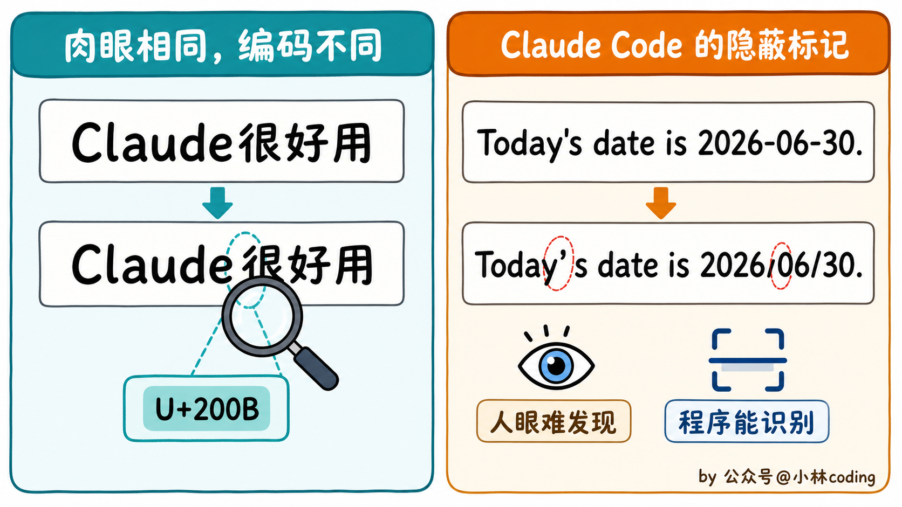
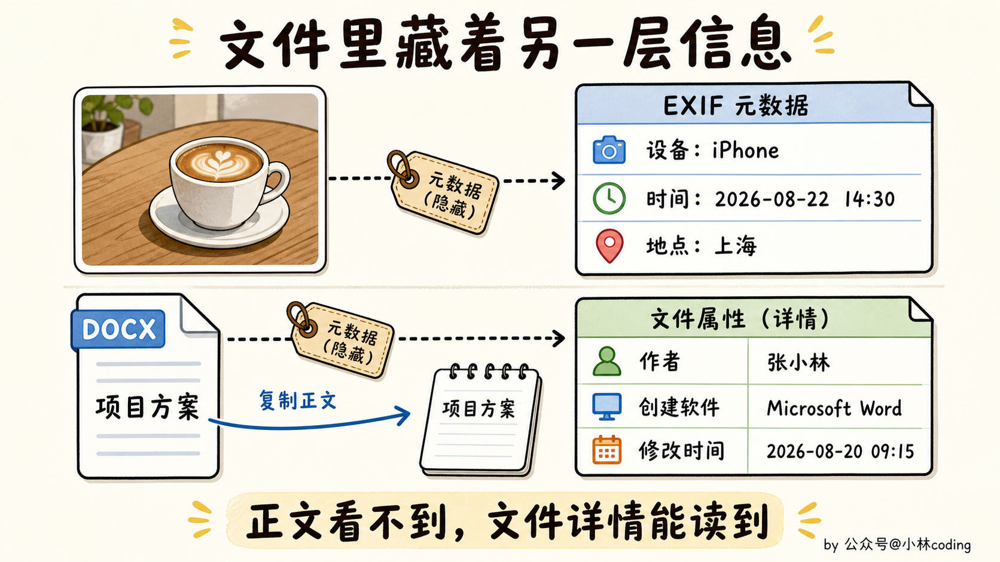
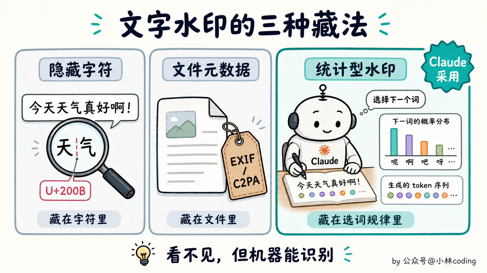
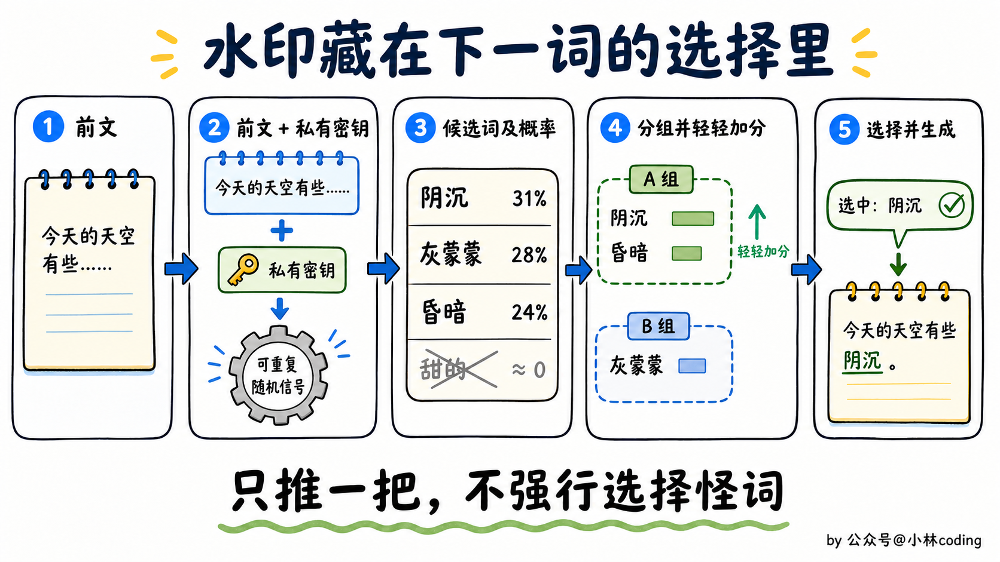
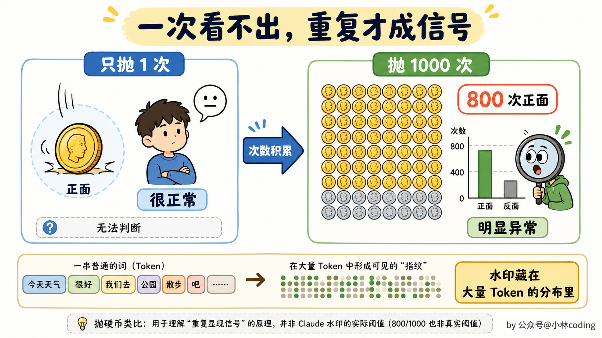
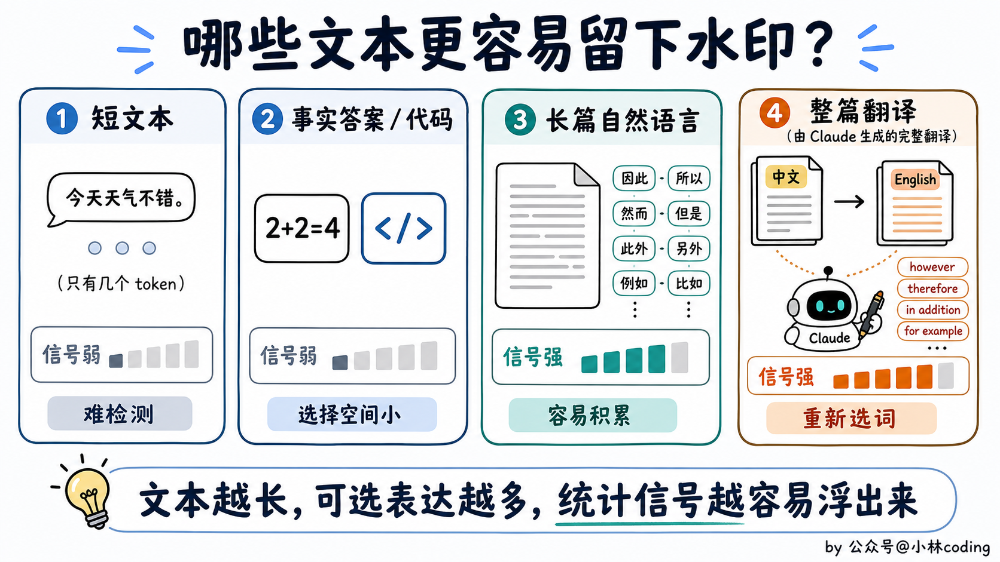
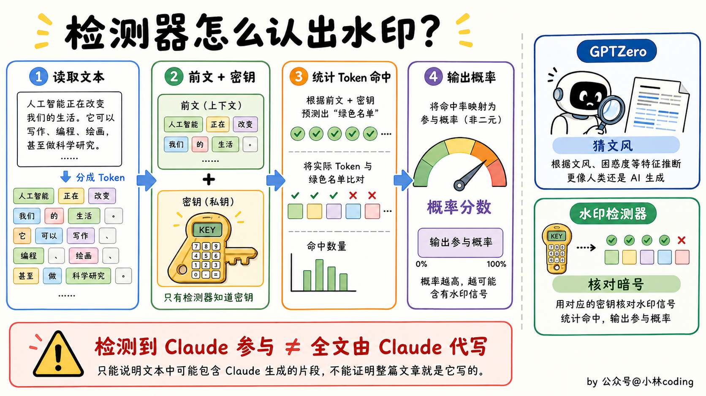
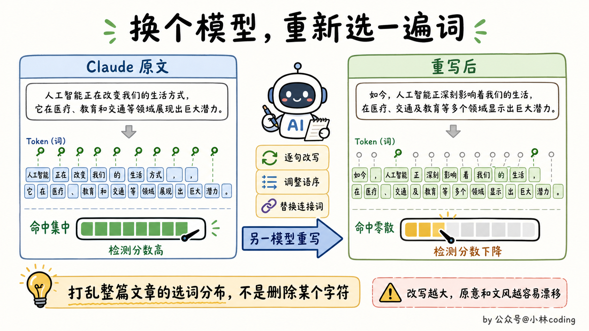
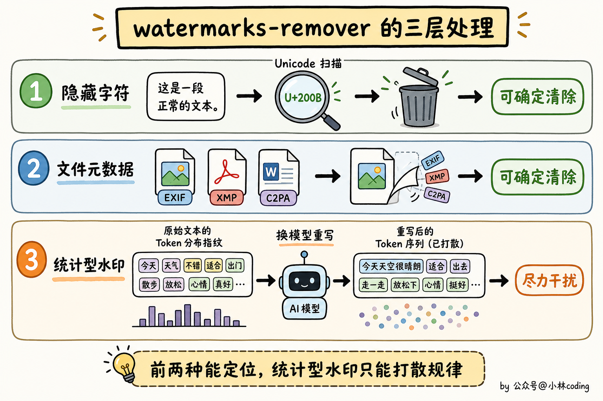

# Claude 文字水印原理图解：看不见的水印是怎么工作的？

> 原文：[Claude 文字水印原理图解：看不见的水印是怎么工作的？](https://xiaolinnote.com/claudecode/insights/claude-text-watermark.html) · 小林面试笔记


大家好，我是小林

最近 Claude 又摊上事了。

前几天，Anthropic 说要给 Claude 生成的文字加上一种看不见的水印。

这消息一出来，马上就有一波人不爽了。

你一个 AI 工具，大家花钱让你帮忙写点东西，结果你还要往文字里盖章，而且连个关闭按钮都没有，谁看了不别扭？

于是，有开发者直接做了一个去水印 Skill，名字也很直给，就叫 watermarks-remover。现在 GitHub 上已经有 1.6 万多个 Star 了。

看到这里，估计有同学就问了，一段文字又没有像素，Claude 到底把水印藏在哪里？这个去水印 Skill 又是怎么洗掉的？

我们顺着这件事往下挖。

## 文字也能加水印？

提到水印，你脑子里是不是会先出现图片角落那个半透明 Logo？

图片有像素，视频有画面，这些地方塞点东西很好理解。可一段纯文字，复制到记事本里干干净净，水印还能藏在哪里？

这里很容易混淆，因为大家嘴里的「文字水印」，可能说的是三种完全不同的东西。

最简单的一种，是隐藏字符。

比如零宽空格、特殊空白符、文字方向控制符。它们不占宽度，人眼看起来什么都没有，但程序检查 Unicode 编码时，能把这些字符一个个揪出来。

举个最简单的例子，下面两句话，你能看出区别吗？

```text
正常文本：Claude很好用
加了字符：Claude​很好用
```

大概率看不出来。

但第二句的「Claude」后面，其实藏了一个 `U+200B`，也就是零宽空格。它不占位置，打印出来没有形状，鼠标点过去也很难发现，可程序一扫编码，马上就能把它抓出来。

如果再约定 `U+200B` 代表 0，`U+200C` 代表 1，往一段话里塞几十个这样的字符，就能悄悄编码一串编号。读者看到的还是原文，机器看到的却是另一层信息。

对了，Claude Code 前阵子也被扒出过类似的玩法。部分版本会根据中转域名和系统时区，偷偷修改系统提示词里的日期。比如命中中国时区后：

```text
正常：Today's date is 2026-06-30.
标记后：Todayʹs date is 2026/06/30.
```

你肉眼看，只是横杠换成了斜杠，撇号也几乎没有区别。但程序一读 Unicode 编码，就能知道这次请求命中了什么环境。

这和前面的零宽字符是一个思路，都是把差异藏进正常文字里，让人不容易注意，机器却一眼就能认出来。



第二种是文件元数据。

这个东西其实我们天天都在碰，只是平时很少注意。

比如你用手机拍了一张咖啡，照片上只能看到桌子和咖啡杯。可你打开「照片详情」，下面可能还藏着另一份信息：

```text
拍摄设备：iPhone
拍摄时间：2026 年 8 月 22 日 14:30
拍摄地点：上海
```

这些内容并没有画在照片的像素里，它们被写进了图片的 EXIF 元数据。你把地点删掉，照片还是那张照片；你把照片裁掉一半，元数据也不一定跟着消失。

PDF、DOCX 也是一样。一份 Word 文档的正文里可能只有「项目方案」四个字，但文件属性里还能带着作者、创建软件、创建时间和最后修改时间。C2PA 更像一份详细的电子履历，可以记录文件由什么工具生成、后来又经过哪些处理。

所以，文件元数据更像贴在文件上的行李牌。你把原文件转发出去，行李牌可能跟着一起走；但你只复制正文，粘贴到记事本里，这些信息通常就留在原文件里了。



Claude 这次采用的是第三种，统计型文字水印。

它不往文章里增加字符，也不会给文件塞一个用户编号。它动的是模型选择 Token 时的那一点随机性。

简单来说，水印藏在 Claude 的「选词习惯」里。



## Claude 怎么把水印塞进选词里？

我们先看大模型平时怎么写出下一个词。

假设 Claude 已经写到这里：

> 今天的天空看起来有些……

接下来它会计算一堆候选 Token 的概率。为了方便理解，我们假设结果是这样：

- 「阴沉」为 31%
- 「灰蒙蒙」为 28%
- 「昏暗」为 24%
- 「甜的」接近 0%

Claude 肯定不会选「甜的」，因为上下文根本接不上。但「阴沉」「灰蒙蒙」「昏暗」都说得通，换掉其中一个，也不会改变整句话的意思。

那它每次都选概率最高的「阴沉」吗？

也不一定。

如果模型永远只选第一名，同一个问题的回答会变得很死。所以在几个合理候选里，模型通常会保留一点随机性。你用同一句 Prompt 问两次，拿到的措辞不完全相同，就是因为这个过程里存在采样。

水印盯上的就是这点空间。

没有水印时，模型用普通的随机过程挑选下一个 Token。加入水印后，Claude 会把前面的文本和一把私有密钥结合起来，生成一个可重复验证的随机信号，再用它影响这一次选择。

你可以把候选词想象成临时分成了两组。水印机制给其中一组轻轻加一点分，让 Claude 更容易从这一组里选词。

注意，只是轻轻推一下。

它不会为了盖章，突然把「阴沉」换成一个人类几乎不用的生僻词。遇到只有一个正确答案的地方，它也没多少操作空间。

这也是 Anthropic 敢说水印不会明显影响质量的原因。读者看到的每个词都正常，意思也没变。

当然，上面的分组只是帮助理解的简化版本。Anthropic 官方披露的是，它使用了 Google DeepMind 发表的 SynthID-Text 方案的一个版本，实际算法比「给候选词分组」复杂得多，但设计思路是一致的。

模型在多个合理候选之间做选择时，密钥悄悄改变随机性的来源。



看到这里，你可能会发现一个问题。

如果 Claude 只在某个地方选了一次「阴沉」，检测器怎么知道这是水印，还是普通随机结果？

答案是，它不知道。

一次选词说明不了任何问题，水印要靠数量积累。

这就像抛硬币。抛一次出现正面很正常，连续抛一千次，其中八百次都是正面，你就很难继续解释成运气。

一篇长文章里，模型会做成百上千次 Token 选择。如果这些选择反复吻合某把密钥制造出来的统计规律，隐藏的指纹才会慢慢浮出来。

所以，文字水印不藏在某一个词里，它藏在大量词语共同形成的分布里。



## 检测器怎么认出它？

假设 Anthropic 拿到一段待检测文本，它会沿着这段文字重新走一遍。

检测器读取前文，再结合私有密钥，计算每个位置原本对应的选择规律。随后，它检查实际出现的 Token，有多少次吻合这套规律。

吻合得越多，Claude 参与生成的概率就越高。

这里有个很重要的边界。

检测器给不出「这篇文章百分之百由 Claude 写成」这种结论。它能回答的是，这段文字在多大程度上符合 Claude 水印的统计特征。

样本越短，检测越难。事实性内容和代码也更难留下水印，因为正确选项往往很少。比如模型已经写出「2+2=」，它总不能为了水印把答案写成 5。

代码注释、说明文档和自然语言就不同了。同一个意思有很多种写法，水印能活动的空间更大。

翻译也是一个典型场景。哪怕原文是你写的，只要整篇译文由 Claude 重新选词，里面就可能积累出足够强的水印信号。



对了，这套检测和我们熟悉的 AI 文风检测器不是一回事。

GPTZero 这类工具会分析措辞、句式和文本分布，猜测一段话像不像 AI。水印检测器查的是模型主动植入的信号，而且需要对应密钥。

一个在猜文风，一个在核对暗号。



## 这个去水印 Skill 到底干了什么？

原理讲到这里，我们再回头看 watermarks-remover 这个 Skill，就容易判断多了。

这个 Skill 把去水印分成了几层。

隐藏 Unicode 字符最好处理。程序逐个检查编码，发现零宽字符、异常空格或者方向控制符，直接删掉。这部分可以确定性完成。

图片、PDF、DOCX 里的 C2PA、EXIF、XMP 也有明确位置。工具找到对应元数据，再从文件结构中剥离。

真正麻烦的是 Claude 的统计型水印。

你没法打开文章，指着某个词说「水印就在这里」。单个词都很正常，问题出在整篇文章的选择规律上。

这个 Skill 给出的方案有点粗暴，也很聪明。

它让另一个模型把文章重新写一遍，通过逐句改写、调整语序、替换连接词，打散原来的 Token 分布。原文如果来自 Claude，最好别再交给 Claude 重写，否则刚洗完一遍，又可能盖上一枚新的 Claude 水印。

这个 Skill 的思路说穿了就一句话。

你不是把水印藏在选词规律里吗？那我就换一个模型，把整篇文章重新选一遍词。

有点莽，但确实对路。



改写范围越大，Claude 原来的选词规律就越容易被打散，代价也越大。文章的语气可能变了，细节可能丢了，技术含义甚至也可能被改偏。你本来只想洗个水印，洗着洗着，自己的味道也被冲淡了。

最后能洗多干净，还得等 Anthropic 把官方检测 API 亮出来，开源社区再接着出招。



## 写到最后

有意思的地方来了。

统计型文字水印并不是 Anthropic 首创，OpenAI 很早就做出来了。

只不过，这套方案能扛住局部改写，却很难扛住全文翻译或者换个模型重写。误报也麻烦，放到互联网上的海量文本里，哪怕概率很低，也可能误伤一批人。

OpenAI 自己还调研过，接近 30% 的用户表示，如果 ChatGPT 加水印而竞争对手不加，他们会减少使用 ChatGPT。

说人话就是：

> 只要 ChatGPT 敢加水印，我就跑去对家模型。

所以 OpenAI 一直没上，结果好家伙，A 社头铁，先发为敬。

Anthropic 的理由是欧盟法规，再加上很难稳定判断用户在哪，干脆准备全球一起上。

我能理解监管为什么想要机器可读标记。AI 内容越来越多，平台确实需要一种溯源方式。

但站在创作者这边，我还是会觉得别扭。

如果一篇文章的研究、观点和初稿都由你完成，只让 Claude 帮忙润色，检测器最后说「Claude 参与过」，别人会耐心区分「参与」和「代写」吗？

技术上，这两个概念差得很远。

现实里，它们可能只差一个标签。

参考资料：

- Anthropic：[How Claude’s text watermark works](https://www.anthropic.com/news/claude-text-watermark)
- GitHub：[watermarks-remover](https://github.com/guillaumemeyer/watermarks-remover)
- Claude Code GitHub Issue：[Undocumented, endpoint- and timezone-dependent variation in the system-prompt date line](https://github.com/anthropics/claude-code/issues/67120)
- OpenAI：[Understanding the source of what we see and hear online](https://openai.com/index/understanding-the-source-of-what-we-see-and-hear-online/)
- The Verge：[OpenAI won’t watermark ChatGPT text because its users could get caught](https://www.theverge.com/2024/8/4/24213268/openai-chatgpt-text-watermark-cheat-detection-tool)
- Google DeepMind：[Scalable watermarking for identifying large language model outputs](https://www.nature.com/articles/s41586-024-08025-4)
