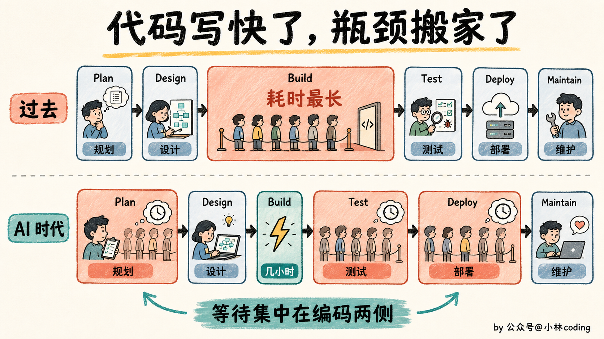
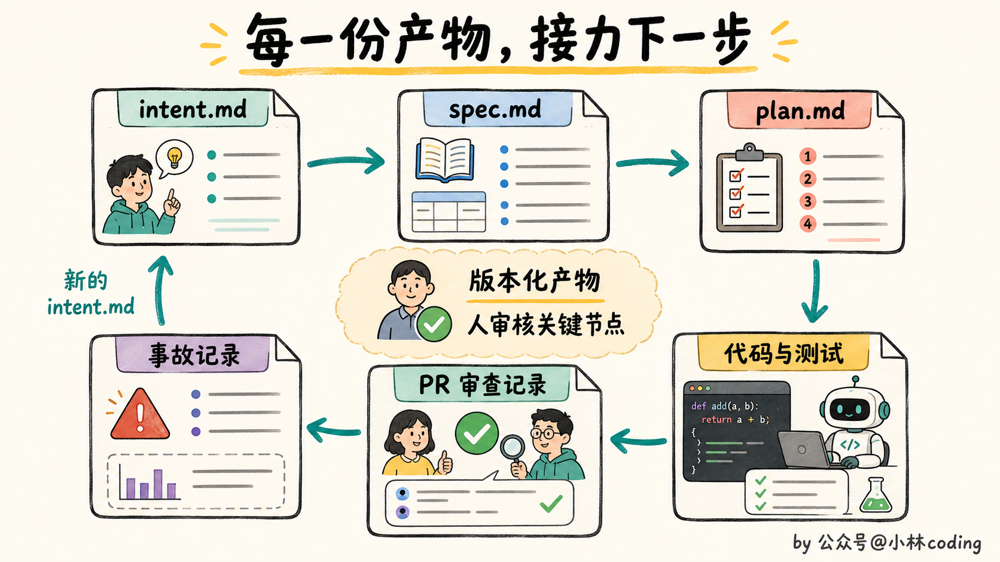
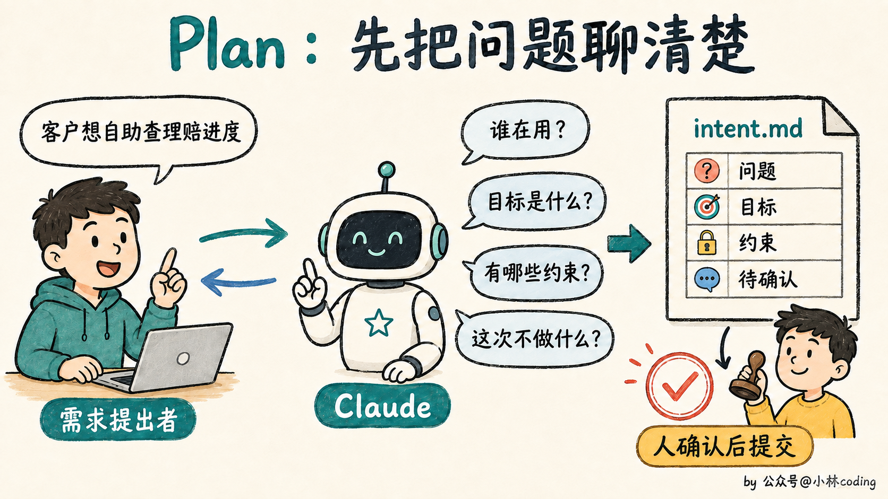
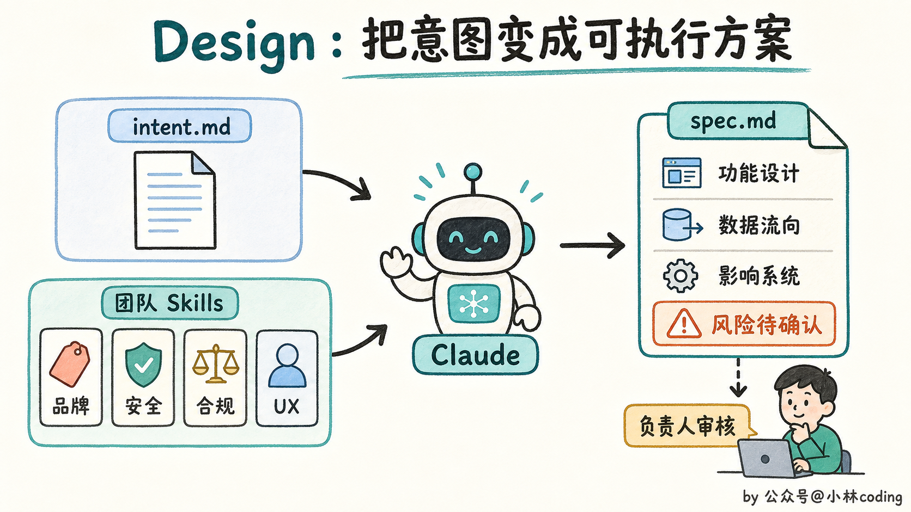
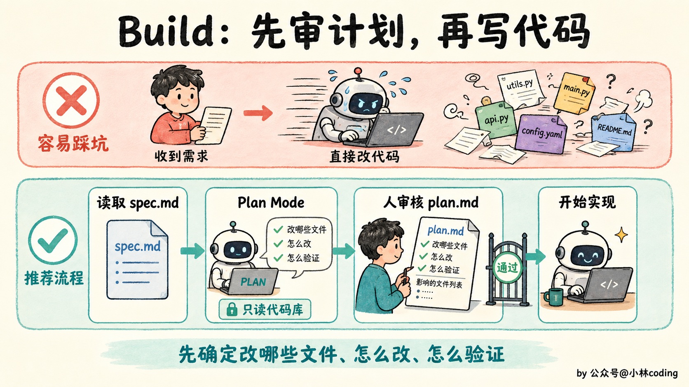
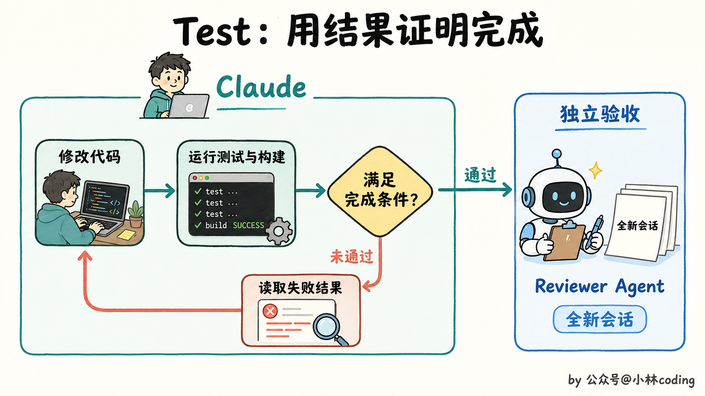
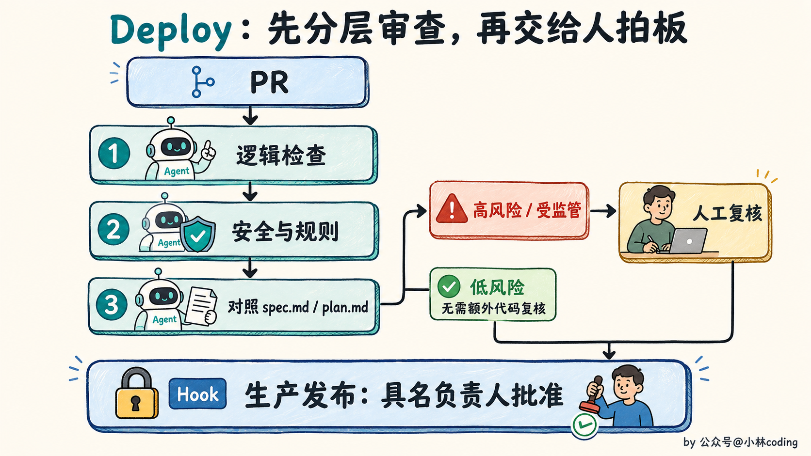
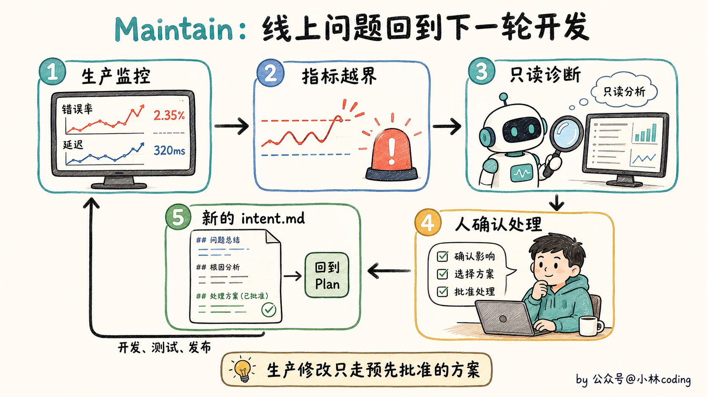
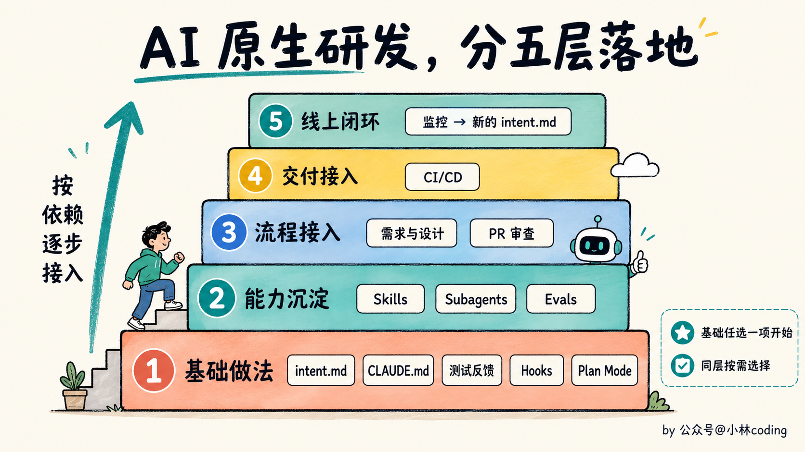

# AI 原生研发流程图解：从需求到上线，Claude Code 怎么参与六个阶段？

> 原文：[AI 原生研发流程图解：从需求到上线，Claude Code 怎么参与六个阶段？](https://xiaolinnote.com/claudecode/playbook/anthropic_ai_native_sdlc.html) · 小林面试笔记

大家好，我是小林。

最近，Anthropic 发布了一篇博客《The AI-Native SDLC Playbook》，翻译过来就是「AI 原生软件开发生命周期手册」。

这个手册专门讲 AI 进入软件开发以后，整个研发流程该怎么改。

目前 Anthropic 内部大约 80% 的合入代码，已经由 Claude 编写。过去需要几天完成的代码，可能几个小时就生成出来了。

但需求、评审、测试和发布，还在按照原来的速度运行。

AI 半天写完代码，接下来等一天需求确认、两天 Code Review、两天测试排期，最后再等发布窗口。代码生成速度上去了，产品交付并没有跟着快多少。

你看，AI 只是把中间的编码阶段压缩了，前后那一大串流程并没有消失。

Anthropic 认为，团队接下来得把规划、设计、构建、测试、部署和维护这六个阶段，都按照 AI 的能力重新设计，才能适应 AI 时代下的软件开发。

## 01｜代码写快以后，旧流程为什么卡住了？

那为什么代码一变快，原来的流程就开始卡住了？

因为传统的软件开发流程，一直围绕一个前提设计，写代码最耗时间，也最贵。

产品经理收集需求，架构师设计方案，工程师负责实现，再交给测试、发布和运维团队。每个角色负责一段，工作通过文档、工单和审批向下传递。

以前一个功能要开发几周甚至几个月，团队花几天开需求会、做安全评审和排发布窗口，也能接受。

现在 AI 把 Build 阶段压缩到几小时，原来的平衡一下就被打破了。

规划、审查和部署仍然按照人的速度运行，新的瓶颈就堵在了编码阶段的两边，过去的管控方式也开始跟不上代码产量。

人写代码的时候，Reviewer 还能逐行检查。Agent 一次生成几十个文件以后，安全团队和 Reviewer 的人数并没有增加，审查队列只会越积越长。

接下来会发生什么？要么代码一直排队等审查，要么团队为了赶进度，让没有充分检查的代码上线。对有安全和合规要求的公司来说，这两条路都走不通。

Anthropic 给出的方案，是让 AI 进入整个软件开发生命周期，并把人留在需要判断和授权的关键节点。

## 02｜AI Native 到底改了什么？

那 Anthropic 准备怎么改造这套软件开发流程？

传统的软件开发生命周期像一条单向流水线。产品把需求交给设计，设计再交给开发，开发完成后交给测试和发布。

Anthropic 把这条流水线改成了一个 Loop。

每个阶段结束时，团队都提交一份版本化的产物，下一阶段直接读取这份产物继续工作。

规划阶段产出 `intent.md`，设计阶段产出 `spec.md`，构建前产出 `plan.md`。后面还有代码和测试、带审查记录的 PR，以及线上事故记录。

这些文件既能给人看，也能让 AI 接着执行。一份通过审核的 `intent.md` 可以触发设计，一份获批的 `spec.md` 可以触发计划模式，合并后的 PR 可以触发 CI/CD。线上指标越界以后，维护阶段又会生成新的 `intent.md`。

刚开始时，团队还是手动提示 Claude 执行每一步。等流程跑顺以后，再让前一个阶段的产物自动触发下一个阶段。

Git 提交历史也会成为审计记录。谁提出了需求，Claude 生成了什么，谁批准了方案，都能从版本记录里查回来。

讲到这里，你大概能看出人的位置怎么变了。AI 负责把流程往下推进，人集中审核那些需要判断力的决定。

## 03｜六个阶段具体怎么跑？

Anthropic 把整套方法分成 Plan、Design、Build、Test、Deploy 和 Maintain 六个阶段。

### 1. Plan，怎么把一个想法变成 intent.md ？

过去一个人有了产品想法，通常先写工单，再找产品经理开会补用户故事和验收标准。现在他可以先用自己的话和 Claude 讨论，不用一上来就憋一份格式完整的需求文档。

Claude 会像分析师一样追问，问题影响谁、希望达到什么结果、有哪些限制、这次明确不做什么。提出者把自己知道的讲清楚，不确定的地方可以先留着。

讨论清楚以后，Claude 按照团队模板生成一份 `intent.md`。提出者负责纠正理解偏差，产品负责人确认后，再把文件提交到版本控制里。

官方给出的例子，是让保险客户在门户里查看理赔状态。`intent.md` 会写清当前问题、期望结果、受影响的系统、数据限制和待确认的问题。

看到这里你可能会觉得，这不就是让 AI 帮忙写 PRD 吗？

区别在于，最初提出问题的人把原始意图直接留在文件里，工程团队不用经过几轮转述，再去猜他一开始到底想解决什么。

### 2. Design，怎么把意图变成 spec.md ？

有了 `intent.md`，能不能马上写代码？还不行。

Claude 会读取前面的 `intent.md`，再加载团队已经整理好的品牌、安全、合规和用户体验 Skills，生成一份 `spec.md`。

这份文件写清功能怎么工作、数据怎样流动、会影响哪些系统。产品负责人检查方案有没有解决原来的问题，再把疑点交给安全、合规或技术负责人处理。

以前需求分析和技术设计由不同角色接力完成，安全、合规问题往往到了评审会上才被发现。Anthropic 想把这个时间点往前挪，能提前发现的问题，就别拖到代码写完以后再返工。

### 3. Build，为什么一定要先做计划？

到了 Build 阶段，Anthropic 的态度很明确，先别急着改代码。工程师把 `intent.md` 和 `spec.md` 交给 Claude Code，然后进入 Plan Mode。

Claude 先读代码库，列出准备修改哪些文件、按什么顺序实现、可能影响什么，以及要运行哪些测试。在工程师接受计划之前，它不能直接修改代码。

工程师还要接着追问，最容易出问题的是哪一步，有没有考虑其他方案，这次改动可能破坏哪些已有功能。计划改到足够清楚以后，再保存为 `plan.md` 并让 Claude 开工。

`CLAUDE.md` 记录构建和测试命令、目录职责、代码约定，以及 Claude 经常犯的错误。官方建议把它控制在一页以内，避免无关信息一直占用上下文。

某类工作有固定做法，就整理成 Skill。需要强制执行的红线，比如禁止读取密钥或修改受保护文件，则交给 Hook 拦截。

任务太复杂时，还可以继续拆给 Subagent。不同任务放进独立的 Git worktree，几个 Claude Code 会话就能同时工作，又不会挤在一起修改同一份文件。

### 4. Test，怎么证明 AI 真的做完了？

代码生成出来，只能说明 Claude 写完了文件，不能证明功能可以运行。

我觉得 Test 阶段最容易踩的坑，就藏在 Claude 的一句话里，「已经完成」。

Anthropic 的处理方式很直接，别听它怎么说，看它能不能拿出结果。

Test 阶段要给 Agent 建立完整的反馈循环。Claude 自己运行测试和构建，读取失败结果，修改代码，然后再次验证，直到满足计划里约定的完成条件。

最后再开一个新的会话，只负责复核结果。这个会话没有参与前面的实现，更容易发现原会话一直忽略的问题。

只验证这一次还不够。Anthropic 还建议团队建立 Evals，也就是一套固定的 Agent 评测任务。

每次更换模型，或者修改 `CLAUDE.md`、Skill 和 Hook，都重新运行这些任务。如果通过率下降，说明这次配置调整带来了退步。线上发生过的问题，也要加入 Evals，变成以后长期运行的回归测试。

### 5. Deploy，AI 可以走到哪一步？

测试都通过以后，能不能让 AI 一路自动发布到生产环境？

Anthropic 的答案是，可以让它走到生产闸门前，但不能让它自己跨过去。

到了 Deploy 阶段，Claude 会同时扮演 PR 作者和 Reviewer。它按照团队规则检查逻辑与安全问题，再对照 `spec.md` 和 `plan.md`，确认实现有没有跑偏。

低风险改动可以经过多层 Agent 审查，高风险和受监管的代码继续交给人复核。

PR 通过以后，Claude 可以进入 CI/CD，完成构建、测试和不同环境的部署准备。开发环境可以多放一些权限，到了生产环境，规则就得收紧。

但生产环境必须保留最后一道闸门。Agent 可以完成上线之前的所有工作，真正执行发布时，Hook 会拦住命令，等待一位具名负责人批准。

### 6. Maintain，怎么让线上问题回到开发流程？

代码上线，流程就结束了吗？

在 Anthropic 这套方法里，上线只是下一轮循环的起点。Agent 还会继续监控错误率、延迟和其他生产指标。

指标超过预设阈值后，Agent 开始做只读诊断，整理可能的原因和修复建议。涉及回滚或生产修改的动作，只能使用团队提前批准和演练过的方案。

工程师确认处理结果后，团队把这次线上问题写成新的 `intent.md`，重新回到 Plan 阶段。

到这里，一整套 Loop 才算闭合。Maintain 不是挂在末尾的一段运维工作，它会把线上发生的事情重新送回 Plan。

## 04｜这套流程该按什么顺序落地？

上面六个阶段是一个需求的执行顺序，但团队落地时不需要从 Plan 一路改到 Maintain。

Anthropic 在博客里给了一张依赖关系图，告诉团队哪些做法可以直接开始，哪些需要先搭好前面的能力。

看到这里可能有同学已经有点头大了。`intent.md`、Skills、Hooks、Subagent、Evals、CI/CD，这么多东西，难道要一次全部配齐？

不用。第一层只有五个可以直接开始的做法。

需求经常走样，就先使用 `intent.md`；Claude 经常重复犯错，就维护 `CLAUDE.md`；AI 做完后拿不出证据，就建立测试反馈循环；担心高风险操作失控，就加 Hook；Claude 一收到任务就改太多文件，就先强制使用 Plan Mode。

这些做法没有复杂的前置条件。你现在最卡哪一步，就先补哪一块。

等基础流程跑顺以后，团队再把成熟经验整理成 Skills，把重复任务交给 Subagent，并用 Evals 检查配置和模型升级有没有带来退步。

下一步可以让 AI 接入需求设计和 PR 审查，再往后接入 CI/CD。最后才是线上监控，让生产异常自动进入下一轮开发。

每个团队遇到的瓶颈不同，需求最慢就先改 Plan，审查队列最严重就先改 Deploy。坦白讲，我觉得这一点比完整的六阶段流程图更重要。AI Native 更像一张改造地图，告诉你眼前这个堵点可以从哪里下手。

## 最后

最近我同时用多个 AI 推进任务时，发现了一个挺残酷的事实。

阻碍生产效率的，竟然开始变成我自己。

几个 Agent 可以同时干活，代码一批接一批地生成出来。可人的脑子没法并行扩容，每份修改为什么这么做、会影响哪里、测试结果能不能信，都得一份一份看。

你可以一口气开五个 AI，却没法同时认真审完五份代码。一天能理解多少改动、发现多少风险、做出多少合并决定，都是有上限的。

那 Anthropic 这套 AI 原生软件开发流程，是怎么处理这个问题的？

Anthropic 的解法，是让 AI 先过滤信息，尽量减少必须交给人处理的内容。

在代码生成前，人先审核 `intent.md`、`spec.md` 和 `plan.md`，趁内容还少的时候把方向定住。

代码生成以后，测试、固定评测和多层 Agent 审查先过滤机械问题。

到了最后，人主要判断需求有没有跑偏、风险能不能接受、代码能不能进入生产环境。

人的注意力仍然有限，但不用再平均分给每一行代码，而是集中在少数几个需要拍板的位置。

如果你看完想动手试试，我的建议是从最小的一步开始，给你的项目写一份 `CLAUDE.md`。写清楚怎么构建、怎么测试、哪里不能碰，然后把 AI 重复犯过的错一条条补进去。

这份文件，就是你的团队开始有「流程」的第一天。

参考资料：

- Anthropic，《The AI-Native SDLC Playbook》：[https://claude.com/blog/the-ai-native-sdlc-playbook](https://claude.com/blog/the-ai-native-sdlc-playbook)
- Anthropic，《How Anthropic secures its AI-native software development lifecycle》：[https://claude.com/blog/how-anthropic-secures-its-ai-native-software-development-lifecycle](https://claude.com/blog/how-anthropic-secures-its-ai-native-software-development-lifecycle)
