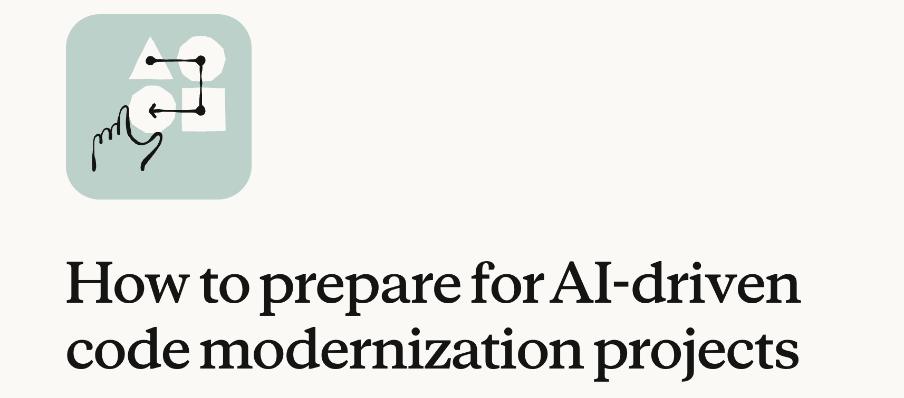
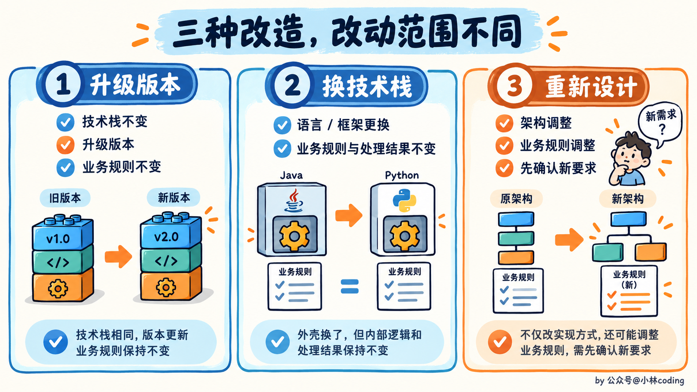
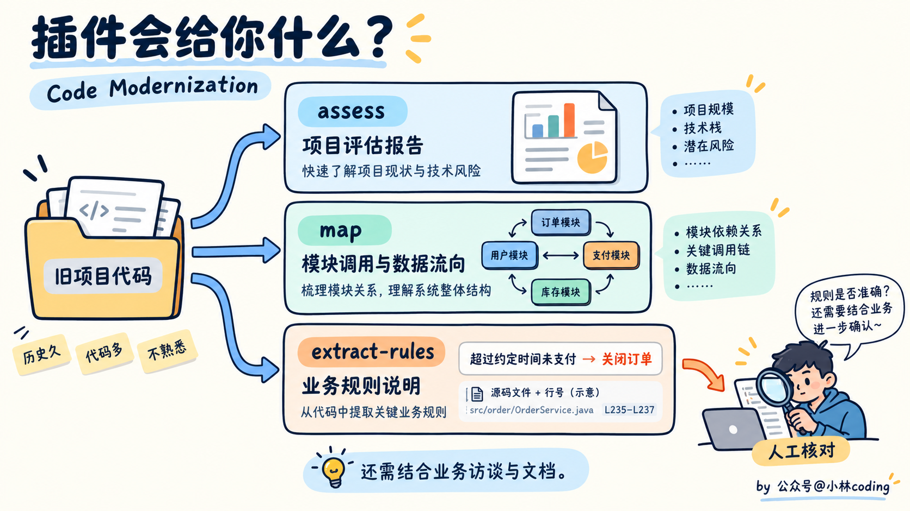
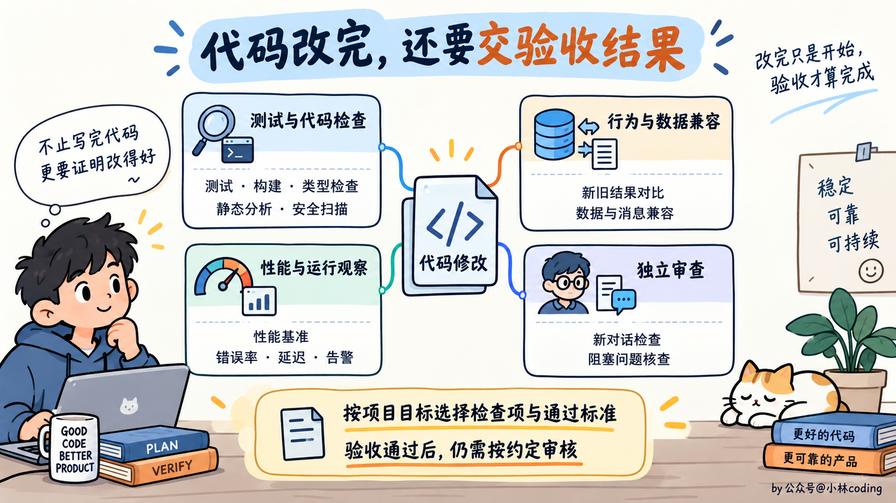
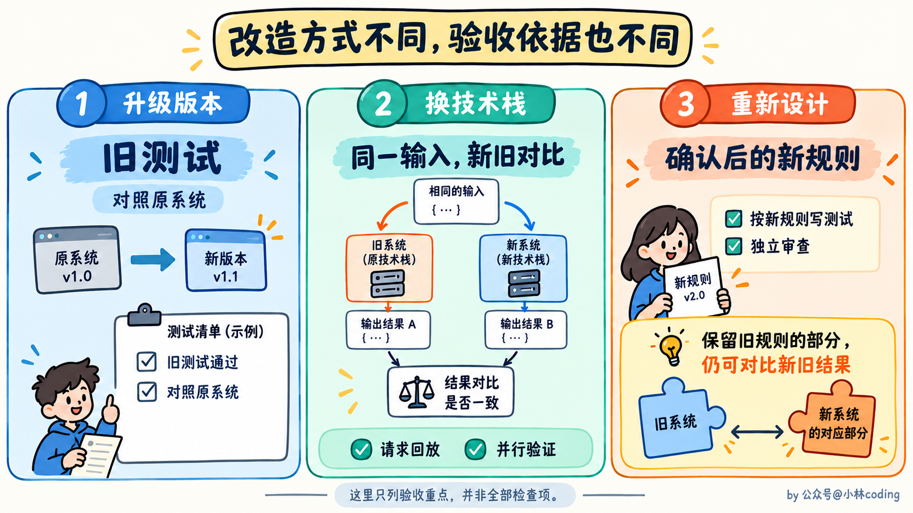
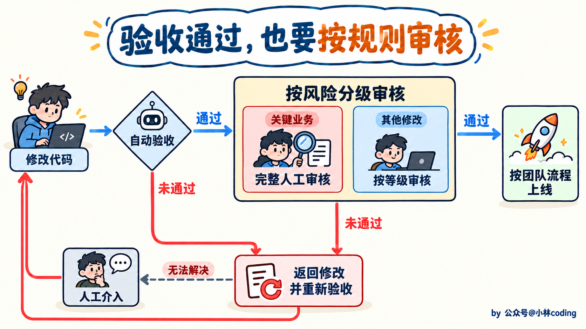
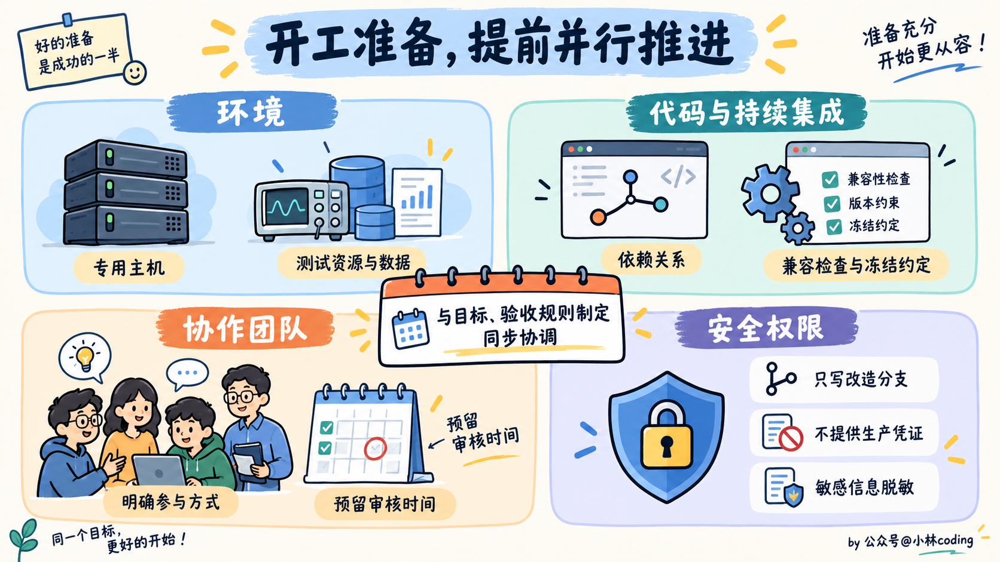
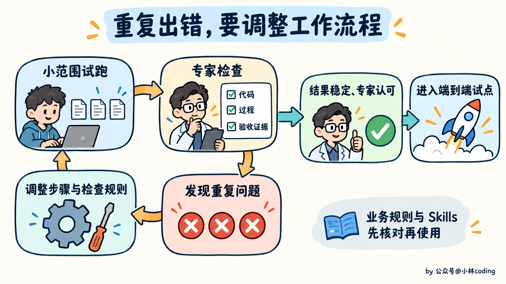
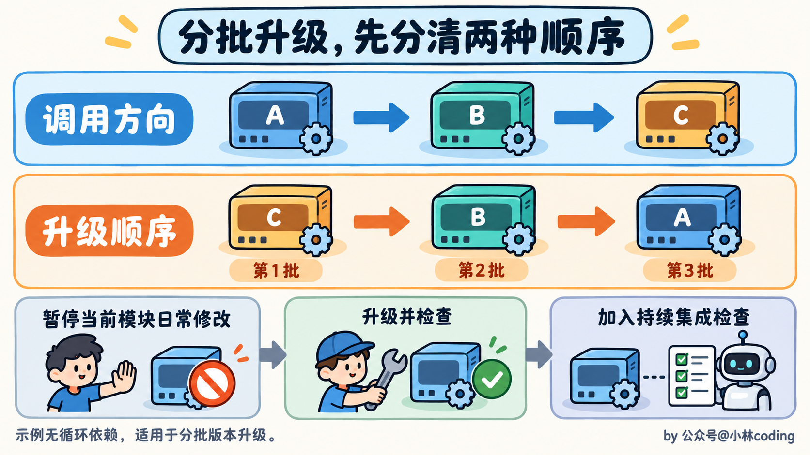
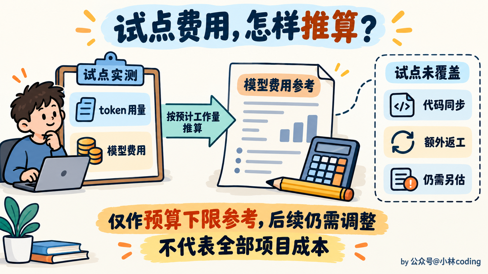

# Claude Code 老项目改造指南：怎样让 AI 稳妥地升级旧系统？

> 原文：[Claude Code 老项目改造指南：怎样让 AI 稳妥地升级旧系统？](https://xiaolinnote.com/claudecode/playbook/claude_code_modernization.html) · 小林面试笔记

大家好，我是小林。

最近看到 Anthropic 官方博客发了一篇《How to prepare for AI-driven code modernization projects》，聊的是用 AI 改造老项目之前，需要做好哪些准备，也分享了推进大型系统改造时积累的经验。

做过老项目的同学应该都有体会，有些代码早就想改了，可真要动手，心里又没底。一个看着不起眼的判断，可能藏着多年前定下的业务规则，改完会影响哪些功能，连团队里的老同事都未必说得清。

现在 AI 越来越能写代码了，你可能也动过这个念头，那个一直不敢动的老项目，是不是终于可以升级了？

但写得出来，改得对不对，还是得有人确认。Agent 一下交来一堆修改，谁来验、谁来审，最后谁点上线？代码可以批量生成，负责审核的同事可不会跟着批量出现。

所以，真要把 AI 用进老项目，先得把这六步准备好。

## 一、旧系统到底要改成什么？

假设团队开会，说要改造老项目。负责线上稳定性的同学希望换掉旧技术栈，业务逻辑尽量别动。维护代码的同学想顺手还掉技术债，业务方一听，都重做了，那顺便加几个需求呗。

好家伙，代码还没动，需求先升级了。

这几种想法都有道理，但不能只靠一句「大家都同意改造」就开工。你想保留原来的处理结果，我想把旧规则也换掉，等 AI 交卷了，这份代码到底算改对了还是改错了？

先分清楚，这次要做的是哪一种改造。

- **升级版本**。技术栈还合适，只是版本落后了，比如 C++11 升到 C++20。目标要写清运行时版本和依赖包。
- **换技术栈**。比如 COBOL 迁到 Java，换掉技术栈，但让系统继续按原来的业务规则处理请求。要用什么语言、框架，代码按什么架构组织，都得提前定好。
- **重新设计**。架构和处理业务的规则一起调整。除了技术要求，还得写清新系统应该怎样处理业务，并和使用方确认。

那老系统现在到底在干什么，谁说得清？有些逻辑跑了十几年，文档早就跟不上了。

Anthropic 提供了一个叫 Code Modernization 的 Claude Code 插件，中文可以理解为「代码现代化」。名字有点绕，说白了，就是一套专门用来改造老项目的工作流程，帮 Claude 按步骤分析旧代码、整理改造方案，再协助升级或重写。这里先用它来摸清项目现状。

具体能拿到什么？比如项目用了哪些语言、代码有多复杂、积累了哪些技术债，可以让它整理成评估报告，这对应 `assess`。哪些模块互相调用、数据经过了哪些地方，可以让它画成关系图，这对应 `map`。你就不用只盯着一堆目录和文件名猜，系统到底是怎么跑起来的。

还有 `extract-rules`，负责把藏在代码里的业务规则整理成说明。举个例子，假设老代码里写着「订单超过一定时间未支付就自动关闭」，Claude 就可以把触发条件和处理动作提取出来，旁边标上对应文件和行号。你拿着这份说明，就能回到代码里核对，判断这条规则升级后要不要保留。

Claude 把代码看完，就算摸清整个系统了吗？先别急。业务同事平时怎么用、开发者记得哪些历史约定，还得找人问，再结合内部文档补充。否则你看着像没用的老逻辑，说不定还有人在依赖。把这些确认好，再决定哪些保留、哪些修改、哪些删掉。

聊到这里，团队里可能还会有人问，系统不是跑得好好的吗，为什么非要折腾？

这个顾虑得回答。旧运行时停止支持、漏洞没法修、懂这套系统的人越来越少，继续拖着也有代价。很多项目改造最重要的收益，就是降低这些风险。后面讨论预算和上线风险时，别只算「改了可能出什么事」，也算算「一直不改会怎样」。

而且，立项时就要把改造理由和目标讲给管理层、系统负责人，以及依赖这套系统的团队听。大家认可目标，也愿意投入人力和资源，后面讨论预算、排期和风险取舍才有依据。光说一句「支持」，真需要人时却一个都抽不出来，项目还是推不动。

## 二、AI 改完了，怎么证明改对了？

Claude 说「已完成」，你敢直接合并吗？尤其是改了一大片文件以后，光看一句「所有任务已完成」，心里还是没底吧。总得知道它检查过什么。

这就需要提前列出一组**验收条件**，再让每份修改带上测试结果、检查报告等通过验收的证据。条件要能自动检查，Agent 才能反复修改、验证，实在过不了再交给人处理。

先看最直接的，原有测试和新增测试过了吗？覆盖率、性能达标了吗？编译、类型检查、静态分析和安全扫描有没有新增问题？这些都可以按项目目标放进验收要求里。

不过，「达标」得提前说具体。覆盖率至少多少，性能允许在什么范围内波动，都要先约定好。别等结果出来了，一个觉得「这点变化没关系」，另一个觉得「这怎么能上线」。

还可以把同一批输入交给新旧系统，比较输出，再检查两个版本能不能读懂彼此保存的数据、发出的消息。比如新版本保存的数据，旧版本还能不能正常读取，字段有没有丢失或变了含义。

也可以让修改后的系统在预发布环境跑一段约定的时间，观察错误率有没有升高、响应有没有变慢、告警有没有增多。有界面的系统，还可以让 Claude 操作界面，检查原来能用的功能有没有被改坏。

审查代码时，可以让 Claude 在新的对话里独立检查，只提供审查所需的代码、要求和资料，查找必须修复才能上线的问题。如果继续沿用写代码时的对话，Claude 可能顺着之前的思路判断，把当时没考虑到的问题又漏过去。

看到这里，有同学可能会问，原来的测试全通过，不就够了吗？

这得看你改的是什么。单纯升级版本，旧测试可以作为验收的核心。换了语言和框架，旧测试往往没法直接跑，就更需要对比新旧系统的处理结果。

比如把线上记录下来的请求，再交给新系统处理，这就是请求回放。也可以让旧系统继续提供服务，新系统在旁边处理同样的输入，观察两边的结果有没有差异。

如果连业务规则也改了，就得先写清楚新系统遇到什么情况该怎样处理，和使用方确认后，再据此写测试。还要让 Claude 在独立的一轮审查里检查修改是否符合这些要求。仍按旧规则处理的部分，可以继续对比新旧系统。这个场景更难，因为文字说明可能有歧义，依赖模型判断的地方也更多，发现说明有缺口就要补，并同步调整验收条件。

不过，验收条件也别自己关起门来定。把开发者、使用方和业务负责人拉进来，拿着准备检查的项目问一句，真都通过了，你愿不愿意合并？

如果大家还是不放心，就接着问，究竟还缺哪项检查。总比 AI 全改完了，审核的人才说「这些结果我不认」要好。

那老项目连测试都没几条，怎么办？有些测试还时过时不过，监控也不齐，确实不能直接拿来放心验收。可以先让 Claude 补测试、搭请求回放工具，或者准备好对比新旧系统的环境，再推进后面的改造。

## 三、代码改得这么快，人怎么审得过来？

验收通过以后，修改怎样进入生产环境？谁来审、审到什么程度、满足哪些要求才能上线，也要事先约定。

如果每份修改都要人逐行看，Agent 交得越快，待审的代码就可能堆得越多。你以为终于不用熬夜写了，结果晚上还在熬夜审。

这就得提前分级。先看修改会影响哪些功能，再结合测试结果、审查发现，以及 Agent 标出的不确定之处，决定需要多深的人工审核。有现成的风险分类就沿用，**涉及支付、账务等关键业务流程，仍然要完整地人工检查**。

那最懂这套老系统的同学，是不是等最后来把关就行？最好早点请进来。

让他们先看看样例，哪些检查结果最有用，报告怎么排才好查，提前说清楚。后面审核时，他们就能直接找到高风险修改和 Agent 标出的疑点，不必先在大段代码里找重点。

专家认可了这些样例和检查结果，团队才多了一份依据，判断哪些把握较大的修改可以减少人工审核。少审到什么程度，仍然按提前约定的规则来，关键业务流程的完整审核也要保留。

如果同一种问题反复出现，也要回头修工作流或验收规则。否则专家每天都在纠正同一个错误，Agent 再快也省不下多少工夫。

审核要多细，还和时间要求有关。运行时马上停止支持，和有充足时间慢慢迁移，是两种处境。想加快上线，就得把因此接受的额外风险提前说清楚。

不过，让一个人少审一点、快点批准，他可能马上就会问，出了问题谁负责？这个问题不能用一句「相信 AI」糊弄过去。

在受监管的企业里，审核深度和风险取舍最好由管理层牵头确定，按已有的变更管理流程执行。不能大家都想提速，最后让点批准的人独自背锅。前提也得守住，验收证据足够扎实，审核的人看得懂 Claude 为什么这样改、做过哪些检查。

## 四、开工前，还要准备什么？

前面的事情商量好了，现在可以让 Agent 开跑了吧？

先看看，它有地方跑吗，能拿到测试数据吗，需要审核的人有时间吗？这些往往得找其他团队协调。Agent 可以随叫随到，同事的排期可不行，所以前面几步还没做完时，就可以开始准备了。

先给 Agent 准备一台专用远程主机，让 Claude 能访问代码和相关资料，再按验收要求配好测试资源、线上监控数据、用于回放的请求记录，或让新旧系统同时运行并对比结果的环境。

再看代码和 CI/CD，先把依赖关系理清楚。插件生成的依赖图可以作为起点，还要结合构建日志、代码里导入了哪些模块，以及实际运行时的调用记录核对。哪些依赖要替换，是否需要兼容性检查，也要定下来。在现有代码库里直接升级，还得约定哪些部分暂时不接受日常修改、暂停多久，并把升级后的兼容要求一起通知正在开发的同事。

还有依赖这套系统的其他团队，是来确认验收条件，还是要参与审核？具体找谁、什么时候有空，都要提前约好。别等代码改完了，才发现能拍板的人根本没排时间。

对了，别为了让 Agent 干活顺手，顺手把生产环境的钥匙也给了。先确认公司允许通过当前的 Claude Code 接入方式处理源码，再给必要的权限，让 Agent 只能写入改造分支，不给生产环境的账号、密码和访问密钥。

改造分支里的敏感信息和个人信息，要清理或脱敏。每个 PR 都附上 Agent 的执行记录和验收结果，方便查清代码是怎样改出来的。引入新依赖时，还要检查许可证要求和安全漏洞。

## 五、怎么把这些要求交给 Agent？

前面的要求明确了，就可以让 Claude Code 把分配任务、修改代码、检查结果和处理失败这些步骤串成一套流程。从代码现代化插件开始，按项目情况调整，再把任务拆给多个子 Agent 处理。

但你们开会商量好的事，Claude 可没旁听。目标、验收条件、审核规则、源码、文档，以及检查时需要的数据和工具，都得让它访问得到。可以放在它能读取的目录里，也可以通过 MCP 接入相关数据和工具。对了，文末链接里的 Anthropic 博客也可以一起交给 Claude，作为搭建流程的参考。

但先别一口气跑完整个仓库。挑小范围试运行，让业务专家检查改出的代码、Agent 的处理过程，以及交上来的验收证据。提取出的业务规则和项目专用 Skills，要先让专家核对，再交给后面的 Agent 使用。

假如试跑十处地方，有五处犯了同一种错，把那五处手工修完就行了吗？后面还有几百处呢。

**要调整 Agent 的操作步骤或检查规则，避免下一批修改再犯同样的错。** 小范围打磨的目的，就是让团队对扩大执行后的结果有把握，也愿意按约定的规则审核、合并。

## 六、怎么推到整个项目？

小范围试跑过了，这下可以全仓库开冲了？还差一次完整演练。

前面重点看怎么改，这次要选一小部分代码，从修改、验收一路走到审核、合并上线。代码改得对，和这份代码能按团队的流程上线，中间还隔着几道关。哪里不顺，就趁范围小的时候修好，跑到有把握再扩大。

换技术栈或重新设计，通常是在旧系统旁边搭新系统，完成后再切换。单纯升级版本，还可以在日常开发继续进行的代码库里分批改造。

你可能会想，复制一份代码，关起门来升级不就好了？问题是，你在升级，同事也没闲着，原项目每天还在进新代码。两份代码就得不停地同步。同步工作太多，或者系统需要持续运行时，可以考虑在现有项目里分批升级。

先根据模块之间的依赖关系排好顺序。比如 A 调用 B，B 又调用 C，可以从末端的 C 开始，再逐步处理 B 和 A。每次只暂停一个模块的日常修改，完成升级和检查后，再推进下一个。如果模块之间有循环依赖，就得先梳理哪些部分需要一起处理，不能直接套用这个顺序。

某个模块升级完，就在 CI/CD 里加检查，防止后来的提交又引入旧版本依赖或不兼容的写法。这样还在开发的同事，也清楚哪些地方已经采用了新要求。

## 七、这样改一遍，要花多少钱？

流程听着可以，那钱包扛得住吗？

光看代码有多少行，还真不好估。Claude 要读多少、改多少，检查有多复杂、要补多少测试、已有测试要修多少，都会影响 token 开销。你在改造，其他团队也在合并代码，同步这些修改也要花工夫。

尤其在受监管的环境里，验证往往比写修改更费 token。别只盯着「写这些代码多少钱」，后面证明这些代码没改错，可能才是大头。

比较可行的办法，是记录小范围试点的用量，再推算整体费用。不过，试点没覆盖到的情况，比如持续开发带来的同步工作，目前还估不准，后面可能需要追加预算。**这个估算更适合作为成本下限，不能当成最终报价。**

那想省一点，先从哪里下手？翻试点的用量记录，看看 token 主要花在哪一步。便宜的检查放前面，通过后再跑耗资源的验证，别让明显不合格的修改先跑完一大套昂贵检查。

对重复性强、数量多，而且能通过自动检查判断对错的任务，可以考虑 Sonnet 这类兼顾成本和能力的模型。涉及复杂逻辑的代码改写，以及需要主动找漏洞、查遗漏的审查，留给能力更强的模型。

也可以先用便宜模型，验收过不了再换强模型。不过，别光看单价就觉得赚了。便宜模型反复返工几次，账单可能比强模型一次做完还高。试点时把重试次数也记下来，再把用量数据和工作流交给 Claude，一起看看哪里值得调整。

## 最后

这轮改造结束，除了升级后的代码，团队还会留下跑过的工作流、大家认可的验收条件、审核上线规则，以及每次修改的证据记录。把这些整理好，下次升级就能接着用。

如果你正准备让 AI 改一个老项目，先别急着发一句「帮我全部升级」。找团队确认两件事，这次允许改变哪些业务规则和处理结果，拿到什么检查结果后，大家才愿意合并。

不然 Agent 忙了一大圈，最后卡在一句「这和我想的不一样」，还得重新来过。

你们项目里有没有那种「谁都知道该升级，但谁都不敢先动」的模块？最让你不放心的是代码逻辑没人说得清，还是改完以后不知道怎么验？

---

参考文章

[How to prepare for AI-driven code modernization projects](https://claude.com/blog/how-to-prepare-for-ai-driven-code-modernization-projects)
