# ELI5 Skill 使用指南：让 Claude Code 把复杂知识画给你看

> 原文：[ELI5 Skill 使用指南：让 Claude Code 把复杂知识画给你看](https://xiaolinnote.com/claudecode/playbook/eli5_skill.html) · 小林面试笔记


大家好，我是小林。

这几天，我刷到 Anthropic 工程师 Thariq 发了一条推文，说他们公司内部最近有不少人在用一个叫 ELI5 的 Skill。

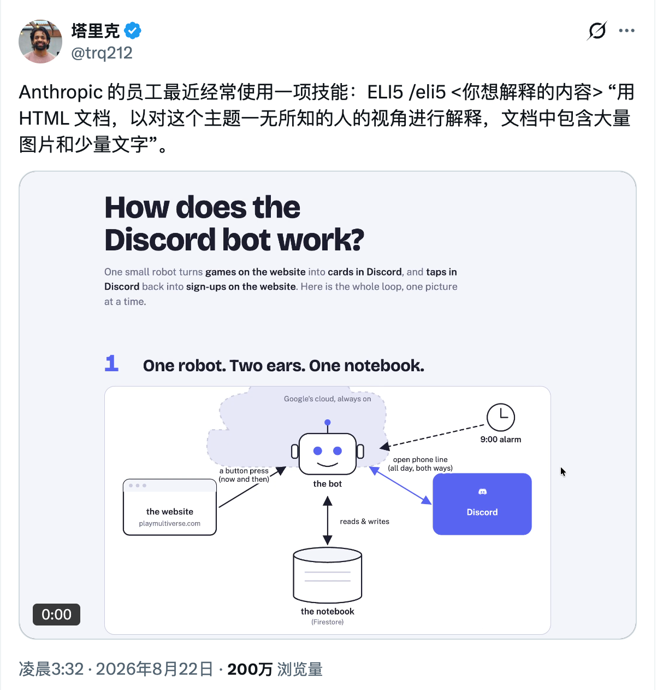

ELI5 是「Explain Like I’m 5」的缩写。你可以理解成，不管这个话题有多复杂，都先把我当成一个完全不了解的人来讲。

它的用法很直接。在 Claude Code 里输入 `/eli5`，后面跟上你想了解的东西。

```text
/eli5 Agent 是什么？怎么工作的？
```

AI 会生成一个 HTML 页面，用大图配上很少的文字，把 Agent 的工作方式画给你看。


看起来有点像技术版的儿童绘本。

以后碰到一个陌生话题，不想一上来就啃大段资料，可以先丢给 ELI5，让它帮你把大概脉络画出来。

我当时就挺好奇，这么好用的 Skill，里面到底塞了多少提示词，才能让 AI 稳定做出这种页面？

结果点开 GitHub 一看，整个 Skill 的核心只有一句提示词。

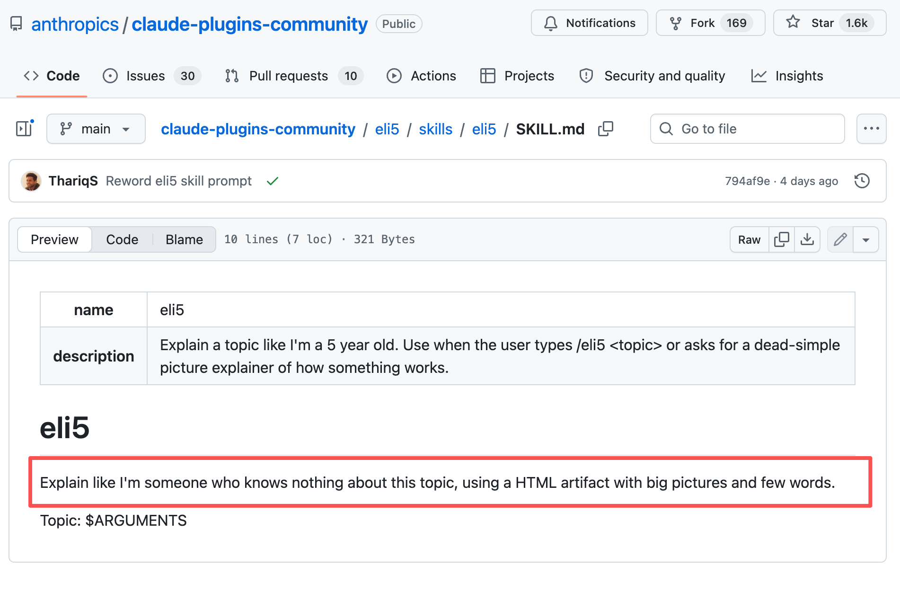

我还以为页面没加载完整，顺手刷新了几次。

还是只有这一句。

## 这个 Skill 到底写了什么？

ELI5 的 `SKILL.md` 只有 321 字节，去掉开头的名字和触发说明，正文只有下面这句话。

```markdown
Explain like I'm someone who knows nothing about this topic,
using a HTML artifact with big pictures and few words.

Topic: $ARGUMENTS
```

翻译过来很简单，**把我当成一个对这个主题完全不了解的人，用大图和少量文字，做成一个 HTML 页面讲给我看**。

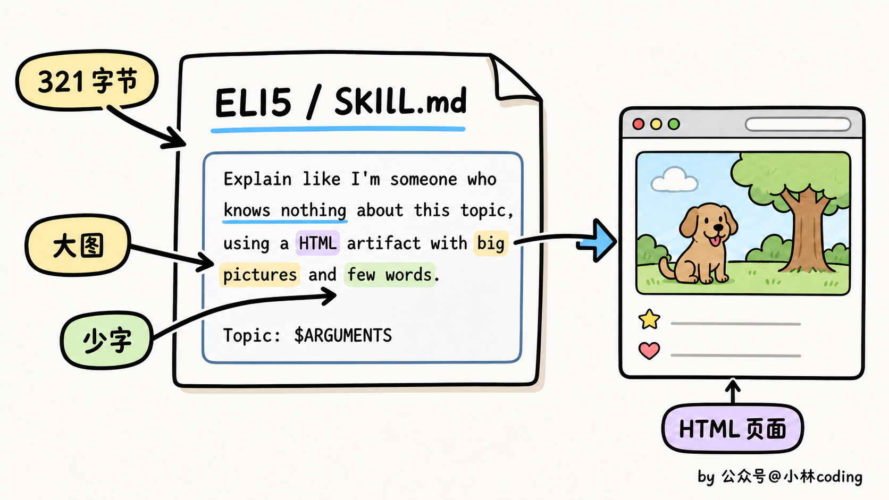

整个 Skill 的工作全交给这一句话。页面该分成几块、画什么图、用什么颜色，Claude 自己判断。

这也是我觉得它有意思的地方。ELI5 没有教 AI 怎么写网页，模型本来就会。这句提示词只定了三个要求，默认你从零开始，内容要可视化，文字尽量少。

就这么一句提示词，AI 的回答就从大段文字变成了大图少字的网页。

## 怎么安装和使用 ELI5？

如果你想把 ELI5 装到 Claude Code 里，先添加 Anthropic 的社区插件市场，再安装这个 Skill。

```bash
claude plugin marketplace add anthropics/claude-plugins-community
claude plugin install eli5@claude-community
```

不过，ELI5 并不是 Claude Code 专属。它本质上就是一份 `SKILL.md`，所以也是可以安装到 Codex、WorkBuddy 等 Agent 里的。

安装的方式也很简单，直接丢个这个提示词就搞定了。

```text
https://github.com/anthropics/claude-plugins-community/blob/main/eli5/skills/eli5/SKILL.md 帮我装这个 skill
```

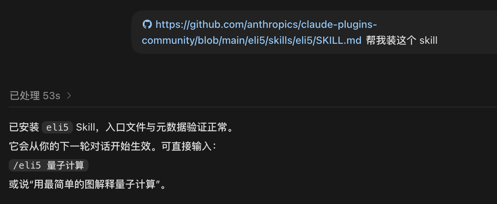

装好之后，不管你用 Claude Code、Codex 还是 WorkBuddy，调用方式都一样。

你想学习一个陌生的知识，直接这样问题就可以：

```text
/eli5 DNS是怎么工作的？
```

你还可以拿它理解陌生项目、技术取舍和事故原因，帮助你快速熟悉一个项目。

```text
/eli5 这个项目是怎么工作的

/eli5 为什么要做这个技术取舍

/eli5 是什么导致了这次事故
```

## 实测 ELI5 的效果

最近 DeepSeek V4 Flash 和 Pro 正式版出来后，很多人都在讨论它们比预览版强了多少。讨论里经常出现一个词，「后训练」。

后训练到底是什么？

如果直接搜资料，大概率又是一堆术语。我把这个问题丢给 ELI5，让它用最简单的方法教我。

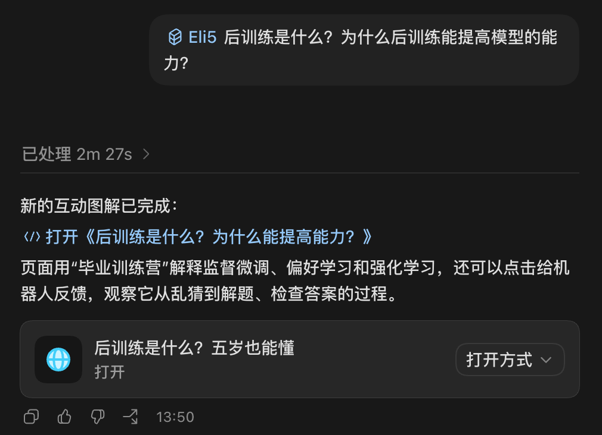

它直接做了一个可以交互的图文网页。


我觉得它讲得挺顺。大模型完成预训练之后，还要针对回答、推理这些能力做专项练习，这个过程就是后训练。

那同一个模型，为什么练完之后会变强？

它用了一个很好懂的说法，「知道」不等于「会做」。

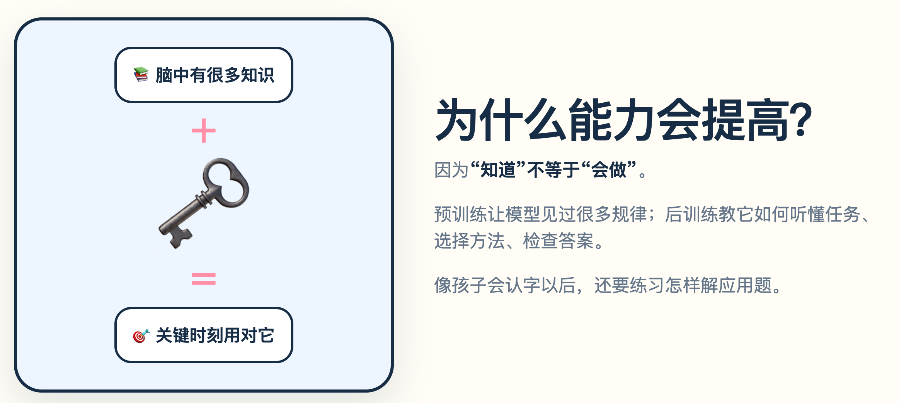

光解释还不够，网页里还做了一套互动演示，让你一步步看模型是怎么练出来的。


我又试了一下，不用 ELI5，直接问 AI 同样的问题。

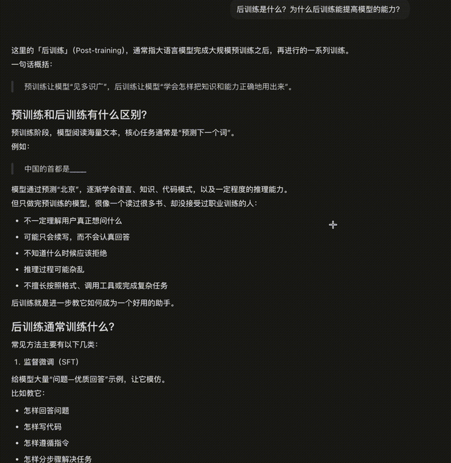

结果又回到了熟悉的长篇文字，信息全堆在一起，读起来确实更累。

放在一起看，ELI5 的优势就很直观了。它会先用图把关系讲清楚，再带着你一点点往下理解。

对了，很多林友跟我吐槽，Agent 开发里全是新名词，刚弄懂一个，又冒出来三个，学起来真的很累。

这种时候，ELI5 就挺好用。

比如你想知道「RAG 是怎么工作的」，直接把问题丢给它。

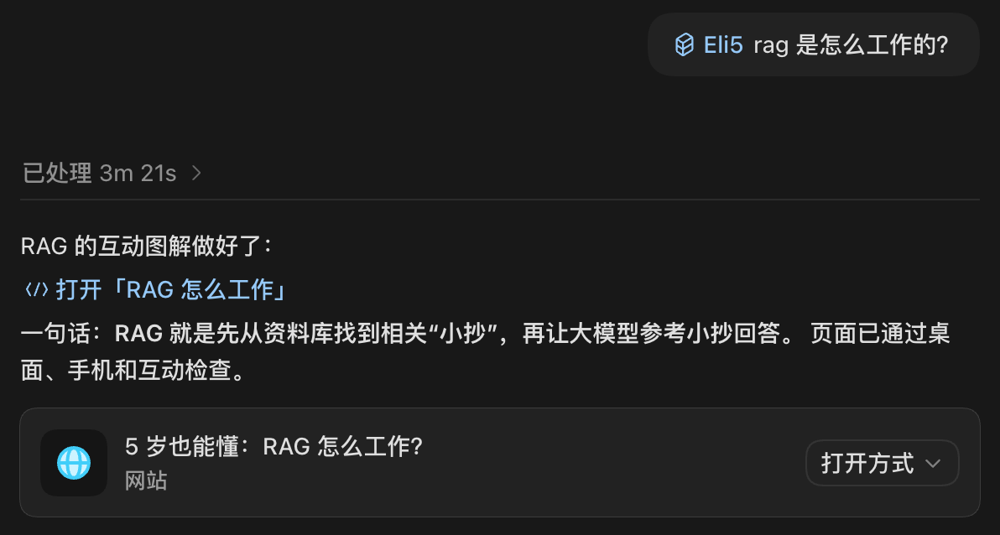

最后出来的是这样的，讲解很清楚。


如果你在准备面试，碰到「如何提升 RAG 的召回率」，也可以让它做成网页，帮你把几种方法放在一起梳理。


还有最近 AI 编程里经常提到的 `Harness`，看名字就有点让人摸不着头脑。交给 ELI5，它也能用图把这个概念讲明白。


这些新名词原来要在不同资料里来回查，现在可以先让 ELI5 画一张图，把大概脉络弄懂，再去看更详细的资料。

对了，我还顺手拿它试了一个真实项目。

我打开了我们的《[智能 OnCall Agent 项目](https://mp.weixin.qq.com/s/cmrUM1YNbAq0R4hIgU_uOA)》的源码，让 ELI5 解释这个项目是怎么工作的。

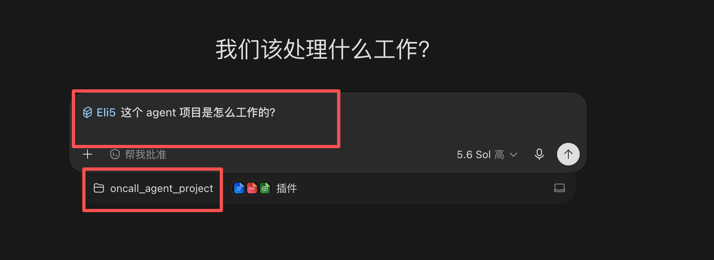

它先把项目的三种工作模式列了出来。


接着，我又问了它第二个问题，「这个项目用了哪些技术栈？」前端、后端、Agent、存储和容器，它都罗列得很清楚。

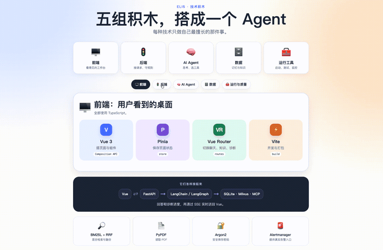

如果你经常要学新知识，或者突然接手一个陌生项目，ELI5 最有用的地方，就是先帮你跨过第一道门槛。

至少不会一上来就被满屏术语劝退。

## 写在最后

看到 ELI5 的提示词这么短，我马上想到之前分享过的另一个 Skill，`grill-me`。

你把一个还没想清楚的方案交给 AI，它会追着你往下问，一次只问一个问题，还会给出它的推荐答案。代码库里能找到的信息，它就自己去查。

听着像一套挺复杂的流程，对吧？

结果它的核心提示词也只有下面几句话。

```markdown
Interview me relentlessly about every aspect of this plan
until we reach a shared understanding. Walk down each branch
of the design tree, resolving dependencies between decisions
one-by-one. For each question, provide your recommended answer.

Ask the questions one at a time, waiting for feedback on each
question before continuing. Asking multiple questions at once
is bewildering.

If a question can be answered by exploring the codebase,
explore the codebase instead.
```

翻译成中文，大概是这样。

```text
毫不留情地追问我这个方案的每一个细节，直到我们达成共同理解。沿着设计树的每一条分支往下走，逐个解决各项决定之间的依赖关系。每次提问时，也给出你推荐的答案。

一次只问一个问题，等我回答后再继续。一次抛出多个问题会让人不知所措。

如果某个问题能通过查看代码库找到答案，那就自己查看代码库，不要再问我。
```

核心提示词就这几句话。

它没写先做什么、再做什么，只给 AI 定了一个目标，把方案问清楚。然后补了两条规矩，一次只问一个，能自己查的就自己查。

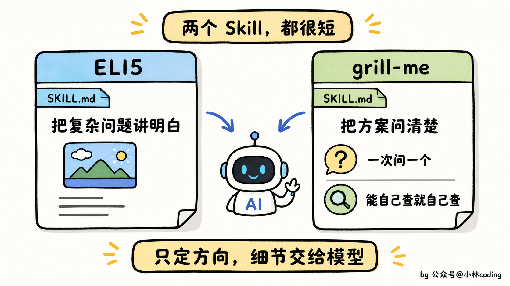

ELI5 也是这个思路。

把复杂问题讲明白，这是目标。具体画什么图、用什么比喻、从哪里开始讲，交给模型自己判断。

我觉得这两个 Skill 有意思的地方就在这里。它们没有把 AI 限在一套固定流程里，只给了一个方向和几条关键规则。

模型越强，自己能补出来的细节越多，同一个 Skill 用起来也会越顺。

有一种大道至简的感觉了。
