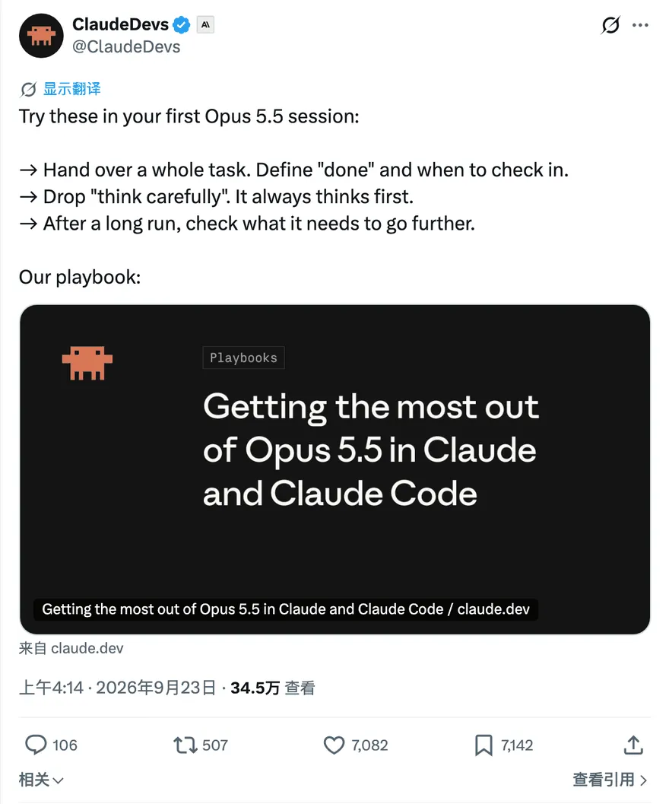
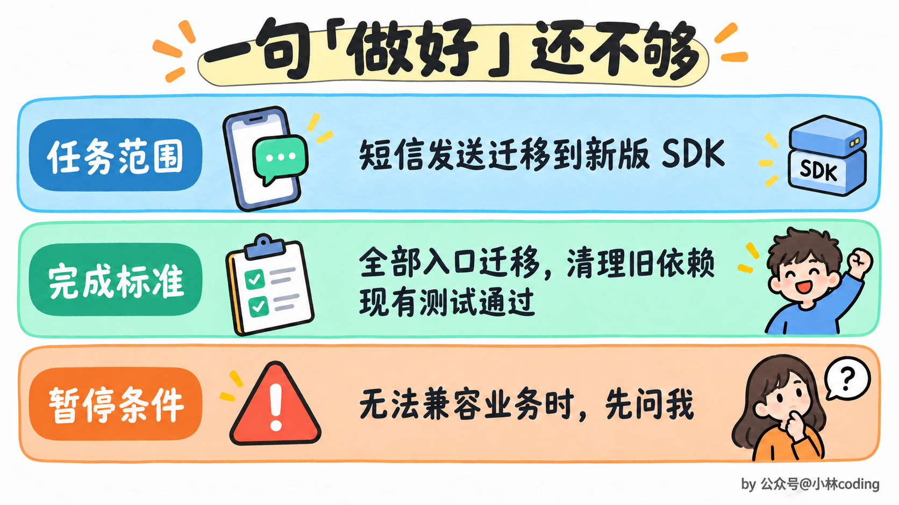
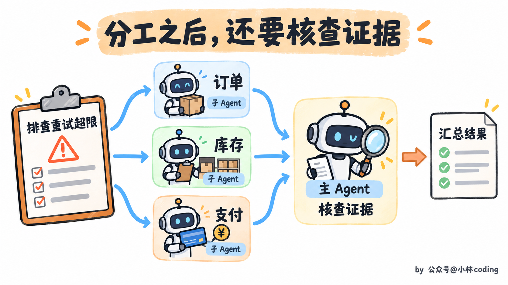
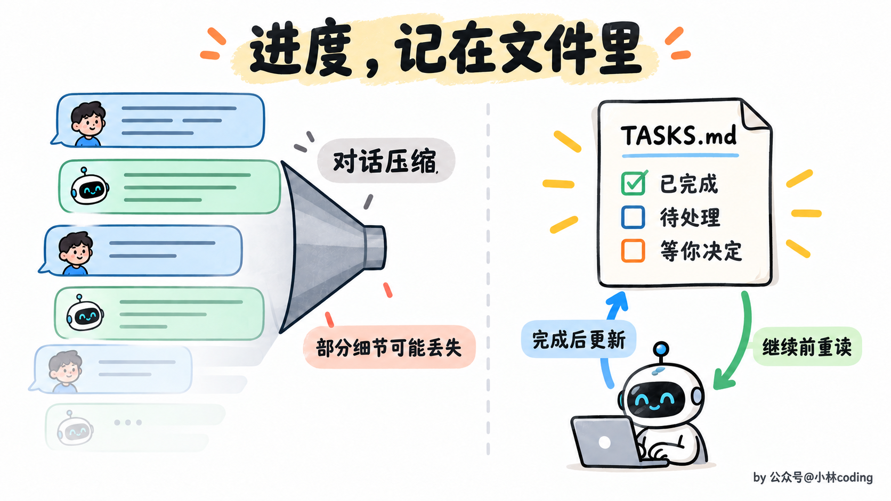
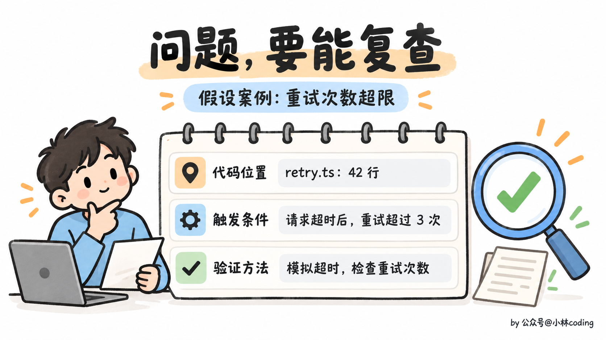
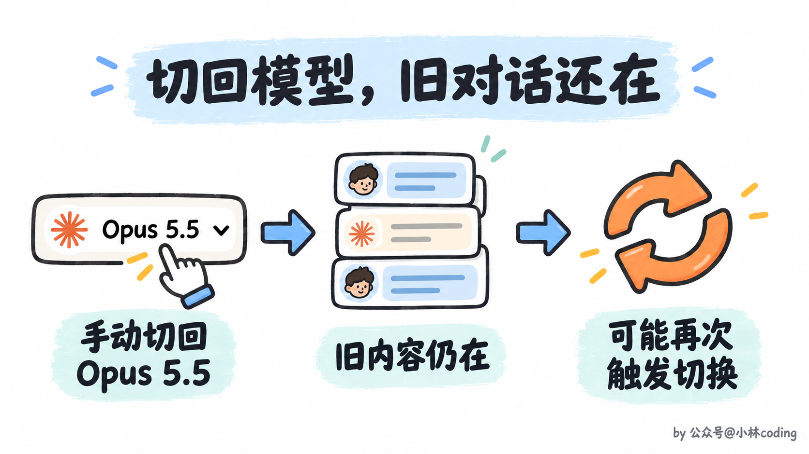
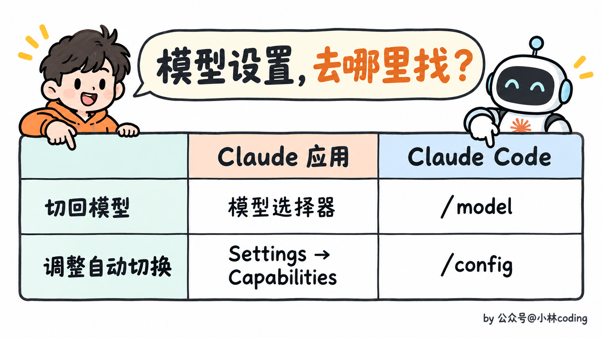
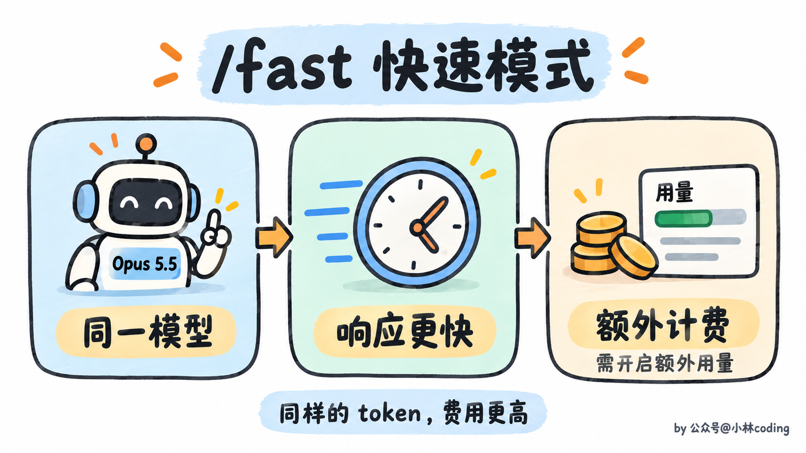

# Claude Opus 5.5 使用指南：怎样让 Claude 更好地完成任务？

> 原文：[Claude Opus 5.5 使用指南：怎样让 Claude 更好地完成任务？](https://xiaolinnote.com/claudecode/playbook/opus55_handbook.html) · 小林面试笔记


大家好，我是小林。

最近看到 Anthropic 发了一份 Opus 5.5 使用手册，叫《如何在 Claude 和 Claude Code 中用好 Opus 5.5》。



*ClaudeDevs 发布 Opus 5.5 使用手册的帖子*

里面有条建议挺有意思，让你把提示词里的「仔细思考」删掉。

连这句也要删？按手册的说法，Opus 5.5 每次回复前就会思考，用不着再叮嘱一遍。

除了怎么写提示词，手册还聊了几个很实际的问题。长任务怎么交给 Claude？干到一半老停下来怎么办？最后交上来的东西又该怎么看？

手册给的建议很直接。把完整任务交出去，说明做到什么程度算完成、什么时候需要来问你，少写「仔细思考」这类叮嘱。等长任务结束，先看哪些事情还在等你处理。


*长任务的三个协作阶段*

## 一、需求到底怎么说，Claude 才好干活？

假设你要换掉项目里的旧短信 SDK，只说一句「帮我升级一下」，改完依赖版本算不算完成？所有发送入口都要改吗？历史调用方式还要不要兼容？这些没说清，模型就得边做边猜。

可以把需求写得具体一点，比如这样。

```text
把项目中的短信发送功能迁移到新版 SDK。
所有发送入口都要完成迁移，清理旧依赖，现有测试通过。
如果新版无法兼容现有业务行为，先说明差异，等我决定。
```

你看，这几句交代了任务、完成标准和需要你介入的情况。接下来查哪些文件、先改哪个入口，就交给 Claude Code 根据仓库情况判断。

**「完成」最好是能检查的，别只写一个「做好」。** 否则它觉得依赖升完了，你觉得业务还没验过，两边说的根本不是同一件事。



*短信 SDK 迁移提示词的三个要素*

需求写完，你是不是还想在结尾补一句「请仔细思考」？以前写 prompt，仿佛不加这句，心里就没底。

Opus 5.5 已经会先思考再回答。官方在聊天产品里试过，去掉这类叮嘱，回复能更早开始，质量也没见明显下降。你自己的任务会有什么变化，可以删掉以后对照着试一轮。

对了，保存下来的固定指令也翻一遍。比如 `CLAUDE.md` 里如果还留着「仔细思考」「一步一步想」这类叮嘱，也一起清理，别只改眼前这一条 prompt。

看到这里，你可能会问，那复杂问题，我还是想让模型多想一会怎么办？

在 Claude Code 里，可以通过 effort 设置，调整模型在思考上投入的精力。简单问题想快点拿到答案，直接说「直接回答」就好。


*删除思考叮嘱，按需调整 effort*

需求发出去了，才想起漏说一件事怎么办？比如代码已经改到一半，你突然想起，老的调用方式还得兼容。

可以在 Claude Code 执行过程中，直接输入补充要求并按回车。任务越长，重新开一轮的成本越高，发现遗漏就及时说，没必要憋到最后交卷才指出来。

如果让 Claude 做页面，要求也得具体。光说「别太模板化」，出来的结果可能只是换了套配色，熟悉的味道还是扑面而来。

手册建议，把你不喜欢的具体样式点出来。比如「不用米白背景，标题不要斜体强调词，按钮不要全做成胶囊形」。出第一版后，再针对实际效果补充要求。

「高级一点」留给模型的猜测空间太大。把自己看不顺眼的地方说清楚，后续才好改。


*把不喜欢的页面样式指出来*

## 二、长任务，怎么避免干一半就停？

需求交代清楚了，Claude 干了一半，突然给你一段汇报，结尾来一句「接下来可以修改剩余文件，需要我继续吗？」

当然继续啊，活还没干完呢。

如果经常碰到这种停顿，可以把工作规矩写进 `CLAUDE.md`。按手册的建议，结合自己的项目，写成类似这样。

```text
范围内还有能推进的工作，就继续执行，汇报进度时也接着做下一步。
确实缺少我的决定或资料，导致无法推进时，再停下来说明。
删除数据、强推代码、修改仓库之外的内容之前，先征求确认。
```

看到这里，你可能想，干脆加一句「没做完就别停」，不就省事了？

普通的查文件、改代码，可以继续往下做。可要是下一步准备删除数据、强推代码呢？这种时候，你大概还是希望 Claude 先问一句。所以，**该继续的事和该停的事，要一起讲清楚。** 危险操作的权限确认也得保留，提示词里的约定不能代替权限设置。


*长任务何时继续，何时暂停*

如果只是停下来问「要不要继续」，回一句「继续」就行。经常这样的话，就得看看 Claude Code 为什么停下来。确实缺少信息，就把信息补上。如果只是汇报一下进度，就在 `CLAUDE.md` 里说明，汇报完继续做，不用每次等你点头。

如果你喜欢边看边改，也可以换个约定，让 Claude Code 动手前先用一句话说说计划，做完后再简短回顾。把这种偏好写进 `CLAUDE.md` 就好。

遇到要同时排查多个服务的任务，还可以让主 Agent 把工作拆给几个子 Agent。比如订单、库存、支付各分一个，分别查完，再汇总结果。

几个子 Agent 都查完了，也都说「没问题」，这下能放心了吗？

先看看这个「没问题」是怎么得出来的。每个 Agent 查了哪些代码、依据是什么，都得交代清楚，主 Agent 收到结果后也要核查。否则你只是多收到了几份结论，真要追问哪里查过了，还是说不清。

比如你怀疑几个服务都有重试次数失控的问题，明明设置了最多重试三次，实际却一直在发同一个请求，就可以让子 Agent 分别去查。

```text
订单、库存、支付服务各分给一个子 Agent，检查请求失败后的重试次数是否超过配置上限。
每个结果附上重试上限、调用路径和触发条件，找不到证据就明确说明。
你核对结果后，再汇总成表，列出服务、是否受影响及依据。
```



*子 Agent 分工后由主 Agent 核查证据*

任务和进度，聊天记录里不是都有吗？为什么还要专门写一份 `TASKS.md`？

问题就在于，长任务跑起来以后，对话里会不断塞进代码、日志和工具结果。上下文接近上限时，旧内容会被压缩，最早交代的细节就可能不再完整。

所以，可以让 Claude Code 把待办写进 `TASKS.md`，完成一项就更新，发现新问题也补进去。接着往下做时，先让它读一遍这份清单，知道哪些已经做完、哪些还没动、哪些在等你决定。

你想检查进度时，也不用再翻几十屏聊天记录。



*用 `TASKS.md` 保存并更新任务进度*

## 三、Claude 说做完了，你先看什么？

跑了很久，终于交来一份汇报，你是不是会先看「完成了哪些工作」？

不妨先找找，有没有什么事还在等你决定。比如缺一份资料，或者有个方案需要你拍板。这些问题要是藏在长篇总结的末尾，你看了半天，才发现接下来该自己接手了。

所以，可以把汇报格式也写进 `CLAUDE.md`，约定每次结束时分成「待你处理」「已完成」「新发现」三部分。把需要你处理的事理清楚，再看看 Claude 交上来的结果，到底靠不靠谱。


*汇报先看待你处理，再看已完成和新发现*

比如代码改完了，还得检查有没有带出新的问题。可以让 Claude Code 先审一轮，再交给人看，提示词可以这样写。

```text
对照 main 分支，审查当前分支的代码变更。
只列出你认为必须修复后才能合并的问题。
每条写清文件名和行号、什么情况下会出错、原因是什么，以及怎样复现。
```

**「这段可能有问题」还不够，得给出能查下去的具体线索。**



*代码审查要给出位置、触发条件和验证方法*

如果交上来的是调研报告，道理也一样。哪些结论有依据，哪些还没查实，报告里要分开写，没查实的再说明已经找过哪里。

这样你才能分清哪些可以采用，哪些还得补查。报告排得再漂亮，一个没有确认的关键数字，也足够让后面的判断跟着跑偏。

## 四、在 Claude 应用里，怎么用得更顺手？

如果你平时主要在 Claude 网页端、桌面端里聊天，下面这几条也值得试试。先看一眼模型选择器，确认选的是 Opus 5.5。

看架构图、报表或截图，直接把原图发过去，再问具体问题。比如「哪些服务直接调用了支付接口」，比自己把方框、箭头描述一遍省事，也保留了位置关系。

这一代对图表细节和位置关系的理解有所改进，图里的箭头连着谁、哪个数字属于哪一栏，都可以直接问 Claude。

图表之外，长文档也可以交给它检查。比如一份方案改了几轮，前面写项目 10 月上线，最后一页还留着 9 月，自己从头翻一遍，真不一定能发现。

提要求时就说清楚，要查日期、数字、名称有没有前后打架。发现问题，把有矛盾的原句摘出来，再标上段落或页码。这样你拿着原句就能回去核对，比一句「帮我看看」更有着落。


*检查长文档里前后矛盾的上线日期*

看完现有材料，还想整理一份表格发给同事？那就明确说要一份文件，把文件格式、列名和每行代表什么说清楚。比如把项目清单整理成 Excel，按负责人和截止日期排列，交付后你就能直接打开检查。

对了，聊得久了，Opus 5.5 有时会重新琢磨前面已经回答过的问题，后续回复因此变慢。

如果只是日常跟进，可以在 Claude 项目的指令里加上这段约定。

```text
已经回答清楚的问题，先沿用之前的答案。
优先处理我当前的问题，除非我再次问起或指出问题，否则不用重新分析旧答案。
```

不过你可能也想到了，后面找到了新材料，发现前面判断错了，难道也不回头看？

这种情况当然得复查。所以，正在做长篇分析，就先别加这条约定。新材料可能改变前面的判断，这时回头检查，才是在把问题想完整。


*日常跟进和长篇分析采用不同的回查方式*

## 五、聊着聊着，怎么换模型了？

你明明选的是 Opus 5.5，聊着聊着，怎么变成旧模型了？

有些内容触发安全检查后，可能会切换模型，正常请求也有可能被误判。手册明确说，查找源码里的安全漏洞是允许的，日常健康和教育问题也应当能正常处理。

而且检查范围不只有你刚发的那句话，前面的消息、文件和搜索结果也算。所以别光盯着最后一句找原因。

在 Claude 应用里，看到「Switched to」和旧模型名称，就说明发生了切换，后续对话也会继续用那个模型。

那我在模型选择器里选回 Opus 5.5，不就好了？

可以重新选，但还有个地方容易忽略。之前触发安全检查的内容，可能还留在这段对话里，所以切回去以后，也可能再次遇到模型切换。如果你认为正常请求被误判了，可以试着新开一个对话，再提出需求。



*切回模型不会清空旧对话，仍可能再次触发切换*

如果希望换模型前先征求你的意见，可以到 Settings → Capabilities，关闭「Switch models when a message is flagged」。这样遇到原本会自动换模型的情况，对话会先暂停，让你决定接下来怎么办。

在 Claude Code 里，想切回模型，就用 `/model`。如果需要修改上一条消息，连按两次 Esc。

自动切换的偏好可以到 `/config` 里调整。如果觉得这次是误判，再用 `/feedback` 反馈。



*Claude 应用和 Claude Code 的模型设置入口对照*

手册在这里还提到，要求模型逐字公开内部思考过程，也可能触发安全标记或被拒绝。如果提示词或保存的指令里有这类要求，也顺手删掉。

那我只是想知道，Claude 为什么选了这个方案，还能问吗？当然可以。直接问取舍和证据，比如「这个方案比另外一个好在哪里，你的判断依据是什么」。

## 六、等回复太慢，能不能快一点？

如果你正在 Claude Code 里来回调代码，每轮都坐在屏幕前等回复，可以试试 `/fast`。

看到「快速模式」，你可能先想到，是不是换了个更轻量的模型？

手册说，用的还是同一个模型。不过，速度快了，费用也会更高。目前这个功能处于研究预览，需要开启「额外用量」，同样的 token，用快速模式会更贵。

那值不值得开？你一直在旁边等着，少等一会可能就值。任务交出去以后，你本来就要去忙别的，那也不用急着开。



*快速模式使用同一模型，响应更快但费用更高*

## 最后，一份使用检查清单

下次开长任务前，可以顺手过一遍。

- **提需求**，写清完成标准，清理提示词和固定指令里多余的思考叮嘱，图表直接附上，设计偏好说具体。
- **跑任务**，约定继续和暂停的条件，保留危险操作确认，大任务按需分工，清单及时更新。
- **看结果**，先处理等你决定的事，再看审查证据和未确认的信息。
- **看设置**，知道当前用了哪个模型，按自己的习惯设置自动切换。


*开始长任务前的四项检查清单*

看完先别急着收藏吃灰，找一个最近让你反复催「继续」的任务试试。

把怎样算做完、什么情况需要停下来问你补清楚，再跑一轮。最后看看，中途少了几次无意义的停顿，交上来的结果是不是更容易检查。哪条建议对你有用，拿自己的任务试过，比记住整份手册更有感觉。

---

参考文章

[Getting the most out of Opus 5.5 in Claude and Claude Code](https://claude.dev/blog/getting-the-most-out-of-opus-5-5/)
