# Codex 工程化指南：AGENTS.md、Skills、Subagents、MCP、Hooks 一篇讲透

> 原文：[Codex 工程化指南：AGENTS.md、Skills、Subagents、MCP、Hooks 一篇讲透](https://xiaolinnote.com/codex/basics/codex_engineering.html) · 小林面试笔记


大家好，我是小林。

用了 Claude 三个月后，我也成功喜提 A➗封号了。

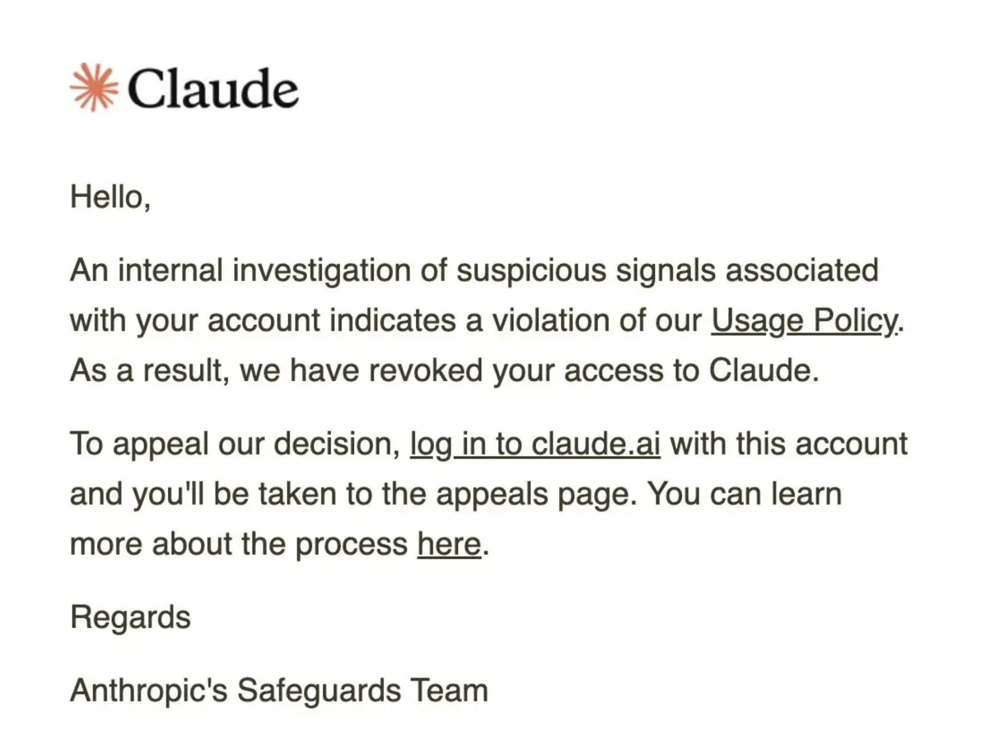

Claude 被封之后，我就转投 Codex 的怀抱了。

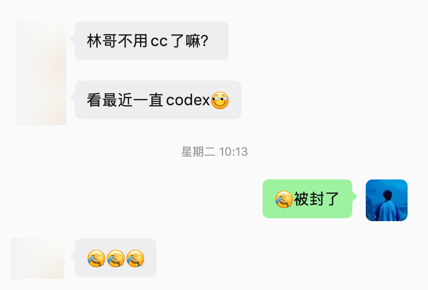

之前我写过一篇 [Claude Code 工程化](https://mp.weixin.qq.com/s/7wkfAeMrsnrmVVGYAvyBjA)的文章。最近我又研究了一下 Codex 的工程化能力，发现两者的很多功能其实是相通的。

所以这次就来聊聊 Codex 里五个常用的工程化能力，分别是 `AGENTS.md`、Skills、Subagents、MCP 和 Hooks。

## 01｜ AGENTS.md ：Codex 怎么记住项目？

### 为什么每次都要重新交代？

假设团队的技术文档仓库有一组固定规则：正文使用中文，一篇文档只能有一个一级标题，图片放进 `images/`，`published/` 中的内容不能直接修改。

如果每个新任务都要重新交代，既麻烦又容易遗漏。没有拿到这些规则时，Codex 只能按常见做法处理。

`AGENTS.md` 就是放在仓库里的「项目入职手册」。Codex 开始任务前会读取它，后续的分析、修改和验收都会遵守其中的规则。

### 怎么创建 AGENTS.md ？

创建 `AGENTS.md` 有两种方式。

最直接的做法，是在项目根目录手动新建一个 `AGENTS.md`，再把团队的目录约定、修改规则和检查命令写进去。

也可以让 Codex 帮你生成。先在 Codex 中按 `Cmd/Ctrl + O` 打开 `product-docs` 项目。

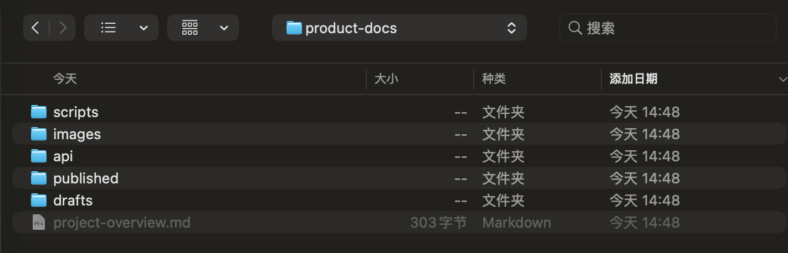

再发送这段提示词。

```text
请在当前项目根目录创建 AGENTS.md。

这是一个团队技术文档仓库。
所有正文使用中文，一篇文档只能有一个一级标题。
文件名使用小写英文和连字符，图片统一放在 `images/`。
`published/` 中的文档只读，不要直接修改。
完成修改后执行 `python3 scripts/check_docs.py` 检查标题和图片引用。

先只创建规则文件，不修改任何文档，也不执行检查命令。
```

Codex 会生成一份 `AGENTS.md`。

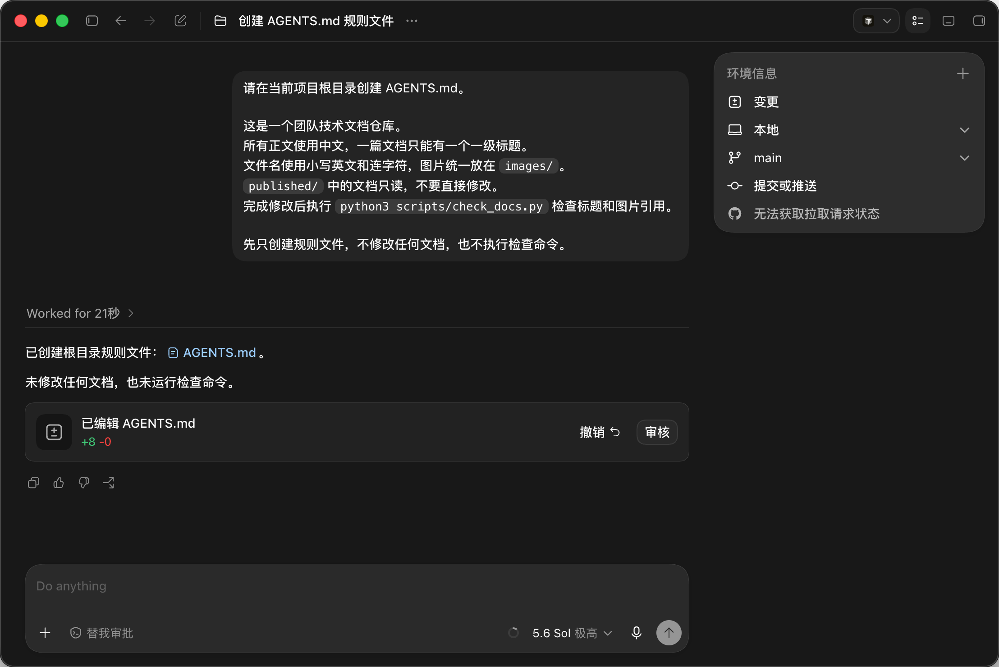

你可以在右侧审核产出的内容

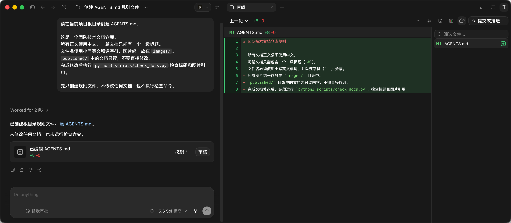

怎么确认新任务真的读到了？重新建一个任务，输入下面这段话。

```text
只总结当前生效的项目规则，并列出规则来自哪些 AGENTS.md 文件。
不要修改任何文件，也不要执行构建命令。
```

返回结果应该包含中文正文、文件命名、图片目录、`published/` 只读和检查命令等规则。

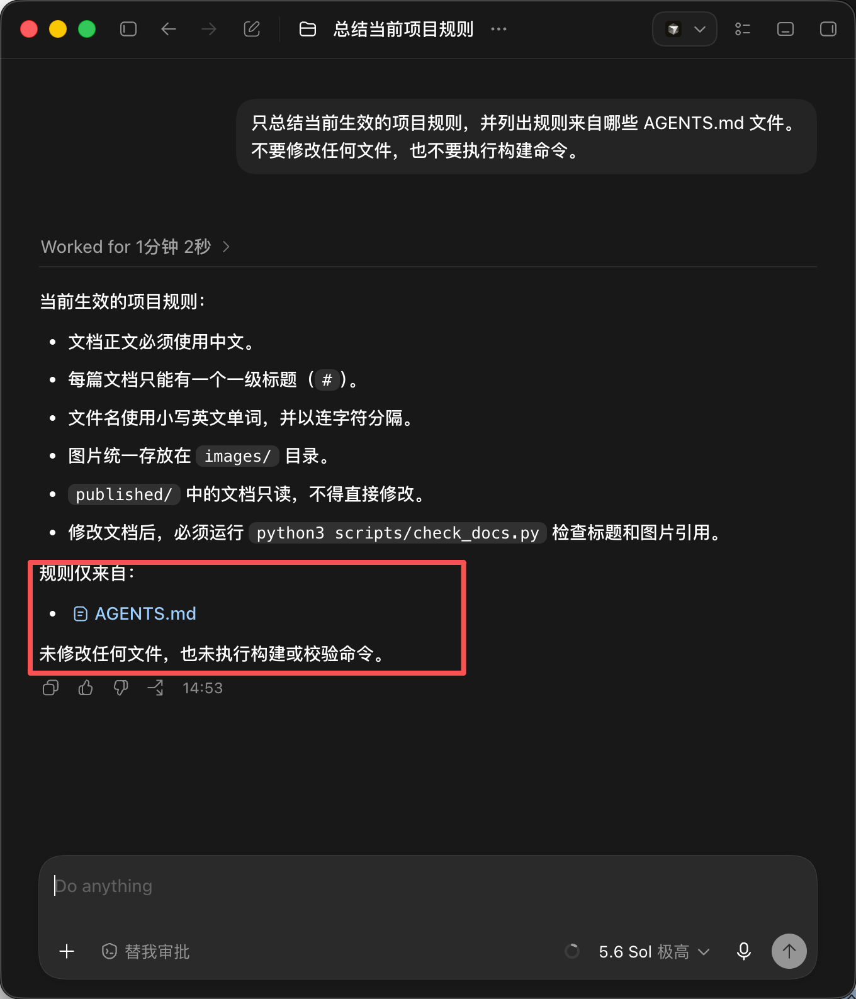

### AGENTS.md 规则怎么加载？

项目根目录会多出一份 `AGENTS.md`。它的最小内容可以长这样。

```markdown
# 项目说明

这是一个团队技术文档仓库。

## 文档规则

- 所有正文使用中文
- 一篇文档只能有一个一级标题
- 文件名使用小写英文和连字符
- 图片统一放在 `images/` 目录

## 修改约束

- `published/` 中的文档只读
- 不要创建正文没有引用的图片
- 完成修改后执行 `python3 scripts/check_docs.py`
```

这份文件没有神秘语法，就是 Markdown。真正影响效果的是内容够不够具体。

「注意文档质量」这种话基本等于没说。什么叫质量好，模型还得自己猜。换成「只能有一个一级标题」「图片统一放进哪个目录」「修改后执行哪条检查命令」，Codex 才知道下一步该做什么，也知道怎么证明自己做完了。

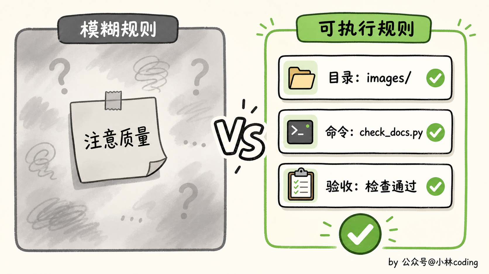

工作目录也不只有项目根目录这一层。个人级规则放在 `~/.codex/AGENTS.md`，适合所有项目通用的偏好。Codex 里可以通过「Settings > Personalization」编辑。项目根目录写团队共识，子目录则放模块专属规则。

```text
~/.codex/
└── AGENTS.md                    # 个人全局规则

product-docs/
├── AGENTS.md                    # 整个文档仓库的规则
├── drafts/
├── published/
├── images/
└── api/
    ├── AGENTS.override.md       # API 文档的覆盖规则
    └── payment-api.md
```

Codex 启动时，会从项目根目录一路走到当前工作目录。每一层最多选一个规则文件，再按从远到近的顺序拼起来。离当前目录越近的规则排在越后面，发生冲突时也就拥有更高优先级。

同一层如果同时存在 `AGENTS.override.md` 和 `AGENTS.md`，Codex 会优先选择 override 文件。这一层只取优先命中的那一份，不会把两份都读进来。

如果 Codex 当前打开的是仓库根目录，后面才让它去改 `api/`，它不会因为读到了 API 文档，就自动把更深处的 `AGENTS.md` 补进当前规则链。要测试 API 目录的规则，可以在 Codex 中把这个子目录作为本地项目打开，或者把所有文档都要遵守的规则写到根目录。

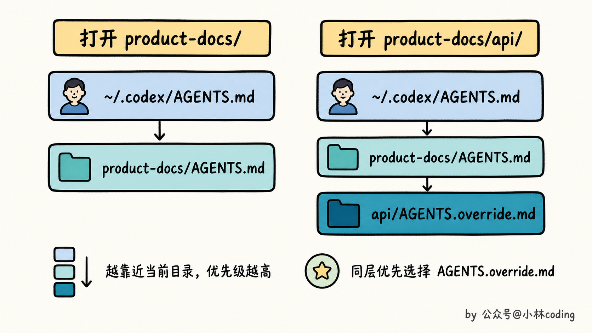

Codex 默认会限制项目规则合并后的总大小，官方文档给出的默认上限是 32 KiB。这个文件可以继续引用架构文档和专项说明，不需要把所有资料全文放进来。

每次都要遵守的放 `AGENTS.md`。只有做发布、Review、迁移时才需要的长流程，应该交给下一件工具。

## 02｜Skills：专项知识该放哪？

### 为什么不能全塞进 AGENTS.md ？

项目里总有一些知识很重要，却不是每次任务都要用。

比如每次发布都要确定起始版本、整理提交、过滤内部改动，再按团队模板生成 Release Notes。这套流程很重要，但平时改文档、查问题时根本用不上。

要是全部塞进 `AGENTS.md`，每一个任务都会带上这些内容。今天只是改个错别字，Codex 也得背着整份发布手册上班。上下文被占用了，注意力也被摊薄了。

那能不能等用到时再读？可以，这就是 Skill。

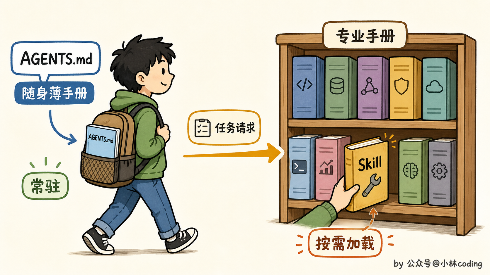

### 怎么创建和使用 Skill？

Codex 里内置了 `$skill-creator`。不用先手写文件，直接把团队生成 Release Notes 的流程说给它。

```text
$skill-creator 为当前项目创建一个 release-notes Skill。

它用于根据指定的 Git Tag 到当前分支之间的真实改动生成发布说明。

先确认起始版本，再读取提交和改动文件。
过滤合并提交、纯格式调整和 CI 配置更新。
把内容分成新功能、问题修复和破坏性变更。
使用面向用户的语言，每一项都要能追溯到提交或文件证据。
只生成草稿，不创建 Tag，也不发布版本。

同时提供 Release Notes 模板和收集提交的脚本。

生成项目共享 Skill，先只创建文件，不开始生成发布说明。
```

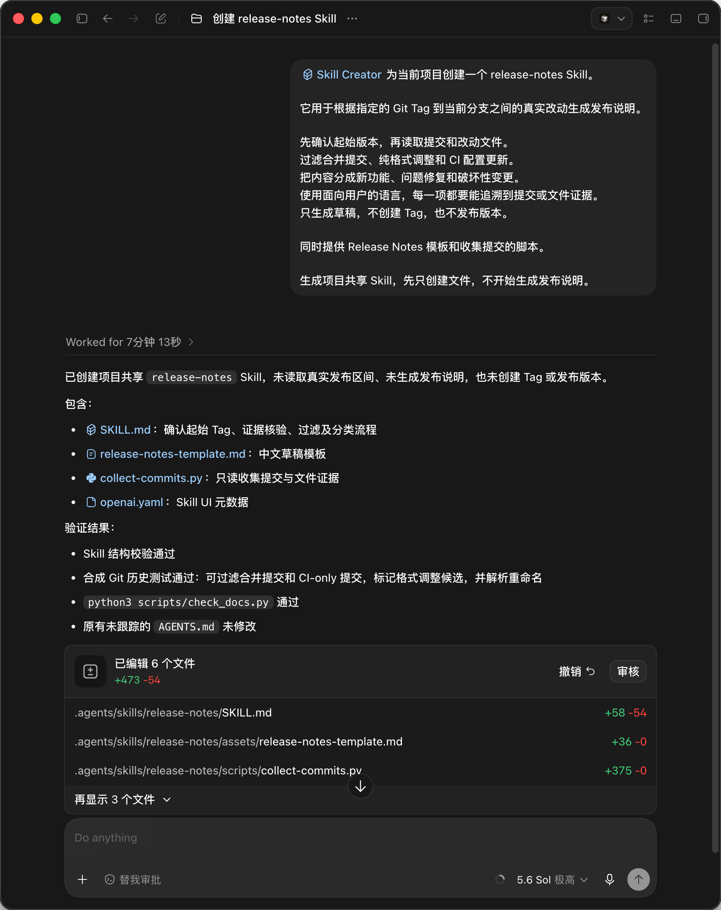

创建好 skill 之后，打开 Codex 侧边栏的「Skills」页面，应该能看到 `release-notes`。

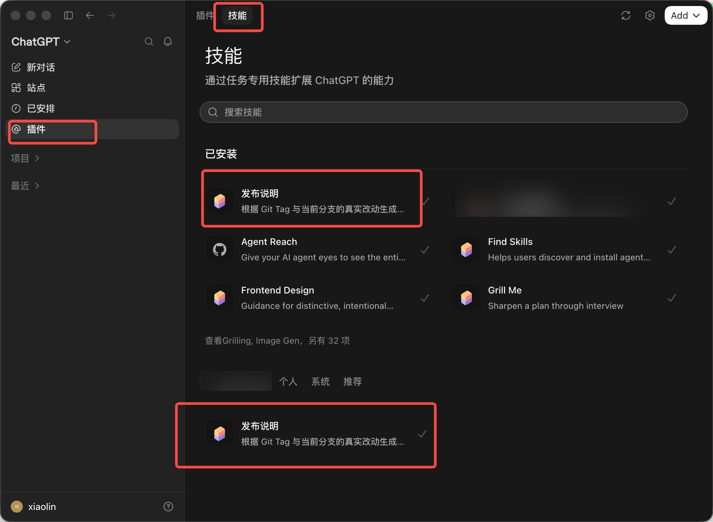

接着新建一个任务，显式调用这个 Skill。

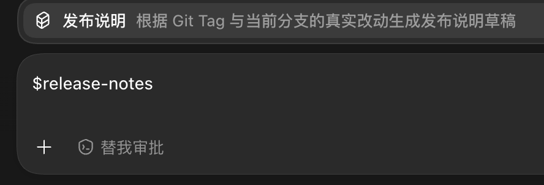

```text
$release-notes 根据 v1.4.0 到当前分支之间的改动，
生成 v1.5.0 的发布说明草稿。
不要创建 Tag，也不要发布 Release。
```

你也可以不写 `$release-notes`，直接说「根据 v1.4.0 之后的改动生成发布说明」。只要任务与 Skill 描述匹配，Codex 也可以自动选中它。

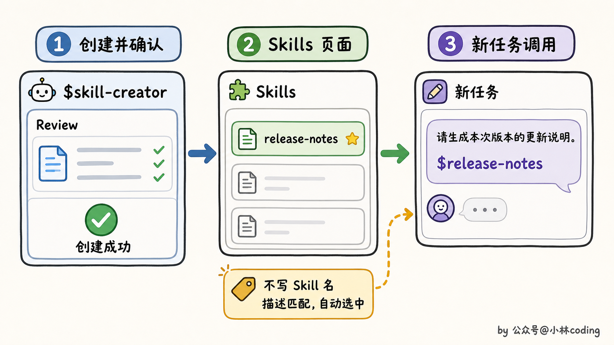

### Skill 是怎么工作的？

创建后的 Skill 目录如下。

```text
release-demo/
└── .agents/
    └── skills/
        └── release-notes/
            ├── SKILL.md
            ├── references/
            │   └── release-template.md
            └── scripts/
                └── collect-commits.sh
```

最小版本其实只要一个 `SKILL.md`。

```markdown
---
name: release-notes
description: 准备版本发布说明时使用，根据指定 Git Tag 到当前分支之间的真实改动，生成可追溯的 Release Notes 草稿。
---

# Release Notes 流程

1. 确认用户给出的起始 Git Tag 存在
2. 运行 `scripts/collect-commits.sh <tag>` 收集提交和改动文件
3. 过滤合并提交、纯格式调整和 CI 配置更新
4. 按新功能、问题修复和破坏性变更分类
5. 使用面向用户的语言，不直接复制提交信息
6. 每一项标出可追溯的提交或文件证据
7. 按 `references/release-template.md` 生成草稿

只生成发布说明草稿，不创建 Tag，不调用发布接口。
```

这里的关键字段是 `description`。Codex 会根据这句话判断什么时候应该使用 Skill，所以不能只写「发布工具」，要写清它做什么、什么时候用、产出什么。

一个 Skill 的核心是 `SKILL.md`，也可以携带脚本、参考资料、模板和其他资源。项目共享 Skill 放在 `.agents/skills/`，个人跨项目使用的 Skill 放在 `~/.agents/skills/`。注意这里是 `.agents`，不是 `.codex`。

Codex 启动时先看每个 Skill 的名称和描述。当用户任务与描述匹配，或者你显式点名某个 Skill 时，它才读取完整正文。正文里引用的长资料和脚本，也可以继续按需读取或执行。

简单来说，Codex 平时只记住「书名和简介」，接到任务后才去书架拿对应的书。这就是 Skill 的渐进式加载。

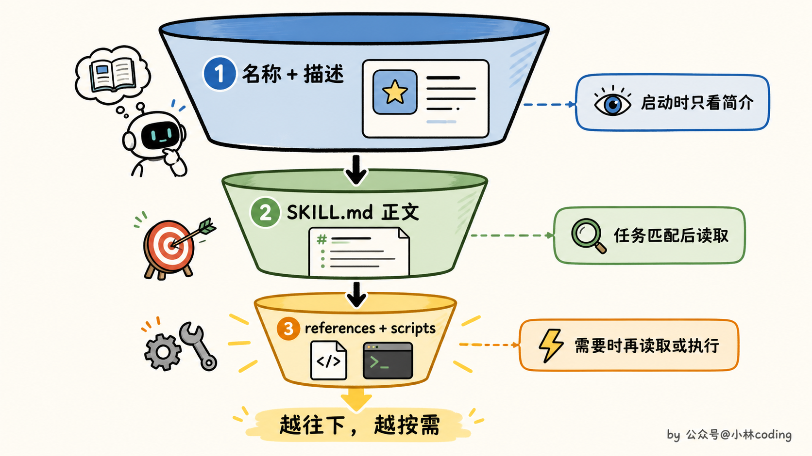

## 03｜Subagents：怎么变成一支小团队？

### 主对话为什么越干越乱？

假设团队准备评估一套新的日志平台，需要同时调查产品能力、Java 接入方式和历史数据迁移风险。全部由主 Agent 处理，搜索结果和中间资料很快就会挤占主上下文。

Subagent 可以把这三路调查拆到独立上下文中并行完成。主 Agent 负责分工、收集结果和整理结论，中间过程则留在各自的子任务里。

在 Codex 里，主任务派出工作后，界面会显示每个 Subagent 线程。你可以点进去查看调查过程，再回到主任务查看合并后的结果。

### 怎么安排 Subagent？

先说清一个容易混淆的点。Subagent 是 Codex 临时派出去执行某个子任务的独立线程，自定义 Agent 则是可以反复使用的「岗位模板」。

普通的并行任务，不创建任何配置也能直接派 Subagent。只有某类分工经常出现时，才值得把职责写进 `.codex/agents/`，以后重复使用。

这次为了同时演示「固定岗位」和「并行派发」，我们先为日志平台调研创建三个自定义 Agent。

```text
请在当前项目创建三个只读的自定义 Agent。

capability_researcher 只负责调查查询、告警、权限和运维能力。
integration_researcher 只负责调查 Java、OpenTelemetry 和现有监控的接入成本。
migration_researcher 只负责调查旧查询、历史数据和迁移风险。

每个 Agent 都要区分官方资料、项目现状和自己的推断，并保留来源。

先只创建 `.codex/agents/` 下的配置文件，不开始调研。
```

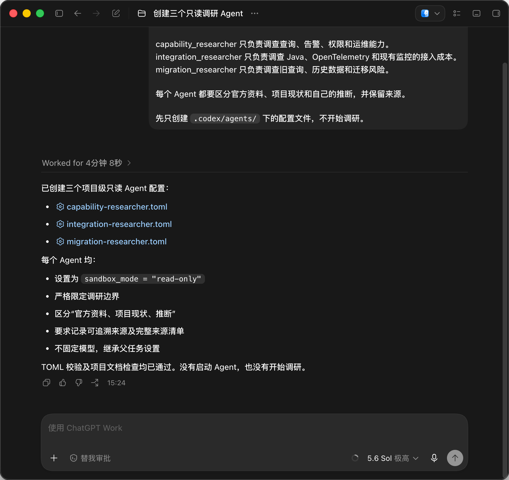

三个岗位模板创建好后，再新建一个任务，把三路调查分别派给对应的 Subagent。

```text
评估当前项目是否适合采用候选日志平台。
请并行安排三个 Subagent：
1. capability_researcher 调查产品能力和限制
2. integration_researcher 调查 Java 接入方式和改造成本
3. migration_researcher 调查迁移步骤、数据风险和回退方案

等三路结果回来后合并去重，输出适用条件、主要风险和待确认问题。
只做调研，不修改当前项目。
```

任务开始后，Codex 会展示三个 Subagent 的活动。

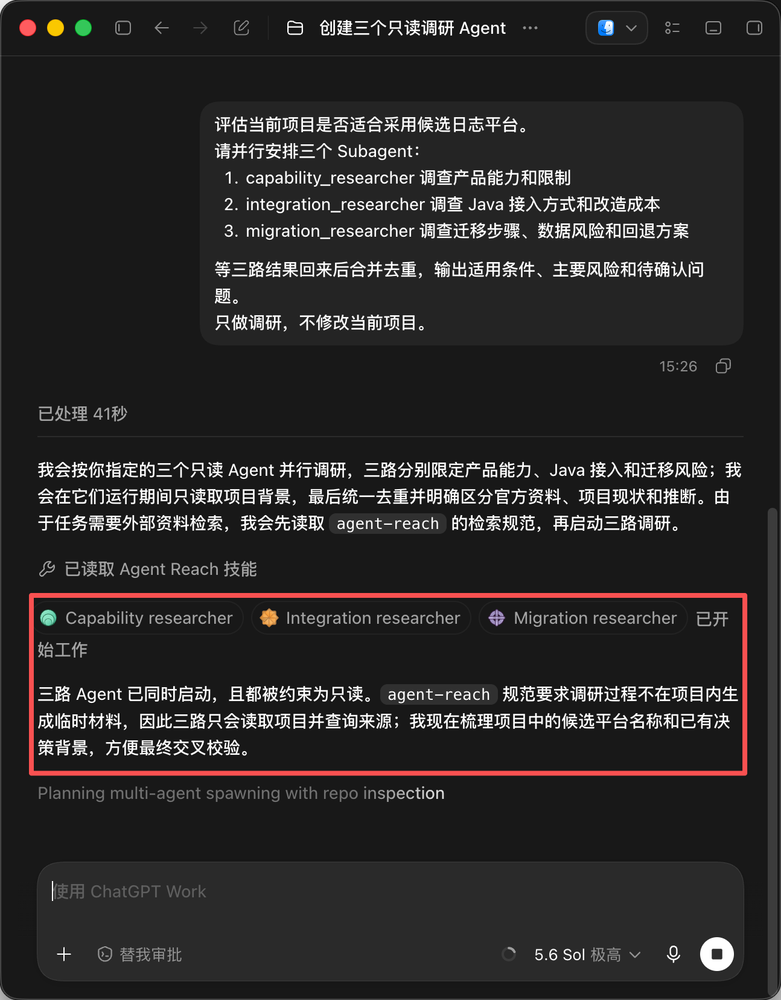

### Subagent 是怎么工作的？

Codex 负责创建 Subagent、派发任务、等待结果，再把多路结果交给主 Agent 统一整理。

| 阶段 | 发生的事情 |
| --- | --- |
| 拆分 | 主 Agent 找出可以独立处理的子任务 |
| 派发 | 为每个 Subagent 指定目标、边界和输出格式 |
| 执行 | 各个 Subagent 在自己的上下文中使用模型和工具完成任务 |
| 回传 | Subagent 把结论和必要证据返回主 Agent |
| 合并 | 主 Agent 等待各路结果，再去重并生成最终回答 |

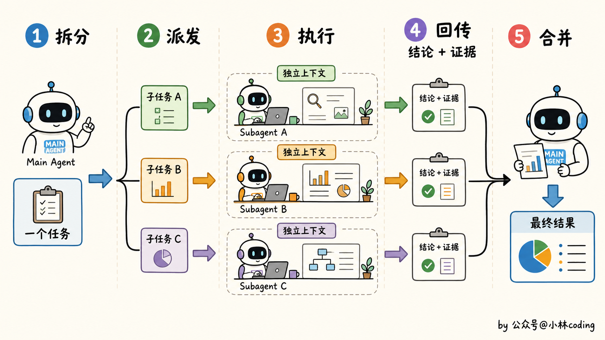

独立上下文是这套机制的关键。一个 Subagent 在调查中产生的搜索结果、命令输出和中间笔记，不需要全部堆进主上下文。主 Agent 最后拿到的是整理过的结论，而不是子任务的全部过程。

Subagent 默认继承主任务的权限模式，并在当前工作区内使用工具。因此，代码探索、资料整理、测试和问题归类这类互相独立的任务，很适合并行。多个 Subagent 同时修改同一批文件时，则可能产生冲突。

如果需要几路任务同时改代码，可以在 Codex 中分别创建多个顶层任务，并为它们选择独立 Worktree。Worktree 提供文件层面的隔离，而 Subagent 提供上下文和分工层面的拆分，两者解决的不是同一个问题。

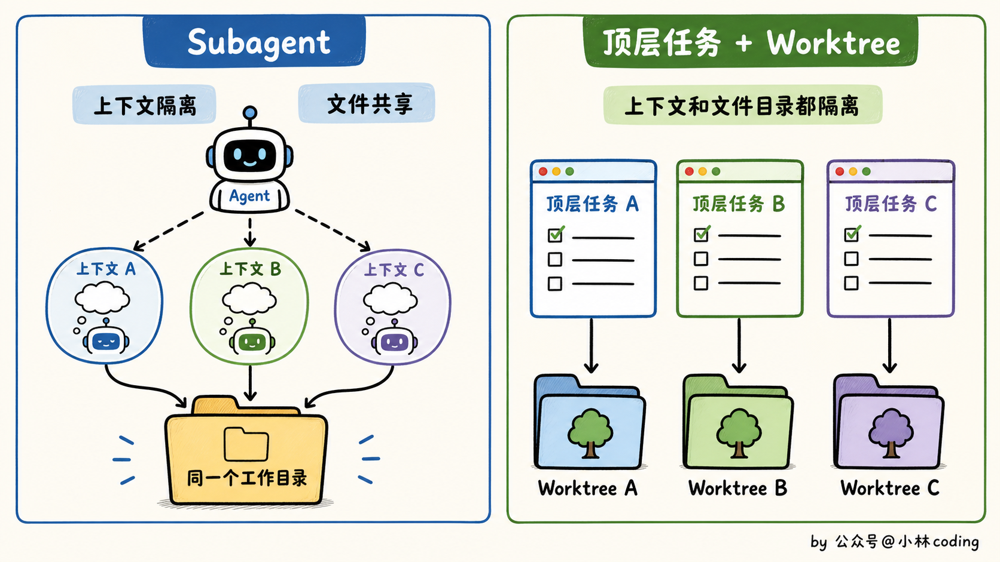

Codex 已经内置 `default`、`worker` 和 `explorer` 等通用 Agent。如果团队需要固定职责，也可以在 `.codex/agents/` 中创建项目级自定义 Agent。不过，普通并行任务不必先定义岗位，直接在提示词中说明「请并行安排三个 Subagent」即可。

## 04｜MCP：怎么接上外部系统？

### 为什么需要 MCP？

Codex 可以读取项目文件、修改代码和执行本地命令，但完成一个真实任务，往往还需要仓库之外的信息。

产品需求可能放在云端文档，Issue 放在 GitHub，业务数据放在数据库，项目进度则记录在协作工具中。这些信息不在当前工作区，而且还会持续变化。

如果每接入一个外部系统，都要单独定义工具说明、参数格式和返回结果，连接方式就会变得很碎片。MCP 提供了一套统一的通信规则，让 Codex 可以用相同的方式发现和调用不同的外部工具。

MCP 全称 Model Context Protocol，可以把它理解成 AI 工具世界的「通用插座」。外部服务通过 MCP 告诉 Codex 自己能提供什么数据和操作，Codex 再根据当前任务选择对应的能力。

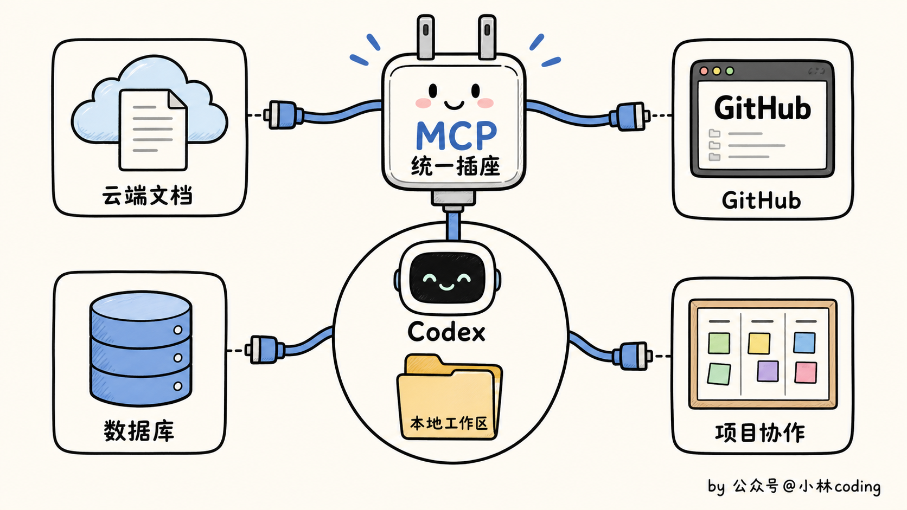

### 怎么接入 MCP 工具？

在 Codex 里，可以直接通过插件市场安装常见的 MCP 工具，安装完成后就能在新任务中调用。

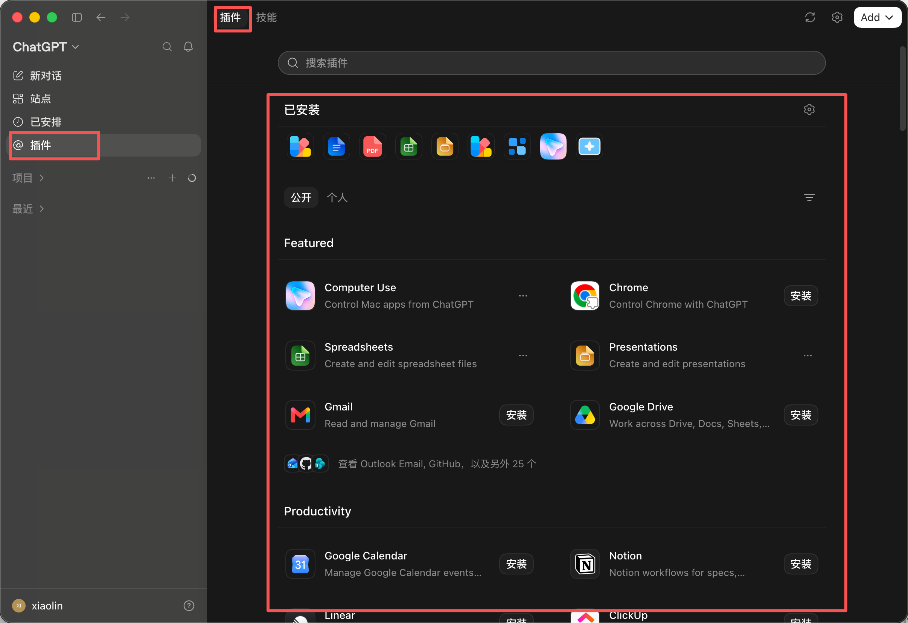

这里以 Google Drive 为例。先创建一份名为 `Codex MCP Demo` 的测试文档，并写入下面几条模拟内容。

```text
项目：会员中心改版
上线时间：8 月 20 日
待办：
1. 确认新版页面文案
2. 补充登录异常监控
3. 完成上线前回归测试
```

接着打开 Codex 侧边栏的「Plugins」，搜索 `Google Drive`，进入详情页后点击加号安装。如果 Codex 提示连接 Google 账号，按页面引导完成登录和授权。

安装完成后新建一个 Codex 任务，直接发送下面的提示词。

```text
使用 Google Drive 工具查找名为「Codex MCP Demo」的文档。

读取文档内容，输出项目名称、上线时间和待办事项。
只读取和整理，不要修改或创建任何文件。
```

Codex 会根据任务内容自动选择 Google Drive 提供的工具，不需要再输入额外命令。

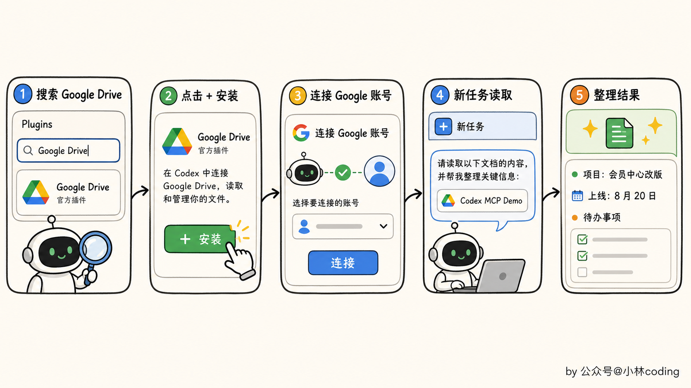

### MCP 工具是怎么工作的？

看到这估计有同学就问了：我只说了一句「去 Google Drive 找文档」，Codex 怎么知道该调哪个工具？

关键就在 MCP。简单来说，MCP 就像一套统一的「工具说明书和通信规则」。Google Drive 接入后，会先告诉 Codex 自己提供了哪些工具、每个工具能做什么，以及调用时要填哪些参数。

当你说「找到 Codex MCP Demo 并读取内容」时，Codex 会先从这些说明中找到匹配的工具，生成查找文档所需的参数，再把请求发给 Google Drive。对方查到文档后把结果返回，Codex 发现还需要读取正文，就会继续调用读取工具。拿到内容后，才会整理成你看到的回答。

如果用 MCP 里的名词来对应，Codex 是 Host，负责理解任务和选择工具。Codex 内部的 MCP Client 像一个传话员，负责发送请求和取回结果。连接外部服务的 MCP Server 则负责真正执行查找、读取或写入操作。

这套流程并不只属于 Google Drive。换成数据库、GitHub 或其他外部系统，Codex 仍然可以用同一套方式理解和调用它们。MCP Server 除了提供可执行的 Tools，还可以提供可读取的 Resources 和可复用的 Prompts。

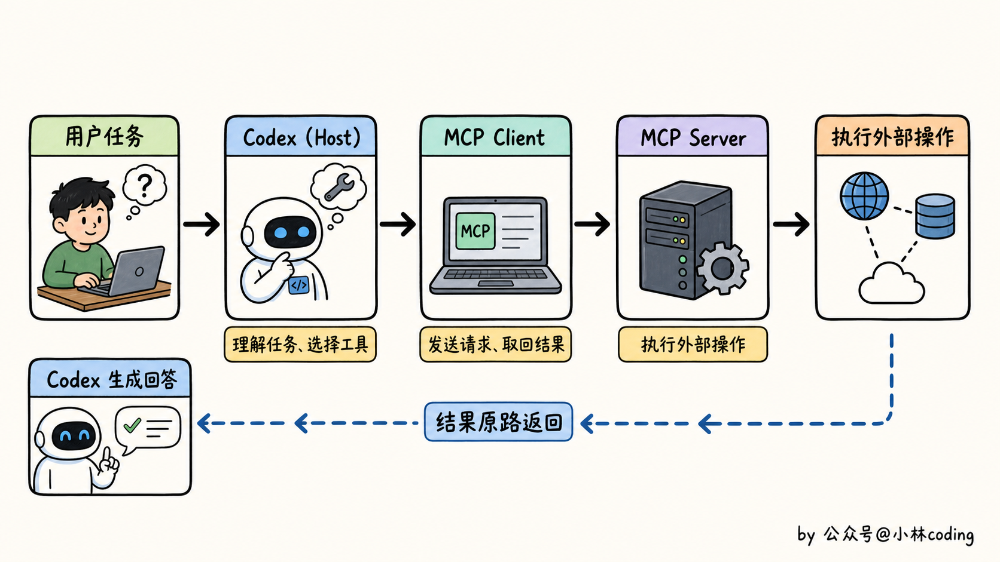

## 05｜Hooks：检查怎么每次都自动跑？

### 为什么需要 Hooks？

提示词和 `AGENTS.md` 都是在告诉 Codex 应该怎么做，适合放项目背景、代码规范和修改约束。但测试、格式化和安全扫描这类动作，更适合由程序在固定时机自动执行。

比如团队要求每次任务结束前都运行检查命令。如果每次都写进提示词，不仅需要重复交代，执行时机也不固定。Hooks 可以把这个动作绑定到任务的生命周期节点上。

### Hooks 是什么，有什么用？

Hooks 是 Codex 任务生命周期中的自动触发器。当任务运行到某个节点时，Codex 会自动调用预先配置的 Handler，不需要用户再次发送提示词。

Hooks 可以在任务启动时加载上下文，在工具执行前检查命令，在工具执行后记录结果，也可以在任务结束前运行测试、格式化或安全扫描。

Hooks 就像安装在 Codex 工作流程中的感应门。Codex 运行到对应位置，就会触发门后的脚本。

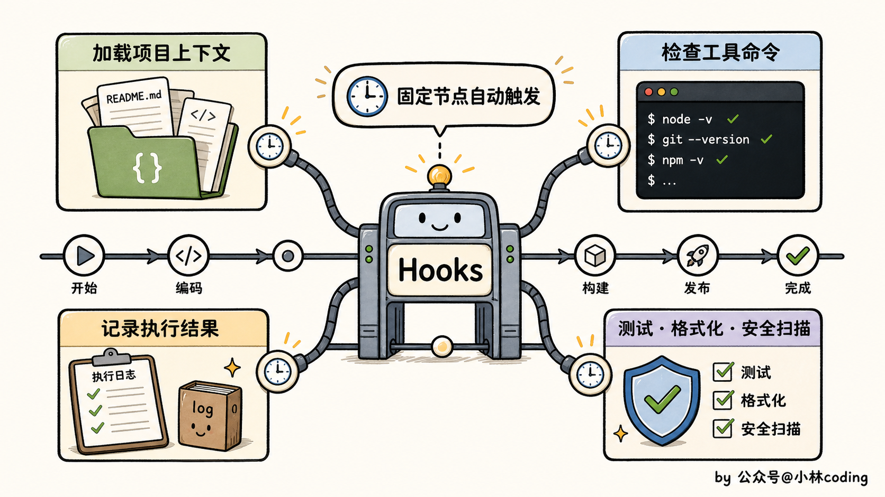

### 一个简单的 Hook 例子

假设文档项目中已经有 `python3 scripts/check_docs.py` 检查脚本，可以让 Codex 创建一个 Stop Hook，在任务准备结束时自动运行它。

```text
请为当前项目创建一个 Stop Hook。

任务准备结束时，自动运行
`python3 scripts/check_docs.py`。

检查通过时正常结束任务。
检查失败时把摘要交给 Codex 继续处理。

请创建所需的 Hook 配置和 Handler，不修改现有文档。
```

接受修改后，在这个本地项目中新建一个任务。以后 Codex 每次准备结束任务，Stop Hook 都会自动运行文档检查，不需要在提示词中重复提醒。

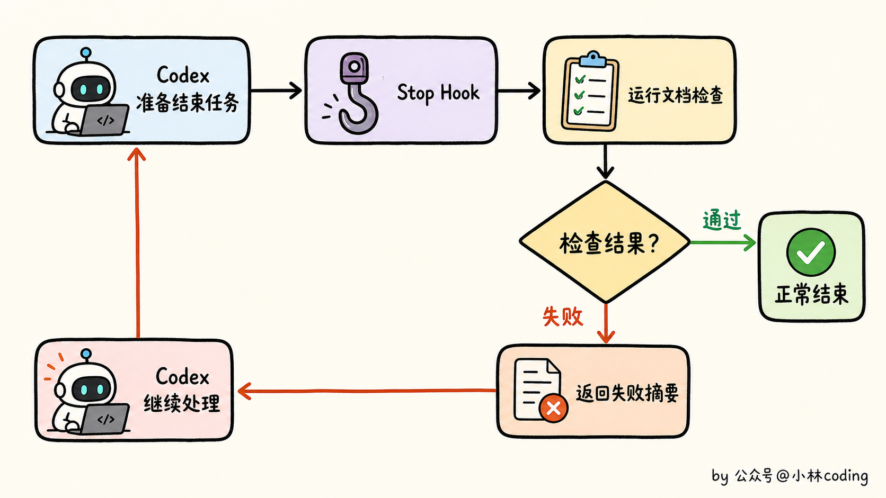

### Hooks 是怎么工作的？

Hook 配置主要说明三件事：监听哪个生命周期事件、什么条件下命中，以及命中后执行哪个 Handler。

| 生命周期节点 | 触发时机 | 常见用法 |
| --- | --- | --- |
| `SessionStart` | 任务会话启动时 | 加载环境信息或项目上下文 |
| `UserPromptSubmit` | 用户提交任务时 | 记录或补充输入上下文 |
| `PreToolUse` | 工具执行之前 | 检查命令或阻止不允许的操作 |
| `PostToolUse` | 工具执行之后 | 记录结果或补充校验 |
| `Stop` | 任务准备结束时 | 运行测试、格式化或安全扫描 |

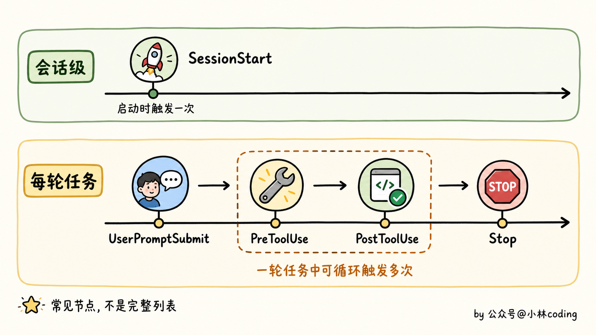

当 Codex 运行到这个节点时，会先找到匹配的 Hook，再调用对应的 Handler。Codex 会通过标准输入把当前工作目录和事件名称等信息交给 Handler。如果是工具相关事件，输入中还会包含工具名称和参数。

Handler 执行完成后，再通过退出码或 JSON 结果告诉 Codex 是继续运行、停止当前动作，还是把新的上下文交回给模型。

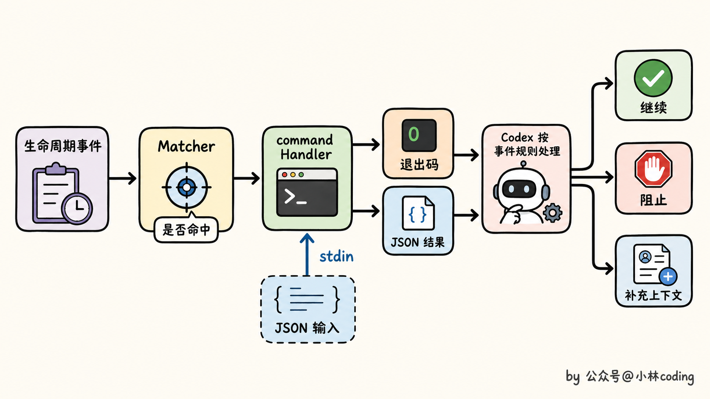

## 最后

最后用一张表，把这五项能力的作用放在一起。

| 能力 | 作用 |
| --- | --- |
| `AGENTS.md` | 让 Codex 在项目中持续遵守固定规则 |
| Skills | 封装可复用的专项知识和操作流程，按需加载 |
| Subagents | 拆分独立子任务，并行调查并汇总结果 |
| MCP | 连接仓库外的数据、工具和外部系统 |
| Hooks | 在 Codex 的固定生命周期节点自动执行动作 |

今天的分享就到这里，我们下次见！
