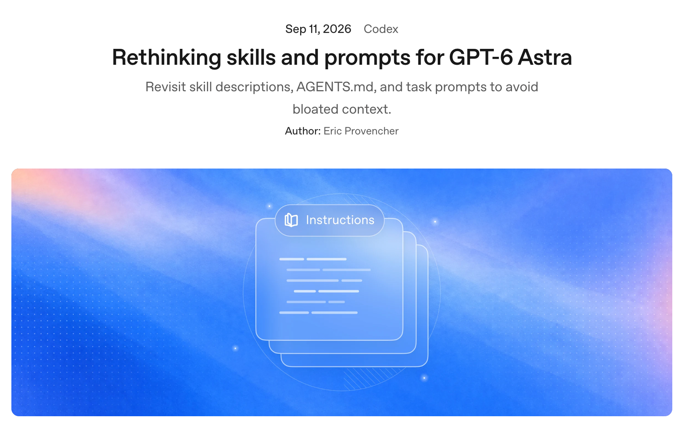
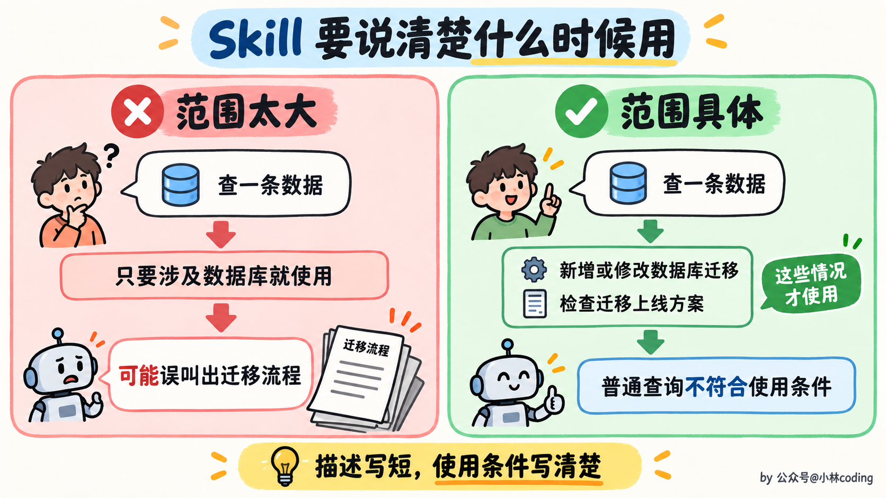
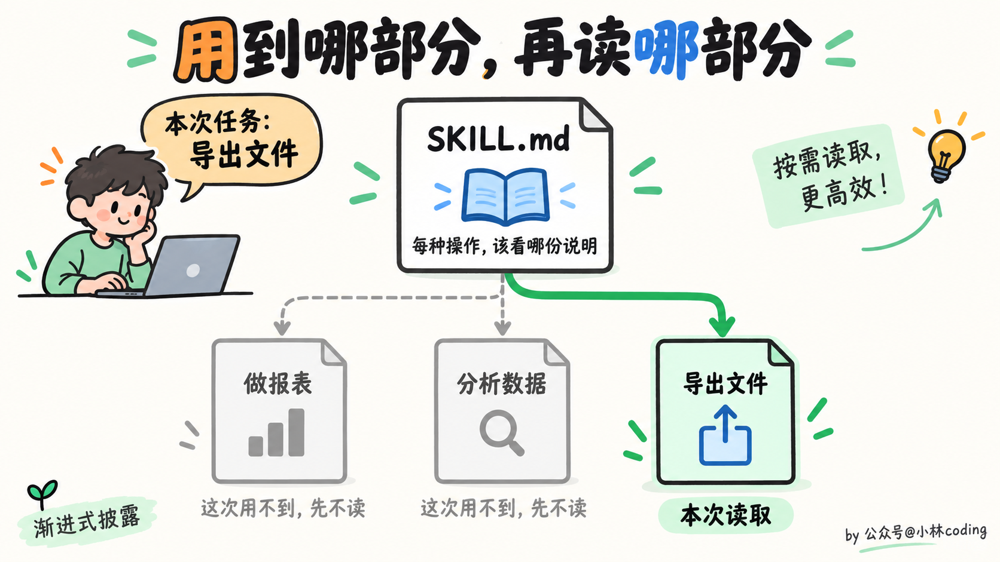
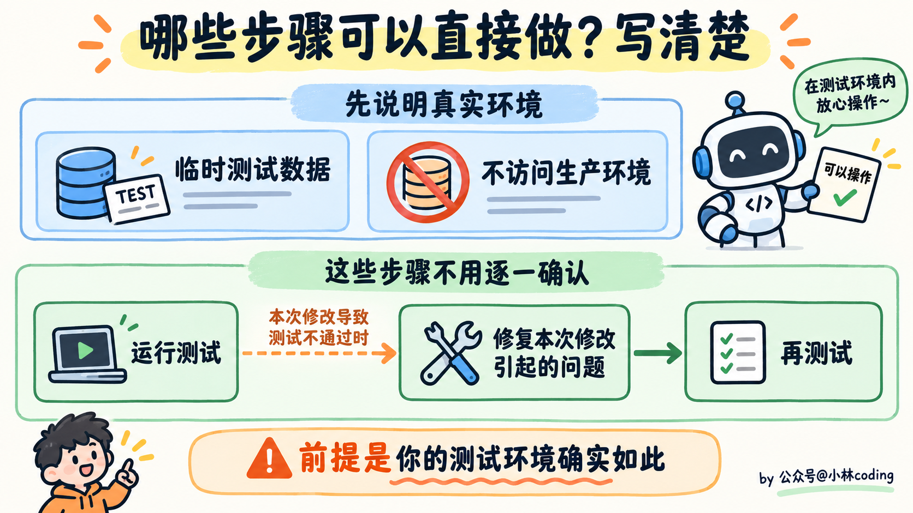

# GPT-6 使用指南：怎样让 Codex 更好地完成任务？

> 原文：[GPT-6 使用指南：怎样让 Codex 更好地完成任务？](https://xiaolinnote.com/codex/playbook/openai_gpt6_usage_guide.html) · 小林面试笔记

大家好，我是小林。

就在前几天，OpenAI 官方博客发了一篇文章，叫《Rethinking skills and prompts for GPT-6 Astra》。专门聊怎么调整提示词、Skills 和 `AGENTS.md`，才能让 GPT-6 更好地帮我们干活。

里面有个提醒挺有意思，你以前辛辛苦苦给 AI 写的那些规则，现在可能得改改了。

啊？这些规则可都是踩过坑才补上去的，怎么模型升级了，反而还要改？

因为有些事情，旧模型需要你一步步教，GPT-6 已经能自己判断了。

那到底哪些规则该改，具体又怎么改？我把 OpenAI 的建议整理了一下，跟大家聊聊。

## 01｜Skills 装得越多，AI 就越强吗？

现在不少人看到好用的 Skill，第一反应就是先装上。写代码的、查资料的、做设计的，主打一个我可以不用，但你必须得会。

那装了几十个 Skills，AI 就能自动挑出最合适的那个吗？

AI 怎么知道该用哪个 Skill？它会先看名字和描述，了解这个 Skill 能做什么。OpenAI 提到，如果装的 Skills 太多，描述又很长，Codex 为了把这些介绍放进上下文，就会把描述截短。介绍看不全，AI 自然就更难选对。

好家伙，装了一堆 Skills，结果 AI 连这些 Skills 是干什么的都看不全，还怎么选对？

而且，Skill 的描述也不能写得什么都管。

OpenAI举了一个数据库迁移 Skill 的例子，它本来是帮你给表加字段、改表结构的。

**修改前**

> 创建并验证 Postgres 数据库迁移。涉及数据库、查询、数据模型或持久化时使用。

**修改后**

> 创建并验证 Postgres 数据库迁移。新增或修改迁移，或检查迁移上线方案时使用。

你看出问题了吗？我只是让 AI 查条数据，它也可能把修改表结构的那套流程翻出来。查个数据而已，有必要搞这么复杂吗？

你看，前半句根本没动，它负责的事情没变。改的是后半句，把「碰到数据库就叫它」缩小成「处理数据库迁移时才叫它」。所以，**Skill 的描述尽量写短，同时说清楚什么时候才需要用它。**

那 Skill 正文是不是越详细越好？也得看这些内容什么时候需要。

假设一个 Skill 既能做报表，又能分析数据，还能导出文件。你这次只想导出文件，AI 有必要把做报表、分析数据的说明也读一遍吗？没必要吧。

那就把这三种操作的详细说明分开放，再在 `SKILL.md` 里告诉它去哪看。

**修改前**

> 使用这个 Skill 前，先完整阅读报表制作、数据分析和文件导出的全部说明，再开始处理任务。

**修改后**

> 根据本次任务，阅读对应的说明。制作报表看 references/`report.md`，分析数据看 references/analysis.md，导出文件看 references/export.md。只读取本次任务需要的部分。

这里的文件名是举例，你要换成自己 Skill 里真实存在的文件。这样你只让它导出文件时，它就不用先把另外两份说明也读一遍。

OpenAI把这种做法叫「渐进式披露」。说白了，就是用到哪部分，再读哪部分，别一上来全塞给它。

还有，别什么任务都给 AI 写好几十步，让它严格照着走。OpenAI 提到，模型越来越能理解复杂情况，以前需要你一步步教，现在有些事情已经能自己判断怎么做了。

那哪些步骤该留，哪些可以删？拿做报表来说，你当然要告诉它必须包含哪些数据。但如果规定「做任何报表之前，都必须先读完这五份资料」，就值得想想，这次真的每份都用得上吗？

**你要什么结果，得说清楚。至于具体怎么做，有些步骤可以让它自己判断。**

## 02｜你的 AGENTS.md ，该做减法了吗？

聊完 Skills，再看另一个熟悉的文件，`AGENTS.md`。你可以把它理解成放在项目里的工作说明，告诉 Agent 这个项目有什么约定、该怎么干活。

很多规则怎么来的？模型漏跑一次测试，就加一句「必须测试」；改代码没看清结构，就再补一句「修改前必须阅读架构文档」。慢慢地，文件越来越长，每条背后都有一段血泪史。

可换了模型以后，这些要求还都需要吗？

OpenAI 举的例子很形象，有些项目要求每次修改前，都先读架构、数据库和部署文档。问题是，如果这次只是改一个错别字呢？

错别字还没改，入职培训先走了一遍。

那怎么写更合适？OpenAI也给了修改前后的对照。

**修改前**

> 每次修改前，必须先阅读 `architecture.md`、`database.md` 和 `deployment.md`。

**修改后**

> 不清楚各个服务分别负责什么时，查 `architecture.md`。修改表结构时，查 `database.md`。准备部署上线时，查 `deployment.md`。

同样是这三份文档，改完以后，AI 就知道什么时候需要看哪份了。改个错别字，也不用先把部署流程学一遍。**这次做什么，就看相关的资料，没必要每次都从头读一遍。**

测试也是一样。以前怕 AI 改完代码不检查，你可能会反复强调「必须跑测试」「改完一定要再检查」。但 OpenAI 提到，GPT-6 Astra 本身就会主动做这些事。如果还留着一堆催它检查的要求，它可能会多跑一些没必要的测试。你只是想让它别漏检查，结果它在检查这件事上花了太多时间。

看到这里，你可能想问，那我把 `AGENTS.md` 清空，是不是就好了？

也不用直接清空。比如代码要按什么格式写，订单金额要怎么计算，哪些操作不能碰生产数据，这些是你项目里的具体要求，AI 未必知道，当然得留着。

真正值得回头检查的是，同一个要求是不是写了好几遍，有些规定是不是早就不适用了，还有那些不管改什么，都要求 AI 从头走一遍的流程。**每条规则都问一句，这次干活真的需要它吗？**

对了，如果这个项目是团队一起用的，还得多想一步，其他同事用的是什么模型？OpenAI 提醒，有些模型还需要你把步骤写细一点，同样的步骤给 Astra，又可能管得太死。所以，改大家共用的 Skills 和项目规则时，也看看其他模型还能不能把任务做好。

## 03｜为什么它总停下来问你？

你有没有碰到过这种情况？任务明明交代清楚了，AI 却干几步就问一句「是否继续」。你坐在电脑前，什么都不用干，光顾着回复「继续」了。

这时除了催它，也值得看看，你是不是曾经写过「执行任何操作前都必须获得确认」？

以前怕 Agent 乱改东西，要求它先问你，这很正常。但 OpenAI 提醒，Astra 可能会把这类要求理解得很严格。你觉得「这种小事直接做就行了」，它却觉得「你明明说了，操作前必须先问」。

那怎么改？把哪些事可以自己做、哪些事必须先问你，分别写清楚。

OpenAI 给了一个本地测试的授权例子。

**修改前**

> 运行测试、修改代码或重新验证之前，都必须先获得我的确认。

**修改后**

> 本地测试使用临时数据，不会访问生产环境。你可以直接运行测试，修复本次修改导致的问题，并重新运行相关测试，不用每一步都问我。需要部署上线时，先等我确认。

改完以后，它就知道，跑测试、修问题可以接着干，部署上线要先问你。你也不用从头到尾守着回复「继续」了。

当然，前提是你的测试确实不会连接生产环境。如果会，就不能照抄这句话。这里得写真实情况，别为了让 AI 少问两句，连自己用的是什么环境都随便写。

我们自己写规则时，也可以照这个思路来。比如，你希望 AI 在本地改代码、跑测试、修问题时直接继续，那就明确告诉它。部署上线、给别人发消息、删除重要数据这些事，如果需要先经过你同意，也单独写清楚。

别一句「你看着办」就全撒手，也别一句「任何操作都问我」，把自己变成了审批机器人。

## 04｜怎么让它把事情真正做完？

权限交代清楚了，还有一个问题，**它理解的「完成」，跟你理解的一样吗？**

OpenAI 提到，如果你习惯了 GPT-5.6 Sol 接到任务就一直往下干，换到 Astra，可能会发现它有时没那么主动。第一版代码刚写好，就回来等你检查了。

这就有点尴尬了。你想要的是一个能用的功能，它把代码写完就交给你。至于能不能跑起来、页面有没有问题，还得你自己接着检查。

那怎么让它多往前做几步？一开始就告诉它，**做到什么程度才算完成。**

比如你想给后台加个按姓名搜索的功能，它做到哪一步就可以停了？代码写好就行，还是得把页面打开，确认真的能搜出结果？这些最好提前说清楚。

按照原文的建议，我整理了一组提示词对照。

**修改前**

> 给用户管理页加一个按姓名搜索的功能。

**修改后**

> 给用户管理页加一个按姓名搜索的功能。写完后运行相关测试，并打开页面检查能否正常搜索、搜不到时有没有提示、清空后列表能否恢复。发现问题就修好并复查，最后告诉我修改和检查结果。确实做不下去时，说明卡在哪里。

功能还是同一个功能，但这次你把「做到哪里才算完」交代清楚了。代码写完以后，它还有明确的事情要继续做。**代码写完还不算结束，要跑起来、检查过，有问题还得修。**

当然，也得看你这次想让它干什么。如果只想讨论方案，就说「先讨论方案，暂时别改代码」。如果想先看设计，就说「设计做完先给我看，确认后再开始写代码」。你需要它停在哪里，也可以提前说清楚。

那如果第一版已经做好了，你还想让它继续检查呢？也别只丢一句「继续优化」。可以说「再检查一下搜索框，输入空格、姓名里带特殊符号时，会不会出问题，有问题就修好」。

这样它才知道接下来要检查什么。不然一句「继续优化」，究竟还要改什么、改到什么时候，你自己可能都没想清楚。

## 最后

读完这篇文章，我觉得最值得做的一件事，就是回去检查一下自己的那堆老规则。

还得自己一条条看吗？倒也不用。OpenAI 在结尾给了个建议，把这篇官方文章交给 GPT-6 Astra，让它帮你检查现有的规则。我整理了一段提示词，可以直接拿去用。

> 请阅读这篇 OpenAI 官方文章 [https://developers.openai.com/blog/rethinking-skills-and-prompts-for-gpt-6-astra](https://developers.openai.com/blog/rethinking-skills-and-prompts-for-gpt-6-astra) ，根据文中的建议，帮我检查当前项目的 `AGENTS.md` 和相关 Skills。看看有没有重复的要求、互相矛盾的规定，或者已经不适用的内容。哪些 Skill 把使用范围写得太大，容易在不需要的时候被调用？哪些要求可能让你反复问我是否继续，或者事情还没做完就停下来？请指出具体是哪条，解释原因，并给出修改建议。项目里必须遵守的业务要求，以及保护生产环境和重要数据的规定，要保留。先列出建议，等我看过再修改。

所以，换了新模型，也别忘了翻翻以前给它写的那些规则。

尤其是那些「上次踩了坑，所以补一句」的要求，过去有用，现在还需不需要，可以重新看看。

说不定模型已经能自己做好了，你还在旁边反复叮嘱。

你们现在的 `AGENTS.md` 写了多少行？有没有哪条规则，加的时候很解气，后来却让 AI 干什么都要先问你？评论区聊聊。

官方原文：[Rethinking skills and prompts for GPT-6 Astra](https://developers.openai.com/blog/rethinking-skills-and-prompts-for-gpt-6-astra)
