# Codex 记忆机制图解：Agent 的记忆系统是怎么设计的？

> 原文：[Codex 记忆机制图解：Agent 的记忆系统是怎么设计的？](https://xiaolinnote.com/codex/source/codex-memory-mechanism.html) · 小林面试笔记

大家好，我是小林

之前发了[图解Codex的Harness架构](https://xiaolinnote.com/codex/source/codex_harness.html)的文章，得到了很多读者的好评。

那么这次就来**图解 Codex 记忆机制**，我们一个一个来看。

- Q1：模型为什么不会天然记住你？
- Q2：Codex 怎样管理当前任务的模型可见历史？
- Q3：上下文快满时，Codex 会在什么时候压缩，又有哪些压缩策略？
- Q4：上下文压缩以后，同一任务怎样恢复现场？
- Q5：旧任务怎样经过两阶段处理，变成跨任务长期记忆？
- Q6：新任务怎样查找、纠正和淘汰旧记忆？

## 01｜模型为什么不会天然记住你？

Codex 能接住你的上一句话，是模型自己保存了状态，还是有人把历史重新递给了它？

答案是后者。

每次请求模型之前，Codex 都会重新组装输入，包括基础指令、项目规则、历史消息、工具结果和当前需求。

模型之所以能接住前文，不是因为它在两次推理之间保存了任务状态，而是因为 Codex 把需要的信息再次放进了本次请求。我们后面讲的上下文管理、压缩和长期记忆，最终都是在解决同一个问题：怎样把此刻最有用的信息放进下一次请求。

但一次请求能处理的 Token 数量有上限。编程 Agent 又会不断读取代码、跑测试、接收工具结果，历史不可能无限增长。所以 Codex 既要保存任务状态，也要控制模型眼前能看到的内容。

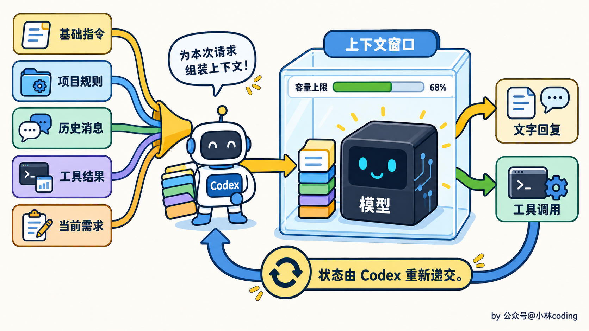

不过，Codex 要解决的不只是眼前窗口会不会满。继续当前任务、恢复已经关闭的任务、让新任务复用旧经验，看起来都像「记住了」，背后却是三套不同机制。

当前上下文，负责让眼前的任务继续执行；会话历史，负责让关闭后的同一任务能够恢复；长期记忆，则负责让新任务复用旧任务里值得保留的经验。

它们解决的是三个不同问题。上下文压缩负责重建当前上下文，Rollout（任务运行档案）和 checkpoint（上下文恢复点）负责恢复原任务，长期记忆流水线处理跨任务复用，三者不能混为一谈。

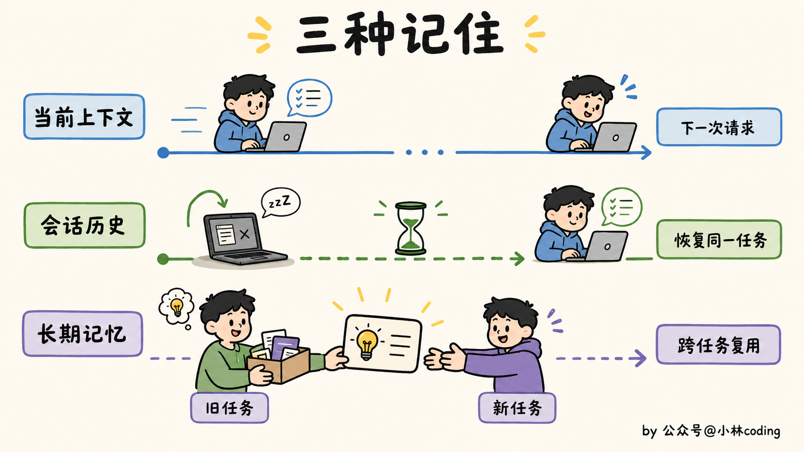

接下来，我们从当前任务的上下文管理讲起。

## 02｜Codex 怎样管理当前任务的记忆？

任务执行过程中，Codex 会整理之前的对话、工具调用和返回结果，供下一次请求模型时使用。负责这件事的，就是上下文管理器。

要注意，Codex 保存了哪些记录，和这次会把哪些记录发给模型，是两回事。

用户发来需求，历史里多一条用户消息。模型决定读取文件，历史里多一个工具调用。文件内容返回，又多一个工具结果。模型继续修改和测试，新的调用与结果再接着往后追加。

所以当前上下文并不是一份静态 Prompt，而是一段不断生长的任务现场。

这也是为什么编程 Agent 特别容易撞到上下文压力。普通聊天主要增加文字，Agent 还会不断带回代码、目录、日志、网页和结构化工具结果。

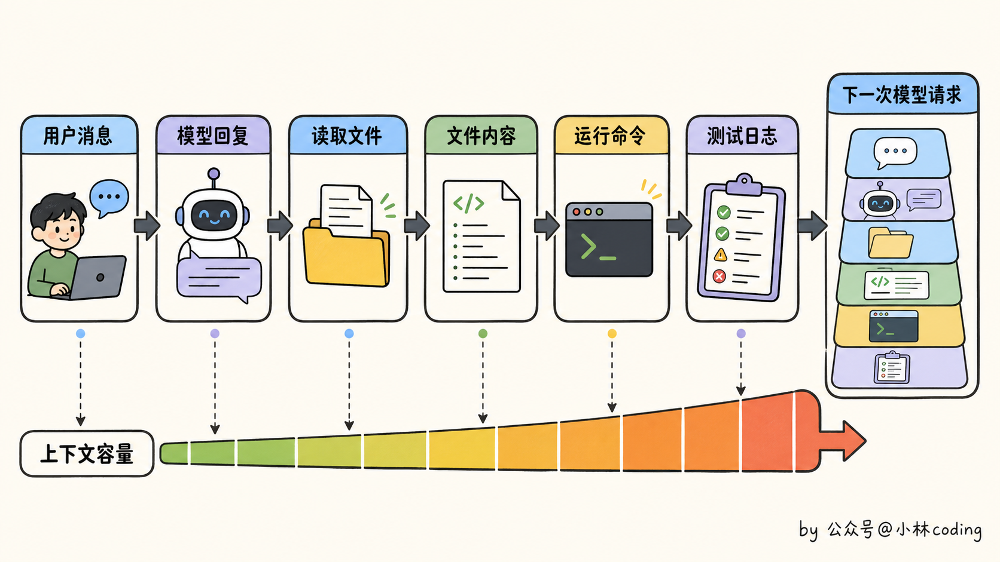

Codex 不会等历史完全塞满才开始处理。

工具结果写进模型历史时，就会先应用限长策略。也就是说，一次工具返回几十万字符，并不代表几十万字符都会原样进入后续请求。

这是第一道防线：先限制每次工具结果的长度，避免一份特别长的日志就占掉大量上下文空间。

同一份工具结果，会有两种保存方式：准备发给模型的那份会限制长度，写进任务档案 Rollout 的那份则会保留更多内容。所以，后续请求少带了一部分，不代表任务档案也删掉了那部分。这里先把 Rollout 理解成 Codex 在模型之外持续保存的任务档案，第 04 章我们再展开。

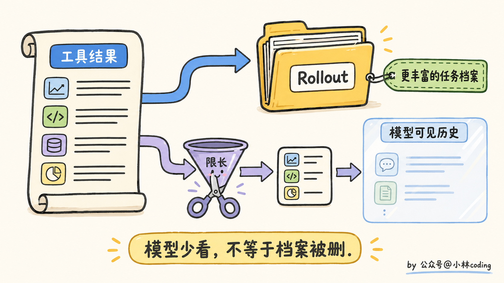

### Codex 怎么知道上下文快满了？

有了限长，历史还是会继续增长。最直觉的办法，是不是数一数已经积累了多少条消息？

问题是，一条工具结果可能比几十轮普通对话还长。真正决定上下文压力的不是消息数量，而是 Token 用量。

Codex 会维护当前上下文的 Token 使用状态，优先采用服务端反馈，必要时再根据历史估算，然后把当前用量和自动压缩阈值进行比较。

自动压缩阈值可以提前设置，但模型的真实上下文窗口始终是不能突破的硬上限。

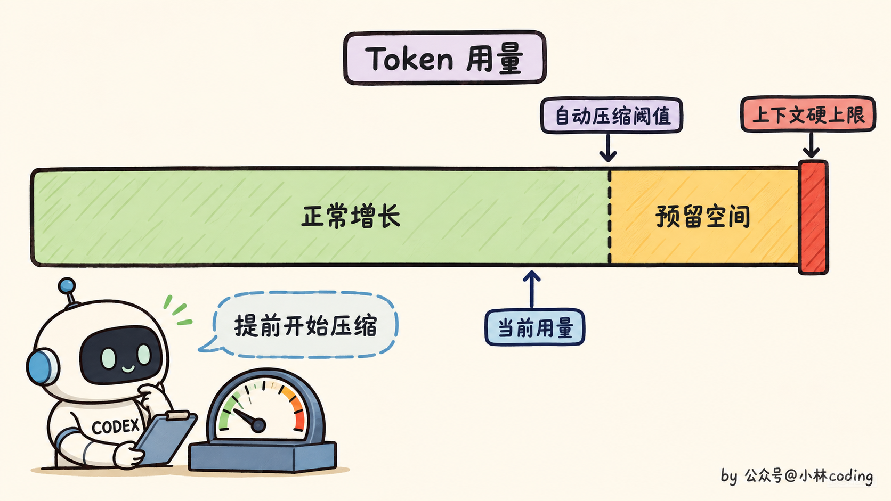

当历史继续增长并达到阈值，才轮到真正的上下文压缩。

## 03｜上下文快满时，Codex 怎样压缩又接着干？

如果 Codex 只在新轮次开始前检查，某次工具调用突然带回大量日志怎么办？

所以压缩不能只发生在两轮对话之间。

自动压缩有两个重要位置。一个是新轮次开始前，如果旧历史已经达到阈值，Codex 会先压缩再继续；另一个是轮次运行中，工具结果把上下文推到阈值后，Codex 会建立新的上下文窗口，然后接着执行任务。

除此之外，用户也可以手动触发压缩。

也就是说，Codex 干活干到一半，也可能先整理上下文，腾出空间，再接着往下做。

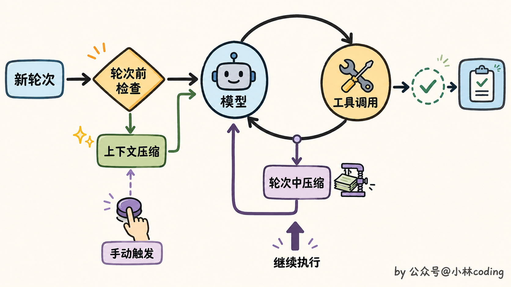

### 本地压缩怎样重建历史？

Codex 有几条压缩路径，其中本地总结最容易看清完整过程，我们先拆这条。

Codex 会把当前历史连同一条专门的压缩指令交给模型。这条指令不是让它继续修 Bug，而是先整理一份供后续请求使用的交接摘要。

摘要要覆盖当前进度、关键决定、用户偏好和限制、剩余工作，以及继续任务所需的重要数据。

这份摘要的目标，是让模型在处理后续请求时知道任务做到哪一步、接下来还要做什么。

这两个目标差别很大。

普通会议摘要可能写「团队讨论了三个方案」。任务交接摘要必须继续回答：最后选了哪个方案，为什么，哪些文件已经改过，测试还差哪一步，哪条路已经证明走不通。

生成摘要以后，Codex 不再让后续请求背着全部旧工具调用和日志，而是构建一份更小的替代历史。

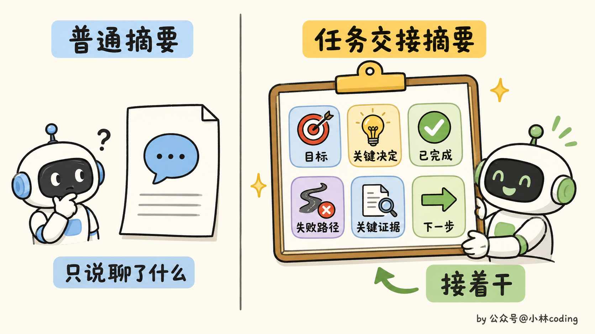

摘要生成以后，原来的历史也要跟着重建。

本地压缩并不是只留一段摘要。

本地压缩还会保留一部分用户原话。能保留多少，取决于可用的 Token 空间；空间有限时，优先保留最近的消息，再把交接摘要接在后面。尤其是明确的需求和约束，用户原话通常比模型的二次转述更值得保留。

但是，旧工具调用、旧工具结果和大量中间过程不会继续完整占据当前窗口。这些过程最后得出的结果，会写进交接摘要。

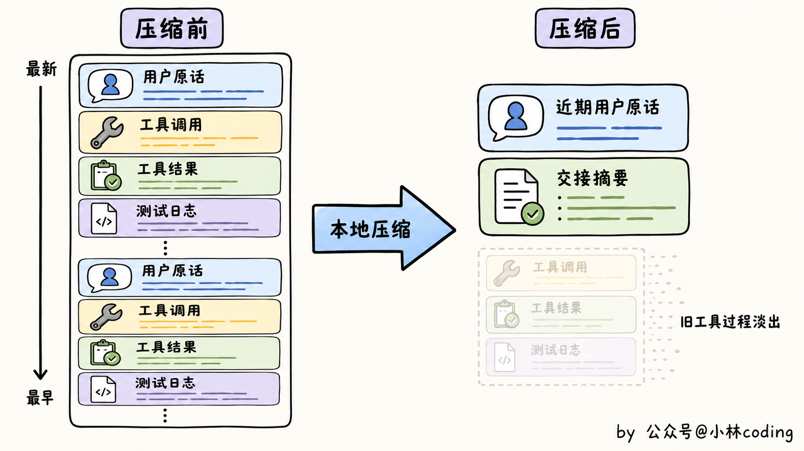

摘要可能漏掉项目规则，这些规则怎么办？

Codex 会单独提供：基础指令本来就随每次请求发送，项目规则、开发者要求和环境信息也会重新补上。这样，即使摘要没提到某条规则，模型仍然能看到它。

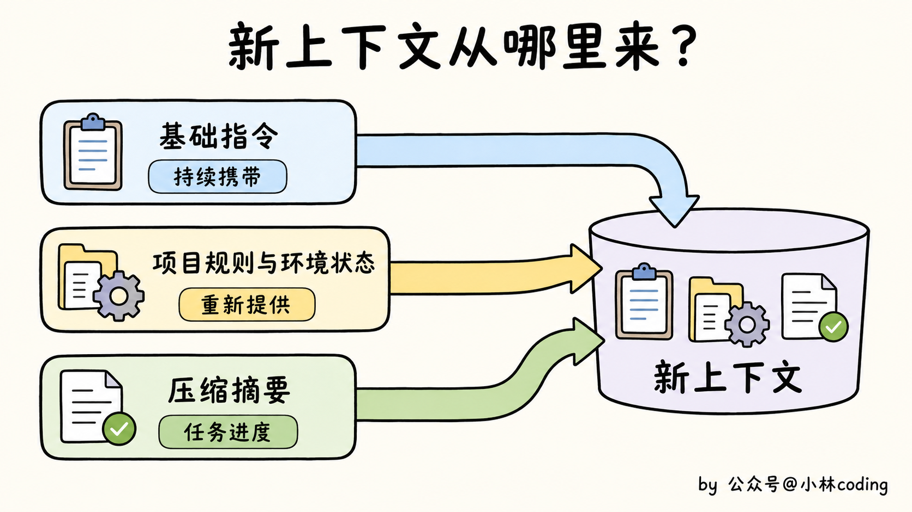

前面讲的是本地总结。实际上，Codex 会根据配置和模型服务能力选择压缩方式：启用 Token 预算策略时，达到预算后直接建立新窗口，不再生成摘要；否则，服务端支持远程压缩就交给服务端处理，不支持才使用本地总结。

三种方式虽然过程不同，目的都是腾出新的上下文空间，让任务继续执行。

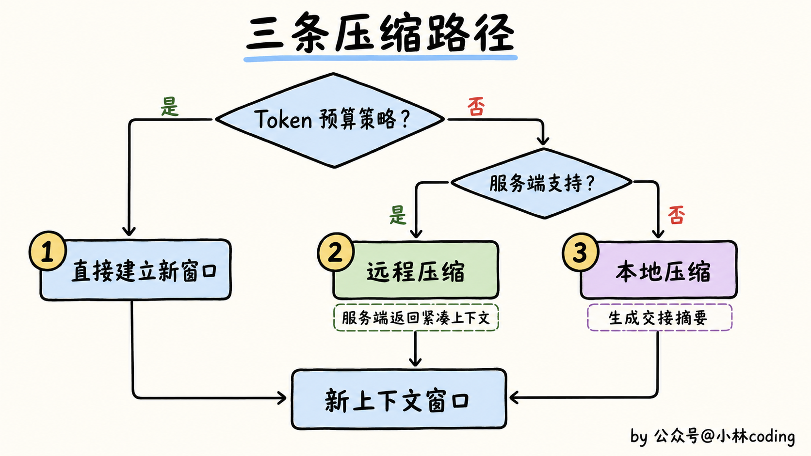

压缩过早会增加成本和信息损失，过晚又可能没有足够空间生成摘要，所以触发阈值本身也是一种取舍。

## 04｜任务关闭以后，现场为什么还能恢复？

如果只看模型当前窗口，确实有大量旧内容已经不在了。

但 Codex 还有另一层：Rollout 持久化。

任务运行过程中，用户消息、模型输出、工具调用、事件和上下文变化等记录，会持续写入 JSONL。这里保存的是 Codex 本地的任务历史，不等于每次都要发送给模型。

压缩发生时，Codex 还会额外写入一条压缩记录（`CompactedItem`），保存替代历史以及恢复这个上下文窗口所需的元数据。

也就是说，压缩不是偷偷改完内存就算了。它会留下一个明确的恢复点。

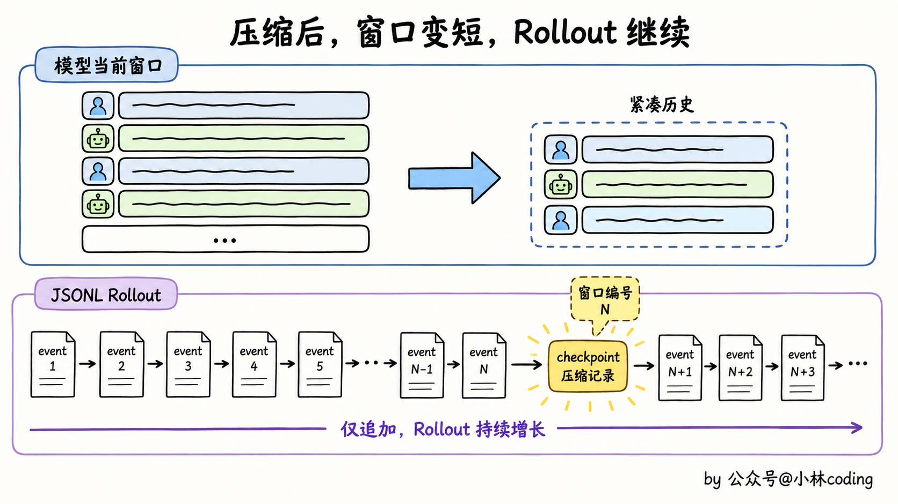

最直觉的恢复办法，是不是把整份 JSONL 从头塞回模型？

Codex 没有这样做。它会先找到最近一次仍然有效的压缩恢复点（checkpoint），取出当时保存的精简历史。然后，把恢复点之后新增的消息和工具结果按顺序补回来，恢复出任务继续执行时需要的上下文。

同时，Codex 还会恢复一份记录，标明哪些规则和环境信息已经加入历史，避免再次追加相同说明。窗口信息和最近使用的模型设置，也会一起恢复。

可以把它理解成数据库恢复里的「快照加增量日志」。

快照负责给出某个时刻的紧凑状态，后面的日志负责补齐从那个时刻到任务关闭之间发生的变化。

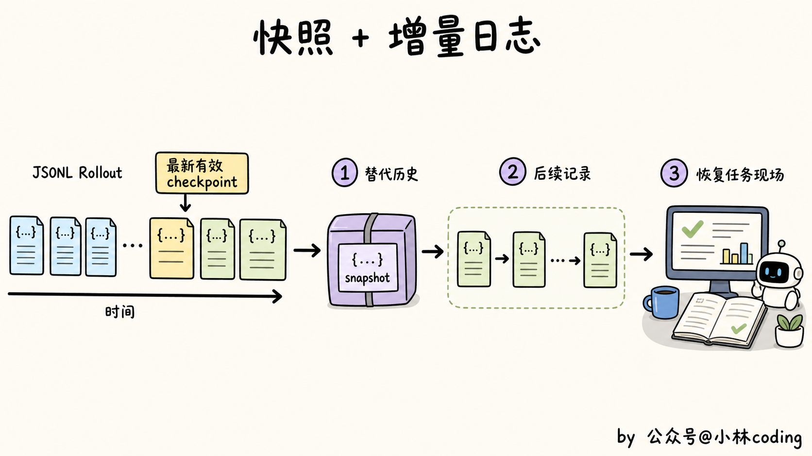

这里再次说明了压缩摘要、持久化历史和长期记忆的区别。

压缩摘要让模型接着当前任务做，会话 checkpoint 让同一任务重新打开后接得上。它们都还没有回答：一个全新的任务为什么要知道以前的经验？

## 05｜旧任务怎样变成跨任务的长期记忆？

先说明一下：在本文分析的 Codex 版本中，这套长期记忆机制默认关闭，需要在设置中打开「启用本地记忆」后才会生效。

很容易让人以为，Codex 会在每项任务结束时做一次总结，然后立刻写入记忆。

Codex 并不是这样做的。

新轮次成功启动以后，Codex 会尝试调度后台记忆流程。只有会话类型、功能配置和运行环境等条件都满足，流程才会真正开始。

后台流程启动后，会从已经空闲一段时间的旧任务中挑选材料。当前正在执行的任务，不参与这一轮记忆提炼。

这个时机挺有意思。

这样，你不用等记忆整理完，当前任务就能继续。刚做完的任务也会先放一放，避免结论还在变化，就急着记下来。不过，刚积累的新经验也不会马上出现在长期记忆里。

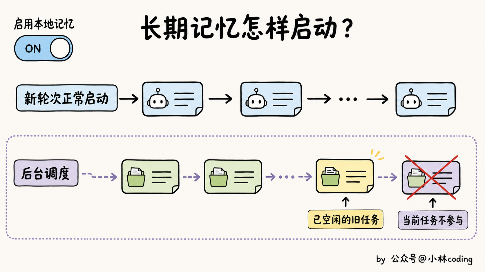

### 第一阶段，怎样从一项旧任务里挑出经验？

长期记忆的写入分两阶段。

旧任务只要结束了，就都值得写进长期记忆吗？

并不是。

第一阶段会从已经空闲、允许生成记忆的旧任务中，选出有限数量的任务。每项任务的运行档案（Rollout）会单独处理，分别提炼经验。

领取任务时，Codex 还会加上一把有时间限制的锁，这就是「租约」。在租约有效期间，其他后台任务不能重复处理同一份历史。

选中以后，Codex 会过滤出与记忆提炼有关的历史项，再调用专门的模型生成结构化结果，主要包括两部分：一份更详细的原始记忆，以及一份紧凑的任务摘要。

它想留下的不是流水账，而是可能改变未来行为的信息，比如稳定的用户偏好、难找的项目入口、已经验证过的工作流、失败原因和避坑方式。

如果这项任务没有值得复用的东西，模型可以返回空结果。生成的记忆字段还会经过敏感信息清理。

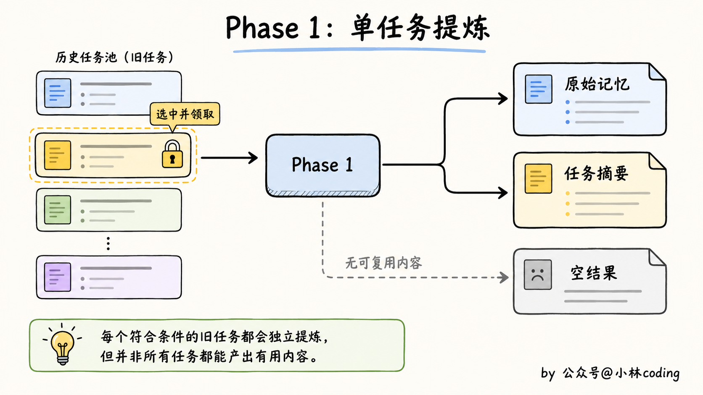

### 第二阶段，为什么还要启动一个整理 Agent？

Phase 1 处理完以后，得到的仍然是一堆按任务分开的材料。

问题来了。

同一个项目可能在三项任务里都提到测试命令；一项任务说旧命令可用，另一项任务后来发现它已经失效；用户对表达风格的要求，也可能经过几次纠正才逐渐稳定。

如果长期记忆只会不断追加，重复和冲突很快就会积累。

所以 Phase 2 做的是跨任务整理。它会把多项任务提炼出的经验放到一起，再与已有记忆对照：重复的合并，互相矛盾的核对，已经失效的删除，并补上各自的适用范围。整理完，再更新供新任务查阅的记忆文件。

主流程其实就是「收集多项任务材料 → 跨任务整理 → 更新长期记忆文件」。为了避免并发覆盖和没有必要的重复整理，Codex 还加了几层工程保护：全局租约保证同一时间只有一个整理流程修改共享记忆，前后文件对比用来定位真正发生的变化；如果材料没有变化，而且已有记忆文件仍然有效，就不必浪费一次模型调用。

需要更新时，Codex 会启动一个专门的内部 Agent 整理记忆文件。

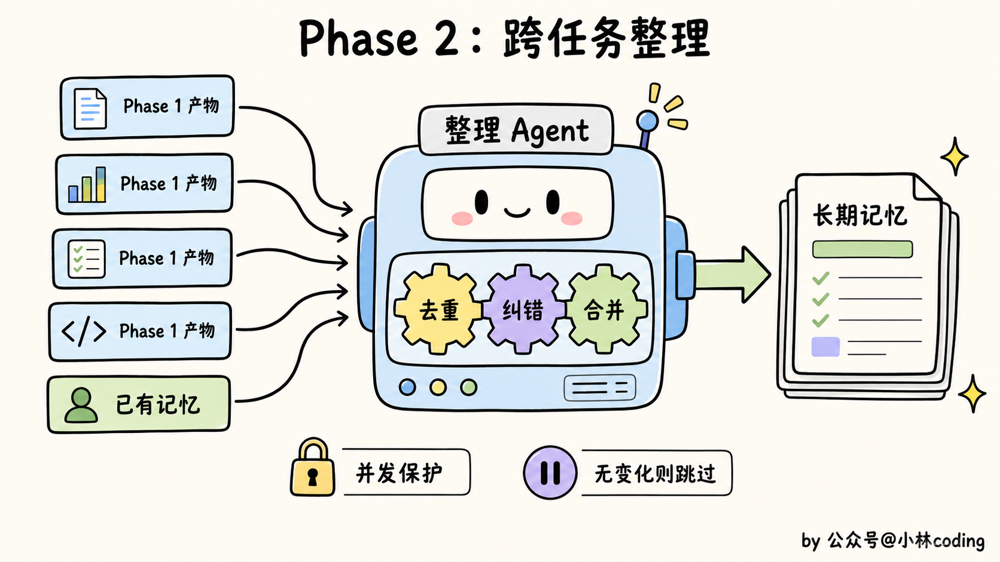

### 长期记忆的文件分层

Codex 的长期记忆不是一张巨大的数据库表直接塞给模型，而是一组按查找深度组织的文件。可以把它理解成三层查找路径：先看目录，再查做法，最后核对来源。

`memory_summary.md` 是目录，先告诉模型有哪些经验可查。需要具体做法，再读 `MEMORY.md` 和 skills；还要核对结论来源，才继续查看对应的 Rollout 摘要和原始 Rollout。

`raw_memories.md` 不属于新任务日常查询的入口。它汇集第一阶段提炼出的材料，交给第二阶段继续整理。

记忆根目录位于 Codex home 下，是跨任务共享的工作区，并不是每个项目天然拥有一套物理隔离的记忆库。因此，每条经验还要记录自己适用于哪个项目和范围，避免把 A 项目的做法搬到 B 项目。

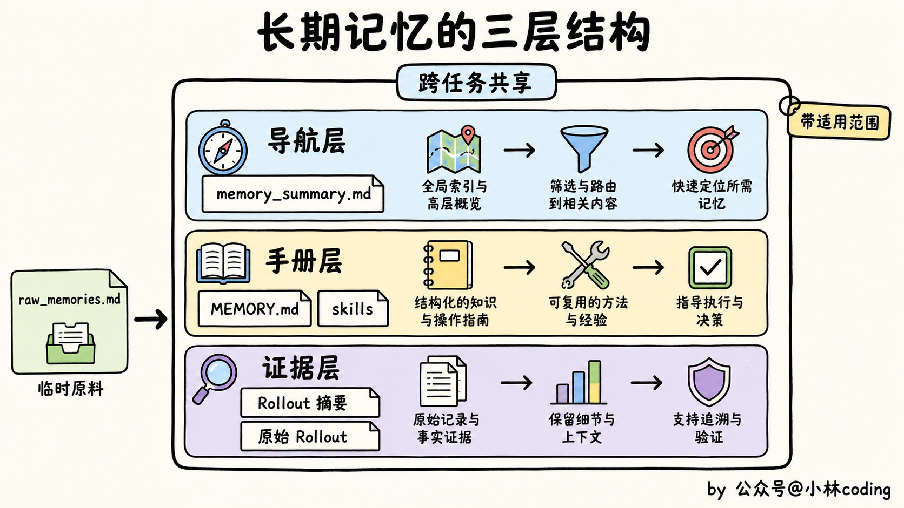

## 06｜新任务怎样找到旧经验，又怎样忘掉它？

最省事的办法，是不是把所有长期记忆一次性塞进上下文？

记忆越多，这个办法越不成立。它只会把刚刚解决的上下文问题重新带回来。

当长期记忆读取满足启用条件，而且 `memory_summary.md` 不是空的，Codex 中负责读取记忆的模块会先把一小段导航摘要和使用说明放进开发者指令。这段摘要本身也有 token 上限。

模型先看到的不是全部经验，而是一份目录。

如果当前任务与目录里的某项经验有关，再去 `MEMORY.md` 里搜索关键词，必要时继续读取一两份最相关的 Rollout 摘要或 skill。找不到相关信息，就停止查记忆，正常完成任务。

这就是渐进式读取。

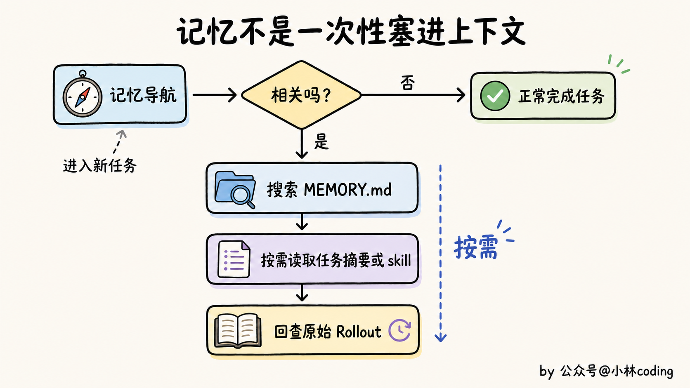

这条本地专用检索路径没有使用向量数据库，而是通过文本子串搜索和按行读取定位记忆。它的优点是精确、可解释，缺点是可能漏掉文字不同但语义相近的内容。

但是，被搜到就等于真正有用吗？

不等于。Codex 要求模型在依赖记忆回答时附带结构化引用，例如记录使用了 `MEMORY.md` 的哪几行，以及这些记忆来自哪个 Rollout。Codex 会根据来源任务 ID 更新记忆的使用次数和最近使用时间，这些信号再参与后续材料选择。

不过，被引用只说明记忆影响了回答，不代表内容一定正确。Agent 仍然要结合当前代码和工具结果重新验证。

除了自动整理，用户还可以主动纠正记忆。

只有用户直接要求新增、更正或删除记忆时，Codex 才会单独写一份用户纠正说明。它不会让当前模型随手重写 `MEMORY.md`，而是等后续整理流程把这份说明与现有证据一起合并。

这样做稍微绕了一步，却能避免一次临时回答直接破坏整本长期手册。

最后，记忆太多以后，Codex 还要决定忘掉什么。

它不会看到某条记忆很久没用，就立刻从 `MEMORY.md` 里删除。

Codex 会先从第一阶段提炼的经验记录中，筛出仍在保留期内的记录，再参考使用次数和最近使用时间，选出一部分交给第二阶段整理。

那些长期没用、上一轮整理也没选中的经验记录，会被分批清理。

但删掉这些原始材料，不会立即改动 `MEMORY.md` 和 `memory_summary.md`。要等下一次整理，这两份供模型查阅的文件才会更新。

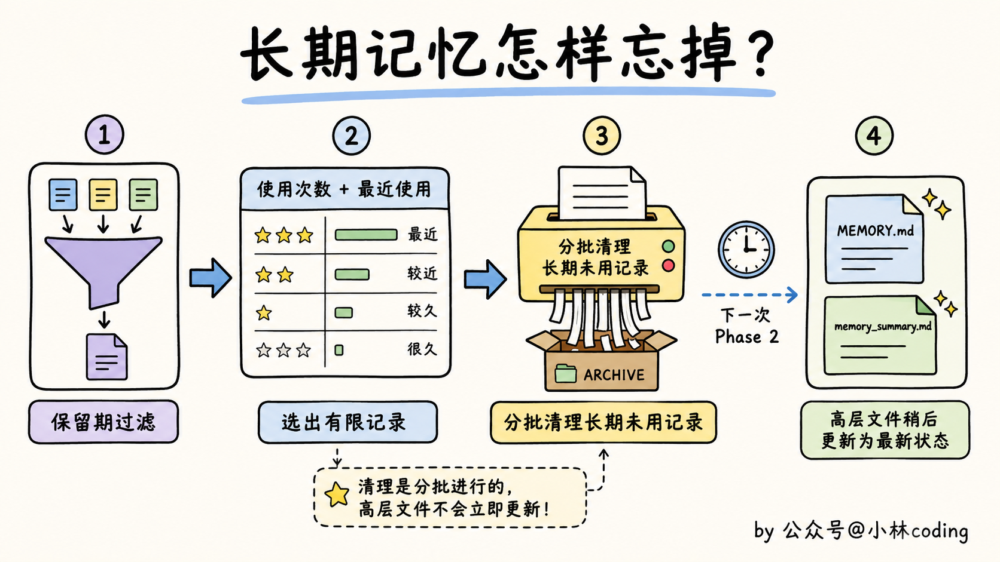

到这里，Codex 的三条记忆链路就清楚了：上下文压缩负责让当前任务继续，Rollout 和 checkpoint 负责恢复同一任务，两阶段的长期记忆流水线负责跨任务复用。它们彼此配合，但解决的不是同一个问题。

## 最后

如果面试官问你：「Codex 的上下文压缩是怎么做的？」

你可以这样回答：

Codex 不会等上下文窗口彻底塞满才处理。它会在新一轮开始前和 Agent 执行过程中检查当前上下文的 Token 用量，超过阈值就自动触发上下文压缩，用户也可以手动触发。

触发以后，Codex 会根据配置和模型服务能力选择压缩策略。如果启用了 Token 预算策略，就不再生成摘要，而是直接切换到新窗口；否则，服务端支持远程压缩时就走远程方案，不支持时再退回本地压缩。

本地压缩的核心，是让模型把已有对话整理成一份能继续工作的交接摘要，同时保留有限数量的近期用户原话，再用它们替换原来不断膨胀的历史。基础指令并不跟着旧对话一起总结，因为它本来就是 Prompt 中的独立字段；项目规则、开发者要求和环境信息，也会重新补回新的上下文。

压缩结果还会作为 checkpoint 写入 Rollout。之后恢复任务时，Codex 可以从最近一次有效 checkpoint 接上后续记录，不需要把压缩前的全部消息重新塞给模型。

所以，Codex 的上下文压缩本质上是在缩短后续请求要带给模型的内容，为任务继续执行腾出空间。在本地总结这条路径中，交接摘要负责保留关键进展；Rollout 则保存任务记录和恢复上下文所需的信息。它解决的是当前任务怎样继续；跨任务复用经验，还要靠长期记忆。

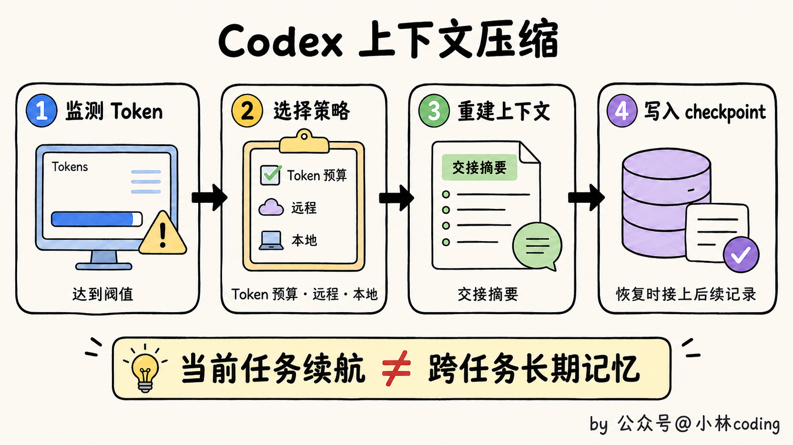
