# 图解 Codex

## Codex 工程化指南：AGENTS.md、Skills、Subagents、MCP、Hooks 一篇讲透

大家好，我是小林。

用了 Claude 三个月后，我也成功喜提 A➗封号了。

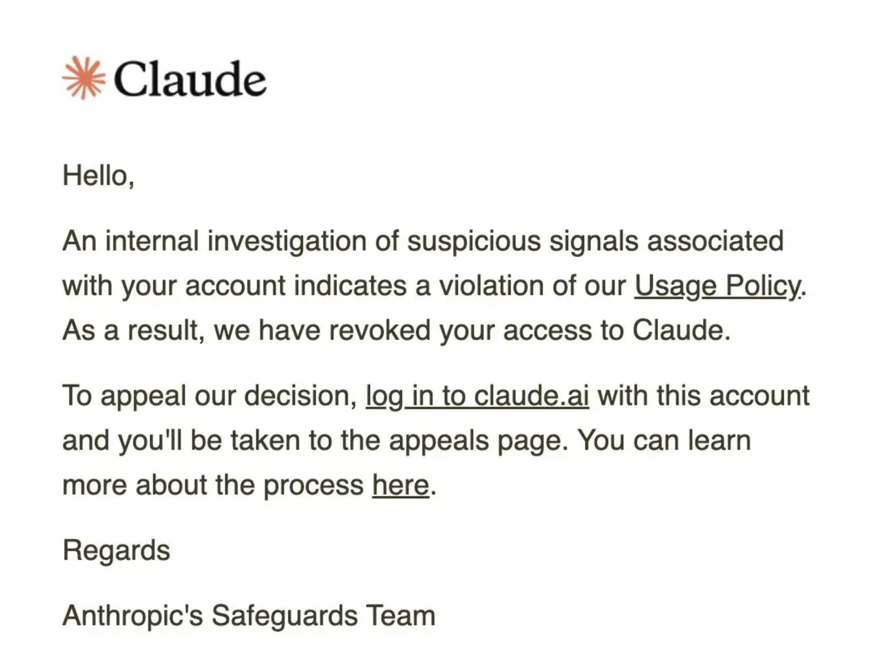

Claude 被封之后，我就转投 Codex 的怀抱了。

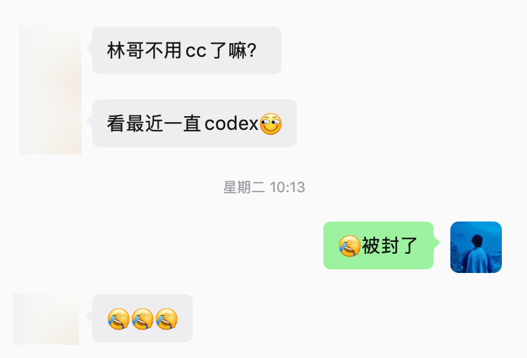

之前我写过一篇 [Claude Code 工程化](https://mp.weixin.qq.com/s/7wkfAeMrsnrmVVGYAvyBjA)的文章。最近我又研究了一下 Codex 的工程化能力，发现两者的很多功能其实是相通的。

所以这次就来聊聊 Codex 里五个常用的工程化能力，分别是 `AGENTS.md`、Skills、Subagents、MCP 和 Hooks。

### 01｜ AGENTS.md ：Codex 怎么记住项目？

#### 为什么每次都要重新交代？

假设团队的技术文档仓库有一组固定规则：正文使用中文，一篇文档只能有一个一级标题，图片放进 `images/`，`published/` 中的内容不能直接修改。

如果每个新任务都要重新交代，既麻烦又容易遗漏。没有拿到这些规则时，Codex 只能按常见做法处理。

`AGENTS.md` 就是放在仓库里的「项目入职手册」。Codex 开始任务前会读取它，后续的分析、修改和验收都会遵守其中的规则。

#### 怎么创建 AGENTS.md ？

创建 `AGENTS.md` 有两种方式。

最直接的做法，是在项目根目录手动新建一个 `AGENTS.md`，再把团队的目录约定、修改规则和检查命令写进去。

也可以让 Codex 帮你生成。先在 Codex 中按 `Cmd/Ctrl + O` 打开 `product-docs` 项目。

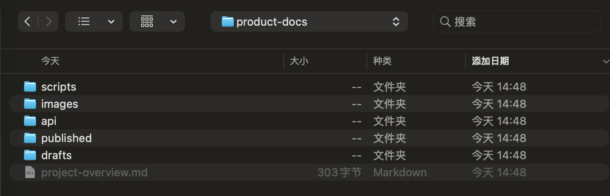

再发送这段提示词。

```text
请在当前项目根目录创建 AGENTS.md。

这是一个团队技术文档仓库。
所有正文使用中文，一篇文档只能有一个一级标题。
文件名使用小写英文和连字符，图片统一放在 `images/`。
`published/` 中的文档只读，不要直接修改。
完成修改后执行 `python3 scripts/check_docs.py` 检查标题和图片引用。

先只创建规则文件，不修改任何文档，也不执行检查命令。
```

Codex 会生成一份 `AGENTS.md`。

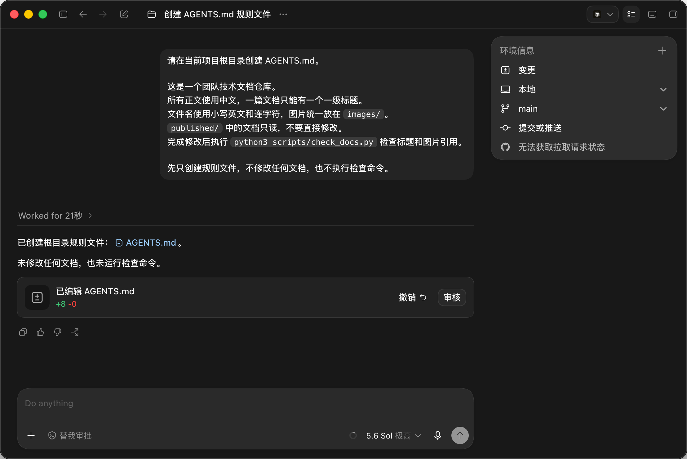

你可以在右侧审核产出的内容

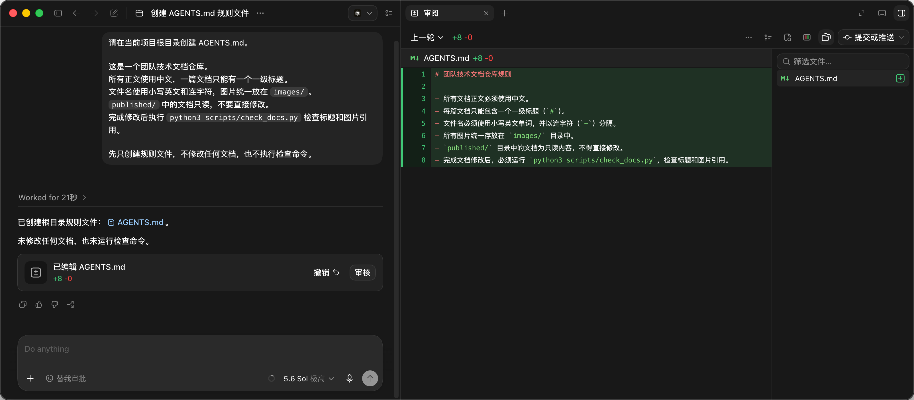

怎么确认新任务真的读到了？重新建一个任务，输入下面这段话。

```text
只总结当前生效的项目规则，并列出规则来自哪些 AGENTS.md 文件。
不要修改任何文件，也不要执行构建命令。
```

返回结果应该包含中文正文、文件命名、图片目录、`published/` 只读和检查命令等规则。

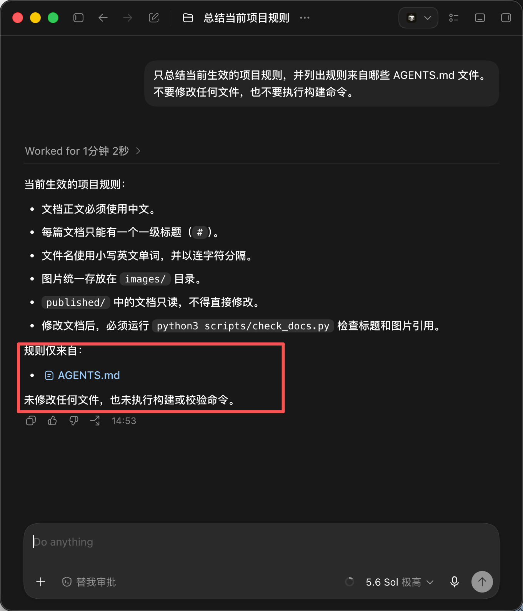

#### AGENTS.md 规则怎么加载？

项目根目录会多出一份 `AGENTS.md`。它的最小内容可以长这样。

```markdown
# 项目说明

这是一个团队技术文档仓库。

## 文档规则

- 所有正文使用中文
- 一篇文档只能有一个一级标题
- 文件名使用小写英文和连字符
- 图片统一放在 `images/` 目录

## 修改约束

- `published/` 中的文档只读
- 不要创建正文没有引用的图片
- 完成修改后执行 `python3 scripts/check_docs.py`
```

这份文件没有神秘语法，就是 Markdown。真正影响效果的是内容够不够具体。

「注意文档质量」这种话基本等于没说。什么叫质量好，模型还得自己猜。换成「只能有一个一级标题」「图片统一放进哪个目录」「修改后执行哪条检查命令」，Codex 才知道下一步该做什么，也知道怎么证明自己做完了。

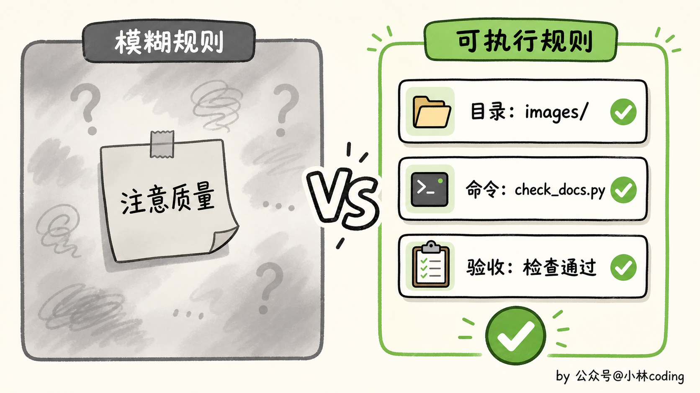

工作目录也不只有项目根目录这一层。个人级规则放在 `~/.codex/AGENTS.md`，适合所有项目通用的偏好。Codex 里可以通过「Settings > Personalization」编辑。项目根目录写团队共识，子目录则放模块专属规则。

```text
~/.codex/
└── AGENTS.md                    # 个人全局规则

product-docs/
├── AGENTS.md                    # 整个文档仓库的规则
├── drafts/
├── published/
├── images/
└── api/
    ├── AGENTS.override.md       # API 文档的覆盖规则
    └── payment-api.md
```

Codex 启动时，会从项目根目录一路走到当前工作目录。每一层最多选一个规则文件，再按从远到近的顺序拼起来。离当前目录越近的规则排在越后面，发生冲突时也就拥有更高优先级。

同一层如果同时存在 `AGENTS.override.md` 和 `AGENTS.md`，Codex 会优先选择 override 文件。这一层只取优先命中的那一份，不会把两份都读进来。

如果 Codex 当前打开的是仓库根目录，后面才让它去改 `api/`，它不会因为读到了 API 文档，就自动把更深处的 `AGENTS.md` 补进当前规则链。要测试 API 目录的规则，可以在 Codex 中把这个子目录作为本地项目打开，或者把所有文档都要遵守的规则写到根目录。

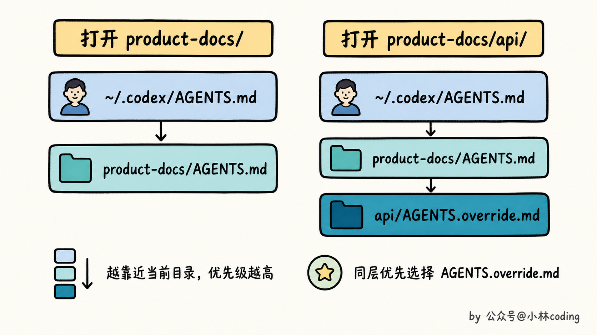

Codex 默认会限制项目规则合并后的总大小，官方文档给出的默认上限是 32 KiB。这个文件可以继续引用架构文档和专项说明，不需要把所有资料全文放进来。

每次都要遵守的放 `AGENTS.md`。只有做发布、Review、迁移时才需要的长流程，应该交给下一件工具。

### 02｜Skills：专项知识该放哪？

#### 为什么不能全塞进 AGENTS.md ？

项目里总有一些知识很重要，却不是每次任务都要用。

比如每次发布都要确定起始版本、整理提交、过滤内部改动，再按团队模板生成 Release Notes。这套流程很重要，但平时改文档、查问题时根本用不上。

要是全部塞进 `AGENTS.md`，每一个任务都会带上这些内容。今天只是改个错别字，Codex 也得背着整份发布手册上班。上下文被占用了，注意力也被摊薄了。

那能不能等用到时再读？可以，这就是 Skill。

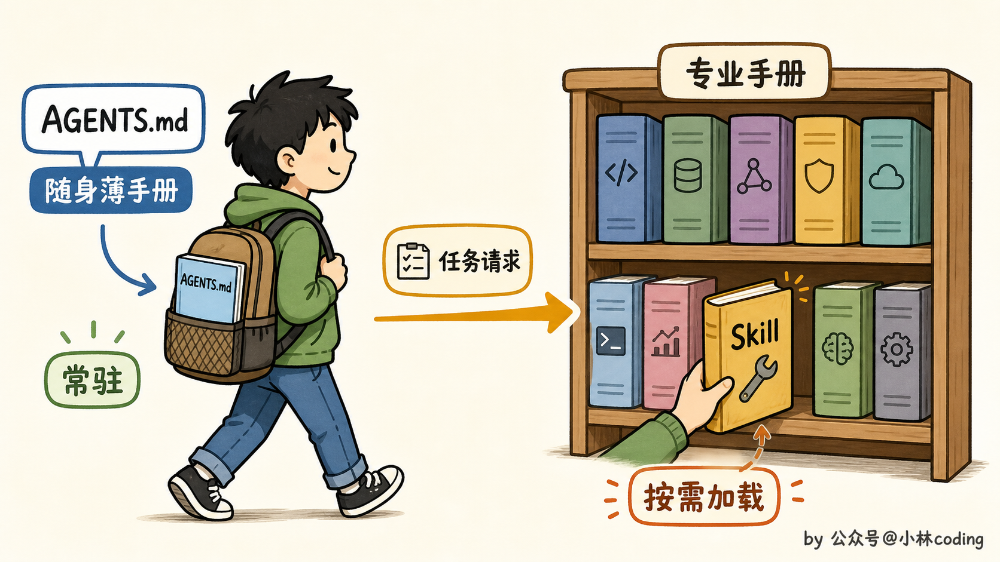

#### 怎么创建和使用 Skill？

Codex 里内置了 `$skill-creator`。不用先手写文件，直接把团队生成 Release Notes 的流程说给它。

```text
$skill-creator 为当前项目创建一个 release-notes Skill。

它用于根据指定的 Git Tag 到当前分支之间的真实改动生成发布说明。

先确认起始版本，再读取提交和改动文件。
过滤合并提交、纯格式调整和 CI 配置更新。
把内容分成新功能、问题修复和破坏性变更。
使用面向用户的语言，每一项都要能追溯到提交或文件证据。
只生成草稿，不创建 Tag，也不发布版本。

同时提供 Release Notes 模板和收集提交的脚本。

生成项目共享 Skill，先只创建文件，不开始生成发布说明。
```

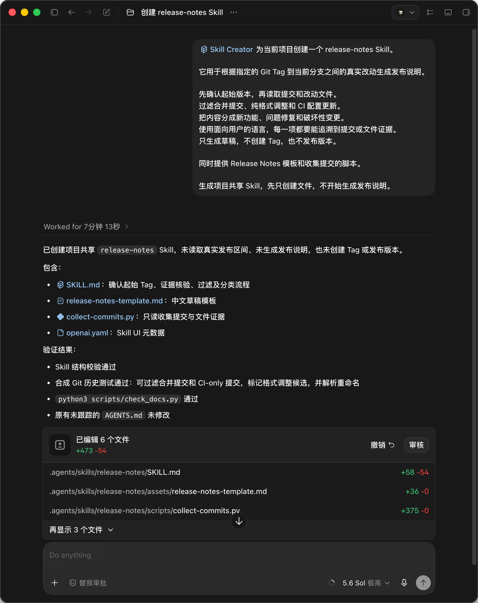

创建好 skill 之后，打开 Codex 侧边栏的「Skills」页面，应该能看到 `release-notes`。

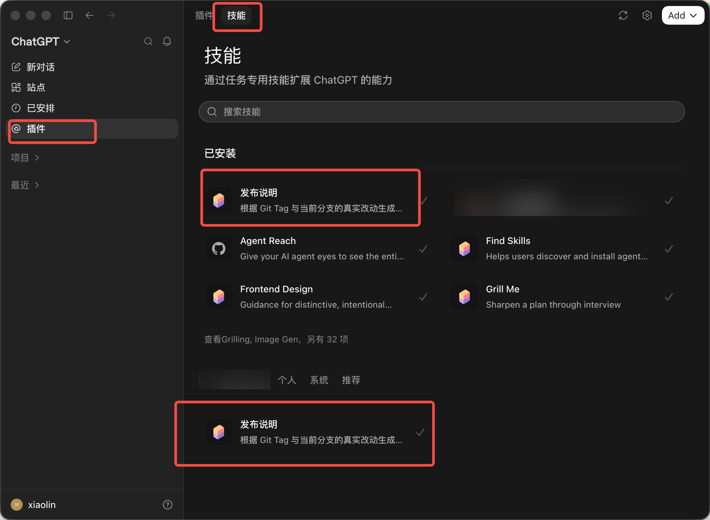

接着新建一个任务，显式调用这个 Skill。

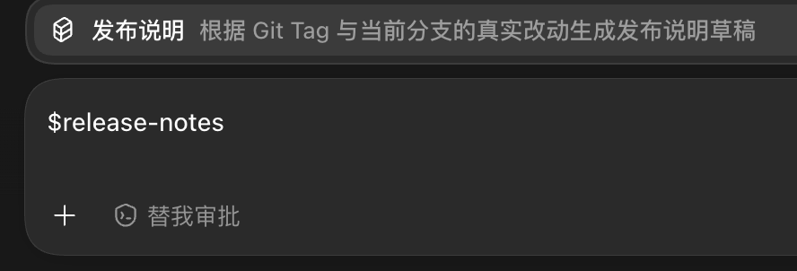

```text
$release-notes 根据 v1.4.0 到当前分支之间的改动，
生成 v1.5.0 的发布说明草稿。
不要创建 Tag，也不要发布 Release。
```

你也可以不写 `$release-notes`，直接说「根据 v1.4.0 之后的改动生成发布说明」。只要任务与 Skill 描述匹配，Codex 也可以自动选中它。

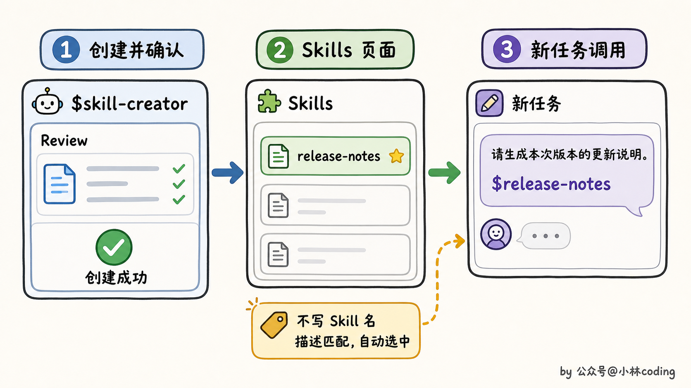

#### Skill 是怎么工作的？

创建后的 Skill 目录如下。

```text
release-demo/
└── .agents/
    └── skills/
        └── release-notes/
            ├── SKILL.md
            ├── references/
            │   └── release-template.md
            └── scripts/
                └── collect-commits.sh
```

最小版本其实只要一个 `SKILL.md`。

```markdown
---
name: release-notes
description: 准备版本发布说明时使用，根据指定 Git Tag 到当前分支之间的真实改动，生成可追溯的 Release Notes 草稿。
---

# Release Notes 流程

1. 确认用户给出的起始 Git Tag 存在
2. 运行 `scripts/collect-commits.sh <tag>` 收集提交和改动文件
3. 过滤合并提交、纯格式调整和 CI 配置更新
4. 按新功能、问题修复和破坏性变更分类
5. 使用面向用户的语言，不直接复制提交信息
6. 每一项标出可追溯的提交或文件证据
7. 按 `references/release-template.md` 生成草稿

只生成发布说明草稿，不创建 Tag，不调用发布接口。
```

这里的关键字段是 `description`。Codex 会根据这句话判断什么时候应该使用 Skill，所以不能只写「发布工具」，要写清它做什么、什么时候用、产出什么。

一个 Skill 的核心是 `SKILL.md`，也可以携带脚本、参考资料、模板和其他资源。项目共享 Skill 放在 `.agents/skills/`，个人跨项目使用的 Skill 放在 `~/.agents/skills/`。注意这里是 `.agents`，不是 `.codex`。

Codex 启动时先看每个 Skill 的名称和描述。当用户任务与描述匹配，或者你显式点名某个 Skill 时，它才读取完整正文。正文里引用的长资料和脚本，也可以继续按需读取或执行。

简单来说，Codex 平时只记住「书名和简介」，接到任务后才去书架拿对应的书。这就是 Skill 的渐进式加载。

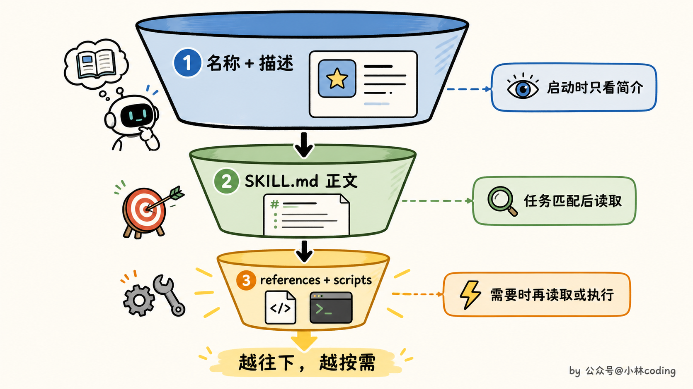

### 03｜Subagents：怎么变成一支小团队？

#### 主对话为什么越干越乱？

假设团队准备评估一套新的日志平台，需要同时调查产品能力、Java 接入方式和历史数据迁移风险。全部由主 Agent 处理，搜索结果和中间资料很快就会挤占主上下文。

Subagent 可以把这三路调查拆到独立上下文中并行完成。主 Agent 负责分工、收集结果和整理结论，中间过程则留在各自的子任务里。

在 Codex 里，主任务派出工作后，界面会显示每个 Subagent 线程。你可以点进去查看调查过程，再回到主任务查看合并后的结果。

#### 怎么安排 Subagent？

先说清一个容易混淆的点。Subagent 是 Codex 临时派出去执行某个子任务的独立线程，自定义 Agent 则是可以反复使用的「岗位模板」。

普通的并行任务，不创建任何配置也能直接派 Subagent。只有某类分工经常出现时，才值得把职责写进 `.codex/agents/`，以后重复使用。

这次为了同时演示「固定岗位」和「并行派发」，我们先为日志平台调研创建三个自定义 Agent。

```text
请在当前项目创建三个只读的自定义 Agent。

capability_researcher 只负责调查查询、告警、权限和运维能力。
integration_researcher 只负责调查 Java、OpenTelemetry 和现有监控的接入成本。
migration_researcher 只负责调查旧查询、历史数据和迁移风险。

每个 Agent 都要区分官方资料、项目现状和自己的推断，并保留来源。

先只创建 `.codex/agents/` 下的配置文件，不开始调研。
```

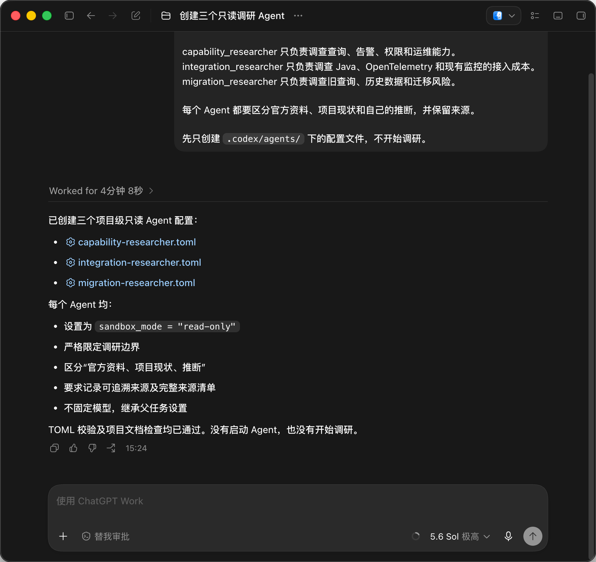

三个岗位模板创建好后，再新建一个任务，把三路调查分别派给对应的 Subagent。

```text
评估当前项目是否适合采用候选日志平台。
请并行安排三个 Subagent：
1. capability_researcher 调查产品能力和限制
2. integration_researcher 调查 Java 接入方式和改造成本
3. migration_researcher 调查迁移步骤、数据风险和回退方案

等三路结果回来后合并去重，输出适用条件、主要风险和待确认问题。
只做调研，不修改当前项目。
```

任务开始后，Codex 会展示三个 Subagent 的活动。

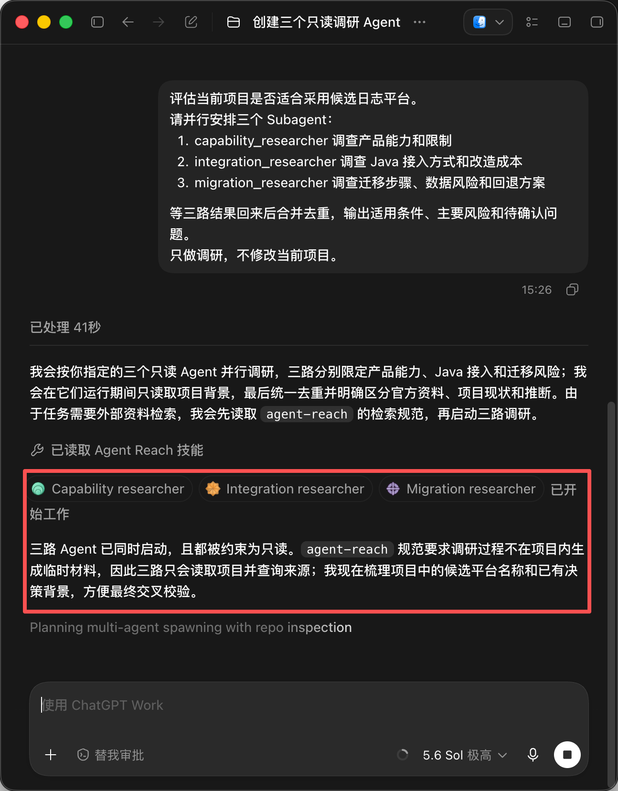

#### Subagent 是怎么工作的？

Codex 负责创建 Subagent、派发任务、等待结果，再把多路结果交给主 Agent 统一整理。

| 阶段 | 发生的事情 |
| --- | --- |
| 拆分 | 主 Agent 找出可以独立处理的子任务 |
| 派发 | 为每个 Subagent 指定目标、边界和输出格式 |
| 执行 | 各个 Subagent 在自己的上下文中使用模型和工具完成任务 |
| 回传 | Subagent 把结论和必要证据返回主 Agent |
| 合并 | 主 Agent 等待各路结果，再去重并生成最终回答 |

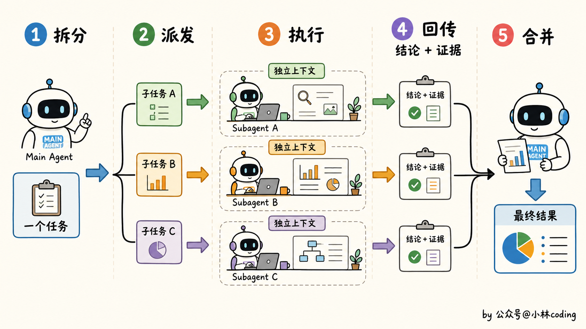

独立上下文是这套机制的关键。一个 Subagent 在调查中产生的搜索结果、命令输出和中间笔记，不需要全部堆进主上下文。主 Agent 最后拿到的是整理过的结论，而不是子任务的全部过程。

Subagent 默认继承主任务的权限模式，并在当前工作区内使用工具。因此，代码探索、资料整理、测试和问题归类这类互相独立的任务，很适合并行。多个 Subagent 同时修改同一批文件时，则可能产生冲突。

如果需要几路任务同时改代码，可以在 Codex 中分别创建多个顶层任务，并为它们选择独立 Worktree。Worktree 提供文件层面的隔离，而 Subagent 提供上下文和分工层面的拆分，两者解决的不是同一个问题。

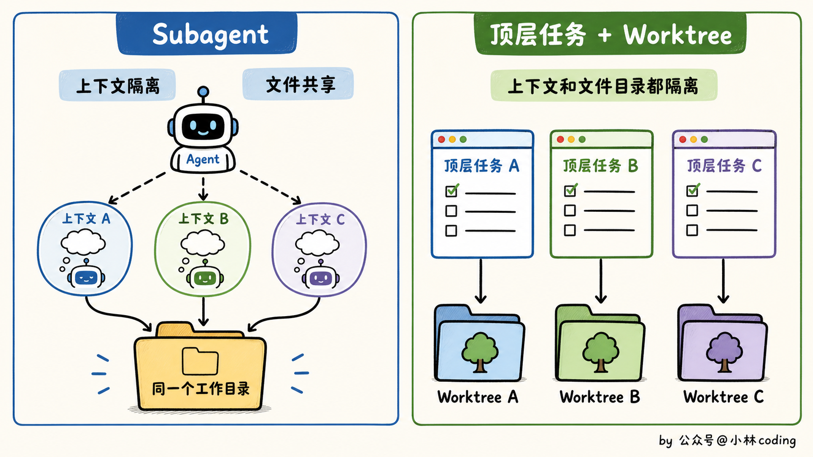

Codex 已经内置 `default`、`worker` 和 `explorer` 等通用 Agent。如果团队需要固定职责，也可以在 `.codex/agents/` 中创建项目级自定义 Agent。不过，普通并行任务不必先定义岗位，直接在提示词中说明「请并行安排三个 Subagent」即可。

### 04｜MCP：怎么接上外部系统？

#### 为什么需要 MCP？

Codex 可以读取项目文件、修改代码和执行本地命令，但完成一个真实任务，往往还需要仓库之外的信息。

产品需求可能放在云端文档，Issue 放在 GitHub，业务数据放在数据库，项目进度则记录在协作工具中。这些信息不在当前工作区，而且还会持续变化。

如果每接入一个外部系统，都要单独定义工具说明、参数格式和返回结果，连接方式就会变得很碎片。MCP 提供了一套统一的通信规则，让 Codex 可以用相同的方式发现和调用不同的外部工具。

MCP 全称 Model Context Protocol，可以把它理解成 AI 工具世界的「通用插座」。外部服务通过 MCP 告诉 Codex 自己能提供什么数据和操作，Codex 再根据当前任务选择对应的能力。

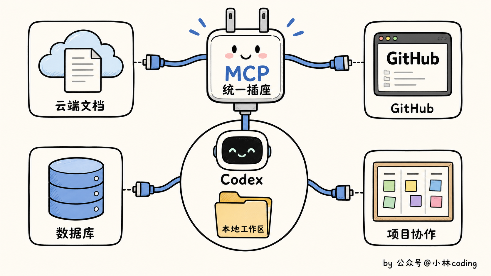

#### 怎么接入 MCP 工具？

在 Codex 里，可以直接通过插件市场安装常见的 MCP 工具，安装完成后就能在新任务中调用。

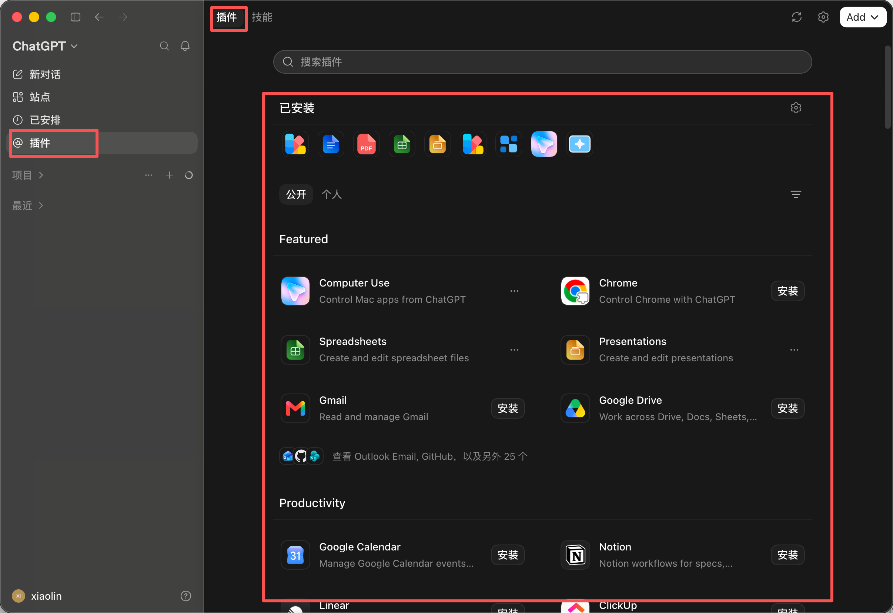

这里以 Google Drive 为例。先创建一份名为 `Codex MCP Demo` 的测试文档，并写入下面几条模拟内容。

```text
项目：会员中心改版
上线时间：8 月 20 日
待办：
1. 确认新版页面文案
2. 补充登录异常监控
3. 完成上线前回归测试
```

接着打开 Codex 侧边栏的「Plugins」，搜索 `Google Drive`，进入详情页后点击加号安装。如果 Codex 提示连接 Google 账号，按页面引导完成登录和授权。

安装完成后新建一个 Codex 任务，直接发送下面的提示词。

```text
使用 Google Drive 工具查找名为「Codex MCP Demo」的文档。

读取文档内容，输出项目名称、上线时间和待办事项。
只读取和整理，不要修改或创建任何文件。
```

Codex 会根据任务内容自动选择 Google Drive 提供的工具，不需要再输入额外命令。

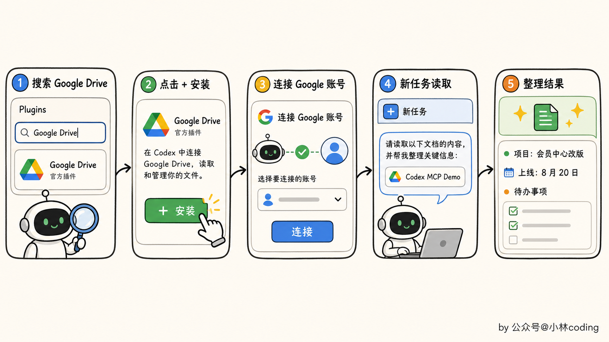

#### MCP 工具是怎么工作的？

看到这估计有同学就问了：我只说了一句「去 Google Drive 找文档」，Codex 怎么知道该调哪个工具？

关键就在 MCP。简单来说，MCP 就像一套统一的「工具说明书和通信规则」。Google Drive 接入后，会先告诉 Codex 自己提供了哪些工具、每个工具能做什么，以及调用时要填哪些参数。

当你说「找到 Codex MCP Demo 并读取内容」时，Codex 会先从这些说明中找到匹配的工具，生成查找文档所需的参数，再把请求发给 Google Drive。对方查到文档后把结果返回，Codex 发现还需要读取正文，就会继续调用读取工具。拿到内容后，才会整理成你看到的回答。

如果用 MCP 里的名词来对应，Codex 是 Host，负责理解任务和选择工具。Codex 内部的 MCP Client 像一个传话员，负责发送请求和取回结果。连接外部服务的 MCP Server 则负责真正执行查找、读取或写入操作。

这套流程并不只属于 Google Drive。换成数据库、GitHub 或其他外部系统，Codex 仍然可以用同一套方式理解和调用它们。MCP Server 除了提供可执行的 Tools，还可以提供可读取的 Resources 和可复用的 Prompts。

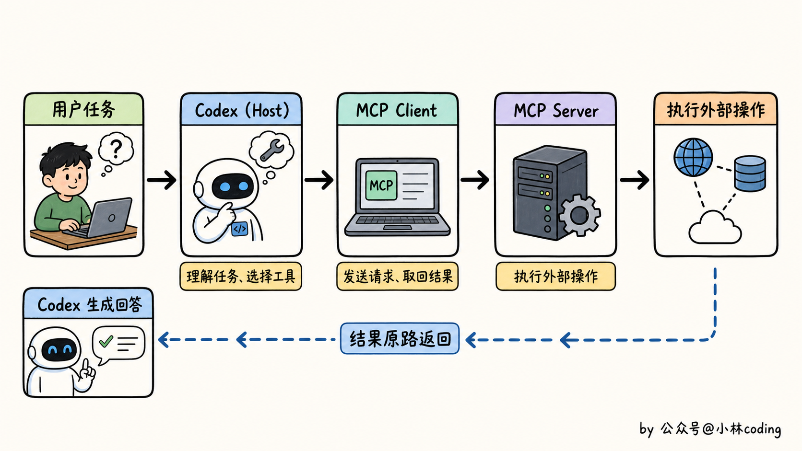

### 05｜Hooks：检查怎么每次都自动跑？

#### 为什么需要 Hooks？

提示词和 `AGENTS.md` 都是在告诉 Codex 应该怎么做，适合放项目背景、代码规范和修改约束。但测试、格式化和安全扫描这类动作，更适合由程序在固定时机自动执行。

比如团队要求每次任务结束前都运行检查命令。如果每次都写进提示词，不仅需要重复交代，执行时机也不固定。Hooks 可以把这个动作绑定到任务的生命周期节点上。

#### Hooks 是什么，有什么用？

Hooks 是 Codex 任务生命周期中的自动触发器。当任务运行到某个节点时，Codex 会自动调用预先配置的 Handler，不需要用户再次发送提示词。

Hooks 可以在任务启动时加载上下文，在工具执行前检查命令，在工具执行后记录结果，也可以在任务结束前运行测试、格式化或安全扫描。

Hooks 就像安装在 Codex 工作流程中的感应门。Codex 运行到对应位置，就会触发门后的脚本。

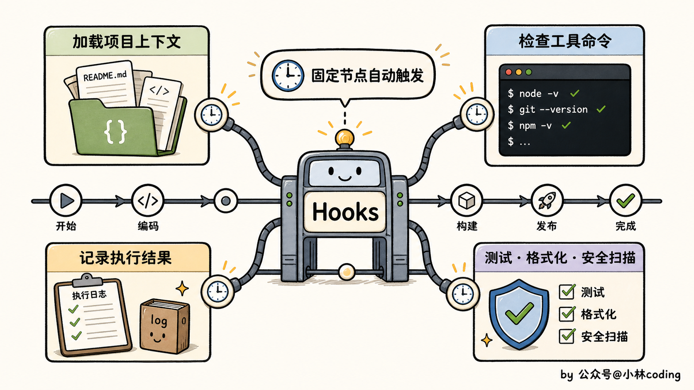

#### 一个简单的 Hook 例子

假设文档项目中已经有 `python3 scripts/check_docs.py` 检查脚本，可以让 Codex 创建一个 Stop Hook，在任务准备结束时自动运行它。

```text
请为当前项目创建一个 Stop Hook。

任务准备结束时，自动运行
`python3 scripts/check_docs.py`。

检查通过时正常结束任务。
检查失败时把摘要交给 Codex 继续处理。

请创建所需的 Hook 配置和 Handler，不修改现有文档。
```

接受修改后，在这个本地项目中新建一个任务。以后 Codex 每次准备结束任务，Stop Hook 都会自动运行文档检查，不需要在提示词中重复提醒。

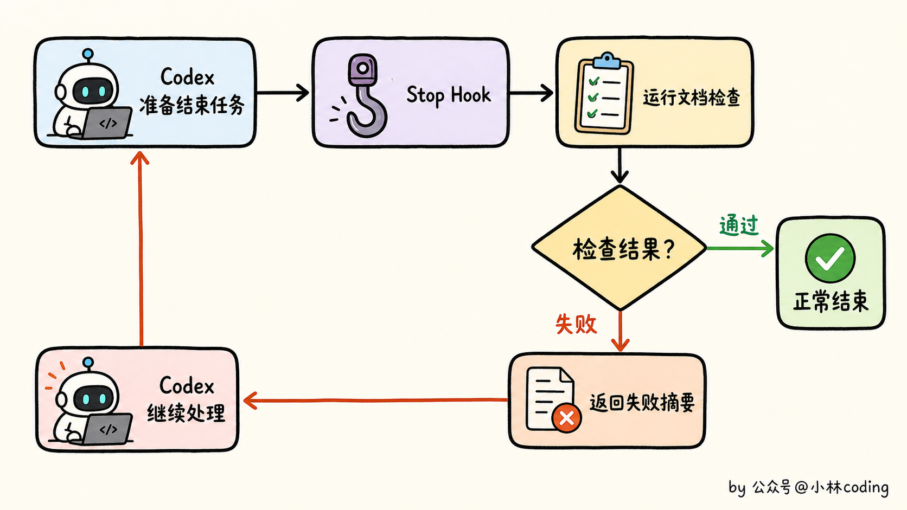

#### Hooks 是怎么工作的？

Hook 配置主要说明三件事：监听哪个生命周期事件、什么条件下命中，以及命中后执行哪个 Handler。

| 生命周期节点 | 触发时机 | 常见用法 |
| --- | --- | --- |
| `SessionStart` | 任务会话启动时 | 加载环境信息或项目上下文 |
| `UserPromptSubmit` | 用户提交任务时 | 记录或补充输入上下文 |
| `PreToolUse` | 工具执行之前 | 检查命令或阻止不允许的操作 |
| `PostToolUse` | 工具执行之后 | 记录结果或补充校验 |
| `Stop` | 任务准备结束时 | 运行测试、格式化或安全扫描 |

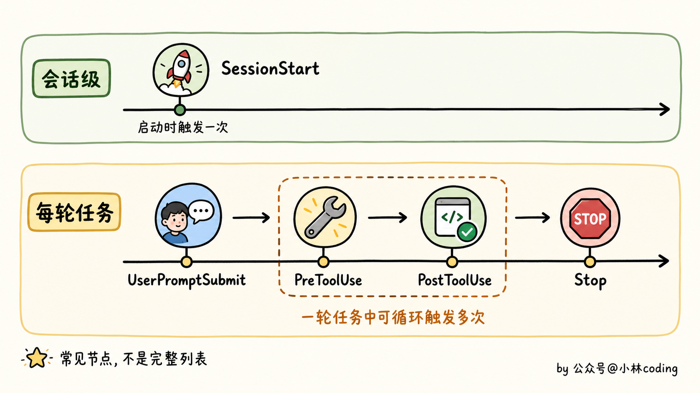

当 Codex 运行到这个节点时，会先找到匹配的 Hook，再调用对应的 Handler。Codex 会通过标准输入把当前工作目录和事件名称等信息交给 Handler。如果是工具相关事件，输入中还会包含工具名称和参数。

Handler 执行完成后，再通过退出码或 JSON 结果告诉 Codex 是继续运行、停止当前动作，还是把新的上下文交回给模型。

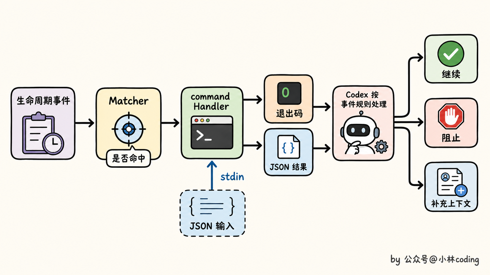

### 最后

最后用一张表，把这五项能力的作用放在一起。

| 能力 | 作用 |
| --- | --- |
| `AGENTS.md` | 让 Codex 在项目中持续遵守固定规则 |
| Skills | 封装可复用的专项知识和操作流程，按需加载 |
| Subagents | 拆分独立子任务，并行调查并汇总结果 |
| MCP | 连接仓库外的数据、工具和外部系统 |
| Hooks | 在 Codex 的固定生命周期节点自动执行动作 |

今天的分享就到这里，我们下次见！

## GPT-6 使用指南：怎样让 Codex 更好地完成任务？

大家好，我是小林。

就在前几天，OpenAI 官方博客发了一篇文章，叫《Rethinking skills and prompts for GPT-6 Astra》。专门聊怎么调整提示词、Skills 和 `AGENTS.md`，才能让 GPT-6 更好地帮我们干活。

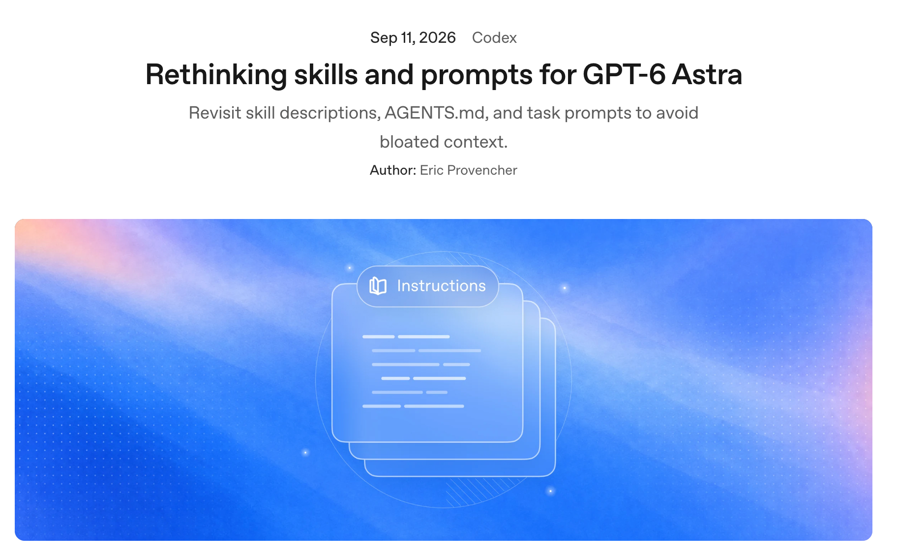

里面有个提醒挺有意思，你以前辛辛苦苦给 AI 写的那些规则，现在可能得改改了。

啊？这些规则可都是踩过坑才补上去的，怎么模型升级了，反而还要改？

因为有些事情，旧模型需要你一步步教，GPT-6 已经能自己判断了。

那到底哪些规则该改，具体又怎么改？我把 OpenAI 的建议整理了一下，跟大家聊聊。

### 01｜Skills 装得越多，AI 就越强吗？

现在不少人看到好用的 Skill，第一反应就是先装上。写代码的、查资料的、做设计的，主打一个我可以不用，但你必须得会。

那装了几十个 Skills，AI 就能自动挑出最合适的那个吗？

AI 怎么知道该用哪个 Skill？它会先看名字和描述，了解这个 Skill 能做什么。OpenAI 提到，如果装的 Skills 太多，描述又很长，Codex 为了把这些介绍放进上下文，就会把描述截短。介绍看不全，AI 自然就更难选对。

好家伙，装了一堆 Skills，结果 AI 连这些 Skills 是干什么的都看不全，还怎么选对？

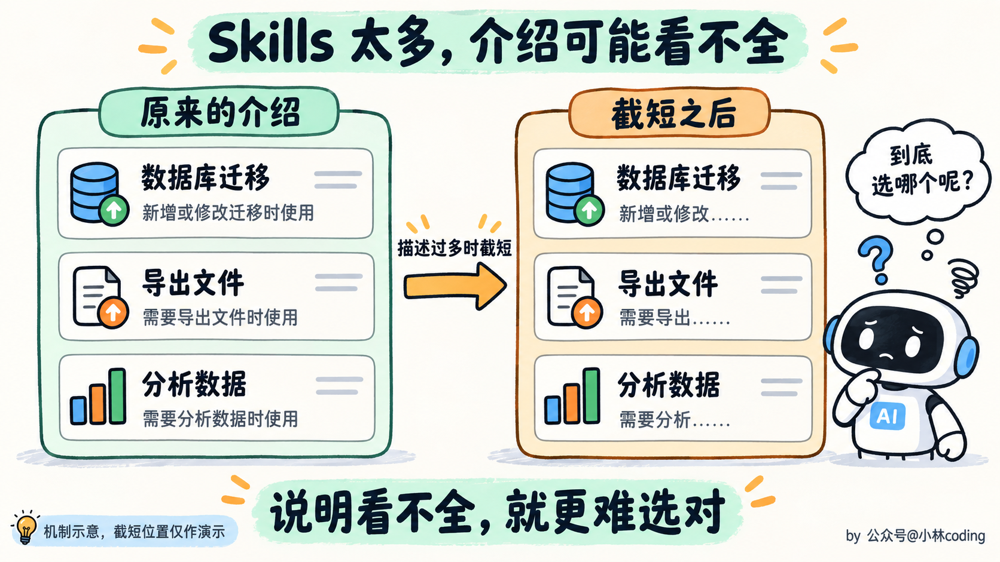

而且，Skill 的描述也不能写得什么都管。

OpenAI举了一个数据库迁移 Skill 的例子，它本来是帮你给表加字段、改表结构的。

**修改前**

> 创建并验证 Postgres 数据库迁移。涉及数据库、查询、数据模型或持久化时使用。

**修改后**

> 创建并验证 Postgres 数据库迁移。新增或修改迁移，或检查迁移上线方案时使用。

你看出问题了吗？我只是让 AI 查条数据，它也可能把修改表结构的那套流程翻出来。查个数据而已，有必要搞这么复杂吗？

你看，前半句根本没动，它负责的事情没变。改的是后半句，把「碰到数据库就叫它」缩小成「处理数据库迁移时才叫它」。所以，**Skill 的描述尽量写短，同时说清楚什么时候才需要用它。**

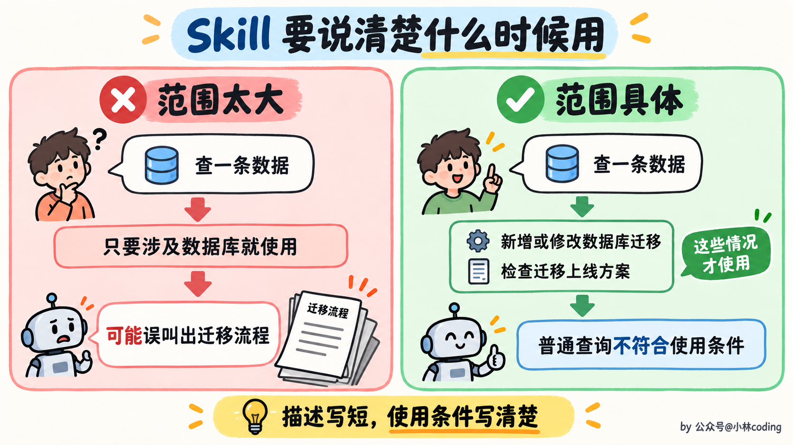

那 Skill 正文是不是越详细越好？也得看这些内容什么时候需要。

假设一个 Skill 既能做报表，又能分析数据，还能导出文件。你这次只想导出文件，AI 有必要把做报表、分析数据的说明也读一遍吗？没必要吧。

那就把这三种操作的详细说明分开放，再在 `SKILL.md` 里告诉它去哪看。

**修改前**

> 使用这个 Skill 前，先完整阅读报表制作、数据分析和文件导出的全部说明，再开始处理任务。

**修改后**

> 根据本次任务，阅读对应的说明。制作报表看 references/`report.md`，分析数据看 references/analysis.md，导出文件看 references/export.md。只读取本次任务需要的部分。

这里的文件名是举例，你要换成自己 Skill 里真实存在的文件。这样你只让它导出文件时，它就不用先把另外两份说明也读一遍。

OpenAI把这种做法叫「渐进式披露」。说白了，就是用到哪部分，再读哪部分，别一上来全塞给它。

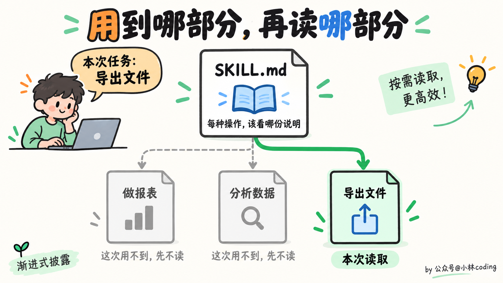

还有，别什么任务都给 AI 写好几十步，让它严格照着走。OpenAI 提到，模型越来越能理解复杂情况，以前需要你一步步教，现在有些事情已经能自己判断怎么做了。

那哪些步骤该留，哪些可以删？拿做报表来说，你当然要告诉它必须包含哪些数据。但如果规定「做任何报表之前，都必须先读完这五份资料」，就值得想想，这次真的每份都用得上吗？

**你要什么结果，得说清楚。至于具体怎么做，有些步骤可以让它自己判断。**

### 02｜你的 AGENTS.md ，该做减法了吗？

聊完 Skills，再看另一个熟悉的文件，`AGENTS.md`。你可以把它理解成放在项目里的工作说明，告诉 Agent 这个项目有什么约定、该怎么干活。

很多规则怎么来的？模型漏跑一次测试，就加一句「必须测试」；改代码没看清结构，就再补一句「修改前必须阅读架构文档」。慢慢地，文件越来越长，每条背后都有一段血泪史。

可换了模型以后，这些要求还都需要吗？

OpenAI 举的例子很形象，有些项目要求每次修改前，都先读架构、数据库和部署文档。问题是，如果这次只是改一个错别字呢？

错别字还没改，入职培训先走了一遍。

那怎么写更合适？OpenAI也给了修改前后的对照。

**修改前**

> 每次修改前，必须先阅读 `architecture.md`、`database.md` 和 `deployment.md`。

**修改后**

> 不清楚各个服务分别负责什么时，查 `architecture.md`。修改表结构时，查 `database.md`。准备部署上线时，查 `deployment.md`。

同样是这三份文档，改完以后，AI 就知道什么时候需要看哪份了。改个错别字，也不用先把部署流程学一遍。**这次做什么，就看相关的资料，没必要每次都从头读一遍。**

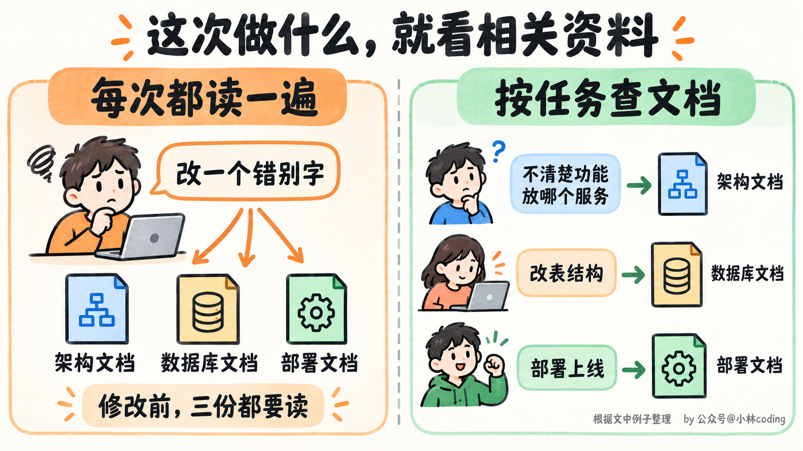

测试也是一样。以前怕 AI 改完代码不检查，你可能会反复强调「必须跑测试」「改完一定要再检查」。但 OpenAI 提到，GPT-6 Astra 本身就会主动做这些事。如果还留着一堆催它检查的要求，它可能会多跑一些没必要的测试。你只是想让它别漏检查，结果它在检查这件事上花了太多时间。

看到这里，你可能想问，那我把 `AGENTS.md` 清空，是不是就好了？

也不用直接清空。比如代码要按什么格式写，订单金额要怎么计算，哪些操作不能碰生产数据，这些是你项目里的具体要求，AI 未必知道，当然得留着。

真正值得回头检查的是，同一个要求是不是写了好几遍，有些规定是不是早就不适用了，还有那些不管改什么，都要求 AI 从头走一遍的流程。**每条规则都问一句，这次干活真的需要它吗？**

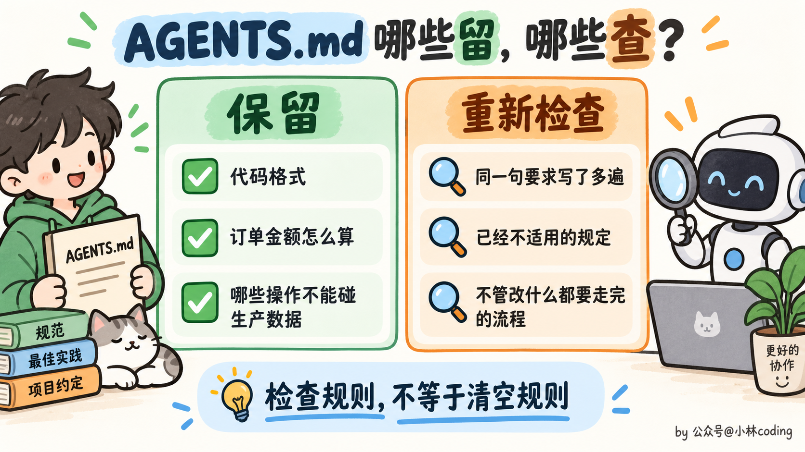

对了，如果这个项目是团队一起用的，还得多想一步，其他同事用的是什么模型？OpenAI 提醒，有些模型还需要你把步骤写细一点，同样的步骤给 Astra，又可能管得太死。所以，改大家共用的 Skills 和项目规则时，也看看其他模型还能不能把任务做好。

### 03｜为什么它总停下来问你？

你有没有碰到过这种情况？任务明明交代清楚了，AI 却干几步就问一句「是否继续」。你坐在电脑前，什么都不用干，光顾着回复「继续」了。

这时除了催它，也值得看看，你是不是曾经写过「执行任何操作前都必须获得确认」？

以前怕 Agent 乱改东西，要求它先问你，这很正常。但 OpenAI 提醒，Astra 可能会把这类要求理解得很严格。你觉得「这种小事直接做就行了」，它却觉得「你明明说了，操作前必须先问」。

那怎么改？把哪些事可以自己做、哪些事必须先问你，分别写清楚。

OpenAI 给了一个本地测试的授权例子。

**修改前**

> 运行测试、修改代码或重新验证之前，都必须先获得我的确认。

**修改后**

> 本地测试使用临时数据，不会访问生产环境。你可以直接运行测试，修复本次修改导致的问题，并重新运行相关测试，不用每一步都问我。需要部署上线时，先等我确认。

改完以后，它就知道，跑测试、修问题可以接着干，部署上线要先问你。你也不用从头到尾守着回复「继续」了。

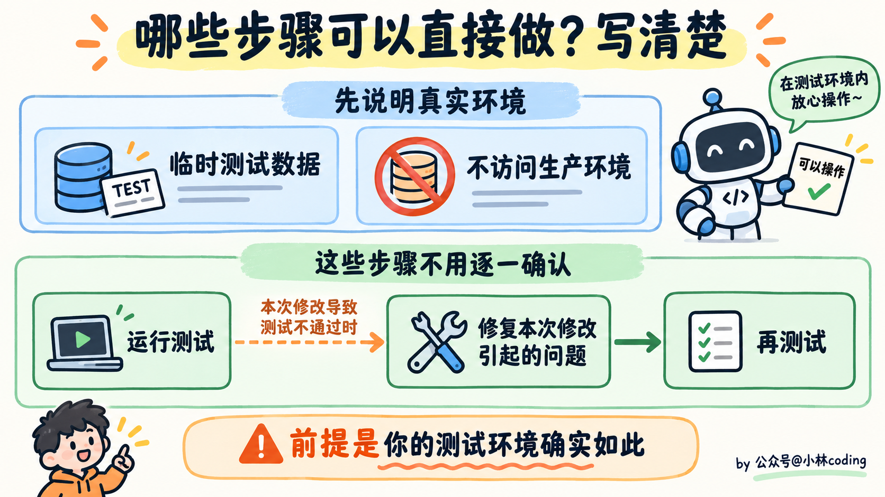

当然，前提是你的测试确实不会连接生产环境。如果会，就不能照抄这句话。这里得写真实情况，别为了让 AI 少问两句，连自己用的是什么环境都随便写。

我们自己写规则时，也可以照这个思路来。比如，你希望 AI 在本地改代码、跑测试、修问题时直接继续，那就明确告诉它。部署上线、给别人发消息、删除重要数据这些事，如果需要先经过你同意，也单独写清楚。

别一句「你看着办」就全撒手，也别一句「任何操作都问我」，把自己变成了审批机器人。

### 04｜怎么让它把事情真正做完？

权限交代清楚了，还有一个问题，**它理解的「完成」，跟你理解的一样吗？**

OpenAI 提到，如果你习惯了 GPT-5.6 Sol 接到任务就一直往下干，换到 Astra，可能会发现它有时没那么主动。第一版代码刚写好，就回来等你检查了。

这就有点尴尬了。你想要的是一个能用的功能，它把代码写完就交给你。至于能不能跑起来、页面有没有问题，还得你自己接着检查。

那怎么让它多往前做几步？一开始就告诉它，**做到什么程度才算完成。**

比如你想给后台加个按姓名搜索的功能，它做到哪一步就可以停了？代码写好就行，还是得把页面打开，确认真的能搜出结果？这些最好提前说清楚。

按照原文的建议，我整理了一组提示词对照。

**修改前**

> 给用户管理页加一个按姓名搜索的功能。

**修改后**

> 给用户管理页加一个按姓名搜索的功能。写完后运行相关测试，并打开页面检查能否正常搜索、搜不到时有没有提示、清空后列表能否恢复。发现问题就修好并复查，最后告诉我修改和检查结果。确实做不下去时，说明卡在哪里。

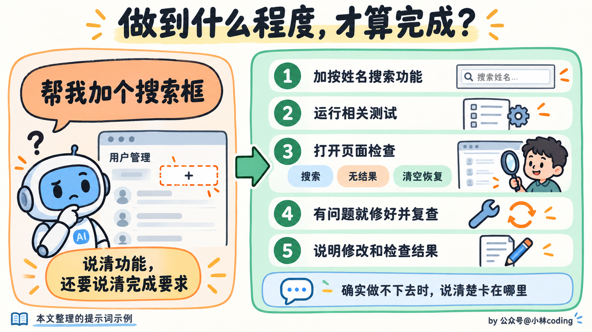

功能还是同一个功能，但这次你把「做到哪里才算完」交代清楚了。代码写完以后，它还有明确的事情要继续做。**代码写完还不算结束，要跑起来、检查过，有问题还得修。**

当然，也得看你这次想让它干什么。如果只想讨论方案，就说「先讨论方案，暂时别改代码」。如果想先看设计，就说「设计做完先给我看，确认后再开始写代码」。你需要它停在哪里，也可以提前说清楚。

那如果第一版已经做好了，你还想让它继续检查呢？也别只丢一句「继续优化」。可以说「再检查一下搜索框，输入空格、姓名里带特殊符号时，会不会出问题，有问题就修好」。

这样它才知道接下来要检查什么。不然一句「继续优化」，究竟还要改什么、改到什么时候，你自己可能都没想清楚。

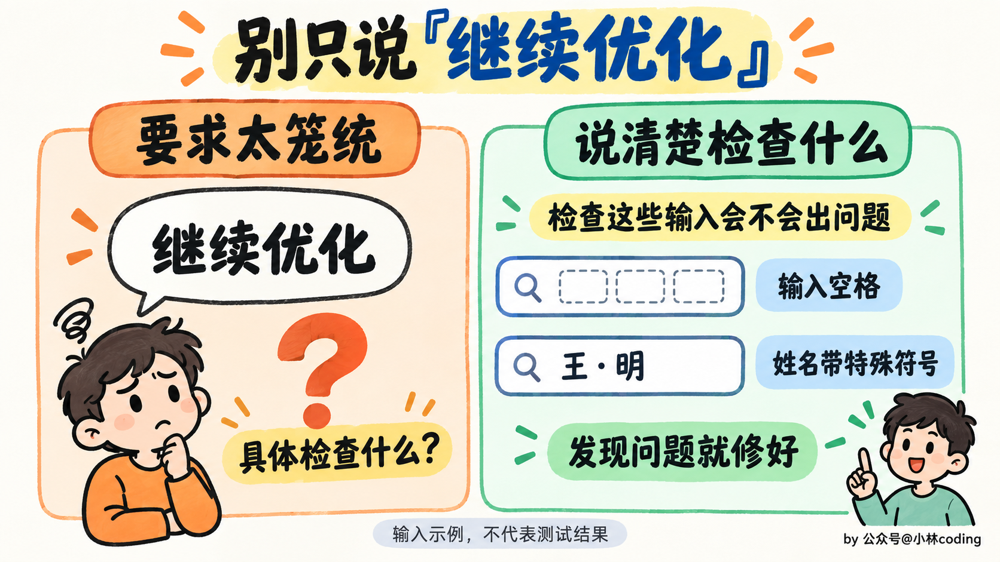

### 最后

读完这篇文章，我觉得最值得做的一件事，就是回去检查一下自己的那堆老规则。

还得自己一条条看吗？倒也不用。OpenAI 在结尾给了个建议，把这篇官方文章交给 GPT-6 Astra，让它帮你检查现有的规则。我整理了一段提示词，可以直接拿去用。

> 请阅读这篇 OpenAI 官方文章 [https://developers.openai.com/blog/rethinking-skills-and-prompts-for-gpt-6-astra](https://developers.openai.com/blog/rethinking-skills-and-prompts-for-gpt-6-astra) ，根据文中的建议，帮我检查当前项目的 `AGENTS.md` 和相关 Skills。看看有没有重复的要求、互相矛盾的规定，或者已经不适用的内容。哪些 Skill 把使用范围写得太大，容易在不需要的时候被调用？哪些要求可能让你反复问我是否继续，或者事情还没做完就停下来？请指出具体是哪条，解释原因，并给出修改建议。项目里必须遵守的业务要求，以及保护生产环境和重要数据的规定，要保留。先列出建议，等我看过再修改。

所以，换了新模型，也别忘了翻翻以前给它写的那些规则。

尤其是那些「上次踩了坑，所以补一句」的要求，过去有用，现在还需不需要，可以重新看看。

说不定模型已经能自己做好了，你还在旁边反复叮嘱。

你们现在的 `AGENTS.md` 写了多少行？有没有哪条规则，加的时候很解气，后来却让 AI 干什么都要先问你？评论区聊聊。

官方原文：[Rethinking skills and prompts for GPT-6 Astra](https://developers.openai.com/blog/rethinking-skills-and-prompts-for-gpt-6-astra)

## Codex Harness 架构图解：一句需求，为什么能让 Agent 自己干活？

大家好，我是小林。

平时用 Codex，我们可能只会输入一句很简单的话：「帮我修改一下这个项目，完成后告诉我结果。」

然后屏幕上就开始不断出现新动作：先读项目规则，再搜索代码、打开文件、修改内容、运行命令。命令失败后，Codex 还会读报错，换一种方法接着做。

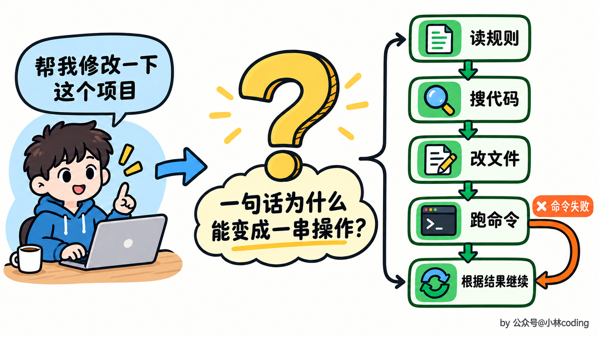

但仔细想一下，这里其实有一个挺奇怪的问题。大模型原本只会根据输入生成输出，既看不见你电脑里的代码，也不能真的启动一个进程。

为什么接进 Codex 之后，模型像突然长出了眼睛和手，还能连续工作十几步？

答案藏在模型外面的 **Codex Harness** 里。

Codex 的源码已经在 GitHub 开源了。为了弄清这套 Harness 到底是怎么工作的，我也把整个仓库拉了下来，从任务入口、会话管理、上下文组装，一路扒到了工具执行和长期记忆。

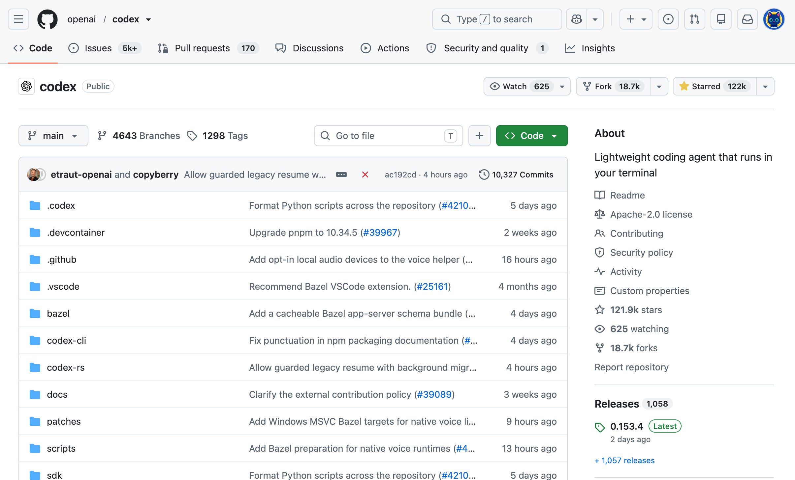

*[https://github.com/openai/codex](https://github.com/openai/codex)*

所以今天这篇文章，我会沿着一次任务的执行过程，把 Codex Harness 的架构拆开来讲，重点回答下面这些问题：

- Codex 整体由哪些部分组成，Harness 在中间负责什么？
- 一句用户需求，怎样经过 App Server、Session，进入 Agent 主循环？
- 模型怎样调用工具，执行结果又怎样回到下一轮？
- 上下文怎样组装、更新和压缩，长任务为什么不会越跑越乱？
- 工具怎样注册、路由和执行，审批、沙箱、并发与长时间进程怎样配合？
- 会话状态怎样持久化，任务中断后怎样恢复？
- 长期记忆怎样生成、检索和更新，Skills、MCP、Hooks 与多 Agent 又接在哪里？

我们先看完整架构，再沿着主循环一层一层往里走。

### 01｜Codex 整体架构是怎样的？

#### 只有模型够吗？

我们先做一个最简单的假设：Codex 里面只有一个大模型。

用户说「帮我修改项目」，模型读到这句话，最多生成一段回答。哪怕回答里写出了正确代码，也只会停留在文本中。文件没有改变，命令没有运行，任务更不会因为一次回答失败，就自动发起下一次请求。

那还缺什么？

首先，要有人把项目规则、代码片段和之前的执行结果交给模型。其次，要有人接住模型提出的动作，真的去读文件、改文件、运行命令。最后，还得有人记住任务进行到哪里，判断什么时候继续，什么时候停下来。

承担这些工作的，就是 Harness。

所以理解 Codex 的第一步，不是先背模块名称，而是先分清三个角色：模型决定下一步做什么，Harness 负责组织上下文、安排工具执行、收集结果，再交给模型继续判断。执行环境，就是实际存放项目文件、运行命令的地方。

模型没有直接碰文件。模型提出动作，Harness 把动作交给工具。工具在执行环境里完成操作，再把结果交回 Harness。Harness 重新组织输入，又去请求模型。

**模型给出下一步，Harness 把很多个下一步接成一项完整工作。** 后面所有架构，都是在解决这句话里的具体问题。

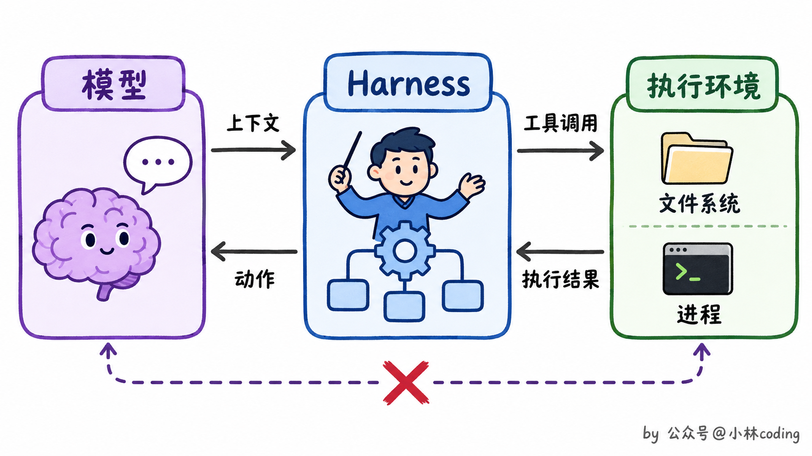

#### Harness 要负责什么？

现在我们已经知道 Harness 要组织任务。可「组织」两个字还是太抽象了。

把一次任务放慢来看，Harness 至少要回答五类问题。

- 用户从哪个界面发来输入，运行过程怎样返回界面？这需要接入与交互。
- 一项任务要请求模型多少次，下一步是否继续？这需要会话与编排。
- 这次到底给模型哪些规则、历史和工具结果？这需要上下文管理。
- 模型提出一个动作，谁来执行，权限够不够？这需要工具与执行系统。
- 任务关闭后怎样恢复，过去的经验怎样在以后被找到？这需要状态持久化和记忆。

于是，我们就能把 Codex Harness 画成一张完整地图。最上面是客户端和 App Server，中间是会话状态、Agent 循环与模型客户端。一侧负责上下文和记忆，另一侧负责工具、路由与执行。底部保存会话历史、元数据和记忆产物。

Harness 会向模型服务发送请求，拿回模型的回答或工具调用。用哪个模型、开放哪些工具、命令怎样运行，由配置决定。真正执行工具时，还要按照权限策略处理审批和沙箱限制。

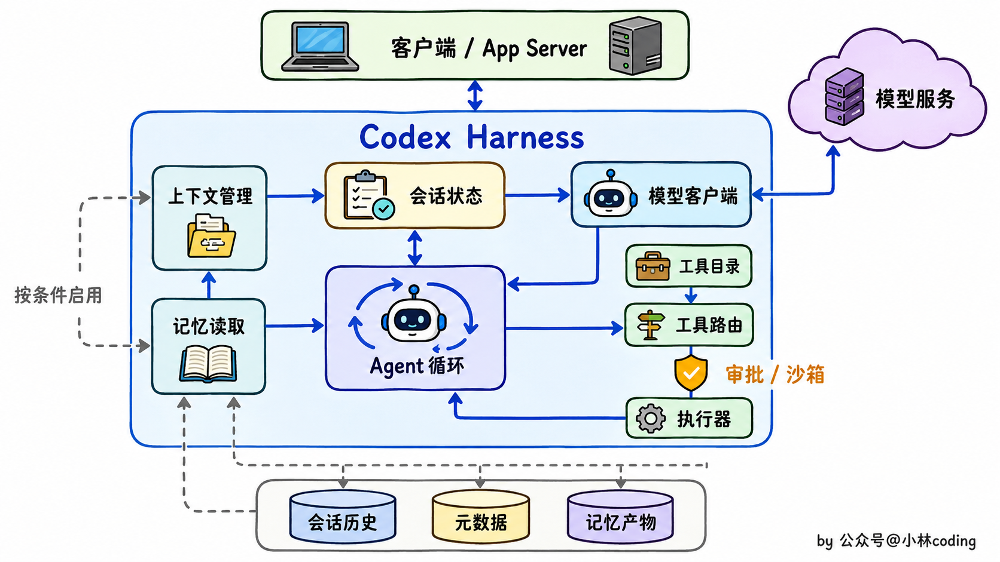

#### 为什么需要 App Server？

地图有了，我们先从用户输入的入口往里走。

Codex 不只有一种界面。终端、IDE、桌面应用都可能提交任务，也都需要接收文字增量、工具进度、文件变更和审批请求。如果每个界面都自己实现一套 Agent 循环，同样的任务，在终端和桌面应用里就可能按不同流程执行。以后修一个问题，也得分别修改多套实现。

App Server 解决的正是接入问题。App Server 把界面发来的需求转交给 Agent 引擎，再把模型输出、工具进度和审批请求传回界面。

App Server 既可以作为服务供客户端连接，也可以在同一个进程里使用。无论采用哪种方式，职责都一样：把用户的要求传进去，把执行过程传回来。

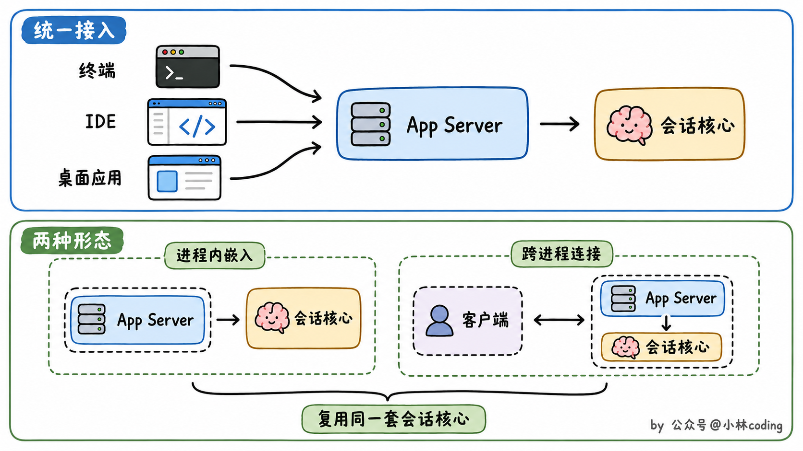

为什么一定要双向？因为 Agent 并不是普通接口那种「请求进去，结果出来」。

一次用户请求，可能连续产生几十个事件。客户端需要一边接收模型文字，一边显示工具状态。执行遇到审批时，服务还会反过来向客户端提问，等待用户允许或拒绝，然后再继续原来的工作。

所以 App Server 负责的是一段持续交互，而不是一次简单的问答。

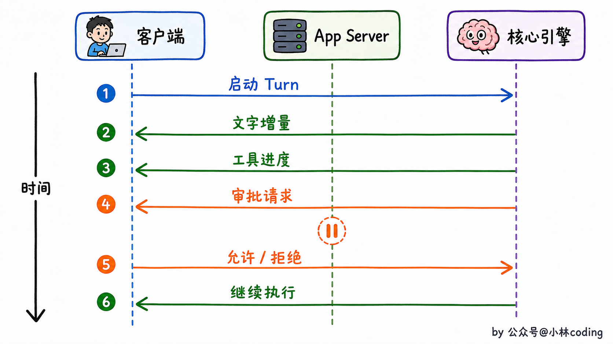

#### 一项任务怎么流动？

到这里，我们可以让那句「帮我修改一下这个项目」第一次穿过总图。

输入先经过 App Server 进入会话。会话引擎准备这一轮工作，上下文系统把规则、环境和已有历史组织起来，再由模型客户端请求模型。

模型可能先提出搜索代码。工具系统接到调用，在执行环境中完成搜索，把结果写回历史。主循环发现任务还没结束，于是带着新结果再次请求模型。模型再提出读取文件、修改内容或者运行验证。

你会发现，一项任务不是从总图左边走到右边就结束了。真正的主线是一个闭环：准备上下文，请求模型，执行动作，得到反馈，再准备下一次上下文。这里先看数据会经过哪些组件，至于循环为什么继续、怎样结束，下一章再拆开。

底部的历史会持续记录过程。后台记忆在满足条件时处理过去的历史，为未来任务提供材料，不需要阻塞眼前这项任务。

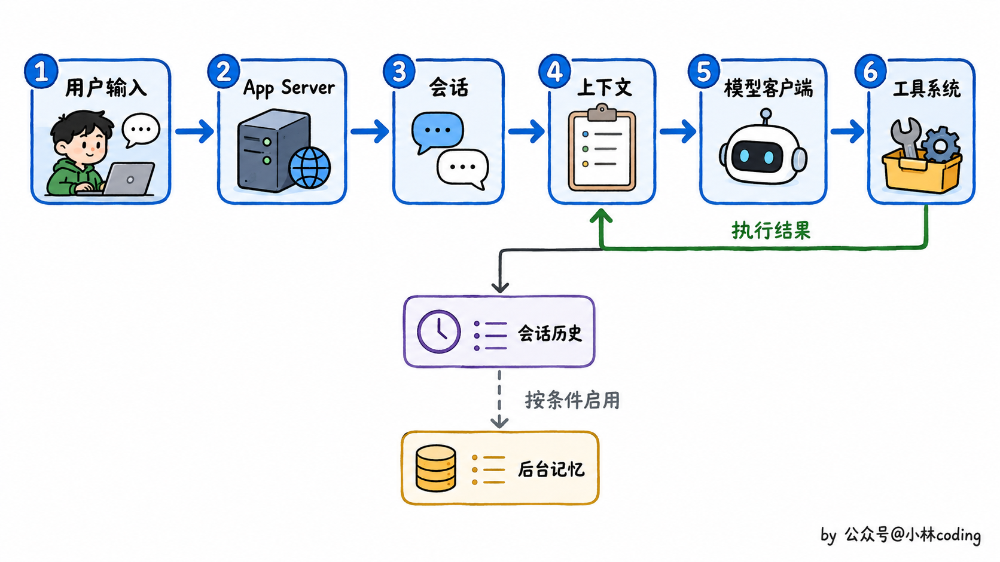

现在大地图已经建立了。接下来别急着跳去工具或记忆，我们就盯住中间这个闭环，看看一次 Agent 循环是怎样跑起来的。

### 02｜Agent 循环怎么运转？

#### 为什么要多次请求模型？

还是那句最简单的需求：「帮我修改一下这个项目。」

第一次请求模型时，模型连项目里有哪些文件都不知道，合理的动作可能只是先读规则，或者搜索相关代码。只有工具真的返回结果后，模型才获得了新的事实。

于是第二次请求和第一次已经不一样了。第一次是在决定从哪里开始，第二次是在根据刚读到的内容判断该改什么。修改完成后，验证命令又可能带回新的成功或失败信息，第三次、第四次请求继续建立在这些反馈上。

这就是 Agent 循环存在的原因：很多信息无法靠模型猜出来，只能先行动，再根据环境反馈决定下一步。

Harness 要做的事情也因此清楚了：每拿到一次真实反馈，就重新判断任务是否还需要下一步。只要模型仍在请求工具，或者还有新输入等待处理，循环就不能停在当前响应上。

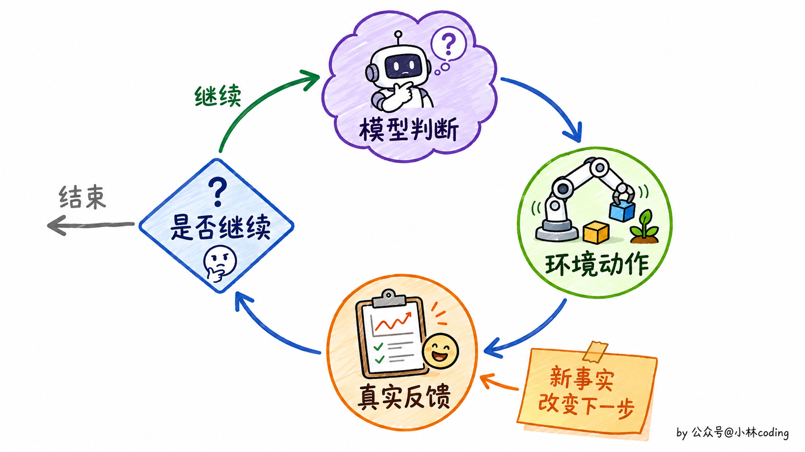

这里可以先形成一个最小理解：Agent 不是模型连续思考的神秘过程，而是模型判断与环境反馈不断交替。模型每次只基于当前输入给出输出，Harness 负责把前后几次请求接起来。

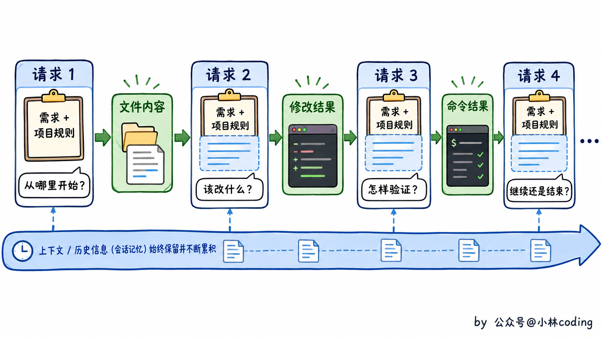

#### 模型输出怎么变成动作？

好，我们现在停在一次模型请求上。

很多人脑中可能是这样的画面：Harness 发出请求，模型返回一大段完整答案，然后程序再分析答案。真实处理要细一些，因为模型返回的是流式事件。

文字增量到达时，Harness 可以交给界面展示。一个工具调用完整生成后，才会进入工具分发。响应完成事件到达时，Harness 更新这次请求的状态和用量，再由外层循环判断后面是否还有工作。

为什么要区分这些事件？

因为「模型正在输出一句解释」「模型已经提出一个完整动作」「这次响应已经结束」是三个不同的时刻。半截工具参数不能执行，一段文字也不应该被误当成命令。

连接和传输方式由模型客户端内部处理。对主循环来说，收到的始终是统一的文字增量、工具调用和完成事件。

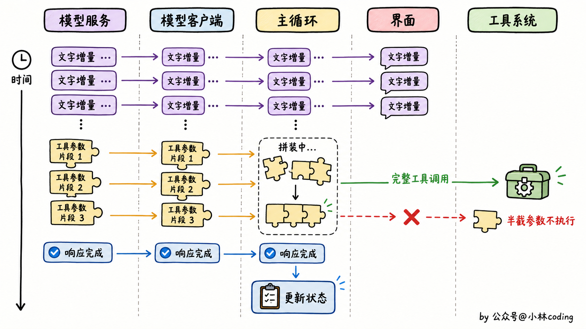

工具执行完成以后，结果还要带回原来的调用标识。假如模型一次提出两个动作，一个读取配置，一个运行命令，Harness 必须知道每段返回属于哪次调用。

下一次模型请求看到的是工具调用与结果之间的对应关系。只有关系没有断，模型才能判断刚才哪一步成功、哪一步失败。

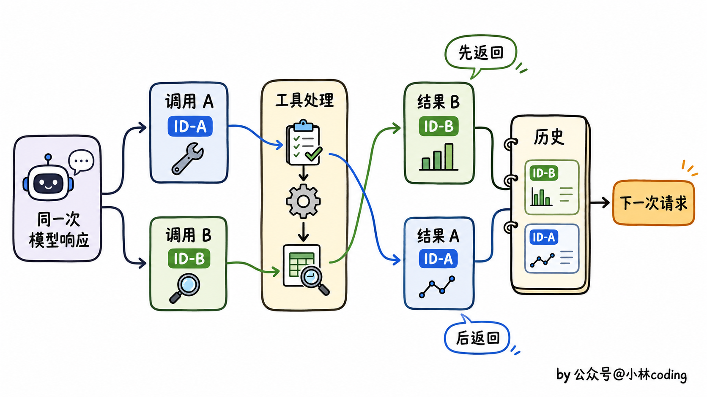

#### 任务状态由谁保存？

到这一步，模型的一次响应已经结束，但用户的任务可能远远没有结束。

那正在等待的工具、用户刚补充的一句话、已经完成的动作，放在哪里？答案是会话状态，而不是模型自己记住。

你打开一个任务，先说「帮我修 Bug」，等 Codex 做完，再说「补上测试」。这两轮工作属于同一个 Thread，也就是同一段会话。

每次用户输入发起的一轮工作，叫 Turn。这一轮里的用户消息、模型回复、工具执行和审批记录，则是一个个 Item。

所以，一个 Turn 里可以请求模型很多次，不能把它理解成一次模型 API 调用。

Session 则负责在程序内部保存这段会话的历史、待处理输入，以及运行时需要的共享服务。当前正在执行的 Turn，还会记录哪些任务仍在运行，以及流程正在等待用户输入、审批还是外部响应。

这些名字不用一口气全背下来。先记层级就够了：Thread 装着多轮任务，Turn 装着这次任务产生的多个 Item。Session 则是让这段会话真正运行起来的内部状态容器。

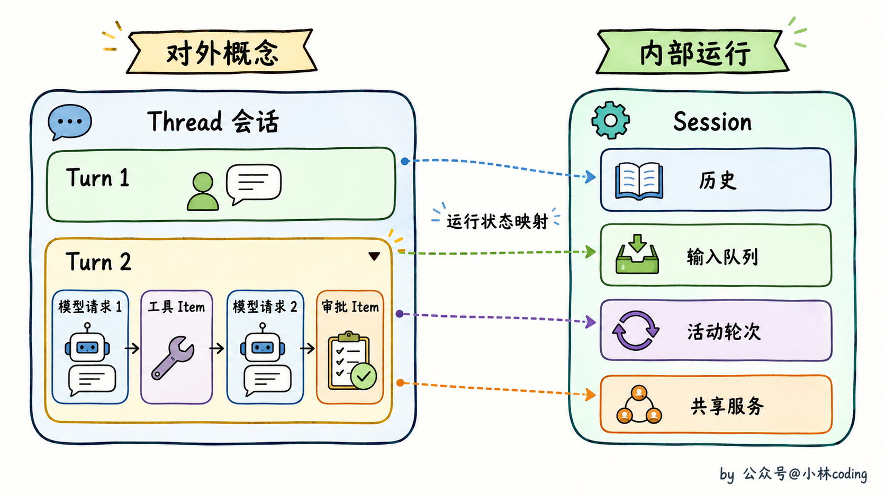

#### 为什么需要 StepContext？

为什么不能等工具调用回来以后，再读取最新配置？

想象一个具体场景。模型请求发出去时，工具目录里还有工具 A，所以模型按照眼前的能力生成了对 A 的调用。可在结果返回前，配置刚好刷新，新目录里已经没有 A。如果 Harness 按新目录解释这次调用，模型明明使用了刚才展示给它的工具，最终却会收到「工具不存在」。

所以 Codex 会为每次模型请求捕获一份 StepContext，固定这一步使用的模型设置、环境视图、MCP 绑定、工具路由和项目规则。工具调用返回后，Harness 仍然沿用同一份请求上下文进行分发。

这样，模型是按哪份工具列表发起调用的，Harness 就按同一份列表处理，不会因为配置中途刷新，让刚才还可用的工具突然找不到。

不过，StepContext 固定的只是这次请求采用的配置、工具列表和项目规则。文件仍可能被用户或其他任务修改，外部服务也可能变化。StepContext 不会把整个文件系统和外部世界一起冻结。

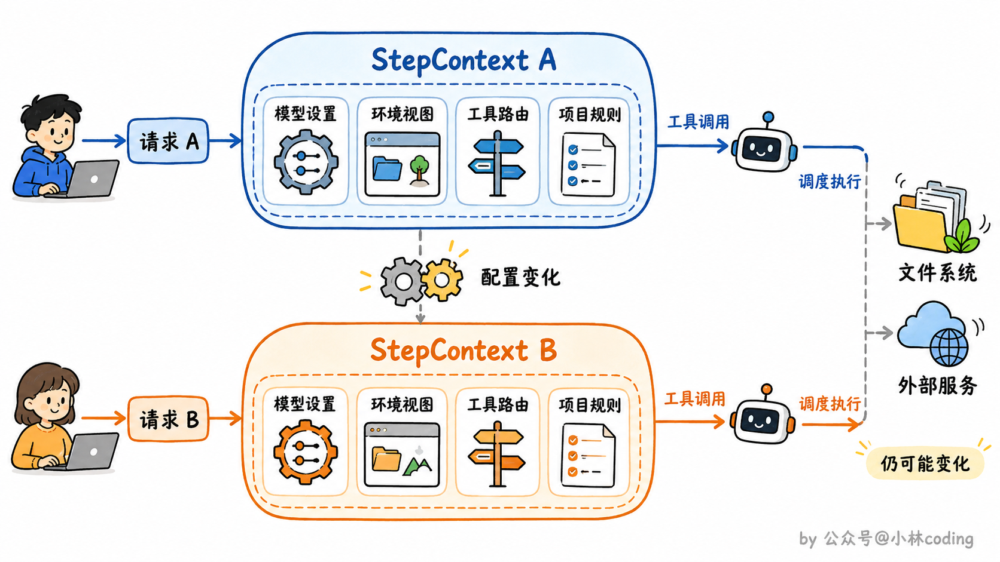

#### 等待和取消

前面的闭环看起来很顺：模型给动作，工具给结果，然后继续。但真实任务一定会遇到停顿和错误。

先看等待。工具需要审批时，Harness 会记下哪个操作正在等用户确认，再把审批请求发到界面上。用户允许或拒绝后，Harness 将答复交给对应的操作，继续处理。模型向用户提问时，也需要记下正在等哪个问题的答案。

再看用户追加输入。假如 Codex 正在运行，你补了一句「修改范围只限当前模块」，这句话通常先进入输入队列。已经发出去的模型请求不会凭空多出新内容，主循环会在合适的边界取走这条输入，让后续请求看到。

取消又不同。Harness 会触发取消信号并收尾当前任务，但已经写入的文件不会自动恢复。仍在运行的进程或子 Agent，也有各自的生命周期，需要相应的控制逻辑处理。

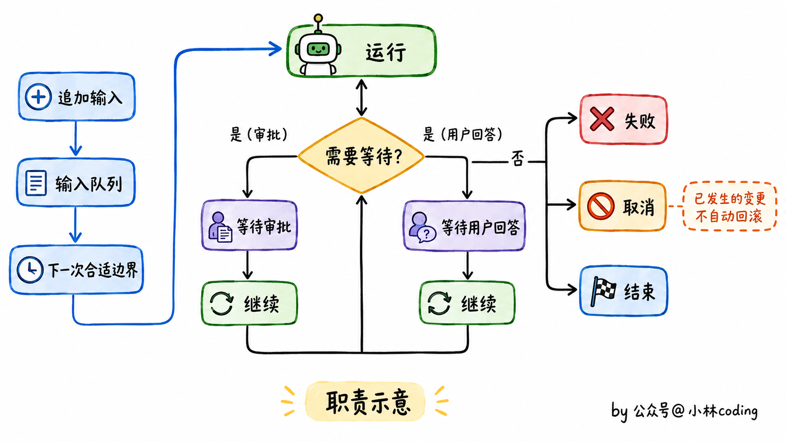

#### 失败怎么处理？

错误也不能全塞进一个「重试」框。命令退出失败，可以作为工具结果交给模型分析。如果连接模型服务时中断，Harness 可能等一会儿再重连，或者改用另一种传输方式，具体取决于错误类型。遇到无法继续处理的错误，才会结束这一轮，并清理相关运行状态。

重新请求模型、重新执行工具、从历史恢复会话，是三件不同的事情。尤其当一个命令已经产生副作用时，模型连接重试不代表这个命令可以安全重跑。

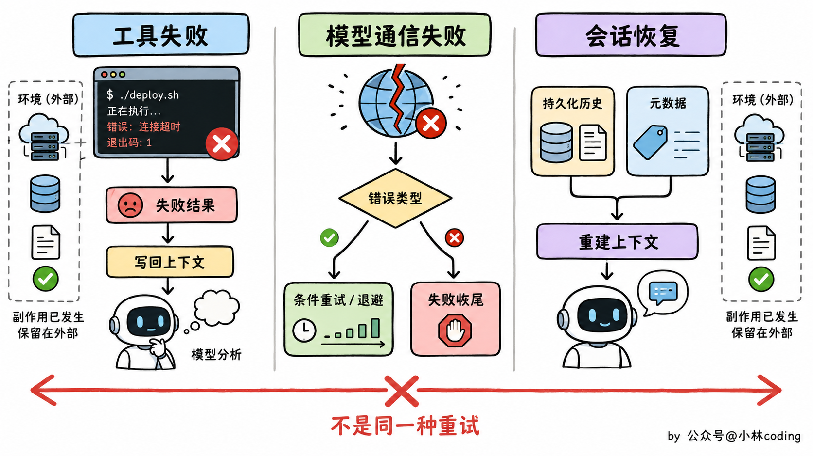

#### 循环什么时候结束？

模型没有继续调用工具，任务也不一定立刻结束。主循环还要确认：有没有用户刚补充的要求，有没有尚未处理的错误，以及停止前的检查是否允许结束。如果用户追加了要求，或者停止前的钩子（Stop Hook）补入了需要继续处理的内容，Agent 就可能再执行一轮。

Codex 停下来，也不代表你的要求一定完成了。比如修一个 Bug，文件改完只能说明代码变了，还要看相关测试和验证结果，才能判断问题是否解决。

到这里，主循环已经完整了：从一次请求开始，通过工具获得新事实，处理等待与失败，再决定继续或结束。


这一章讲的是轮次正在运行时，Harness 怎样保存状态并推动循环。会话关闭以后，哪些内容会落盘、重新打开时又能恢复到什么程度，留到第五章再回答。

但还有一个关键问题没有回答。第二次请求模型时，第一次的结果、项目规则和环境状态，是怎样变成新输入的？下一章，我们就沿着循环往前退半步，看看请求发出之前发生了什么。

### 03｜上下文怎么组织？

#### 模型实际看到了什么？

你在聊天框里只输入了一句话，但 Harness 发给模型的内容要多得多：既要说明你想做什么，也要告诉模型项目有哪些规则、前面做到了哪一步、现在能用哪些工具。

其中有规定 Codex 整体行为的基础指令，有说明当前任务和仓库约束的用户需求与项目规则，也有工作目录等环境信息。前几次模型请求和工具结果记录着任务进度，工具定义则告诉模型这一步能提出哪些动作。

如果长期记忆功能满足启用条件，一小段记忆导航也可能进入请求，帮助模型决定是否查找过去的经验。


为什么工具定义也要放进去？因为模型不会凭空知道工具名和参数格式。只有 Harness 告知本次可见能力，模型才可能生成一条结构正确的调用。

上下文决定模型知道什么，工具定义决定模型此刻能要求 Harness 做什么。

#### 项目规则怎么注入？

先看最容易理解的项目规则。

一个代码仓库可能在根目录写通用要求，在子目录再写更具体的约定。Codex 会围绕项目边界和当前工作目录查找规则文件，按层级组织找到的内容，并受到读取预算限制。

为什么要有层级？因为根目录的规则通常适用于整个项目，越接近当前目录的规则，往往越具体。模型需要同时知道全局要求和局部约束，才能在当前文件上工作。

但这不意味着仓库里所有说明都会被自动塞进模型。发现范围、候选文件、当前工作目录和读取预算都会影响最终内容。项目规则是经过 Harness 发现和组织后进入请求的，不是模型在每一步凭记忆猜出来的。

Skills 和内部扩展也能从各自入口补入说明或资源。来源虽然不同，最后都可能影响模型这一次怎样行动。


这里有一条边界需要停一下：写进上下文的规则，可以要求模型怎样做，却不能直接扩大执行权限。

项目文件里即使写了「允许访问某个目录」，实际工具能否访问，仍由 Harness 的权限策略和执行环境决定。文字指令解决行为选择，沙箱解决资源边界，两者属于架构中的不同位置。


#### 重复信息怎么更新？

如果每调用一次模型，就把相同的规则和环境说明再追加一遍，上下文很快会充满重复内容。

Codex 会记下已经向模型介绍过的规则和环境信息，这份记录就是上下文基线。第一次请求时，先提供必要的环境说明。以后工作目录、设置或其他环境信息发生变化，再补充变化的部分。

但这不代表下一次只发送变化内容。之前的对话和工具结果仍会随请求发给模型，只是不再重复追加相同的环境说明。

这和前面讲的 StepContext 正好接上。上下文系统组织这一步应该看到什么，StepContext 固定这次请求采用的设置、环境与工具视图。


让前面的内容保持稳定，还有一个实际好处。连续请求拥有相同前缀时，模型服务才有机会复用已有前缀缓存。是否命中仍取决于服务与请求条件，但如果 Harness 每一步都重新排列前文，就很难保留这种机会。

所以维护上下文不只是控制长度。Context Manager 还要尽量保持不变信息的稳定，让新信息正常追加，让变化状态得到更新。


#### 长输出怎么处理？

主循环继续运行，工具结果就会不断增加。文件内容可能很长，编译或测试日志更可能一次返回几万行。

如果全部保留，最先遇到的是容量问题。更麻烦的是，真正有用的报错也可能被大量重复日志淹没。

Codex 会在记录工具输出等环节应用限长策略，控制进入模型历史的内容规模。不同工具和输出类型，可以采用相应预算与保留方式。模型下一次看到的，可能是受限后的结果，而不是底层进程产生的全部原始输出。

那被省略的细节怎么办？如果现有信息不足，模型需要发起更精确的动作，例如读取指定文件范围、按关键词搜索，或者用范围更小的命令重新取得证据。

这里没有免费的午餐。限长换来了可控的上下文，也可能丢掉暂时看不出价值的细节。Harness 负责控制体积，模型通过后续工具调用补回真正需要的信息。


#### 调用与结果怎么配对？

控制历史长度时，还有一个结构问题比文本长短更麻烦。

模型提出工具调用，工具随后返回结果，这两个条目通过调用标识配成一对。如果历史里只剩调用，没有结果，模型会不知道动作是否完成。如果只剩一段孤立结果，模型又不知道这段内容回答了什么。

因此，Codex 在发送历史前还要做规范化。缺失结果的调用需要补出中止等状态，孤立结果需要按协议处理，不支持的输入类型也要根据当前模型能力调整。

这里补出的状态，是为了告诉模型调用没有正常完成，并不是伪造一个成功结果。


到这一步，我们已经看到 Context Manager 的核心工作：不只追加消息，还要维护模型能理解的历史结构。

一旦理解这一点，就能解释很多表面现象。Codex 有时重新读一段文件，不一定是模型完全忘了，也可能是旧输出被限长，或者压缩后需要重新取得精确证据。

#### 上下文满了怎么办？

单次输出做了限长，任务足够长时，历史仍然会持续增长。规则、用户输入、模型消息和工具结果加在一起，最终会接近模型上下文窗口。

Codex 会跟踪使用量，并在轮次开始前或运行过程中，根据阈值与继续条件触发压缩。具体使用哪种压缩能力，还会受模型服务和配置影响。

其中，总结式压缩可以理解成写一份交接说明：目标是什么，哪些地方已经改完，确认了哪些事实，试过哪些失败的方法，接下来还要做什么。

下一次请求模型时，靠这些信息接着往下做，就不必再带上之前每一步的完整输出。

至于每次搜索的完整输出、已经被替代的猜测，就可能不再留在当前窗口。


压缩之后，Harness 还要把必要的初始上下文放回合适位置。原因很简单：仅有一段任务摘要，未必包含当前项目规则、工作环境和模型需要遵循的全部要求。

轮次前压缩和轮次中压缩，在重新注入上下文的位置上还有不同安排，目的都是让后续请求拿到必要规则与当前任务。


压缩最容易被高估的地方，是被想成无损存档。事实并非如此。

摘要保住了主线，也可能丢掉某段完整日志和局部代码细节。持久化历史里也许仍然保存过更多内容，但「Harness 保存过什么」和「下次模型请求能看到什么」是两回事。

所以必须把三个范围分清：当前模型窗口，Harness 维护的会话历史，以及后面才会讲的长期记忆。上下文压缩服务于眼前任务继续运行，不会自动把全部细节变成跨任务知识。

现在，模型输入已经准备好了。问题也顺着出现了：这份输入里包含工具定义，可 Codex 的工具越来越多，Harness 到底选择哪些给模型，又怎样把模型调用落到真实执行？

### 04｜工具调用怎么执行？

#### 模型能看到哪些工具？

我们先站在模型请求的角度看工具。

模型要使用工具，必须先看到名称、用途和参数结构。但如果 Harness 连接了大量内部工具、通过 MCP 接入的外部服务工具和扩展能力，把所有定义都塞进每次请求，会占用上下文，也会增加模型选择负担。

每次请求模型前，Codex 都要安排好工具怎么用：哪些工具直接展示名称、用途和参数，哪些等需要时再查找，以及模型发起调用后交给谁处理。这些安排合起来，就是本次工具计划。具体安排会结合当前配置、模型能力、运行环境，以及已经接入的 MCP 和内部扩展。

这里一定要区分三件事：系统里存在什么工具，这次请求向模型展示什么，以及 Harness 最终能调用哪个执行器。三者有关联，却不是一个简单的完整列表。


这也解释了为什么同一个 Codex，在不同项目、模型或权限配置下，能用的工具可能不同。不是模型临时忘了一个工具，而是本次 StepContext 固定的工具计划可能不同。

#### 工具调用怎么路由？

现在假设模型已经生成一条完整调用。

模型输出的是结构化请求，里面包含工具名称和参数。Tool Router 先解析这份请求，再从本次工具计划里找到对应处理器。如果工具不存在，或者参数不合法，就返回相应错误，不能把模型生成的任意内容直接拿去执行。

找到处理器后，Harness 把调用参数、会话信息和 StepContext 一起交给处理器。动作完成后，处理器再把结果封装为带调用标识的工具输出。

随后结果走向两个地方：事件通道把进展展示给客户端，Context Manager 把结果记入历史，供下一次模型请求使用。


#### 审批和沙箱做什么？

审批和沙箱负责控制动作怎样改变环境。读某个目录、修改文件、访问网络、启动进程，风险和权限要求并不一样。

对于执行类工具，Harness 会先走一段公共流程：根据当前策略判断是否需要审批，再选择合适的沙箱方式运行。审批回答「这个动作要不要额外获得许可」，沙箱限制「进程能够接触哪些资源」。

两者不能混为一谈。用户批准某个动作，不代表进程自动获得无限资源。沙箱里的执行失败，也不代表系统会直接提升权限重跑。

只有策略允许时，执行链路才可能请求许可或调整执行方式。其他类型的工具，也会根据自己的边界处理权限和失败。


#### 长命令怎么交互？

短命令可以一次等待结束，可编译、测试或开发服务可能持续很久。要是一次工具调用必须等到进程退出，Agent 就无法在运行中观察新输出，也很难与交互式进程继续通信。

Unified Exec 把「一次工具请求」和「一个进程的完整生命周期」分开处理，负责启动、跟踪进程，收集输出，并处理继续等待、写入输入和取消等操作。

第一次调用可以先返回当前输出和一个进程标识，底层进程继续运行。后续调用再用标识读取新输出，或者发送输入，直到最终取得退出状态。

因此，工具调用返回了一段日志，只能说明 Harness 当前拿到了这些内容，不能直接推断进程已经结束。


#### 工具如何并发和选环境？

模型一次可能提出多个动作，Harness 也要判断这些动作能否并行。

可以把这里想成一道门。允许并行的工具拿的是共享通行证，可以一起进去。需要单独运行的工具拿到专用通行证后，其他调用要在门外等它完成。

这道门控制的是工具分发顺序，不是给整个文件系统上锁。具体拿哪种通行证，由工具注册时声明的能力决定。工具进入以后如果还会修改共享资源，仍然要处理自己的数据一致性。


找到负责执行的工具以后，还要确定它在哪里运行。启动进程、读写文件这类操作，可以交给 Exec Server，在对应的本地或远程环境中执行。MCP 工具会请求各自连接的外部服务。内部控制工具则直接在运行 Harness 的 Codex 进程里处理。

这里别被两个相近的名字绕进去。App Server 连接客户端和 Agent 运行核心，负责传递用户请求与执行事件。Exec Server 连接工具和执行环境，负责相应的进程与文件操作。两者做的是不同的事情。

所以工具系统不是一个巨大的 Shell。不同类型的工具会走不同的处理程序、权限策略和执行环境，最后再把结果送回同一个 Agent 循环。


讲到这里，一项任务已经能完整跑起来了：模型看到上下文，提出动作，工具受控执行，结果回来后循环继续。

可一旦关闭当前任务，模型窗口里的内容还在吗？下次新开任务时，Codex 又凭什么记得过去发生过什么？这就进入了最容易混淆的一组概念：上下文、历史和长期记忆。

### 05｜长期记忆怎么形成？

#### 三种记忆有什么区别？

先想三个时间点。

第一个时间点，Agent 正在处理当前任务，下一次模型请求需要知道刚才读了什么、改了什么。这里依赖的是当前上下文。

第二个时间点，你关闭界面，后来重新打开原来的会话，希望继续之前的工作。这里依赖的是持久化历史和状态重建。

第三个时间点，你创建了一个全新的会话，希望过去积累的项目经验仍然能派上用场。这里才需要长期记忆的提炼与读取。

如果把三者都叫作「记忆」，就很容易得出错误结论：以为压缩历史是在写长期记忆，以为会话保存后，新会话就会自动读到全部旧聊天。

更准确的理解是：上下文服务下一次模型请求，持久化历史服务原会话恢复，长期记忆尝试把跨任务仍有价值的信息带进新任务。


#### 会话怎么恢复？

一项任务运行时，会话过程会持续写入历史。当前本地实现以 JSONL 保存事件历史，在状态数据库可用时，再用 SQLite 保存便于查询的元数据。

重新打开原会话，Harness 会先从记录中还原已经发生过的用户消息、模型回复和工具结果，再恢复上下文基线与窗口用量等信息。恢复不只是把聊天文字重新显示出来，还要让 Context Manager 知道接下来从哪里继续组织输入。

但恢复也有明确边界。某些等待中的审批、交互对象或正在运行的进程，只存在于当时的进程内。历史保存了什么，恢复过程才能重建什么。已经发生的文件修改，也不会靠重放聊天自动撤销或再执行一次。


到这里，原会话可以接着看、接着组织输入了。可如果是一个完全不同的新会话，直接把几十次旧任务全部塞进去，显然又回到了上下文爆满的问题。

所以长期记忆不能只是「保存更多」，还得先回答一个更难的问题：过去哪些内容值得留下？

#### 历史怎么提炼？

在看写入过程之前，先问一个更实际的问题：记忆任务什么时候启动？

当前 App Server 会在带输入的新轮次成功启动、运行环境准备好后，尝试调度后台记忆任务。真正启动前，还要确认长期记忆功能已经开启、当前会话不是临时会话或子 Agent 会话、状态数据库可用，而且账号剩余调用量高于系统设置的阈值。任一条件不满足，这次后台记忆任务就直接跳过。

所以长期记忆不是每轮结束立即保存的固定步骤，也不能假定每个安装都默认启用。前台任务可以继续执行，后台流程在条件满足时处理符合要求的旧历史。刚完成的内容，也不保证立刻进入下一次请求。


通过这些条件以后，记忆写入还要分成两个阶段。我们先看第一阶段，每次只处理一段历史任务。

后台流程不会拿到一条历史就立刻提炼，而是先按会话来源、时间、空闲状态、记忆配置和数量限制筛选候选，再通过任务租约抢占处理资格。可以把租约理解成一把有时间限制的锁：一个后台任务拿到以后，其他任务暂时不能处理同一份材料。即使任务中途异常退出，锁到期后也会自动释放，材料仍能被后续任务接手。

候选选中后，模型从这次任务中提炼结构化的原始记忆和任务摘要。目标是留下可复用偏好、有效步骤、失败教训等信息。如果这次任务没有值得长期保留的内容，也允许没有产出。

比如一个项目长期固定的验证命令，可能对未来任务仍有用。一次偶然产生的完整临时日志，就未必需要保存。这里说的是提炼目标，不是程序已经保证每条记忆都正确。模型仍可能遗漏，也可能概括得不够准确。


#### 为什么还要整理？

因为单任务记忆只是材料，还不是一份容易使用的知识。

不同任务可能重复记录同一条命令，也可能保留已经变化的项目约定。如果把这些材料按时间不断追加，模型下次会读到大量重复甚至互相冲突的内容。

于是第二阶段要做跨任务整理。整理流程先取得全局租约，也就是给整个整理过程加锁，再选择第一阶段的材料，同步到记忆工作区，并比较内容是否发生变化。没有变化且现有产物通过检查，就可以跳过本次整理。

确实需要更新时，Harness 会启动一个专门的整理 Agent，把经验整理成几类文件：导航摘要告诉模型有哪些经验可查，详细记忆说明具体内容，任务摘要帮助模型追溯当时做了什么，可复用步骤则记录以后遇到同类任务可以怎么做。

这里锁住的不是某一段历史，而是整份共享记忆，因此同一时间只允许一个整理 Agent 改写。整理 Agent 本身还是临时内部任务，会关闭再次生成和读取记忆、递归协作等能力，避免整理过程再次触发自己。


#### 新任务怎么读取记忆？

读取分两步：先给导航，再按需展开。把全部记忆塞进去，只会让新任务的上下文越来越难控制。

当记忆读取功能启用，而且已经存在非空摘要时，扩展会把有限长度的记忆导航和使用说明注入开发者指令。

模型先看到「过去大概有哪些经验」，判断是否与当前任务相关。需要细节时，再通过专用工具搜索详细记忆，必要时继续读取任务摘要和可复用步骤。

当前本地搜索主要按照文字匹配，找到以后只返回命中位置附近的一小段内容。这样不用把整份记忆都读进来，但如果两段话意思相近、用词却不同，就可能搜不到。


只不过，过去的经验仍然是线索。项目代码和环境可能已经变化，模型必须回到当前文件与工具结果上验证，不能把长期记忆当成永远正确的事实库。

#### 记忆怎么更新？

长期记忆也会变化。系统可以根据记忆引用等信号记录使用情况，再结合时间窗口和数量上限选择后续整理材料。长期未使用的原始材料可能被清理，但已经汇总的内容还要经过后续整理才能反映变化。

使用次数也不能证明一条记忆是真的，只能说明这份材料被引用过，并不构成自动事实校验机制。


到这里，三种状态终于分开了：上下文负责眼前这次请求，历史负责原会话的续接，长期记忆负责跨任务的信息复用。

但你可能还会问，记忆为什么能同时把说明注入上下文，又提供搜索工具？Skills、MCP 和多 Agent 又是从哪里接进来的？最后一章，我们把这些扩展入口放回总图。

### 06｜扩展能力怎么接入？

#### 扩展怎么接入主循环？

如果每增加一项能力，都去改主循环中的大量代码，Harness 很快就会变得难以维护。Codex 内部提供了扩展注册机制，让每个扩展先登记自己会增加什么，以及要在哪些时机运行。

有的扩展会往模型输入里补充说明，有的会增加工具，还有的会在会话启动、轮次结束等时机执行处理。Harness 会先登记这些扩展，等到准备模型输入、组装工具列表，或者运行到对应时机时，再调用相应的扩展。

第五章的记忆读取就是一个例子。准备请求时，记忆扩展可以补入一小段记忆导航。模型需要查看详情时，记忆扩展又能提供搜索和读取记忆的工具。


这里讲的是源码内部架构接口。内部扩展机制解释了核心运行时怎样组织扩展点，不代表所有面向用户的插件、MCP 服务和 Skills 都遵循同一个公开接口。

#### Skills、MCP 和 Hooks 做什么？

Skills 告诉模型某类任务应该怎么做，并提供需要的说明和资源。

MCP 把外部服务的工具接进来，让模型可以请求 Harness 调用。

Hooks 让程序在指定时机介入，比如收到用户输入时、工具执行前后，或者任务准备停止时。

一个提供做事方法，一个接入工具，一个在特定时机执行处理。


#### 子 Agent 怎么运行？

子 Agent 仍然沿用同一套运行架构，也需要会话、上下文、模型循环和工具执行。多 Agent 机制复用这些核心组件，再增加父子关系、消息传递和并发控制。

父 Agent 可以把一部分调查任务交给子 Agent，子任务按配置继承相应上下文，独立运行后再把结果传回。父任务拿到新信息，继续自己的 Agent 循环。

独立会话意味着运行状态分开，却不等于文件环境一定隔离。如果父子 Agent 指向同一个工作目录，多个 Agent 仍可能看到或修改相同文件。真正需要隔离时，还要配合独立工作目录或相应环境策略。


现在再回头看扩展，你会发现这些能力没有改变 Agent 的基本原理。无论加上 Skill、MCP 还是子 Agent，核心仍然是准备输入、请求模型、执行动作、接收反馈，再决定下一步。

### 最后

恭喜你看到这里，你已经成功解锁了这道面试题。

如果面试官问你：「Codex 的架构是怎样的？」

你可以这样回答：

> Codex 的核心是在大模型外面加了一套 Harness，模型负责判断下一步，Harness 负责把判断变成真实行动。整体上，Codex 可以分为客户端接入、会话编排、上下文管理、工具执行、状态与记忆五个部分。用户发起任务后，Harness 会在一个 Turn 里反复「组织上下文、请求模型、调用工具、写回结果」，中途需要审批或用户补充信息时先等待，收到答复后再继续。其中 Context Manager 把规则、历史和工具结果整理给模型，Tool Router 找到对应的工具处理器，再由执行流程按照权限策略处理审批、沙箱和实际操作。Session 还会保存任务状态、压缩上下文和恢复会话，长期记忆则负责跨任务复用经验，所以整套架构的主线就是：**模型决定下一步，Harness 让这一步安全执行，再把结果交给模型继续判断。**


这就是 Codex Harness 最核心的工作原理：维护一个不断获得环境反馈的任务循环，让上下文、状态、权限、执行和记忆在正确的位置发挥作用。

## Codex 记忆机制图解：Agent 的记忆系统是怎么设计的？

大家好，我是小林

之前发了[图解Codex的Harness架构](https://xiaolinnote.com/codex/source/codex_harness.html)的文章，得到了很多读者的好评。


那么这次就来**图解 Codex 记忆机制**，我们一个一个来看。

- Q1：模型为什么不会天然记住你？
- Q2：Codex 怎样管理当前任务的模型可见历史？
- Q3：上下文快满时，Codex 会在什么时候压缩，又有哪些压缩策略？
- Q4：上下文压缩以后，同一任务怎样恢复现场？
- Q5：旧任务怎样经过两阶段处理，变成跨任务长期记忆？
- Q6：新任务怎样查找、纠正和淘汰旧记忆？

### 01｜模型为什么不会天然记住你？

Codex 能接住你的上一句话，是模型自己保存了状态，还是有人把历史重新递给了它？

答案是后者。

每次请求模型之前，Codex 都会重新组装输入，包括基础指令、项目规则、历史消息、工具结果和当前需求。

模型之所以能接住前文，不是因为它在两次推理之间保存了任务状态，而是因为 Codex 把需要的信息再次放进了本次请求。我们后面讲的上下文管理、压缩和长期记忆，最终都是在解决同一个问题：怎样把此刻最有用的信息放进下一次请求。

但一次请求能处理的 Token 数量有上限。编程 Agent 又会不断读取代码、跑测试、接收工具结果，历史不可能无限增长。所以 Codex 既要保存任务状态，也要控制模型眼前能看到的内容。


不过，Codex 要解决的不只是眼前窗口会不会满。继续当前任务、恢复已经关闭的任务、让新任务复用旧经验，看起来都像「记住了」，背后却是三套不同机制。

当前上下文，负责让眼前的任务继续执行；会话历史，负责让关闭后的同一任务能够恢复；长期记忆，则负责让新任务复用旧任务里值得保留的经验。

它们解决的是三个不同问题。上下文压缩负责重建当前上下文，Rollout（任务运行档案）和 checkpoint（上下文恢复点）负责恢复原任务，长期记忆流水线处理跨任务复用，三者不能混为一谈。


接下来，我们从当前任务的上下文管理讲起。

### 02｜Codex 怎样管理当前任务的记忆？

任务执行过程中，Codex 会整理之前的对话、工具调用和返回结果，供下一次请求模型时使用。负责这件事的，就是上下文管理器。

要注意，Codex 保存了哪些记录，和这次会把哪些记录发给模型，是两回事。

用户发来需求，历史里多一条用户消息。模型决定读取文件，历史里多一个工具调用。文件内容返回，又多一个工具结果。模型继续修改和测试，新的调用与结果再接着往后追加。

所以当前上下文并不是一份静态 Prompt，而是一段不断生长的任务现场。

这也是为什么编程 Agent 特别容易撞到上下文压力。普通聊天主要增加文字，Agent 还会不断带回代码、目录、日志、网页和结构化工具结果。


Codex 不会等历史完全塞满才开始处理。

工具结果写进模型历史时，就会先应用限长策略。也就是说，一次工具返回几十万字符，并不代表几十万字符都会原样进入后续请求。

这是第一道防线：先限制每次工具结果的长度，避免一份特别长的日志就占掉大量上下文空间。

同一份工具结果，会有两种保存方式：准备发给模型的那份会限制长度，写进任务档案 Rollout 的那份则会保留更多内容。所以，后续请求少带了一部分，不代表任务档案也删掉了那部分。这里先把 Rollout 理解成 Codex 在模型之外持续保存的任务档案，第 04 章我们再展开。


#### Codex 怎么知道上下文快满了？

有了限长，历史还是会继续增长。最直觉的办法，是不是数一数已经积累了多少条消息？

问题是，一条工具结果可能比几十轮普通对话还长。真正决定上下文压力的不是消息数量，而是 Token 用量。

Codex 会维护当前上下文的 Token 使用状态，优先采用服务端反馈，必要时再根据历史估算，然后把当前用量和自动压缩阈值进行比较。

自动压缩阈值可以提前设置，但模型的真实上下文窗口始终是不能突破的硬上限。


当历史继续增长并达到阈值，才轮到真正的上下文压缩。

### 03｜上下文快满时，Codex 怎样压缩又接着干？

如果 Codex 只在新轮次开始前检查，某次工具调用突然带回大量日志怎么办？

所以压缩不能只发生在两轮对话之间。

自动压缩有两个重要位置。一个是新轮次开始前，如果旧历史已经达到阈值，Codex 会先压缩再继续；另一个是轮次运行中，工具结果把上下文推到阈值后，Codex 会建立新的上下文窗口，然后接着执行任务。

除此之外，用户也可以手动触发压缩。

也就是说，Codex 干活干到一半，也可能先整理上下文，腾出空间，再接着往下做。


#### 本地压缩怎样重建历史？

Codex 有几条压缩路径，其中本地总结最容易看清完整过程，我们先拆这条。

Codex 会把当前历史连同一条专门的压缩指令交给模型。这条指令不是让它继续修 Bug，而是先整理一份供后续请求使用的交接摘要。

摘要要覆盖当前进度、关键决定、用户偏好和限制、剩余工作，以及继续任务所需的重要数据。

这份摘要的目标，是让模型在处理后续请求时知道任务做到哪一步、接下来还要做什么。

这两个目标差别很大。

普通会议摘要可能写「团队讨论了三个方案」。任务交接摘要必须继续回答：最后选了哪个方案，为什么，哪些文件已经改过，测试还差哪一步，哪条路已经证明走不通。

生成摘要以后，Codex 不再让后续请求背着全部旧工具调用和日志，而是构建一份更小的替代历史。


摘要生成以后，原来的历史也要跟着重建。

本地压缩并不是只留一段摘要。

本地压缩还会保留一部分用户原话。能保留多少，取决于可用的 Token 空间；空间有限时，优先保留最近的消息，再把交接摘要接在后面。尤其是明确的需求和约束，用户原话通常比模型的二次转述更值得保留。

但是，旧工具调用、旧工具结果和大量中间过程不会继续完整占据当前窗口。这些过程最后得出的结果，会写进交接摘要。


摘要可能漏掉项目规则，这些规则怎么办？

Codex 会单独提供：基础指令本来就随每次请求发送，项目规则、开发者要求和环境信息也会重新补上。这样，即使摘要没提到某条规则，模型仍然能看到它。


前面讲的是本地总结。实际上，Codex 会根据配置和模型服务能力选择压缩方式：启用 Token 预算策略时，达到预算后直接建立新窗口，不再生成摘要；否则，服务端支持远程压缩就交给服务端处理，不支持才使用本地总结。

三种方式虽然过程不同，目的都是腾出新的上下文空间，让任务继续执行。


压缩过早会增加成本和信息损失，过晚又可能没有足够空间生成摘要，所以触发阈值本身也是一种取舍。

### 04｜任务关闭以后，现场为什么还能恢复？

如果只看模型当前窗口，确实有大量旧内容已经不在了。

但 Codex 还有另一层：Rollout 持久化。

任务运行过程中，用户消息、模型输出、工具调用、事件和上下文变化等记录，会持续写入 JSONL。这里保存的是 Codex 本地的任务历史，不等于每次都要发送给模型。

压缩发生时，Codex 还会额外写入一条压缩记录（`CompactedItem`），保存替代历史以及恢复这个上下文窗口所需的元数据。

也就是说，压缩不是偷偷改完内存就算了。它会留下一个明确的恢复点。


最直觉的恢复办法，是不是把整份 JSONL 从头塞回模型？

Codex 没有这样做。它会先找到最近一次仍然有效的压缩恢复点（checkpoint），取出当时保存的精简历史。然后，把恢复点之后新增的消息和工具结果按顺序补回来，恢复出任务继续执行时需要的上下文。

同时，Codex 还会恢复一份记录，标明哪些规则和环境信息已经加入历史，避免再次追加相同说明。窗口信息和最近使用的模型设置，也会一起恢复。

可以把它理解成数据库恢复里的「快照加增量日志」。

快照负责给出某个时刻的紧凑状态，后面的日志负责补齐从那个时刻到任务关闭之间发生的变化。


这里再次说明了压缩摘要、持久化历史和长期记忆的区别。

压缩摘要让模型接着当前任务做，会话 checkpoint 让同一任务重新打开后接得上。它们都还没有回答：一个全新的任务为什么要知道以前的经验？

### 05｜旧任务怎样变成跨任务的长期记忆？

先说明一下：在本文分析的 Codex 版本中，这套长期记忆机制默认关闭，需要在设置中打开「启用本地记忆」后才会生效。

很容易让人以为，Codex 会在每项任务结束时做一次总结，然后立刻写入记忆。

Codex 并不是这样做的。

新轮次成功启动以后，Codex 会尝试调度后台记忆流程。只有会话类型、功能配置和运行环境等条件都满足，流程才会真正开始。

后台流程启动后，会从已经空闲一段时间的旧任务中挑选材料。当前正在执行的任务，不参与这一轮记忆提炼。

这个时机挺有意思。

这样，你不用等记忆整理完，当前任务就能继续。刚做完的任务也会先放一放，避免结论还在变化，就急着记下来。不过，刚积累的新经验也不会马上出现在长期记忆里。


#### 第一阶段，怎样从一项旧任务里挑出经验？

长期记忆的写入分两阶段。

旧任务只要结束了，就都值得写进长期记忆吗？

并不是。

第一阶段会从已经空闲、允许生成记忆的旧任务中，选出有限数量的任务。每项任务的运行档案（Rollout）会单独处理，分别提炼经验。

领取任务时，Codex 还会加上一把有时间限制的锁，这就是「租约」。在租约有效期间，其他后台任务不能重复处理同一份历史。

选中以后，Codex 会过滤出与记忆提炼有关的历史项，再调用专门的模型生成结构化结果，主要包括两部分：一份更详细的原始记忆，以及一份紧凑的任务摘要。

它想留下的不是流水账，而是可能改变未来行为的信息，比如稳定的用户偏好、难找的项目入口、已经验证过的工作流、失败原因和避坑方式。

如果这项任务没有值得复用的东西，模型可以返回空结果。生成的记忆字段还会经过敏感信息清理。


#### 第二阶段，为什么还要启动一个整理 Agent？

Phase 1 处理完以后，得到的仍然是一堆按任务分开的材料。

问题来了。

同一个项目可能在三项任务里都提到测试命令；一项任务说旧命令可用，另一项任务后来发现它已经失效；用户对表达风格的要求，也可能经过几次纠正才逐渐稳定。

如果长期记忆只会不断追加，重复和冲突很快就会积累。

所以 Phase 2 做的是跨任务整理。它会把多项任务提炼出的经验放到一起，再与已有记忆对照：重复的合并，互相矛盾的核对，已经失效的删除，并补上各自的适用范围。整理完，再更新供新任务查阅的记忆文件。

主流程其实就是「收集多项任务材料 → 跨任务整理 → 更新长期记忆文件」。为了避免并发覆盖和没有必要的重复整理，Codex 还加了几层工程保护：全局租约保证同一时间只有一个整理流程修改共享记忆，前后文件对比用来定位真正发生的变化；如果材料没有变化，而且已有记忆文件仍然有效，就不必浪费一次模型调用。

需要更新时，Codex 会启动一个专门的内部 Agent 整理记忆文件。


#### 长期记忆的文件分层

Codex 的长期记忆不是一张巨大的数据库表直接塞给模型，而是一组按查找深度组织的文件。可以把它理解成三层查找路径：先看目录，再查做法，最后核对来源。

`memory_summary.md` 是目录，先告诉模型有哪些经验可查。需要具体做法，再读 `MEMORY.md` 和 skills；还要核对结论来源，才继续查看对应的 Rollout 摘要和原始 Rollout。

`raw_memories.md` 不属于新任务日常查询的入口。它汇集第一阶段提炼出的材料，交给第二阶段继续整理。

记忆根目录位于 Codex home 下，是跨任务共享的工作区，并不是每个项目天然拥有一套物理隔离的记忆库。因此，每条经验还要记录自己适用于哪个项目和范围，避免把 A 项目的做法搬到 B 项目。


### 06｜新任务怎样找到旧经验，又怎样忘掉它？

最省事的办法，是不是把所有长期记忆一次性塞进上下文？

记忆越多，这个办法越不成立。它只会把刚刚解决的上下文问题重新带回来。

当长期记忆读取满足启用条件，而且 `memory_summary.md` 不是空的，Codex 中负责读取记忆的模块会先把一小段导航摘要和使用说明放进开发者指令。这段摘要本身也有 token 上限。

模型先看到的不是全部经验，而是一份目录。

如果当前任务与目录里的某项经验有关，再去 `MEMORY.md` 里搜索关键词，必要时继续读取一两份最相关的 Rollout 摘要或 skill。找不到相关信息，就停止查记忆，正常完成任务。

这就是渐进式读取。


这条本地专用检索路径没有使用向量数据库，而是通过文本子串搜索和按行读取定位记忆。它的优点是精确、可解释，缺点是可能漏掉文字不同但语义相近的内容。

但是，被搜到就等于真正有用吗？

不等于。Codex 要求模型在依赖记忆回答时附带结构化引用，例如记录使用了 `MEMORY.md` 的哪几行，以及这些记忆来自哪个 Rollout。Codex 会根据来源任务 ID 更新记忆的使用次数和最近使用时间，这些信号再参与后续材料选择。

不过，被引用只说明记忆影响了回答，不代表内容一定正确。Agent 仍然要结合当前代码和工具结果重新验证。

除了自动整理，用户还可以主动纠正记忆。

只有用户直接要求新增、更正或删除记忆时，Codex 才会单独写一份用户纠正说明。它不会让当前模型随手重写 `MEMORY.md`，而是等后续整理流程把这份说明与现有证据一起合并。

这样做稍微绕了一步，却能避免一次临时回答直接破坏整本长期手册。

最后，记忆太多以后，Codex 还要决定忘掉什么。

它不会看到某条记忆很久没用，就立刻从 `MEMORY.md` 里删除。

Codex 会先从第一阶段提炼的经验记录中，筛出仍在保留期内的记录，再参考使用次数和最近使用时间，选出一部分交给第二阶段整理。

那些长期没用、上一轮整理也没选中的经验记录，会被分批清理。

但删掉这些原始材料，不会立即改动 `MEMORY.md` 和 `memory_summary.md`。要等下一次整理，这两份供模型查阅的文件才会更新。


到这里，Codex 的三条记忆链路就清楚了：上下文压缩负责让当前任务继续，Rollout 和 checkpoint 负责恢复同一任务，两阶段的长期记忆流水线负责跨任务复用。它们彼此配合，但解决的不是同一个问题。

### 最后

如果面试官问你：「Codex 的上下文压缩是怎么做的？」

你可以这样回答：

Codex 不会等上下文窗口彻底塞满才处理。它会在新一轮开始前和 Agent 执行过程中检查当前上下文的 Token 用量，超过阈值就自动触发上下文压缩，用户也可以手动触发。

触发以后，Codex 会根据配置和模型服务能力选择压缩策略。如果启用了 Token 预算策略，就不再生成摘要，而是直接切换到新窗口；否则，服务端支持远程压缩时就走远程方案，不支持时再退回本地压缩。

本地压缩的核心，是让模型把已有对话整理成一份能继续工作的交接摘要，同时保留有限数量的近期用户原话，再用它们替换原来不断膨胀的历史。基础指令并不跟着旧对话一起总结，因为它本来就是 Prompt 中的独立字段；项目规则、开发者要求和环境信息，也会重新补回新的上下文。

压缩结果还会作为 checkpoint 写入 Rollout。之后恢复任务时，Codex 可以从最近一次有效 checkpoint 接上后续记录，不需要把压缩前的全部消息重新塞给模型。

所以，Codex 的上下文压缩本质上是在缩短后续请求要带给模型的内容，为任务继续执行腾出空间。在本地总结这条路径中，交接摘要负责保留关键进展；Rollout 则保存任务记录和恢复上下文所需的信息。它解决的是当前任务怎样继续；跨任务复用经验，还要靠长期记忆。


