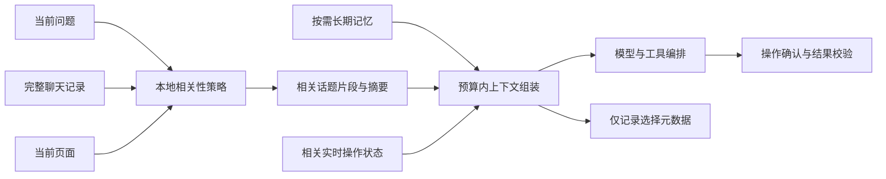

# AI 上下文审查与优化（2026-11-13）

## 结论与交付状态

当前按账号隔离数据库、区分聊天/学习分析/记忆提取、工具确认与结构化证据校验的基础可以保留。主要缺口在**每轮资料的相关性选择**：原实现按时间与容量截取历史，摘要跨话题积累，页面和历史操作状态默认进入请求；因此完整记录容易变成持续生效的回答背景。

本轮完成本地源码改进和回归验证，没有部署、重启或写入生产数据库，也没有调用真实模型对改进后的回答质量做线上实验。生产审计只使用既有 SSH 连接和只读 SQLite 查询，报告不包含身份信息、凭据或聊天正文。

## 生产证据与边界

审计日期为北京时间 2026-11-13。生产服务正常运行；公开首页返回预期的登录跳转。生产 HEAD 与本地 HEAD 均为 `eb08de88`，本次修改尚未上线。

| 指标 | 只读检查结果 |
|---|---:|
| 用户学习数据库 | 11 |
| 含 AI chat/trace 数据的数据库 | 3 |
| AI 聊天会话 / 消息 | 3 / 78（用户、助手各 39） |
| chat turn / LLM round trace | 40 / 50 |
| 工具运行 / 动作确认请求 | 18 / 8 |
| 长期 Memory / 会话摘要 | 0 / 1 |
| 学习分析任务 / insight | 5 / 5 |
| 全量 chat 成功 / 失败 | 39 / 1 |
| 最近 30 天 chat 请求 | 2，均成功 |
| 最近 7 天 chat 请求 | 0 |

AI 聊天与 trace 数据覆盖 2026-09-14 至 2026-10-30，最近活动为 2026-10-30 23:38（北京时间）。样本很小且近期不活跃，不应将这些数字外推为当前持续流量的质量指标。

脱敏主题检查发现：

1. 一个长会话在约 22.87 天后收到简短问候，助手仍输出算法、学习规划相关内容。问候自身没有这些主题，构成明确的旧主题残留证据。
2. 另一个长会话在约 32.93 天后进入新章节，回答仍包含多个旧技术主题；之后再间隔约 9.36 天，短问题仍引出这些主题。这与“旧回答再次进入近期历史”的累积路径一致。
3. 当时长期记忆为零，所以这些线上实例不能归因于长期 Memory。记忆召回的修正属于同时发现的潜在缺陷修复。

第二类实例只能按主题残留判断，不能仅凭日志证明某个模型句子的唯一因果来源。历史日志不保存完整请求，也没有当轮上下文块的准入决策，无法精确还原旧 prompt。

49 个成功的 `deepseek-flash` 模型轮次中，输入 token 的 P50 为 5,311，P95 为 9,539，最大为 9,724。39 个可配对成功请求的 provider 实际输入 / 请求开始时估算输入，比例 P50 约 1.99，P95 约 4.54，最大约 4.67。该差异也可能包含工具 schema 和 provider 包装，不能全部归因于中文计数，但原来的中英文统一字符除以三显然不足以代表中文输入。

唯一 chat trace 失败发生在 2026-09-14，归类为 provider_error；最近 30 天没有 chat 失败记录。5 个学习分析任务最终均成功；18 个工具记录中 10 个成功、8 个需要确认，对应 8 个动作最终均成功。

## 原链路与本次调整

### 1. 会话历史按当前问题选择

新增 `interview_forge/ai/chat/relevance.py`，使用版本化的确定性策略 `chat-relevance-v1`，不新增 embedding 服务或分类模型调用。

- 独立新主题、明确换题、单独问候不带入旧聊天。
- 只有用户消息建立话题锚点，助手自行提到的额外主题不能反过来成为召回依据。
- “继续”“它的复杂度呢”“给个例子”等追问保留最近对应话题；切换前的其他话题被排除。
- “详细点/展开说”同样限定于最近话题，不能走歧义路径重新载入跨话题摘要。“嗯/好的/是的/可以/开始吧”等低信息回应间隔超过 24 小时时不恢复旧任务；这条时间边界也能从持久化历史重建，避免后续追问重新穿透。
- 再次明确提到较早的同名技术主题，可召回对应交流片段。
- 明确提到“之前/刚才”的跨轮引用保守保留历史。信息不足的输入也保守处理，避免误猜其指代。
- 只选择当前消息 ID 之前的记录，避免重试时读取后续消息。

这不删除持久化记录，不修改历史 API，也不切断用户显式要求的回顾。

### 2. 摘要不再充当系统指令

`ContextBuilder` 将滚动摘要作为普通参考消息传入。相关话题只覆盖部分历史时，不复用跨话题的旧摘要，而从选中的原始交流重建局部摘要；局部构建不覆盖旧会话摘要缓存。

后续若要进一步改善摘要质量，可以将目前每行首尾摘录改为带来源 ID 的结构化“问题、事实、未决事项”。这需要单独评估压缩的忠实度，本次没有引入额外模型摘要或新的持久化协议。

### 3. 页面与操作状态按需提供

当前页面只有在用户明确指向页面/题目/选中文本，或问题与页面标题、章节、题号有直接关联时才进入模型。浏览器中残留的选中文字本身不构成关联证据。

用户切到不同页面并直接询问“这题/这章”时，页面成为新的话题边界。历史消息中的页面元数据也参与重建边界，保证下一轮“它的复杂度呢”不会再次带回切页前的聊天。

在题目或章节页，切页后的“它呢/继续”等简短指代按新页面处理；明确提到“之前/刚才”的历史引用仍保守保留。存在待确认操作时，近期的“是的/可以/开始吧”仍获得服务端真实待确认状态，但不会绕过操作确认接口。

历史操作状态只在当前问题涉及同步、确认、标记、目标等操作，或对应操作的追问中保留。实时确认状态仍优先于聊天里的旧描述，ACTION 工具仍须用户确认。

### 4. 长期记忆先判断适用性

取消高重要性记忆绕过相关性门槛的行为。重要性、置信度与时效性只用于相关记忆之间的排序。中文功能词、低信息词及单个汉字不再充当有效主题证据。

解释顺序、编程语言等稳定偏好仍可应用于相应任务；职业目标和每日学习时长的适用条件收窄，避免“算法复杂度”“TCP 持续多久”“向量方向”等通用技术问题引出旧个人计划。

显式保存/删除记忆、隐私过滤、持久化成功判定及失败降级不变。

### 5. 其他 agent 的任务与工具边界

聊天提示明确要求直接回答独立新问题，禁止主动总结或延续无关旧话题。页面、学情、记忆与工具资料只能用于直接支持当前问题；不因资料中存在旧任务而调用工具。

学习分析提示仅允许基于本次学习快照进行 `learning_diagnosis`。保留真实 support_ref、data_gaps、heuristic 标记、结构化 schema 与输出验证。提示版本提升到 `coach-analysis-v2.3`，避免复用旧版本分析缓存。

没有改变 provider/model 选择、能力目录、视觉回退或模型允许列表。

### 6. 中文估算与诊断元数据

token fallback 改为按 ASCII 与非 ASCII 分别估算；保持默认请求预算总量，增加系统提示预算并相应缩小近期历史预算，避免中文系统提示挤出实时操作状态。已知较小窗口按比例缩放历史、摘要和参考资料预算。实时操作块先提供实际状态，再提供说明，防止裁剪时只留下规则而丢失状态。

这仍是粗估，不能替代 provider tokenizer，也没有把工具 schema 和所有 provider 包装算成精确输入。生产实际 token 用量仍是权威观测。

新增 `ai_trace_events` 的 `context/context_selection` 事件，复用现有表而不迁移 schema，记录策略版本、选择模式、原因、选中/省略消息数量、上下文块类型、页面是否省略与估算 token。白名单排除聊天正文、摘要、页面正文、记忆正文与原始消息 ID。

## 验证与已知限制

回归覆盖独立换题、问候、中文/英文短追问、旧主题召回、明确回顾、页面切换及下一轮追问、跨主题旧摘要隔离、实时操作状态、记忆相关性、元数据隐私，以及实际 ChatService → 模型边界的消息内容。另运行聊天、工具、动作确认、学习分析、provider 和管理端可观测性相关测试及 Ruff 检查。

最终使用 `E:\python\python.exe` 运行 AI 相关测试与聊天历史、上下文编译、provider 能力/硬化、操作追问、管理端可观测性组合：**251 passed，51 subtests passed**，耗时约 33 秒，仅有既有 Starlette TestClient 弃用警告。全项目 Python `E9/F821` 检查、本轮新增模块的未使用导入检查、本轮修改文件的 `git diff --check` 均通过。项目 `.venv-ai` 缺少服务依赖，本轮使用已有完整运行环境，未安装或修改全局依赖。

局限：

- 无 embedding 的词面策略不能完美理解同义改写、隐含关联或同一技术内部的所有子话题；保守回顾/歧义路径仍可能保留较多历史。需要以真实回归集持续校准。
- 完整聊天仍由数据库加载后选择，超长会话的 DB 读取和摘要计算可以继续优化；本次没有引入新的索引或向量库。
- 没有真实模型 A/B 回答实验，测试证明的是输入隔离与既有流程兼容，不能据此声称线上污染率已下降。
- 生产尚未发布本次修改。上线后应检查 context_selection 与实际输入 token，并抽查换题、短追问和工具确认是否符合预期。

## 参考机制

[Anthropic：Effective context engineering for AI agents](https://www.anthropic.com/research/effective-context-engineering-for-ai-agents) 将上下文视为有限注意力资源，强调选择最小的高信号资料。本次据此限制每轮资料准入，而不是继续扩大历史窗口。

[LangChain：Context Engineering](https://www.langchain.com/blog/context-engineering-for-agents) 区分写入、选择、压缩和隔离；本次保留完整存储，独立决定选择和局部压缩。

[LangChain：Short-term memory](https://docs.langchain.com/oss/python/langchain/short-term-memory) 明确指出过时、偏题历史会分散模型注意力，并讨论历史裁剪与摘要。本次保留真正追问，同时隔离跨话题片段。上述资料提供工程原则，不构成特定中文规则效果的实验证据。
