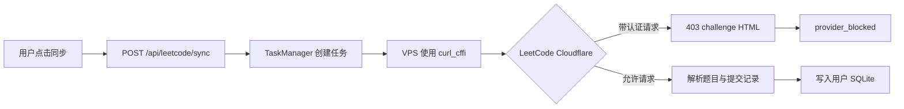
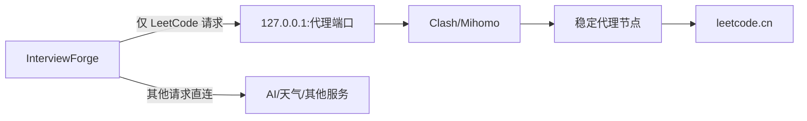
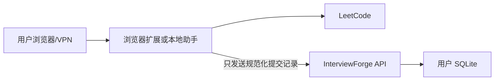

# LeetCode 同步故障与代理方案记录

> 记录日期：2026-09-17  
> 用途：InterviewForge 内部排障与后续实施参考  
> 当前结论：代码与 Python 依赖链路已基本正常，生产失败点在 VPS 到 `leetcode.cn` 的出口被 Cloudflare challenge 拦截。

## 1. 问题摘要

用户在 InterviewForge 前端点击力扣同步后，请求可以正常到达 VPS：

```text
浏览器
  → POST /api/leetcode/sync
  → InterviewForge VPS
  → LeetCode /api/problems/all/
  → LeetCode /api/submissions/
```

当前真正失败的位置是最后一段。VPS 访问力扣时，带认证 Cookie 的请求返回：

```text
HTTP 403
cf-mitigated: challenge
Content-Type: text/html; charset=UTF-8
```

因此同步在读取题目状态或第一页提交记录时就会失败，尚未进入分页、去重和 SQLite 写入阶段。



## 2. 已验证的信息

### 2.1 VPS 运行环境

已确认生产服务使用项目虚拟环境，而不是系统 Python：

```text
ExecStart=/opt/interview-forge/.venv/bin/python -m uvicorn interview_forge.api.app:app
sys.executable=/opt/interview-forge/.venv/bin/python
sys.prefix=/opt/interview-forge/.venv
```

服务依赖版本：

```text
Python       3.12
FastAPI      0.115.6
Uvicorn      0.34.0
HTTPX        0.28.1
curl_cffi    0.16.3
```

本次部署后已执行：

```text
git pull --ff-only origin main
python -m pip install -r requirements-server.txt
systemctl restart interview-forge
```

部署提交：

```text
5f4a2686
```

### 2.2 服务链路

服务重启后状态正常：

```text
systemctl is-active interview-forge → active
```

本地健康检查：

```text
GET http://127.0.0.1:8765/api/health
→ 200 {"ok":true}
```

公网健康检查：

```text
GET https://hot100.xyz/api/health
→ 200 {"ok":true}
```

生产日志中可看到真实同步请求到达：

```text
POST /api/leetcode/sync → 201 Created
GET  /api/leetcode/sync/status?... → 200 OK
```

### 2.3 curl_cffi 出口测试

#### 无认证请求

使用项目 `.venv` 和 `curl_cffi` 请求：

```text
GET https://leetcode.cn/api/problems/all/
→ 200
server: cloudflare
cf-mitigated: 无
```

响应主体可被解析为 JSON，但返回的是匿名数据，`user_name` 为空。这只能证明 VPS 可以连到力扣，不能证明认证同步可用。

#### 带认证请求

使用用户提供的认证凭证做了一次内存内探针。凭证没有写入文件、数据库、日志或报告。

测试了两个当前同步实际使用的接口：

```text
GET https://leetcode.cn/api/problems/all/
→ 403
cf-mitigated: challenge

GET https://leetcode.cn/api/submissions/?offset=0&limit=100
→ 403
cf-mitigated: challenge
```

两个响应都是 Cloudflare challenge HTML，无法解析为 JSON。

这说明当前失败不是：

- `curl_cffi` 未安装；
- 服务使用了错误的 Python；
- InterviewForge API 没有收到请求；
- SQLite 写入锁；
- 提交分页算法；
- JSON 字段解析错误。

### 2.4 当前代码行为

`interview_forge/services/leetcode.py` 当前逻辑：

1. 优先导入 `curl_cffi.requests`；
2. 构造 `LEETCODE_SESSION` Cookie 和通用浏览器请求头；
3. 使用 `impersonate="chrome"` 请求力扣；
4. 如果导入失败才回退到标准库 `urllib`；
5. `cf-mitigated=challenge` 或响应包含 `Just a moment` 时归类为 `provider_blocked`；
6. Cloudflare challenge 不进入普通 429/5xx 重试。

当前分类设计是合理的，因为 challenge 不是暂时性网络抖动，盲目重试只会增加失败请求。

## 3. 当前问题的根因

根因可以归纳为：

```text
Hostinger VPS 公网出口 IP / ASN
  → LeetCode Cloudflare 风控
  → 带认证的 API 请求被 challenge
  → curl_cffi 也无法通过
  → 同步第一阶段失败
```

`curl_cffi` 解决的是部分浏览器指纹和 TLS 兼容问题，但不能保证一个已经被 Cloudflare 风控标记的 VPS 出口获得访问权限。

因此继续修改以下内容没有根本作用：

- 增加 User-Agent 变体；
- 增加重试次数；
- 延长超时时间；
- 调整分页 offset；
- 重写 SQLite 写入；
- 在前端重复点击同步。

## 4. 对现有 YAML 的判断

文件 `RFLCO6OwdqAR.yaml` 是一份 Clash/Mihomo 配置，不是单独的代理 URL。

安全提取到的结构信息：

```text
port:              已配置
socks-port:        已配置
allow-lan:         false
mode:              Rule
external-controller: loopback-bound
tun:               未配置
proxies:           存在
proxy-groups:      存在
rules:             存在
leetcode 专门规则: 不存在
MATCH 兜底规则:    存在
```

这份配置可以作为 VPS 上 Clash/Mihomo 的节点配置，但不能直接填入：

```text
INTERVIEW_FORGE_LEETCODE_PROXY
```

运行后它会在 VPS 本机开启 HTTP/SOCKS5 监听端口，InterviewForge 再把力扣请求转发到这个本地端口。

由于没有配置 `tun`，可以采用非 TUN 模式，避免改变 VPS 的全局路由。由于 `allow-lan=false`，本机上的 InterviewForge 仍然可以通过 `127.0.0.1` 使用代理，不需要把代理端口暴露到公网。

但当前配置没有针对 `leetcode.cn` 的专门规则，必须确认 `MATCH` 最终选择的是代理节点，而不是 `DIRECT`。

## 5. 可行方案

### 方案 A：VPS 配置 LeetCode 专用 HTTP/SOCKS5 代理（推荐）

架构：



落地内容：

1. 在 VPS 运行 Linux 版 Clash/Mihomo；
2. 使用该 YAML 作为配置，但不启用 TUN；
3. 只监听 `127.0.0.1`；
4. 确认 `leetcode.cn` 通过代理节点，不走 `DIRECT`；
5. InterviewForge 增加独立环境变量，例如：

   ```text
   INTERVIEW_FORGE_LEETCODE_PROXY
   ```

6. `curl_cffi` 的 LeetCode 请求显式传入代理；
7. AI、天气、Nginx 和其他业务不使用该代理。

优点：改动小、可回滚、不会改变 VPS 全局路由。

### 方案 B：独立稳定代理服务

不在 VPS 上运行 Clash，而是购买一个可信的 HTTP CONNECT 或 SOCKS5 代理：

```text
InterviewForge → 代理地址 → LeetCode
```

要求：

- 固定或稳定出口；
- 不使用免费代理；
- 服务商不会记录 Cookie 和请求正文；
- 最好支持 VPS IP 白名单；
- 与当前 Hostinger ASN 不同。

这是运维最简单的方案，但需要额外代理服务成本。

### 方案 C：浏览器扩展或本地同步助手

让用户本机通过自己的 VPN 访问力扣，再把规范化后的提交数据发送到 VPS：



优点：使用用户本机出口，不受 VPS IP 风控影响；LeetCode Cookie 不必发送到 VPS。

缺点：需要维护浏览器扩展、权限、版本更新和数据上传协议，不是简单修改一个前端 URL。

### 方案 D：VPS 全局 WireGuard/OpenVPN

把整个 VPS 接入 VPN，使所有网络流量改变出口。

不推荐作为第一方案，因为会影响：

- SSH；
- Nginx；
- AI Provider；
- 系统更新；
- DNS；
- 其他项目；
- VPS 公网 IP 白名单。

除非使用独立 network namespace 或单独中转机，否则不应直接改 VPS 全局路由。

### 方案 E：人工导入

用户从力扣导出或复制提交记录，再上传到 InterviewForge。

优点是安全、无需代理；缺点是体验差，只适合作为临时兜底。

## 6. 推荐实施顺序

```text
刷新已暴露的 LeetCode 凭证
        ↓
确认 Clash 配置的默认 MATCH 走代理而不是 DIRECT
        ↓
在 VPS 非 TUN 模式运行 Clash/Mihomo
        ↓
只为 LeetCode 接入本机代理
        ↓
先测 /api/problems/all/
        ↓
再测 /api/submissions/?offset=0&limit=100
        ↓
最后测试 InterviewForge 完整同步
```

验收条件：

```text
带认证请求不是 403
没有 cf-mitigated: challenge
响应可解析为 JSON
user_name 非空
submissions_dump 可以读取
第一页成功后 SQLite 有新增或已存在记录
```

## 7. 安全要求

- 当前在对话中暴露过的 JWT/Session 必须轮换；
- YAML 不得提交 GitHub；
- YAML 不应放在项目受 Git 管理目录中；
- 节点地址、UUID、订阅 token、代理密码不得写入日志；
- 代理 URL 中的密码不得出现在命令历史和进程列表中；
- LeetCode Cookie 只能保留在用户数据库或临时内存中；
- 代理只服务于 LeetCode，不设置全局 `HTTPS_PROXY`；
- 测试响应只记录状态码、响应类型和错误类别，不记录响应正文；
- 代理不可用时应返回明确的 `provider_blocked` 或 `network_error`，不能伪装成同步成功。

## 8. 当前未完成事项

以下工作尚未执行：

- 未在 VPS 安装 Clash/Mihomo；
- 未把该 YAML 上传 VPS；
- 未修改 InterviewForge 代码接入代理环境变量；
- 未修改 systemd 增加代理服务；
- 未重新测试带代理的 LeetCode 认证请求。

当前 VPS 工作区还存在部署前已有的非本次变更：

```text
M  data/.gitkeep
?? .venv/
```

这些内容在部署过程中未被删除或修改。

