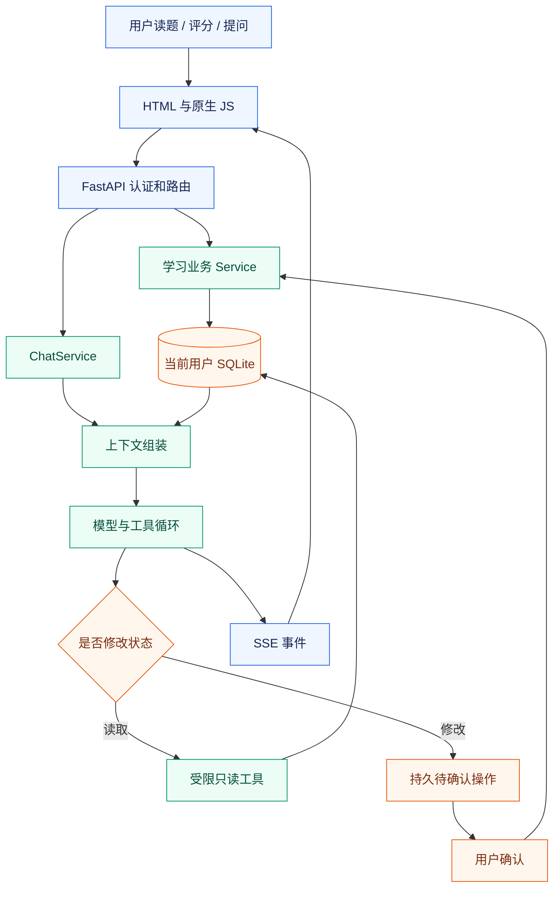

# 项目讲述与架构取舍

基线：`2b01df99`，2026-10-02。先建立讲述主线，再用后两份问答深入；不从功能菜单逐个念起。

## 1. 用一句话说清楚

InterviewForge 是一个围绕算法和面试学习的个人学习系统：把题目与教材、学习记录、间隔复习和 AI 助手连接起来，让用户能看材料、记录进度、知道该复习什么，并让 AI 根据真实学习状态提供解释和建议。

这里最核心的区别是：**题目内容是静态知识，学习状态是动态事实，AI 是读取和解释这些事实的交互入口。** AI 不负责凭空决定某人做过什么，也不能靠一段回答直接修改用户计划。

## 2. 一分钟口述模板

> 我做的是 InterviewForge，一个面向算法和面试学习的系统。它既有 Hot100 题解和演示，也会记录学习与提交历史，通过 FSRS 安排复习，并提供能读取学习数据、调用工具的 AI 助手。
>
> 技术上采用构建生成的 HTML、原生 JavaScript、FastAPI 和按用户划分的 SQLite 数据库。普通功能走 JSON API，AI 对话通过 SSE 流式返回。AI 前面有上下文组装和工具执行层，涉及修改学习状态的操作先生成待确认记录，用户确认后再执行。
>
> 我最想展开的是三个工程问题：长回答怎样避免把浏览器卡死，工具操作怎样避免把“已发起”说成“已完成”，以及有限上下文怎样保留近期对话、学习事实和长期偏好。它是单机部署的应用，我没有把它包装成已经验证的高并发分布式系统。

最后一句根据岗位调整。AI 应用岗位展开上下文和工具；后端岗位展开事务、异步和幂等；前端岗位展开流式渲染、缓存更新和交互状态。

## 3. 三分钟讲述的因果顺序

### 3.1 用户问题

材料分散、学习状态和知识内容脱节、复习容易凭感觉。通用聊天模型不知道用户最近实际做过什么；如果只把历史聊天塞进去，它还可能把旧的“我要同步”理解成当前“同步成功”。因此，系统要同时维护内容、学习事实和动作状态。

### 3.2 为什么不是只有静态站

静态站适合题解和教材，因为内容更新频率低，构建时就能生成目录、导航和统一学习控件。但学习记录、用户权限、复习时间、AI 会话和操作确认都需要服务端。两者分开，避免让每次读题都依赖模型，也避免把用户状态写进构建产物。

### 3.3 为什么不是所有事都交给 AI

下次复习日期、权限检查、提交历史去重和任务状态都是确定性业务。它们应该由代码和数据库决定。AI 适合解释、归纳、选择工具和生成建议，但不能成为数据库事实的替代品。

### 3.4 设计如何落地



这张图表达职责与数据流，不表示所有数据库读取都同时发生，也不表示用户确认仍在原来的 SSE 连接中执行。确认有独立 HTTP 请求。

## 4. 三条核心执行链

### 学习评分链

```text
评分按钮 → POST /api/complete
→ 认证并定位用户 DB → 读取全站保持率
→ 写事务内检查同日评分 → 更新 review_cards / review_logs
→ commit → 失效学习缓存 → 返回下次复习日
```

同一题同一业务日重复点不同分数不会不断增长轮次；既有评分结果会返回给前端。管理员调整保持率只影响未来评分，不批量改写所有既有 due。

### AI 对话链

```text
输入问题 → POST 流式接口 → 会话/模型并发检查
→ 保存本轮 user message → 组装历史、摘要、学习与记忆资料
→ 模型输出文本或 Tool Call → 工具反馈进入下一轮
→ 保存有效回答或保留待确认动作 → message.done
```

不是每个 delta 都入库；完整回答与过程展示是不同责任。异常清理也不能把已经被记忆或操作记录引用的用户消息误删。

### 操作确认链

```text
模型提出 sync_leetcode → 服务端校验参数
→ 保存 pending Action → 前端显示确认卡
→ 用户点确认 → 条件更新领取 pending
→ 启动同步任务 → 任务结束后记录真正结果
```

这里至少有三层成功：确认请求成功、后台任务被接受、数据同步完成。三者不能合并成一个“成功”。

## 5. 关键取舍及代价

| 选择 | 为什么在当前项目合适 | 明确付出的代价 |
| --- | --- | --- |
| 构建期 HTML + 原生 JS | 阅读内容稳定，直接复用内容构建流程，流式和状态控件可独立增强 | 多页面资源版本和组件一致性需要管理 |
| FastAPI + 领域 Service | HTTP 边界与业务规则分开，普通请求和流式请求共用认证 | 遗留 facade 与默认 runtime 仍增加理解成本 |
| 每用户 SQLite + 全局认证库 | 部署简单，学习数据路径由服务端确定，用户间写竞争有所分散 | 文件多、跨用户统计成本更高、不是跨机扩展方案 |
| LangChain 兼容模型接口 + 自有编排 | 复用接入能力，自己控制确认、预算和持久化契约 | 协议差异仍需 Adapter 与回归测试承担 |
| 有限工具循环 | 防止无止境规划和重复查询 | 复杂请求可能要明确降级或让用户继续提问 |
| 规则式记忆召回 | 数据量小、结果可解释、没有额外向量服务 | 同义表达和语义泛化能力有限 |
| FSRS 固定参数调度 | 比固定轮次间隔更能表达评分差异，迁移可保留历史日期 | 未进行个人参数拟合，不能宣称实际记忆效果 |

## 6. 最值得讲的三个亮点

**亮点一：把完成语义绑定到服务端事实。** 过去 AI 可能把“已发起同步”解释成“同步完成”。改进是为动作和后台任务分别保存状态，给模型提供有时间的状态投影，旧记录没有最终结果就明确未知。

**亮点二：拆开模型输出频率和 UI 渲染频率。** delta 只累计原文；100ms 合并纯文本预览；完成时做最终 Markdown。这样既保持流式反馈，又避免每个 chunk 重解析全文。

**亮点三：上下文是有预算的重新组装，不是完整数据库副本。** 当前行按 ID 去重，旧消息推进摘要游标，学习事实、偏好与页面资料按优先级和信任属性进入模型。模型上下文可重建，数据库保留事实来源。

## 7. 面试展示时打开哪些代码

| 讲述点 | 源码入口 |
| --- | --- |
| 应用与 HTTP 边界 | [app.py](../../interview_forge/api/app.py)、[study router](../../interview_forge/api/routers/study.py) |
| 学习事务和调度 | [study service](../../interview_forge/services/study.py)、[review.py](../../interview_forge/services/review.py) |
| AI 业务主链 | [ChatService](../../interview_forge/ai/chat/service.py) |
| 上下文与工具 | [ContextBuilder](../../interview_forge/ai/chat/context_builder.py)、[ToolOrchestrator](../../interview_forge/ai/chat/tool_orchestrator.py) |
| 确认状态 | [ActionRequestStore](../../interview_forge/ai/actions/store.py)、[RecentActionContext](../../interview_forge/ai/chat/recent_action_context.py) |
| 前端性能 | [ai-assistant.js](../../assets/ai-assistant.js) |

## 8. 简历表述候选

根据本人实际贡献选择，不要把三条全部默认归功于自己：

- 设计并实现学习记录驱动的 AI 助手，通过服务端上下文组装、受限工具循环与持久确认操作，将学习查询与状态修改分离。
- 优化 AI 流式展示，将逐 chunk 全文 Markdown 重建改为合并纯文本预览和最终渲染，并避免完成后重载整段会话。
- 实现 SQLite 事务内评分去重与 FSRS 迁移，保留历史复习日期，通过管理员保持率配置控制未来评分调度。

不要添加没有测过的“支持万级并发”“延迟降低 90%”“幻觉减少 80%”。面试官真正会继续问的是：你怎样测出来，比较对象是什么，样本多大，边界在哪里。
