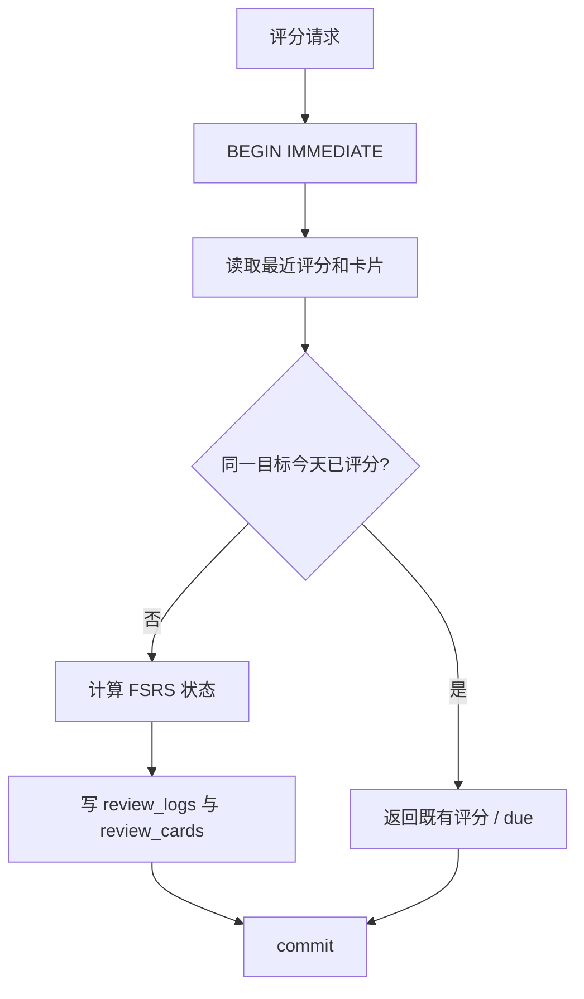

# 后端与数据：18 个项目深挖问题

基线：`2b01df99`，2026-10-02。回答按“执行链、理由、边界”组织；括号中的追问用来检验是否真正理解。

## Q1. 为什么用了 FastAPI？写成 async 就不会阻塞了吗？

**口述回答：** FastAPI 适合这里的 JSON API 和流式响应，但异步不是自动加速。`async def` 中直接调用同步 SQLite 或同步网络库，仍会阻塞事件循环。同步路由由框架在线程池执行；异步路由里的同步业务则需要显式交给 `run_in_threadpool` 或 `asyncio.to_thread`。

项目学习写接口先认证和读取 JSON，再把 operation 放在线程池。模型流如果只有同步迭代器，工具编排也用线程推进下一块。

```python
# 从 study router 缩减，只保留执行边界
payload = await read_json(request)
db = user_db(user)
result = await run_in_threadpool(operation, payload, db)
invalidate_learning(db)
return json_response(result, 201)
```

**为什么这样做：** 保留已有同步业务函数，又不让慢数据库/网络操作长时间占据事件循环。

**继续追问：CPU 很重怎么办？** 线程池主要解决阻塞 I/O；不能据此宣称绕过 Python GIL。真有重计算应评估进程池或独立 worker，并先测瓶颈。

依据：[study router](../../interview_forge/api/routers/study.py)、[ToolOrchestrator](../../interview_forge/ai/chat/tool_orchestrator.py)。通用语义见 [FastAPI 官方说明](https://fastapi.tiangolo.com/async/)。

## Q2. 为什么选择 SQLite，而不是 MySQL？

**口述回答：** 当前是单机学习应用，学习数据主要按用户访问，SQLite 省掉独立数据库的部署运维。全局认证与设置放在认证库，个人学习、Chat、Memory 等放在用户库。这样同一用户的数据可以就近事务处理，不同用户的学习写入也不会全挤在同一个文件。

**代价：** 用户库数量会增长，跨用户聚合要访问多个库，备份和迁移需要管理文件。全局认证库也仍是共享竞争点。

**继续追问：用户多了怎么迁移？** 先测写锁等待、数据库大小、跨用户统计耗时，再决定迁移。迁移时保留 Service 接口，把存储查询和事务抽成可替换实现，集中库增加 user_id 和索引，先校验读写结果。不能把现在的“每用户一个文件”称为已验证的无限分片。

依据：[路径定义](../../interview_forge/core/paths.py)、[auth.user_db_path](../../interview_forge/services/auth.py)。

## Q3. WAL 究竟解决了什么，能同时写吗？

**口述回答：** WAL 改善了读者与写者并行：读者读取自己的快照，写入追加到 WAL。但同一个数据库同一时刻仍只有一个写者。项目连接设置 WAL，并使用 `sqlite3.connect(..., timeout=10)` 处理部分锁等待；评分的读检查写序列用 `BEGIN IMMEDIATE` 先取得写事务。

```python
# 连接初始化与业务事务分属不同函数，这里分开示意
connection = sqlite3.connect(db_path, timeout=10)
connection.execute("PRAGMA foreign_keys = ON")
# 首次 schema 初始化路径设置 WAL
connection.execute("PRAGMA journal_mode = WAL")

# 学习评分业务中
connection.execute("BEGIN IMMEDIATE")
# 检查同日状态 → 写事件 / 卡片 / 日志 → commit
```

**继续追问：有 timeout 就一定不报 locked？** 不是。等待策略不是无条件成功保证；锁持续时间、快照升级和多进程竞争都可能导致失败。应该缩短事务、避免在事务中等模型或上游请求。

依据：[connection.py](../../interview_forge/db/connection.py)、[study.py](../../interview_forge/services/study.py)、[SQLite WAL 官方说明](https://www.sqlite.org/wal.html)。

## Q4. 两个人同时点“完成”，怎么防止重复评分？

**口述回答：** 不能仅靠按钮禁用。服务端在 `BEGIN IMMEDIATE` 事务内查最近评分所属的北京时间业务日；若今天已经评分，就返回已有卡片状态，不再追加一条 review_log。首次评分才计算并写入卡片和日志，然后提交。



**边界：** 这是“业务日 + 目标”的评分去重规则，不是通用请求幂等键。兼容完成接口仍可能为每次尝试保存 submission，所以不能说所有表都只写一次。

**继续追问：上午点 again，下午点 easy 怎么办？** 当前规则保留当天首次评分；这是产品约束。如果要允许纠错，应设计单独的评分更正及调度重算，不能悄悄放开重复写入。

依据：[study._apply_review_rating](../../interview_forge/services/study.py)、[hardening tests](../../tests/test_study_server_hardening.py)。

## Q5. 用户隔离靠什么？请求里传别人的用户名能读到吗？

**口述回答：** 学习 API 先从 Cookie 解析当前用户，再由服务端定位用户数据库。模型的工具参数也没有决定用户 DB 的权限；`ToolExecutionContext.user_db` 由服务端创建。用户名参与文件路径前还要满足格式约束。

会话或 action_id 要在当前用户库内查询，找不到就拒绝，而不是凭一个全局 ID 直接访问其他用户的数据。

**继续追问：分文件是不是等于隔离绝对安全？** 不是。仍要检查每个入口是否从登录身份确定 DB，路径是否可控，静态文件是否白名单开放，日志和导出是否泄漏。隔离是多条边界共同成立。

依据：[support.user_db](../../interview_forge/api/support.py)、[chat router](../../interview_forge/api/routers/chat.py)、[ToolExecutionContext](../../interview_forge/ai/tools/contracts.py)。

## Q6. 登录为什么没用 JWT？密码和会话怎么保存？

**口述回答：** 当前采用服务端会话，便于登出和禁用用户后重新校验身份。密码使用随机盐的 scrypt，验证用常量时间比较；会话 token 随机生成，数据库保存 token 的 SHA-256 摘要，浏览器拿原 token 的 HttpOnly Cookie。

```python
# 真实核心做法，省略参数校验和数据库代码
salt = secrets.token_bytes(16)
digest = hashlib.scrypt(password.encode("utf-8"), salt=salt,
                        n=1 << 14, r=8, p=1, dklen=32)
token = secrets.token_urlsafe(32)
stored_token = hashlib.sha256(token.encode("utf-8")).hexdigest()
```

**继续追问：为什么 token 用 SHA-256，密码却不用？** token 是高熵随机值，密码往往低熵，密码需要更昂贵的派生函数抑制离线猜测。两者不能套同一种威胁模型。

**边界：** 会话要读认证库，不是无状态认证；Cookie Secure 标志由项目的主机判断逻辑设置，不能泛称每个本地/生产地址都相同。

依据：[auth.py](../../interview_forge/services/auth.py)、[support.session_cookie](../../interview_forge/api/support.py)。

## Q7. HttpOnly 和 SameSite 就能防住所有攻击吗？

**口述回答：** HttpOnly 限制脚本直接读取 Cookie，SameSite 限制部分跨站携带行为，写请求还有服务端来源检查。但它们不能保证页面没有 XSS，也不能代替角色权限。模型生成内容、搜索结果和工具文案仍要按具体渲染入口处理转义及白名单。

**继续追问：CORS 与认证有什么关系？** CORS 约束浏览器跨域读响应；认证决定服务端允许谁访问。非浏览器客户端不靠 CORS 获得或失去权限，服务端仍须认证和校验写操作。

依据：[support.py](../../interview_forge/api/support.py)、[app middleware](../../interview_forge/api/app.py)、[ai-assistant.js](../../assets/ai-assistant.js)。不要回答“有 HttpOnly，所以没有 XSS 风险”。

## Q8. 为什么中控台不能用一个 Promise 链加载所有数据？

**口述回答：** 身份检查通过后，bootstrap 和 plan 各自有加载、成功、失败与重试逻辑。天气和 AI 能力也有独立边界。计划超时不应清掉已经成功显示的待复习数据。

**为什么：** 用户需要知道到底哪个模块失败；统一大 catch 会把局部问题放大成整个页面不可用。重试按钮也应只重试失败模块。

**继续追问：返回 200 但 JSON 格式坏了呢？** 前端要区分 HTTP、网络、timeout、invalid_json、unauthorized，而不能把所有失败都显示成一个“服务异常”。

依据：[cockpit.html](../../cockpit.html)、[study router](../../interview_forge/api/routers/study.py)。

## Q9. GET /api/plan 为什么不该顺便删过期记录？

**口述回答：** 获取计划的业务查询不需要写锁。过期 pin 查询时忽略即可；在 GET 内 DELETE 会让高频读取主动竞争 SQLite 写锁，并可能与同步写入相互影响。

**关键边界：** `today_plan` 的业务查询不做 cleanup write；但首次 `connect()` 可能初始化 schema 和迁移，所以不能扩大成“这个 HTTP GET 从打开连接开始绝对不可能写任何字节”。

**继续追问：过期数据永远留着？** 可在明确写操作或维护任务里清理；必须把维护成本与读取路径分开，并确定保留策略。

依据：[study.today_plan](../../interview_forge/services/study.py)、[connection.connect](../../interview_forge/db/connection.py)。

## Q10. 页面旧缓存为什么 Ctrl+F5 不一定能解决？

**口述回答：** 页面可能同时受浏览器 HTTP 缓存、Service Worker Cache Storage、页面中旧资源 URL 影响。刷新一个层不等于清掉全部层。项目通过资源版本、SW 版本、activate 清旧缓存、skipWaiting/claim 和网络优先读取来支持自动升级。

API 不进入 SW 缓存。CSS/JS 离线失败不能拿 HTML 首页充当脚本返回，否则会产生看起来与业务无关的语法错误。

**继续追问：有 SW 后永远不会旧？** 网络优先在断网时仍会回退已有缓存；离线能力和强一致更新有取舍。`private` HTTP 头也不自动阻止应用代码把响应放进 Cache Storage，未来若缓存个人化 HTML，必须另审登出清理与隔离策略。

依据：[service-worker.js](../../service-worker.js)。

## Q11. HTML 的 ETag 是怎么做的？304 会漏掉浏览埋点吗？

**口述回答：** 服务端先完成 HTML 注入，对最终字节算 SHA-256 指纹，再设置 ETag 和 `private, no-cache`。浏览器保存页面但每次验证；内容不变就返回 304，减少传输，不等于浏览器不使用缓存。

浏览记录处理位于条件返回之前，因此 304 路径仍进入记录逻辑；记录本身另有短时间去重。

```python
# static router 的核心逻辑
body = _inject_html(decoded, target.read_bytes(), embedded=embedded)
headers["Cache-Control"] = "private, no-cache"
headers["ETag"] = '"' + hashlib.sha256(body).hexdigest()[:32] + '"'
# 当前实现按请求头中的标记匹配后返回 304
```

**继续追问：304 省掉所有服务端工作吗？** 没有。当前仍读取、注入并计算内容指纹，也走埋点。它主要省响应体传输，不要说成跳过全部渲染与业务处理。

依据：[static.py](../../interview_forge/api/routers/static.py)。生产登录态已经验证 200/304，但没有压测节省比例。

## Q12. 力扣同步失败，为什么不能一律加重试？

**口述回答：** 要先分类。Cloudflare challenge、会话失效、上游限流、5xx 和网络异常不是同一种故障。限流和短暂服务异常可以有限退避；缺凭证或 challenge 不能靠无限重试保证恢复。提示同时更新 SESSION 与 csrftoken 是排查建议，不是对 Cloudflare 的万能修复。

**继续追问：curl_cffi 一定能绕过去吗？** 不能承诺。它改善请求兼容性，环境可能仍被挑战；还必须确认依赖安装在服务实际解释器中，避免导入失败回退到另一客户端。

依据：[leetcode.py](../../interview_forge/services/leetcode.py)、[requirements-server.txt](../../requirements-server.txt)。

## Q13. 部分成功和分页续传怎么定义？

**口述回答：** 第一页失败没有可交付数据，应失败；后续页失败时，已取到的合法记录仍可写库，结果标记 partial/degraded，并记录后续 offset。前端应该刷新已变化的数据并显示部分完成，而不是因为有 error 字段把它当全失败。

全量一次最多 50 页，下一次可以带续传 offset。客户端保存游标要在更换或清除凭证、账号变化时失效，避免把账号 A 的位置用于 B。

**当前边界：** 增量代码仍只取最新一页，最多 100 条，不遍历所有“上次同步后”的记录。积累超过一页时不能承诺完整增量，应使用全量/回填路径。这是面试时必须诚实指出的数据完整性边界。

依据：[leetcode_sync](../../interview_forge/services/leetcode.py)、[连接页](../../pages/leetcode-connect.html)。

## Q14. TaskManager 是任务队列吗？任务去重跨进程吗？

**口述回答：** TaskManager 是统一 submit/query/cancel 的注册门面，它不拥有第二套任务状态。AI 分析有自己的持久任务，力扣同步有自己的进程内状态和用户级运行保护。这样复用现有生命周期，不为统一接口再复制一份任务表。

力扣同步在锁内原子检查并插入；同用户同模式复用任务，不同模式返回冲突。同用户防重复不等于不同用户串行，也不等于重启后恢复。

**继续追问：开多个 Uvicorn worker 呢？** 进程内字典与锁不会跨 worker 生效。要扩展就需要共享的领取状态、任务存储、owner 唯一约束或租约，以及超时恢复，不能直接多开 worker 后继续宣传原来的保证。

依据：[TaskManager](../../interview_forge/runtime/task_manager.py)、[leetcode task state](../../interview_forge/services/leetcode.py)、[AI tasks](../../interview_forge/ai/tasks.py)。

## Q15. FSRS 解决什么问题？是不是让 AI 来算复习日期？

**口述回答：** 调度由确定性 FSRS-4.5 代码完成，模型不参与。卡片保存 stability、difficulty、reps、lapses、due；again/hard/good/easy 影响新状态。目标保持率越高，其他条件相同时预计复习间隔越短。

迁移用旧复习间隔初始化状态并保留旧 due，不伪造历史评分日志。新日志从真实评分开始。全站管理员设置在新评分时读取，旧 due 不因设置变化被整体重写。

**继续追问：你证明用户真的达到 90% 了吗？** 没有。0.9 是调度目标，不是实测结果；当前权重固定，没有做用户级参数拟合。验证的是算法路径、迁移和幂等，不是学习效果实验。

依据：[review.py](../../interview_forge/services/review.py)、[migration](../../interview_forge/db/connection.py)、[admin retention tests](../../tests/test_admin_v2.py)。

## Q16. 为什么要统一北京时间？把服务器时区改掉不就行了？

**口述回答：** 服务器时区不能替代业务时区。评分去重、每日配额和复习日期按 Asia/Shanghai 的自然日决定；某些观测和配置时间仍以 UTC 持久化，显示时转换。纯日期与某个瞬间不同，不能给 YYYY-MM-DD 随便附时区再转换。

前端 naive datetime 按业务 +08:00 解释，带 offset 的时间按对应瞬间显示。后端小时 bucket 输出完整 ISO，避免 `T14+00:00` 这种不可靠格式。

**继续追问：Tokyo 和 UTC 浏览器显示是否一样？** 显式指定业务时区后应该一样；已有跨 TZ 测试验证这一点。不能只在自己的北京时间电脑看起来正常就算完成。

依据：[time-utils.js](../../assets/time-utils.js)、[AI quota](../../interview_forge/ai/quota.py)。

## Q17. 日志怎么排错而不暴露聊天内容？

**口述回答：** 请求有 request_id，API 日志记录端点、状态、耗时和安全错误类别；AI Trace 记录模型轮次、工具名、token 用量和时间等元数据。管理员按这些维度串起故障，不需要直接把 prompt、Cookie 或回答正文打印进日志。

**继续追问：完全没有正文就一定不能排错？** 多数传输、状态、限流和锁问题不需要正文。复杂语义问题可在明确授权与最小范围下复现，但不能以方便为由默认记录所有私人数据。

**边界：** 总响应创建耗时不是完整 SSE 生成耗时，LLM TTFT 也不是浏览器首次绘制时间。指标名称必须说明测量起止点。

依据：[app middleware](../../interview_forge/api/app.py)、[TraceRecorder](../../interview_forge/observability/ai_trace.py)。

## Q18. 怎样证明项目稳定？如果流量涨十倍怎么办？

**口述回答：** 当前证据是功能回归、协议与状态测试、结构检查和生产只读冒烟。它们分别验证 correctness 和部署可达性；还没有真实并发负载下的容量数据。

增长时先测 SQLite 锁等待、线程池排队、上游模型耗时、SSE 长连接数和浏览器渲染，再针对瓶颈改。可能的演进是共享任务状态、外部 worker、集中数据库、限流与缓存，但这属于方案，不是已落地成果。

**继续追问：测试全绿就说明不会出错？** 只能说明已覆盖用例通过。同步突发 harness 不覆盖持续真实 SSE；模拟模型不证明真实模型回答质量；HTTP API 通过也不证明移动端视觉正常。面试时明确这些差异。

依据：[quality workflow](../../.github/workflows/quality.yml)、[本次核验记录](../审阅收尾核验-2026-10-02.md)。
