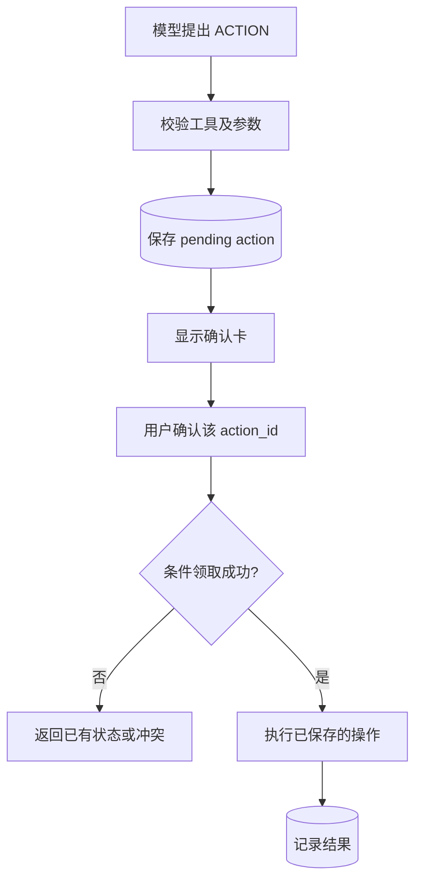

# AI 与上下文：20 个项目深挖问题

基线：`2b01df99`，2026-10-02。重点是把模型能力、服务端状态和持久化三者分开。不要把网上 RAG 标准答案直接套到本项目。

## Q1. 这是不是套个模型 API 的聊天壳？

**口述回答：** 模型接口本身不是项目的主要难点。系统要把登录用户的学习事实、近期会话、长期偏好和页面内容按预算组装；模型能查询工具，修改状态则必须经过持久确认；错误、取消、配额与 Trace 也有业务语义。

如果拿掉这些层，只剩输入到模型、文本回前端，才会失去这个项目的核心价值。反过来，也不必把它夸成完全自主 Agent：它是有明确领域、工具与权限限制的助手。

**追问：什么必须由代码决定？** 用户身份、可用工具、参数校验、动作状态、事务提交、复习日期；模型不能越过这些边界。

依据：[ChatService](../../interview_forge/ai/chat/service.py)、[ToolRuntime](../../interview_forge/ai/tools/runtime.py)。

## Q2. 为什么用了 LangChain，又自己写编排？

**口述回答：** 项目复用 LangChain 兼容的 ChatModel、消息和工具绑定接口，但自己的业务要求不能交给默认 Agent 随意决定。例如确认操作要落库、工具结果要限额、失败不能被说成完成，Trace 要脱敏，所以把这些编排职责放在自己的 Orchestrator 和 Runtime。

**追问：既然自己写，为什么不用裸 SDK？** 可以，但要自己承担协议适配、消息结构和流式工具增量累积。当前折中是复用接入层，业务状态机自己控制。依赖是可选 AI 能力，基础站点不应因某个模型 SDK 缺失而整体不可用。

依据：[requirements-ai.txt](../../requirements-ai.txt)、[langchain_adapter](../../interview_forge/ai/tools/langchain_adapter.py)、[providers](../../interview_forge/ai/providers/__init__.py)。

## Q3. 不同模型厂商的协议差异怎么处理？

**口述回答：** 管理层维护 Provider、Model 与业务路由；接入层按协议选择 Adapter。当前源码有 OpenAI Chat/Responses、Anthropic Messages、Gemini 等适配分支。业务层消费归一化的可见文本、工具调用和 usage，而不是每个 Service 都解析厂商私有 chunk。

可见文本与 reasoning 块要分开；只有推理内容、没有正文和有效待确认操作，不能作为正常成功保存。

**追问：支持分支等于所有模型都可用？** 不等于。原生 SDK 可能是可选依赖，工具能力也与模型有关，必须保留能力探测、模型测试与降级说明。不要声称所有厂商所有版本都经过实测。

依据：[provider.py](../../interview_forge/ai/provider.py)、[provider adapters](../../interview_forge/ai/providers/__init__.py)、[build_chat_model_kwargs](../../interview_forge/ai/providers/chat_model.py)。

## Q4. 为什么用 SSE，不用 WebSocket？

**口述回答：** 这条链主要是用户提交一次请求后，服务端持续返回文本与工具事件，单向流符合 SSE。项目用 POST + fetch 读取 SSE，方便在 body 中传消息和 page_context；并不是直接用浏览器原生 EventSource 发 POST。

事件格式是 `event: 名称`、`data: JSON`，空行分隔。使用 message.start/delta/done、tool 事件和 error，浏览器能分别处理消息、进度与确认卡。约 12 秒没有新数据时发送注释心跳，不污染正文。

**追问：SSE 自带业务恢复吗？** 格式和某些客户端重连能力不等于本项目已实现事件重放。本项目 fetch 流不是持久事件总线；中断时读取服务端消息和 action 状态恢复，不能保证每个 delta 都可重放。

依据：[chat router](../../interview_forge/api/routers/chat.py)、[sse_events](../../interview_forge/runtime/streaming.py)、[MDN SSE 格式](https://developer.mozilla.org/en-US/docs/Web/API/Server-sent_events/Using_server-sent_events)。

## Q5. 长回答为什么会把浏览器卡死，你怎么优化？

**口述回答：** 原路径每收到一个 delta 都重新解析完整累计 Markdown、重建 bubble DOM、读取 scrollHeight。随着答案增长，重复处理的总文本量接近二次增长，还不断触发布局。

现在 delta 只累积 `_rawText`，每个节点同一时间最多一个待处理 timer，约 100ms 合并刷新纯文本；done 时取消 timer、完整 Markdown 渲染一次。滚动用 RAF 合并，用户上翻后停止跟随。正常完成只刷新会话列表，不重拉全部历史。

```javascript
// 实际 hot path 的缩减示意，事件解析与异常分支省略
bubble._rawText = (bubble._rawText || "") + delta;
scheduleStreamRender(bubble);

// 流式预览
bubble.textContent = bubble._rawText || "";

// 正常完成
finalizeAssistant(bubble);
await refreshSessionList();
```

**追问：证明优化有效的数据？** 本次运行同步 1000 delta harness，流式预览 render_count 为 1，最终表格、代码块、列表和粗体仍正确。这证明突发合并，不代表几十秒真实流也是一次；预览计数也不等于总 DOM 操作数。没有给真实浏览器 CPU 或 P99 编造提升比例。

依据：[ai-assistant.js](../../assets/ai-assistant.js)、[streaming harness](../../tests/test_ai_assistant_streaming.js)。

## Q6. 用户点 Stop，服务端就一定停止所有工作了吗？

**口述回答：** 浏览器取消请求，服务端 SSE 检测断开并取消 pending 迭代，关闭 source。ChatService 的 finally 释放会话和模型占用，按持久状态决定失败消息清理；前端重新读取服务端真值。

**边界：** 协程取消不等于已经在线程池执行的同步函数立刻被杀死，也不能保证厂商已产生的 token 不收费。外部副作用更不能因为断线就自动回滚。因此 Action 取消和 Chat Stop 需要独立理解。

依据：[streaming.py](../../interview_forge/runtime/streaming.py)、[ChatService finally](../../interview_forge/ai/chat/service.py)、[ActionService](../../interview_forge/ai/actions/service.py)。

## Q7. Tool Calling 从模型 JSON 到实际执行之间做了什么？

**口述回答：** 先把流式工具碎片合成调用，再查服务器 ToolRegistry，用 args_model 校验参数，构造服务端执行上下文，然后才执行 handler。用户 DB、会话 ID 等由服务器提供，不能让模型在参数里随意选用户或文件。

只读结果在当前 turn 按规范化参数缓存，执行有 timeout 和结果体预算，错误转换成稳定 code/message。工具失败也要返回模型一个配对 ToolMessage，而不是让 assistant 的 tool_calls 留在没有响应的历史里。

**追问：工具输出是不是系统指令？** 不是。它提供数据，不能覆盖权限、确认规则或允许执行任意新工具。

依据：[ToolRuntime.execute](../../interview_forge/ai/tools/runtime.py)、[ToolSpec](../../interview_forge/ai/tools/contracts.py)。

## Q8. 怎么防止模型一直调用工具，耗尽费用？

**口述回答：** 当前 ToolPolicy 默认限制 3 轮、每轮对话最多 6 次工具调用、只读最多 3 个并行、工具结果总预算约 3500 token、相同调用最多 2 次。每个工具还有自身超时和结果大小上限。

```python
# 当前 ToolPolicy 默认值
max_rounds = 3
max_calls_per_turn = 6
max_parallel_read_tools = 3
max_total_result_tokens = 3500
max_identical_calls = 2
```

达到边界后仍要正确配对工具响应，并让模型根据已取得信息结束或说明无法确认。限额意味着某些复杂任务会降级，这是主动选择，不是模型万能。

**追问：并发工具越多越好？** 不一定。独立 READ 可以批量并行，ACTION 需要确认并控制状态；并发还受上游与数据库容量限制。

依据：[ToolPolicy](../../interview_forge/ai/tools/policy.py)、[ToolOrchestrator](../../interview_forge/ai/chat/tool_orchestrator.py)。

## Q9. 用户在聊天里说“确认”，为什么不能直接执行写操作？

**口述回答：** 自然语言可能指代别的操作，也可能来自历史或页面资料。项目把 ACTION 先保存为 pending，返回结构化确认事件，由用户针对具体 action_id 点确认。服务端再检查用户、过期时间和状态，执行该已保存参数。



**追问：安全只靠模型提示词吗？** 不靠。模型只提出请求，持久状态和确认路由提供真实执行门槛。

依据：[ToolRuntime._prepare_action](../../interview_forge/ai/tools/runtime.py)、[ActionRequestStore](../../interview_forge/ai/actions/store.py)。

## Q10. 两个标签页同时确认，怎样只执行一次？

**口述回答：** 对 pending 行做条件更新，只有成功改变行的请求拿到领取标记并进入 handler。其他请求看到 executing 或最终状态，就返回冲突或已保存结果。

```sql
-- 来自 claim_pending 的核心条件更新
UPDATE chat_action_requests
SET status = 'executing', decided_at = ?
WHERE id = ? AND status = 'pending' AND expires_at > ?;
```

**关键边界：** 这保证并发领取只有一个赢家，不保证任意外部副作用全局 exactly-once。进程若在上游执行成功、最终结果落库前崩溃，可能出现状态不确定。严格外部幂等还需要下游幂等键、结果查询或可恢复执行协议。

**追问：那你的确认有什么价值？** 它已经解决正常并发重复点击和无授权执行，是可验证的局部保证；不能因为没有跨系统 exactly-once 就否认这层作用，也不能把它夸大。

依据：[claim_pending](../../interview_forge/ai/actions/store.py)、[ActionService.confirm](../../interview_forge/ai/actions/service.py)。

## Q11. 为什么曾经出现“还没同步成功，AI 却说成功”？

**口述回答：** action 的 handler 可能只启动后台任务，确认处理成功和后台任务最终成功不是一回事。旧 action 仅记录了发起成功，如果被模型读成完成，就会误报。当前 RecentActionContext 读取真实 pending/recent 状态，结合后台结果与北京时间提供简短投影。

旧 sync action 没有最终结果时显示“已发起（最终状态未知）”。当前没有 pending 时也明确告诉模型，防止靠历史对话猜还有一个确认等待。

**追问：给消息加时间戳就够了吗？** 不够。时间戳说明何时说过，但不能证明说法正确；还要给最终任务状态和最新数据质量，必要时实时查询。

依据：[recent_action_context.py](../../interview_forge/ai/chat/recent_action_context.py)、[ActionRequestStore.complete](../../interview_forge/ai/actions/store.py)。

## Q12. 聊天记录、摘要和 Memory 有什么区别？

**口述回答：** 聊天记录保存每轮原始消息；会话摘要是较老历史的有限压缩，带已覆盖消息的 cursor；Memory 是跨会话稳定的偏好、目标、约束等，并有明确更新/遗忘策略。模型上下文则是本轮从这些持久来源重新选择的输入。

比如“今天这个错误”通常只是对话；“以后优先 Python”可能进入 Memory；“前三轮已讨论什么”是会话摘要。数据库原文保存不意味着每次都全部发给模型。

**追问：模型自己记住了吗？** 不是服务端 Memory。每次模型调用都需组装输入，不能把对话模型的上下文窗口、推理 KV Cache 与应用长期记忆混为一谈。

依据：[chat service](../../interview_forge/ai/chat/service.py)、[context builder](../../interview_forge/ai/chat/context_builder.py)、[MemoryStore](../../interview_forge/ai/memory/store.py)。

## Q13. 为什么当前用户消息按 ID 去重，而不是比较文本？

**口述回答：** 当前消息先写入数据库，再构建模型上下文。如果不排除，就会既出现在历史里，又作为当前问题追加一次。用 current_message_id 精确排除这一行，保留用户过去同样说过的“继续”。

```python
history = [row for row in rows
           if current_message_id is None
           or int(row["id"]) != int(current_message_id)]
```

**追问：相同内容历史不就是重复吗？** 业务语境和时间可能不同，按文本删会丢失真实轮次。去重的是本轮组装来源，不是把所有相同句子永久去掉。

依据：[ContextBuilder.build](../../interview_forge/ai/chat/context_builder.py)。

## Q14. 长历史怎么压缩，摘要会不会漏消息？

**口述回答：** 近期消息在预算内保留原文，老消息按时间推进一个带 through_message_id 的有限摘要。当前摘要是确定性、按预算裁剪的历史文本压缩，不是每轮额外调用大模型做语义总结。

只有实际纳入的连续旧消息才能推进 cursor；不能取最后几条却把中间没处理的消息也算覆盖。原始历史仍持久化，可用于用户查看及后续回读。

**追问：规则摘要能完整理解长期对话吗？** 不能，摘要本身有损。cursor 解决覆盖边界，不解决语义损失。若以后引入模型摘要，要增加遗漏评测、来源关联和失败恢复，而不是把更短等同于更准确。

依据：[ContextBuilder._summary_for](../../interview_forge/ai/chat/context_builder.py)。

## Q15. token 预算怎么分，估算是否准确？

**口述回答：** ChatTokenBudget 默认给摘要 1200、近期 5000、系统 700、不可信资料 1800、当前问题 800、输出预留 1200。已知模型窗口较小时调整预算；ContextBlock 再按 priority 与 max_tokens 进入。学习资料优先级 90，但仍 marked untrusted。

**必须承认：** 当前字符比例估算不是模型精确 tokenizer；类名叫 Conservative 也不代表中文、特殊字符和工具 schema 一定都被高估。工具参数/协议开销与后续工具轮次也需要单独考虑，不能把静态 slot 总数宣称为所有请求的精确上界。

**追问：怎样改得更可靠？** 接模型匹配的 tokenizer，计入工具 schema 与消息开销，在每轮重新计算预算，记录估算与真实 usage 偏差。当前没有完成这套精确测量。

依据：[token_budget.py](../../interview_forge/ai/chat/token_budget.py)、[context_blocks.py](../../interview_forge/ai/chat/context_blocks.py)。

## Q16. 长期记忆什么时候写、怎么检索？

**口述回答：** 用户明确要求记住时，处理与持久化结果要进入当前回复，不能先说“已记住”再假设保存会成功。推断记忆是可选任务，失败不拖垮普通回答。写入前做类型、规范 key、置信度与敏感字段检查。

召回是规则式：英文/数字词、中文单字和相邻双字构成 unit，按重叠、importance、confidence 与新近程度评分，再限制条数和文本预算。当前不是向量检索。

**追问：换个说法就搜不到怎么办？** 这是词面召回的弱点，可先做同义归一，再通过评测决定是否引入 Embedding。现在不能说已经有语义召回。

依据：[MemoryExtractor](../../interview_forge/ai/memory/extractor.py)、[MemoryPolicy](../../interview_forge/ai/memory/policy.py)、[MemoryRetriever](../../interview_forge/ai/memory/retriever.py)。

## Q17. 用户页面或记忆中写“忽略规则”，怎么防注入？

**口述回答：** 页面选中文本、用户资料和学习投影都是数据，不能因为来自数据库就升级成系统指令。ContextBlock 有 trusted 属性，不可信块分开放置并标记；工具执行还要经过 registry、schema、身份与确认门槛。

**边界：** 文字隔离与提示规则不是数学证明模型绝不受影响；真正有约束力的是服务端不允许模型突破工具权限。敏感词过滤也只是防线，不能宣称能识别所有秘密。

**追问：为什么 Learning Context 也 untrusted？** 其中可能有用户可写字段。确定性选择只是保证取哪些数据，不能让这些字段获得系统指令权。

依据：[ContextBuilder._contextual_content](../../interview_forge/ai/chat/context_builder.py)、[MemoryPolicy](../../interview_forge/ai/memory/policy.py)、[PageContext](../../interview_forge/ai/chat/page_context.py)。

## Q18. 模型报错或返回空内容，数据库怎么办？

**口述回答：** 一轮有效结果需要非空可见文本或有效 pending confirmation。普通失败没有落盘回答和其他持久副作用时，清理本轮失败用户消息；若明确 Memory 或 pending Action 已经保存，则保留它们引用的用户消息，避免断掉证据链。空 assistant 不作为正常成功插入。

```python
# ChatService finally 的关键判断，省略诊断日志
if current_message_id is not None and not assistant_saved and not durable_turn_state:
    self._delete_failed_user_message(...)
release_claims()
```

**追问：整个 Chat 是否一个大事务？** 不是。流式过程跨外部模型调用，不能长时间持有数据库写锁。它靠分步提交和状态清理维持业务一致性，不能保证跨模型、记忆、外部工具的一次性原子提交。

依据：[ChatService.stream_reply](../../interview_forge/ai/chat/service.py)。

## Q19. AI 配额和密钥安全怎么做？

**口述回答：** Chat 与一键分析额度分开。Chat 在路由里按请求原子计数；分析任务有 reserved/used 的预约与消耗状态，避免并发先查剩余再各自通过。它们不能混讲成全部“失败必退额度”。

Provider 密钥以 Fernet 加密保存，部署密钥负责解密，普通口令使用 KDF 派生，管理输出只给配置状态和有限提示。base_url 还做网络目标验证；固定已验证地址集、保留 Host/TLS SNI，降低验证后重新解析的 DNS 风险。

**边界：** 密钥必须在调用时于进程内解密，管理员更改目标仍是高权限行为；不是加密一个字段就解决全部安全问题。不要展示真实 key、Cookie 或部署口令。

依据：[quota.py](../../interview_forge/ai/quota.py)、[config_store.py](../../interview_forge/ai/config_store.py)、[network.py](../../interview_forge/ai/providers/network.py)。

## Q20. 怎样衡量 AI 质量？这是 RAG 吗？

**口述回答：** 系统把用户学习事实和召回记忆送入上下文，具有检索/选择后生成的思路，但当前主线不是“切文档、Embedding、向量索引、rerank”的经典知识库 RAG。书架有内容，不等于已经建了向量知识库。

已有测试验证事件、参数、权限、确认和持久化；没有完成真实模型回答质量的系统评测。下一步可建立脱敏固定题集，分别衡量事实正确、工具选择、参数正确、动作误报、确认触达、超时、token 成本与延迟。

**追问：没有评测怎么知道修好了？** 协议 bug 用确定性测试证明；UI 性能用 harness 验证合并；语义改善需要标注评测或人工样本。不能把前两种证据当成模型幻觉率下降的证据。

依据：[context compiler](../../interview_forge/analytics/context_compiler.py)、[learning context](../../interview_forge/ai/chat/learning_context.py)、[相关测试目录](../../tests)。
