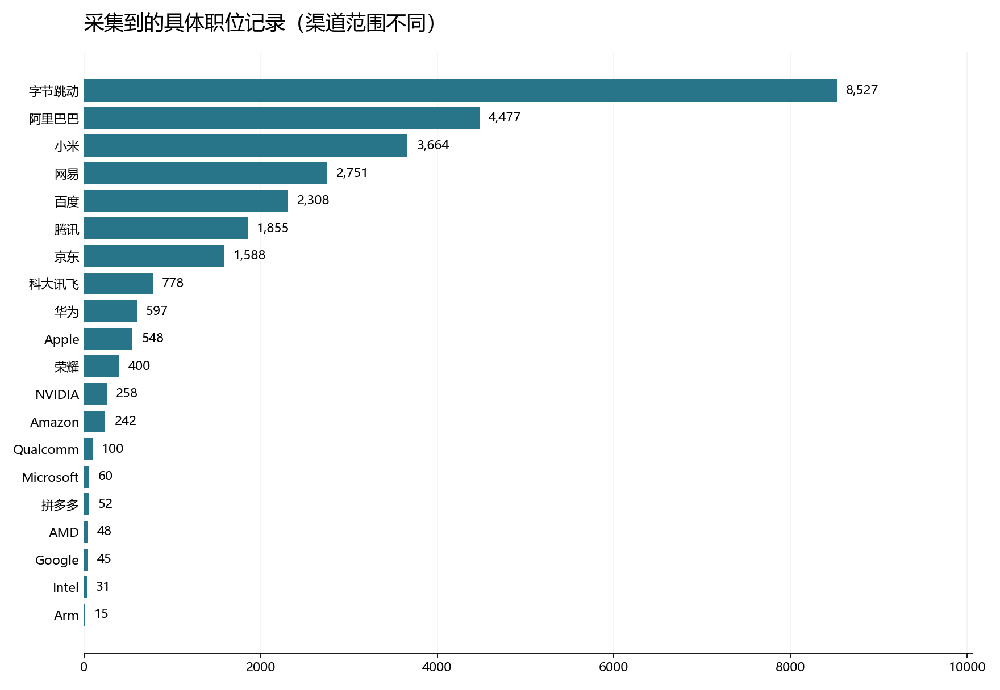
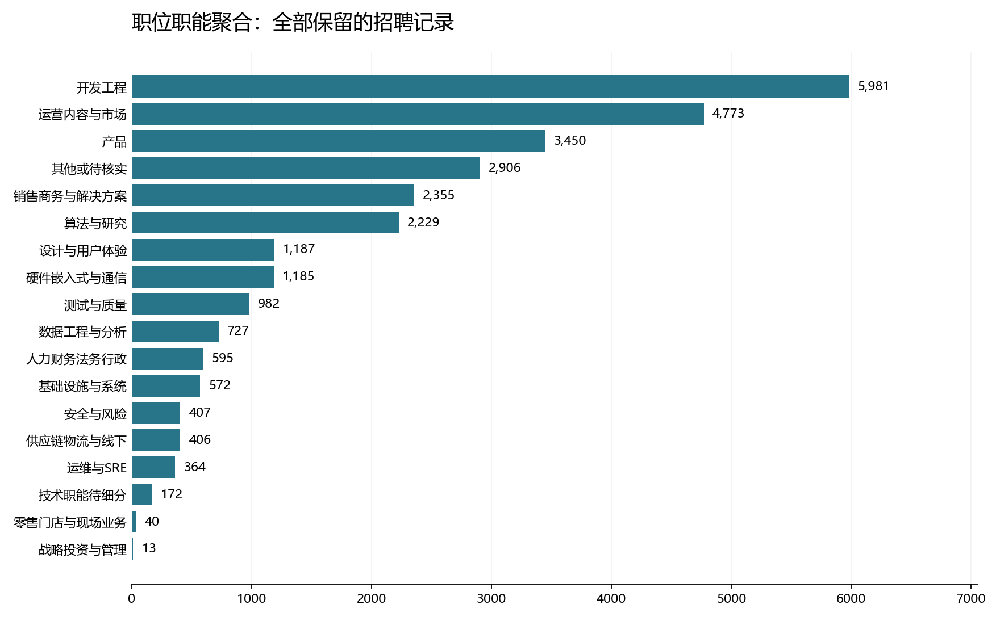
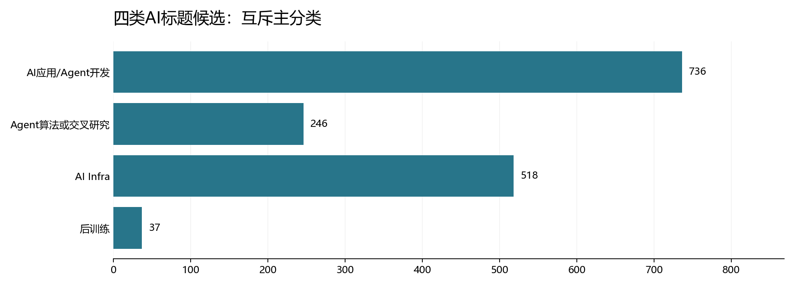

# 互联网、AI与科技公司就业调研报告（扩展版）

调研截面：2026年11月17日，Asia/Shanghai。该版本把公司内职位ID作为分析单元；在历史腾讯、阿里、京东数据上，补充字节、其他中国科技公司及外企的官方公开JD。所有返回职能均保留，再做分类。

## 一 主要发现与使用方式

本轮合并后有 **28,344 条公开职位记录、20 家有数据的雇主**（其中2条为已识别的分领域招聘池，另行标记）；**28,268 条已保存本地正文**，其中 **28,144 条具备可用于技能统计的独立任职要求**。正文合计约 **19.56 百万字符**。另有 76 条仅保留元数据，清楚标记为正文未归档。相同职位ID的不同采集版本不重复计数。

需求表达清晰的规则候选为 **15,988 条**，另有 **37 条逐条审读精选**。[打开全部岗位看板](../index.html#view=explore)、[打开详细JD筛选](../index.html?clearOnly=1#view=explore)。可按公司、职能、AI方向、资格技能、地域、存档状态、清晰度及审读状态组合过滤。

**当前招聘的核心变化是工作对象与交付标准。** Agent应用工程主要交付可运行的业务系统；Agent算法交付规划、检索、工具决策与任务效果改进；Infra交付性能、资源效率、可靠性和平台能力；后训练交付经实验验证的模型行为改进。名字相似的岗位可能分属这些层次，应读职责与验收目标。

| 方向 | 主要交付 | 可迁移基础 | 应补充的能力 |
| --- | --- | --- | --- |
| AI应用/Agent开发 | 可上线、可监控、能完成业务任务的服务 | 后端、全栈、业务系统 | 检索、工具调用、上下文、权限、评测、成本与故障处理 |
| Agent算法或交叉研究 | 检索、规划、记忆、决策或任务成功率的改进 | 搜索推荐、NLP、多模态、机器学习 | 数据与基线、实验消融、任务评测；部分涉及RL及后训练 |
| AI Infra | 推理训练效率、资源利用率、稳定性、开发运行平台 | 系统、分布式、C++、云平台、性能工程 | 按具体层次补集群、引擎、并行通信、算子、编译器或Agent运行时 |
| 后训练 | 模型行为、能力、对齐和训练流程的可验证改进 | 深度学习、NLP、训练实验 | SFT、偏好优化、RL、奖励、合成数据、训练稳定性与回归评测 |

对已有开发经验者，应用工程与AI平台后端通常更能复用基础；算法背景者可比较Agent算法与后训练；系统背景者可按平台、引擎、算子等层次选择Infra。这是技能重叠的职业研判，不是录用概率或未来数量预测。

## 二 雇主覆盖、边界与全景结构

| 雇主 | 去重记录 | 正文存档 | 独立要求可统计 | 采集范围 |
| --- | --- | --- | --- | --- |
| 字节跳动 | 8527 | 8527 | 8527 | 官网公开搜索按职类分页，并补充大模型搜索；逐条件覆盖见字节审计，不是全球全站普查 |
| 阿里巴巴 | 4477 | 4477 | 4474 | 集团官网off-campus公开列表，空关键词分页 |
| 小米 | 3664 | 3664 | 3645 | 官网公开职位空关键词列表；列表总数与唯一ID数存在差异 |
| 网易 | 2751 | 2751 | 2746 | 官网社招与当前导航校招项目102/103/75；未覆盖所有独立业务招聘站 |
| 百度 | 2308 | 2308 | 2307 | 官网公开社会招聘、校招和实习；分渠道分页 |
| 腾讯 | 1855 | 1855 | 1793 | 官网空关键词列表中中国地区详情；保留上一轮历史ID并集 |
| 京东 | 1588 | 1588 | 1588 | 官网公开职位列表，空关键词分页；动态列表存在重复行 |
| 科大讯飞 | 778 | 778 | 777 | 官网社招、校招、实习渠道；实习返回0且页面称项目结束 |
| 华为 | 597 | 597 | 593 | 官网社会招聘，jobType=SR，空关键词、未筛城市与职类 |
| Apple | 548 | 488 | 485 | 官网中国地点搜索分页及逐岗详情，含零售/硬件等全部返回职能 |
| 荣耀 | 400 | 400 | 398 | 官网社会招聘公开列表及逐岗详情 |
| NVIDIA | 258 | 258 | 257 | 官网Workday搜索词China；会返回海外岗位，不能视为精确中国过滤 |
| Amazon | 242 | 242 | 242 | 官网API国家代码CHN；不是全球招聘总量 |
| Qualcomm | 100 | 100 | 81 | 官网location=China搜索；公开返回count为100，未证明不存在搜索上限 |
| Microsoft | 60 | 60 | 60 | 官网location=China公开响应；初期访问失败后恢复，最终按当次返回总数分页 |
| 拼多多 | 52 | 36 | 36 | 官网校招与可公开取得的详情；社招列表/详情受限，不能认为社招无岗位 |
| AMD | 48 | 48 | 45 | 官网国家China过滤公开列表及完整正文 |
| Google | 45 | 45 | 45 | 官网中国地点搜索分页；含多地点岗位 |
| Intel | 31 | 31 | 31 | 官网Workday搜索词China |
| Arm | 15 | 15 | 14 | 官网China搜索页声明16条，实际解析到15个非推荐职位链接；含海外中国市场岗位 |

**字节批量补齐的可核查范围：**

| 字节查询条件 | 返回行数 | 唯一ID | 归档页/预计页 | 触及显示上限 |
| --- | --- | --- | --- | --- |
| 研发 / 空词 | 4366 | 4366 | 437/437 | 否 |
| 产品 / 空词 | 1778 | 1768 | 178/178 | 否 |
| 运营 / 空词 | 2403 | 2393 | 241/241 | 否 |
| 研发 / 大模型 | 1554 | 1429 | 156/156 | 否 |

字节并集8,527个ID、1,012份使用中的正常分页响应，全部有职责和要求；验证器核对10,101行及原文/原始记录哈希，错误0。研发大模型结果是研发子集，不能再相加。产品、运营和大模型分页各有10、10、125次重复行，故取完显示页码不等于所有唯一岗位零遗漏；官网全站显示上限10,000也不能当准确总体。本批四个条件均未触顶，中国大陆8,523条，另有西班牙3条、英国1条。

**其他需要保留的数量差异：** 网易社招总数从2,654变为2,652、最后复核2,648，采集跨时段按ID得到2,636条社招正文，加当前导航校招115条为2,751条；不声称动态列表零遗漏。Apple的33页返回650行、548个唯一ID，成功取得488份正文，另60条仅保留官方列表元数据与失败ID，未把简介当全文。完整原始行、计数历史和失败信息见对应审计。

以上是不同公开渠道在当日的可见记录与历史ID并集；不是这些公司全部有效空缺。社招、校招、实习、全球站、特定国家搜索的覆盖不能直接比较。字节及外企可能包含海外/多地点记录，必须结合地域筛选。

地域归纳：含中国大陆地点 27,492条；地域待核或其他地区 801条；含大陆及港澳台多地点 6条；港澳台地点 45条。城市和国家原字段同时保留；中文或英文城市识别属于本地推断。多地点职位只计一条；城市覆盖统计允许一条覆盖多个城市。

**访问限制单独记录：** 拼多多社招详情受访问校验限制，未重建校验字段；校招可见数据单独采集。SAP页面触发安全校验，未绕过。Adobe的China搜索返回0，只代表该次搜索结果。微软初期请求出现限流或无成功响应，随后正常页面恢复，最终按该次返回的60条分页并取得60份正文；这不代表微软全球或全部中国岗位。Arm页面宣称16条而实际取得15个职位链接，保留这一差额。各雇主原始审计保留分页数、返回总数、重复与错误，不能把失败记成市场需求为零。

| 职能主分类 | 记录数 |
| --- | --- |
| 开发工程 | 5981 |
| 运营内容与市场 | 4773 |
| 产品 | 3450 |
| 其他或待核实 | 2906 |
| 销售商务与解决方案 | 2355 |
| 算法与研究 | 2229 |
| 设计与用户体验 | 1187 |
| 硬件嵌入式与通信 | 1185 |
| 测试与质量 | 982 |
| 数据工程与分析 | 727 |
| 人力财务法务行政 | 595 |
| 基础设施与系统 | 572 |
| 安全与风险 | 407 |
| 供应链物流与线下 | 406 |
| 运维与SRE | 364 |
| 技术职能待细分 | 172 |
| 零售门店与现场业务 | 40 |
| 战略投资与管理 | 13 |

分类使用标题与雇主原大类，英文职位另设同义规则；它是批量归纳，未声称所有职位均经人工语义标注。招聘原分类与本地推断字段都保留。硬件、终端、制造、供应链和零售来自科技公司招聘站，分别列出，不能统称软件研发。

## 三 四类AI岗位的量化技术需求

| 标题候选主方向 | 职位记录 | 可统计要求分母 |
| --- | --- | --- |
| AI应用/Agent开发 | 736 | 733 |
| Agent算法或交叉研究 | 246 | 246 |
| AI Infra | 518 | 516 |
| 后训练 | 37 | 37 |

| 公司 | AI应用/Agent开发 | Agent算法或交叉研究 | AI Infra | 后训练 |
| --- | --- | --- | --- | --- |
| 字节跳动 | 368 | 112 | 156 | 5 |
| 阿里巴巴 | 175 | 50 | 124 | 12 |
| 小米 | 25 | 22 | 52 | 3 |
| 网易 | 27 | 4 | 5 | 0 |
| 百度 | 35 | 31 | 35 | 1 |
| 腾讯 | 71 | 15 | 67 | 14 |
| 京东 | 6 | 4 | 9 | 0 |
| 科大讯飞 | 5 | 5 | 9 | 2 |
| 华为 | 2 | 2 | 6 | 0 |
| Apple | 2 | 0 | 0 | 0 |
| 荣耀 | 5 | 1 | 4 | 0 |
| NVIDIA | 8 | 0 | 23 | 0 |
| Amazon | 0 | 0 | 0 | 0 |
| Qualcomm | 1 | 0 | 9 | 0 |
| Microsoft | 4 | 0 | 4 | 0 |
| 拼多多 | 0 | 0 | 1 | 0 |
| AMD | 2 | 0 | 12 | 0 |
| Google | 0 | 0 | 0 | 0 |
| Intel | 0 | 0 | 1 | 0 |
| Arm | 0 | 0 | 1 | 0 |

方向主分类互斥，但实际职责可以交叉。主分类以明确标题为主，少量已审读的运行时等边界按正文修正，记录在`analysis/正文分类复核_v2.json`及旧版边界审核中。AI安全、评测、数据工程、AI硬件等另列；普通游戏强化学习不会自动归为大模型后训练。宽泛“大模型算法”标题可能实际做后训练，普通后端也可能开发Agent，所以这四组不能当全部相关岗位总量。完整方向分布与公司交叉表见分析目录。

| 任职要求提及 | 应用开发 | Agent算法 | AI Infra | 后训练 |
| --- | --- | --- | --- | --- |
| Python | 414/733（56.5%） | 116/246（47.1%） | 345/516（66.9%） | 24/37（64.9%） |
| Java | 334/733（45.6%） | 15/246（6.1%） | 82/516（15.9%） | 1/37（2.7%） |
| C++ | 163/733（22.2%） | 53/246（21.5%） | 297/516（57.6%） | 3/37（8.1%） |
| Go | 311/733（42.4%） | 20/246（8.1%） | 142/516（27.5%） | 1/37（2.7%） |
| PyTorch | 41/733（5.6%） | 90/246（36.6%） | 177/516（34.3%） | 21/37（56.8%） |
| RAG | 286/733（39.0%） | 60/246（24.4%） | 33/516（6.4%） | 4/37（10.8%） |
| 工具调用 | 190/733（25.9%） | 61/246（24.8%） | 25/516（4.8%） | 5/37（13.5%） |
| LangChain/LangGraph | 152/733（20.7%） | 42/246（17.1%） | 17/516（3.3%） | 0/37（0.0%） |
| MCP | 126/733（17.2%） | 17/246（6.9%） | 24/516（4.7%） | 0/37（0.0%） |
| 评测 | 192/733（26.2%） | 83/246（33.7%） | 54/516（10.5%） | 14/37（37.8%） |
| SFT/微调 | 87/733（11.9%） | 113/246（45.9%） | 20/516（3.9%） | 17/37（46.0%） |
| RL/对齐 | 90/733（12.3%） | 157/246（63.8%） | 58/516（11.2%） | 34/37（91.9%） |
| DeepSpeed/Megatron/FSDP | 9/733（1.2%） | 15/246（6.1%） | 81/516（15.7%） | 17/37（46.0%） |
| CUDA/Triton | 10/733（1.4%） | 1/246（0.4%） | 180/516（34.9%） | 3/37（8.1%） |
| NCCL/RDMA | 4/733（0.6%） | 0/246（0.0%） | 72/516（13.9%） | 4/37（10.8%） |
| vLLM/SGLang/TensorRT | 23/733（3.1%） | 18/246（7.3%） | 163/516（31.6%） | 10/37（27.0%） |
| Kubernetes/Docker | 83/733（11.3%） | 2/246（0.8%） | 109/516（21.1%） | 1/37（2.7%） |
| 性能优化 | 160/733（21.8%） | 20/246（8.1%） | 307/516（59.5%） | 7/37（18.9%） |
| verl/OpenRLHF/Slime | 1/733（0.1%） | 7/246（2.9%） | 18/516（3.5%） | 7/37（18.9%） |

**为什么不能只靠标题判断后训练需求：**

| 口径 | 记录数 |
| --- | --- |
| 明确标题与已审读主分类为后训练 | 37 |
| 生成式模型语境下，职责含后训练/SFT/RLHF等词 | 836 |
| 同语境下，独立资格分析字段提及这些词 | 923 |
| 职责有线索但主分类不是后训练 | 803 |

后面三行只是正文线索，可以相互重叠，也可能是Infra平台支持训练、Agent算法交叉或仅需理解方法，不能直接改称全部后训练岗位，更不能相加为HC。它们说明标题统计会漏掉宽泛算法/工程标题中的训练工作。全部逐岗线索及原文入口在`analysis/后训练正文线索_v2.csv`，可继续语义审读；普通无生成式模型语境的游戏RL不纳入该检查。

每格为“提及职位数 / 该组独立要求可用职位数（比例）”，覆盖本报告保留的全部地域。另导出`analysis/技能_含大陆地点_v2.csv`，只取含中国大陆地点的同口径分层，避免把China搜索带回的海外职位混成大陆需求。正文未可靠拆分资格条件的职位不进入分母；未提及不等于不需要；必备与优先项都可能命中，提及率不是精通率。一个职位可以命中多个词，比例不相加为100%。统一词典覆盖语言、应用、训练、系统、数据、终端与硬件；词典与全部计算明细已导出，新增词典可离线重算，不需依赖原站。

**应如何解读：** 应用组需要同时观察Java/Go/Python与RAG、工具、评测，而不能把应用开发等同统一Python栈；Agent算法应比较训练与任务评测的交叉；Infra应区分平台工程与CUDA/通信/编译器深度；后训练应同时看数据、算法和分布式训练。各组的总体比例受雇主构成影响，应再查公司分层表，不宜把整体排序直接当行业标准。另导出`analysis/技能_去重正文敏感性_v2.csv`，比较按职位ID与公司内相同正文只算一次的结果，观察模板复用的影响；两者都不是全国份额。

除AI外，普通开发的前后端、数据库、微服务；数据岗位的SQL、Spark/Flink、消息队列；终端硬件的嵌入式、RTL/FPGA、SoC；以及产品、销售、运营等职能均保留。`analysis/技能_职能_v2.csv`提供全部职能的同词典提及率，非技术岗位没有命中词典时不推断为无专业门槛。

学历统计只统计本科/硕士/博士等中英文词出现，不推导最低学历或录用率；“本科及以上、硕士优先”可同时出现。经验原字段与正文表达不同，没有结构化年限不能解释成经验不限。薪资大多未披露且单位不统一，本报告不计算缺乏可比口径的跨厂均薪。

## 四 单独筛选写得清楚的详细JD

“优秀详细”在此只指需求表达清楚。初筛总分10：行动职责0–2、独立资格条件0–2、具体可核对技术/业务能力0–2、准入条件1、必备/优先分层1、业务或系统场景1、交付与质量约束1。候选须≥8分、至少3项行动职责、独立要求≥100字符。篇幅只是字段完整性条件之一，公司名气、薪资、学历高低不加分。

规则会偏爱结构清晰且落在词典覆盖内的文本，短而精准的JD可能漏选，空泛长文也可能混入。因此另设“已审读精选”，逐条解释为何写清楚；两者在看板中可分别筛选。评分不衡量岗位价值、团队质量、未来发展或个人录用概率。

| 已审读岗位 | 清楚在哪里 | 完整正文 |
| --- | --- | --- |
| Arm · Robotics AI Solutions Engineer (Robotics AI Solutions) | 机器人演示、跨平台SDK集成、任务成功与性能验证、样例和部署文档均明确；基础ROS2/Python/C++与机器人学习优先经验分开。 | [本地JD](../index.html?q=2026-17484&companies=Arm#view=explore) |
| Intel · AI GPU Arch Perf Analysis Intern | 把GEMM、Attention、算子融合、真实负载与架构协同列出，并区分在读与Python基础和GPU编程优先经验。 | [本地JD](../index.html?q=JR0288972&companies=Intel#view=explore) |
| Microsoft · SOFTWARE ENGINEER II - Core AI | 明确Foundry Agent Service运行时、隔离、会话、调度伸缩、身份网络与可观测任务；5年软件交付和学历/等效经历为基础，AI应用与云平台等经验列在优先项。 | [本地JD](../index.html?q=1970393556986960&companies=Microsoft#view=explore) |
| NVIDIA · AI Infrastructure and Frameworks Intern, Cosmos Lab - 2027 | 训练、rollout、仿真、奖励与评测的数据流及性能指标写清楚；明确至少一类实践即可，并说明不要求全部领域或已有大集群经历。 | [本地JD](../index.html?q=JR2025559&companies=NVIDIA#view=explore) |
| Qualcomm · AI Infrastructure Software Engineer | NPU驱动、RPC性能、客户算法集成与阻塞闭环均具体；基础C/C++/Linux能力与QNN、Hexagon、PCIe优先经验分开。 | [本地JD](../index.html?q=446718840435&companies=Qualcomm#view=explore) |
| 京东 · AI Infra优化工程师 | 核心算子、编译器中间表示、融合与调度、W4A8及计算通信重叠写得具体，职责与能力要求一一对应；未明示年限和学历，保留这一缺口。 | [本地JD](../index.html?q=223291&companies=%E4%BA%AC%E4%B8%9C#view=explore) |
| 京东 · 测试开发工程师（infra推理业务） | 按请求调度到结果返回的链路说明测试对象，列出异常场景、自动化回归、灰度和性能指标；基础要求与AI平台优先项分开。 | [本地JD](../index.html?q=227402&companies=%E4%BA%AC%E4%B8%9C#view=explore) |
| 京东 · 运维工程师（infra推理业务） | 发布、灰度、回滚、扩缩容、故障响应均具体，且列出可用性、成功率、延迟、吞吐、GPU利用率和资源成本。 | [本地JD](../index.html?q=227193&companies=%E4%BA%AC%E4%B8%9C#view=explore) |
| 华为 · Agent OS软件开发工程师 | 列出端侧记忆、上下文、多设备协同、插件和路由模块，以及运行引擎低开销、高性能与高可用目标；实际偏Agent运行基础设施。 | [本地JD](../index.html?q=127603&companies=%E5%8D%8E%E4%B8%BA#view=explore) |
| 华为 · 鲲鹏AI Infra高级工程师 | 明确鲲鹏CPU、DPU及互联网workload，列出性能分析工具和商用交付，能区分软硬结合的工作深度。 | [本地JD](../index.html?q=98358&companies=%E5%8D%8E%E4%B8%BA#view=explore) |
| 华为 · AI安全技术研究专家 | 职责按模型训练、Agent安全测试落地、平台/数据闭环和持续改进分项，标明任务对象、工程化结果与团队职责；资格正文区分核心能力和“优先”经验，便于核对研究与落地经历。 | [本地JD](../index.html?q=113857&companies=%E5%8D%8E%E4%B8%BA#view=explore) |
| 字节跳动 · AI领航官（移动端广告） - 国际化广告业务 | AI转型路线图、原型、权限/评估/人工复核、工作流和组织采用有清楚交付及指标；真实搭建经验是要求，技术工具和规模化采用经验分列加分。 | [本地JD](../index.html?q=7682988171850582277&companies=%E5%AD%97%E8%8A%82%E8%B7%B3%E5%8A%A8#view=explore) |
| 字节跳动 · AI Agent应用架构师 - TikTok研发 | 框架、记忆/RAG、可插拔工具、错误恢复、多Agent冲突与评测各自展开；完成度、步骤效率、工具成功率、延迟和Token成本都是可对照交付。 | [本地JD](../index.html?q=7685978642254268725&companies=%E5%AD%97%E8%8A%82%E8%B7%B3%E5%8A%A8#view=explore) |
| 字节跳动 · Agentic AI平台负责人 - TikTok研发 | 企业级Agent架构、ReAct/Plan-and-Execute/Reflexion、多Agent与插件/Workflow、评测和数据飞轮均明确；同时说明产品规划、协作及混合团队管理，基础条件与高级RAG/开源等加分分层。 | [本地JD](../index.html?q=7698581598722066693&companies=%E5%AD%97%E8%8A%82%E8%B7%B3%E5%8A%A8#view=explore) |
| 字节跳动 · 后端研发工程师-抖音生态与运营 （北京/上海/杭州/厦门） | 创作者中心、运营、版权和治理系统对应明确技术任务，列出分布式架构、Go运行时、存储/消息、容灾和数据一致性；要求分硬性、高阶、软性与加分四层。 | [本地JD](../index.html?q=7068209941492025636&companies=%E5%AD%97%E8%8A%82%E8%B7%B3%E5%8A%A8#view=explore) |
| 小米 · 新业务部-AI编译器开发工程师/专家 | 编译器前中后端、任务排序、性能和功耗目标具体；TVM/MLIR、C++和IP落地优先项与交付对象对应。 | [本地JD](../index.html?q=7681572156865694006&companies=%E5%B0%8F%E7%B1%B3#view=explore) |
| 小米 · 新业务部-AI高性能算子开发工程师/专家 | 说明基于NPU建设计算库、算子需求拆解及瓶颈优化，并具体到框架、异构平台经历和体系结构。 | [本地JD](../index.html?q=7194832458432331884&companies=%E5%B0%8F%E7%B1%B3#view=explore) |
| 小米 · AI红队安全专家 | 职责直接给出工具链范围、评测指标、平台形态和“评测—反馈—训练”协作闭环；资格条件按方向、工程能力和加分项分别列出，实践证据可验证。 | [本地JD](../index.html?q=7703840514843347236&companies=%E5%B0%8F%E7%B1%B3#view=explore) |
| 拼多多 · AI Infra研发工程师 | 训练/推理平台、资源调度、通信、并行、弹性和故障自愈范围清楚；吞吐、成本和利用率对应验收方向；毕业时段、基础技能与论文/项目优先项明确。 | [本地JD](../index.html?q=XZ0000619&companies=%E6%8B%BC%E5%A4%9A%E5%A4%9A#view=explore) |
| 拼多多 · 设计管培生（上海） | 交互、UI和创意视觉分轨，分别写出交互文档/视觉动效/转化效果等交付与迭代；资格按轨对应能力，并明确2027届、本科及视频作品上传要求。 | [本地JD](../index.html?q=XZ0000636&companies=%E6%8B%BC%E5%A4%9A%E5%A4%9A#view=explore) |
| 百度 · 2027AIDU-AI异构计算研发工程师(J99964) | 区分前向引擎算子、通信库、异构编译与平台四项工作，并明确是精通所列一项或多项；源码优化、底层汇编与性能工具列为优先条件，避免误读成全都必须。 | [本地JD](../index.html?q=fe876a65-1a6c-499a-9506-2169009a02a1&companies=%E7%99%BE%E5%BA%A6#view=explore) |
| 百度 · AI产品经理（J106764） | Agent能力范围、建设优先级、跨团队交付和真实任务评估对应明确；在读届别、每周天数、实习时长及PRD/原型能力写清楚。 | [本地JD](../index.html?q=88eaf53d-b89d-4b9a-96c6-6b22791474ac&companies=%E7%99%BE%E5%BA%A6#view=explore) |
| 科大讯飞 · AI Agent 应用研发工程师 | 把用户场景、规划/记忆/工具/检索能力、失败恢复、端云资源约束和研发协作展开；任务完成率、工具成功率、延迟和成本清楚；允许个人/课程/比赛项目且不要求所有框架。 | [本地JD](../index.html?q=2ca30bc1-4bec-46f5-9dee-6b7c050fac3a&companies=%E7%A7%91%E5%A4%A7%E8%AE%AF%E9%A3%9E#view=explore) |
| 科大讯飞 · JAVA后端开发工程师 | 普通Java标题内明确了座舱云服务与大模型应用工作，架构输出具体到接口契约、数据模型和关键时序；基础要求与车云/平台等优先经历分开。 | [本地JD](../index.html?q=b8d68ef4-c577-41d8-8918-19c32e98e9a7&companies=%E7%A7%91%E5%A4%A7%E8%AE%AF%E9%A3%9E#view=explore) |
| 网易 · Java 开发工程师（AI Agent 方向） | 交代EHR系统覆盖的业务、完整产研协作、核心系统/Agent/架构演进三项任务；2027届和Java后端基础清楚，AI只要求基础认知，项目/实习/框架实践列为加分。福利与团队稳定性陈述属于雇主自述，不当作独立事实。 | [本地JD](../index.html?q=4917&companies=%E7%BD%91%E6%98%93#view=explore) |
| 网易 · 高级用户运营（LOFTER视频创作者运营） | 把创作者分层成长、内容质量、圈层活跃、活动和产品反馈连成工作链，并给出投稿、观看、互动/回访和ARPU等目标；学历年限、运营能力与补充经验可逐项核对。 | [本地JD](../index.html?q=78703&companies=%E7%BD%91%E6%98%93#view=explore) |
| 腾讯 · 腾讯游戏-大模型训练框架研发工程师/专家 | 把多模态预训练、长上下文、吞吐与算力利用率写成任务；主流框架、训练经验和并行/CUDA能力均有明确对应。 | [本地JD](../index.html?q=2072330920538583040&companies=%E8%85%BE%E8%AE%AF#view=explore) |
| 腾讯 · 企业微信-AI应用后台开发工程师 | 明确文档AI与CLI开放场景、跨算法团队协作、高并发低延迟和稳定性；语言、系统基础及AI经验优先项分开写。 | [本地JD](../index.html?q=2089728223888977920&companies=%E8%85%BE%E8%AE%AF#view=explore) |
| 腾讯 · 微信小程序-AI Agent 算法工程师-Coding方向 | 把Coding Agent策略、评估和RL三项工作展开，列出任务完成率、修改成功率和工具调用准确率，能力与指标对应。 | [本地JD](../index.html?q=2082710396749393920&companies=%E8%85%BE%E8%AE%AF#view=explore) |
| 腾讯 · 高级广告审核Agent算法工程师-深圳/北京 | 审核、拒审修复和badcase迭代链条明确，关联人审成本、风险响应周期、训练方法与业务优先经验。 | [本地JD](../index.html?q=2108144612332974080&companies=%E8%85%BE%E8%AE%AF#view=explore) |
| 腾讯 · 企业微信-大模型算法工程师-Agent后训练（北京/广州） | 写清Agent后训练的规划、推理、工具调用目标及数据合成管线；独立解决效果问题、分布式训练和奖励经验层次明确。 | [本地JD](../index.html?q=2094682199537401856&companies=%E8%85%BE%E8%AE%AF#view=explore) |
| 腾讯 · 混元大语言模型后训练算法工程师-Memory方向（北京/深圳/上海） | 记忆抽取到遗忘、用户建模、训练信号和评测闭环均明确，兼顾幻觉与隐私风险，可区分核心能力和优先经历。 | [本地JD](../index.html?q=2046923451989651456&companies=%E8%85%BE%E8%AE%AF#view=explore) |
| 荣耀 · 端侧AI推理优化工程师 | 明确PC端、Intel/AMD/NVIDIA跨平台适配及CPU/GPU/NPU算子性能目标，基本条件与四类优先经验层次清楚。 | [本地JD](../index.html?q=6ae7ee3cd280e980fa952388&companies=%E8%8D%A3%E8%80%80#view=explore) |
| 荣耀 · 端侧大模型推理优化工程师 | 模型部署、量化、版本管理、Benchmark和Profiling任务完整，明确时延、吞吐、功耗和内存约束，并列出终端推理工具链。 | [本地JD](../index.html?q=69eb13f92a1bc548b5a871c2&companies=%E8%8D%A3%E8%80%80#view=explore) |
| 荣耀 · 端侧AI架构师 | 职责交代输入（算法需求）、设计范围（计算/指令/数据流/调度/存储）、输出（架构方案与SPEC）及从定义到量产的协作阶段；要求覆盖具体技术域和工作年限，并把优先经历独立列出。 | [本地JD](../index.html?q=6a277dbb3d5b657f38be2756&companies=%E8%8D%A3%E8%80%80#view=explore) |
| 阿里巴巴 · 千问事业部-智能体平台高级研发工程师/专家-北京/杭州/广州 | 交代千问App落地、架构稳定性和增长目标；基本语言与经验要求、智能体实践、千万级架构优先条件可区分。 | [本地JD](../index.html?q=100018240006&companies=%E9%98%BF%E9%87%8C%E5%B7%B4%E5%B7%B4#view=explore) |
| 阿里巴巴 · 阿里云智能-AI Agent开发工程师/专家-杭州 | 说明供应链与IDC具体系统，明确必须有AI落地及业务/技术结果；信息化经验、本体论和英语优先项可识别。 | [本地JD](../index.html?q=100037740001&companies=%E9%98%BF%E9%87%8C%E5%B7%B4%E5%B7%B4#view=explore) |

所有岗位均提供完整句子的结构化摘要，不再使用截断半句话的短摘录。多数摘要由公开规则归纳职责主题与资格技能，精选条目另经审读重写；摘要不是原文。具体程度、必须/优先关系和雇主原话，以本地完整JD及原始字段JSON为准。

## 五 市场规模：公开职位与平台趋势

**能回答的是公开职位记录与平台趋势；全国有效HC的绝对量仍然未知。** 单次公司采集没有投递人数、名额、预算、录用和职位关闭事件，因此不能测全国人才缺口或真实招聘转化率。

| 证据 | 时间和范围 | 可以得出的结论 | 不能推出什么 |
|---|---|---|---|
| 智联报告，经经济网报道 | 2026上半年，智联AI行业；职位数同比+10.6%，求职人数+10.5% | 行业招聘和求职同步扩张 | 所有大厂AI岗位都增长10.6% |
| 央视转述智能体需求 | 2026上半年，相关开发人才需求同比+244% | Agent是增长较快的细分方向 | 当前岗位绝对数、人人容易转岗 |
| 脉脉报告，经经济日报报道 | 2026年1—7月，新经济行业新发AI岗位同比+789.47%；应用开发占60.97% | 该平台新发AI职位偏向应用落地 | 本报告各方向的全国占比，或与智联增速取平均 |
| 猎聘报告，经智东西报道 | 2026上半年，AI行业新发职位同比+21.08% | 另一平台也观察到扩张，岗位间分化 | 将其与另外两平台合并成无重叠职位总量 |

来源：[智联报告报道](https://www.ceweekly.cn/economic/industry/2026/0717/497479.html)、[央视智能体招聘报道](https://finance.cctv.cn/2026/08/28/ARTIxnofbL409vkM6skY5WRh260828.shtml)、[经济日报脉脉报告报道](https://www.jingjiribao.cn/static/detail.jsp?id=683574)、[猎聘报告报道](https://zhidx.com/p/576798.html)。

央视的智能体增速句称“某招聘软件”，总量指标与智联报道一致，可能同源，不视作独立普查。三项关键来源本轮再次访问，事实与限制保存在`evidence/market_recheck_v2.json`。

智联给出的AI工程师“需供比2.62”和脉脉春招的AI“供需比1.23”方向相反，样本人群、单位与统计期也不同，不能直接比较高低，更不是个人可拿offer数。脉脉春招报道还显示AI求职投递竞争随招聘增长而上升，这与“市场有需求、普通转岗仍然困难”并不矛盾。[智联报告报道](https://www.ceweekly.cn/economic/industry/2026/0717/497479.html)、[每经春招报道](https://www.nbd.com.cn/articles/2026-05-18/4397761.html)

业务层面有两个支持需求延续的信号：阿里披露截至2026年6月季度的AI云及计算业务收入增长，并展示企业工作和购物Agent；京东11月12日介绍购物、商家工具与物流中的AI部署。这说明模型应用确实进入了多种业务流程。但收入和资本开支都不能按固定比例换算招聘人数，也不能证明每个项目已实现正收益。[阿里官方披露](https://www.alibabagroup.com/en-US/document-2027233133950140416)、[京东官方业务介绍](https://jdcorporateblog.com/from-tokens-to-ai-powered-shopping-how-jd-com-brings-ai-into-singles-day-2026/)

## 六 网上对前景的看法及其可信范围

| 观点 | 公开讨论中的表现 | 与JD对照后的判断 |
|---|---|---|
| Agent是后端的迁移机会 | V2EX有人把它看作下一阶段日常业务开发 | 部分职责确实可复用后端基础；通用开发岗位也可能内生增加AI职责 |
| Demo难换到offer | 十多年后端开发者反映被追问生产经验，前端转岗者也有类似困惑 | 与JD中的稳定性、系统集成、业务经验相符；不能据此算转岗失败率 |
| Infra壁垒高、竞争强 | 牛客匿名面试反馈强调强学历、社区实践和底层经验 | 能说明部分高端团队筛选严格；不能推出所有Infra只招博士 |
| 学到一半框架就过时 | LINUX DO学习者担心模型和新框架吸收已有技巧 | 工具名称寿命可能短，系统能力与效果验证更可迁移；这是职业研判 |
| AI有效但投资可能过热 | 同一讨论区区分生产力与融资/价格周期 | 技术继续发展与个别企业缩编可以同时发生 |

对应原帖：[后端转Agent的困惑](https://v2ex.com/t/1256422)、[前端转Agent求职讨论](https://www.v2ex.com/t/1255984)、[Agent与日常业务开发](https://v2ex.com/t/1196222)、[Infra劝退贴](https://www.nowcoder.com/discuss/931290694155587584)、[学习与技术迭代焦虑](https://linux.do/t/topic/2820718)。

这里是主题对照，不是舆情抽样统计。帖子自选参与、身份未经独立验证，失败者与成功者都有发帖选择偏差；牛客两篇材料来自同一作者，且有付费专栏，不能当独立样本。仅有搜索索引的高薪故事没有用于薪资或成功率结论。详细访问状态见`evidence/discussion_sources.json`。

### 未来一至三年的情景研判

**较有依据的基准情景：岗位继续围绕业务闭环和效率指标细分。** 当应用进入更多真实流程，可靠工具调用、权限隔离、评测、数据反馈和推理成本会比“会拼几个节点”更重要。应用工程可能融入常规后端岗位；Agent算法、运行平台和后训练之间也会有更多交叉。依据是当前JD职责与公司部署活动，尚不是已验证的未来数量预测。

**扩张情景：** 如果企业AI使用量和付费持续增加，应用工程、推理服务和数据评测可能随之增加；熟悉行业流程的人更容易把技术变成可交付功能。观察指标应是新增具体职位、重复岗位是否真实补人、岗位预算与产品付费，而不是融资新闻标题。

**收缩情景：** 如果应用回报不足、模型服务被平台统一吸收，部分重复封装岗位与探索项目会减少；如果模型升级降低常规编排复杂度，单纯依赖某框架操作的价值也可能下降。Infra和后训练同样受预算、算力与组织集中度影响，不存在天然免疫的职业路线。

判断一条路线是否值得投入，可看它是否积累三个可迁移资产：完整系统能力、可复核的性能/效果证据、真实业务问题理解。它们比某次热点命名更能跨团队复用。

## 七 按基础选择路线和准备作品

| 当前基础 | 优先检索的职位 | 作品应证明什么 | 常见缺口 |
|---|---|---|---|
| Java/Go/Python后端 | AI应用后端、Agent开发、AI平台研发 | 从用户请求到工具执行、权限、状态、重试、监控和回归的完整链条 | 只展示模型调用，缺少失败处理与评测 |
| 前端或全栈 | Agent产品工程、全栈AI应用、交互/执行结合岗位 | 流式交互、任务状态与真实后端系统如何协作 | 只做UI或对话壳，服务端基础不足 |
| 搜索推荐/NLP/机器学习 | Agent算法、AI搜索、模型应用算法、垂类后训练 | 建立基线，验证检索/规划/数据/训练对任务成功的净贡献 | 缺消融、数据泄漏检查或任务评测 |
| C++/分布式/系统 | 推理平台、推理引擎、训练框架、AI Infra | 在明确硬件、并发、输入长度下定位瓶颈并证明提升 | 只报吞吐峰值，漏掉延迟、质量和成本条件 |
| 深度学习训练经验 | SFT/RL/对齐、奖励与数据、后训练工程 | 数据版本、训练配置、对照实验、失败分析与能力回归 | 只会跑脚本，解释不了数据和奖励的作用 |
| 业务、产品、运营 | AI产品、AI业务运营、交付与解决方案 | 定义流程、验收指标、使用约束和可衡量价值 | 把“会使用AI工具”当作能建设AI产品 |

应用作品可以选择一个能完成任务的小系统，加入离线评测、权限、超时重试、状态持久化、日志与费用记录；无需为了显得复杂强行多Agent。算法作品要比较朴素基线、检索/规划策略以及必要时的训练方法，说明何时不起作用。Infra作品要固定硬件和负载条件，报告首字延迟、后续生成延迟、吞吐、显存与资源成本之间的取舍。后训练作品应固定独立测试集，对照基座与训练后模型，检查回归和奖励投机。

上述是与JD匹配的作品建议，不是所有岗位的统一面试题。工程实践可从官方项目选择载体：[LangGraph](https://github.com/langchain-ai/langgraph)、[vLLM](https://github.com/vllm-project/vllm)、[SGLang](https://github.com/sgl-project/sglang)、[verl](https://github.com/verl-project/verl)。框架只是实现工具，不能取代问题定义和验证。

投递前建议逐岗确认：本组交付应用、算法、平台还是模型；实际负责的指标是什么；是否需要真实训练或多卡资源经验；学历和年限哪些是硬条件；团队当前是在验证方向还是已有线上用户；公开职位是否仍有预算和实际名额。用这些信息判断岗位，而不是仅靠职位名字和招聘宣传。

## 八 数据方法、存档与可复核性

以规范化公司名+原职位ID去重，保留带正文的新版本；原始响应、正文和采集审计独立保存。不同ID但相同文本仍保留，因为它们可能是不同团队/地区的广告；当前 28,268 条正文对应 25,571 个文本哈希，重复组见`analysis/文本重复组_v2.csv`。同文本不等于同一个实际名额，不同文本也不等于不同HC。

原始JSON保留官网响应中的职责、要求及其他公开职位字段；每条正文有SHA-256、来源链接、采集时间。另生成可离线阅读的逐岗HTML。网易等入口若未验证到稳定的独立详情路由，则保留官网列表URL、具体职位ID和官方响应定位，不猜造详情网址；具体原文可由本地档案复核。合并正文不能可靠拆分资格的记录仍完整保存，标记为合并正文；它们不进入独立要求技能分母。资格字段中的可识别通用雇主政策尾文在分析时排除，但原文完整保留于HTML及JSON。历史上仅保留元数据、后续未重新取得正文的记录不会伪造原文。

独立抽查覆盖11家硬件与外企共30条，属于目的抽样，不是准确率估计。根据发现补充Arm资格标题识别、排除分析字段里的政策尾文、标记NVIDIA两个毕业生方向招聘池，并保留结构地点与正文地点差异。Arm的官方requisition标识与URL路由ID不同，两者通过原始JSON-LD及链接对应，不把路由数字冒充招聘编号。完整发现及处理说明见`analysis/独立质量审阅_v2.json`和`analysis/独立问题处理_v2.json`。

**交付校验已执行：29项全部通过，浏览器脚本错误0。** 检查覆盖公司内ID去重、正文SHA-256、档案路径、全部逐岗HTML与标准化正文一致性（统一换行）、技能分子分母重算、CSV记录数与长ID保护、桌面/手机离线筛选和页面布局。保存了5份截图，记录见`analysis/qa_v2/verification.json`。该检查不证明全站零遗漏或全量语义分类准确。

正文转为可读文本时处理HTML标签与空白，不自动修正雇主措辞。优先使用源完整资格字段；独立补充字段合入时添加中性标识，不能仅因采集字段名bonus就认作可选加分（例如作品上传也可能是要求）。原字段另行保留。原始响应用于还原字段与核对；“资格未拆分”是本地处理限制，不等于官网没有资格要求。相同ID新旧正文可能因格式或动态内容不同产生不同哈希，不将这种差异直接解释成岗位需求变化。

这是一份多雇主、可逐岗追踪的批量语料研究，规模远大于几个示例，但不是全国随机样本。列表动态变化、排序漂移、重复发布、长期挂网、搜索上限和访问限制都可能影响覆盖。没有名额、预算、投递、关闭、offer与入职数据，不能计算真实人才缺口、就业成功率或AI工资溢价。

## 部署包导航

[岗位探索](../index.html#view=explore) · [研究结论](../index.html#view=research) · [高级分析](高级分析与结论.html) · [字段口径](../DATA_SCHEMA.md)

本报告保留总体口径（包含2条已标记招聘池）；高级职位层分析排除这2条。正文中的上游分析文件名属于研究溯源，部署包以data目录与高级分析JSON为独立分析输入。
